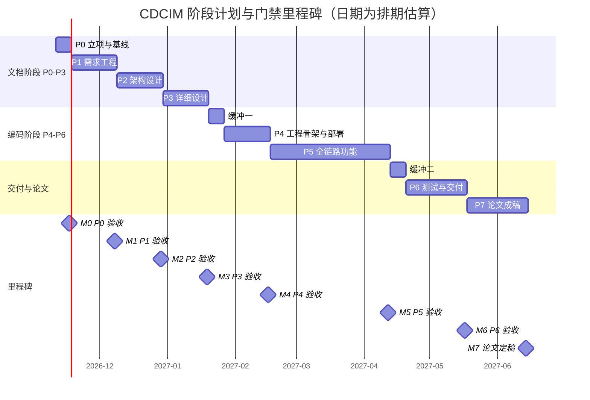

# 项目管理计划（Project Management Plan）

| 项 | 内容 |
|---|---|
| 文档编号 | CDCIM-P0-DOC-03 |
| 版本 / 状态 | v0.1 · 草案（含 5 处 `〔待确认〕`，1 处 `〔假设〕`） |
| 所属阶段 | P0 立项与基线 |
| 论文价值 | ★★★★★ 直接支撑「软件项目管理」类论文的 WBS、进度、质量、配置四段论述 |
| 上游依据 | [项目背景卡](01-项目背景卡.md)、[文档规范](../90-规范/01-文档规范.md) |

> **数值口径约定**：本文所有工作量、工期、缓冲系数均为**估算**，全部指标为**目标值**，没有任何实测值。凡标注 `〔待确认〕` 需用户校正；标注 `〔假设〕` 为推进工作的占位前提，P0 验收时确认。

---

## 1. 项目章程摘要

### 1.1 项目目标

| 维度 | 目标（草案） | 度量口径 |
|---|---|---|
| 业务目标 | 统一 3 个机房、约 2000 测点的动环数据采集与告警，告警平均响应时间由 8 min 降至 ≤ 1 min（目标值） | P95 时间差 |
| 交付目标 ① | 交付可在 WSL2 + Docker Compose 一键启动的完整可运行系统 | 单机 8 GB 配额内全链路跑通 |
| 交付目标 ② | 产出可支撑软考高级「系统架构设计师」论文的成套素材 | 覆盖 4 类高频命题，素材与实现数字一致 |
| 过程目标 | 8 个阶段全部通过门禁验收，每阶段留可追溯制品 | 门禁记录完整率 100% |

### 1.2 项目范围（摘要）

**范围内**：动环数据采集接入（Modbus TCP / SNMP / MQTT）、消息接入、流式计算与告警研判（分级 / 抑制 / 根因）、时序存储与查询、2D 总览与 3D 机房视图、报表与审计、大模型旁路增强（降噪聚类 / 根因建议 / 知识库问答）。

**范围外（明确不做）**：IT 设备性能监控与 CMDB、视频智能分析算法、计费与工单系统（仅留接口）、移动端 App。范围基线详见 [项目背景卡](01-项目背景卡.md) 第 4 节，变更须走第 8 节流程。

### 1.3 成功标准

| # | 成功标准 | 判定方式 |
|---|---|---|
| 1 | 8 个阶段门禁全部通过且用户逐阶段签字确认 | 门禁记录表 |
| 2 | 系统在 8 GB 内存配额下稳定运行 ≥ 72 h 不 OOM（目标） | 压测与长稳记录 |
| 3 | 端到端采集到入库 P99 ≤ 2 s（目标），告警判定 P99 ≤ 3 s（目标） | 性能测试报告 |
| 4 | 论文母版成稿 ≥ 2500 字，4 类命题各有可复用段落 | 论文目录与字数统计 |
| 5 | 文档与实现的关键数字（测点数、吞吐、容量）全文一致，无第二套口径 | 交叉核对清单 |

### 1.4 关键假设与约束

| 类型 | 内容 | 影响 |
|---|---|---|
| 〔假设〕A-01 | 本人有效投入约 3.5 人日/周（工作日 5×1.5 h + 周末 2×5 h，合计约 17.5 h） | 排期基准；若实际低于 2.5 人日/周，31 周排期不成立，须按 5.3 节裁剪 |
| 〔假设〕A-02 | 除本人外，团队其他角色为部门内兼职投入，仅参与评审、测试执行与环境支持（合计约 18 人日） | 主体产出为单线程，工期不可按 5 人并行压缩 |
| 约束 C-01 | 门禁协议：每阶段交付后停止，等待用户验收 | 阶段间无并行，关键路径为串行链 |
| 约束 C-02 | P0–P3 不写代码 | 文档阶段无编码验证，风险转移到 P4 首周 |
| 约束 C-03 | WSL2 内存配额 8 GB（硬上限 10 GB），无 GPU | 组件选型与并发度受限 |
| 约束 C-04 | 在职备考，仅业余时间推进 | 单周产能波动大，需缓冲 |
| 约束 C-05 | 两台设备（工作 / 家庭）通过 GitHub 私有库同步 | 环境一致性成为独立风险项 |

---

## 2. 工作分解结构（WBS）

### 2.1 编制说明

- 分解口径：**按阶段（P0–P7）× 交付物**，最多 3 级；工作包为可独立验收的最小单元，粒度控制在 1–4 人日（估算）。
- 工作量口径：单人完成的等效工作日（人日）**估算**，不含沟通与等待时间；5 人团队并行时可压缩日历工期，但本项目实际为单线程执行（见 A-02）。
- 编号规则：`1` 为一级（阶段/职能），`1.1` 为二级（子域），`1.1.1` 为三级（工作包）。
- 横向工作包（1.2 门禁与变更、1.3 配置管理）贯穿全程，不单独占用阶段工期，其工作量分摊进各阶段缓冲。

### 2.2 WBS 表

| 编号 | 工作包 | 交付物 | 人日（估算） | 主责角色 |
|---|---|---|---|---|
| **1** | **项目管理（横向）** | — | **14** | 架构师 |
| 1.1 | 立项与基线 | — | 8 | 架构师 |
| 1.1.1 | 项目背景卡与可行性 | 01-项目背景卡、02-可行性分析 | 2 | 架构师 |
| 1.1.2 | 项目管理计划 | 03-项目管理计划（本文） | 2 | 架构师 |
| 1.1.3 | 风险管理计划 | 04-风险管理计划 | 2 | 架构师 |
| 1.1.4 | 干系人与约束清单 | 05-干系人清单、06-约束清单 | 2 | 架构师 |
| 1.2 | 门禁与变更控制 | — | 3 | 架构师 |
| 1.2.1 | 门禁执行与验收记录 | 门禁检查表填写件、阶段验收记录 | 2 | 架构师 + 发起人 |
| 1.2.2 | 变更请求与 ADR 归档 | 决策台账、ADR-0001～0006 | 1 | 架构师 |
| 1.3 | 配置与知识管理 | — | 3 | 架构师 |
| 1.3.1 | Git 仓库、分支与 tag 落地 | 私有库 + tag 规范 + .gitignore | 1 | 架构师 |
| 1.3.2 | 文档索引与状态看板维护 | docs/00-项目状态与门禁.md | 2 | 架构师 |
| **2** | **P1 需求工程** | — | **15** | 架构师 |
| 2.1 | 业务需求 | — | 5.5 | 架构师 |
| 2.1.1 | 干系人访谈与现状调研 | 访谈记录（运维/暖通/电气 3 组）、现状流程图 | 3 | 架构师 |
| 2.1.2 | 业务需求说明书 | BRD（CDCIM-P1-BRD-01） | 2.5 | 架构师 |
| 2.2 | 软件需求 | — | 5.5 | 架构师 |
| 2.2.1 | 用例模型 | 用例图、用例规约（≥ 12 个） | 2.5 | 架构师 |
| 2.2.2 | 软件需求规格 | SRS（CDCIM-P1-SRS-01） | 3 | 架构师 |
| 2.3 | 质量属性 | — | 3 | 架构师 |
| 2.3.1 | 质量属性场景 | 6 属性 × ≥ 2 场景，共 ≥ 12 条 | 2 | 架构师 |
| 2.3.2 | 效用树 | 效用树图 + 敏感点/权衡点标注 | 1 | 架构师 |
| 2.4 | 需求追踪 | — | 1 | 架构师 |
| 2.4.1 | 需求追踪矩阵 | RTM（需求 ↔ 场景 ↔ 组件 ↔ 用例） | 1 | 架构师 |
| **3** | **P2 架构设计** | — | **16** | 架构师 |
| 3.1 | 候选方案与选型 | — | 6.5 | 架构师 |
| 3.1.1 | 三套候选架构方案 | 方案对比表（单体分层 / 微服务 / 事件驱动） | 3.5 | 架构师 |
| 3.1.2 | 技术选型对比 | 时序库、消息中间件、向量库、前端渲染选型矩阵 | 3 | 架构师 |
| 3.2 | 架构评估 | — | 2 | 架构师 + 评审 |
| 3.2.1 | ATAM 评估会与权衡记录 | ATAM 报告（敏感点、权衡点、风险点、非风险点） | 2 | 架构师 |
| 3.3 | 架构视图 | — | 5.5 | 架构师 |
| 3.3.1 | 4+1 视图 | 逻辑/进程/开发/物理/场景五视图 | 4 | 架构师 |
| 3.3.2 | 组件映射与部署拓扑 | 组件-服务映射表、部署图 | 1.5 | 架构师 |
| 3.4 | 架构决策 | — | 2 | 架构师 |
| 3.4.1 | ADR 集（≥ 6 份） | ADR-0001～0006（含大模型旁路化、时序库选型、消息选型） | 1 | 架构师 |
| 3.4.2 | 容量与性能模型 | 容量测算表、性能预算表 | 1 | 架构师 |
| **4** | **P3 详细设计** | — | **12** | 架构师 |
| 4.1 | 数据设计 | — | 4 | 架构师 |
| 4.1.1 | E-R 与库表设计 | E-R 图、TDengine 超级表、PG 表结构、Redis Key 规范 | 3 | 架构师 |
| 4.1.2 | 留存与降采样策略 | 数据生命周期表（原始 180 天 / 降采样 3 年） | 1 | 架构师 |
| 4.2 | 接口与行为设计 | — | 5.5 | 架构师 |
| 4.2.1 | 接口契约 | REST API 契约、MQTT Topic 规范 | 2.5 | 架构师 |
| 4.2.2 | 动态模型 | 时序图（≥ 5）、状态机（告警生命周期）、类图 | 3 | 架构师 |
| 4.3 | 非功能细化设计 | — | 2.5 | 架构师 |
| 4.3.1 | 告警规则与抑制模型 | 规则 DSL 定义、分级/抑制/根因聚合算法说明 | 1.5 | 架构师 |
| 4.3.2 | 3D 场景与坐标映射 | 机房坐标系、设备模型 LOD 分级方案 | 1 | 架构师 |
| **5** | **P4 工程骨架与部署** | — | **8** | 架构师 + 开发 |
| 5.1 | 环境基线 | — | 3 | 架构师 |
| 5.1.1 | WSL2 与 Docker 基线 | 环境搭建手册、资源限额配置（mem_limit / swap） | 1.5 | 架构师 |
| 5.1.2 | Compose 编排与端口规划 | docker-compose.yml、端口分配表 | 1.5 | 架构师 |
| 5.2 | 骨架与模拟数据 | — | 3.5 | 开发 |
| 5.2.1 | 仓库骨架与静态检查 | 目录骨架、lint 与格式化配置、pre-commit | 1.5 | 开发 |
| 5.2.2 | 采集模拟器 | Modbus/SNMP/MQTT 三协议数据模拟器 | 2 | 开发 |
| 5.3 | 端到端最小链路 | — | 1.5 | 架构师 |
| 5.3.1 | 最小链路打通 | 采集→MQTT→Redpanda→TDengine→API→前端 Demo | 1.5 | 架构师 |
| **6** | **P5 全链路功能** | — | **26** | 架构师 + 开发 |
| 6.1 | 采集接入 | — | 4 | 开发 |
| 6.1.1 | 多协议采集适配 | 三个采集适配器 + 统一设备模型 | 2.5 | 开发 |
| 6.1.2 | 采集调度与断点续采 | 分频调度、质量码、断线缓存重传 | 1.5 | 架构师 |
| 6.2 | 流式计算与告警引擎 | — | 6.5 | 架构师 |
| 6.2.1 | 流式聚合与降噪 | 窗口聚合、去抖、告警聚类服务 | 3 | 架构师 |
| 6.2.2 | 告警分级/抑制/根因 | 规则引擎、抑制链、根因拓扑推导 | 3.5 | 架构师 |
| 6.3 | 存储与查询服务 | — | 4 | 开发 |
| 6.3.1 | 幂等写入与降采样 | 写入服务、降采样任务 | 2 | 开发 |
| 6.3.2 | 查询 API 与缓存 | 时序查询接口、Redis 缓存策略 | 2 | 开发 |
| 6.4 | 可视化 | — | 7 | 开发 |
| 6.4.1 | 2D 总览大屏 | Vue3 + ECharts 大屏（总览/机柜/趋势） | 3.5 | 开发 |
| 6.4.2 | 3D 机房孪生 | Three.js 场景、告警空间定位、LOD 降级 | 3.5 | 开发 |
| 6.5 | 大模型旁路增强 | — | 3 | 架构师 |
| 6.5.1 | 脱敏与 Provider 抽象 | 脱敏管道、Provider 接口、超时与熔断 | 1.5 | 架构师 |
| 6.5.2 | 知识库问答与降级 | RAG 检索链路、不可用时降级为规则告警 | 1.5 | 架构师 |
| 6.6 | 安全与审计 | — | 1.5 | 架构师 |
| 6.6.1 | 认证授权与审计日志 | 登录鉴权、操作审计、日志留存 ≥ 6 个月配置 | 1.5 | 架构师 |
| **7** | **P6 测试与交付** | — | **11** | 测试 + 运维 |
| 7.1 | 测试 | — | 6.5 | 测试 |
| 7.1.1 | 测试计划与用例 | 测试计划、功能用例（≥ 60 条） | 1.5 | 测试 |
| 7.1.2 | 功能与性能实测 | 测试报告、P99 时延与吞吐实测数据 | 3 | 测试 |
| 7.1.3 | 故障注入与降级演练 | 故障注入记录（杀容器、断网、大模型超时） | 2 | 测试 + 运维 |
| 7.2 | 交付 | — | 4.5 | 运维 |
| 7.2.1 | 部署/运维/用户手册 | 三本手册（CDCIM-P6-OPS-01～03） | 3 | 运维 |
| 7.2.2 | 备份恢复与交接 | 备份恢复手册、运维交接记录 | 1.5 | 运维 |
| **8** | **P7 论文成稿** | — | **8** | 架构师 |
| 8.1 | 素材库 | — | 4 | 架构师 |
| 8.1.1 | 素材卡片 | 按 5 个评分维度组织的素材卡片（≥ 40 张） | 2.5 | 架构师 |
| 8.1.2 | 图表资产 | 导出 SVG/PNG 至 docs/assets（≥ 12 张） | 1.5 | 架构师 |
| 8.2 | 成稿与演练 | — | 4 | 架构师 |
| 8.2.1 | 论文母版与一题多练 | 2500 字母版 + 4 类命题改写稿 | 3 | 架构师 |
| 8.2.2 | 限时模拟 | 120 分钟手写模拟稿 2 篇 + 复盘记录 | 1 | 架构师 |

### 2.3 工作量汇总

| 阶段 | 人日（估算） | 占比 | 日历工期（估算） |
|---|---|---|---|
| 横向管理（门禁、变更、配置 1.2–1.3） | 6 | 5% | 分摊全程 |
| P0 立项与基线（1.1） | 8 | 7% | 1 周 |
| P1 需求工程 | 15 | 14% | 3 周 |
| P2 架构设计 | 16 | 15% | 3 周 |
| P3 详细设计 | 12 | 11% | 3 周 |
| P4 工程骨架 | 8 | 7% | 3 周 |
| P5 全链路功能 | 26 | 24% | 8 周 |
| P6 测试与交付 | 11 | 10% | 4 周 |
| P7 论文成稿 | 8 | 7% | 4 周 |
| **合计** | **110** | 100% | **31 周（含 2 周缓冲）** |

> 说明：110 人日中，本人承担约 92 人日，其余约 18 人日由 R2–R5 以评审、测试执行、环境与厂商对接方式分担。按 A-01 的 3.5 人日/周计算，31 周供给约 108 人日，相对本人需求的等效系数约 1.18，与第 5.2 节建议的整体 1.20 基本吻合；余量偏薄的部分由 2 个显式缓冲周与 5.3 节裁剪预案兜底。P0 验收时须确认 A-01，若实际投入低于 2.5 人日/周，本表全部日期失效。

---

## 3. 里程碑计划

### 3.1 阶段甘特图

### 3.2 里程碑定义

| 里程碑 | 日期（估算） | 达成判据 | 主责 | 验收人 |
|---|---|---|---|---|
| M0 P0 验收 | 2026-11-17 | 6 份立项文档齐备，`〔待确认〕` 项全部回填或降级为假设 | 架构师 | 用户 |
| M1 P1 验收 | 2026-12-08 | SRS 条目与质量属性场景可双向追踪，RTM 无孤儿需求 | 架构师 | 用户 |
| M2 P2 验收 | 2026-12-29 | 三候选方案对比 + ATAM 记录 + 4+1 视图 + 6 份 ADR 齐备 | 架构师 | 用户 |
| M3 P3 验收 | 2027-01-19 | 库表、接口契约、时序图可直接指导编码，无「待细化」占位 | 架构师 | 用户 |
| M4 P4 验收 | 2027-02-16 | `docker compose up` 后最小链路可出图，8 GB 配额内启动成功 | 架构师 | 用户 |
| M5 P5 验收 | 2027-04-12 | 六大功能域全部可用；大模型不可用时告警链路仍完整 | 架构师 | 用户 |
| M6 P6 验收 | 2027-05-17 | 性能与故障注入报告出具；三本手册可独立操作 | 测试 | 用户 |
| M7 论文定稿 | 2027-06-14 | 母版 ≥ 2500 字，数字与项目文档零冲突，限时模拟达标 | 架构师 | 用户 |

---

## 4. 资源计划

### 4.1 人力（草案，5 人）

| 编号 | 角色 | 人数 | 投入方式 | 主要职责 | 人日（估算） |
|---|---|---|---|---|---|
| R1 | 架构师 / 技术负责人（本人） | 1 | 业余 3.5 人日/周 | 全阶段主责：需求、架构、详设、核心编码、测试组织、论文 | 92 |
| R2 | 后端开发 | 1 | 兼职，按需 | P4 骨架、P5 采集适配与查询服务编码 | 8 |
| R3 | 前端开发 | 1 | 兼职，按需 | P5 2D 大屏与 3D 场景编码评审与联调 | 4 |
| R4 | 测试工程师 | 1 | 兼职，P6 集中 | 测试用例执行、性能与故障注入协助 | 4 |
| R5 | 运维工程师 | 1 | 兼职，P4/P6 集中 | 环境基线核对、部署与备份恢复演练 | 2 |
| — | 需求与架构 | — | 由 R1 兼任 | 不单列人力 | — |
| **合计** | — | **5** | — | — | **110** |

> 〔待确认〕R2–R5 是否真实存在可支配工时。若均为「名义成员」，则全部工作量回流至本人，31 周排期须按 5.3 节压缩约 15% 范围。

### 4.2 环境资源

| 编号 | 资源 | 配置（草案） | 用途 | 约束 |
|---|---|---|---|---|
| E1 | 工作设备 | WSL2 + Docker Desktop，内存配额 8 GB | 主开发与联调环境 | 硬上限 10 GB，无 GPU |
| E2 | 家庭设备 | WSL2 + Docker Desktop，内存配额 8 GB | 备用开发与文档撰写 | 环境须与 E1 对齐 |
| E3 | GitHub 私有库 | `git@github.com:smornfly/CDCIM.git` | 双设备同步与版本留痕 | 仅存脱敏代码与文档，无真实生产数据 |
| E4 | 云端大模型 API | 按量计费，单一 Provider 起步 | 旁路增强与文档辅助 | 送前脱敏；不可用即降级 |
| E5 | 内网测试数据 | 模拟器生成，刻度对齐真实量程 | 全链路验证 | 不使用真实业务数据 |

### 4.3 工具

| 类别 | 工具 | 用途 | 备注 |
|---|---|---|---|
| 文档 | Markdown + Mermaid + Git | 文档即代码，图表可版本化 | 图渲染校验用 Mermaid Live |
| 编排 | Docker Compose | 单机多容器编排 | 每个服务设 `mem_limit` |
| 质量 | ruff / pytest / pre-commit | 静态检查与单测 | 提交前钩子强制 |
| 追踪 | Git tag + 决策台账 + ADR | 阶段基线与决策留痕 | tag 命名 `p<N>-gate` |
| 沟通 | 周报（Markdown 单页）+ 评审会 | 与发起人和管理层同步 | 见第 6 节 |

---

## 5. 进度策略

### 5.1 三条策略对排期的影响

| 策略 | 具体做法 | 对排期的影响 | 代价 |
|---|---|---|---|
| 文档先行（P0–P3 不写代码） | 需求、架构、详设全部冻结后才进入编码 | 前 10 周零可运行产物，进度压力后置到 P4/P5 | 需承担「文档写完才发现技术不可行」的风险，用 P2 的容量测算与 P4 首周最小链路对冲 |
| 每阶段门禁 | 阶段交付后停等用户验收，未确认不得进入下一阶段 | 关键路径完全串行，无并行赶工空间；验收等待时间不计入工期但会拉长日历时间 | 交付节奏刚性，单阶段延期必然顺延后续全部里程碑 |
| 业余时间推进 | 按周排产，不按天排产；每周产能 3.5 人日 | 单周产能波动 ±50% 属正常，不能以「日均进度」判断偏差 | 需按周复盘，用滚动 4 周均值判断趋势 |

### 5.2 缓冲系数建议

| 阶段类型 | 建议缓冲系数 | 理由 |
|---|---|---|
| 文档阶段（P0–P3） | 1.15 | 产出物形态确定，不确定性主要来自内容返工 |
| 编码阶段（P4–P5） | 1.25 | 环境类问题（镜像、端口、内存）集中爆发 |
| 测试与交付（P6） | 1.30 | 缺陷修复时长不可预测，且需配合他人档期 |
| 论文成稿（P7） | 1.20 | 受考试时间倒逼，不宜压缩，但需预留下笔犹豫期 |
| **整体** | **1.20** | 31 周 × 3.5 人日/周 ≈ 108 人日供给，对应本人 92 人日需求，等效系数约 1.18；其中 2 周为显式缓冲周，其余为阶段内预留 |

### 5.3 进度压缩与裁剪预案（触发条件与动作）

| 触发条件 | 裁剪动作（按顺序执行） | 保留底线 |
|---|---|---|
| 任一阶段超期 > 1 周 | 启用对应缓冲周，压缩下一阶段文档篇幅（章节可合并，结论不可缺） | 质量属性场景与 ADR 不裁剪 |
| P5 超期 > 1 周 | 3D 视图降级为「2.5D 平面 + 告警定位」；RAG 问答降级为「检索 + 模板作答」 | 采集→告警→存储→2D 链路必须完整 |
| P5 超期 > 2 周 | 大模型增强整体移出本期，仅保留 Provider 抽象与脱敏模块（可论述不可运行） | 论文中明确标注「设计完成、未实现」 |
| 距考试 < 8 周仍未到 P6 | 停止编码，直接进入 P7；以已完成部分为素材，缺口用「设计论证」补足 | 论文不得虚构已实现功能 |

---

## 6. 沟通计划

| 沟通活动 | 对象 | 频率 | 形式 | 输出物 |
|---|---|---|---|---|
| 阶段门禁评审 | 用户（架构师自评 + 用户确认） | 每阶段 1 次 | 逐项勾选检查表 + 15 min 口头确认 | 门禁记录、验收签署 |
| 周报 | 发起人（运维主管） | 每周五 | Markdown 单页，≤ 1 屏 | 本周完成 / 下周计划 / 阻塞项 / 需协调事项 |
| 月度汇报 | 上级技术管理层 | 每月 1 次 | 10 min 口头 + 1 页图表 | 里程碑达成率、风险 Top3 |
| 合规专项沟通 | 信息安全部 | P1、P2、P6 各 1 次，风险触发时即时 | 专项评审会 | 数据流图、脱敏方案说明、合规自查表 |
| 资源协调 | IT 基础设施部 | 按需（预计 ≤ 4 次） | 工单 + 简短会 | 端口/网段申请单、资源确认 |
| 厂商对接 | UPS/空调/门禁厂商 | 按需（预计 2–3 次） | 电话/邮件 + 协议文档索取 | 协议点位表、接口说明 |
| 团队同步 | R2–R5 | 双周 1 次，30 min | 线上短会 | 任务分派与阻塞清单 |

> 沟通原则：所有结论落文档，口头结论 24 h 内补进对应文档或决策台账，避免「会上说过」成为唯一依据。

---

## 7. 质量计划

### 7.1 文档质量

| 检查项 | 判定标准 | 检查方式 |
|---|---|---|
| 结构合规 | 文档头 5 项齐全 + 正文 + 考点映射 + 论文可引用段落 + 变更记录 | 对照 [文档规范](../90-规范/01-文档规范.md) 第 3、7 节逐项勾选 |
| 结论明确 | 无未标注的「待定 / 视情况 / 后续再议」 | 全文检索关键词 |
| 数值口径 | 目标值标「目标」，估算标「估算」，无实测冒充 | 抽查数字来源是否可追溯到背景卡 |
| 图文可渲染 | 所有 Mermaid 在 Mermaid Live 渲染通过，图有编号与标题 | 逐图渲染 |
| 链接可达 | 所有相对链接指向存在的文件 | 逐链点击 |
| 术语一致 | 与术语表一致（P1 建立后生效） | 关键词抽查 |

### 7.2 代码质量

| 维度 | 标准（目标） | 手段 |
|---|---|---|
| 静态检查 | ruff 零告警（忽略项须注明理由） | pre-commit 钩子，不通过不许提交 |
| 单元测试 | 核心模块（协议解析、告警规则、幂等写入）行覆盖 ≥ 60% | pytest + 覆盖率报告，P6 出具 |
| 接口契约 | 契约先于实现，契约变更须留痕 | P3 契约文档为唯一依据 |
| 资源配置 | 每个容器显式设 `mem_limit`，全栈常驻 ≤ 8 GB | compose 文件审查 + P6 长稳测试 |
| 可回滚 | 每次部署可回退到上一 tag | tag + 镜像版本固定 |

### 7.3 评审方式

| 类型 | 对象 | 参与人 | 时机 |
|---|---|---|---|
| 自检 | 全部文档与代码 | 架构师 | 每次提交前 |
| 同行评审 | 关键文档（SRS、架构方案、接口契约） | R2/R5 任一 | 阶段内，≥ 1 次 |
| 架构评审 | 候选方案与 ATAM | 架构师 + R2 + 运维代表 | P2，1 次 |
| 合规评审 | 数据流与脱敏方案 | 信息安全部 | P2、P6 各 1 次 |
| 验收评审 | 阶段全部交付物 | 用户 | 每阶段末 |

---

## 8. 变更控制流程

### 8.1 流程

| 步骤 | 动作 | 责任人 | 记录载体 |
|---|---|---|---|
| 1 提出 | 任何干系人以「变更请求（CR）」形式提出，须写清：变更内容、动因、期望时间 | 提出人 | CR 编号 `CR-<阶段>-<序号>` |
| 2 影响分析 | 评估对范围、工期、成本、风险、已冻结文档的影响，给出「接受 / 延后 / 拒绝」建议 | 架构师 | CR 单「影响分析」栏 |
| 3 审批 | 按 8.2 分级审批 | 审批人 | CR 单「审批」栏 |
| 4 实施 | 更新受影响文档与代码，同步更新 RTM 与追踪链 | 架构师 | 文档变更记录 |
| 5 归档 | 凡涉及架构层面的变更，必须新增或修订 ADR；全部 CR 进决策台账 | 架构师 | ADR、决策台账 |

### 8.2 审批权限

| 变更量级 | 判定标准 | 审批人 |
|---|---|---|
| 微小 | 工作量 < 1 人日，不影响接口与范围 | 架构师自批，周报报备 |
| 一般 | 1–5 人日，或影响单个组件内部实现 | 架构师 + 发起人口头确认 |
| 重大 | > 5 人日，或影响范围基线、里程碑、接口契约 | 发起人 + 上级技术管理层书面确认 |
| 合规类 | 涉及数据外发、权限、日志留存策略 | 信息安全部**一票否决**，无其书面同意不得实施 |

### 8.3 与 ADR 的绑定规则

- 触发 ADR 的条件：技术选型变化、架构风格变化、跨组件接口契约变化、非功能目标调整。
- ADR 命名 `ADR-<四位序号>-<决策短语>.md`，置于 `docs/09-决策/`，必含：背景、候选方案、决策、理由、代价、状态（提议/已采纳/已废弃）。
- 被废弃的 ADR 不删除，状态改为「已废弃」并注明替代者编号，保证决策可追溯。

---

## 9. 配置管理

### 9.1 分支与标签策略（单人单机多设备）

| 项 | 策略 | 理由 |
|---|---|---|
| 主干 | 仅 `main`，允许直推 | 单人开发，PR 流程的评审价值为零，只会增加摩擦 |
| 临时分支 | 仅用于实验性改造，命名 `exp/<主题>`，验证后合并或删除 | 避免多设备各留半成品分支 |
| 阶段标签 | 每阶段验收通过后打 `p<N>-gate`（如 `p2-gate`），附验收说明 | 形成可回溯的阶段基线，论文可引用「阶段版本」 |
| 发布标签 | 可运行版本打 `v<主>.<次>`（如 `v0.5`） | 与 compose 镜像版本对应 |
| 冲突预防 | 每次开工前 `git pull --rebase`；收工必提交并推送 | 双设备最大风险是「两边都改了同一文件」 |

### 9.2 提交信息规范

格式：`<type>(<scope>): <简述>`

| type | 用途 | 示例 |
|---|---|---|
| docs | 文档 | `docs(p2): 新增 ATAM 评估记录` |
| feat | 新功能 | `feat(p5): 告警抑制链支持父子设备继承` |
| fix | 缺陷修复 | `fix(p4): 修正 TDengine 容器健康检查超时` |
| refactor | 重构（不改行为） | `refactor(p5): 抽出统一设备模型` |
| chore | 构建、依赖、配置 | `chore: 固定 Redpanda 镜像版本` |
| test | 测试 | `test(p6): 补充幂等写入并发用例` |

约束：一次提交只做一件事；正文须写「为什么」而非「改了什么」；涉及门禁的提交在正文标注 `Gate: p3`。

### 9.3 制品管理

| 制品 | 存放 | 版本策略 |
|---|---|---|
| 源代码与文档 | GitHub 私有库 `smornfly/CDCIM` | 随 tag 冻结 |
| 容器镜像 | 本地构建，Dockerfile 入库；不推公共仓库 | 镜像 tag = git tag |
| 图表资产 | `docs/assets/`，SVG 优先 | 与文档同版本 |
| 测试数据 | 模拟器脚本生成，不入库原始数据文件 | 脚本版本随代码 |
| 论文稿件 | `docs/07-论文/` | 与 P7 阶段同步 |
| 敏感信息 | 一律不入库；`.env.example` 提供占位 | API Key 走本地环境变量 |

### 9.4 双设备同步检查单（每次切换设备执行）

- [ ] `git pull --rebase` 成功，无冲突残留
- [ ] `docker compose ps` 全服务健康
- [ ] 端口占用检查（见 P4 端口分配表）
- [ ] `.env` 与另一台设备的差异项已人工比对（API Key、路径）
- [ ] 上次未完成的 TODO 已记入 `docs/00-项目状态与门禁.md`

---

## 10. 阶段门禁检查表

> 使用方式：每阶段结束时逐项勾选，全部 `[x]` 方可提请验收；任一 `[ ]` 需写明原因与补救计划。验收签署后打 tag。

### 10.1 P0 立项与基线（M0）

- [ ] 01–06 六份立项文档齐备且通过文档规范自检
- [ ] `〔待确认〕` 项已全部回填，或明确降级为 `〔假设〕` 并记录影响
- [ ] WBS 三级工作包均有交付物与人日估算
- [ ] 里程碑日期与缓冲系数已确认
- [ ] 风险登记册 ≥ 14 条，Top5 有详述
- [ ] 验收签署：＿＿＿＿（用户）　日期：＿＿＿＿

### 10.2 P1 需求工程（M1）

- [ ] BRD 与 SRS 结论明确，无未标注待定项
- [ ] 质量属性场景 ≥ 12 条，每条含刺激源/刺激/制品/环境/响应/响应度量
- [ ] 效用树完成，敏感点与权衡点已标注
- [ ] RTM 覆盖全部需求，无孤儿需求、无无源场景
- [ ] 需求条目已编号，可被 P2/P3 引用
- [ ] 验收签署：＿＿＿＿　日期：＿＿＿＿

### 10.3 P2 架构设计（M2）

- [ ] 三套候选方案均有「优点 / 缺点 / 代价 / 适用条件」
- [ ] 选型矩阵含量化权重与打分依据
- [ ] ATAM 记录含敏感点、权衡点、风险点、非风险点四类结论
- [ ] 4+1 视图齐全，视图间元素可对应
- [ ] ADR ≥ 6 份，含大模型旁路化、时序库选型、消息选型三项
- [ ] 容量与性能预算表可支撑 400 点/秒基准与 600 点/秒峰值
- [ ] 验收签署：＿＿＿＿　日期：＿＿＿＿

### 10.4 P3 详细设计（M3）

- [ ] 库表设计含 TDengine 超级表、标签设计、PG 表、Redis Key 规范
- [ ] 接口契约完整（请求/响应/错误码/幂等键）
- [ ] 时序图 ≥ 5 张，覆盖采集、告警、查询、降级、写入五条主链
- [ ] 告警生命周期状态机完整，抑制规则可执行
- [ ] 数据留存与降采样策略与容量测算一致
- [ ] 验收签署：＿＿＿＿　日期：＿＿＿＿

### 10.5 P4 工程骨架与部署（M4）

- [ ] `docker compose up -d` 后全服务健康检查通过
- [ ] 单机内存占用实测 ≤ 8 GB（记录实际值）
- [ ] 三协议模拟器可产出符合量程的模拟数据
- [ ] 最小链路可出图（前端能看到至少 1 个测点曲线）
- [ ] 环境搭建手册按步骤可在另一台设备复现
- [ ] 验收签署：＿＿＿＿　日期：＿＿＿＿

### 10.6 P5 全链路功能（M5）

- [ ] 六大功能域（采集/流计算/存储查询/可视化/AI 旁路/安全审计）全部可用
- [ ] 告警分级、抑制、根因三条规则链路可演示
- [ ] 断开大模型 API 后，告警链路无功能缺失（降级验证）
- [ ] 3D 视图在无 GPU 环境下达成交互帧率目标（估算 ≥ 20 FPS）
- [ ] 审计日志可按时间范围检索，留存策略已配置
- [ ] 验收签署：＿＿＿＿　日期：＿＿＿＿

### 10.7 P6 测试与交付（M6）

- [ ] 功能用例执行率 100%，通过率 ≥ 95%（目标）
- [ ] 性能报告含 P99 时延、吞吐、资源占用的实测值
- [ ] 故障注入覆盖：容器被杀、网络中断、大模型超时、磁盘写满
- [ ] 72 h 长稳无 OOM、无数据丢失
- [ ] 部署/运维/用户三本手册可由他人独立完成一次部署
- [ ] 备份恢复演练成功一次（含恢复时长记录）
- [ ] 验收签署：＿＿＿＿　日期：＿＿＿＿

### 10.8 P7 论文成稿（M7）

- [ ] 母版 ≥ 2500 字，结构完整（摘要/正文/结尾）
- [ ] 4 类命题各有改写稿，复用段落已标注
- [ ] 全文数字与项目文档一致（抽查 ≥ 10 处）
- [ ] 限时模拟 120 分钟完成 2 篇，复盘记录已写
- [ ] 图表资产导出齐全，可在论文中直接引用
- [ ] 验收签署：＿＿＿＿　日期：＿＿＿＿

---

## 11. 交付物总清单

| # | 交付物 | 文档编号 | 阶段 | 责任角色 | 状态 |
|---|---|---|---|---|---|
| 1 | 项目背景卡 | CDCIM-P0-DOC-01 | P0 | 架构师 | v0.1 草案 |
| 2 | 可行性分析 | CDCIM-P0-DOC-02 | P0 | 架构师 | 〔待产出〕 |
| 3 | 项目管理计划 | CDCIM-P0-DOC-03 | P0 | 架构师 | v0.1 草案 |
| 4 | 风险管理计划 | CDCIM-P0-DOC-04 | P0 | 架构师 | v0.1 草案 |
| 5 | 干系人清单 | CDCIM-P0-DOC-05 | P0 | 架构师 | v0.1 草案 |
| 6 | 约束清单 | CDCIM-P0-DOC-06 | P0 | 架构师 | 〔待产出〕 |
| 7 | 业务需求说明书 | CDCIM-P1-BRD-01 | P1 | 架构师 | 〔待产出〕 |
| 8 | 软件需求规格说明书 | CDCIM-P1-SRS-01 | P1 | 架构师 | 〔待产出〕 |
| 9 | 用例模型 | CDCIM-P1-SRS-02 | P1 | 架构师 | 〔待产出〕 |
| 10 | 质量属性场景与效用树 | CDCIM-P1-SRS-03 | P1 | 架构师 | 〔待产出〕 |
| 11 | 需求追踪矩阵 | CDCIM-P1-SRS-04 | P1 | 架构师 | 〔待产出〕 |
| 12 | 架构选型对比 | CDCIM-P2-ARCH-01 | P2 | 架构师 | 〔待产出〕 |
| 13 | ATAM 评估报告 | CDCIM-P2-ARCH-02 | P2 | 架构师 | 〔待产出〕 |
| 14 | 4+1 视图与组件映射 | CDCIM-P2-ARCH-03 | P2 | 架构师 | 〔待产出〕 |
| 15 | 容量与性能预算 | CDCIM-P2-ARCH-04 | P2 | 架构师 | 〔待产出〕 |
| 16 | 架构决策记录集 | CDCIM-P2-ADR-0001～0006 | P2 | 架构师 | 〔待产出〕 |
| 17 | 数据库设计 | CDCIM-P3-DB-01 | P3 | 架构师 | 〔待产出〕 |
| 18 | 详细设计说明书 | CDCIM-P3-DD-01 | P3 | 架构师 | 〔待产出〕 |
| 19 | 接口契约 | CDCIM-P3-API-01 | P3 | 架构师 | 〔待产出〕 |
| 20 | 告警规则与抑制模型 | CDCIM-P3-DD-02 | P3 | 架构师 | 〔待产出〕 |
| 21 | 环境搭建与编排说明 | CDCIM-P4-OPS-01 | P4 | 架构师 | 〔待产出〕 |
| 22 | 测试计划 | CDCIM-P6-TEST-01 | P6 | 测试 | 〔待产出〕 |
| 23 | 测试报告（功能/性能） | CDCIM-P6-TEST-02 | P6 | 测试 | 〔待产出〕 |
| 24 | 故障注入与降级演练记录 | CDCIM-P6-TEST-03 | P6 | 测试 | 〔待产出〕 |
| 25 | 部署手册 | CDCIM-P6-OPS-02 | P6 | 运维 | 〔待产出〕 |
| 26 | 运维手册 | CDCIM-P6-OPS-03 | P6 | 运维 | 〔待产出〕 |
| 27 | 备份恢复手册 | CDCIM-P6-OPS-04 | P6 | 运维 | 〔待产出〕 |
| 28 | 论文素材卡片 | CDCIM-P7-THESIS-01 | P7 | 架构师 | 〔待产出〕 |
| 29 | 论文母版与一题多练 | CDCIM-P7-THESIS-02 | P7 | 架构师 | 〔待产出〕 |
| 30 | 决策台账 | CDCIM-DEC-01 | 全程 | 架构师 | 〔待产出〕 |
| 31 | 术语表 | CDCIM-DEC-02 | 全程 | 架构师 | 〔待产出〕 |

---

## 考点映射

| 考纲知识点 | 本文件对应内容 | 论文可用位置 | 真题溯源 |
|---|---|---|---|
| 项目管理·WBS 分解 | 第 2 节三级 WBS，含交付物与工时估算 | 论文「项目计划与实施」段，说明如何按阶段×交付物分解 | 2021 下「论软件项目管理」 |
| 项目管理·进度管理 | 第 3 节里程碑与甘特图、第 5 节缓冲系数 | 论文「进度控制」段，说明缓冲与关键路径 | 2019 下「论信息系统项目进度管理」 |
| 项目管理·质量管理 | 第 7 节文档与代码质量标准、三级评审 | 论文「质量保证」段 | 2020 下「论信息系统项目质量管理」 |
| 项目管理·配置管理 | 第 9 节分支/tag/提交规范/制品 | 论文「配置管理」段，说明单人多设备下的取舍 | 2018 下「论软件配置管理」 |
| 项目管理·变更控制 | 第 8 节 CR 流程与审批权限矩阵 | 论文「范围与变更控制」段 | 2022 上「论信息系统项目范围管理」 |
| 架构决策 | 第 8.3 节 ADR 绑定规则 | 论文「架构决策」段，佐证决策留痕方法 | 2023 上「论架构设计中的决策」 |
| 质量属性 | 第 10.5/10.6 节门禁中可用性、性能、内存约束的验收项 | 论文「质量属性实现与验证」段 | 2024 上「论质量属性与架构权衡」 |

## 论文可引用段落

> 本项目采用「文档先行、门禁驱动」的单线程推进方式。考虑到在职备考的实际条件，我在立项阶段即完成了三级工作分解，把 8 个阶段拆为 53 个工作包，控制粒度在 1 至 4 人日之间，并为每类阶段设定差异化缓冲系数：文档阶段 1.15、编码阶段 1.25、测试阶段 1.30。进度控制不按日排产，而以滚动四周的实际完成量比对基准，避免用单周波动误判趋势。每阶段结束时执行门禁检查表，未逐项通过不得进入下一阶段，这一约束虽然牺牲了并行度，却保证了任一时刻项目状态可判定、可回溯，也使阶段基线成为论文叙述的可信依据。（适用：「软件项目管理」「进度管理」「质量管理」类命题）

## 变更记录

| 版本 | 日期 | 变更 |
|---|---|---|
| v0.1 | 2026-11-11 | 初稿，P0 阶段产出 |
