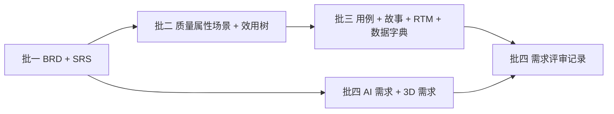

# P1 需求工程 · 执行清单

| 项 | 内容 |
|---|---|
| 文档编号 | CDCIM-P1-PLAN-01 |
| 版本 / 状态 | v0.1 · 待放行 |
| 所属阶段 | P1 需求工程 |
| 论文价值 | ★★★★★ 需求工程是「架构决策过程 30%」的输入，质量属性场景直接决定 ATAM 的效用树 |
| 上游依据 | [项目背景卡](../01-立项/01-项目背景卡.md)、[约束清单](../01-立项/06-约束清单.md)、[决策台账](../09-决策/决策台账.md) |

---

## 1. 阶段目标

把「业务痛点 + 约束 + 决策」翻译成**可验证、可追溯、可评估**的需求，具体达成三件事：

1. **需求可测**：每条需求都有验收判据，不用「响应快」「稳定」这类无法判定的表述；
2. **质量属性可评估**：六大属性各出场景（刺激-响应-度量），能直接喂给 P2 的 ATAM；
3. **可追溯**：需求 → 设计 → 测试 双向可追（RTM），后续阶段改需求能定位影响面。

**不做的事**：P1 不写接口契约、不画类图、不做选型对比（属 P2/P3）；不写一行代码。

---

## 2. 产出清单（11 份）

| 批次 | # | 文档 | 编号 | 核心内容 | 论文价值 |
|---|---|---|---|---|---|
| **批一（骨架）** | 1 | 业务需求说明书 BRD | CDCIM-P1-BRD-01 | 业务目标、干系人诉求映射、成功标准、范围边界 | ★★★☆☆ |
| | 2 | 需求规格说明书 SRS | CDCIM-P1-SRS-01 | 6 大功能模块 + 接口需求 + 数据需求 + 非功能需求 | ★★★★★ |
| **批二（质量属性）** | 3 | 质量属性场景表 | CDCIM-P1-SRS-04 | 六大属性 × 刺激-响应-度量，≥ 18 条 | ★★★★★ |
| | 4 | 质量属性效用树 | CDCIM-P1-SRS-05 | 双层树 +（重要性, 难度）排序 | ★★★★★ |
| **批三（细化）** | 5 | 用例规约集 | CDCIM-P1-SRS-02 | ≥ 15 个用例，主/备/异常流 | ★★★☆☆ |
| | 6 | 用户故事与优先级 | CDCIM-P1-SRS-03 | MoSCoW 分级，支撑 P5 裁剪 | ★★☆☆☆ |
| | 7 | 需求追踪矩阵 RTM | CDCIM-P1-SRS-06 | 需求 → 架构元素 → 测试用例 | ★★☆☆☆ |
| | 8 | 数据需求与数据字典初稿 | CDCIM-P1-SRS-07 | 测点模型、设备台账、告警字段 | ★★★☆☆ |
| **批四（专项）** | 9 | AI 功能需求说明 | CDCIM-P1-SRS-08 | 降噪、根因、RAG、NL 查询的验收标准 | ★★★★☆ |
| | 10 | 3D 可视化需求说明 | CDCIM-P1-SRS-09 | 场景范围、交互、性能指标 | ★★★☆☆ |
| | 11 | 需求评审记录 | CDCIM-P1-SRS-10 | 评审意见与闭环情况 | ☆☆☆☆☆ |

---

## 3. SRS 六大功能模块（需求骨架）

| 模块 | 需求要点 | 关键约束 |
|---|---|---|
| M1 采集接入 | Modbus TCP / SNMP / MQTT 三类协议；分频采集（快变 5 s、慢变 30 s）；断网缓存与补传 | 接入延迟 P99 ≤ 500 ms；断网 ≥ 30 min 不丢数据 |
| M2 计算与存储 | 实时清洗、降采样、窗口聚合；时序库写入与冷热分层 | 采集到入库 P99 ≤ 2 s；数据不丢（至少一次 + 幂等） |
| M3 告警研判 | 阈值/持续/变化率规则；分级；抑制（同源/父子）；根因关联 | 告警判定 P99 ≤ 3 s；重复告警率 ≤ 20% |
| M4 联动控制 | 与门禁、视频、空调联动；人工确认后才执行 | 控制指令必须可审计、可回滚 |
| M5 可视化 | 2D 总览大屏 + 3D 机房视图；告警空间定位 | 首屏 ≤ 3 s；3D 集显 ≥ 20 fps |
| M6 智能增强 | 告警降噪聚类、根因建议、知识库问答、NL 查询 | 不可用时降级为纯规则，功能不中断 |

---

## 4. 质量属性场景（初稿，正式版在批二细化）

> 六大属性各出场景，格式为「刺激源 → 刺激 → 制品 → 环境 → 响应 → 响应度量」。下表为骨架，正式版每条补全六要素并编号。

| 属性 | 场景编号 | 场景描述 | 响应度量 |
|---|---|---|---|
| 可用性 | AS-01 | 消息总线进程崩溃 | 30 s 内自动重启，数据不丢，消费者自动重连 |
| 可用性 | AS-02 | 外部大模型 API 不可用 | 告警功能 100% 可用，仅「AI 建议」标记缺失，不影响推送 |
| 可用性 | AS-03 | 时序库写入失败 | 消息积压不丢弃，恢复后自动补写，滞后 ≤ 5 min |
| 性能 | PS-01 | 正常运行 2000 测点 / 400 点·秒 | 采集到入库 P99 ≤ 2 s |
| 性能 | PS-02 | 峰值 1800 msg/s | 无消息丢弃，消费 lag ≤ 10 s |
| 性能 | PS-03 | 3D 视图加载 120 机柜场景 | 首屏 ≤ 3 s，集显 ≥ 20 fps，自动降级可用 |
| 安全性 | SS-01 | 未授权用户访问告警接口 | 拒绝并记录审计日志，5 s 内可检索到 |
| 安全性 | SS-02 | 向外部模型发送告警数据 | 100% 经过脱敏，不含真实设备编号/IP/位置 |
| 可修改性 | MS-01 | 新增一种设备协议 | 仅采集网关配置与适配类变更，不改动下游服务 |
| 可修改性 | MS-02 | 调整告警阈值规则 | 支持热加载，≤ 10 s 生效，无需重启 |
| 易用性 | US-01 | 值班人员定位告警设备位置 | 3 次点击内（大屏 → 机房 3D → 设备高亮） |
| 可测试性 | TS-01 | 注入温升故障 | 一键注入，10 s 内产生告警，可回放验证 |
| 可靠性子项 | RS-01 | 系统连续运行 30 天 | 无内存泄漏导致的 OOM，进程重启次数 = 0 |
| 互操作性 | IS-01 | 与既有门禁系统对接 | 通过标准 MQTT/HTTP 接口，2 人日完成联调 |

> 正式版预计 ≥ 18 条，按「重要性（高/中/低）× 实现难度（高/中/低）」二维排序，作为效用树的叶子节点。

---

## 5. 执行顺序与依赖

- **批一必须先行**：SRS 定功能边界，后面所有文档都引用它的编号。
- **批二可与批四并行**：AI / 3D 需求独立成册，不阻塞质量属性。
- **RTM 最后写**：等 SRS 编号稳定后再建矩阵，否则反复返工。

---

## 6. 派发分工（多智能体）

| 批次 | 主笔 | 协同 | 主智能体职责 |
|---|---|---|---|
| 批一 | 需求分析师 | 论文教练（术语校验） | 定边界、控口径、交叉审校 |
| 批二 | 架构师 | 需求分析师 | 校验场景可度量性，剔除伪需求 |
| 批三 | 需求分析师 | 数据建模师（数据字典） | RTM 一致性核对 |
| 批四 | AI 算法工程师 / 3D 可视化工程师 | 需求分析师 | 验收标准可测试性审查 |

---

## 7. 验收标准（P1 门禁）

- [ ] SRS 六大模块全部覆盖，每模块需求条目 ≥ 8 条，且每条有唯一编号与验收判据
- [ ] 质量属性场景 ≥ 18 条，六要素齐全，度量可量化
- [ ] 效用树叶子节点与场景编号一一对应，无孤立节点
- [ ] 用例 ≥ 15 个，关键用例含异常流
- [ ] RTM 覆盖 SRS 全部一级需求，无断链
- [ ] AI / 3D 需求含降级与性能判据
- [ ] 所有文档含文档头、考点映射、论文可引用段落
- [ ] 无「待定」未标注项

---

## 8. 需要你确认的需求假设

P1 会按以下假设写，若有偏差请在放行时指出：

| # | 假设 | 影响 |
|---|---|---|
| 1 | 告警分级为三级（紧急/重要/一般），不含自定义级别 | 告警引擎规则与 UI |
| 2 | 联动控制仅覆盖门禁与视频调用，不含空调远程调节（安全考虑，只告警不建议） | 联动模块范围 |
| 3 | 用户角色三类：值班员、运维工程师、管理员 | RBAC 设计 |
| 4 | 报表需求仅做日报/周报导出，不做自定义报表设计器 | 可视化范围 |
| 5 | 不建设独立 App，仅响应式 Web | 前端范围 |
| 6 | 多租户不做，单机构部署 | 数据模型 |

---

## 9. 风险与裁剪预案

| 风险 | 预案 |
|---|---|
| 需求条目膨胀（动环子项极多） | 按 MoSCoW 分级，P5 只实现 Must，Should 列为扩展 |
| 质量属性场景写成「优化目标」而非场景 | 用六要素模板强制校验，缺一退回重写 |
| 数据字典与 P3 的 E-R 冲突 | P3 必须以本阶段数据字典为输入，冲突时改 P3 |

---

## 变更记录

| 版本 | 日期 | 变更 |
|---|---|---|
| v0.1 | 2026-11-26 | P1 执行清单，待用户放行 |
