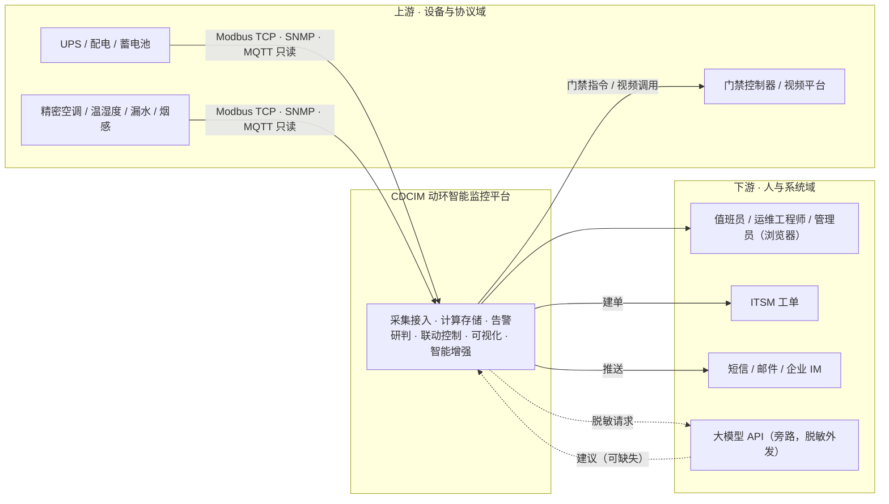

# 需求规格说明书（SRS）

| 项 | 内容 |
|---|---|
| 文档编号 | CDCIM-P1-SRS-01 |
| 版本 / 状态 | v0.4 · 关键待决项已确认，NFR 挂载已校核，待验收 |
| 所属阶段 | P1 需求工程 |
| 论文价值 | ★★★★★ 「需求→架构」推导的唯一需求基线，功能需求表与非功能需求可直接支撑论文「需求分析」「质量属性」「接口设计」三段 |
| 上游依据 | [业务需求说明书 BRD](01-业务需求说明书-BRD.md)、[P1 执行清单](00-P1执行清单.md)、[项目背景卡](../01-立项/01-项目背景卡.md)、[约束清单](../01-立项/06-约束清单.md) |
| 下游承接 | 质量属性场景表（SRS-04）、用例规约（SRS-02）、RTM（SRS-06）、数据字典（SRS-07）、AI 需求（SRS-08）、3D 需求（SRS-09） |

> **口径声明**：本文所有指标均为**目标值**（验收时必须达到的门槛），不是实测值。实测数据只在 P6 阶段产生，论文「实施效果」段落引用 P6 数据。文中 `〔待确认〕` 标记项集中在第 10 节。

---

## 1. 文档目的与范围

### 1.1 目的

本文将 [BRD](01-业务需求说明书-BRD.md) 中的 12 条业务需求（BR-01 ~ BR-12）与 6 项业务目标（G-1 ~ G-6）翻译为**可测试、可追溯、可评估**的软件需求，作为 P2 架构设计、P3 详细设计、P6 测试验收的共同基线。

三条写作准则：

1. **可测试**：每条功能需求必须有验收判据，判据须含阈值、时间或条件，禁用「及时」「稳定」「友好」等无法判定的表述；
2. **可追溯**：每条功能需求标注来源 BR 编号，形成 BR → FR 的单向可追链（反向矩阵见第 9 节）；
3. **不越界**：本文只描述「系统应做什么、做到什么程度」，**不描述如何实现**——技术选型、组件划分、部署拓扑属 P2，接口报文字段属 P3。

### 1.2 范围

**本文覆盖**：功能需求（M1 ~ M6 六大模块）、外部接口需求、数据需求、非功能需求、优先级与版本规划、需求追踪矩阵。

**本文不覆盖**：

| 不覆盖内容 | 归属文档 |
|---|---|
| 技术选型对比、架构风格、组件映射 | P2 架构设计 |
| 质量属性场景的六要素展开与效用树 | SRS-04 / SRS-05 |
| 用例主/备/异常流 | SRS-02 |
| E-R 图、表结构、字段类型长度 | P3 详细设计 / SRS-07 |
| 接口报文字段级定义 | P3 接口契约 |
| 测试用例与实测数据 | P6 测试 |

### 1.3 需求编号规则

| 前缀 | 含义 | 格式示例 | 数量 |
|---|---|---|---|
| `FR-M<n>-<nn>` | 功能需求，M1 ~ M6 为模块号 | `FR-M3-05` | 69 条 |
| `IF-EXT-<nn>` | 外部接口需求 | `IF-EXT-06` | 13 条 |
| `NFR-<属性>-<nn>` | 非功能需求，属性用英文缩写 | `NFR-PERF-02` | 31 条 |
| `DE-<nn>` | 数据实体 | `DE-04` | 10 项 |

编号一经分配不复用。需求作废时保留编号并标注「已作废」，不做重排，避免下游文档交叉引用失效。

---

## 2. 术语与缩略语

| 术语 | 全称 / 英文 | 含义（本文口径） |
|---|---|---|
| 动环 | 动力与环境（Power & Environment） | 数据中心供配电、暖通空调、环境参数、安防设施的统称，是本系统的监控对象域 |
| 测点 | 测点（Point / Tag） | 设备上可被采集的单个物理量或状态量，是数据采集的最小单位。2000 个测点即 2000 个 Point |
| 遥测 | 遥测（Telemetry，模拟量） | 连续取值的测量量，如温度、电压、电流、功率；本文主要指 5 s 快变采集对象 |
| 遥信 | 遥信（Telesignal，开关量） | 离散状态量，如断路器分合、门磁开闭、告警干接点；本文主要指 30 s 慢变采集对象 |
| 快变 / 慢变 | — | 按变化速率划分的采集频率档：快变 5 s（遥测为主）、慢变 30 s（遥信为主） |
| 死区 | Deadband | 模拟量变化未超过设定阈值时不上报的过滤机制，用于抑制噪声写入，默认 0.5% 量程 |
| 质量码 | Quality Code | 标注单条数据可信度的枚举：Good / Bad / Uncertain / Stale，随数据一同存储与展示 |
| 事件时间 | Event Time | 数据实际发生的时刻（设备侧或网关接收时刻），区别于处理时间（Processing Time），是乱序处理与窗口计算的基准 |
| 水位线 | Watermark | 流处理中用于判定「窗口可以关闭」的时间进度标记，本文允许 60 s 迟到窗口 |
| 幂等 | Idempotent | 同一操作重复执行与执行一次结果相同；本文指同一 `(设备, 测点, 时间戳)` 重复写入只保留一份 |
| 降噪 | Noise Reduction | 通过去重、抑制、聚类减少推送告警数量的处理总称，**不降低单条告警的判定灵敏度** |
| 抑制 | Suppression | 对已知派生告警不推送但仍记录的处理，分「同源抑制」（同设备同规则窗口内重复）与「父子抑制」（上级故障导致的下级派生） |
| 聚类 | Clustering | 将时间邻近、拓扑相邻、指标相似的原始告警归并为 1 个「告警事件」的处理 |
| 根因 | Root Cause | 引发一组关联告警的最初故障设备或故障类型；本文要求给出 Top3 疑似根因并附证据 |
| 告警事件 | Alarm Event | 聚类后的告警单元，是推送给值班员的最小单位；1 个事件可含 N 条原始告警 |
| 原始告警 | Raw Alarm | 规则命中的单条告警记录，包含被抑制与被聚并的条目，须全量留存可查 |
| 重复告警率 | Duplicate Alarm Rate | 推送告警中「同一根因、抑制窗口内重复上报」的条数占推送总数的比例，目标 ≤ 20%（口径见 6.2.5） |
| 巡检 | Inspection | 按计划自动执行的批量检查任务，逐项判定设备与系统健康度并产出结论，替代人工填表 |
| PUE | Power Usage Effectiveness | 数据中心总能耗与 IT 设备能耗之比，越接近 1 越优；本系统按日计算并输出趋势 |
| RAG | 检索增强生成（Retrieval-Augmented Generation） | 先从知识库检索相关段落，再交由大模型生成答案的技术路线；本文要求答案必须带来源引用 |
| NL 查询 | 自然语言查询（Natural Language Query） | 将中文问句转为结构化只读查询（SQL / 查询 DSL）的能力 |
| 大模型旁路 | LLM Bypass | 大模型不参与告警判定主链路、仅作为增强建议源，不可用时主流程完整可用的架构约束 |
| 脱敏 | De-identification | 外发前将设备编号哈希化、IP/位置/人名替换为逻辑 ID 的处理，保证外部不可还原真实资产信息 |
| LOD | 细节层次（Level of Detail） | 3D 渲染中按视距切换模型精度的技术，用于在集显环境下保证帧率 |
| 实例化渲染 | Instanced Rendering | 同一几何体以一次绘制调用渲染多份副本的技术，120 个机柜场景的关键性能手段 |
| RBAC | 基于角色的访问控制（Role-Based Access Control） | 权限授予角色、角色授予用户的三级模型 |
| 等保 2.0 三级 | 网络安全等级保护 2.0 第三级 | 金融行业信息系统须满足的合规基线，涵盖身份鉴别、访问控制、安全审计、入侵防范、数据完整性与保密性、备份恢复 |
| MoSCoW | Must / Should / Could / Won't | 需求优先级分级方法，本文用 M / S / C 三档，W 表示本期不做 |

---

## 3. 总体描述

### 3.1 产品定位与边界

**一句话定位**：面向金融业数据中心的动环统一监控平台，把多厂商割裂的采集、告警、可视化收敛为单一数据源与单一处置入口，AI 作为旁路增强而非主链路依赖。

**系统上下文**（文字说明）：

上下文要点四条：

1. **对上游只读为主**：系统不改变厂商设备运行参数（BC-04），唯一写操作是门禁与视频的平台级调用，且经人工确认；
2. **对下游单向为主**：工单、短信、邮件、IM 均为系统向外发起，无反向控制依赖；
3. **大模型为虚线连接**：可断开而不影响实线链路，这是可用性约束 C-14 在图上的表达；
4. **用户入口唯一**：浏览器，不设独立 App（执行假设 5）。

**边界外**（与 BRD 第 4 节一致，需求层面显式排除）：IT 设备监控与 CMDB、视频智能分析算法、移动端 App、工单与计费系统本体、空调远程调节。

### 3.2 用户角色与权限

| 角色 | 典型人员 | 可做 | 不可做 | 日均使用 |
|---|---|---|---|---|
| **值班员** | 7×24 值班岗，2 人轮班 | 查看大屏与 2D/3D 视图、查看与确认告警、查看测点曲线、发起门禁/视频联动（需确认）、填写交接班记录、查看日报 | 修改告警规则与阈值、修改设备与测点台账、导出全量历史数据、执行批量删除、管理用户 | 8 h 全程盯屏 |
| **运维工程师** | 环境与设备组、电气组 | 值班员全部权限 + 配置告警规则（含阈值/持续/变化率）、配置联动策略、维护设备与测点台账、执行巡检任务与复核结论、查看能效与容量分析、使用 AI 根因建议与知识库问答 | 管理用户与角色、修改审计日志、变更系统级参数、远程调节空调 | 每日 2 ~ 3 次 |
| **管理员** | 系统管理员 | 用户与角色管理、系统参数配置、审计日志查询与导出、备份恢复、查看系统自身监控、数据归档策略配置 | 删除或修改审计日志（只追加）、绕过双人复核执行门禁操作 | 每周 1 ~ 2 次 |

权限三条硬规则：

1. **最小权限**：默认拒绝，权限按角色显式授予，未授予的操作一律返回 403 并记审计；
2. **职责分离**：规则配置（运维工程师）与授权审批（管理员）分离，同一人不得同时具备「配置门禁联动策略」与「复核门禁操作」两项权限；
3. **不可抵赖**：所有写操作留操作人身份与时间戳，审计日志任何角色均不可改删。

### 3.3 运行环境

| 维度 | 生产目标环境 | 原型验证环境 |
|---|---|---|
| 部署形态 | 私有化部署于数据中心内网，3 节点集群（设计目标） | 单机 WSL2 + Docker，内存配额 8 GB、硬上限 10 GB（C-01） |
| 网络 | 机房监控网段与办公网段互通，不出内网（BC-06、C-09） | 仅 `localhost` 访问，Web 端口绑 `0.0.0.0`，其余绑 `127.0.0.1`（C-07） |
| 浏览器 | Chrome / Edge 100+，支持 WebGL 2.0 | 同左；集显环境（C-02） |
| 显示分辨率 | 监控大屏 1920×1080，工作站 1366×768 及以上 | 同上 |
| 操作系统 | 信创 OS 优先（麒麟 / 统信），保留 x86 路径（C-11） | Windows 11 + WSL2 Ubuntu |
| 时间源 | 内网 NTP，全链路时钟偏差 ≤ 100 ms | 宿主时钟 |
| GPU | 无独立显卡要求，集显可用 | 集显（C-02） |

### 3.4 设计约束与假设

本节引用上游约束，只保留**对需求内容有直接影响**的条目；纯实现类约束（端口、镜像源）不在需求层重复。

| 编号 | 类型 | 内容 | 对需求的影响 |
|---|---|---|---|
| BC-01 / C-09 | 约束 | 生产数据不出内网，AI 必须脱敏外发 | 派生 FR-M6-07 脱敏强制需求；AI 类需求的验收必须包含「脱敏后可外发」判据 |
| BC-02 / C-14 | 约束 | 系统自身不得成为故障源，AI 与 3D 不得进告警主链路 | 所有 AI 需求必须写降级路径（FR-M6-03/05/11）；3D 需求必须写降级路径（FR-M5-06/07） |
| BC-03 / C-08 / C-10 | 约束 | 等保 2.0 三级，审计日志留存 ≥ 6 个月且不可篡改 | 派生 NFR-SEC-01 ~ 06、FR-M5-13 审计查询；审计留存期独立于业务数据归档策略 |
| BC-04 | 约束 | 不改厂商设备运行参数，只读采集为主 | 写操作仅限门禁与视频平台调用，且需人工确认（FR-M4-02）；FR-M4-08 显式排除空调远程调节 |
| BC-05 / C-18 | 假设 | 设备支持 Modbus TCP 或 SNMP，可开放只读接口 | M1 三类协议接入需求的成立前提；不支持的设备走网关旁路（BR-R1 应对） |
| BC-06 | 假设 | 机房网络与监控网段互通，无需新增专线 | 外部接口需求不包含网络建设内容 |
| BC-07 | 假设 | 值班人员具备基础网络与电气知识 | 易用性需求按「有专业背景的新人」设定培训时长（NFR-USE-02） |
| C-01 / C-03 | 约束 | 单机部署、8 GB 内存、非集群 | 性能需求按单机可验证口径设定（1800 msg/s 而非万级）；高可用以「进程级多副本 + 快速重启 + 数据不丢」表达，不以节点容灾表达 |
| C-02 | 约束 | 无 GPU | 3D 性能目标按集显设定（≥ 20 fps），并强制 LOD 与实例化 |
| C-15 | 约束 | 采集入库 P99 ≤ 2 s、告警判定 P99 ≤ 3 s | 直接转为 NFR-PERF-01 / 02，并成为 M2 / M3 多条 FR 的验收判据 |
| C-16 | 约束 | 至少一次投递 + 幂等写入 | 派生 FR-M2-05 / 06、FR-M4-05 |
| C-17 | 约束 | 测点规模可扩展至万级（当前 2000） | 性能与容量需求按 2000 验收、按万级设计，不承诺万级实测 |
| C-12 | 约束 | 大模型输出不得驱动控制指令 | 派生 FR-M4-02、FR-M6-08：AI 结果类型上不可作为控制入参 |

**本阶段已锁定的六条需求假设**（来自 P1 执行清单第 8 节，如与用户判断不一致须在评审时提出）：

| # | 假设 | 影响的需求 |
|---|---|---|
| A-1 | 告警分级固定三级（紧急/重要/一般），不支持自定义级别 | FR-M3-04、FR-M5-09 |
| A-2 | 联动仅覆盖门禁与视频调用，**不含空调远程调节** | FR-M4-01 ~ 09 |
| A-3 | 用户角色三类：值班员、运维工程师、管理员 | 3.2、NFR-SEC-02 |
| A-4 | 报表仅日报/周报导出，不做自定义报表设计器 | FR-M5-10 |
| A-5 | 不做独立 App，仅响应式 Web | FR-M5-12 |
| A-6 | 单机构部署，不做多租户 | 全部数据需求（无租户维度） |

---

## 4. 功能需求

六大模块共 **69 条**功能需求，分布如下表。每条需求用「系统应…」句式描述行为，验收判据给出可执行的判定方法。

| 模块 | 名称 | 条数 | M | S | C |
|---|---|---|---|---|---|
| M1 | 采集接入 | 10 | 6 | 4 | 0 |
| M2 | 计算与存储 | 12 | 8 | 4 | 0 |
| M3 | 告警研判 | 14 | 11 | 3 | 0 |
| M4 | 联动控制 | 9 | 5 | 4 | 0 |
| M5 | 可视化与报表 | 13 | 7 | 2 | 4 |
| M6 | 智能增强 | 11 | 3 | 6 | 2 |
| **合计** | — | **69** | **40** | **23** | **6** |

### 4.1 M1 采集接入

职责：把多厂商、多协议的设备数据变成统一格式的原始测点报文，并保证不丢、可辨真伪、可扩展。

| FR 编号 | 需求名称 | 需求描述 | 输入 | 处理规则 | 输出 | 验收判据 | 优先级 | 来源 BR |
|---|---|---|---|---|---|---|---|---|
| FR-M1-01 | 三类协议设备接入 | 系统应支持 Modbus TCP、SNMP（v2c/v3）、MQTT 三类协议接入动环设备，并按设备配置实例化对应适配器 | 设备地址表、协议参数（寄存器映射 / OID 映射 / Topic 订阅式） | 按设备配置选择适配器，轮询或订阅，统一转为内部标准报文 | 标准原始测点报文（device_id、point_id、value、quality、ts） | 3 类协议各接入 ≥ 1 台模拟设备，接入后 30 s 内首帧数据入库；同一协议下新增设备只改配置、不改代码 | M | BR-01 |
| FR-M1-02 | 分频采集调度 | 系统应按点位变化速率分频采集：快变 5 s、慢变 30 s，同一采集进程内互不阻塞 | 测点表的采集频率属性 | 按频率分桶调度，慢变不占用快变时隙；单设备超时不影响其他设备 | 按各自频率产出的原始数据 | 连续运行 1 h，快变测点实际间隔落在 5±0.5 s 的比例 ≥ 99%，慢变落在 30±3 s 的比例 ≥ 99% | M | BR-01 |
| FR-M1-03 | 测点模板与批量配置 | 系统应按设备类型提供测点模板（地址、数据类型、量纲、换算系数、死区），支持批量导入导出 | Excel/CSV 模板文件 | 导入时逐行校验（地址重复、类型越界、系数缺失），全部错误一次性列出 | 导入结果报告（成功 N 条 / 失败 M 条及原因） | 以 40 机柜同类设备批量导入，≤ 10 min 完成；构造 20 条错误数据，20 条全部报出且 0 条静默入库 | S | BR-01 |
| FR-M1-04 | 死区过滤与心跳保留 | 系统应对模拟量按死区过滤写入，变化未超死区不上报存储，但保留定时心跳值 | 原始采样值、点位死区配置 | 与上次写入值比较，差值 < 死区则丢弃；距上次写入 ≥ 5 min 强制写一条心跳 | 过滤后的数据流 + 心跳记录 | 稳态 30 min 内单测点写入 ≤ 1 条/min；用阶跃信号跨越限值验证，死区不影响越限告警触发（100% 触发） | S | BR-01 |
| FR-M1-05 | 数据质量码标注 | 系统应为每条数据标注质量码（Good / Bad / Uncertain / Stale），并随数据持久化 | 采集结果、设备通信状态 | 通信超时置 Bad、超时 3 周期置 Stale、值超量程置 Uncertain | 带质量码的数据记录 | 断开设备 60 s 后，该设备全部测点质量码转 Bad/Stale 且时间戳停止前进；恢复后 ≤ 2 个采集周期内转回 Good | M | BR-01、BR-04 |
| FR-M1-06 | 断连缓存与断点补传 | 系统应在与消息总线断连时本地缓存数据，恢复后按事件时间顺序补传 | 断连期间的采集数据 | 本地磁盘队列（≥ 100 MB 配额可覆盖峰值 30 min），恢复后批量补传并保留原始时间戳 | 补传数据流 | 模拟断连 30 min（600 点/秒），恢复后 5 min 内补齐，丢失条数 = 0，补传数据时间戳与原始采集时刻一致（偏差 0） | M | BR-01 |
| FR-M1-07 | 设备在线状态判定 | 系统应维护每台设备的在线/离线/未知三态，并在状态变化时产生状态事件 | 采集响应、心跳 | 连续 3 个采集周期无响应判离线；首次接入未响应判未知 | 设备状态事件 + 当前状态视图 | 拔线后 ≤ 15 s（快变设备）判定离线；状态变化到 UI 可见 ≤ 5 s；状态事件可在历史中检索 | M | BR-01 |
| FR-M1-08 | 采集过载降级 | 系统应在采集侧资源过载时优先保障关键测点，并上报告警 | CPU/内存占用率、测点 critical 标记 | 持续 30 s CPU > 80% 则停采非关键测点，仅保留 critical 点位 | 降级状态事件 + 降级告警 | 注入 CPU 压力至 95%，30 s 内进入降级；降级期间关键测点采样间隔偏差 ≤ 20%；非关键测点停采有记录；压力解除后 60 s 内自动恢复 | S | BR-01 |
| FR-M1-09 | 协议适配可插拔 | 系统应在新增协议时仅新增适配器实现与配置，不改动下游服务 | 新协议设备、适配器实现 | 适配器输出统一报文契约，下游按契约消费 | 可运行的第三/第四类协议接入 | 以新增一类 HTTP 拉取型设备验证：改动限于采集服务适配层（≤ 2 个文件），下游服务代码零改动，既有回归用例 100% 通过 | S | BR-01、C-18 |
| FR-M1-10 | 时间戳规范化 | 系统应统一使用 UTC 毫秒时间戳，并标注时间来源（设备时钟 / 网关时钟） | 设备时间、网关接收时间 | 设备可提供可信时间则用设备时间，否则用网关接收时间并标记 ts_source=gateway | 带 ts_source 的标准时间戳 | 抽样 1000 条数据，ts_source 字段 100% 存在；同一设备同一测点时间戳单调不回退（0 条回退）；与 NTP 基准偏差 ≤ 100 ms | M | BR-04、C-16 |

### 4.2 M2 计算与存储

职责：把原始数据流清洗为可信数据，按多级时间粒度落库，满足留存与检索要求，并承载定时计算类任务（巡检、能效）。

| FR 编号 | 需求名称 | 需求描述 | 输入 | 处理规则 | 输出 | 验收判据 | 优先级 | 来源 BR |
|---|---|---|---|---|---|---|---|---|
| FR-M2-01 | 实时清洗与换算 | 系统应按点位模板完成系数换算、单位统一、超量程剔除，并保留原始值 | 原始测点报文 | 换算后超物理量程（如 > 120% 额定）标记 Bad 且不参与聚合；原始值与换算值同时保留 | 清洗后的标准值 + 原始值 | 注入 100 条超量程值，100 条被标记 Bad 且未进入任何聚合；原始值可在明细中查得 | M | BR-01、BR-04 |
| FR-M2-02 | 端到端入库时延 | 系统应保证采集时间戳到可查询时间戳的端到端时延 | 原始数据流 | 就近计算，不做同步外部调用 | 可查询的时序记录 | 2000 测点 / 400 点·秒稳态下，连续 10 min 采样，P99 ≤ 2 s、P50 ≤ 800 ms | M | BR-01、G-1 |
| FR-M2-03 | 多级降采样聚合 | 系统应按 1 min / 5 min / 1 h 三级生成降采样，聚合项含 avg、max、min、count | 清洗后数据 | 按事件时间窗口聚合，窗口内缺失不插值，按质量码统计有效点数；水位线推进 60 s 后窗口封闭 | 三级聚合表 | 任意 1 h 窗口内 1 min 聚合点数 = 应有点数（缺失以空桶标记，不插值）；聚合值与原始明细重算误差 ≤ 0.5% | M | BR-04、G-4 |
| FR-M2-04 | 冷热分层与留存 | 系统应保证原始数据在线可查 ≥ 180 天、1 min 降采样可查 ≥ 3 年 | 入库数据、归档策略配置 | 热数据（≤ 30 天）与温数据（31 ~ 180 天）分介质存放，超期原始数据归档后按策略清理 | 分层存储 + 归档文件 | 查询 179 天前原始数据响应 ≤ 3 s；查询 2 年前降采样数据响应 ≤ 3 s；归档文件可导出且校验和一致 | M | BR-04、C-08 |
| FR-M2-05 | 幂等写入 | 系统应按 `(device_id, point_id, ts)` 幂等写入，重复消息不产生重复记录 | 可能重复的数据流 | 重复键覆盖写（后到者覆盖，值与质量码取最新）；写入前不做跨库去重查询 | 无重复的时序记录 | 注入 10% 重复消息，库内记录增量 = 理论增量（误差 0 条）；重复键检测结果为空 | M | BR-04、C-16 |
| FR-M2-06 | 乱序与迟到数据处理 | 系统应基于事件时间与水印处理乱序数据，允许 60 s 迟到窗口 | 乱序到达的数据流 | 迟到 ≤ 60 s 计入原窗口并可能触发窗口重算；迟到 > 60 s 写入旁路表并计数告警 | 正确的聚合结果 + 旁路表 | 注入 5% 乱序（迟到 5 ~ 60 s）数据，最终聚合与顺序输入结果误差 ≤ 0.5%；迟到 120 s 数据 100% 进入旁路表且可在 UI 查得 | M | BR-04 |
| FR-M2-07 | 峰值吞吐不丢数据 | 系统应在峰值吞吐下不丢消息、不无限积压 | 峰值数据流（1800 msg/s） | 背压传导至采集侧缓存，消费端并行度可扩展 | 完整入库数据 | 1800 msg/s 持续 10 min，消息丢弃数 = 0，消费积压（lag）≤ 10 s，入库时延 P99 ≤ 5 s | M | BR-01、G-6 |
| FR-M2-08 | 写入失败可恢复 | 系统应在时序库不可用时于总线上积压不丢弃，恢复后自动补写 | 数据流、存储可用性信号 | 停止消费位点提交，积压保留；恢复后从上次位点续写 | 补写完成的数据 | 停库 5 min，恢复后积压清零 ≤ 5 min，数据完整率 100%（按条数比对），无需人工干预 | M | BR-04、C-16 |
| FR-M2-09 | 元数据变更广播 | 系统应在设备、测点、机房拓扑变更时广播变更事件，各消费方无需重启即可生效 | 台账变更操作 | 变更事件携带版本号，消费方按版本增量更新本地缓存 | 变更事件 + 各方生效 | 新增 1 台设备（含 10 测点）后，采集、告警、可视化三侧 ≤ 30 s 内可见，三方进程重启次数 = 0 | S | BR-01、BR-03 |
| FR-M2-10 | 历史数据回放 | 系统应支持将指定历史区间数据回放进计算管道，用于规则验证与故障复盘 | 时间区间、目标管道 | 回放数据打标隔离，不写入在线表；回放速率可调（1× ~ 10×） | 回放产生的告警与聚合结果 | 回放 1 h 历史区间，产出告警与当时落库结果一致率 ≥ 99%；回放期间在线数据 0 污染（在线表记录数不受影响） | S | BR-04、TS-01 |
| FR-M2-11 | 自动巡检 | 系统应按计划（默认每日 2 次）生成巡检任务，逐项判定并产出结论，异常项自动关联告警 | 巡检项清单、设备与测点当前/历史数据 | 巡检项 ≥ 20 项（在线率、阈值越限、告警未闭环、通信质量、电池组一致性等），逐项给「正常/异常/无法判定」 | 巡检报告（含异常明细与证据） | 任务在计划时刻 ±5 min 内启动，单次执行 ≤ 10 min，巡检项结论覆盖率 100%，异常项 100% 生成关联告警且可在报告中追溯原始数据 | S | BR-05、G-5 |
| FR-M2-12 | 能效与容量分析 | 系统应按日计算 PUE、制冷效率、负载率与剩余容量，并给出趋势与扩容建议 | 电量、制冷量、IT 负载、机柜容量数据 | 日粒度汇总，近 30 天趋势，90 天线性外推给出扩容时点与置信区间 | 能效指标集 + 容量趋势 | 日 PUE 与手工核算值误差 ≤ 2%；可输出近 30 天趋势曲线；扩容建议含外推依据（斜率、样本天数、置信区间） | S | BR-06 |

### 4.3 M3 告警研判

职责：把数据变成判断——规则判定、分级、降噪（去重/抑制/聚类）、根因关联、通知升级，并保证「降噪不降灵敏度」。

| FR 编号 | 需求名称 | 需求描述 | 输入 | 处理规则 | 输出 | 验收判据 | 优先级 | 来源 BR |
|---|---|---|---|---|---|---|---|---|
| FR-M3-01 | 阈值规则判定 | 系统应支持上限、下限、上下限带、区间外四类阈值规则 | 清洗后数据、规则配置 | 逐点比对阈值，命中即生成原始告警；同一周期内不重复判定 | 原始告警记录 | 配置「温度 > 30 ℃」，注入 31 ℃ 数据，≤ 3 s 生成告警；注入 29.9 ℃ 不生成（0 条） | M | BR-02 |
| FR-M3-02 | 持续时长规则 | 系统应支持「条件持续 N 秒」的规则形态 | 数据流、持续时长配置 | 条件首次命中开始计时，持续达标才生成告警；中途恢复则计时清零 | 原始告警记录 | 配置「> 30 ℃ 持续 60 s」：注入 59 s 不告警（0 条），第 60 s 告警（1 条）；中途回落再起计时从头计算 | M | BR-02 |
| FR-M3-03 | 变化率规则 | 系统应支持单位时间变化率规则（如 1 min 温升 > 3 ℃） | 数据流、窗口与变化率阈值 | 滑窗首末差值 / 窗口时长，超阈值生成告警 | 原始告警记录 | 注入 4 ℃/min 上升，≤ 3 s 告警；注入 2 ℃/min 不告警（0 条）；阶跃噪声（±0.5 ℃ 抖动）不误报（0 条） | S | BR-02、BR-12 |
| FR-M3-04 | 三级告警分级 | 系统应强制每条规则绑定「紧急/重要/一般」之一，不提供自定义级别 | 规则定义 | 保存时校验级别字段，缺失或越界拒绝；接口层与界面层双重校验 | 带级别的告警 | 未绑定级别保存被拒绝（界面 + API 各测 1 次，均返回 400）；尝试写入第四级被拒绝（100% 拦截） | M | BR-02 |
| FR-M3-05 | 同源去重抑制 | 系统应对同一设备同一规则在抑制窗口内（默认 300 s）只推送 1 条主告警，其余计为抑制 | 原始告警流、抑制窗口配置 | 首次命中推送，窗口内后续命中累加 suppressed_count 不推送；窗口届满重新计数 | 主告警 + 抑制计数 | 注入 100 条同源事件，推送 1 条、抑制计数 99；统计重复告警率 ≤ 20%（口径见 6.2.5）；放大窗口至 600 s 后行为一致 | M | BR-02、G-2 |
| FR-M3-06 | 父子拓扑抑制 | 系统应在上级设备故障时抑制其下游设备的派生告警，并保留关联关系 | 原始告警、拓扑父子关系 | 上级在抑制窗口内存在活动告警时，下级告警标记为派生并抑制；上级恢复后下级若仍异常则重新推送 | 主告警 + 派生告警关联链 | 构造「市电断电 → UPS 转电池 → 下挂设备掉电」链路（模拟 30 条告警），最终推送 1 条根告警；被抑制的 29 条可在「关联告警」中展开查看；上级恢复后下级重新推送（100%） | M | BR-02、BR-03 |
| FR-M3-07 | 告警聚类 | 系统应按时间窗（默认 120 s）+ 拓扑邻域 + 指标相似度将原始告警聚类为告警事件 | 原始告警流、拓扑、指标 | 三条件加权打分，超阈值归入同一事件；事件内保留全部原始告警引用 | 告警事件 | 模拟单次市电波动产生 200 条原始告警，聚合为 ≤ 5 个事件；在 10 组混合场景中，独立故障不被错误吸收（召回率 ≥ 95%） | M | BR-02、G-2 |
| FR-M3-08 | 根因定位 | 系统应结合拓扑与告警时序输出疑似根因设备 Top3 与影响范围（受影响机柜/业务） | 告警事件、拓扑、设备依赖 | 按「最上游 + 最早发生 + 覆盖面」排序，输出置信度与判据；影响范围由拓扑向下遍历得出 | 根因候选列表 + 影响范围 | 20 个构造故障场景中 Top1 命中 ≥ 17 个（85%）；输出耗时 ≤ 5 s（P95）；影响范围与实际受影响设备比对准确率 ≥ 90% | M | BR-03、G-3 |
| FR-M3-09 | 告警判定时延 | 系统应保证从采集时间戳到告警生成的时延 | 数据流 | 就地判定，不跨服务同步调用 | 带生成时间戳的告警 | 稳态与峰值分别连续 10 min 统计，告警判定时延 P99 ≤ 3 s、P50 ≤ 1.5 s | M | BR-02、C-15 |
| FR-M3-10 | 告警生命周期状态机 | 系统应实现「产生 → 确认 → 处理中 → 关闭」与「自动恢复」状态迁移，拒绝非法跃迁 | 用户操作、自动恢复条件 | 9 条合法迁移放行；非法迁移返回 409 并记录；自动恢复需连续 3 个周期正常 | 状态变更记录 | 9 条合法迁移全部可执行且状态正确；构造 6 条非法迁移（如「关闭」直接跳「处理中」）全部被拒绝；自动恢复在连续 3 周期正常后 ≤ 1 个周期内触发 | M | BR-02 |
| FR-M3-11 | 分级通知与升级 | 系统应按级别路由通知渠道，未确认时按 5 min 间隔升级，最多 3 次 | 告警、通知配置、确认状态 | 紧急→短信+IM+大屏；重要→短信+IM；一般→大屏+IM；升级不改变级别仅扩大范围 | 通知记录 + 送达状态 | 紧急告警首个通道送达 P95 ≤ 60 s；升级计时误差 ≤ 10 s；第 3 次升级后停止（0 次多余推送）；通道全部失败时降级为界面强提示并记录 | M | BR-02、G-1 |
| FR-M3-12 | 规则热加载与灰度 | 系统应支持规则变更 ≤ 10 s 生效、无需重启，并支持按机房灰度发布 | 规则变更请求、灰度范围 | 变更下发至规则引擎，先灰度机房生效，观察窗（默认 30 min）后全量；支持一键回滚 | 生效的规则版本 | 修改阈值后 10 s 内新数据按新规则判定；回滚 ≤ 10 s；灰度期间非灰度机房误判条数 = 0 | S | BR-02、MS-02 |
| FR-M3-13 | 检修模式与告警挂起 | 系统应支持对指定设备/测点在维护窗口内挂起告警，到期自动恢复 | 挂起申请（对象、起止时间、原因） | 挂起期间不推送但记录原始告警；到期自动解除；挂起需填写原因与审批人 | 挂起记录 + 到期恢复 | 挂起期间推送 0 条；到期 ±10 s 内自动恢复；挂起期间原始告警 100% 可查；未填原因的申请被拒绝 | S | BR-02 |
| FR-M3-14 | 原始告警全量留存 | 系统应保留全部原始告警（含被抑制与被聚类吸收的），并支持按时间与设备检索 | 原始告警流 | 只追加不覆盖；与告警事件通过事件 ID 关联 | 可检索的原始告警库 | 任一被抑制告警在 90 天内可按「时间 + 设备」检索到，响应 ≤ 3 s；原始告警条数 ≥ 事件条数（校验通过） | M | BR-02、BR-R2 |

### 4.4 M4 联动控制

职责：在人工确认前提下调用门禁与视频，缩短现场确认时间；一切写操作可审计、可回滚、不可由 AI 驱动。

| FR 编号 | 需求名称 | 需求描述 | 输入 | 处理规则 | 输出 | 验收判据 | 优先级 | 来源 BR |
|---|---|---|---|---|---|---|---|---|
| FR-M4-01 | 联动策略配置 | 系统应以「触发条件（告警级别/类型/设备）+ 动作（门禁常开、抓拍、录像标记、视频上墙）+ 生效范围」定义联动策略 | 策略配置 | 策略保存后 ≤ 10 s 生效；同一告警可命中多条策略，动作去重后执行 | 可执行的联动策略 | 策略增删改查可用；保存到生效 ≤ 10 s；相同动作被 2 条策略命中时只执行 1 次 | S | BR-07 |
| FR-M4-02 | 人工确认后执行 | 系统应在执行任何联动动作前要求人工二次确认，不存在自动执行路径 | 联动建议、用户确认操作 | 生成待确认卡片，确认后下发；确认超时（默认 5 min）自动失效 | 带确认人的执行记录 | 代码审查 + 用例验证：100% 的联动请求存在确认记录；绕过确认直接调用接口返回 403（构造 5 次，5 次拒绝） | M | BR-07、C-12 |
| FR-M4-03 | 门禁联动 | 系统应对指定门下发「常开 / 恢复原状态」指令，并回读执行结果 | 告警、门禁设备标识、策略 | 调用既有门禁平台接口；失败重试 3 次（间隔 2 s）；回读状态确认 | 门禁状态变更结果 | 指令下发到门禁平台返回 ≤ 2 s；状态回读 ≤ 5 s 内与指令一致；3 次重试失败后生成「联动失败」告警（100%） | S | BR-07 |
| FR-M4-04 | 视频联动 | 系统应在联动触发时调用视频平台取流或抓拍，并在界面弹出 | 告警、摄像头标识 | 优先取实时流，取流失败（5 s 超时）回落抓拍图；抓拍失败提示人工 | 视频窗口 + 抓拍图 | 联动触发到首帧显示 P95 ≤ 5 s；取流失败场景下 5 s 内回落到抓拍并可见；全部失败时提示可点击重试 | S | BR-07、G-1 |
| FR-M4-05 | 指令幂等与超时处理 | 系统应对控制指令按 request_id 幂等，超时标记为「结果未知」并触发核对 | 控制请求 | 相同 request_id 只执行 1 次；超时 10 s 置「结果未知」，由核对任务回读真实状态 | 执行结果 + 状态核对记录 | 同一指令重复提交 10 次，实际执行 1 次；注入超时后 10 s 内出现「结果未知」，核对任务 ≤ 30 s 完成并更新为真实状态 | M | BR-07、C-16 |
| FR-M4-06 | 控制审计与补偿 | 系统应记录全部控制指令的操作人、时间、目标、参数、结果，并支持「恢复原状态」补偿动作 | 控制指令与执行结果 | 审计记录只追加、留存 ≥ 6 个月；补偿动作本身也需人工确认并另行审计 | 控制审计记录 + 补偿结果 | 审计覆盖率 100%（构造 50 次各类指令，50 条审计）；补偿动作从确认到完成 ≤ 10 s；审计记录不可修改（尝试更新返回 403） | M | BR-07、BR-08 |
| FR-M4-07 | 联动失败不影响告警 | 系统应在门禁/视频平台不可用时使联动失败，但告警推送照常 | 平台不可用信号、告警 | 联动失败仅影响联动卡片状态，不阻塞告警链路 | 告警推送 + 失败提示 | 停掉视频平台后，告警推送成功率 100%；联动卡片显示失败原因，可 10 s 内手动重试 | M | BR-07、C-14 |
| FR-M4-08 | 控制范围显式排除 | 系统不应提供空调温度设定、风机转速、UPS 输出参数等设备运行参数的远程调节能力 | — | 接口清单与界面均不实现此类写操作 | 接口清单（只读项） | 接口清单评审：写接口仅含门禁 2 项、视频 3 项；界面上不存在空调/UPS 参数设置入口（评审确认 + 接口扫描 0 命中） | M | BR-07 |
| FR-M4-09 | 危险操作双人复核 | 系统应对「门禁常开」类影响物理安全的动作要求第二人复核 | 联动请求、复核操作 | 提交后进入待复核，复核通过才下发；提交人 = 复核人时拒绝 | 双人签名的执行记录 | 单人提交停留在待复核（0 下发）；第二人确认后 ≤ 2 s 下发；提交人自审 100% 被拒绝（构造 3 次） | S | BR-07、BR-08 |

### 4.5 M5 可视化与报表

职责：把数据与告警变成可判断的态势画面，并产出可交付的报表与交接记录。3D 为 C 类增强，必须有性能降级与形态降级。

| FR 编号 | 需求名称 | 需求描述 | 输入 | 处理规则 | 输出 | 验收判据 | 优先级 | 来源 BR |
|---|---|---|---|---|---|---|---|---|
| FR-M5-01 | 2D 总览大屏 | 系统应提供 3 机房总览大屏，展示关键指标（PUE、总功率、告警计数）、活动告警 Top N、机房健康度 | 实时数据、告警 | 按 5 s 刷新，增量更新不清屏；断流时显示「数据延迟」标记而非空白 | 总览大屏 | 冷缓存首屏可交互 ≤ 5 s、热缓存 ≤ 3 s；数据刷新周期 ≤ 5 s；注入数据延迟 30 s，界面出现延迟标记（100%） | M | BR-10、BR-02 |
| FR-M5-02 | 三级钻取导航 | 系统应支持「机房 → 机柜 → 设备」三级钻取，并保持面包屑可回溯 | 用户点击 | 每级加载对应层级数据，钻取不丢失上一级筛选条件 | 三级页面 | 从大屏到任一设备详情 ≤ 3 次点击；单次页面切换 ≤ 1 s（内网）；面包屑回溯到任意上级 ≤ 1 次点击 | M | BR-10、G-3 |
| FR-M5-03 | 3D 机房视图 | 系统应以 3D 形式呈现机房布局与 120 个机柜状态，采用 LOD 与实例化渲染 | 机房与机柜模型、实时状态 | 按视距切换 LOD；机柜以实例化渲染；状态用颜色编码（正常/告警/离线） | 3D 场景 | 集显环境首屏 ≤ 3 s，稳定帧率 ≥ 20 fps（连续 60 s 采样），渲染内存 ≤ 1.5 GB | C | BR-10 |
| FR-M5-04 | 3D 告警空间定位 | 系统应支持从告警条目一键定位到 3D 空间中的目标机柜并高亮影响范围 | 告警、机柜坐标 | 相机飞行至目标机柜，高亮目标 + 同列/同排影响范围；支持返回上一视角 | 定位后的 3D 画面 | 点击告警到定位完成（相机停止 + 高亮可见）≤ 1.5 s；影响范围高亮与实际受影响机柜一致（抽检 10 次，10 次一致） | C | BR-10、BR-03 |
| FR-M5-05 | 温度热力分布 | 系统应在 3D 中按机柜进风温度着色，分档 ≥ 5 档，并提供图例 | 温度数据、色阶配置 | 分档映射（如 < 22 / 22–25 / 25–28 / 28–30 / > 30 ℃）；刷新周期 30 s | 热力着色视图 | 颜色与数值映射错档 0 例（抽检 20 个机柜）；刷新 ≤ 30 s；图例与色阶一致 | C | BR-10 |
| FR-M5-06 | 3D 性能自动降级 | 系统应在帧率不足时自动降级渲染质量并提示用户 | 实时帧率 | 连续 5 s fps < 15 触发降级：关闭阴影 → 降低 LOD → 减少非关键装饰；恢复后不自动升档（防抖动） | 降级后的场景 | 降级动作 ≤ 2 s，降级后 fps ≥ 20；降级后定位与热力功能保持可用（各验证 1 次）；界面显示「已降级」标识 | C | BR-10、C-02 |
| FR-M5-07 | 3D 不可用回落 2D | 系统应在不支持 WebGL 或显存不足时自动回落 2D 机房平面图，功能等价 | 浏览器能力探测结果 | 探测失败即加载 2D 平面图；2D 提供等价的设备状态、告警定位、热力着色 | 2D 平面图 | 禁用 WebGL 后 100% 回落 2D（3 个浏览器各验证 1 次）；2D 下设备状态、告警定位、热力三项功能均可用；无空白页或报错 | M | BR-10 |
| FR-M5-08 | 测点历史曲线 | 系统应支持任意测点按 1 h / 24 h / 7 d / 自定义区间查询曲线，可叠加 ≤ 8 条 | 测点、时间区间 | 按区间自动选择原始或降采样粒度；缺失段断开显示并标注质量码 | 曲线图 + 数据导出 | 24 h 区间（降采样至 1440 点）查询 ≤ 2 s；180 天单点区间查询 ≤ 3 s；叠加 8 条时渲染 ≤ 3 s | M | BR-04 |
| FR-M5-09 | 告警工作台 | 系统应提供告警列表与筛选（级别/机房/设备/时间/状态），支持批量确认与关联告警展开 | 告警数据、筛选条件 | 服务端分页（默认 50 条），筛选条件组合，批量操作逐条记审计 | 告警工作台 | 1 万条告警数据下组合筛选响应 ≤ 1 s（分页 50）；批量确认 100 条 ≤ 2 s；关联告警可展开至原始告警明细 | M | BR-02 |
| FR-M5-10 | 日报/周报 | 系统应自动生成日报与周报，含告警统计、巡检结论、能效指标，并支持导出 PDF/Excel | 当日/当周数据 | 定时生成（日报 00:10 前，周报周一 01:00 前）；不做自定义报表设计器 | 报表文件 | 日报在 00:10 前生成，生成成功率 100%（连续 7 天）；导出 ≤ 5 s；报表字段缺失率 0 | S | BR-11、BR-06 |
| FR-M5-11 | 值班交接 | 系统应自动带出未闭环告警、设备异常、待办事项生成交接单，交接双方确认后归档 | 当前告警与设备状态 | 交班人提交 → 接班人确认 → 归档；未确认的交接单每 30 min 提醒 | 交接单 | 交接单生成 ≤ 2 s；关键字段完整率 100%；交接记录留存 ≥ 1 年可查；未确认提醒按 30 min 触发（3 次内可验） | S | BR-11 |
| FR-M5-12 | 响应式适配 | 系统应适配 1920×1080 大屏与 1366×768 工作站，不提供独立移动 App | 浏览器视口 | 栅格自适应，核心区域优先；小屏隐藏次要图表而非堆叠 | 适配后的页面 | 两种分辨率下核心区域无横向滚动、无元素遮挡（逐页检查 8 个主页面）；1366×768 下关键操作按钮可见可点 | M | BR-10 |
| FR-M5-13 | 审计日志查询 | 系统应提供审计日志的只读检索与导出，任何角色不得修改或删除审计记录 | 查询条件（操作人/时间/对象/结果/IP） | 只追加存储；查询分页；导出留痕（导出行为本身记审计） | 审计查询结果 + 导出文件 | 6 个月范围内组合查询 ≤ 3 s（分页 50）；尝试删除/修改审计记录 100% 被拒绝并另记一条审计；导出文件含完整性校验值 | M | BR-08、C-10 |

### 4.6 M6 智能增强

职责：以旁路方式提供降噪聚类建议、根因建议、知识库问答与自然语言查询。**每条 AI 需求必须给出不可用时的降级行为**，这是 C-14 在需求层的落地。

| FR 编号 | 需求名称 | 需求描述 | 输入 | 处理规则 | 输出 | 验收判据 | 优先级 | 来源 BR |
|---|---|---|---|---|---|---|---|---|
| FR-M6-01 | 语义聚类建议 | 系统应对活跃告警给出「可能属于同一物理事件」的语义聚类建议，仅作展示 | 告警事件、拓扑、历史相似事件 | 大模型对告警文本与指标特征做相似性判断，输出分组建议与理由；不改变告警状态 | 聚类建议卡片 | 100 条历史告警样本上人工评估，聚类合理率 ≥ 80%；建议 100% 附理由；关闭 AI 后告警列表与状态 0 变化 | S | BR-09、G-2 |
| FR-M6-02 | 根因建议与证据引用 | 系统应输出 Top3 疑似根因，每条附 ≥ 1 条证据引用（关联测点、时序片段、知识库条目） | 告警事件、拓扑、时序、知识库 | 无证据的建议不展示；证据需可点击跳转到原始数据 | 根因建议卡片 | 建议证据引用覆盖率 100%；无证据建议展示数 = 0（构造 5 条无证据响应，5 条均被过滤）；证据链接 100% 可跳转 | S | BR-09、BR-03 |
| FR-M6-03 | AI 建议时延与降级 | 系统应保证 AI 建议超时或不可用时不影响告警功能，并显式提示降级 | 建议请求 | 超时 20 s 放弃；模型不可用时置「AI 建议不可用」占位；规则侧根因（FR-M3-08）结果始终展示 | 建议或占位 | 建议生成 P95 ≤ 15 s；断开模型 API 后，告警推送成功率 100%，规则根因结果 100% 展示，占位提示 100% 出现 | M | BR-09、C-14 |
| FR-M6-04 | 知识库 RAG 问答 | 系统应基于运维手册、厂商文档、历史工单提供自然语言问答，并给出来源段落 | 用户问题、知识库 | 检索 Top-K 段落 → 生成答案 → 附来源；无检索结果时明确回答「知识库无相关内容」 | 答案 + 来源引用 | 50 条测试问题中，答案含正确来源段落 ≥ 70%；无来源的生成内容必须标注「无依据」（抽检 10 条，10 条标注） | S | BR-09 |
| FR-M6-05 | RAG 降级为关键词检索 | 系统应在向量库或模型不可用时降级为关键词全文检索 | 用户问题 | 降级后仅返回文档片段列表，不做生成；界面标注「已降级」 | 检索结果列表 | 停掉向量库后检索入口仍可用，返回 ≤ 3 s；结果条数 ≥ 1（对 10 个常见问题）；降级标识 100% 显示 | S | BR-09、C-14 |
| FR-M6-06 | 自然语言查询 | 系统应将中文问句转为结构化只读查询并返回结果与所用查询语句 | 用户问句 | 仅允许只读（SELECT 语义），写操作语句 100% 拒绝；生成语句回显供用户核对 | 查询结果 + 语句 | 30 条标准问句，生成查询可执行率 ≥ 80%，结果与人工构造查询一致率 ≥ 90%；构造 5 条含删除/更新意图的问句，5 条均被拒绝 | C | BR-09 |
| FR-M6-07 | 送模前脱敏 | 系统应在任何外发请求前完成脱敏：设备编号哈希化、IP/位置/人名替换为逻辑 ID | 待外发内容 | 脱敏规则白名单校验；校验失败或命中黑名单则拒绝外发并记录 | 脱敏后的请求 + 脱敏审计 | 抓包审计 100 条外发请求，真实设备编号/IP/机房位置/人名出现次数 = 0；构造 5 条含敏感信息的请求，5 条全部被脱敏或拦截 | M | BR-09、C-09 |
| FR-M6-08 | AI 输出不可驱动控制 | 系统应将 AI 输出定型为只读建议，控制接口不接受 AI 结果作为入参 | AI 结果、控制请求 | 数据模型层区分「建议」与「指令」类型；控制接口校验来源 | 建议展示 + 控制参数校验 | 接口层 AI 结果类型只读（不可作为控制入参，构造 5 次注入，5 次被拒绝）；代码审查确认无 AI → 控制直连路径 | M | BR-09、C-12 |
| FR-M6-09 | 调用限流与成本保护 | 系统应对 AI 调用设日上限（默认 5000 次）与速率上限，超限后仅保留紧急告警的建议生成 | 调用计数 | 计数按日重置；超限后普通请求返回「已限流」，紧急告警仍可生成 | 限流状态 + 建议 | 达到上限后普通请求 100% 返回限流提示；紧急告警建议仍可用（验证 3 次）；计数与账单口径可核对 | S | BR-09 |
| FR-M6-10 | 建议反馈闭环 | 系统应允许用户对建议评价「有用/无用」，并支持导出月度评估报告 | 用户评价 | 评价与建议、告警关联存储；月度统计采纳率与无用率 | 评价记录 + 月度报告 | 评价可提交并入库（100%）；月度报告可导出，含采纳率、无用率、样本量三个指标 | S | BR-09 |
| FR-M6-11 | 短期趋势预测 | 系统应对温度、负载率、电池容量做 ≥ 30 min 预测，越限前提前预警 | 历史时序、预测模型 | 逐测点预测并给置信区间；预测预警与阈值告警并列展示，不替代阈值告警 | 预测曲线 + 预警 | 在 24 h 回放数据上，提前 ≥ 30 min 命中越限比例 ≥ 70%，误报率 ≤ 30%；预测服务停止后阈值告警 100% 不受影响 | C | BR-12 |

---

## 5. 外部接口需求

全部外部接口共 **13 条**：设备侧 4 条（IF-EXT-01 ~ 04），系统侧 9 条（IF-EXT-05 ~ 13）。协议细节与报文字段在 P3 接口契约中定义，本文只约束方向、频次、内容与异常处理。

### 5.1 设备侧接口

| 编号 | 接口名称 | 方向 | 协议 / 方式 | 频次 / 时效 | 数据内容 | 异常处理 |
|---|---|---|---|---|---|---|
| IF-EXT-01 | UPS/配电/空调数据采集 | 系统 ← 设备 | Modbus TCP（只读，功能码 03/04） | 快变 5 s、慢变 30 s 轮询 | 寄存器值：电压、电流、功率、温度、开关状态 | 超时 3 s 重试 1 次；连续 3 周期失败置设备离线（FR-M1-07）；离线事件告警 |
| IF-EXT-02 | 环境与网络设备采集 | 系统 ← 设备 | SNMP v2c / v3（GET 轮询 + TRAP 接收） | 轮询 30 s；TRAP 实时 | OID 值：温湿度、漏水、烟感、端口状态 | v3 认证失败不重试（防锁定），记录并告警；TRAP 丢失以轮询兜底（≤ 30 s 内补齐） |
| IF-EXT-03 | 网关/智能设备上报 | 系统 ← 设备 | MQTT 订阅（QoS 1） | 事件驱动，峰值 1800 msg/s | JSON 报文：设备标识、测点、值、时间戳 | QoS 1 重复投递由 FR-M2-05 幂等吸收；断连由 Broker 会话保持 + 本地缓存（FR-M1-06） |
| IF-EXT-04 | 时间同步 | 系统 ↔ 内网 NTP | NTP v4 | 每 10 min 校时 | 时间基准 | 校时失败沿用本地时钟并标记；偏差 > 1 s 时告警并在数据上标注时间质量 |

### 5.2 系统侧接口

| 编号 | 接口名称 | 方向 | 协议 / 方式 | 频次 / 时效 | 数据内容 | 异常处理 |
|---|---|---|---|---|---|---|
| IF-EXT-05 | 门禁平台联动 | 系统 → 门禁 | HTTPS / REST（同步调用） | 按需，≤ 10 次/日 | 门标识、动作（常开/恢复）、有效期、request_id | 超时 3 次重试（间隔 2 s）；仍失败生成联动失败告警；超时置「结果未知」并回读核对（FR-M4-05） |
| IF-EXT-06 | 视频平台调用 | 系统 → 视频 | GB/T 28181 或厂商 REST（取流/抓拍/录像标记） | 按需，峰值 20 次/min | 摄像头标识、流地址、时间段、抓拍时间点 | 取流 5 s 超时回落抓拍；抓拍失败提示人工并记录；不影响告警链路（FR-M4-07） |
| IF-EXT-07 | ITSM 工单 | 系统 → ITSM | REST（建单 + 状态查询） | 按需，≤ 100 次/日 | 告警摘要、设备、级别、影响范围、附件（截图/曲线） | 建单失败本地暂存并重试 3 次（指数退避）；仍失败在告警详情标记「未建单」供人工补录 |
| IF-EXT-08 | 短信网关 | 系统 → 短信 | HTTPS API | 告警触发，峰值 100 条/min | 手机号、模板 ID、变量（设备、级别、时间） | 发送失败重试 2 次；累计失败率 > 10% 触发通道告警并切换备用通道（如配置） |
| IF-EXT-09 | 邮件通知 | 系统 → SMTP | SMTP over TLS | 日报/周报 + 重要告警，≤ 200 封/日 | 收件人、主题、正文、报表附件 | 连接失败重试 3 次；附件超 10 MB 改为下载链接；失败记录可查 |
| IF-EXT-10 | 企业 IM 推送 | 系统 → IM | Webhook（HTTPS） | 告警触发，峰值 200 条/min | 卡片消息：标题、级别、设备、定位链接 | 限流（429）时按退避重试；连续 5 次失败降级为仅短信/邮件并记录 |
| IF-EXT-11 | 大模型 API | 系统 ⇄ 云端 | HTTPS（OpenAI 兼容协议） | 按需，≤ 5000 次/日 | 脱敏后的告警摘要、检索段落、问句；返回建议与置信度 | 超时 20 s 放弃；不可用时降级（FR-M6-03/05）；**外发前 100% 脱敏**（FR-M6-07），脱敏失败拒绝发送 |
| IF-EXT-12 | 统一身份认证 | 系统 ← IdP | LDAP / OIDC | 登录时 + 会话续期 | 账号、角色组、认证结果 | IdP 不可用时禁止新登录但**不影响已登录会话与告警推送**；认证失败 5 次锁定 10 min |
| IF-EXT-13 | 备份存储 | 系统 → 备份介质 | 文件写入（NFS / 本地挂载） | 每日 1 次全量 + 每小时增量 | 配置、元数据、审计日志、聚合数据快照 | 备份失败重试 1 次并告警；连续 2 次失败升级为紧急；恢复演练每季度 1 次（P6 执行） |

**接口约束四条**：

1. 所有对外调用必须设超时（默认 5 s，大模型 20 s），**禁止无超时同步调用**（C-15 的延伸）；
2. 所有外部接口失败必须降级为「可继续工作」的状态，不得阻塞告警主链路（C-14）；
3. 所有携带真实资产信息的出网流量必须经脱敏中间件（C-09）；
4. 接口频次上限用于容量规划与限流配置，超限时按「紧急优先」取舍。

---

## 6. 数据需求

### 6.1 数据实体清单

| 编号 | 实体 | 粒度（一行代表什么） | 主键 | 关键字段 | 留存期 | 量级估算 |
|---|---|---|---|---|---|---|
| DE-01 | 测点（Point） | 一个可采集的物理量/状态量 | point_id | 所属设备、名称、类型（遥测/遥信）、量纲、系数、死区、采集频率、critical 标记、阈值引用 | 长期（随设备生命周期） | 2000 条，年增 ≤ 10% |
| DE-02 | 设备（Device） | 一台物理设备 | device_id | 名称、类型（UPS/空调/配电/环境/门禁）、厂商型号、所属机房与机柜、通信参数、父子关系、投运日期 | 长期（含退役标记） | 约 300 台，年增 ≤ 30 台 |
| DE-03 | 机房拓扑（Space Node） | 一个空间节点（机房/列/机柜/U 位） | node_id | 类型、父节点、坐标（3D 用）、容量（U 数/功率）、所属机房 | 长期 | 3 机房 + 约 40 列 + 120 机柜 + 约 5000 U 位，合计约 5200 条 |
| DE-04 | 时序数据（Telemetry） | 一个测点在一个时刻的一个值 | (device_id, point_id, ts) | 值、质量码、ts_source、采集批次 | 原始 ≥ 180 天；1 min 降采样 ≥ 3 年 | 3456 万条/天，见 6.3 |
| DE-05 | 告警事件（Alarm Event） | 一个聚类后的可处置告警单元 | event_id | 级别、类型、根因设备、影响范围、状态、首末发生时间、抑制计数、确认人 | 在线 1 年，归档 ≥ 3 年 | 约 400 ~ 800 条/天（降噪后） |
| DE-06 | 原始告警（Raw Alarm） | 一条规则命中的原始告警 | raw_alarm_id | 事件 ID、设备、测点、规则 ID、命中值、阈值、判定时间、是否抑制、抑制原因 | ≥ 90 天在线，归档 1 年 | 约 2000 ~ 5000 条/天 |
| DE-07 | 告警规则（Alarm Rule） | 一条判定规则 | rule_id | 规则类型（阈值/持续/变化率）、适用对象、条件表达式、级别、抑制窗口、通知策略、版本、生效范围 | 全版本留存（含变更历史） | 约 200 ~ 400 条，年变更 ≤ 500 次 |
| DE-08 | 工单关联（Ticket Link） | 一条告警与一张 ITSM 工单的关联 | (event_id, ticket_id) | 工单号、建单时间、状态、回写内容 | ≥ 2 年 | 约 100 条/天 |
| DE-09 | 审计日志（Audit Log） | 一次写操作或敏感读操作 | audit_id | 操作人、角色、时间、动作、对象、参数摘要、结果、来源 IP、会话 ID | **≥ 6 个月（法定），实际配置 1 年** | 约 5 万条/天（含批量操作逐条记录） |
| DE-10 | 知识库条目（KB Entry） | 一篇可检索的文档或工单解决记录 | kb_id | 标题、正文、来源类型、标签（设备类型/故障类型）、向量、更新时间、有效性 | 长期（失效标记） | 初始约 500 篇，年增 ≤ 300 篇 |

附加两项派生数据（不单列实体，随 DE-04 生成）：**降采样表**（1 min / 5 min / 1 h）与**能效指标表**（日粒度 PUE、制冷效率、负载率）。

### 6.2 数据精度与质量要求

#### 6.2.1 时间精度

| 项 | 要求 | 说明 |
|---|---|---|
| 时间戳精度 | 毫秒（ms） | UTC 存储，展示层转本地时区 |
| 全链路时钟偏差 | ≤ 100 ms | 以 NTP 为基准，超差在数据上标注时间质量 |
| 采集间隔偏差 | 快变 ±10%（5±0.5 s）、慢变 ±10%（30±3 s） | 见 FR-M1-02 |
| 事件时间与处理时间 | 两者都记录 | 事件时间用于窗口计算与回溯，处理时间用于时延统计 |

#### 6.2.2 缺失值处理

- **不插值**：缺失就标记为缺失，聚合时按有效点数统计并记录 `valid_count` / `total_count`；
- 曲线展示中缺失段**断开**而非连线（避免视觉上伪造连续）；
- 单测点连续缺失 ≥ 3 个周期即触发「数据中断」判定（进入设备离线逻辑 FR-M1-07）；
- 聚合结果的可用性判据：窗口内有效点数 / 应有点数 ≥ 80% 才标记为「可信」，否则标「不完整」。

#### 6.2.3 乱序处理

- 允许水位线内 60 s 迟到，迟到数据触发窗口重算（FR-M2-06）；
- 超 60 s 迟到写入旁路表，参与事后分析但不修正已发布聚合；
- 同一 `(device, point, ts)` 出现不同值时，以 **ts_source=device 优先、否则后到覆盖** 为规则，并记录覆盖次数用于数据质量监控。

#### 6.2.4 重复数据幂等

- 幂等键：`(device_id, point_id, ts)`；告警幂等键：`(rule_id, device_id, point_id, 抑制窗口起始时刻)`；
- 控制指令幂等键：`request_id`（客户端生成，服务端去重 24 h）；
- 投递语义：至少一次（at-least-once）+ 幂等写入 = 效果上恰好一次（effectively-once），**不承诺中间件层恰好一次**。

#### 6.2.5 指标口径定义（避免验收争议）

| 指标 | 计算式 | 口径说明 |
|---|---|---|
| 采集到入库时延 | `t_可查询 − t_采集` | 取 P99，10 min 滑动窗口，稳态 400 点/秒 |
| 告警判定时延 | `t_告警生成 − t_采集` | 取 P99，含规则计算但不含通知送达 |
| 重复告警率 | `推送告警中同根因重复条数 ÷ 推送告警总数` | **推送口径**（非原始口径）；同根因 + 同抑制窗口内重复计为重复，目标 ≤ 20% |
| 降噪压缩比 | `原始告警数 ÷ 推送告警数` | 风暴期目标 ≥ 10:1；日常目标 ≥ 2:1 |
| 根因定位时长 | `t_定位到具体设备 − t_告警生成` | 人工确认口径，P95 ≤ 5 min（对应 G-3） |
| 年可用性 | `1 − 不可用分钟数 / 年总分钟数` | 不可用定义：核心链路（采集→存储→告警推送→大屏）任一环节中断 > 1 min |
| 巡检替代率 | `自动巡检结论可替代的人工巡检项 ÷ 原人工巡检项` | 目标 ≥ 75%（对应 G-5） |

> **待确认**：重复告警率采用「推送口径」还是「原始口径」，两种算法结果差异可达数倍，直接影响 G-2 的达成判定，见第 10 节 Q-1。

### 6.3 数据量估算

| 数据类别 | 单条大小 | 日增条数 | 日增容量（未压缩） | 压缩后日增（约 1:10） | 180 天累计（压缩后） | 3 年累计 |
|---|---|---|---|---|---|---|
| 原始时序（快变 5 s + 慢变 30 s 折算） | 64 B | 3456 万 | 2.2 GB | 220 MB | 约 40 GB | — |
| 1 min 降采样（模拟量约 1600 点） | 64 B | 230 万 | 147 MB | 约 15 MB | 约 2.7 GB | 约 16 GB |
| 原始告警 | 约 300 B | 0.2 ~ 0.5 万 | 0.6 ~ 1.5 MB | 不压缩 | 约 0.3 GB | — |
| 告警事件 | 约 500 B | 400 ~ 800 | 0.4 MB | 不压缩 | 约 0.07 GB | 约 0.4 GB |
| 审计日志 | 约 400 B | 5 万 | 20 MB | 不压缩 | 3.6 GB（保留 1 年） | — |
| 知识库与向量 | — | — | 约 2 MB | — | 约 0.4 GB 存量 | 约 0.8 GB |
| **合计（稳态）** | — | — | **约 2.4 GB/天** | **约 240 MB/天** | **约 47 GB** | **约 60 GB** |

三点说明：

1. 峰值口径：1800 msg/s × 3600 s ≈ 648 万条/h，为稳态的 4.5 倍速率，但按 3 倍冗余设计仅用于压测，不作为容量规划基数；
2. 降采样 3 年估算 16 GB 与背景卡草案 12 GB 的差异来自「参与降采样的测点口径」（本文按 1600 个模拟量计算，背景卡按更少的有效点估算），二者同量级，以本文计算过程为准；
3. 原型环境（8 GB 内存 / 单盘）在 180 天留存下磁盘需求约 50 GB，可满足；若要求 3 年原始留存需扩容，**不在本期范围**（见第 10 节 Q-6）。

---

## 7. 非功能需求

共 **31 条**：性能 7、可用性 5、安全性 6、可修改性 4、易用性 3、可测试性 4、互操作与可伸缩 2。每条给「度量指标 + 验证方法」，验证方法必须可执行。

### 7.1 性能（Performance）

| 编号 | 需求 | 度量指标 | 验证方法 | 关联质量属性 |
|---|---|---|---|---|
| NFR-PERF-01 | 采集到入库端到端时延应满足实时监控要求 | P99 ≤ 2 s，P50 ≤ 800 ms（2000 测点 / 400 点·秒稳态）。**测点翻倍至 4000 时的放宽口径见 NFR-SCALE-01（P99 ≤ 3 s）** | 连续 10 min 采样，按 6.2.5 口径统计；注入 3 次 5 min 抖动观察是否劣化 | 性能 / 时间性 |
| NFR-PERF-02 | 告警判定时延应满足「分钟级响应」目标 | P99 ≤ 3 s，P50 ≤ 1.5 s | 稳态与 1800 msg/s 峰值各测 10 min，统计「采集时间戳 → 告警生成」 | 性能 / 时间性 |
| NFR-PERF-03 | 大屏首屏应快速可用 | 热缓存 ≤ 3 s、冷缓存 ≤ 5 s 可交互 | Chrome DevTools 冷启动（清缓存）+ 内网环境，10 次取 P95 | 性能 / 时间性 |
| NFR-PERF-04 | 3D 视图应在集显环境保持可用帧率 | 120 机柜场景 ≥ 20 fps，首屏 ≤ 3 s，渲染内存 ≤ 1.5 GB | 集显机器连续 60 s 采样帧率；Chrome Performance 面板记录首屏与内存 | 性能 / 资源利用 |
| NFR-PERF-05 | 历史查询应满足回溯分析 | 24 h 区间单测点 ≤ 2 s；180 天内任意区间 ≤ 3 s；8 测点叠加 ≤ 3 s | 构造 20 组查询（含最坏区间），取 P95 | 性能 / 时间性 |
| NFR-PERF-06 | 系统应支撑值班并发使用 | 在线 50 用户、20 并发查询时 P95 ≤ 2 s，错误率 < 1% | 用压测工具模拟 20 并发持续 10 min | 性能 / 可伸缩性 |
| NFR-PERF-07 | 峰值吞吐下不应丢数据 | 1800 msg/s 持续 10 min：丢弃 0、lag ≤ 10 s、入库 P99 ≤ 5 s | 以协议模拟器 + 压测脚本回放峰值流量，核对条数 | 性能 / 容量 |

### 7.2 可用性（Availability）

| 编号 | 需求 | 度量指标 | 验证方法 | 关联质量属性 |
|---|---|---|---|---|
| NFR-AVAIL-01 | 系统年可用性应满足业务连续性要求 | ≥ 99.99%（年不可用 ≤ 52.6 min），按 6.2.5 口径 | 拨测（1 min 一次）+ 系统自身监控，累计 12 个月；原型期以 30 天连续运行折算 | 可用性 |
| NFR-AVAIL-02 | 单组件故障应自动恢复且不丢数据 | 进程崩溃后 ≤ 30 s 自愈；数据丢失 0 条 | 故障注入：kill 消息总线 / 消费进程 / 存储进程各 3 次，核对数据完整率 | 可用性 / 容错 |
| NFR-AVAIL-03 | AI 不可用时应保持核心功能完整 | 核心功能（采集/告警/推送/大屏）可用度 100%，整体功能完整度 ≥ 95%（仅缺 AI 建议） | 断开大模型 API 与向量库 30 min，逐项验证 M1~M5 功能清单 | 可用性 / 降级 |
| NFR-AVAIL-04 | 前端异常不应影响后端告警 | 3D 崩溃/浏览器关闭时，告警推送成功率 100% | 强制关闭浏览器 3 次、注入 3D 渲染异常 3 次，核对推送记录 | 可用性 / 故障隔离 |
| NFR-AVAIL-05 | 系统应可长期连续运行 | 连续 30 天：进程重启次数 0，内存增长率 ≤ 1%/天（无 OOM） | 30 天连续运行监控内存曲线与重启计数 | 可用性 / 可靠性子项 |

### 7.3 安全性（Security）

| 编号 | 需求 | 度量指标 | 验证方法 | 关联质量属性 |
|---|---|---|---|---|
| NFR-SEC-01 | 系统应实现统一身份鉴别 | 口令 ≥ 12 位含三类字符、90 天强制更换、连续 5 次失败锁定 10 min；管理角色支持双因子 | 逐条构造用例验证：弱口令拒绝、到期强制改密、锁定生效；双因子登录链路走通 | 安全性 / 认证 |
| NFR-SEC-02 | 系统应实施基于角色的最小权限控制 | 三类角色权限矩阵 100% 覆盖；越权请求 100% 返回 403 并记审计 | 对每个角色逐接口构造越权请求（不少于 40 条），核对响应码与审计记录 | 安全性 / 授权 |
| NFR-SEC-03 | 系统应记录全量写操作审计 | 写操作审计覆盖率 100%；留存 ≥ 6 个月（配置 1 年）；不可改删 | 构造 50 类写操作核对审计；尝试 UPDATE/DELETE 审计表，100% 拒绝 | 安全性 / 审计 |
| NFR-SEC-04 | 关键链路应加密传输 | 对外 HTTP 启用 TLS 1.2+；数据库与消息组件跨主机通信启用 TLS | 抓包确认无明文凭据；`openssl s_client` 校验协议版本与套件 | 安全性 / 保密性 |
| NFR-SEC-05 | 外发数据应 100% 脱敏 | 外发请求中真实设备编号/IP/位置/人名出现次数 = 0 | 抓包审计 100 条外发请求 + 黑名单字符串扫描 | 安全性 / 保密性 |
| NFR-SEC-06 | 密钥与凭据不应泄露 | 密钥不入库、不入日志、不入前端产物；日志脱敏规则覆盖率 100% | 全库检索密钥串（0 命中）；日志扫描敏感字段（0 命中）；前端打包产物扫描（0 命中） | 安全性 / 保密性 |

### 7.4 可修改性（Modifiability）

| 编号 | 需求 | 度量指标 | 验证方法 | 关联质量属性 |
|---|---|---|---|---|
| NFR-MOD-01 | 新增设备协议应低成本 | 改动限于采集适配层（≤ 2 个文件），下游 0 改动，回归 100% 通过 | 以新增一类协议做真实改造，统计变更文件数与回归结果 | 可修改性 |
| NFR-MOD-02 | 新增/调整告警规则应无需发版 | 0 行代码；热加载 ≤ 10 s 生效；回滚 ≤ 10 s | 变更 10 条规则（含灰度），计时并核对生效范围 | 可修改性 |
| NFR-MOD-03 | 新增设备类型应只改元数据 | 仅新增测点模板与台账数据，不改代码；新增 1 类设备 ≤ 0.5 人日 | 以新增「蓄电池巡检仪」为例，记录实际工时与变更清单 | 可修改性 |
| NFR-MOD-04 | 单个服务应可独立升级 | 单服务发布中断 ≤ 1 min，其他服务不可用时间 = 0 | 滚动发布 3 个服务各 1 次，记录其他服务可用性 | 可修改性 / 可部署性 |

### 7.5 易用性（Usability）

| 编号 | 需求 | 度量指标 | 验证方法 | 关联质量属性 |
|---|---|---|---|---|
| NFR-USE-01 | 定位告警设备应快捷 | 大屏 → 目标设备 ≤ 3 次点击，总耗时 ≤ 10 s | 5 名有专业背景的试用者各完成 3 次任务，全部达标 | 易用性 / 可学习性 |
| NFR-USE-02 | 新值班员应可快速独立值班 | 培训 ≤ 4 h 后能独立完成「确认告警 + 定位设备 + 发起联动 + 交接班」四项任务 | 2 名新人培训后实操考核，四项任务完成率 100%、无严重误操作 | 易用性 / 可学习性 |
| NFR-USE-03 | 常用操作应低步数 | 单条告警确认 ≤ 2 次操作；批量确认 ≥ 50 条 ≤ 3 次操作 | 逐项计数验证；批量场景实测耗时 ≤ 2 s | 易用性 / 操作效率 |

### 7.6 可测试性（Testability）

| 编号 | 需求 | 度量指标 | 验证方法 | 关联质量属性 |
|---|---|---|---|---|
| NFR-TEST-01 | 系统应支持故障注入 | 一键注入温升/掉电/断网/超量程 4 类故障，10 s 内产生对应告警 | 逐类注入 3 次，记录注入到告警的时间 | 可测试性 |
| NFR-TEST-02 | 系统应支持数据回放验证 | 指定区间回放，回放与在线数据 100% 隔离；结果一致率 ≥ 99% | 回放 3 个不同区间，比对告警与聚合结果；核对在线表未被污染 | 可测试性 |
| NFR-TEST-03 | 系统应提供协议模拟能力 | 3 类协议各提供模拟器，可脚本化批量造数与异常 | 用模拟器接入 3 类设备并构造 5 种异常，全部按预期响应 | 可测试性 |
| NFR-TEST-04 | 关键链路应可观测 | 单次告警可用 trace_id 串起「采集→计算→判定→推送」全链路；定位一次异常 ≤ 5 min | 随机取 20 条告警，用 trace_id 追全链路并计时 | 可测试性 / 可观测性 |

### 7.7 互操作性与可伸缩性（Interoperability & Scalability）

共 **2 条**。这两条是 v0.3 增补，用于给质量属性场景 QA-INTEROP-01 与 QA-SCALE-01 提供合法的 NFR 度量来源（原先只能借接口契约，不满足「场景必须挂到质量属性需求」的要求）。

| 编号 | 需求 | 度量指标 | 验证方法 | 关联质量属性 |
|---|---|---|---|---|
| NFR-INTEROP-01 | 系统与门禁、视频、ITSM 等外部平台的对接应具备成功率保障与不可用降级 | 接口调用成功率 ≥ 99.5%（5 min 滚动窗口）；单次调用超时 ≤ 5 s；外部平台不可用时本系统主链路不阻塞，联动降级为人工通知并留痕 | 模拟外部平台连续 30 min 不可用，检查主链路无阻塞、降级通知与记录完整、恢复后自动重连 | 互操作性 |
| NFR-SCALE-01 | 测点规模翻倍时系统应可扩，无需改代码 | 测点 2000 → 4000（约 800 点/秒）稳态 10 min：入库 P99 ≤ 3 s（基线 2 s 放宽 1 s）、P50 ≤ 1.2 s；内存 ≤ 8 GB 配额的 85%（6.8 GB），OOM 0 次；无单分区写入占比 > 30%；1 min 聚合延迟 ≤ 90 s。万级规模不做实测，仅给容量推导 | P6 压测 4000 测点 10 min，采集时延分位、各容器内存峰值、分区写入分布、聚合产出延迟四项指标（工期不足时以容量推导替代，论文标注「设计目标，未实测」） | 可伸缩性 |

---

## 8. 优先级与版本规划

### 8.1 MoSCoW 汇总

| 模块 | M（必须有） | S（应该有） | C（可以有） | 合计 |
|---|---|---|---|---|
| M1 采集接入 | 6 | 4 | 0 | 10 |
| M2 计算与存储 | 8 | 4 | 0 | 12 |
| M3 告警研判 | 11 | 3 | 0 | 14 |
| M4 联动控制 | 5 | 4 | 0 | 9 |
| M5 可视化与报表 | 7 | 2 | 4 | 13 |
| M6 智能增强 | 3 | 6 | 2 | 11 |
| **合计** | **40** | **23** | **6** | **69** |
| 占比 | 58.0% | 33.3% | 8.7% | 100% |

非功能需求不分优先级——31 条 NFR 中除 NFR-PERF-04（3D 帧率）随 FR-M5-03 一并裁剪外，其余 **30 条为全量必达**，因为可用性、安全性指标不达标即构成合规或业务风险，不可裁剪。

### 8.2 P5 实现范围建议

| 批次 | 范围 | FR 条数 | 判定依据 |
|---|---|---|---|
| **第一批（核心闭环）** | M1 全部 + M2 的 M 类 + M3 的 M 类 + M5-01/02/07/08/09/12/13 + M4-02/05/06/07/08 + M6-03/07/08 | 约 45 | 无此范围则「采集→判定→推送→定位」闭环不成立，业务目标 G-1/G-2/G-3/G-4 无法验证 |
| **第二批（增强）** | 剩余 S 类（M1 的 4 条、M2 的 4 条、M3 的 3 条、M4 的 4 条、M5-10/11、M6 的 6 条） | 23 | 提升效率但不影响闭环；可按进度整体后移 |
| **第三批（可选）** | C 类：M5-03/04/05/06（3D 全套）、M6-06（NL 查询）、M6-11（趋势预测） | 6 | 无 GPU、无足够工期时的首批裁剪对象；裁剪须记入决策台账并说明「能力降级后如何满足 BR-10/BR-12」 |
| **不做（W）** | 空调远程调节、自定义告警级别、自定义报表设计器、多租户、独立 App、CMDB | — | 已在 3.4 与 BRD 第 4 节显式排除 |

裁剪原则三条：

1. **先裁 C，再裁 S，不裁 M**；M 类需求不达标即视为不满足业务目标，不允许以「时间不够」为由裁剪；
2. **裁剪必须连同降级方案一起记录**：裁掉 3D 后 BR-10 由 FR-M5-02（2D 三级钻取）+ FR-M5-07（2D 平面图）承接，须在论文中说明取舍；
3. **NFR 不参与裁剪**，仅 NFR-PERF-04 随 3D 一同失效。

---

## 9. 需求追踪矩阵

### 9.1 BR → FR 正向追踪

| BR | 业务需求摘要 | 对应 FR | 覆盖完备性 |
|---|---|---|---|
| BR-01 | 统一接入多厂商设备，形成单一数据源 | FR-M1-01 ~ 10；FR-M2-01、02、07、09；FR-M6-07 | 完整：协议覆盖、分频、质量码、断连补传、过载降级均有对应用例 |
| BR-02 | 告警降噪、去重、分级、抑制 | FR-M3-01 ~ 14；FR-M5-09；FR-M6-01 | 完整：规则形态 3 类、抑制 2 类、聚类、分级、通知升级、原始留存 |
| BR-03 | 告警关联拓扑，指明故障设备与影响范围 | FR-M3-06、07、08；FR-M5-02、04；FR-M2-09 | 完整：规则侧根因为主，AI 建议为辅（FR-M6-02） |
| BR-04 | 历史数据长期留存与检索回溯 | FR-M2-03、04、05、06、10；FR-M5-08；FR-M1-05、10 | 完整：留存期、降采样、幂等、乱序、回放、曲线查询 |
| BR-05 | 自动巡检替代人工填表 | FR-M2-11；FR-M5-10、11 | 完整：巡检任务 + 结论进入日报与交接 |
| BR-06 | 能效与容量分析 | FR-M2-12；FR-M5-10 | 完整：日粒度 PUE、制冷效率、容量趋势、扩容建议 |
| BR-07 | 告警联动门禁与视频 | FR-M4-01 ~ 09 | 完整：策略、确认、幂等、审计、失败降级、范围排除、双人复核 |
| BR-08 | 统一认证、分级授权、全量审计 | FR-M5-13；FR-M4-06；NFR-SEC-01 ~ 06 | **部分由 NFR 承接**：认证与授权的主体内容是质量属性而非功能点，故以 NFR-SEC-01/02 定义度量，以 FR-M5-13 提供审计查询入口 |
| BR-09 | AI 辅助研判（聚类/根因/知识库） | FR-M6-01 ~ 10 | 完整：4 类能力 + 脱敏 + 不可驱动控制 + 限流 + 反馈 + 逐项降级 |
| BR-10 | 三维机房视图与空间定位 | FR-M5-03、04、05、06、07；FR-M5-01、02、12 | 完整：3D 为主，2D 为降级与同等能力兜底 |
| BR-11 | 值班交接与报表 | FR-M5-10、11 | 完整：日报/周报 + 交接单；不做自定义报表设计器（A-4） |
| BR-12 | 趋势预测（温度/负载/电池） | FR-M6-11；FR-M3-03 | 完整：预测预警为 C 类，变化率规则（S 类）可先行覆盖部分场景 |

### 9.2 未完全覆盖项说明

| 项 | 情况 | 处理 |
|---|---|---|
| BR-08 的「分级授权」 | 无独立 FR，落在 NFR-SEC-02 | 理由：授权是横切质量属性，功能点只有「权限配置界面」，其价值在于「越权必拒」而非界面本身。若评审认为需独立功能需求，可在 v0.2 增补 FR-M5-14 角色权限配置 |
| BR-12 的「电池容量预测」 | 依赖电池组充放电历史，样本积累需 ≥ 3 个月 | 需求保留，验收在 P6 以回放数据替代；论文中标注「样本受限，结论为定性」 |
| G-5「巡检替代率 ≥ 75%」 | 该指标取决于人工巡检项清单，清单未最终确定 | 见第 10 节 Q-5，清单确定后回填 FR-M2-11 的巡检项与替代率口径 |
| G-6「年可用性 99.99%」 | 单机原型无法验证年度指标 | 以 30 天连续运行折算 + 故障注入验证（NFR-AVAIL-02），论文写明「年度指标为设计目标，实测为 30 天折算」 |

---

## 10. 待确认事项

以下 6 项需用户拍板。2026-11-26 用户已确认 Q-1 与 Q-3；其余按本表建议值执行并标注〔暂定〕，变更时走决策台账。

| # | 待确认点 | 本文暂定 | 备选方案 | 影响面 | 建议 |
|---|---|---|---|---|---|
| Q-1 | **重复告警率统计口径** | 推送口径（推送告警中同根因重复占比 ≤ 20%） | 原始口径（原始告警中被抑制占比） | 直接决定 G-2 是否达成；两种算法结果差异可达数倍 | 采用推送口径：它对应「值班员实际被打扰的程度」，与 G-2 的业务本意一致；同时在报表中并列展示降噪压缩比，避免口径争议 |
| Q-2 | **视频平台对接方式** | GB/T 28181 或厂商 REST，二者择一 | 双协议并行 | IF-EXT-06 的实现复杂度、FR-M4-04 的 5 s 首帧判据 | 优先确认现网视频平台是否支持 GB/T 28181；若只支持私有 SDK，5 s 判据需放宽至 8 s 并记 ADR |
| Q-3 | **门禁联动是否允许「远程开门」** | 仅「常开/恢复」，不允许远程开门 | 增加远程开门（需双人复核 + 留影） | FR-M4-02/09 的复核范围、物理安全责任边界 | 建议维持仅「常开/恢复」：远程开门的安全责任难以在系统层面闭环，且与 BC-04「不改设备运行参数」精神一致 |
| Q-4 | **大模型是否允许走公网 API** | 允许，但 100% 脱敏（BC-01 已授权路径） | 完全禁止外发 → M6 全部降级为纯规则 | M6 的 11 条 FR 中 9 条可能作废，BR-09 无法达成 | 需信息安全部书面确认「脱敏后可外发」的边界，特别是时序数值是否算敏感数据 |
| Q-5 | **自动巡检项清单与责任边界** | 暂定 ≥ 20 项，结论供参考、需人工复核 | 结论可直接替代人工签字 | G-5 的 75% 替代率可否达成；FR-M2-11 的验收项 | 建议先由环境与设备组出清单，再回填 FR；「结论是否可替代签字」涉及管理责任，需业务方明确 |
| Q-6 | **原始数据留存是否需超 180 天** | 原始 180 天 + 降采样 3 年 | 原始 1 年（磁盘 ×2，约 80 GB） | NFR-PERF-05 的查询范围、6.3 的容量估算、FR-M2-04 | 按等保「日志 6 个月」与业务「能效年同比」推断，180 天原始 + 3 年降采样已够；若要做故障年度复盘则需 1 年原始 |

### 10.1 确认结果（2026-11-26）

| 项 | 结论 | 生效动作 |
|---|---|---|
| Q-1 | ✅ **已确认：采用推送口径** | 6.2.5 口径定义定稿；报表必须并列展示「降噪压缩比」，避免口径争议 |
| Q-3 | ✅ **已确认：不允许远程开门** | FR-M4 仅保留「常开 / 恢复常闭」；「远程开门」从需求池移除，不进入设计与测试范围 |
| Q-2 / Q-4 / Q-5 / Q-6 | 🟡 **暂定**：按本文建议值执行 | 文中相关条目按建议值落地并标注〔暂定〕；后续变更走[决策台账](../09-决策/决策台账.md) |

> **Q-4 的风险提示**：模型外发边界仍是未决项，暂按「脱敏后可外发」执行。若信息安全部最终书面否决，M6 中 9 条依赖外发的功能需求将失效，BR-09 无法达成，需回到本文件走变更流程——这是本项目**唯一可能推翻已定架构**的外部风险，建议尽早取得书面结论。

---

## 考点映射

| 考纲知识点 | 本文件对应内容 | 论文可用位置 | 真题溯源 |
|---|---|---|---|
| 需求工程过程（获取 → 分析 → 规格化 → 验证） | 第 1 节范围界定、第 4 节 69 条 FR、第 10 节待确认闭环 | 论文「需求分析」段的规格化过程描述 | 2023 下 需求分析、2024 上 需求工程 |
| 功能需求的可测试性 | 第 4 节每条含验收判据（阈值 + 条件） | 论文「需求分析」段的方法论论述 | 评分要求「必须具体、可量化」 |
| 非功能需求与质量属性 | 第 7 节 31 条 NFR，按属性分组 | 论文「质量属性」段的场景来源 | 2024 下 软件可靠性、2025 下 性能测试 |
| 质量属性场景六要素 | 第 7 节「度量指标 + 验证方法」两列 | 论文「ATAM」段的效用树叶子来源 | 2023 上 架构评估 |
| 接口设计 | 第 5 节 13 条 IF-EXT，含方向/频次/异常处理 | 论文「接口设计」或「集成方案」段 | 2023 下 多源集成、2024 下 SOA |
| 数据需求与数据治理 | 第 6 节实体清单、精度质量、容量估算 | 论文「数据架构」段的容量与留存论证 | 2022 下 数据架构、2024 上 大数据 |
| 需求优先级与范围管理 | 第 8 节 MoSCoW + 三批裁剪 | 论文「实施过程」段的范围控制 | 案例分析常考范围蔓延 |
| 需求追踪 | 第 9 节 BR → FR 矩阵 + 未覆盖说明 | 论文「需求管理」段的变更影响分析 | 2023 下 需求变更 |

## 论文可引用段落

> 本段适用于「需求工程」「系统架构设计」「信息系统项目管理」类论文的需求分析部分。
>
> 在需求规格化阶段，我没有直接进入功能清单的编写，而是先把 12 条业务需求逐条拆解为可验证的软件需求。以告警为例，业务侧只提出「少告警、快定位」，这个表述无法验收；我将其拆为 14 条功能需求，分别约束同源去重窗口、父子拓扑抑制、聚类召回率与根因 Top1 命中率，每条都给出阈值和统计口径。对非功能需求，我采用「编号—度量指标—验证方法」三段式：采集到入库时延定义为 P99 不超过 2 秒，验证方法是 2000 测点稳态下连续 10 分钟采样统计，而不是笼统的「实时」。整个过程最终产出 69 条功能需求、31 条非功能需求与 13 条外部接口需求，并用追踪矩阵把 12 条业务需求逐条落到具体条目上，其中 BR-08 的授权部分因属横切质量属性，明确交由非功能需求承接并说明了理由。我的体会是：需求的可测试性决定了架构的可评估性——只有当每条需求都能被度量，后续 ATAM 中的质量属性场景才有真实来源，架构权衡才不会退化为技术偏好的争论。

## 变更记录

| 版本 | 日期 | 变更 |
|---|---|---|
| v0.1 | 2026-11-26 | 初稿，P1 批一产出。含 M1 ~ M6 共 69 条功能需求、13 条外部接口需求、10 项数据实体、29 条非功能需求、BR → FR 追踪矩阵、6 项待确认 |
| v0.2 | 2026-11-26 | 用户确认 Q-1（推送口径）、Q-3（不允许远程开门）；Q-2/4/5/6 标〔暂定〕，新增 10.1 确认结果 |
| v0.3 | 2026-11-26 | 增补 7.7 互操作性与可伸缩性（NFR-INTEROP-01、NFR-SCALE-01），NFR 由 29 条增至 31 条，为 QA-INTEROP-01 / QA-SCALE-01 提供度量来源 |
| v0.4 | 2026-11-26 | NFR-PERF-01 补一句「4000 测点放宽口径见 NFR-SCALE-01」，使放宽有权威出处；配合场景表 v0.3 的挂载校核 |
