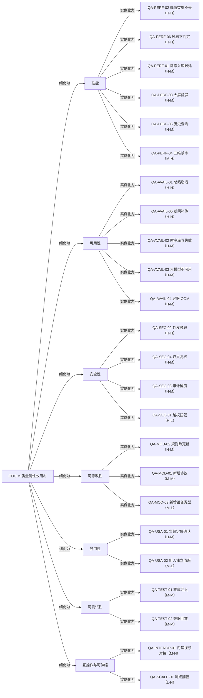

# 质量属性效用树

| 项 | 内容 |
|---|---|
| 文档编号 | CDCIM-P1-SRS-05 |
| 版本 / 状态 | v0.1 · 草案（待评审） |
| 所属阶段 | P1 需求工程 |
| 论文价值 | ★★★★★ ATAM 的输入物与「架构评估」段落的骨架图，效用树可直接作为论文插图（FIG-SRS-01），其（重要性, 难度）二元标注是「敏感点识别」与「优先级排序」的论证依据 |
| 上游依据 | [质量属性场景表 SRS-04](03-质量属性场景表.md)（24 条场景，唯一叶子来源）、[需求规格说明书 SRS](02-需求规格说明书.md)、[业务需求说明书 BRD](01-业务需求说明书-BRD.md)、[约束清单](../01-立项/06-约束清单.md) |
| 下游承接 | P2 的 ATAM 评估报告（敏感点 / 权衡点 / 风险点 / 风险主题）、架构战术选择与 ADR、P5 实现范围裁剪决策 |

> **一致性红线**：本文件的 24 个叶子**全部**来自 [场景表](03-质量属性场景表.md) 的场景编号，不新增、不改名、不合并。若需新增场景，必须先改场景表再回改本文件，两侧编号必须逐一对应。评审时以「叶子编号集合 ⊆ 场景编号集合，且两侧条数相等」为通过条件。

---

## 1. 文档目的

效用树（Utility Tree）回答一个问题：**在资源有限的条件下，应该优先把架构工夫花在哪几个质量属性上**。它把「业务目标」逐层细化为「可判定的场景」，并给每个叶子打上（重要性, 实现难度）二元标签，从而把「什么都重要」的伪共识转化为可排序的清单。

它在 ATAM 中的作用有四个，本文的章节结构与之逐一对应：

| ATAM 步骤 | 效用树的作用 | 本文对应章节 |
|---|---|---|
| 步骤 3：识别架构方法 | 提供「架构需要响应什么」的完整清单 | 第 3 节全图 + 第 4 节明细 |
| 步骤 4：生成质量属性效用树 | 本文件即该步骤的产出物 | 全文 |
| 步骤 5：分析架构方法 | 用（H,H）与（H,M）叶子检验架构方案是否覆盖 | 第 5 节热点分析 |
| 步骤 6：识别风险与敏感点 | 高重要性 + 高难度叶子天然是敏感点候选 | 第 5 节 + 第 7 节映射 |

本文**不重复**场景的六要素描述——那在场景表中。本文只做三件事：把场景挂到质量属性分支上、给每个叶子定级、给出排序与理由。

---

## 2. 构建方法

### 2.1 三层细化路径

```text
业务目标（G-1 ~ G-6 + 合规约束）
   ↓ 归因：这个目标主要受哪一类质量属性影响
质量属性（性能 / 可用性 / 安全性 / 可修改性 / 易用性 / 可测试性 / 互操作与可伸缩）
   ↓ 实例化：在什么条件下、对什么制品、达到什么度量
场景叶子（QA-xxx-nn，含六要素与响应度量）
```

第一层到第二层是**归因**：一个业务目标通常由 1 ~ 2 个质量属性主导。例如 G-2「降低重复告警干扰」主要由性能（判定时延）与可修改性（规则可调）共同支撑，而不是由功能数量支撑。

第二层到第三层是**实例化**：把「可用性要好」落到「消息总线进程崩溃 90 s 后自愈且不丢数据」。这一步的判据是：两个工程师独立阅读后能否得出同一结论。

### 2.2 二元标注规则

每个叶子标注 `（重要性, 实现难度）`，取值 H / M / L。两维的判定规则必须可核查，否则标注退化为印象打分。

| 维度 | 取值 | 判定规则 |
|---|---|---|
| **重要性** | **H** | 场景优先级为 P1：失效即触发业务目标未达成、数据丢失、告警漏推、越权成功或合规不通过（对应场景表 2.3 节的 P1 三条判据） |
| | **M** | 场景优先级为 P2：不达标削弱体验或运维效率，存在降级路径 |
| | **L** | 场景优先级为 P3：可在 P5 裁剪，或属纯设计目标 |
| **实现难度** | **H** | 需 ≥ 3 个组件协同，或受 C-01（8 GB 内存）/ C-02（无 GPU）/ C-03（单机）压制，或要求「不丢 + 有序 + 低时延」三者同时成立 |
| | **M** | 需 1 ~ 2 个组件配合，战术成熟但需调优 |
| | **L** | 单组件内配置或常规工程手段即可达成 |

**关键约定**：重要性直接由场景表的优先级映射而来（P1 → H，P2 → M，P3 → L），两文不得各自解释。这样做的代价是损失了一点表达自由度，收益是消除了「场景表说 P2、效用树说 H」这类跨文档矛盾——在 ATAM 评审中，这类矛盾会直接导致整棵树的可信度被质疑。

### 2.3 为什么是 7 个分支

根节点下共 7 个质量属性分支：性能、可用性、安全性、可修改性、易用性、可测试性、互操作与可伸缩。选择 7 个而非 8 个的理由有两条：

1. **符合「7±2」认知规则**：评审会上人一次能同时处理的分类数量约为 5 ~ 9 个，7 个分支使整棵树在一页内可读，不必翻页；
2. **互操作与可伸缩各只有 1 个叶子**，独立成支会造成「一个叶子一个分支」的失衡结构，合并后该分支的语义仍清晰（都是「与外部或规模的边界」），且在第 6 节作为可裁剪分支整体处理。

代价是牺牲了两类属性的独立可见性。这项取舍在 ATAM 中需要说明，因为「互操作性只有一条 NFR」本身就是一个值得记录的架构风险（见第 8 节 S5-Q1）。

---

## 3. 效用树全图



**图 FIG-SRS-01　CDCIM 质量属性效用树**

> 图注：本图回答「架构工夫应优先花在哪里」。读法是自左向右三层：业务目标经归因得到 7 个质量属性分支，再实例化为 24 个带二元标签的场景叶子。主干节点 8 个（含根），符合「7±2」认知规则；末级叶子不计入主干限制。括号内为（重要性, 实现难度）：左上角密集的（H·H）叶子即 ATAM 的主战场。图中未画业务目标层是为保持主干 ≤ 9，映射关系见第 7 节。

---

## 4. 叶子节点明细

**表 TAB-SRS-30　效用树叶子明细（24 条，按综合排序）**

| 排序 | 叶子编号（= 场景编号） | 属性 | （重要性, 难度） | 标注依据（重要性 / 难度各一句） | 场景优先级 |
|---|---|---|---|---|---|
| 1 | QA-PERF-02 | 性能 | (H, H) | 重要性 H：峰值丢数据直接否定 G-6 与「不丢」硬约束 C-16；难度 H：需采集侧缓存、总线背压、消费并行度三者联动 | P1 |
| 2 | QA-PERF-06 | 性能 | (H, H) | 重要性 H：判定时延是 G-1/G-2 的直接前因；难度 H：200 条告警并发判定叠加抑制与聚类，且 AI 超时不得阻塞 | P1 |
| 3 | QA-AVAIL-01 | 可用性 | (H, H) | 重要性 H：总线是唯一咽喉，崩溃即全链路中断并计入年不可用；难度 H：需本地队列 + 位点续传 + 自愈三件事同时成立 | P1 |
| 4 | QA-AVAIL-05 | 可用性 | (H, H) | 重要性 H：断网 30 min 消耗全年不可用预算 57%（见场景表权衡提示）；难度 H：补传需保序、保时间戳、并触发窗口重算 | P1 |
| 5 | QA-SEC-02 | 安全性 | (H, H) | 重要性 H：脱敏失败即违反 C-09 与 BC-01，M6 全部功能须下架；难度 H：需在 3 类外发路径上全覆盖且可审计 | P1 |
| 6 | QA-PERF-01 | 性能 | (H, M) | 重要性 H：端到端入库时延是「实时监控」的定义性指标；难度 M：单链路优化，战术成熟（就近计算、批量写） | P1 |
| 7 | QA-PERF-03 | 性能 | (H, M) | 重要性 H：首屏超过 3 s 值班员即转向旧平台，G-1 失效；难度 M：缓存 + 增量推送 + 骨架屏即可达标 | P1 |
| 8 | QA-AVAIL-03 | 可用性 | (H, M) | 重要性 H：C-14 要求 AI 缺失时业务完整，属架构红线；难度 M：旁路隔离已在设计中，难点在占位与超时治理 | P1 |
| 9 | QA-PERF-05 | 性能 | (H, M) | 重要性 H：G-4 的「可查」若无响应保证即形同未达成；难度 M：降采样表 + 分区裁剪 | P1 |
| 10 | QA-AVAIL-02 | 可用性 | (H, M) | 重要性 H：写失败若丢数据即违反 C-16；难度 M：停位点 + 续写为标准战术 | P1 |
| 11 | QA-AVAIL-04 | 可用性 | (H, M) | 重要性 H：单容器 OOM 在 8 GB 配额下属高概率事件；难度 M：限额 + 健康检查 + 降级 | P1 |
| 12 | QA-SEC-04 | 安全性 | (H, M) | 重要性 H：门禁属物理安全边界，越权后果不可逆；难度 M：双人复核 + 类型校验，逻辑复杂但技术简单 | P1 |
| 13 | QA-SEC-03 | 安全性 | (H, M) | 重要性 H：等保三级强制项，C-10 硬约束；难度 M：只追加表 + 查询索引 | P1 |
| 14 | QA-MOD-02 | 可修改性 | (H, M) | 重要性 H：规则不可热更新则每次调参都要停机，G-2 无法持续优化；难度 M：配置中心 + 灰度路由 | P1 |
| 15 | QA-USA-01 | 易用性 | (H, M) | 重要性 H：3 次点击定位是 G-1/G-3 的人机侧前提；难度 M：钻取路径与 3D 定位需协同 | P1 |
| 16 | QA-SEC-01 | 安全性 | (H, L) | 重要性 H：越权成功即合规不通过；难度 L：网关鉴权 + RBAC 中间件，属常规实现 | P1 |
| 17 | QA-INTEROP-01 | 互操作性 | (M, H) | 重要性 M：BR-07 为 S 类且有降级路径；难度 H：两套外部平台协议异构，超时与回落分支多 | P2 |
| 18 | QA-PERF-04 | 性能 | (M, H) | 重要性 M：3D 属 C 类，可回落 2D；难度 H：无 GPU 下保 20 fps 需 LOD + 实例化 + 降级策略 | P2 |
| 19 | QA-MOD-01 | 可修改性 | (M, M) | 重要性 M：新协议接入不阻塞现有业务；难度 M：适配器 SPI 已预留，需验证契约稳定性 | P2 |
| 20 | QA-TEST-01 | 可测试性 | (M, M) | 重要性 M：不达标则无法量化验证 G-1 ~ G-3；难度 M：模拟器 + 注入开关 + 埋点 | P2 |
| 21 | QA-TEST-02 | 可测试性 | (M, M) | 重要性 M：规则变更前的回归手段，影响交付效率；难度 M：打标隔离 + 结果比对 | P2 |
| 22 | QA-MOD-03 | 可修改性 | (M, L) | 重要性 M：新设备类型属常规扩容；难度 L：只改元数据与模板 | P2 |
| 23 | QA-USA-02 | 易用性 | (M, L) | 重要性 M：培训成本影响交接效率但不影响正确性；难度 L：界面信息层级优化 | P2 |
| 24 | QA-SCALE-01 | 可伸缩性 | (L, H) | 重要性 L：C-17 只承诺「按 2000 验收」；难度 H：单机 8 GB 下规模翻倍受内存硬顶 | P3 |

**排序规则**（可复现，不依赖印象）：先按重要性降序（H > M > L），同档内按难度降序（H > M > L），再同档内按「对 G-1 ~ G-6 的直接影响强度」降序。第 6 ~ 8 位的 QA-PERF-01、QA-PERF-03、QA-AVAIL-03 三者同属（H, M）且均直接影响 G-1/G-6，排序差异仅为 1 位，评审时不宜过度解读。

---

## 5. 热点分析

### 5.1 （H, H）叶子：5 条，ATAM 主战场

**表 TAB-SRS-31　（H, H）叶子及为何优先**

| 叶子 | 场景要点 | 为何优先（ATAM 视角） | 可能的架构战术方向（P2 论证，本文不决策） |
|---|---|---|---|
| QA-PERF-02 | 1800 msg/s 持续 10 min，丢弃 0、lag ≤ 10 s | 高重要性与高难度同时成立，且直接约束中间的选型：内存受限下不能用重型集群，只能靠背压 + 本地缓存补位。它是「性能 vs 可用性」的天然权衡点 | 背压传导、消费端水平扩展、批量写、分区键避免热点 |
| QA-PERF-06 | 3 min 内 200 条原始告警，判定 P99 ≤ 3 s，收敛 ≤ 5 个事件 | 风暴期正是告警系统最需要正确的时刻，却是资源最紧张的时刻，二者冲突构成典型敏感点：抑制窗口调大则漏报、调小则风暴 | 流式就地判定、抑制与聚类并行、AI 旁路隔离 |
| QA-AVAIL-01 | 总线崩溃 90 s，自愈 ≤ 30 s，丢 0 条 | 总线是单点，也是「不丢」与「低时延」的公共依赖。它把可用性要求反向压到采集侧（必须有本地队列），跨组件耦合度最高 | 采集侧磁盘队列、位点手动提交、健康检查与快速重启 |
| QA-AVAIL-05 | 断网 30 min，补传 5 min 内完成，时间戳偏差 0 | 唯一一条能直接量化「消耗多少可用性预算」的场景，它把技术选择（队列容量）与业务指标（99.99%）连成一条可计算的链，是论文中最有说服力的权衡实例 | 本地队列容量、补传并发限速、事件时间水位线 |
| QA-SEC-02 | 100 条外发请求，敏感信息出现 0 次 | 合规红线与外部依赖的交点：一旦脱敏有漏，不是降级而是整体下架，风险等级最高；且需覆盖 3 条外发路径，遗漏一条即失败 | 脱敏中间件强制串接、白名单校验、外发前拦截 |

排序理由：这 5 条构成项目的「不可退让区」。ATAM 中应优先用它们检验架构方案，任一条无可行战术，则方案需回退到架构风格层面重选，而不是在详细设计层打补丁。

### 5.2 （H, M）叶子：10 条，必须满足但战术成熟

这 10 条（QA-PERF-01/03/05、QA-AVAIL-02/03/04、QA-SEC-03/04、QA-MOD-02、QA-USA-01）重要性同为 H，难度降一档。它们的共同特征是：**存在业界成熟战术，风险不在「能不能做」而在「是否被认真做」**。ATAM 中对这类叶子的检查方式应从「有没有方案」转为「方案是否被写进验收判据」——例如 QA-AVAIL-03（大模型不可用）本身不难，难的是团队是否真的会在每次联调时断开模型验证降级。

### 5.3 热点结论

（H, H）5 条 + （H, M）10 条 = 15 条 H 级叶子，占 62.5%。这个比例偏高，说明本项目在「必须满足」一侧的负担很重，也解释了为什么 P5 必须裁剪 C 类功能而不能削减 NFR——H 级叶子对应的是 28 条不可裁剪的 NFR。

**表 TAB-SRS-32　优先级 Top8（供 P2 的 ATAM 按序评估）**

| 名次 | 叶子 | （重要性, 难度） | 一句话理由 |
|---|---|---|---|
| 1 | QA-PERF-02 峰值突增不丢 | (H, H) | 同时约束消息中间件选型与采集侧缓存设计，是架构风格层面的约束 |
| 2 | QA-PERF-06 风暴下判定 | (H, H) | 高负载与高正确性同时要求，是降噪策略的核心敏感点 |
| 3 | QA-AVAIL-01 总线崩溃 | (H, H) | 单点故障 + 不丢数据 + 快速自愈三重约束，跨组件耦合最深 |
| 4 | QA-AVAIL-05 断网补传 | (H, H) | 唯一可量化「可用性预算消耗」的场景，权衡关系最清晰 |
| 5 | QA-SEC-02 外发脱敏 | (H, H) | 合规红线，失败即整体功能下架，无中间状态 |
| 6 | QA-PERF-01 稳态入库时延 | (H, M) | 「实时」的定义性指标，也是其余性能场景的基线 |
| 7 | QA-PERF-03 大屏首屏 | (H, M) | G-1 的人机入口，超过 3 s 则值班员回流旧平台 |
| 8 | QA-AVAIL-03 大模型不可用 | (H, M) | C-14 的直接检验点，旁路架构是否真实成立在此一举 |

Top8 的构成：性能 4、可用性 3、安全 1。这一分布与「监控系统的核心价值是数据不丢、告警不漏、时延可控」的判断一致；安全只占 1 席不是因为它不重要，而是因为其可用的战术最成熟（QA-SEC-01 难度 L、QA-SEC-03 难度 M），风险集中在脱敏这一条路径上。

---

## 6. 非热点与可裁剪场景

### 6.1 （L, *）场景

仅 1 条：**QA-SCALE-01（L, H）**。它是全树唯一重要性为 L 的叶子，原因是 C-17 明确「按 2000 验收、按万级设计」，4000 测点属增长场景而非当前验收范围。但难度为 H——单机 8 GB 内存下规模翻倍的瓶颈是内存而非 CPU，这也是它排在末位却仍需在架构中预留分区键的原因：**可以不做实测，不能不留余地**。

### 6.2 可裁剪清单（P5 使用）

**表 TAB-SRS-33　可裁剪场景与裁剪代价**

| 叶子 | 档位 | 裁剪条件 | 裁剪后的替代承接 | 裁剪代价 |
|---|---|---|---|---|
| QA-SCALE-01 | P3 | 工期紧张时不实测 4000 测点 | 保留分区键设计与线性外推推导（B-04） | 论文无法给出扩展性实测证据，只能写「按 2000 验证、按万级推导」 |
| QA-PERF-04 | P2 | 随 FR-M5-03 一起裁掉 3D | 2D 平面图承接设备状态、告警定位、热力着色（FR-M5-07） | 失去「态势感知」的直观性，BR-10 降级为 2D 达成 |
| QA-USA-02 | P2 | 培训考核样本不足时可只做定性 | 保留界面信息层级设计，考核改为 1 人 1 轮 | 新人上手时长的证据强度下降 |
| QA-MOD-03 | P2 | 新设备类型延后 | 保留测点模板机制 | BR-05 的巡检项扩展延后 |

**不可裁剪清单**：其余 20 条（含全部 15 条 H 级叶子）。理由：H 级叶子对应 28 条不可裁剪的 NFR，裁剪即将 G-1 ~ G-6 中的至少一项置于未达成状态。

---

## 7. 与业务的映射

**表 TAB-SRS-34　效用树分支 → 业务目标**

| 分支 | 主导业务目标 | 支撑关系说明 | 分支内叶子数 |
|---|---|---|---|
| 性能 | G-1、G-2、G-4、G-6 | G-1（响应 ≤ 1 min）直接由判定时延与首屏决定；G-2 的降噪效果依赖风暴期判定仍准确；G-4 的「可查」依赖历史查询响应 | 6 |
| 可用性 | G-6 | 99.99% 的年可用性由「单点故障是否可自愈」「断网是否可补」「外部依赖缺失是否降级」三者合成，是本分支四条场景的并集 | 5 |
| 安全性 | 无 G 编号，对应 BR-08 与 C-08 / C-09 / C-10 | 安全属合规驱动而非业务目标驱动。这一点在 ATAM 中须显式说明：它不参与「业务价值」排序，但具有一票否决权 | 4 |
| 可修改性 | G-2、G-5 | G-2 需要持续调参（规则热更新），G-5 的巡检扩展需要新设备类型快速接入 | 3 |
| 易用性 | G-1、G-3 | G-1 的 1 min 响应含人机操作时间；G-3 的 5 min 定位依赖 3 次点击内到达设备 | 2 |
| 可测试性 | 间接支撑 G-1 ~ G-3 | 本身不对应业务目标，但它是「业务目标能否被验证」的前提：没有故障注入与回放，G-1/G-2/G-3 的达成只能靠主观判断 | 2 |
| 互操作与可伸缩 | G-1、C-17 | 门禁视频对接服务 G-1 的现场确认环节；规模翻倍不对应业务目标，对应设计约束 C-17 | 2 |

三点观察：

1. **G-6 被两个分支共同支撑**（性能的峰值场景、可用性的全部场景）。这意味着年可用性指标不是可用性分支的「独占责任」，只做容错不做背压，同样达不到 99.99%；
2. **安全性分支无业务目标编号**，是本文最需要解释的一处。它提醒评审：合规要求不应被折算成业务收益，否则会在资源紧张时被首先牺牲——这正是等保类项目最常见的失败模式；
3. **G-5 只出现在可修改性分支的一个叶子上**（QA-MOD-03），说明「巡检替代率 75%」这一目标在质量属性层面几乎没有架构压力，其风险主要在业务侧（巡检项清单未定，见 SRS 第 10 节 Q-5），而非技术侧。这个判断应写进 ATAM 的风险清单。

---

## 8. 待确认事项

| # | 待确认点 | 本文暂定 | 影响面 | 建议 |
|---|---|---|---|---|
| S5-Q1 | **互操作与可伸缩合并为一个分支是否可接受** | 合并为 1 个分支，共 2 个叶子 | 效用树的「7±2」合规性；互操作性缺独立 NFR 的问题被掩盖 | 建议保持合并（否则会出现两个单叶子分支），但在 ATAM 报告中把「互操作性仅 1 条叶子且无独立 NFR」列为**架构风险**，并在 SRS v0.3 增补 NFR-INTEROP-01。若 SRS 增补，本分支可拆为两个 |
| S5-Q2 | **（H, M）10 条是否应全部进入 ATAM 评估范围** | 全部进入，但 Top8 优先 | P2 阶段 ATAM 的工作量（每条需 1 次场景走查） | 建议分两轮：第一轮只走 Top8（约 1 次评审会），第二轮对其余 7 条 H 级做书面核验。若工期紧张，可只做 Top8 并在报告中声明其余为「未走查」 |
| S5-Q3 | **排序第 6 ~ 8 位是否存在过度解读风险** | 按「业务目标影响强度」排定，差异仅 1 位 | 评审对排序权威性的质疑 | 建议在 ATAM 报告中声明：同档内排序仅用于确定评审顺序，不代表价值高低；Top5（全部为（H, H））才是真正的不可退让集合 |

---

## 考点映射

| 考纲知识点 | 本文件对应内容 | 论文可用位置 | 真题溯源 |
|---|---|---|---|
| 质量属性效用树（Utility Tree） | 第 3 节 FIG-SRS-01 全图 + 第 4 节 24 个叶子明细 | 论文「架构评估」段的核心插图与论证 | 2022 下、2023 上、2024 上 架构评估 |
| 效用树的构建方法 | 2.1 节「业务目标 → 质量属性 → 场景」三层细化 | 论文「架构评估」段说明如何从需求推导评估输入 | 2023 上 架构评估 |
| （重要性, 难度）二元标注 | 2.2 节判定规则 + 第 4 节标注依据两列 | 论文「架构权衡」段说明优先级如何得出 | 案例分析常考「优先级依据」 |
| ATAM 步骤与产出 | 第 1 节「ATAM 步骤 → 效用树作用」映射表 | 论文「架构评估」段的方法论框架 | 2024 上、2025 上 架构评估 |
| 敏感点与权衡点识别 | 第 5 节热点分析（含 QA-PERF-02/06、QA-AVAIL-05 的权衡说明） | 论文「架构设计」段的取舍论述 | 2023 上 架构评估、2024 下 软件可靠性 |
| 架构风险识别 | 第 7 节观察 2（安全性无业务目标）、第 8 节 S5-Q1（互操作 NFR 缺位） | 论文「经验总结」段的风险与不足 | 评分要求「风险识别到位」 |

## 论文可引用段落

> 本段适用于「系统架构设计」「架构评估」「软件可靠性」类论文的架构评估部分。
>
> 在进入架构设计之前，我先构建了质量属性效用树。树的根是业务目标，第二层是 7 个质量属性分支，第三层是 24 个场景叶子，每个叶子标注重要性与实现难度两个维度，取值均为高、中、低。标注规则是事先约定的：重要性由场景优先级映射，凡失效即导致数据丢失、告警漏推或合规不通过者为高；难度则以「是否需要三个以上组件协同、是否受 8 GB 内存与无 GPU 约束压制」为判据，避免退化为印象打分。结果是 15 个叶子的重要性为高，其中 5 个同时具备高难度，分别是峰值突增不丢数据、告警风暴下的判定时延、消息总线崩溃自愈、单机房断网补传与送模前脱敏。这 5 条构成了项目的不可退让区，也是 ATAM 评估中优先走查的对象。分支控制在 7 个而非按属性逐一展开，是为符合一次评审能处理的分类数量；代价是互操作与可伸缩被迫合并，我把这一取舍本身作为架构风险写进了评估报告。我的体会是，效用树的价值不在于画出漂亮的树，而在于它强迫团队回答一个平时会回避的问题：如果只能做好五件事，是哪五件。

## 变更记录

| 版本 | 日期 | 变更 |
|---|---|---|
| v0.1 | 2026-11-26 | 初稿。含 7 分支 24 叶子的效用树全图（FIG-SRS-01）、叶子明细与排序、热点分析（(H,H) 5 条）、Top8 清单、可裁剪清单、业务映射与 3 项待确认 |
