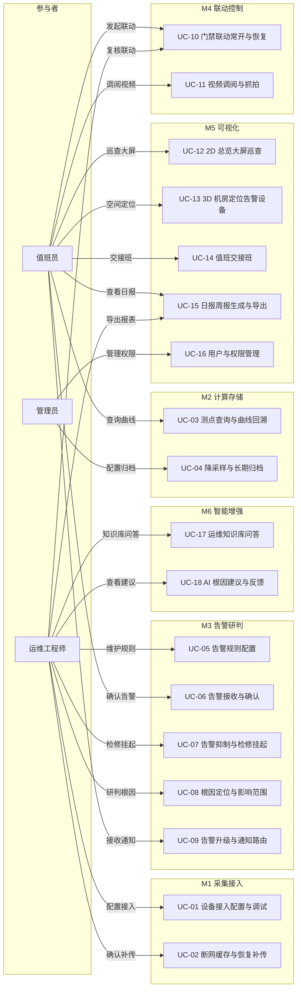

# 用例规约集（Use Case Specifications）

| 项 | 内容 |
|---|---|
| 文档编号 | CDCIM-P1-SRS-02 |
| 版本 / 状态 | v0.1 · 草案（待评审） |
| 所属阶段 | P1 需求工程 |
| 论文价值 | ★★★★☆ UML 用例建模的落地物，直接支撑论文「需求分析」段的用例建模过程、「面向对象建模」段的参与者与用例关系论述，以及「需求验证」段的场景可测试性论证 |
| 上游依据 | [需求规格说明书 SRS](02-需求规格说明书.md)（69 条 FR、31 条 NFR）、[业务需求说明书 BRD](01-业务需求说明书-BRD.md)（BR-01 ~ 12）、[质量属性场景表](03-质量属性场景表.md)（24 条 QA）、[文档规范](../90-规范/01-文档规范.md)、[图表规范](../90-规范/02-图表规范.md) |
| 下游承接 | P2 逻辑视图（用例 → 组件职责的映射依据）、P3 时序图与告警状态机、P6 功能测试用例（每条主成功场景可直接派生 1 条正向用例、每条异常流派生 1 条负向用例）、RTM（SRS-06） |

> **口径声明**：本文所有数值与 [SRS](02-需求规格说明书.md) 完全一致，不新增指标、不改阈值。凡本文写「≤」「≥」者均为**目标值**（验收门槛），实测数据只在 P6 产生。角色仅三类（值班员、运维工程师、管理员），不做第四类角色、不做多租户。

---

## 1. 文档目的与范围

### 1.1 目的

SRS 回答「系统应做什么、做到什么程度」，本文回答「**谁在什么情况下、按什么顺序、与系统交换什么，才算做成了**」。两者不可互相替代：SRS 的 69 条功能需求是**能力清单**，用例规约是**使用过程的切片**，后者才能暴露「能力之间的先后依赖、失败分支、权限边界」这三类在需求表里看不出来的问题。

本文承担四项职能：

1. **为测试提供可执行脚本的骨架**：主成功场景的每一步都可直接转成一条操作步骤与一条预期结果，异常流直接转成负向用例，避免测试人员自行发挥；
2. **为架构提供职责切分依据**：每条用例的参与者与系统交互序列，是 P2 划分组件边界、P3 绘制时序图的输入；
3. **为权限设计提供反向验证**：三类角色的「可做/不可做」在用例层被固化为具体动作，越权路径在异常流中被显式写出，NFR-SEC-02 的「越权 100% 返回 403」由此有可执行的验证对象；
4. **为论文提供 UML 建模素材**：参与者、用例、关系（关联/包含/扩展）三要素齐备，可直接支撑用例图与用例规约的写作。

### 1.2 范围

**本文覆盖**：18 条用例的完整规约（参与者、目标、前置、触发、主成功场景、扩展流、异常流、后置、业务规则、关联 FR/QA、优先级、频率）、参与者定义、用例总览图、用例与需求的双向覆盖核对、3 项待确认。

**本文不覆盖**：

| 不覆盖内容 | 归属文档 |
|---|---|
| 类图、对象图、组件图 | P2 / P3 详细设计 |
| 时序图与状态机的完整绘制 | P3 详细设计（本文只给状态迁移的文字约束） |
| 界面布局、控件规格 | P3 界面原型 |
| 测试用例的步骤细化与测试数据 | P6 测试用例 |
| 性能与可靠性的实测方法 | SRS-04 场景表、P6 测试方案 |

### 1.3 与上下游的计数关系

| 项 | 数量 | 说明 |
|---|---|---|
| 参与者 | 3 类 | 值班员、运维工程师、管理员，与 SRS 3.2 一致 |
| 用例 | 18 条 | UC-01 ~ UC-18，覆盖 M1 ~ M6 六个模块 |
| 主成功场景步骤 | 5 ~ 6 步/条 | 共 100 步，平均 5.6 步 |
| 异常流 | 每条 ≥ 3，共 75 条 | 最少 3 条（UC-03）、最多 5 条（UC-10/16/17/18），覆盖断网、越权、超时、并发冲突、数据不一致、外部平台不可用六类 |
| 关联 FR | 69 条全覆盖 | 直接覆盖 56 条、间接覆盖 13 条、未覆盖 0 条（见第 6 节） |
| 关联 QA | 22 条挂载 | 24 条场景中 22 条作为用例的「关联 QA」字段挂载；未挂载的 2 条为 QA-PERF-02（峰值吞吐）与 QA-SCALE-01（规模翻倍），二者属压测与容量推导，仅在 6.3 中被提及，不在用例层承接 |

---

## 2. 参与者定义

### 2.1 三类角色

**表 TAB-SRS-30　参与者职责边界**

| 项 | 内容 |
|---|---|
| **值班员** | |
| 典型人员 | 7×24 值班岗，2 人轮班，每班 12 h |
| 核心诉求 | 少被打扰、快定位、操作简单（BRD 第 5 节） |
| 可做 | 查看 2D 大屏与 3D 视图、查看与确认告警、查看测点曲线、发起门禁/视频联动（需二次确认，且门禁需第二人复核）、填写交接班记录、查看日报 |
| 不可做 | 修改告警规则与阈值、修改设备与测点台账、导出全量历史数据、执行批量删除、管理用户、挂起检修、使用知识库的厂商内部文档 |
| 在用例中的位置 | UC-03、UC-06、UC-07（查看）、UC-08（查看结论）、UC-10（发起）、UC-11、UC-12、UC-13、UC-14、UC-15（查看）、UC-17（受限） |
| **运维工程师** | |
| 典型人员 | 环境与设备组、电气组，负责设备与规则的专业判断 |
| 核心诉求 | 保留专业判断权、不被系统误导（BR-09 人在回路） |
| 可做 | 值班员全部权限 + 配置告警规则（阈值/持续/变化率）、配置联动策略、维护设备与测点台账、执行巡检任务与复核结论、查看能效与容量分析、使用 AI 根因建议与知识库问答、发起检修挂起、复核门禁联动 |
| 不可做 | 管理用户与角色、修改或删除审计日志、变更系统级参数、远程调节空调、自我复核自己提交的门禁操作 |
| 在用例中的位置 | UC-01、UC-03、UC-04（聚合质量核对）、UC-05、UC-06、UC-07（挂起）、UC-08、UC-10（复核）、UC-15、UC-17、UC-18 |
| **管理员** | |
| 典型人员 | 系统管理员 |
| 核心诉求 | 合规可审计、系统可控、责任可追 |
| 可做 | 用户与角色管理、系统参数配置、审计日志查询与导出、备份恢复、查看系统自身监控、数据归档策略配置 |
| 不可做 | 删除或修改审计日志（只追加）、绕过双人复核执行门禁操作、代替运维工程师配置告警规则（职责分离） |
| 在用例中的位置 | UC-16（主）、UC-04（归档策略）、UC-15（模板与订阅） |

**系统作为参与者**：UC-02（采集侧缓存与补传）、UC-04（降采样与归档）、UC-09（通知路由与升级）、UC-15（定时生成报表）四条用例的**主动发起方是系统自身**（定时器或内部事件），人为参与者只承担观察与确认职责。这四类在 UML 中属于「时间触发」用例，本文在参与者栏显式标注「系统（主）」，避免把定时任务误画成人工操作。

### 2.2 参与者与用例的关系

四条关系规则，直接决定用例图的连线：

| 关系 | 说明 | 本文示例 |
|---|---|---|
| **关联（association）** | 参与者主动发起或实质参与该用例，图上画实线 | 值班员 → UC-06 告警接收与确认 |
| **包含（include）** | 多个用例共同复用的必经子流程 | UC-06、UC-12、UC-13 均包含「权限校验与审计写入」；UC-10、UC-11 均包含「人工确认」 |
| **扩展（extend）** | 在特定条件下追加的行为，主线不依赖它 | UC-08 的「手工指定根因」扩展 UC-08 主流程；UC-13 的「回落 2D」扩展 3D 定位 |
| **泛化（generalization）** | 参与者之间的继承 | 运维工程师泛化值班员（拥有其全部权限）；本文**不使用**参与者泛化连线，改为在 2.1 用「值班员全部权限 +」文字表达，理由是图上泛化箭头会与「不可做」的差异冲突，画出来反而误导 |

### 2.3 权限硬规则（用例层的约束）

| # | 规则 | 在用例中的落点 |
|---|---|---|
| 1 | 最小权限：默认拒绝，未授予操作返回 403 并记审计 | 除 UC-09（系统内部通知路由，无人工写操作）外，各用例异常流均有「越权」分支；UC-16 主流程第 2 步给出角色矩阵 |
| 2 | 职责分离：规则配置（运维工程师）与门禁复核（另一人）不得由同一人持有 | UC-05 异常流 E3、UC-10 异常流 E1、UC-16 异常流 E4 |
| 3 | 不可抵赖：所有写操作留操作人与时间戳，审计不可改删 | UC-16 异常流 E3、UC-10 后置条件 |
| 4 | AI 只读：AI 输出不得作为任何控制动作的入参 | UC-10 异常流 E3、UC-18 异常流 E2 |

---

## 3. 用例总览图

**图 FIG-SRS-01　CDCIM 用例总览**

**图注**：本图回答「三类角色各自把哪些用例当成日常动作」——值班员的连线集中在 M3、M5（确认、巡查、定位、交接），运维工程师的连线集中在 M1、M3、M6（配置、研判、增强），管理员只有两条线（权限、归档策略）。连线的疏密本身就是权限边界的可视化：值班员到 UC-05（规则配置）、UC-16（权限管理）没有任何连线，这正是「值班员不可修改规则、不可管理用户」在模型上的表达。

**图中未画出的两条关系**（避免图形拥挤，改由文字声明）：

1. **包含关系**：UC-06 / UC-12 / UC-13 共同包含「身份校验 + 审计写入」子流程；UC-10 / UC-11 共同包含「人工二次确认」子流程。P2 设计时该子流程应作为横切能力实现，不在每条用例内重复开发。
2. **扩展关系**：UC-13 的「WebGL 不可用回落 2D」扩展 3D 主流程（FR-M5-07）；UC-18 的「AI 不可用占位」扩展建议展示主流程（FR-M6-03）。

> **与图表规范的偏差声明**：《图表规范》第 4 节第 7 条要求单图主干节点控制在 7±2 个，本图含 18 个用例节点，属**有意超限**，目的是在一张图上完整呈现「角色—模块—用例」的三元关系，作为索引图使用。论文排版时须拆为 6 张模块级用例图（M1 2 个、M2 2 个、M3 5 个、M4 2 个、M5 5 个、M6 2 个），每张只保留该模块的用例与相关参与者，本图不直接进论文正文，仅作附录索引。

---

## 4. 用例清单

**表 TAB-SRS-31　用例清单（18 条）**

| 用例编号 | 用例名 | 主要参与者 | 所属模块 | 优先级 | 关联 FR | 关联 QA |
|---|---|---|---|---|---|---|
| UC-01 | 设备接入配置与调试 | 运维工程师 | M1 采集接入 | 高（M） | FR-M1-01/02/03/04/09/10、FR-M2-09 | QA-MOD-01、QA-PERF-01 |
| UC-02 | 断网期间数据缓存与恢复补传 | 系统（主）、运维工程师 | M1 采集接入 | 高（M） | FR-M1-05/06/07/08、FR-M2-05/06/07 | QA-AVAIL-05、QA-AVAIL-01 |
| UC-03 | 测点数据查询与曲线回溯 | 值班员、运维工程师 | M2 计算存储 | 高（M） | FR-M2-02/04、FR-M5-08、FR-M1-05 | QA-PERF-05 |
| UC-04 | 降采样与长期归档 | 系统（主）、管理员、运维工程师 | M2 计算存储 | 高（M） | FR-M2-01/03/05/06/08/10 | QA-TEST-02、QA-AVAIL-02 |
| UC-05 | 告警规则配置 | 运维工程师 | M3 告警研判 | 高（M） | FR-M3-01/02/03/04/12、FR-M2-10 | QA-MOD-02、QA-TEST-01 |
| UC-06 | 告警接收与确认 | 值班员 | M3 告警研判 | 高（M） | FR-M3-09/10、FR-M5-09/02 | QA-PERF-06、QA-USE-01 |
| UC-07 | 告警抑制与检修挂起 | 运维工程师、值班员 | M3 告警研判 | 高（M） | FR-M3-05/06/13/14 | QA-PERF-06、QA-MOD-02 |
| UC-08 | 根因定位与影响范围查看 | 运维工程师 | M3 告警研判 | 高（M） | FR-M3-06/07/08、FR-M5-04 | QA-PERF-06、QA-USE-01 |
| UC-09 | 告警升级与通知路由 | 系统（主）、值班员 | M3 告警研判 | 高（M） | FR-M3-04/10/11 | QA-AVAIL-04、QA-PERF-06 |
| UC-10 | 告警触发门禁联动（常开/恢复） | 值班员、运维工程师 | M4 联动控制 | 高（M） | FR-M4-01/02/03/05/06/08/09 | QA-INTEROP-01、QA-SEC-04 |
| UC-11 | 视频调阅与抓拍 | 值班员 | M4 联动控制 | 中（S） | FR-M4-01/04/07 | QA-INTEROP-01 |
| UC-12 | 2D 总览大屏巡查 | 值班员 | M5 可视化 | 高（M） | FR-M5-01/02/12、FR-M6-11 | QA-PERF-03、QA-USE-01 |
| UC-13 | 3D 机房定位告警设备 | 值班员 | M5 可视化 | 中（C） | FR-M5-03/04/05/06/07 | QA-PERF-04 |
| UC-14 | 值班交接班 | 值班员 | M5 可视化 | 中（S） | FR-M5-11 | QA-USE-02 |
| UC-15 | 日报/周报生成与导出 | 系统（主）、运维工程师 | M5 可视化 | 中（S） | FR-M2-11/12、FR-M5-10 | QA-MOD-03、QA-PERF-05 |
| UC-16 | 用户与权限管理 | 管理员 | M5 可视化 | 高（M） | FR-M4-06、FR-M5-13 | QA-SEC-01、QA-SEC-03 |
| UC-17 | 运维知识库问答 | 运维工程师、值班员 | M6 智能增强 | 中（S） | FR-M6-04/05/06/07/09 | QA-AVAIL-03、QA-SEC-02 |
| UC-18 | AI 根因建议查看与反馈 | 运维工程师 | M6 智能增强 | 中（S） | FR-M6-01/02/03/08/10/11 | QA-AVAIL-03、QA-SEC-04 |

> 优先级取自 SRS 第 8 节的 MoSCoW 分档，取该用例所覆盖 FR 中**最高**的一档：含 M 类 FR 即为高，全为 S 类为中，仅 C 类为低。UC-13 的五条 FR 均为 C 类，故标中（C），并随 3D 裁剪规则一并处理。

---

## 5. 用例规约详述

### 5.1 M1 采集接入

#### UC-01 设备接入配置与调试

| 项 | 内容 |
|---|---|
| 用例编号 | UC-01 |
| 用例名称 | 设备接入配置与调试 |
| 参与者 | 运维工程师（主）、系统（采集适配层） |
| 目标 | 新增一台设备（含 10 个测点）的接入配置在 10 min 内完成，首帧数据 30 s 内入库且质量码为 Good |
| 前置条件 | ① 工程师已登录且具备「设备台账维护」权限；② 设备已开通 Modbus TCP / SNMP v2c·v3 / MQTT 只读接口；③ 设备所属机房、列、机柜已在拓扑中登记；④ 内网 NTP 已同步，时钟偏差 ≤ 100 ms |
| 触发条件 | 新设备上架，或既有设备更换通信参数（地址、端口、认证凭据、寄存器映射） |
| 主成功场景 | 1）工程师在设备台账新建设备，选择协议类型，填地址、端口、轮询周期（快变 5 s / 慢变 30 s）。 2）系统按设备类型加载测点模板，工程师选中模板并批量导入 10 个测点的寄存器地址 / OID / Topic、数据类型、量纲、换算系数、死区（默认 0.5% 量程）。 3）系统逐行校验地址重复、类型越界、系数缺失，一次性列出全部错误；校验通过后保存并广播元数据变更事件。 4）工程师点击「连通性测试」，系统建立一次只读会话，返回首帧原始值、采集时间戳与质量码。 5）系统在 30 s 内完成首帧入库，设备状态由「未知」转「在线」，采集按 5 s / 30 s 分频调度运行。 6）工程师在测点详情核对换算值与原始值，确认量纲正确，接入完成。 |
| 扩展流 | 3a 模板导入存在错误行：系统列出错误行号与原因，工程师修正后重传，已成功行不重复入库。 4a 首帧质量码为 Uncertain（超量程）：系统不改设备在线状态，仅将该测点标 Uncertain，提示核对量程与系数。 6a 同类设备批量接入（如 40 机柜）：工程师复用模板批量导入，系统在 10 min 内完成并给出「成功 N 条 / 失败 M 条」报告。 |
| 异常流 | E1 **协议连通失败**（超时 3 s、重试 1 次仍失败）：系统将设备置「未知」，返回失败原因（连接拒绝 / 认证失败 / 无响应），不写入任何测点，配置以草稿保存并记审计；连续 3 个采集周期无响应转「离线」并生成设备离线告警。 E2 **SNMP v3 认证失败**：系统**不重试**（防账户锁定），记录一次认证失败审计，提示核对凭据，设备保持「未知」。 E3 **越权**：值班员调用台账保存接口，系统返回 403 并记审计，配置不生效。 E4 **并发冲突**：两名工程师同时编辑同一设备（同一版本号），后提交者收到 409 与最新内容，须基于最新版本重新编辑，不覆盖他人修改。 |
| 后置条件 | 设备与测点台账生效；元数据变更事件在 30 s 内被采集、告警、可视化三方消费且三方进程重启次数为 0；审计含操作人、设备、变更前后值 |
| 业务规则 | 仅支持 Modbus TCP / SNMP / MQTT 三类协议，新增协议只加适配器（≤ 2 个文件）不改下游；快变 5 s、慢变 30 s，慢变不占用快变时隙；死区默认 0.5% 量程，距上次写入 ≥ 5 min 强制写心跳；时间戳统一 UTC 毫秒并标 `ts_source`（device / gateway）；单设备超时不阻塞其他设备 |
| 关联 FR | FR-M1-01、FR-M1-02、FR-M1-03、FR-M1-04、FR-M1-09、FR-M1-10、FR-M2-09 |
| 关联 QA | QA-MOD-01（新增第 4 类协议）、QA-PERF-01（首帧入库时延） |
| 优先级 | 高（M） |
| 频率 | 每周 1 ~ 3 次（新接入或参数变更） |

#### UC-02 断网期间数据缓存与恢复补传

| 项 | 内容 |
|---|---|
| 用例编号 | UC-02 |
| 用例名称 | 断网期间数据缓存与恢复补传 |
| 参与者 | 系统（采集侧，主）、运维工程师（观察与确认） |
| 目标 | 单机房断连 30 min 内丢失 0 条数据，恢复后 5 min 内按事件时间补齐且时间戳与原始采集时刻偏差 0 ms |
| 前置条件 | ① 该机房设备已在线；② 采集侧本地磁盘队列已配置 ≥ 150 MB 配额（覆盖峰值 30 min）；③ 全链路时钟已与 NTP 同步；④ 消息总线 QoS 1 已启用 |
| 触发条件 | 采集网关与消息总线 / 平台之间链路中断，或总线、消费进程被终止 |
| 主成功场景 | 1）采集侧连续 3 次发布失败（约 15 s）后判定断连，切换为本地磁盘队列按事件时间追加写入。 2）系统在界面将该机房标记「数据延迟」，队列水位 > 80% 时生成「缓存水位高」一般告警。 3）断连期间采集以 600 点/秒持续落盘（30 min 约 108 万条），设备按连续 3 个周期无响应判「离线」并生成状态事件。 4）链路恢复后，系统从队列头部按事件时间顺序批量补传，保留原始时间戳与质量码。 5）补传数据按 `(device_id, point_id, ts)` 幂等写入，重复消息覆盖写不产生重复记录。 6）系统核对发送计数与库内增量，5 min 内队列清零，界面「数据延迟」标记消失。 |
| 扩展流 | 3a 队列水位达 100%（配额耗尽）：系统丢弃最旧的 Stale 数据并计数，生成「缓存溢出」重要告警，保留丢弃计数供补传后核对。 5a 迟到 ≤ 60 s 的数据：计入原窗口并触发窗口重算；迟到 > 60 s 的数据写入旁路表并计数告警，不修正已发布聚合。 6a 工程师核对补传结果：在数据质量页查看「发送数 / 入库数 / 丢弃数」三列，逐设备比对，差额非 0 时可下钻到具体测点。 |
| 异常流 | E1 **补传速率不足导致积压**：系统以 1.5 倍稳态速率限流补传、在线数据优先，若预计完成时间 > 5 min，界面显示预计完成时刻并记一条性能事件，不丢弃数据。 E2 **补传期间时序库不可用**（停库 5 min）：消费端停止提交位点，积压保留在总线，恢复后从上次位点续写，按条数比对完整率 100%，人工干预 0 次。 E3 **数据不一致**（补传数据时间戳与原始采集时刻偏差 > 1 s，时钟漂移）：系统将该批数据时间质量标「可疑」，生成重要告警并要求工程师核对 NTP，**不静默修正时间戳**。 E4 **越权**：值班员尝试手工触发补传或清空队列，接口不存在该动作，直接调用返回 403 并记审计。 |
| 后置条件 | 断连期间数据 100% 入库且时间戳未改写；设备状态恢复在线；补传、丢弃、旁路三类计数进入数据质量报表 |
| 业务规则 | 至少一次投递 + 幂等写入 = 效果上恰好一次，不承诺中间件层恰好一次；缓存配额 ≥ 150 MB，占用 80% 触发「缓冲将满」告警；补传保留原始时间戳（偏差 0 ms）；60 s 为水位线窗口边界；补传不优先于在线数据 |
| 关联 FR | FR-M1-05、FR-M1-06、FR-M1-07、FR-M1-08、FR-M2-05、FR-M2-06、FR-M2-07 |
| 关联 QA | QA-AVAIL-05（单机房断网 30 min 后补传）、QA-AVAIL-01（总线崩溃自愈不丢数据） |
| 优先级 | 高（M） |
| 频率 | 异常触发，年 ≤ 4 次；演练每月 1 次 |

### 5.2 M2 计算存储

#### UC-03 测点数据查询与曲线回溯

| 项 | 内容 |
|---|---|
| 用例编号 | UC-03 |
| 用例名称 | 测点数据查询与曲线回溯 |
| 参与者 | 值班员、运维工程师 |
| 目标 | 24 h 单测点曲线 2 s 内返回，180 天内任意区间 3 s 内返回，缺失段如实断开 |
| 前置条件 | ① 用户已登录且具备「历史数据查询」权限；② 测点存在且已采到数据；③ 库内保留原始 ≥ 180 天、1 min 降采样 ≥ 3 年 |
| 触发条件 | 用户在设备详情或大屏点击测点，或在查询页选择测点与时间区间 |
| 主成功场景 | 1）用户选择测点与区间（1 h / 24 h / 7 d / 自定义），可叠加 ≤ 8 条测点。 2）系统按区间自动选粒度：≤ 24 h 用原始或 1 min，7 d 用 5 min，> 30 d 用 1 h。 3）系统返回曲线与统计摘要（最大 / 最小 / 平均 / 有效点数），24 h ≤ 2 s、180 天内任意区间 ≤ 3 s。 4）缺失段断开显示并标注质量码（Bad / Stale / Uncertain），不插值、不连线。 5）用户可导出当前区间数据，导出行为记审计。 |
| 扩展流 | 1a 叠加 8 条测点：系统在同一坐标系渲染 8 条曲线，渲染 ≤ 3 s；超过 8 条拒绝并提示上限。 3a 区间跨月边界且含大段缺失：系统仍按粒度返回，缺失以空桶标记，图例注明有效点数占比。 5a 导出含敏感列（设备 IP）：系统按角色裁剪列，值班员导出不含 IP 与位置字段。 |
| 异常流 | E1 **查询超时**（> 5 s 未返回）：系统中断查询，提示缩小范围或改用更粗粒度，记录慢查询日志（测点、区间、耗时）。 E2 **越权导出**：值班员请求全量历史导出接口，返回 403 并记审计（值班员不可导出全量历史数据）。 E3 **数据不一致**（原始与降采样同一点差异 > 0.5%）：系统以原始为准展示并在图上标注「聚合偏差」，同时生成数据质量事件供工程师核查。 |
| 后置条件 | 曲线渲染完成；导出文件生成并含完整性校验值；慢查询、导出、越权三类行为均留审计 |
| 业务规则 | 粒度按区间自动选择；不插值、缺失断开；叠加上限 8 条；原始 180 天 / 降采样 3 年；值班员不可全量导出；观测点为接口返回时刻与前端 `renderComplete` 时刻 |
| 关联 FR | FR-M2-02、FR-M2-04、FR-M5-08、FR-M1-05 |
| 关联 QA | QA-PERF-05（历史曲线与长区间回溯查询） |
| 优先级 | 高（M） |
| 频率 | 值班员每日 10 ~ 30 次，工程师每日 3 ~ 5 次 |

#### UC-04 降采样与长期归档

| 项 | 内容 |
|---|---|
| 用例编号 | UC-04 |
| 用例名称 | 降采样与长期归档 |
| 参与者 | 系统（计算与归档任务，主）、管理员（归档策略配置与核对）、运维工程师（聚合质量核对） |
| 目标 | 1 min / 5 min / 1 h 三级聚合稳定产出，原始在线 180 天、降采样 3 年可查，归档失败不删源数据 |
| 前置条件 | ① 实时数据已入库；② 降采样任务与归档任务已启用；③ 磁盘余量 ≥ 20%；④ 管理员已配置归档策略（保留期、清理窗口） |
| 触发条件 | 1 min 窗口关闭（事件时间 + 60 s 水位线）触发聚合；每日 02:00 触发归档 |
| 主成功场景 | 1）系统对清洗后数据按事件时间窗口聚合，产出 avg / max / min / count 与 `valid_count` / `total_count`。 2）水位线推进 60 s 后窗口封闭；迟到 ≤ 60 s 触发重算，> 60 s 写旁路表并计数。 3）聚合写 1 min 表，5 min 与 1 h 由 1 min 上卷，任意 1 h 窗口点数与应有点数一致（缺失记空桶）。 4）每日 02:00 系统将 > 180 天原始数据归档为列式文件，计算校验和写入归档索引后按策略清理在线分区。 5）系统输出当日归档报告（归档条数、校验和、释放空间）；管理员核对归档清单，运维工程师在数据质量页核对聚合完整率与有效点数占比。 |
| 扩展流 | 2a 窗口内有效点数 / 应有点数 < 80%：该窗口标「不完整」，不参与日报均值统计，界面以斜纹标识。 4a 归档校验和不一致：系统保留原分区**不删除**，生成「归档失败」重要告警并中止当日清理。 5a 管理员手工补归档：选择日期区间重跑，系统在同一策略下重算并标注「补归档」。 |
| 异常流 | E1 **时序库写入失败 5 min**：消费端停止提交位点，积压保留在总线，恢复后从上次位点续写，5 min 内积压清零、完整率 100%、无需人工干预。 E2 **归档与备份争抢磁盘 IO 导致超时**：系统串行化两者（归档优先），备份顺延并记录；磁盘写至 80% 触发容量告警。 E3 **数据不一致**（同一 `(device, point, ts)` 出现不同值）：按 `ts_source=device` 优先、否则后到覆盖，覆盖次数写入质量计数；单测点日覆盖 > 1% 时生成质量告警。 E4 **越权**：值班员或工程师修改归档保留期，返回 403 并记审计（该参数仅管理员可改）。 |
| 后置条件 | 三级聚合表与归档文件就绪；原始在线 ≥ 180 天、降采样 ≥ 3 年；质量计数与归档报告可查 |
| 业务规则 | 不插值；有效点数 ≥ 80% 才标「可信」；幂等键 `(device_id, point_id, ts)`；归档校验和一致才删除源分区；聚合观测点为窗口关闭后产出时刻 |
| 关联 FR | FR-M2-01、FR-M2-03、FR-M2-05、FR-M2-06、FR-M2-08、FR-M2-10 |
| 关联 QA | QA-TEST-02（历史区间回放验证规则）、QA-AVAIL-02（写入失败期间积压与续写） |
| 优先级 | 高（M） |
| 频率 | 持续（每分钟）、归档每日 1 次 |

### 5.3 M3 告警研判

#### UC-05 告警规则配置

| 项 | 内容 |
|---|---|
| 用例编号 | UC-05 |
| 用例名称 | 告警规则配置 |
| 参与者 | 运维工程师 |
| 目标 | 新规则 10 s 内生效、无需重启；变更可灰度、可回滚；级别强制三级 |
| 前置条件 | ① 工程师具备「规则配置」权限；② 规则适用对象已在台账中；③ 级别字典固定为紧急 / 重要 / 一般；④ 规则引擎在线 |
| 触发条件 | 新增规则、调整阈值或持续时长，或变更前需验证历史效果 |
| 主成功场景 | 1）工程师选择规则类型（阈值四类：上限 / 下限 / 上下限带 / 区间外；持续 N 秒；变化率），绑定适用对象与级别（必选）。 2）系统校验级别缺失或越界即拒绝保存（400），抑制窗口（默认 300 s）与通知策略必填。 3）工程师选「历史回放验证」：回放 1 h 历史区间（1× ~ 10×），系统输出该规则命中条数与样本明细。 4）工程师提交，系统下发规则引擎，10 s 内新数据按新规则判定。 5）若选灰度，系统先在某机房生效，观察窗 30 min 内非灰度机房误判 0 条后全量。 6）系统记录规则版本、变更人、变更前后差异并写审计。 |
| 扩展流 | 3a 回放显示误报偏高：工程师调整阈值或持续时长后重跑；回放数据打标隔离，在线表记录数不受影响。 5a 灰度期发现问题：工程师一键回滚，10 s 内恢复快照版本，灰度范围自动撤销。 6a 规则停用：工程师停用后规则保留可查，历史告警不重算，停用动作记审计。 |
| 异常流 | E1 **并发冲突**（两人同时改同一条规则）：系统按版本号乐观锁，后提交者收到 409 与当前版本内容，须基于最新版本重编辑，禁止静默覆盖。 E2 **规则下发失败**（引擎不可达）：系统保持旧规则继续判定，变更状态置「未生效」，每 30 s 重试 3 次，仍失败则生成「规则未生效」重要告警。 E3 **越权与职责分离**：值班员调用规则保存接口返回 403；管理员可审批但不能代替工程师配置，系统按角色矩阵拦截并记审计。 E4 **非法输入**（持续时长填 0、变化率窗口为负）：保存时校验拒绝，返回字段级错误，不产生半生效规则。 |
| 后置条件 | 新版本生效且旧版本快照可回滚；灰度范围与观察窗记录在案；审计含规则差异 |
| 业务规则 | 三级固定，不提供自定义级别；变更 ≤ 10 s 生效、回滚 ≤ 10 s；灰度观察窗 30 min；规则变更不得降低单条告警判定灵敏度（降噪只在抑制与聚类层做）；回放不污染在线数据 |
| 关联 FR | FR-M3-01、FR-M3-02、FR-M3-03、FR-M3-04、FR-M3-12、FR-M2-10 |
| 关联 QA | QA-MOD-02（规则热更新与灰度回滚）、QA-TEST-01（故障注入后按预期告警）、QA-TEST-02 |
| 优先级 | 高（M） |
| 频率 | 每周 2 ~ 5 次 |

#### UC-06 告警接收与确认

| 项 | 内容 |
|---|---|
| 用例编号 | UC-06 |
| 用例名称 | 告警接收与确认 |
| 参与者 | 值班员（主）、运维工程师 |
| 目标 | 紧急告警 60 s 内触达、1 min 内确认；状态迁移合法、可追、可批量 |
| 前置条件 | ① 用户已登录；② 告警已按级别路由推送；③ 告警状态机已启用（产生 → 确认 → 处理中 → 关闭，含自动恢复） |
| 触发条件 | 收到推送，或在告警工作台看到新告警 |
| 主成功场景 | 1）系统按级别推送：紧急→短信 + IM + 大屏；重要→短信 + IM；一般→大屏 + IM，紧急首通道送达 P95 ≤ 60 s。 2）值班员在大屏或工作台看到卡片，含级别、设备、测点、命中值、阈值、发生时间、关联告警数。 3）值班员点击告警，3 次点击 / 10 s 内到达设备详情（2D 钻取或 3D 定位）。 4）值班员点「确认」，状态由「产生」迁「确认」，记录确认人与时间；单条确认 ≤ 2 次操作。 5）批量场景勾选 50 条一般告警一次确认，≤ 3 次操作、≤ 2 s，逐条记审计。 6）处置后置「处理中」；恢复后系统在连续 3 个周期正常时自动迁「关闭」。 |
| 扩展流 | 2a 事件含多条原始告警：卡片显示事件级信息，展开可见被抑制 / 聚并的原始告警明细与抑制原因。 4a 确认后发现为误报：可置「关闭」并标记误报原因，误报计入规则评估样本。 6a 处置需跨班组：值班员置「处理中」并指派给运维工程师，交接单自动带出该条。 |
| 异常流 | E1 **非法状态跃迁**（如「关闭」直接改「处理中」）：返回 409，状态不变，界面提示合法迁移路径并记审计。 E2 **并发确认冲突**（两人同时确认同一告警）：以首次确认为准，后到者收到「已被 XXX 确认」提示，不重复记确认人。 E3 **推送通道全部失败**：降级为界面强提示（弹窗 + 声音）并记录通道失败，告警不丢失，通道恢复后补发。 E4 **越权**：值班员修改告警级别或删除告警，返回 403 并记审计（级别由规则决定，不可人工改）。 |
| 后置条件 | 告警状态与确认人入库；通知与确认留痕；未确认告警进入升级计时 |
| 业务规则 | 状态机 9 条合法迁移，非法迁移一律 409；自动恢复需连续 3 个周期正常；降噪不降灵敏度，原始告警全量留存；确认动作必须记审计 |
| 关联 FR | FR-M3-09、FR-M3-10、FR-M5-09、FR-M5-02 |
| 关联 QA | QA-PERF-06（告警风暴下的判定时延与收敛）、QA-USE-01（定位到设备并确认） |
| 优先级 | 高（M） |
| 频率 | 每日推送 20 ~ 60 条；值班员 8 h 全程使用 |

#### UC-07 告警抑制与检修挂起

| 项 | 内容 |
|---|---|
| 用例编号 | UC-07 |
| 用例名称 | 告警抑制与检修挂起 |
| 参与者 | 运维工程师（挂起申请）、值班员（查看抑制结果） |
| 目标 | 推送重复告警率 ≤ 20%（推送口径）；检修期推送 0 条但原始告警 100% 可查 |
| 前置条件 | ① 规则已配置抑制窗口（默认 300 s）；② 拓扑父子关系已维护；③ 挂起申请需原因与审批人；④ 值班员与工程师均已登录 |
| 触发条件 | 同源重复命中、上级故障引发派生告警，或计划检修需挂起 |
| 主成功场景 | 1）同一设备同一规则 300 s 内再次命中：系统累加 `suppressed_count`，不推送，仅保留原始告警。 2）上级设备存在活动告警时，其下游派生告警标「派生」并抑制；上级恢复后下级仍异常则重新推送。 3）工程师提交挂起申请（对象、起止时间、原因、审批人），未填原因被拒绝。 4）挂起期内该设备 / 测点推送 0 条，原始告警 100% 记录且可按时间 + 设备检索（≤ 3 s）。 5）到期后系统自动解除，误差 ≤ 10 s，恢复正常判定。 6）工程师在事件详情查看抑制计数与关联链，核对压缩比与重复告警率。 |
| 扩展流 | 2a 值班员担心漏报：在「关联告警」展开全部被抑制原始告警，含抑制原因与首次命中时刻。 4a 检修提前结束：工程师手工解除挂起，立即恢复判定并记审计。 6a 抑制窗口调整：窗口放大到 600 s 行为一致，保存时校验上限 ≤ 3600 s，超限拒绝。 |
| 异常流 | E1 **挂起到期未执行**（调度器异常）：到期后 10 min 内由巡检任务兜底扫描解除，同时生成「挂起到期未解除」重要告警。 E2 **抑制配置错误导致长时间不推送**：保存时校验窗口上限并拒绝；已生效的异常窗口由日报「零推送设备」清单暴露。 E3 **越权**：值班员提交挂起申请返回 403；值班员只能查看挂起状态，不能创建或延长。 E4 **数据不一致**（拓扑父子关系缺失，导致派生判断失效）：系统降级为仅同源抑制，标记「拓扑不完整」，生成台账质量告警。 |
| 后置条件 | 抑制计数与挂起记录入库；到期自动恢复；重复告警率（推送口径）进入日报 |
| 业务规则 | 同源窗口 300 s；父子抑制只抑制派生、不抑制根因；挂起期原始告警全留；重复告警率按**推送口径**统计（同根因 + 同抑制窗口内重复计为重复）；降噪不降低单条判定灵敏度 |
| 关联 FR | FR-M3-05、FR-M3-06、FR-M3-13、FR-M3-14 |
| 关联 QA | QA-PERF-06、QA-MOD-02 |
| 优先级 | 高（M） |
| 频率 | 抑制持续生效；挂起每周 2 ~ 6 次 |

#### UC-08 根因定位与影响范围查看

| 项 | 内容 |
|---|---|
| 用例编号 | UC-08 |
| 用例名称 | 根因定位与影响范围查看 |
| 参与者 | 运维工程师（主）、值班员（查看结论） |
| 目标 | 告警到定位到具体设备的时长 P95 ≤ 5 min；Top1 命中率 ≥ 85%；影响范围准确率 ≥ 90% |
| 前置条件 | ① 拓扑（机房 → 列 → 机柜 → 设备）与设备依赖已维护；② 告警已按 120 s 窗口 + 拓扑邻域 + 指标相似度聚类为事件；③ 规则侧根因计算服务在线 |
| 触发条件 | 发生一组关联告警（如市电断电 → UPS 转电池 → 下挂设备掉电） |
| 主成功场景 | 1）系统在 120 s 窗口内聚类，200 条原始告警收敛为 ≤ 5 个事件，事件保留全部原始告警引用。 2）工程师打开事件，系统按「最上游 + 最早发生 + 覆盖面」排序，输出 Top3 疑似根因与置信度。 3）每条根因附判据（拓扑路径、首告警时间差、受影响父子链），点击判据跳到对应测点曲线。 4）系统由拓扑向下遍历给出影响范围（受影响机柜数、业务系统清单），与实际受影响设备比对准确率 ≥ 90%。 5）工程师确认根因，事件标「已定位」，定位耗时计入 P95 统计。 |
| 扩展流 | 2a Top3 均不成立：工程师手工指定根因设备，系统记录人工结论并作为该拓扑链样本，供后续排序权重调整。 4a 影响范围跨机房：按机房分组展示，标注每组受影响机柜数与关键业务标记。 5a 工程师需要复盘：从事件跳转到历史回放，用同一区间重跑规则验证结论（复用 UC-05 扩展流 3a）。 |
| 异常流 | E1 **拓扑数据不一致**（设备所属机柜为空或父子成环）：聚类降级为「按设备类型 + 时间」，标记「拓扑不完整」，生成台账质量告警，要求补录后再算影响范围。 E2 **聚类过度吸收**（独立故障被并入同一事件）：保留每条原始告警的独立可查性，工程师可将某条「拆出」为独立事件，拆分记审计并计入召回率样本。 E3 **计算超时**（> 5 s 未返回）：先返回已算出的 Top1 与影响范围，界面显示「正在细化」，20 s 内补齐 Top3，不返回空白。 E4 **越权**：值班员修改根因结论返回 403，只能查看（结论修正权属工程师）。 |
| 后置条件 | 事件含根因、置信度、影响范围；定位耗时入库；拆分与人工指定留审计 |
| 业务规则 | 聚类三条件加权；根因排序三因子；Top1 命中 ≥ 85%（20 个构造场景）；根因结果为规则侧产出，不依赖 AI；AI 建议仅并列展示（见 UC-18），不得覆盖规则结论 |
| 关联 FR | FR-M3-06、FR-M3-07、FR-M3-08、FR-M5-04 |
| 关联 QA | QA-PERF-06、QA-USE-01 |
| 优先级 | 高（M） |
| 频率 | 每日 3 ~ 10 次 |

#### UC-09 告警升级与通知路由

| 项 | 内容 |
|---|---|
| 用例编号 | UC-09 |
| 用例名称 | 告警升级与通知路由 |
| 参与者 | 系统（通知路由，主）、值班员（接收与确认） |
| 目标 | 紧急告警首通道送达 P95 ≤ 60 s；未确认按 5 min 间隔升级、最多 3 次、不多推 |
| 前置条件 | ① 通知渠道已配置并连通（短信、邮件、IM）；② 值班表与接收人已维护；③ 级别与通知策略已绑定 |
| 触发条件 | 告警生成，或确认超时（5 min 未确认） |
| 主成功场景 | 1）系统按级别选渠道：紧急→短信 + IM + 大屏；重要→短信 + IM；一般→大屏 + IM。 2）系统记录每渠道送达状态，紧急首通道送达 P95 ≤ 60 s。 3）5 min 未确认触发第 1 次升级，扩大接收范围但不改变级别。 4）每次升级间隔 5 min，计时误差 ≤ 10 s，第 3 次后停止。 5）值班员确认后升级计时终止，通知记录闭合。 6）系统在告警详情展示通知链路（渠道、时间、送达结果），供复盘。 |
| 扩展流 | 2a 渠道限流（429）：按退避重试，连续 5 次失败降级为仅短信 / 邮件并记录。 3a 值班表为空：系统回落到值班主管并提示「值班表未配置」，同时生成配置类待办。 5a 升级后由第二人确认：以首个确认为准，后续升级计划撤销。 |
| 异常流 | E1 **短信网关累计失败率 > 10%**：触发通道告警并切换备用通道（若配置）；无备用时降级为 IM + 大屏强提示。 E2 **三条渠道全部失败**：降级为界面强提示并记「通知不可达」，告警仍可在工作台看到，不再无限重试。 E3 **重复通知**（同一告警被两条策略命中）：系统按「渠道 + 接收人」去重只发 1 次，去重计数进通知报表。 E4 **外部平台超时**（IM Webhook 5 s 无响应）：单次调用按 5 s 超时计失败，不阻塞其他渠道，全部渠道并行发送而非串行。 |
| 后置条件 | 通知记录与送达状态入库；升级次数可统计；通道健康度进入日报 |
| 业务规则 | 分级固定三级；升级只扩范围不改级别；5 min 间隔、最多 3 次；通道全失败降级不丢告警；所有对外调用必须有超时（默认 5 s），禁止无超时同步调用 |
| 关联 FR | FR-M3-04、FR-M3-10、FR-M3-11 |
| 关联 QA | QA-AVAIL-04（前端崩溃与容器故障隔离下推送成功率 100%）、QA-PERF-06 |
| 优先级 | 高（M） |
| 频率 | 每条紧急 / 重要告警触发 |

### 5.4 M4 联动控制

#### UC-10 告警触发门禁联动（常开/恢复）

| 项 | 内容 |
|---|---|
| 用例编号 | UC-10 |
| 用例名称 | 告警触发门禁联动（常开 / 恢复常闭） |
| 参与者 | 值班员（发起）、运维工程师（复核）、系统（执行与回读） |
| 目标 | 人工确认 + 双人复核后对指定门下「常开」或「恢复常闭」，指令 2 s 内下发、5 s 内回读一致，全程可审计可补偿 |
| 前置条件 | ① 联动策略已配置（触发条件 + 动作 + 生效范围）；② 门禁平台接口可用；③ 提交人具备「联动发起」权限，复核人具备「联动复核」权限且**不是提交人**；④ 该门在策略生效范围内 |
| 触发条件 | 告警命中联动策略，系统生成待确认卡片 |
| 主成功场景 | 1）系统生成待确认卡片（目标门、动作 = 常开 / 恢复常闭、有效期、`request_id`），5 min 未确认自动失效。 2）值班员点确认，卡片进入「待复核」，**不直接下发**。 3）运维工程师复核通过，系统 ≤ 2 s 内向门禁平台下发指令。 4）系统 5 s 内回读门状态，与指令一致则卡片置「已执行」。 5）失败重试 3 次（间隔 2 s）仍失败，生成「联动失败」重要告警，卡片显示失败原因。 6）系统记录操作人、复核人、时间、目标、参数、结果；恢复动作同样需确认并另行审计。 |
| 扩展流 | 1a 同一告警命中两条策略且动作相同：去重后只执行 1 次，卡片注明命中策略数。 4a 回读超时 10 s：置「结果未知」，由核对任务 30 s 内回读真实状态并更新。 6a 需要恢复：值班员发起「恢复常闭」，同样走确认 + 复核，作为补偿动作另行审计。 |
| 异常流 | E1 **单人自审**（提交人 = 复核人）：系统拒绝复核，返回 403 并记审计，指令不下发（构造 3 次，3 次拒绝）。 E2 **外部平台不可用**（门禁连接拒绝 / 超时）：重试 3 次后置失败，**告警推送成功率保持 100%**，卡片可 10 s 内手动重试，联动失败不阻塞告警链路。 E3 **越权与超范围动作**：请求「远程开门」或空调参数调节，接口清单中不存在该动作（返回 404 / 403 并记审计，Q-3 已确认远程开门不实现）；以 AI 建议结果作为控制入参被类型校验拒绝。 E4 **指令重复提交**（网络重试）：按 `request_id` 幂等，同一请求提交 10 次实际执行 1 次。 E5 **并发冲突**（同一门被两条告警同时请求相反动作）：后到请求进入「待裁决」，由工程师选择保留哪个动作，系统不并行下发。 |
| 后置条件 | 门状态变更并回读确认；审计含提交人与复核人双签名；补偿动作可另行发起并独立留痕 |
| 业务规则 | 动作集合仅「常开 / 恢复常闭」，**不含远程开门**（Q-3 已确认）；100% 人工确认，无自动执行路径；双人复核，提交人不得自审；指令幂等 24 h；AI 输出不可作为控制入参；接口清单中写操作仅门禁 2 项、视频 3 项 |
| 关联 FR | FR-M4-01、FR-M4-02、FR-M4-03、FR-M4-05、FR-M4-06、FR-M4-08、FR-M4-09 |
| 关联 QA | QA-INTEROP-01（门禁与视频平台对接及失败降级）、QA-SEC-04（双人复核与 AI 不可驱动控制）、QA-SEC-03（写操作审计） |
| 优先级 | 高（M） |
| 频率 | 每月 2 ~ 5 次 |

#### UC-11 视频调阅与抓拍

| 项 | 内容 |
|---|---|
| 用例编号 | UC-11 |
| 用例名称 | 视频调阅与抓拍 |
| 参与者 | 值班员 |
| 目标 | 联动触发到首帧显示 P95 ≤ 5 s；取流失败 5 s 内回落抓拍；视频故障不影响告警 |
| 前置条件 | ① 摄像头与告警设备的关联关系已维护；② 视频平台可用（GB/T 28181 或厂商 REST，接口方式待 Q-2 确认）；③ 用户具备「视频调阅」权限 |
| 触发条件 | 告警命中视频联动策略，或值班员手工调阅 |
| 主成功场景 | 1）系统按告警设备查关联摄像头，优先请求实时流。 2）首帧 P95 ≤ 5 s 内显示，界面弹出视频窗口并标注摄像头位置。 3）值班员抓拍当前帧，抓拍图与告警事件关联保存。 4）值班员对录像打时间标记，供事后复盘。 5）系统记录调阅人、摄像头、时间、结果并写审计。 |
| 扩展流 | 2a 取流 5 s 超时：自动回落抓拍图，5 s 内可见，界面标「已回落抓拍」。 3a 需要多路画面：同屏最多 4 路，超出提示分批查看，避免前端解码过载。 5a 抓拍图需要随工单外发：系统对图片中的位置信息按脱敏规则处理后再附加工单。 |
| 异常流 | E1 **视频平台不可用**（连接失败 / 鉴权失败）：提示「视频平台不可用」，卡片显示失败原因并可 10 s 内手动重试，**告警推送成功率 100%**。 E2 **抓拍也失败**：提示人工到场确认，记录失败并生成「视频联动失败」一般告警，重试不超过 2 次。 E3 **通道并发占满**（摄像头被其他用户占用）：排队 10 s，超时提示「通道忙」并给出邻近可用摄像头建议。 E4 **越权**：值班员访问未授权区域摄像头（如办公区）返回 403 并记审计。 |
| 后置条件 | 视频窗口或抓拍图与事件关联；调阅与失败均留痕；抓拍图按留存策略与告警同期保存 |
| 业务规则 | 首帧 P95 ≤ 5 s；取流 5 s 超时回落抓拍；视频失败不影响告警链路；仅调阅与抓拍，**不做视频智能分析**（BRD 第 4 节范围外）；单次调用超时 ≤ 5 s |
| 关联 FR | FR-M4-01、FR-M4-04、FR-M4-07 |
| 关联 QA | QA-INTEROP-01 |
| 优先级 | 中（S） |
| 频率 | 每日 3 ~ 10 次 |

### 5.5 M5 可视化

#### UC-12 2D 总览大屏巡查

| 项 | 内容 |
|---|---|
| 用例编号 | UC-12 |
| 用例名称 | 2D 总览大屏巡查 |
| 参与者 | 值班员 |
| 目标 | 冷缓存 5 s / 热缓存 3 s 首屏可交互；3 次点击内下钻到设备；断流显示延迟标记而非空白 |
| 前置条件 | ① 用户已登录；② 大屏聚合接口与 WebSocket 正常；③ 浏览器为 Chrome / Edge 100+，支持 WebGL 2.0（不支持则走 2D） |
| 触发条件 | 值班开始、交接班前巡检，或随时巡查 |
| 主成功场景 | 1）值班员打开总览大屏，关键区域（PUE、总功率、告警计数、告警 Top N、机房健康度）渲染完成且可交互。 2）数据按 5 s 增量刷新，不清屏、不闪烁；断流时显示「数据延迟」标记。 3）点击机房 → 机柜 → 设备三级钻取，≤ 3 次点击，单次切换 ≤ 1 s。 4）面包屑保留上级筛选条件，1 次点击可回溯任意上级。 5）值班员在设备详情查看实时值、最近告警与预测预警（若开启），完成巡查。 |
| 扩展流 | 2a 数据延迟 30 s：界面出现延迟标记（100%），值班员据此判断为链路问题而非设备正常。 3a 1920×1080 与 1366×768 两种分辨率：栅格自适应，小屏隐藏次要图表而非堆叠，核心区域无横向滚动。 5a 值班员需要导出当前画面：导出为图片并记审计（便于交接说明）。 |
| 异常流 | E1 **前端崩溃或浏览器关闭**：后端告警推送成功率 100%，重进后恢复，告警不丢（NFR-AVAIL-04）。 E2 **聚合接口超时**（20 并发下 P95 > 2 s）：展示上一次快照并标注「数据滞后 N s」，不显示空白页。 E3 **越权**：值班员尝试在详情页修改阈值，入口不存在；直接调用接口返回 403 并记审计。 E4 **数据不一致**（大屏告警计数与工作台筛选结果不一致）：以事件表为准重算并标注差异，差异 > 1% 时生成数据质量告警。 |
| 后置条件 | 巡查完成；延迟标记、崩溃、慢接口均可观测；导出的画面留审计 |
| 业务规则 | 刷新周期 5 s；冷 ≤ 5 s / 热 ≤ 3 s；三级钻取 ≤ 3 次点击；两种分辨率适配；不提供独立 App（A-5）；预测预警与阈值告警并列展示，不替代 |
| 关联 FR | FR-M5-01、FR-M5-02、FR-M5-12、FR-M6-11 |
| 关联 QA | QA-PERF-03（大屏首屏在 20 并发下可交互）、QA-USE-01 |
| 优先级 | 高（M） |
| 频率 | 值班员每日持续（8 h 盯屏） |

#### UC-13 3D 机房定位告警设备

| 项 | 内容 |
|---|---|
| 用例编号 | UC-13 |
| 用例名称 | 3D 机房定位告警设备 |
| 参与者 | 值班员 |
| 目标 | 点击告警到定位完成 ≤ 1.5 s；集显 ≥ 20 fps；帧率不足自动降级；WebGL 不可用回落 2D 且功能等价 |
| 前置条件 | ① 3D 模型与机柜坐标已维护；② 浏览器支持 WebGL 2.0 且显存充足（否则直接走 2D）；③ 机房与机柜拓扑已同步 |
| 触发条件 | 值班员在告警条目点击「空间定位」，或进入机房的 3D 视图 |
| 主成功场景 | 1）系统加载 3D 场景，120 个机柜实例化渲染，集显首屏 ≤ 3 s，稳定帧率 ≥ 20 fps。 2）点击告警，相机飞行至目标机柜，1.5 s 内定位完成并高亮。 3）同时高亮同列 / 同排影响范围，按正常 / 告警 / 离线三色编码。 4）切换到温度热力视图，按进风温度分 5 档着色，30 s 刷新，图例与色阶一致。 5）点击「返回上一视角」，恢复原相机位置。 |
| 扩展流 | 3a 影响范围与预期不符：切换到 2D 平面图交叉核对，2D 提供等价的状态、定位、热力三项功能。 4a 视距变化：按 LOD 切换精度，近景显示设备标签，远景只显示机柜块。 5a 需要多机柜对比：框选 3 个机柜，系统并排展示温度与告警数，不改变主视角。 |
| 异常流 | E1 **帧率连续 5 s < 15 fps**：2 s 内按「关阴影 → 降 LOD → 减装饰」降级，降级后 fps ≥ 20，界面显示「已降级」，且**不自动升档**（防抖动）。 E2 **WebGL 不可用或显存不足**：100% 回落 2D 平面图，状态 / 定位 / 热力三项均可用，不出空白页或报错。 E3 **机柜坐标缺失或模型加载失败**：定位到机房层级并提示「该机柜无空间坐标」，生成台账质量告警，不影响告警本身。 E4 **越权**：值班员在 3D 中尝试编辑机柜坐标，入口不存在，接口返回 403。 |
| 后置条件 | 定位完成；降级标识与回落记录可观测；3D 崩溃不影响后端告警推送 |
| 业务规则 | 集显 ≥ 20 fps，首屏 ≤ 3 s，渲染内存 ≤ 1.5 GB；降级阈值 15 fps / 连续 5 s；降级后不自动升档；WebGL 不可用即回落 2D；3D 属 C 类增强，裁剪后由 2D 承接 BR-10 |
| 关联 FR | FR-M5-03、FR-M5-04、FR-M5-05、FR-M5-06、FR-M5-07 |
| 关联 QA | QA-PERF-04（3D 机房视图在集显下保持帧率） |
| 优先级 | 中（C，裁剪则整体由 2D 承接） |
| 频率 | 每日 5 ~ 15 次 |

#### UC-14 值班交接班

| 项 | 内容 |
|---|---|
| 用例编号 | UC-14 |
| 用例名称 | 值班交接班 |
| 参与者 | 值班员（交班人与接班人） |
| 目标 | 2 s 内生成交接单，关键字段完整率 100%，接班人确认后归档并留存 ≥ 1 年 |
| 前置条件 | ① 交班人已登录；② 当前告警与设备状态可读；③ 交接单模板已配置；④ 当前班次已登记 |
| 触发条件 | 到交接时点，或交班人主动发起 |
| 主成功场景 | 1）交班人点「发起交接」，系统 2 s 内自动带出未闭环告警、设备异常、挂起中的检修、待办事项。 2）交班人补充口头交代事项（如「B 机房 3 号柜温度偏高，已通知厂家」）。 3）交班人提交，交接单进入「待确认」，接班人收到提醒。 4）接班人逐项核对并确认，系统归档，记录双方与时间。 5）归档后交接单可查，留存 ≥ 1 年。 |
| 扩展流 | 2a 自动带出内容与现场不符：交班人可手工增删条目，修改留痕（谁改了什么）。 4a 接班人 30 min 未确认：每 30 min 提醒一次，最多 3 次，大屏显示「交接未确认」。 5a 交接单需附截图：交班人上传现场照片，图片与交接单同期留存。 |
| 异常流 | E1 **数据接口超时**：降级为「仅带出告警列表」，设备异常区块标注「获取失败，请手工填写」，不阻塞交接。 E2 **交班人未提交即离岗**：接班人以「代班发起」创建交接单并填原因，系统记审计并通知值班主管。 E3 **并发编辑**（双方同时修改同一交接单）：以提交版本为准，后保存者收到 409 与差异对比，需合并后重提。 E4 **越权**：非本班人员确认交接单返回 403 并记审计。 |
| 后置条件 | 交接单归档；未闭环事项进入接班人待办；台账含双方签名与时间 |
| 业务规则 | 生成 ≤ 2 s；关键字段完整率 100%；未确认 30 min 提醒；留存 ≥ 1 年；交接单不替代告警确认动作 |
| 关联 FR | FR-M5-11 |
| 关联 QA | QA-USE-02（新人 4 h 培训后独立值班） |
| 优先级 | 中（S） |
| 频率 | 每班 2 次（每日 2 班） |

#### UC-15 日报/周报生成与导出

| 项 | 内容 |
|---|---|
| 用例编号 | UC-15 |
| 用例名称 | 日报 / 周报生成与导出 |
| 参与者 | 系统（定时生成，主）、运维工程师（查看与导出）、管理员（模板与订阅配置） |
| 目标 | 日报 00:10 前、周报周一 01:00 前生成；字段缺失率 0；导出 ≤ 5 s |
| 前置条件 | ① 报表模板已配置；② 当日数据已入库；③ 巡检任务（每日 2 次）与能效日计算已产出结论；④ 邮件通道可用 |
| 触发条件 | 定时触发（日报 00:10、周报周一 01:00），或用户手工补生成 |
| 主成功场景 | 1）系统汇总当日 / 当周告警统计（条数、级别分布、重复告警率、降噪压缩比）、巡检结论、能效指标（PUE、制冷效率、负载率）。 2）按模板生成 PDF / Excel，字段缺失率 0，生成成功率 100%。 3）通过邮件推送给订阅人，附件 > 10 MB 改下载链接。 4）用户查看并导出，≤ 5 s 完成，导出记审计。 5）工程师查看能效趋势（近 30 天）与扩容建议（90 天外推、含斜率、样本天数、置信区间）。 |
| 扩展流 | 2a 某日数据缺失（如断网）：对应区块标注「数据不完整（有效点数 78%）」，不伪造数值，均值按有效点数计算。 4a 需要历史某日补生成：手工触发，同模板重算并标「补生成」。 5a 巡检项结论进入报表：异常项 100% 带证据链接，可跳回原始数据。 |
| 异常流 | E1 **报表服务发布或重启**（中断 ≤ 1 min）：恢复后 5 min 内补跑，当日只保留 1 份（最新版本覆盖并留版本号）。 E2 **邮件发送失败**（SMTP 不可用）：重试 3 次后转站内通知 + 下载链接，报表文件本身保留可查。 E3 **数据不一致**（日报告警条数与工作台筛选不一致）：以事件表为准重算并输出差异说明，差异 > 1% 生成数据质量告警。 E4 **越权**：值班员修改报表模板返回 403；值班员只能查看与导出本人权限范围内的报表。 |
| 后置条件 | 报表文件与推送记录留存；导出留痕；能效指标可回溯到日粒度明细 |
| 业务规则 | 仅日报 / 周报，**不做自定义报表设计器**（A-4）；字段缺失率 0；导出 ≤ 5 s；PUE 与手工核算误差 ≤ 2%；报表必须并列展示重复告警率与降噪压缩比（Q-1 确认口径的配套要求） |
| 关联 FR | FR-M2-11、FR-M2-12、FR-M5-10 |
| 关联 QA | QA-MOD-03（新增设备类型与日报统计区块）、QA-PERF-05 |
| 优先级 | 中（S） |
| 频率 | 每日 1 次 + 每周 1 次 |

#### UC-16 用户与权限管理

| 项 | 内容 |
|---|---|
| 用例编号 | UC-16 |
| 用例名称 | 用户与权限管理 |
| 参与者 | 管理员 |
| 目标 | 按三类角色授予最小权限；越权 100% 拦截并留审计；审计记录不可改删；职责分离冲突可检出 |
| 前置条件 | ① 管理员已双因子登录；② 角色字典固定三类；③ 统一身份源（LDAP / OIDC）可用；④ RBAC 中间件已启用 |
| 触发条件 | 新员工入职、岗位调整、离职，或季度权限复核 |
| 主成功场景 | 1）管理员新增用户，绑定统一身份账号与角色（可多角色但受职责分离约束）。 2）系统按角色矩阵授权：值班员只读 + 确认 + 联动发起；工程师含规则 / 台账 / 巡检；管理员含用户 / 参数 / 审计 / 备份。 3）保存后权限 10 s 内生效，用户下次请求即按新权限校验。 4）管理员在矩阵页核对「配置门禁联动策略」与「复核门禁操作」是否被同一人持有，冲突时拒绝保存。 5）管理员查询审计日志（操作人 / 时间 / 对象 / 结果 / IP），6 个月范围组合查询 ≤ 3 s。 6）离职用户被禁用，会话 ≤ 60 s 内失效，历史审计保留。 |
| 扩展流 | 1a 需要临时高权限：授予临时角色并设到期时间，到期自动回收并记审计。 5a 审计导出：导出文件含完整性校验值，校验一致率 100%，导出行为本身记一条审计。 6a 季度权限复核：系统输出「角色—权限—人员」全量对照表，标出闲置权限与冲突组合。 |
| 异常流 | E1 **越权访问**（值班员令牌调用规则配置接口 20 次）：100% 返回 403，成功 0 次，每次生成审计且 5 s 内可按 IP 检索。 E2 **认证失败 5 次**：账号锁定 10 min（误差 ≤ 5 s），锁定记审计并通知管理员；IdP 不可用时禁止新登录，但**已登录会话与告警推送不受影响**。 E3 **篡改审计**（对审计表执行 UPDATE / DELETE）：100% 拒绝并另记一条审计，操作人标记待查。 E4 **职责分离冲突**（同一人同时具备配置与复核权限）：拒绝保存并提示拆分角色，存量冲突在季度复核中列出。 E5 **并发冲突**（两名管理员同时改同一用户角色）：按版本号乐观锁，后提交者收到 409，避免权限被意外覆盖。 |
| 后置条件 | 权限生效；变更与越权均留审计；审计只追加、留存 ≥ 6 个月（实际配置 1 年） |
| 业务规则 | 三类角色、最小权限、默认拒绝；职责分离不得由同一人持有配置与复核权限；审计只追加不可改删；口令 ≥ 12 位含三类字符、90 天更换、连续 5 次失败锁定 10 min、管理角色双因子；值班员不可查询审计（见第 7 节 Q2） |
| 关联 FR | FR-M4-06、FR-M5-13 |
| 关联 QA | QA-SEC-01（未授权与越权访问拦截）、QA-SEC-03（写操作审计留痕与防篡改）、QA-SEC-04 |
| 优先级 | 高（M） |
| 频率 | 每周 1 ~ 2 次；季度全量复核 1 次 |

### 5.6 M6 智能增强

#### UC-17 运维知识库问答

| 项 | 内容 |
|---|---|
| 用例编号 | UC-17 |
| 用例名称 | 运维知识库问答 |
| 参与者 | 运维工程师（主）、值班员（受限使用） |
| 目标 | 30 s 内返回带来源段落的答案；无来源必标「无依据」；模型或向量库不可用时降级为关键词检索 |
| 前置条件 | ① 知识库已导入（运维手册、厂商文档、历史工单，初始约 500 篇）；② 脱敏中间件已启用；③ 用户具备「知识库问答」权限；④ 向量库与大模型 API 可用（不可用则走降级分支） |
| 触发条件 | 用户输入问题，或在告警详情点击「查知识库」 |
| 主成功场景 | 1）用户输入问题（如「UPS 电池组单体电压偏差多少算异常」），系统检索 Top-K 段落。 2）系统将脱敏后的问句与段落送模型，生成答案并附来源段落与文档标题。 3）答案 30 s 内返回（建议生成 P95 ≤ 15 s），点击来源可跳原文。 4）无检索结果时明确回答「知识库无相关内容」，不编造。 5）用户评价「有用 / 无用」，评价与问题、答案关联存储。 6）用户用自然语言问数据（如「昨天 B 机房 3 号柜最高温度」），系统回显生成的只读查询语句与结果。 |
| 扩展流 | 2a 答案无来源（模型自行生成）：标注「无依据」，不作为结论展示，仅作参考。 6a 生成的查询语句含写意图（删除 / 更新）：100% 拒绝并提示仅支持只读查询。 5a 评价「无用」并填原因：该样本进入月度评估，作为知识库补录的候选清单。 |
| 异常流 | E1 **模型 API 超时**（20 s）：放弃本次生成，展示检索到的原文片段并标「已降级为检索」，不阻塞其他请求。 E2 **向量库不可用**：降级为关键词全文检索，≤ 3 s 返回片段列表，界面标「已降级」，10 个常见问题结果条数 ≥ 1。 E3 **脱敏校验失败或命中黑名单**：拒绝外发，返回「内容含敏感信息，已拦截」并记脱敏审计，不外发任何字段。 E4 **调用超日上限 5000 次**：普通请求返回「已限流」，与紧急告警相关的检索仍可用。 E5 **越权**：值班员访问仅工程师可见的厂商内部文档返回 403 并记审计。 |
| 后置条件 | 问答与评价入库；外发请求 100% 脱敏且可追溯至请求 ID；降级状态可观测 |
| 业务规则 | 答案必须带来源；无来源标「无依据」；NL 查询只读，写语义 100% 拒绝；外发 100% 脱敏（设备编号哈希化、IP / 位置 / 人名替换为逻辑 ID）；日上限 5000 次、超限后仅保留紧急告警相关调用 |
| 关联 FR | FR-M6-04、FR-M6-05、FR-M6-06、FR-M6-07、FR-M6-09 |
| 关联 QA | QA-AVAIL-03（大模型与向量库同时不可用）、QA-SEC-02（送模外发全链路脱敏与加密） |
| 优先级 | 中（S；NL 查询为 C） |
| 频率 | 工程师每日 3 ~ 8 次；值班员每周 0 ~ 3 次 |

#### UC-18 AI 根因建议查看与反馈

| 项 | 内容 |
|---|---|
| 用例编号 | UC-18 |
| 用例名称 | AI 根因建议查看与反馈 |
| 参与者 | 运维工程师 |
| 目标 | 建议 P95 ≤ 15 s 返回且每条带证据；AI 不可用时规则侧根因 100% 展示、告警推送 100% 成功 |
| 前置条件 | ① 告警事件已生成规则侧根因（FR-M3-08）；② AI 编排服务已配置；③ 待外发内容已脱敏；④ 用户在工程师角色下 |
| 触发条件 | 工程师打开告警事件，或系统异步生成建议完成 |
| 主成功场景 | 1）事件详情页**先展示规则侧根因**（Top3 + 影响范围），不等待 AI。 2）系统异步请求 AI 建议，P95 ≤ 15 s 返回 Top3，每条附 ≥ 1 条证据（关联测点、时序片段、知识库条目）。 3）工程师点击证据，跳转到对应测点曲线或知识库原文。 4）工程师评价「有用 / 无用」并可填原因，评价入库。 5）系统按月统计采纳率与无用率，导出月度评估报告（含样本量）。 6）语义聚类建议以卡片展示（「可能属于同一物理事件」），仅展示，不改变告警状态。 |
| 扩展流 | 2a 建议无证据：系统过滤，不展示（无证据建议展示数 = 0）。 3a 工程师认为建议误导：标「误导」并填理由，样本进入月度评估与优化清单。 6a 关闭 AI 开关：告警列表与状态 0 变化，仅卡片消失，便于对比验证旁路性。 |
| 异常流 | E1 **AI 超时或服务不可用**：卡片显示「AI 建议不可用」占位，规则侧根因 100% 展示，告警推送成功率 100%（NFR-AVAIL-03）。 E2 **AI 结果被尝试作为控制入参**：控制接口按类型校验拒绝（5 次注入 5 次拒绝），记审计。 E3 **脱敏失败**：不发起外发，卡片提示「建议不可用（内容未通过脱敏校验）」，不影响规则根因与告警。 E4 **趋势预测服务停止**：阈值告警 100% 不受影响，预测区块标「预测不可用」（FR-M6-11 不替代阈值告警）。 E5 **越权**：值班员查看 AI 建议卡片可见（只读），但提交评价或修改结论返回 403。 |
| 后置条件 | 建议与评价入库；月度报告可导出；AI 缺失不影响主链路；证据跳转链路可用 |
| 业务规则 | AI 旁路，不可用即降级；建议必须带证据，无证据不展示；AI 输出只读、不可驱动控制；语义聚类只展示不改状态；趋势预测不替代阈值告警；外发 100% 脱敏；建议采纳率不写成本期已达成（P6 实测） |
| 关联 FR | FR-M6-01、FR-M6-02、FR-M6-03、FR-M6-08、FR-M6-10、FR-M6-11 |
| 关联 QA | QA-AVAIL-03、QA-SEC-04、QA-SEC-02 |
| 优先级 | 中（S；趋势预测为 C） |
| 频率 | 每日 5 ~ 15 次查看；评价每周 2 ~ 3 次 |

---

## 6. 用例与需求的双向覆盖

### 6.1 模块 × 用例数

**表 TAB-SRS-32　模块与用例分布**

| 模块 | 用例数 | 用例编号 | 对应 FR 条数 | 该模块 FR 被覆盖情况 |
|---|---|---|---|---|
| M1 采集接入 | 2 | UC-01、UC-02 | 10 | 10/10（直接 6、间接 4） |
| M2 计算存储 | 2 | UC-03、UC-04 | 12 | 12/12（直接 7、间接 5） |
| M3 告警研判 | 5 | UC-05 ~ UC-09 | 14 | 14/14（直接 13、间接 1） |
| M4 联动控制 | 2 | UC-10、UC-11 | 9 | 9/9（直接 8、间接 1） |
| M5 可视化 | 5 | UC-12 ~ UC-16 | 13 | 13/13（直接 13） |
| M6 智能增强 | 2 | UC-17、UC-18 | 11 | 11/11（直接 9、间接 2） |
| **合计** | **18** | — | **69** | **69/69（直接 56、间接 13、未覆盖 0）** |

### 6.2 FR 被用例覆盖明细

判定口径：**直接覆盖**＝该 FR 在用例主成功场景或扩展流中有对应的可观察行为；**间接覆盖**＝该 FR 是用例成立的内部机制或业务规则，不单独成步，但在业务规则、后置条件或异常流中被约束（例如分频采集、幂等写入、脱敏）。间接覆盖不等于不覆盖，其验收仍由 P6 功能测试承担。

**表 TAB-SRS-33　69 条 FR 的用例归属**

| FR 编号 | 覆盖用例 | 方式 | FR 编号 | 覆盖用例 | 方式 |
|---|---|---|---|---|---|
| FR-M1-01 | UC-01 | 直接 | FR-M3-07 | UC-08 | 直接 |
| FR-M1-02 | UC-01 | 间接 | FR-M3-08 | UC-08 | 直接 |
| FR-M1-03 | UC-01 | 直接 | FR-M3-09 | UC-06 | 间接 |
| FR-M1-04 | UC-01 | 间接 | FR-M3-10 | UC-06 | 直接 |
| FR-M1-05 | UC-02、UC-03 | 直接 | FR-M3-11 | UC-09 | 直接 |
| FR-M1-06 | UC-02 | 直接 | FR-M3-12 | UC-05 | 直接 |
| FR-M1-07 | UC-02 | 直接 | FR-M3-13 | UC-07 | 直接 |
| FR-M1-08 | UC-02 | 间接 | FR-M3-14 | UC-07 | 直接 |
| FR-M1-09 | UC-01 | 直接 | FR-M4-01 | UC-10、UC-11 | 直接 |
| FR-M1-10 | UC-01 | 间接 | FR-M4-02 | UC-10 | 直接 |
| FR-M2-01 | UC-04 | 直接 | FR-M4-03 | UC-10 | 直接 |
| FR-M2-02 | UC-03 | 间接 | FR-M4-04 | UC-11 | 直接 |
| FR-M2-03 | UC-04 | 直接 | FR-M4-05 | UC-10 | 直接 |
| FR-M2-04 | UC-03 | 直接 | FR-M4-06 | UC-10、UC-16 | 直接 |
| FR-M2-05 | UC-04 | 间接 | FR-M4-07 | UC-11 | 直接 |
| FR-M2-06 | UC-04 | 间接 | FR-M4-08 | UC-10 | 间接 |
| FR-M2-07 | UC-02 | 间接 | FR-M4-09 | UC-10 | 直接 |
| FR-M2-08 | UC-04 | 直接 | FR-M5-01 | UC-12 | 直接 |
| FR-M2-09 | UC-01 | 间接 | FR-M5-02 | UC-12 | 直接 |
| FR-M2-10 | UC-04、UC-05 | 直接 | FR-M5-03 | UC-13 | 直接 |
| FR-M2-11 | UC-15 | 直接 | FR-M5-04 | UC-13 | 直接 |
| FR-M2-12 | UC-15 | 直接 | FR-M5-05 | UC-13 | 直接 |
| FR-M3-01 | UC-05 | 直接 | FR-M5-06 | UC-13 | 直接 |
| FR-M3-02 | UC-05 | 直接 | FR-M5-07 | UC-13 | 直接 |
| FR-M3-03 | UC-05 | 直接 | FR-M5-08 | UC-03 | 直接 |
| FR-M3-04 | UC-05、UC-09 | 直接 | FR-M5-09 | UC-06 | 直接 |
| FR-M3-05 | UC-07 | 直接 | FR-M5-10 | UC-15 | 直接 |
| FR-M3-06 | UC-07、UC-08 | 直接 | FR-M5-11 | UC-14 | 直接 |
| FR-M5-12 | UC-12 | 直接 | FR-M5-13 | UC-16 | 直接 |
| FR-M6-01 | UC-18 | 直接 | FR-M6-07 | UC-17、UC-18 | 间接 |
| FR-M6-02 | UC-18 | 直接 | FR-M6-08 | UC-18 | 直接 |
| FR-M6-03 | UC-18 | 直接 | FR-M6-09 | UC-17 | 间接 |
| FR-M6-04 | UC-17 | 直接 | FR-M6-10 | UC-18 | 直接 |
| FR-M6-05 | UC-17 | 直接 | FR-M6-11 | UC-12、UC-18 | 直接 |
| FR-M6-06 | UC-17 | 直接 | — | — | — |

### 6.3 未覆盖与间接覆盖说明

**未覆盖 FR：0 条。** 但需说明 13 条间接覆盖的理由，避免读者误认为「用例已足以验收全部需求」：

| 间接覆盖的 FR | 为何不单独成步 | 验收由谁承担 |
|---|---|---|
| FR-M1-02 分频采集调度、FR-M1-04 死区过滤、FR-M1-10 时间戳规范化 | 属采集侧内部机制，用户看不到「5 s 还是 30 s」，只能在配置项与数据结果上间接体现 | P6 采集性能测试（快变间隔落在 5±0.5 s ≥ 99%） |
| FR-M1-08 采集过载降级 | 只在 CPU > 80% 持续 30 s 时触发，属极端条件，放在 UC-02 异常流而非主流程 | P6 故障注入（QA-AVAIL-04） |
| FR-M2-02 端到端入库时延、FR-M2-05 幂等写入、FR-M2-06 乱序处理、FR-M2-07 峰值吞吐 | 是数据链路的性质，不是一次人工操作；写成步骤会变成「系统处理数据」式空话 | P6 性能与数据完整性测试（QA-PERF-01/02、QA-AVAIL-05） |
| FR-M2-09 元数据变更广播 | 变更后的「三方 30 s 内可见」在 UC-01 后置条件中约束，拆成独立用例会与 UC-01 重复 | P6 集成测试（QA-MOD-01） |
| FR-M3-09 告警判定时延 | 时延是每步的隐含约束，无法作为值班员的一个动作 | P6 性能测试（QA-PERF-06） |
| FR-M4-08 控制范围显式排除 | 是「不做什么」，通过对「远程开门」请求返回 404/403 的反向验证体现 | 接口清单评审 + 接口扫描（QA-SEC-04 度量 ⑤） |
| FR-M6-07 送模前脱敏、FR-M6-09 调用限流 | 是外发链路的拦截机制，用户只感知「被拦截」或「已限流」 | P6 抓包审计与限流测试（QA-SEC-02） |

三点结论：

1. **用例覆盖的是「人的动作」，FR 覆盖的是「系统的能力」**，两者的差集天然存在，13 条间接覆盖即为该差集。用「用例未直接覆盖」倒推「需求缺失」是错误推理，反之用「FR 已被用例引用」证明「测试已充分」也是错误推理——后者必须由 P6 用例逐条闭环。
2. **反向检查发现一处重复**：FR-M3-06（父子拓扑抑制）同时被 UC-07 与 UC-08 覆盖。这不是冗余而是分工——UC-07 负责「抑制是否发生」，UC-08 负责「抑制后根因是否可判」，两者从不同角度验证同一条需求，属有益的交叉验证。
3. **用例与 QA 的对应不是一一映射**：24 条 QA 中有 22 条被挂到具体用例的「关联 QA」字段，另 2 条为 QA-PERF-02（峰值 1800 msg/s 不丢不积压）与 QA-SCALE-01（测点 2000 翻倍至 4000），二者均由 P6 压测或容量推导承接，不属于任何一次人工操作，故不强行挂到某条用例上。这一点须在 RTM 中注明，避免出现「场景无用例承接」的空洞，也避免为了凑满覆盖率而把压测目标硬塞进用例。

---

## 7. 待确认事项

| # | 待确认点 | 本文暂定 | 影响面 | 建议 |
|---|---|---|---|---|
| U-1 | **3D 若在 P5 裁剪，UC-13 如何处置** | 保留 UC-13 但将其主路径改写为 2D 等价路径，优先级标「中（C）」 | BR-10 的达成论证；UC-12 与 UC-13 是否合并；论文「三维定位」素材是否还能用 | 建议裁剪时保留用例编号不重排，状态标「已裁剪（由 UC-12 承接）」，并在论文中说明「3D 为增强、2D 为等价兜底」的取舍，避免读者误认为能力缺失 |
| U-2 | **值班员是否可查询本人操作的审计记录** | 暂定不可（严格按 SRS 3.2），审计查询仅在 UC-16 由管理员执行 | 若合规或工会要求「本人可查自己的操作痕迹」，需在 UC-16 增一条扩展流，并调整 NFR-SEC-02 的权限矩阵 | 建议先维持「仅管理员」，理由是审计查询本身属敏感读操作；若业务坚持，则以「只读本人、不可导出」为边界增补 |
| U-3 | **值班员的知识库可见范围** | 暂定仅「常见故障处置指南」，厂商内部文档与历史工单仅工程师可见（UC-17 异常流 E5） | UC-17 的权限粒度；知识库条目需增加「可见角色」字段（影响 DE-10 的字段设计） | 建议按「文档密级 + 角色」两维控制，先在 P3 数据字典中给 DE-10 补 `visibility` 字段，再回填本条 |

---

## 考点映射

| 考纲知识点 | 本文件对应内容 | 论文可用位置 | 真题溯源 |
|---|---|---|---|
| UML 用例图（参与者、用例、关联/包含/扩展/泛化） | 第 2 节参与者定义与四条关系规则、第 3 节 FIG-SRS-01 | 论文「需求分析」段或「面向对象建模」段的建模过程描述 | 2022 下 面向对象分析、2023 下 需求分析 |
| 用例规约的要素（参与者、前置、主成功场景、扩展、异常、后置、业务规则） | 第 5 节 18 张规约表，字段固定 15 项 | 论文「需求分析」段说明「如何把需求写成可执行脚本」 | 评分要求「需求必须可验证」 |
| 参与者与用例的关系及权限边界 | 2.1 三类角色的可做/不可做、2.3 四条权限硬规则、图中连线疏密 | 论文「需求分析」段论述角色建模如何约束权限设计 | 2024 上 系统分析 |
| 用例与需求的追踪 | 第 6 节 69 条 FR 全覆盖核对、13 条间接覆盖说明 | 论文「需求管理」段说明正向/反向追踪 | 2023 下 需求变更管理 |
| 需求验证（场景可测试性） | 主成功场景 5 ~ 6 步可执行、75 条异常流、与 SRS 数值一一对应 | 论文「需求验证」段或「测试设计」段 | 2025 上 需求验证 |
| 异常流与健壮性设计 | 断网（UC-02）、越权（UC-05/16/17）、超时（UC-09/11/18）、并发冲突（UC-01/05/10/14/16）、数据不一致（UC-02/03/04/12/15）、外部平台不可用（UC-10/11/18） | 论文「可靠性设计」段的故障场景来源 | 2024 下 软件可靠性 |

## 论文可引用段落

> 本段适用于「需求工程」「面向对象分析与设计」「系统分析」类论文的用例建模部分。
>
> 功能需求清单只能说明系统有哪些能力，却说不清这些能力在什么条件下、被谁、按什么顺序使用。因此我在 69 条功能需求之上补充了 18 条用例规约，参与者严格限定为值班员、运维工程师、管理员三类。每条规约固定十五个字段，核心是主成功场景与异常流：场景要求五到六步，每步写明谁做什么、系统如何响应，禁止「系统处理数据」这类无法测试的表述；异常流必须落到具体分支，如断网三十分钟后的补传、两人同时修改同一条规则的版本冲突、门禁复核人与提交人为同一人时的拒绝。这些分支在需求表里看不出来，却真正决定健壮性。我还做了双向核对：69 条需求中 56 条被直接覆盖、13 条作为内部机制间接约束、未覆盖为零。用例规约的价值不在于画一张好看的用例图，而在于把「用户可以使用系统」变成可被两人独立复现的操作序列。

## 变更记录

| 版本 | 日期 | 变更 |
|---|---|---|
| v0.1 | 2026-11-26 | 初稿。含 3 类参与者定义、用例总览图 FIG-SRS-01、18 条用例清单与规约（UC-01 ~ UC-18）、75 条异常流、69 条 FR 全覆盖核对、3 项待确认 |
