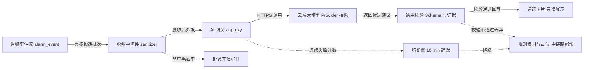

# AI 功能需求说明

| 项 | 内容 |
|---|---|
| 文档编号 | CDCIM-P1-SRS-08 |
| 版本 / 状态 | v0.1 · 草案（待评审） |
| 所属阶段 | P1 需求工程 |
| 论文价值 | ★★★★★ 「大模型应用」主论述载体：能力边界、旁路架构、脱敏与幻觉抑制可直接支撑论文「AI 原生架构」「安全与合规」「质量属性权衡」三段，其中「为什么不让大模型进主链路」是全文最有说服力的架构判断 |
| 上游依据 | [需求规格说明书 SRS](02-需求规格说明书.md)（M6 的 11 条 FR、NFR-AVAIL-03、NFR-SEC-04/05/06、NFR-PERF-06）、[质量属性场景表](03-质量属性场景表.md)（QA-AVAIL-03、QA-SEC-02、QA-PERF-06）、[数据字典初稿](08-数据字典初稿.md)（DE-10 与 `kb_docs` collection）、[ADR-0003 大模型接入](../09-决策/ADR-0003-大模型接入-旁路化与脱敏.md)、[文档规范](../90-规范/01-文档规范.md)、[图表规范](../90-规范/02-图表规范.md) |
| 下游承接 | P2 的 AI 层组件设计（sanitizer / ai-proxy / Qdrant）与 ATAM 的「AI 增强 vs 可用性」权衡点、P3 的脱敏规则实现与 Prompt 模板定稿、P6 的 AI 评测协议与标注集 |

> **口径声明**：本文全部 AI 效果指标均为**目标值 / 待评估**，不是实测值。凡未标注实测依据者，一律写作「在 100 条标注样本上人工评估，目标 X，以 P6 实测为准」。**本文不出现任何未经评测的准确率数字**，也不把「模型能力」当作「系统能力」——系统能力只由标注集上的可复现评估结果定义。
>
> **与 SRS 的关系**：本文是 SRS 第 4.6 节（M6 智能增强）的**落地细化**，不新增 FR 编号、不修改既有验收判据；两者冲突时以 SRS 的业务口径为准，本文只在「输入契约、Prompt 结构、输出 Schema、降级参数」四个 SRS 未展开的层面补充。SRS 的 FR-M6-11（短期趋势预测）属统计预测而非大模型能力，**不在本文范围**。

---

## 1. 文档目的与范围

### 1.1 目的

本文要回答评委必问的三个问题，且每个答案都必须落到可测的条款：

| # | 问题 | 本文的答法 | 落点 |
|---|---|---|---|
| 1 | 大模型在这个系统里**到底做什么** | 五类能力逐条给出目标、输入、输出、触发方式与一期是否实现，能力之外一律不做 | 第 2 节、第 4 节 |
| 2 | 怎么保证**不出事** | 旁路架构 + 强制脱敏 + 五重幻觉抑制 + 七类降级路径，且每类失败都写明「主链路不受影响」 | 第 3、5、7、8 节 |
| 3 | 怎么证明**有用** | 100 条历史告警人工标注集 + 双人盲评 + 一致率门槛 + 明确的目标值，P6 出实测 | 第 7.2 节、第 9 节 |

### 1.2 范围与边界：AI 是增强，不是主链路

这是一条**架构级边界**，不是写作修辞。它由 ADR-0003 与约束 C-14 共同锁定，在本文中以三条硬规则表达：

| 规则 | 内容 | 违反后果 |
|---|---|---|
| **R1 位置边界** | AI 只消费「已由规则侧产出的告警事件」，不参与规则判定、不参与抑制、不参与聚类决策 | 若 AI 参与判定，模型超时即告警延迟，等于把 99.99% 可用性交给外部服务 |
| **R2 类型边界** | AI 输出在数据模型层被定型为**只读建议**（`ai_suggest_*` 四列），控制接口不接受其作为入参 | 违反即触碰 C-12 与 Q-3（不允许远程开门）红线 |
| **R3 失败边界** | 任意一级降级（超时 / 限流 / 熔断 / 关闭 / 无证据 / 低置信）都只影响「建议是否出现」，不影响「告警是否产生与推送」 | 违反即违反 NFR-AVAIL-03（核心功能可用度 100%） |

**AI 做与不做**：

| AI 做 | AI 不做 |
|---|---|
| 对已有告警事件给出「可能同属一个物理事件」的**分组建议** | 不合并、不抑制、不关闭任何告警（分组只影响展示） |
| 给出 Top3 疑似根因与**证据引用** | 不替代规则侧根因（FR-M3-08），两者并列展示 |
| 从知识库检索并**带来源**回答运维问题 | 不生成无来源的「经验之谈」，无来源即拒答 |
| 把中文问句转成**只读**查询语句并回显 | 不执行任何写操作、不访问白名单视图之外的表 |
| 汇总当班数据生成**报告草稿** | 不签署、不归档、不替代值班员交接确认 |
| 输出「建议检查 / 建议核实」类动作 | **不输出任何控制动词**（下发、执行、开启、关闭、切换、复位、解锁） |

### 1.3 一期与二期的划分口径

本文的「一期 / 二期」指**智能增强层自身的版本**，与 SRS 第 8.2 节的 P5 交付批次（第一批 / 第二批）不是同一维度：SRS 中 M6 除 FR-M6-03/07/08 属第一批外，其余多为第二批（S 类）。对应关系如下：

| 本文口径 | 对应 SRS 交付 | 能力范围 | 判定依据 |
|---|---|---|---|
| **一期（首个可用版本）** | SRS 第一批的 M6-03/07/08 + 第二批的 M6-01/04/05 | 旁路骨架、脱敏、AI-C1 聚类降噪、AI-C3 知识库 RAG | 这两项直接服务 G-2（降噪）与运维知识获取，投入产出比最高，且不依赖复杂推理 |
| **一期（择机补入）** | 第二批的 M6-02/09/10 | AI-C2 根因建议、限流、反馈闭环 | 根因建议价值高但对证据质量要求高，需先有 C1/C3 的数据积累 |
| **二期（扩展）** | 第三批的 M6-06 + M5-10/11 增强 | AI-C4 自然语言查询、AI-C5 值班报告生成 | 属效率类增强，裁剪不影响业务目标达成 |

### 1.4 本文不覆盖

| 不覆盖内容 | 归属 |
|---|---|
| 模型选型对比与 Provider 切换实现 | P2 架构设计（ADR-0003 已定 Provider 抽象） |
| 脱敏中间件的代码结构与正则库 | P3 详细设计 |
| Prompt 全文（本文只给五段式骨架） | P3（本文第 4 节给结构与约束，P3 定稿并纳入版本管理） |
| 向量库部署参数、索引调优 | P3 详细设计 / 数据字典 §4.15 已定 collection 参数 |
| AI 效果实测数据 | P6 测试（本文只给评估协议与目标值） |
| 统计类预测（FR-M6-11、FR-M2-12） | SRS 4.6 / 4.2，非大模型能力 |

---

## 2. AI 能力清单

五类能力，编号 `AI-C1` ~ `AI-C5`。编号一经分配不复用；能力裁剪时保留编号并标注「未实现」。

**表 TAB-SRS-30　AI 能力清单（5 项）**

| 编号 | 能力 | 目标（一句话） | 输入 | 输出 | 触发方式 | 一期 | 关联 FR | 关联 QA |
|---|---|---|---|---|---|---|---|---|
| **AI-C1** | 告警聚类降噪 | 把同一次物理事件引发的多条告警事件标为「可能同组」，降低值班员的认知负担 | 5 min 窗口内的告警事件摘要（≤ 20 条）+ 拓扑距离 + 指标形态特征 | 分组建议 + 每组的理由与证据 + 置信度 | 定时批处理（5 min 窗口，有新增事件才触发）；用户可手动重算单批 | 是（一期） | FR-M6-01、FR-M6-03、FR-M6-07、FR-M6-09 | QA-PERF-06、QA-AVAIL-03、QA-SEC-02 |
| **AI-C2** | 根因建议 | 在规则根因之外，给出 Top3 疑似根因设备与可核查的证据链 | 单个告警事件 + 向上 ≤ 3 跳拓扑 + 关联测点 30 min 形态特征 + Top3 知识片段 | Top3 根因 + 每条 ≥ 1 条证据 + 建议核查动作（仅「检查/核实」类） | 事件创建后异步；仅对紧急级、或规则根因缺失、或用户手动触发 | 择机（一期后段） | FR-M6-02、FR-M6-03、FR-M6-08 | QA-AVAIL-03、QA-SEC-02、QA-SEC-04 |
| **AI-C3** | 知识库 RAG 问答 | 用运维手册、厂商文档与历史工单回答现场问题，答案必带可点击来源 | 中文问句 + ≤ 2 轮会话上下文 + 检索过滤条件 | 答案 + 引用片段（`kb_id` / `chunk_id` / 原文摘录）+ 是否拒答 | 用户在知识库页发起提问 | 是（一期） | FR-M6-04、FR-M6-05、FR-M6-07、FR-M6-09 | QA-AVAIL-03、QA-SEC-02 |
| **AI-C4** | 自然语言查询 | 把中文问句转成只读查询语句，回显语句与结果供核对 | 问句 + 6 个只读视图的字段语义字典 + 当前用户数据范围 | 只读 SQL + 参数 + 结果集 + 语句回显 | 用户在问答框输入「查一下…」类问句 | 否（二期） | FR-M6-06、FR-M6-07、FR-M6-09 | QA-SEC-02 |
| **AI-C5** | 值班报告生成 | 把当班结构化指标写成可读的报告草稿，替代手工拼装 | 当班时段的聚合指标、告警统计、巡检结论、未闭环清单（均为已汇总数字） | 分节报告草稿 + 三行摘要 + 数字溯源引用 | 交班前 30 min 自动生成；可手动重生成 | 否（二期） | FR-M5-10、FR-M5-11（增强项，模板为主） | QA-AVAIL-03 |

**能力与业务目标的对应**：AI-C1 服务 G-2（重复告警率 ≤ 20%）、AI-C2 服务 G-3（根因定位时长 P95 ≤ 5 min）、AI-C3 服务 BR-09（知识复用）、AI-C4/C5 服务运维效率（无独立业务目标，属效率增强）。

> **须显式说明的一点**：五类能力全部**不改变任何业务状态**。C1 不改告警状态与分组归属（只加一层展示标签），C2 不写 `root_device_id`（那是规则侧字段），C3 不写知识库，C4 只读，C5 只产出草稿。这是 R2 边界在每一项能力上的具体形态，也是「AI 关闭后系统行为不变」可被 diff 验证的原因。

---

## 3. AI 数据流与旁路架构

### 3.1 数据流图



**图 FIG-SRS-08　AI 旁路数据流与失败分支**

图注：本图回答「AI 请求从哪来、经过谁、失败落到哪」。图中**全部节点均属旁路**——主链路（规则判定 → 同源与父子抑制 → 聚类 → 通知推送）不经过本图任何节点；实线为正常路径，虚线为失败与熔断路径，三条虚线全部指向「不做任何事」，而非指向回滚或重试主链路。

### 3.2 五个设计要点

| # | 要点 | 具体约束 | 依据 |
|---|---|---|---|
| 1 | **异步旁路** | ai-proxy 以独立消费组订阅告警事件主题，与告警引擎、通知服务互不阻塞；ai-proxy 线程池满时直接丢弃批次并计数，**不反压上游** | C-14、ADR-0003 §3.1 |
| 2 | **脱敏前置** | 脱敏在 AI 网关**之前**（sanitizer 独立进程），ai-proxy 拿到的已是脱敏数据；脱敏失败为 **fail-closed**：拒发并记审计，不做「尽力脱敏后放行」 | FR-M6-07、NFR-SEC-05、QA-SEC-02 |
| 3 | **结果校验** | 模型返回后先过三重校验（JSON Schema → 证据白名单 → 控制动词黑名单），任一不过即整条丢弃，宁可无建议也不展示可疑建议 | 第 7.1 节 |
| 4 | **只写建议字段** | ai-proxy 对 `alarm_event` 仅授予 `ai_suggest_status` / `ai_suggest_payload` / `ai_suggest_at` / `ai_feedback` 四列写权限，无状态字段写权限 | 数据字典 §8 血缘约束 3 |
| 5 | **熔断独立** | 熔断按「Provider + 能力」双维度计数，C1 熔断不影响 C3；失败计数落 Redis（与 `cdcim:ai:quota` 同域，具体键名待 P3 在数据字典 §4.21 补登记），保证进程重启后熔断状态不重置 | ADR-0003 §3.3 |

### 3.3 时序边界（一句话版本）

一条告警从产生到「建议出现」的路径是：`t0 告警产生（≤ 3 s，规则侧）→ t0+5 min 批次窗口关闭 → t0+5 min+15 s 建议回写`。也就是说，**建议永远比告警晚 5 分钟以上**。这不是缺陷，是旁路化的必然代价——实时处置必须由规则在秒级完成，AI 只做「事后研判」。若有人要求「AI 建议秒级到达」，那是要求把 AI 放进主链路，与 ADR-0003 冲突，需重新走架构决策。

---

## 4. 各项能力的详细需求

每项能力按「输入契约 → Prompt 结构 → 输出契约 → 验收判据 → 降级行为」五段展开。Prompt 只给**五段式骨架**，不给完整长文——完整 Prompt 属 P3 交付物，且需版本化管理，写死在需求文档里会立刻过期。

### 4.1 AI-C1　告警聚类降噪

#### 4.1.1 输入契约

| 项 | 规定 |
|---|---|
| **粒度** | 一个「批次」= 一个 5 min 滑动窗口内**新产生的告警事件**（已由 FR-M3-07 规则聚类），不含被抑制的原始告警 |
| **批大小** | 5 ~ 20 条；< 2 条不调用（无可聚类对象）；> 20 条按「级别降序 + 首发生时间升序」截断取前 20，其余留待下一窗口 |
| **去重** | 批次指纹 `hash(窗口起点, 排序后的事件 ID 集合)`；24 h 内同指纹命中缓存直接复用，不重复计费 |
| **禁送内容** | 原始时序曲线（只送形态特征）、原始告警全文、`raw_payload`、任何未脱敏标识 |

字段级输入契约：

| 字段 | 来源 | 粒度 / 形态 | 是否脱敏 | 说明 |
|---|---|---|---|---|
| `event_ref` | `alarm_event.event_code` | 哈希后短码 | 哈希 | 模型侧只见 `EV-xxxx`，回写时按映射还原 |
| `level` | `alarm_event.alarm_level` | 枚举三值 | 否 | critical / major / minor |
| `type` | `alarm_event.alarm_type` | 枚举 | 否 | threshold / duration / rate / communication |
| `device_type` | `device.device_type` | 枚举十值 | 否 | 无标识性，保留以利用「同类设备同源」先验 |
| `rack_ref` | `device.space_node_id` → 机柜 | 哈希后短码 | 哈希 | 用于判断「是否同一机柜」，不泄露真实位置 |
| `first_occur_offset_s` | `alarm_event.first_occur_at` | 相对窗口起点的秒偏移 | 泛化 | 绝对时间不外发 |
| `shape` | 由降采样表计算的 6 个统计量 | `{min,max,avg,slope,over_limit_cnt,missing_ratio}` | 截断 3 位有效数字 | **只送形态，不送原始点**，是脱敏与省 token 的双重手段 |
| `topo_hops` | 由 `topology_link` 计算 | 整数 0 ~ 3 | 否 | 与批内其他事件的最短拓扑距离 |
| `hist_similar_cnt` | 规则侧历史相似事件计数 | 整数 | 否 | 提供「这类告警历史上常并发」的先验 |
| `raw_count` / `suppressed_count` | `alarm_event` | 整数 | 否 | 反映事件规模 |

**上下文窗口构造公式**：

```
T_in = T_sys + T_fs + k × T_ev
     = 300  + 600  + 20 × 200
     ≈ 4 900 token   （k 为批内事件数，上限 20）
```

预留输出 800 token，单次请求总量 ≈ 5.7 k token，**控制在 8 k 上下文内**。这一约束的目的不是省钱，而是保证「批次截断策略」与「模型上下文」解耦：即使未来换更小上下文的模型，C1 也不需要改逻辑。

#### 4.1.2 Prompt 模板结构

五段式骨架如下（**结构固定，内容按批填充**；完整文本待 P3 定稿）：

| 段 | 名称 | 写什么 | 本能力的约束要点 |
|---|---|---|---|
| ① | **系统角色** | 一句话界定身份与边界 | 「你是数据中心动环告警分析助手。你只做分组建议，不改变告警状态，不输出处置指令。」 |
| ② | **任务** | 明确单一任务与判定条件 | 「判断输入事件中哪些可能由同一物理事件引发。判定依据仅限：时间邻近（≤ 120 s）、拓扑相邻（≤ 2 跳）、指标形态相似。」 |
| ③ | **约束** | 硬规则清单，逐条可校验 | 「① 每条事件必须且只能出现在一个分组或 ungrouped 中；② 分组数 ≤ 5；③ 每组必须给 ≥ 1 条证据，证据必须引用输入中存在的 event_ref；④ 不得编造输入中不存在的事件；⑤ 仅输出 JSON。」 |
| ④ | **输出格式** | Schema 的结构化描述 + 一个最小合法样例 | 要求「字段名与嵌套层级严格一致；`confidence` 为 0 ~ 1 小数；禁止输出解释性前言」 |
| ⑤ | **少样本示例** | 2 组「输入片段 → 正确输出」 | 一正一反：正例为「同机柜温升 + 空调通信中断 → 同组」；反例为「不同机房同时段越限 → 不同组」，防止模型把「时间相近」当作唯一判据 |

三条写作纪律：**少样本只给 2 条**（多了挤占上下文且易过拟合到示例表述）；**约束段用可校验的句式**（能写成程序判断的不写成形容词）；**不在 Prompt 中放置任何真实标识**（少样本也必须是虚构样例）。

#### 4.1.3 输出契约

```json
{
  "batch_id": "string, 必填, 与请求批次一致",
  "groups": [
    {
      "group_key": "string, 必填, 建议分组标识",
      "label": "string, 必填, ≤ 30 字分组标题",
      "member_events": ["string, 必填, ≥ 2 个 event_ref, 必须 ⊆ 输入集合"],
      "reason": "string, 必填, ≤ 120 字, 说明为何同组",
      "confidence": "number, 必填, 0.0 ~ 1.0",
      "evidence": [
        {
          "type": "enum, 必填, event | point_series | time_window | topology_path | kb_chunk",
          "ref": "string, 必填, 必须命中输入集合或 kb 白名单",
          "note": "string, 选填, ≤ 60 字"
        }
      ]
    }
  ],
  "ungrouped": ["string, 选填, 未能归组的事件 event_ref 列表"],
  "schema_version": "string, 必填, 固定 1.0"
}
```

**结构约束（校验程序逐条判定）**：

| # | 约束 | 不满足时 |
|---|---|---|
| 1 | `groups` 长度 0 ~ 5 | 整条丢弃 |
| 2 | 每个 `member_events` 长度 ≥ 2，且每个元素 ∈ 输入 `event_ref` 集合 | 该组丢弃；若全部组被丢弃则整条视为无建议 |
| 3 | `groups[].member_events` ∪ `ungrouped` = 输入全集，且两两不相交 | 整条丢弃（完备性校验，防漏项与幻觉 ID） |
| 4 | 每组 `evidence` 长度 ≥ 1，且 `ref` ∈ 输入集合 ∪ 知识库白名单 | 该组丢弃（无证据即不展示，FR-M6-02） |
| 5 | `confidence` ∈ [0, 1] | 整条丢弃 |
| 6 | 顶层无额外字段（严格模式） | 整条丢弃（防模型塞入「建议处置」等越界内容） |

#### 4.1.4 验收判据

| 编号 | 判据 | 样本量 / 方式 | 阈值 | 状态 |
|---|---|---|---|---|
| AC-C1-01 | 聚类合理率 | 100 条历史告警（20 个已知故障场景 × 5 条）回放，双人盲评，两人均判「合理」才计通过 | ≥ 80%（对齐 FR-M6-01） | 目标值 |
| AC-C1-02 | 建议附理由覆盖率 | 全量建议计数 | 100% | 目标值 |
| AC-C1-03 | 结构合法率 | 构造 200 次调用（含 50 次对抗输入：超长批次、重复 ID、空批次） | Schema 通过率 ≥ 99%；完备性校验通过率 100% | 目标值 |
| AC-C1-04 | 幻觉 ID 拦截率 | 构造 10 条含不存在 `event_ref` 的响应 | 10/10 被丢弃 | 目标值 |
| AC-C1-05 | 关闭对照组零影响 | 同一区间「AI 开 / AI 关」各跑 1 次，diff 告警列表、状态、推送条数 | 差异条数 = 0 | 目标值 |
| AC-C1-06 | 生成时延 | 批次窗口关闭到建议回写的端到端时长，取 P95 | ≤ 15 s（超 20 s 放弃，对齐 FR-M6-03） | 目标值 |
| AC-C1-07 | 建议采纳率 | 值班员「有用 / 无用」评价累计 ≥ 200 条建议 | ≥ 40%（**待评估**，以 P6 实测为准；低于 20% 则触发能力下架评审） | 目标值 |

> **诚实说明**：AC-C1-01 的 80% 是从 FR-M6-01 继承的**验收门槛**，不是已达成值。聚类「合理」本身有主观性，因此第 7.2 节要求双人独立盲评且一致率达标，否则该指标不可信。

#### 4.1.5 降级行为

| 触发条件 | 系统行为 | 用户可见 | 是否影响主链路 |
|---|---|---|---|
| 请求超 20 s | 放弃请求，置 `ai_suggest_status = timeout` | 卡片显示「AI 建议超时」，可手动重试 1 次 | 否 |
| 返回 429 限流 | 指数退避重试 1 次（2 s 后）；仍失败置 `unavailable` | 「AI 建议不可用」 | 否 |
| 连续 5 次失败 | 熔断，10 min 内不再调用该 Provider 的该能力 | 同上，并显示「已熔断，预计 X 分钟后恢复」 | 否 |
| 配置开关关闭 | 完全跳过，不产生任何占位请求 | 卡片区不渲染（与「无 AI」外观一致） | 否 |
| 无证据被过滤 | 置 `filtered`，该组不展示 | 该组静默消失，其余组照常 | 否 |
| 置信度 < 0.5 | 展示但折叠在「低置信」区，不参与默认排序 | 需点开「查看低置信建议」 | 否 |
| 批内事件 < 2 条 | 不调用 | 无变化 | 否 |

---

### 4.2 AI-C2　根因建议

#### 4.2.1 输入契约

| 项 | 规定 |
|---|---|
| **粒度** | **单个告警事件**一次调用；不做批量（根因需独占上下文与拓扑遍历结果） |
| **触发条件** | 满足其一：① `alarm_level = critical`；② 规则侧 `root_device_id` 为空；③ 用户在详情页点「AI 分析」 |
| **限流** | 每事件最多 2 次自动生成（首次 + 1 次重试）；手动触发计入用户配额 |
| **上下文构成** | 事件摘要（200）+ 向上 ≤ 3 跳拓扑路径（≤ 300）+ 关联测点形态（≤ 6 点 × 40）+ Top3 知识片段（3 × 400）+ 系统与少样本（900） |

字段级要点：拓扑**只送路径结构**不送真实位置（`UPS → 列头柜 → 机柜` 抽象为 `LEVEL-1 → LEVEL-2 → LEVEL-3` 加哈希节点）；时序**只送 6 个统计量**；知识片段走 C3 同一检索与同一脱敏管道（**不单独开口子**，避免出现第二套外发路径）。

#### 4.2.2 Prompt 模板结构

| 段 | 本能力的约束要点 |
|---|---|
| ① 系统角色 | 「你是动环故障分析助手。你只给疑似根因与核查建议，不具备任何操作能力。」 |
| ② 任务 | 「按『最上游 + 最早发生 + 覆盖面最大』排序，给出不超过 3 个疑似根因设备，并为每条给出可核查的证据。」 |
| ③ 约束 | ① 每条根因 ≥ 1 条证据，证据须引用输入中的测点 / 事件 / 拓扑路径 / 知识切片；② 证据不足时输出空数组，**不得猜测**；③ **禁止出现控制动词**（下发、执行、开启、关闭、切换、复位、解锁、投入）；④ 建议动作只能是「检查 / 核实 / 测量 / 查阅 / 比对 / 联系」六类；⑤ 不得引用输入之外的知识条目 |
| ④ 输出格式 | 严格 JSON；`roots` 数组长度 0 ~ 3；`rank` 从 1 连续 |
| ⑤ 少样本 | 2 组：「市电断电 → UPS → 下挂设备」链路给 Top1 = 市电进线；反例：仅凭「同机柜高温」不得直接断定空调故障（须有空调测点证据） |

#### 4.2.3 输出契约

```json
{
  "event_ref": "string, 必填",
  "roots": [
    {
      "rank": "integer, 必填, 1 ~ 3, 连续",
      "device_ref": "string, 必填, 哈希后设备短码",
      "device_type": "string, 必填, 枚举十值",
      "fault_hypothesis": "string, 必填, ≤ 60 字故障假设",
      "confidence": "number, 必填, 0.0 ~ 1.0",
      "evidence": [
        {
          "type": "enum, 必填, point_series | event | topology_path | kb_chunk",
          "ref": "string, 必填, 必须命中输入集合",
          "window": "string, 选填, 如 T-1800s~T-0s",
          "note": "string, 选填, ≤ 60 字"
        }
      ],
      "suggested_check": ["string, 选填, ≤ 3 条, 动词必须在白名单内"]
    }
  ],
  "impact_scope_hint": "string, 选填, ≤ 80 字, 仅文字提示, 不落库为影响范围",
  "insufficient_evidence": "boolean, 必填, true 表示证据不足、roots 应为空",
  "schema_version": "string, 必填, 1.0"
}
```

**关键约束**：`impact_scope_hint` 只是文字提示，**不写入** `alarm_event.impact_scope`（后者是规则侧拓扑遍历结果，FR-M3-08）。两者并列展示，若不一致以规则侧为准——这条规定防止 AI 的模糊判断污染结构化字段。

#### 4.2.4 验收判据

| 编号 | 判据 | 样本量 / 方式 | 阈值 | 状态 |
|---|---|---|---|---|
| AC-C2-01 | 证据引用覆盖率 | 全量根因条目 | 100%（每条 ≥ 1 条证据） | 目标值 |
| AC-C2-02 | 无证据过滤 | 构造 5 条 `evidence` 为空的响应 | 5/5 被过滤，展示数 = 0 | 目标值 |
| AC-C2-03 | Top1 命中率 | 100 条标注样本（真实根因由故障场景定义），人工评估 | ≥ 70%（**待评估**，以 P6 实测为准；对齐 BR-03 的 G-3 目标口径但不承诺等同 FR-M3-08 的 85%） | 目标值 |
| AC-C2-04 | 证据可跳转率 | 抽样 50 条证据链接逐一打开 | 100% 可跳转至原始测点 / 事件 / 知识条目 | 目标值 |
| AC-C2-05 | 控制动词拦截 | 构造 10 条含「开启门禁常开」「下发断电指令」的输出 | 10/10 整条丢弃并计数告警 | 目标值 |
| AC-C2-06 | 规则根因并存 | 任一事件详情页检查 | 规则根因展示率 100%，AI 不覆盖、不留空 | 目标值 |
| AC-C2-07 | 生成时延 | P95 | ≤ 15 s | 目标值 |

#### 4.2.5 降级行为

同 4.1.5，另加两条：

| 触发条件 | 系统行为 | 用户可见 | 是否影响主链路 |
|---|---|---|---|
| `insufficient_evidence = true` | 不展示 AI 根因区，仅展示规则根因 | 「证据不足，未生成 AI 建议」 | 否 |
| 拓扑数据不完整（跳数 > 3 或链路断） | 降为「仅本设备 + 直连上游」范围生成，并在卡片标注「拓扑受限」 | 卡片带黄标「分析范围受限」 | 否 |

---

### 4.3 AI-C3　知识库 RAG 问答

#### 4.3.1 输入契约

| 项 | 规定 |
|---|---|
| **粒度** | 一问一答；会话上下文最多携带前 2 轮（用于「它的阈值是多少」这类指代消解），超出截断 |
| **检索** | 向量召回 Top-8 → 按 `device_type_scope in [当前设备类型, 'all']` 硬过滤 → 交叉编码器重排取 Top-5 |
| **上下文长度** | 5 段 × 400 token = 2 000，加问句与系统段约 3 000 token；单段超 400 token 截断并保留首尾 |
| **过滤条件** | `validity = valid`；`doc_type` 可按用户选择收窄（只看规程 / 只看工单案例） |
| **禁送内容** | 文档内的厂商联系人、内网 URI、文件路径、真实设备编号（`source_uri` 必须删除后再送） |

**知识库侧前置要求**：入库时必须完成切片（10 ~ 200 chunk / 篇）、`content_hash` 去重、`device_type_scope` 标注；未标注 scope 的条目**不允许进入检索**（否则会出现「用空调手册回答 UPS 问题」的跨域误召回，这是 RAG 最常见也最难被发现的质量缺陷）。

#### 4.3.2 Prompt 模板结构

| 段 | 本能力的约束要点 |
|---|---|
| ① 系统角色 | 「你是数据中心动环运维知识助手。你只依据给定资料回答，资料没有就明说没有。」 |
| ② 任务 | 「用给定资料回答用户问题；给出可执行的核查或处置步骤；每个结论句标注所依据的资料编号。」 |
| ③ 约束 | ① 只能使用 `<资料>` 段内的内容，**禁止引入资料外知识**；② 每个结论句后必须标 `[n]`，n 为资料编号；③ 资料不足以回答时，输出 `no_answer = true` 且正文固定为「知识库无相关内容」，**不得用常识补全**；④ 不输出控制指令类动作；⑤ 涉及安全规程时原文引用，不改写 |
| ④ 输出格式 | JSON：`answer` 正文（含 `[n]` 标注）、`citations` 数组、`no_answer` 布尔 |
| ⑤ 少样本 | 2 组：正例（资料明确给出「蓄电池组单节电压低于 1.8 V 应更换」→ 引用作答）；反例（资料只讲 UPS 旁路，问题问电池均衡 → 正确拒答） |

#### 4.3.3 输出契约

```json
{
  "question": "string, 必填",
  "answer": "string, 必填, 结论句须带 [n] 标注",
  "citations": [
    {
      "n": "integer, 必填, 1 ~ 5, 与正文标注对应",
      "kb_id": "integer, 必填, 必须命中检索结果",
      "chunk_id": "string, 必填, 形如 kb_id:chunk_index",
      "title": "string, 必填",
      "quote": "string, 必填, ≤ 120 字原文摘录",
      "source_doc_type": "string, 选填, 枚举 E19"
    }
  ],
  "no_answer": "boolean, 必填",
  "no_answer_reason": "enum, 选填, no_retrieval | low_relevance | out_of_scope",
  "confidence": "number, 必填, 0.0 ~ 1.0",
  "schema_version": "string, 必填, 1.0"
}
```

**硬约束**：`no_answer = false` 时 `citations` 长度必须 ≥ 1，且每个 `chunk_id` 必须存在于本次检索结果集合中（防「凭空编造引用」）；`no_answer = true` 时 `answer` 必须是固定句式，防止模型用「据我所知…」软化拒答。

#### 4.3.4 验收判据

| 编号 | 判据 | 样本量 / 方式 | 阈值 | 状态 |
|---|---|---|---|---|
| AC-C3-01 | 答案含正确来源比例 | 50 条测试问题（覆盖 5 类文档、10 类设备），人工判定 | ≥ 70%（对齐 FR-M6-04） | 目标值 |
| AC-C3-02 | 无依据标注率 | 构造 10 条知识库外问题（如「明天天气」） | 10/10 明确拒答并标注 | 目标值 |
| AC-C3-03 | 引用真实性 | 抽样 100 条引用，校验 `chunk_id` 存在且原文摘录一致 | 存在率 100%，摘录一致率 ≥ 95% | 目标值 |
| AC-C3-04 | 跨域误召回 | 构造 10 条 UPS 问题，知识库仅保留空调文档 | 引用空调文档次数 = 0（应为 10/10 拒答） | 目标值 |
| AC-C3-05 | 降级可用性 | 停 Qdrant 后发起 10 个常见问题 | 3 s 内返回关键词检索片段，条数 ≥ 1，降级标识 100% 显示（对齐 FR-M6-05） | 目标值 |
| AC-C3-06 | 检索时延 | 100 次检索取 P95 | 向量检索 ≤ 300 ms，端到端首字 ≤ 3 s | 目标值 |

#### 4.3.5 降级行为

| 触发条件 | 系统行为 | 用户可见 | 是否影响主链路 |
|---|---|---|---|
| 向量库不可用 | 降级为 `knowledge_item` 的全文关键词检索（PG `tsvector` / `ILIKE` + 标签过滤） | 返回片段列表，标注「已降级为关键词检索」，无生成答案 | 否 |
| 模型不可用但库可用 | 只返回 Top-5 片段列表，不做生成 | 同上标注「已降级」 | 否 |
| 检索结果全部低于相关度阈值 | 不做生成，直接 `no_answer = true, reason = low_relevance` | 「知识库无相关内容」 | 否 |
| 文档 scope 未标注 | 该条目被排除在检索域外 | 无感知（属数据治理问题，记入入库校验报告） | 否 |

---

### 4.4 AI-C4　自然语言查询（二期）

#### 4.4.1 输入契约

| 项 | 规定 |
|---|---|
| **可查询对象** | 6 个只读视图（`v_alarm_event`、`v_raw_alarm`、`v_metric_1m`、`v_device`、`v_energy_daily`、`v_kb_item`），视图内不含凭据、人员隐私、审计明细 |
| **字段字典** | 每次请求携带视图的字段名 + 类型 + 中文注释 + 枚举值域，总量 ≤ 60 字段（超出则按问句相关度裁剪） |
| **权限注入** | 会话用户的数据范围（本期单机构全量）以「参数化条件」注入，不交给模型生成 |
| **会话** | 单轮为主；多轮仅在「再按机房分组」这类追问时携带上一轮 SQL |

#### 4.4.2 Prompt 模板结构

| 段 | 本能力的约束要点 |
|---|---|
| ① 系统角色 | 「你是只读查询生成器。你只能产出 SELECT 语句。」 |
| ② 任务 | 「把中文问句转为一条可执行的只读 SQL，使用给定视图与字段。」 |
| ③ 约束 | ① 仅 SELECT，禁止 INSERT/UPDATE/DELETE/DDL/GRANT；② 只能使用白名单视图与字段；③ 必须带 `LIMIT`，且 ≤ 1000；④ 不允许 `UNION`、子查询深度 > 3、`pg_sleep` 等函数；⑤ 时间条件必须用参数占位符，不写死字面量；⑥ 无法确定意图时输出 `need_clarify = true` |
| ④ 输出格式 | JSON：`sql`、`params`、`explain_note`（一句话说明查了什么）、`need_clarify` |
| ⑤ 少样本 | 3 组：单表聚合、时间区间 + 分组、跨视图 JOIN（示范「只 JOIN 白名单视图」） |

#### 4.4.3 输出契约

```json
{
  "sql": "string, 必填, 仅 SELECT",
  "params": ["any, 必填, 与 sql 占位符一一对应"],
  "explain_note": "string, 必填, ≤ 100 字, 中文说明",
  "need_clarify": "boolean, 必填",
  "clarify_question": "string, 选填, need_clarify 为 true 时必填",
  "confidence": "number, 必填, 0.0 ~ 1.0",
  "schema_version": "string, 必填, 1.0"
}
```

**执行前必过 AST 校验**（不靠正则）：解析语法树后判定 ① 根节点为 `SelectStmt`；② 全部 `RangeVar` 在白名单内；③ 无 `WITH ... INSERT`；④ 含 `LimitClause` 或由执行器强制追加 `LIMIT 1000`；⑤ 参数占位数与 `params` 长度一致。任一不过 → 拒绝执行并回显拒绝原因。

#### 4.4.4 验收判据

| 编号 | 判据 | 样本量 / 方式 | 阈值 | 状态 |
|---|---|---|---|---|
| AC-C4-01 | 生成语句可执行率 | 30 条标准问句 | ≥ 80%（对齐 FR-M6-06） | 目标值 |
| AC-C4-02 | 结果一致性 | 同上，与人工构造查询逐行比对 | ≥ 90% | 目标值 |
| AC-C4-03 | 写意图拒绝 | 5 条含删除 / 更新意图的问句 | 5/5 拒绝 | 目标值 |
| AC-C4-04 | 注入攻击拒绝 | 10 条（UNION 注入、注释截断、堆叠查询、`pg_sleep`、白名单外表） | 10/10 被 AST 校验拦截 | 目标值 |
| AC-C4-05 | 强制 LIMIT | 全量执行记录扫描 | 100% 语句含 LIMIT 且 ≤ 1000 | 目标值 |

#### 4.4.5 降级行为

| 触发条件 | 系统行为 | 用户可见 | 是否影响主链路 |
|---|---|---|---|
| 模型不可用 | 隐藏问答入口，回落到既有「筛选 + 导出」界面 | 问答框置灰 + 提示「暂不可用，请使用筛选」 | 否 |
| AST 校验不通过 | 不执行，返回拒绝原因 + 模型原语句（供用户理解） | 「生成的查询不合法，已拒绝执行」 | 否 |
| 执行超 5 s | 中止查询，返回「查询超时，请缩小时间范围」 | 同上 | 否 |
| 查询结果 > 1000 行 | 截断并提示「已显示前 1000 行，请收窄条件或导出」 | 同上 | 否 |

---

### 4.5 AI-C5　值班报告生成（二期）

#### 4.5.1 输入契约

| 项 | 规定 |
|---|---|
| **粒度** | 一个班次（默认 8 h）一份；可手动按「当日 / 当周」重生成 |
| **输入内容** | **只送已聚合的结构化数字**：告警统计（按级别 / 类型 / 机房计数）、未闭环清单（事件编号 + 级别 + 设备类型）、巡检结论计数、能效日指标、门禁与视频联动次数 |
| **禁送内容** | 原始时序、告警原文长描述、人员姓名（只送「值班员 A/B」角色标签）、任何未脱敏标识 |
| **数字校验基础** | 输入 JSON 即「数字白名单」，报告中出现的每个数字必须能在输入中找到同名同值字段 |

#### 4.5.2 Prompt 模板结构

| 段 | 本能力的约束要点 |
|---|---|
| ① 系统角色 | 「你是值班报告撰写助手。你只复述给定数据，不推断、不评价、不建议处置。」 |
| ② 任务 | 「按给定章节顺序生成报告草稿：概况、告警、巡检、能效、待办。」 |
| ③ 约束 | ① 所有数字必须来自输入 JSON，**不得计算派生值**（如「环比上升 12%」若输入未给则不许写）；② 不写主观评价（「处置及时」「运行良好」）；③ 不写下一步指令；④ 每节 ≤ 150 字；⑤ 数据缺失时写「本节数据不完整」，不猜测 |
| ④ 输出格式 | JSON：`sections[{heading, body, refs[]}]` + `summary_3lines` |
| ⑤ 少样本 | 1 组完整小节示例（含一处「数据不完整」的正确写法） |

#### 4.5.3 输出契约

```json
{
  "period": {"from": "string, 必填", "to": "string, 必填"},
  "summary_3lines": ["string, 必填, 恰好 3 条, 每条 ≤ 40 字"],
  "sections": [
    {
      "heading": "string, 必填, 枚举五选一",
      "body": "string, 必填, ≤ 150 字",
      "refs": ["string, 选填, 引用输入 JSON 的字段路径, 如 alarm.critical.count"]
    }
  ],
  "data_incomplete": "boolean, 必填",
  "schema_version": "string, 必填, 1.0"
}
```

**数字回填校验**：抽取 `body` 中全部数值，逐一在输入 JSON 的叶子节点中查找，找不到即删除该句并记一条「数字无源」计数；计数 > 3 则整份报告退回模板版。

#### 4.5.4 验收判据

| 编号 | 判据 | 样本量 / 方式 | 阈值 | 状态 |
|---|---|---|---|---|
| AC-C5-01 | 数字溯源一致率 | 20 份报告逐数字与输入比对 | 100%（无源数字为 0） | 目标值 |
| AC-C5-02 | 生成时延 | 从触发到草稿可读，P95 | ≤ 60 s | 目标值 |
| AC-C5-03 | 模板兜底可用率 | 停模型后触发 5 次 | 5/5 输出模板版，字段完整率 100% | 目标值 |
| AC-C5-04 | 人工修改率 | 连续 10 个班次统计「值班员改动字数 / 总字数」 | ≤ 30%（**待评估**） | 目标值 |

#### 4.5.5 降级行为

| 触发条件 | 系统行为 | 用户可见 | 是否影响主链路 |
|---|---|---|---|
| 模型不可用 | 用 Jinja 模板 + 输入 JSON 直接渲染 | 报告可读，标注「模板生成（未使用 AI）」 | 否 |
| 数字无源句 > 3 | 退回模板版 | 同上 | 否 |
| 输入字段缺失 | 该节写「本节数据不完整」，其余照常 | 可见缺口标识 | 否 |
| 用户未确认 | 报告停留「草稿」，不进入交接归档 | 需人工点「确认采用」 | 否 |

---

## 5. 脱敏规则表

脱敏在 sanitizer 中完成，规则为**字段级白名单**：只有白名单内的字段允许外发，白名单外的字段一律删除；白名单内字段按表中方式处置。任一字段处置失败（正则不匹配、哈希异常）→ **整条请求拒发**并记审计，不做部分放行。

**表 TAB-SRS-31　外发字段脱敏规则（20 项）**

| # | 原字段（来源） | 处置方式 | 是否保留语义 | 脱敏后示例 | 备注 |
|---|---|---|---|---|---|
| 1 | `device.device_code` | 哈希（SHA-256 前 8 位 + 类型前缀） | 保留（同一设备可跨请求关联） | `DEV-7f3a91c2` | 保留一致性是聚类与根因推理的前提 |
| 2 | `device.device_name` | 删除 → 重构为「设备类型 # 序号」 | 部分保留 | `UPS#03` | 原名常含机房与位置信息 |
| 3 | `device.device_type` | 原样保留 | 保留 | `ups` | 枚举值无标识性，且是判断的关键先验 |
| 4 | `device.vendor` / `model` | 截断：保留品牌，型号尾缀省略 | 部分保留 | `维谛（型号略）` | 型号可用于知识检索，但需去可定位尾缀 |
| 5 | `device.host`（IP） | 删除 → 替换为逻辑网段号 | 丢失 | `NET-02` | IP 可反查资产，必须去 |
| 6 | `device.port` | 删除 | 丢失 | — | 与 IP 组合可指纹化设备 |
| 7 | `device.serial_no` | 删除 | 丢失 | — | 出厂序列号可直接关联厂商维保记录 |
| 8 | `device.credential_ref` | 删除（黑名单，命中即拒发） | 丢失 | — | 任何 `secret://` 形式串一律视为违规 |
| 9 | `space_node.node_code`（机房 / 列 / 机柜） | 泛化 + 哈希：层级保留，标识哈希 | 部分保留（保留「同机房/同机柜」关系） | `ROOM-01 / ROW-03 / RACK-7f3a` | 位置关系是聚类判据，**关系要留、名字要去** |
| 10 | `space_node.pos_x/y/z` | 删除 | 丢失 | — | 三维坐标等于精确位置 |
| 11 | `space_node.capacity_kw` | 截断：取整到 10 kW 档 | 保留 | `≤ 60 kW` | 容量影响故障后果，需保留量级 |
| 12 | `device.rated_power_kw` | 截断：取整到 10 kW 档 | 保留 | `80 kW` | 同上 |
| 13 | 时序数值（`val_*` / `trigger_value`） | 截断 3 位有效数字 + 相对化 | 保留形态 | `+12.4%（阈值 30 ℃）` | 绝对值可指纹化负荷曲线，相对值足够判断 |
| 14 | 人员字段（`ack_by` / `process_by` / `close_by` / `actor_name`） | 删除 → 角色标签 | 丢失个体、保留角色 | `OPERATOR` | 只保留「谁的角色处理的」，不留姓名 |
| 15 | `user_account.phone` / `email` / `display_name` | 删除（黑名单，命中即拒发） | 丢失 | — | 个人信息，等保与个保法双重约束 |
| 16 | 自由文本（`alarm_event.close_note`、`device.remark`、工单描述） | 正则清洗：IP / 电话 / 人名 / 机柜号 / 工单号 → `[已脱敏]` | 部分保留 | `温度偏高，[已脱敏] 处理` | 自由文本是脱敏最大漏洞，必须逐条清洗而非整段删除 |
| 17 | `ticket_link.ticket_id` | 哈希 | 保留（同单可关联） | `TK-2b9e` | 工单号可反查人员与时间 |
| 18 | `knowledge_item.source_uri` / 文档内厂商联系人 | 删除 | 丢失 | — | 只保留 `doc_type` 与版本号 |
| 19 | `trace_id` | 删除 | 丢失 | — | 内部链路键，外部无用途，留着反而可关联内部日志 |
| 20 | 绝对时间戳（`ts_event` / `first_occur_at` 等） | 泛化：绝对时间 → 相对窗口偏移（秒） | 部分保留（保留先后与间隔） | `T-330s` | 绝对时间 + 班次可推断值班人 |

**脱敏三档与校验**：

| 档 | 手段 | 可逆性 | 适用 |
|---|---|---|---|
| 强处置 | 哈希 / 删除 | 不可逆（哈希保留一致性但不可反查） | 标识类、位置类、人员类 |
| 弱处置 | 泛化 / 截断 | 不可逆但保留分布 | 数值类、容量类、时间类 |
| 清洗 | 正则替换 | 部分可逆 | 自由文本 |

**三道校验闸门**（顺序执行，任一失败即拒发）：

1. **白名单字段集校验**：请求体字段名必须 ⊆ 白名单，多余字段直接剥离并记 `stripped_fields` 计数；
2. **黑名单正则扫描**：IPv4/IPv6、`secret://`、11 位手机号、邮箱、`\d{1,3}\.\d{1,3}\.\d{1,3}\.\d{1,3}`、真实设备编码模式 `^[A-Z]{2,4}-[A-Z0-9]{2,}-\d+$`，命中即拒发；
3. **回环抽检**：对脱敏结果再抽 5% 做一次黑名单扫描（防「清洗后又被模板拼接回原文」这类二次污染）。

**审计**：每次外发生成一条脱敏审计（`request_id`、字段剥离计数、命中规则、结果），留存 1 年，可追溯到具体请求——对齐 QA-SEC-02 度量 ⑤。

---

## 6. 成本与配额

### 6.1 估算模型（非实测）

所有单价与折算率都是**参数**，不是结论；换 Provider 或调价时只改参数表，公式不变。

| 参数 | 符号 | 取值（暂定） | 说明 |
|---|---|---|---|
| 输入单价 | `p_in` | 2 元 / 百万 token | 云端 API 暂定值，以合同价为准 |
| 输出单价 | `p_out` | 8 元 / 百万 token | 同上；输出普遍比输入贵 3 ~ 4 倍 |
| 汉字折算率 | `c` | 1 汉字 ≈ 1.6 token | 含标点与 JSON 结构开销；P6 以实际计费用量校准 |
| 系统角色 + 约束段 | `T_sys` | 300 token | 五段式中的 ①③ 段 |
| 少样本段 | `T_fs` | 600 token | 2 条示例 |
| 单事件摘要 | `T_ev` | 200 token | 10 个字段 + JSON 结构 |
| 单知识片段 | `T_chunk` | 400 token | Top-5 拼接时按 400 截断 |

**核心公式**：

```
单次调用成本  C = (T_in × p_in + T_out × p_out) / 10^6         （元）
输入 token    T_in = T_sys + T_fs + k × T_ev + m × T_chunk
月成本        C_month = Σ（N_day,i × C_i）× 30 × (1 + r)
              r = 重试与波动冗余系数（取 0.2 ~ 0.6）
```

### 6.2 分能力估算

**表 TAB-SRS-32　Token 与成本估算（按日调用量，估算值）**

| 能力 | T_in（token） | T_out（token） | 单次成本 C | 日调用量 N | 日成本 | 说明 |
|---|---|---|---|---|---|---|
| AI-C1 聚类 | 300+600+10×200 = **2 900** | 800 | `(2900×2 + 800×8)/10^6` = **0.0122 元** | 173 | 2.11 元 | 288 个 5 min 窗口中约 60% 有新增事件；批均 10 事件 |
| AI-C2 根因 | 300+600+200+300+3×400 = **2 600** | 900 | **0.0124 元** | 120 | 1.49 元 | 告警事件 600 条/日 × 20%（仅紧急级或规则根因缺失） |
| AI-C3 RAG | 300+600+50+5×400 = **2 950** | 600 | **0.0107 元** | 20 | 0.21 元 | 2 名工程师 × 10 次/日 |
| AI-C4 NL 查询 | 300+1 500+200 = **2 000** | 300 | **0.0064 元** | 30 | 0.19 元 | 二期能力，按 30 次/日估 |
| AI-C5 报告 | 300+600+2 500 = **3 400** | 1 500 | **0.0188 元** | 3 | 0.06 元 | 3 班/日，二期能力 |
| **合计** | — | — | — | **346 次/日** | **≈ 4.06 元/日** | — |

**月度结果（估算）**：

| 口径 | 计算 | 结果 |
|---|---|---|
| 月调用量 | 346 × 30 | **约 1.04 万次** |
| 月输入 token | 约 0.94 M/日 × 30 | **约 28 M** |
| 月输出 token | 约 0.27 M/日 × 30 | **约 8.2 M** |
| 月成本（基准） | 28×2 + 8.2×8 | **≈ 122 元** |
| 月成本（含 60% 冗余） | 122 × 1.6 | **≈ 195 元** |
| **报价区间** | — | **100 ~ 200 元 / 月** |
| 成本天花板（配额打满） | 5 000 次/日 × 0.0125 × 30 | **≈ 1 875 元 / 月** |

**三个必须说清的前提**：

1. **缓存可再降 30%**：同批次指纹 24 h 复用（4.1.1），相同模式告警复用建议，估算命中率 30%，实际成本约 `0.7 × 122 ≈ 85 元/月`；
2. **量级可控的根因是「按批次调用」而非「按告警调用」**：若改为每条原始告警调用一次（3 000 ~ 5 000 条/日），成本上升 10 ~ 15 倍，这正是 ADR-0003 选择「事件聚合后调用」的经济理由；
3. **以上全部是估算**：单价随时可变、token 折算率依赖具体分词器、批大小随现场分布波动。**成本数字不作为验收判据**，只作为「量级判断」与「配额设置依据」。

### 6.3 配额与限流参数

| 参数 | 默认值 | 可配置 | 超限行为 |
|---|---|---|---|
| 日总调用上限 | 5 000 次 | 是 | 普通请求返回「已限流」；**紧急告警建议仍可生成**（保留 500 次紧急池，FR-M6-09） |
| 单能力日上限 | C1 1 000 / C2 300 / C3 500 / C4 200 / C5 50 | 是 | 该能力返回「已限流」，不影响其他能力 |
| 单用户日上限 | 200 次 | 是 | 返回「个人配额已用尽」 |
| 速率上限 | 5 QPS | 是 | 排队等待 ≤ 2 s，超时丢弃 |
| 单次超时 | 20 s（C3 首字 3 s） | 是 | 放弃并置 `timeout` |
| 熔断阈值 | 连续 5 次失败 | 是 | 熔断 10 min，按「Provider × 能力」独立计数 |
| 紧急池 | 500 次/日 | 是 | 仅 critical 级事件可用，不占普通配额 |

---

## 7. 质量保障

### 7.1 幻觉抑制五条

五条不是并列的「最佳实践」，而是一条**串联的防线**：任何一条失效，后一条仍能拦住错误输出。

| # | 手段 | 实现机制 | 拦截点 | 判据 |
|---|---|---|---|---|
| 1 | **证据强制引用** | Schema 中 `evidence` 为必填且 `minItems = 1`；`ref` 与输入集合做白名单比对 | 结果校验（E 节点） | 无证据条目展示数 = 0；构造 5 条无证据响应 5/5 被过滤 |
| 2 | **Schema 校验** | JSON Schema 严格模式（`additionalProperties = false`）；结构化输出约束 + 失败重试 1 次 | 结果校验 | Schema 通过率 ≥ 99%；连续 3 次失败触发熔断 |
| 3 | **置信度阈值** | ≥ 0.7 正常展示；0.5 ~ 0.7 标「低置信」并折叠；< 0.5 默认折叠不排序 | 前端渲染 | 低置信建议不得出现在默认视图首屏 |
| 4 | **白名单动作** | 输出动词白名单（检查 / 核实 / 测量 / 查阅 / 比对 / 联系）；控制动词黑名单（下发 / 执行 / 开启 / 关闭 / 切换 / 复位 / 解锁 / 投入 / 置位）→ 命中即整条丢弃并计数 | 结果校验 | 控制动词输出拦截率 100%（构造 10 条 10/10 丢弃） |
| 5 | **人在回路** | 建议不落控制字段；联动必经人工确认（FR-M4-02）；门禁常开需双人复核（FR-M4-09）；Q-3 已确认不实现远程开门 | 数据模型 + 接口校验 | AI 结果作为控制入参注入 5 次 5 次被拒（对齐 QA-SEC-04） |

**为什么这五条足够**：模型的错误只可能以三种形态出现——**编内容**（第 1 条拦住：引用不到输入即丢）、**格式坏**（第 2 条拦住：不合 Schema 即丢）、**乱指挥**（第 4 条拦住：控制动词即丢）。置信度与人在回路处理的是「内容没错但不该被采信」与「采信了也不该被执行」这两种剩余风险。

### 7.2 评估方法

#### 7.2.1 标注集构建

| 项 | 规定 |
|---|---|
| 规模 | **100 条历史告警**，来自 20 个已知故障场景（市电断电、UPS 转电池、空调停机、电池劣化、漏水、烟感、通信中断、单路掉电等）× 每场景 5 条 |
| 来源 | 由 FR-M2-10 回放通道从历史区间导出，**非人工编造**；允许用故障注入补足样本不足的场景 |
| 标注字段 | ① 真实根因设备（唯一）；② 正确聚类分组（可多组）；③ 应引用的知识条目（0 ~ 3 条）；④ 该场景是否「本就无解」（用于排除） |
| 标注人 | 2 名运维工程师（具备电气与暖通背景），**独立标注、互不可见** |
| 冻结 | 标注集版本化（`eval_set_v1`），评估前后不得修改；修改须升版本并重跑全部历史结论 |

#### 7.2.2 双人盲评协议

| 环节 | 规定 |
|---|---|
| 盲什么 | 评委**看不到** AI 的置信度、模型名、生成时间；**看不到**对方的评分 |
| 评什么 | 二值判定：「该建议是否可作为处置参考」（是 / 否），不做 1 ~ 5 分打分（分档评分的一致率天然偏低） |
| 一致率门槛 | Cohen's κ ≥ 0.6；或简单一致率 ≥ 80%。**未达标则该指标不得写入论文**，须重标或缩小题库 |
| 分歧处理 | 由第 3 名工程师裁决，裁决记录留档；裁决比例 > 15% 说明判据不清，需回改标注手册 |
| 记录 | 每份评报告含：样本量、κ 值、一致率、分歧数、裁决数、评估日期、评估人代号 |

#### 7.2.3 指标口径

| 指标 | 定义 | 目标 / 状态 |
|---|---|---|
| 聚类合理率 | 被两名评委均判「合理」的分组数 / 分组总数 | ≥ 80%（目标值，FR-M6-01） |
| 根因 Top1 命中率 | AI Top1 设备 = 标注真实根因的样本数 / 有效样本数 | ≥ 70%（**待评估**） |
| 根因 Top3 命中率 | 真实根因落在 Top3 内的比例 | ≥ 85%（**待评估**，不承诺等同 FR-M3-08 规则侧 85%） |
| 证据覆盖率 | 含 ≥ 1 条有效证据的建议数 / 建议总数 | 100%（目标值） |
| RAG 正确来源率 | 答案引用含正确段落的题数 / 总题数 | ≥ 70%（目标值，FR-M6-04） |
| 拒答正确率 | 知识库外问题被明确拒答的比例 | ≥ 80%（**待评估**） |
| 建议采纳率 | 「有用」评价数 / 有效评价数 | ≥ 40%（**待评估**） |
| 低置信占比 | `confidence < 0.5` 的建议占比 | ≤ 30%（用于判断「模型是否在猜」，超标说明输入信息不足） |

> **纪律**：上表中凡标「待评估」者，论文中只能写「目标值 ≥ X，P6 实测为 Y」。**禁止**把目标值写成已达成，也禁止用「业界通常可达 95%」这类无出处表述替代实测。

---

## 8. 失败模式与应对

**表 TAB-SRS-33　失败模式与应对（13 项）**

| # | 失败模式 | 触发条件 | 系统行为 | 用户可见影响 | 是否影响主链路 |
|---|---|---|---|---|---|
| 1 | 模型响应超时 | 单次 > 20 s | 放弃，置 `timeout`，释放连接 | 「AI 建议超时」，可手动重试 1 次 | **否** |
| 2 | 触发限流 | HTTP 429 或超 QPS | 退避 2 s 重试 1 次；仍失败置 `unavailable` | 「AI 建议不可用」 | **否** |
| 3 | 凭据失效 / 认证失败 | 401 / 403 | 不重试（防锁定），立即熔断并告警运维 | 「AI 建议不可用」+ 系统告警 | **否** |
| 4 | 连续失败熔断 | 连续 5 次失败 | 静默 10 min，期间直接返回 `unavailable`，不发起请求 | 「已熔断，预计 X 分钟后恢复」 | **否** |
| 5 | 输出非 JSON / 结构不合 | 解析失败或 Schema 校验不过 | 重试 1 次（temperature 降为 0）；仍失败整条丢弃 | 建议不出现，无占位（静默） | **否** |
| 6 | 幻觉引用 | `evidence.ref` 不在输入集合 | 该组 / 该条丢弃，其余保留 | 该条建议消失 | **否** |
| 7 | 输出含控制动词 | 命中黑名单动词 | 整条丢弃 + 计数告警（用于观察模型漂移） | 该条建议消失 | **否** |
| 8 | 输出越界（额外字段 / 处置方案） | 严格模式检测到多余字段 | 整条丢弃 | 同上 | **否** |
| 9 | 向量库不可用 | Qdrant 连接失败或超时 3 s | C3 降级为关键词全文检索；C2 跳过知识检索（证据只剩测点与事件） | 「已降级为关键词检索」 | **否** |
| 10 | 检索无结果 / 全低分 | Top-1 相关度 < 阈值 | 直接拒答，不做生成 | 「知识库无相关内容」 | **否** |
| 11 | 脱敏失败 | 命中黑名单或白名单校验不过 | **fail-closed**：拒发，记审计，告警 | 「AI 功能暂不可用」（不暴露「脱敏失败」细节） | **否** |
| 12 | 成本超配额 | 日计数达上限 | 普通请求限流；紧急池内请求照常 | 「已限流」 | **否** |
| 13 | 回写并发冲突 | 建议回写时事件已 `closed` 或 `row_version` 变化 | 丢弃回写（旧数据不得覆盖新状态），记一条 `stale_write` 计数 | 建议不出现 | **否** |

**一条整体性说明**：上表 13 行的「是否影响主链路」全部为「否」，这个结论不是靠逐条设计得来的，而是靠**结构**保证的——AI 层与告警链路之间只有一条**单向、异步、可丢弃**的消息通道，没有共享事务、没有共享连接池、没有同步回调。要让它影响主链路，必须先改造这条通道的形态，而这需要一次架构决策。

---

## 9. 验收清单

勾选标准：一次性演示 + 可复现的证据（截图 / 日志 / 抓包 / 报告），不接受「口头确认」。

### 9.1 一期 Must（不达成即视为 AI 能力未交付）

**A. 架构与安全底线（3 项）**

- [ ] **A1** 断开模型 API 与向量库 30 min，采集 / 告警 / 推送 / 大屏四项可用度 100%，整体功能完整度 ≥ 95%（对齐 QA-AVAIL-03 度量 ①②）
- [ ] **A2** 抓包审计 100 条外发请求，真实设备编号 / IP / 机房位置 / 人名出现次数 = 0；构造 5 条含敏感信息的请求 5/5 被脱敏或拦截（对齐 QA-SEC-02 度量 ①②）
- [ ] **A3** AI 结果作为控制接口入参注入 5 次，5/5 被类型校验拒绝；接口与代码审查确认无「AI → 控制」直连路径（对齐 FR-M6-08、QA-SEC-04）

**B. AI-C1 告警聚类降噪（4 项）**

- [ ] **B1** 100 条标注样本双人盲评，聚类合理率 ≥ 80%，且 κ ≥ 0.6（或一致率 ≥ 80%）；报告含样本量与分歧统计
- [ ] **B2** 建议理由覆盖率 100%；结构合法率 ≥ 99%；幻觉 ID 与完备性校验通过率 100%（构造 200 次调用，含 50 次对抗输入）
- [ ] **B3** 「AI 开 / AI 关」同一区间对照，告警列表、状态、推送条数差异 = 0
- [ ] **B4** 生成时延 P95 ≤ 15 s；超 20 s 正确置 `timeout` 并显示占位（连续 10 次超时注入，10/10 正确）

**C. AI-C3 知识库 RAG（4 项）**

- [ ] **C1** 50 条测试问题，答案含正确来源比例 ≥ 70%；无依据标注 10/10
- [ ] **C2** 引用真实性：抽样 100 条，`chunk_id` 存在率 100%，原文摘录一致率 ≥ 95%
- [ ] **C3** 跨域误召回 0：10 条 UPS 问题在仅有空调文档时 10/10 拒答
- [ ] **C4** 停 Qdrant 后 3 s 内返回关键词检索结果，条数 ≥ 1，降级标识 100% 显示

**D. 可运营性（3 项）**

- [ ] **D1** 日配额 5 000 次生效；达到上限后普通请求 100% 返回限流，紧急告警建议仍可生成（验证 3 次）
- [ ] **D2** 脱敏审计可追溯：任取 10 条外发请求，100% 能定位到审计记录
- [ ] **D3** 熔断可复现：注入连续 5 次失败，第 6 次起 10 min 内 0 次外发（抓包验证）

### 9.2 二期 Should（不进一期验收，缺失不影响一期交付）

**E. AI-C2 根因建议（4 项）**

- [ ] **E1** 证据引用覆盖率 100%；无证据响应 5/5 被过滤
- [ ] **E2** 100 条标注样本 Top1 命中率 ≥ 70%（待评估值，以实测为准）；Top3 命中率 ≥ 85%
- [ ] **E3** 控制动词拦截 10/10；规则根因与 AI 建议并存展示率 100%
- [ ] **E4** 证据链接可跳转率 100%（抽 50 条）

**F. AI-C4 自然语言查询（3 项）**

- [ ] **F1** 30 条标准问句可执行率 ≥ 80%，结果一致率 ≥ 90%
- [ ] **F2** 5 条写意图问句 5/5 拒绝；10 条注入尝试 10/10 被 AST 校验拦截
- [ ] **F3** 全量执行记录 100% 含 LIMIT 且 ≤ 1000

**G. AI-C5 值班报告（3 项）**

- [ ] **G1** 20 份报告数字溯源一致率 100%（无源数字 = 0）
- [ ] **G2** 停模型后 5/5 输出模板版，字段完整率 100%
- [ ] **G3** 生成时延 P95 ≤ 60 s；人工修改率 ≤ 30%（待评估）

**H. 反馈闭环（2 项）**

- [ ] **H1** 评价可提交并入库 100%；建议与评价可关联查询
- [ ] **H2** 月度评估报告可导出，含采纳率、无用率、样本量三指标（对齐 FR-M6-10）

---

## 10. 待确认事项

| # | 待确认点 | 本文暂定 | 影响面 | 建议 |
|---|---|---|---|---|
| AI-Q1 | **模型外发边界是否获信息安全部书面确认** | 按「脱敏后可外发」执行（ADR-0003 与 SRS Q-4 的暂定值） | 若书面否决，AI-C1 ~ C5 全部失效，BR-09 无法达成，本文整篇作废 | 这是本项目**唯一可能推翻已定架构**的外部风险（SRS 第 10 节已提示）。建议在 P2 结束前取得书面结论，并明确「时序数值是否属敏感数据」——本文按「截断 + 相对化后可外发」处理 |
| AI-Q2 | **标注集由谁出、何时冻结** | 100 条样本由 20 个历史故障场景回放导出，2 名运维工程师独立标注 | AC-C1-01、AC-C2-03、AC-C3-01 三项核心指标的可信度；论文「实施效果」段能否引用 | 建议 P5 中期冻结 `eval_set_v1`，P6 前不得修改；若人力不足，先冻结 50 条并标注「样本量 50，结论为初步」 |
| AI-Q3 | **AI-C2 是否提前到一期** | 二期（择机） | 一期交付范围；若提前，需先完成 C1/C3 的数据积累（证据质量依赖知识库完备度） | 建议维持二期：根因建议的验收依赖「100 条样本 Top1 ≥ 70%」，在知识库仅 500 篇、无历史 AI 反馈时可达成性不确定，提前做易造成「功能上线但指标不达标」 |

---

## 考点映射

| 考纲知识点 | 本文件对应内容 | 论文可用位置 | 真题溯源 |
|---|---|---|---|
| 大模型应用（能力边界与工程化） | 第 2 节 5 项能力清单、第 4 节每项能力的输入/输出契约与 Prompt 五段式结构 | 论文「AI 应用」段的核心：不是「用了大模型」，而是「把大模型约束成可交付的接口」 | 论文题·人工智能在信息系统中的应用；2025 上 新技术应用 |
| 向量数据库与 RAG | 4.3 节检索链路（召回 8 → scope 硬过滤 → 重排 5）、引用真实性校验、跨域误召回防御、降级为关键词检索 | 论文「检索增强生成」段的工程细节，尤其「元数据硬过滤防止跨域误召回」是可复用的经验点 | 论文题·大模型应用；案例题·知识库建设 |
| 质量属性权衡（可用性 vs 功能增强） | 第 3 节旁路架构、第 8 节 13 类失败模式、QA-AVAIL-03 的「仅缺 AI 建议」度量 | 论文 ATAM 段的**权衡点实例**：为 99.99% 可用性放弃「AI 实时参与判定」 | 2023 上、2024 上 架构评估；2024 下 软件可靠性 |
| 安全与合规（脱敏、最小权限、不可驱动控制） | 第 5 节 20 项脱敏规则与三道闸门、7.1 第 5 条人在回路、A2/A3 验收项 | 论文「安全架构」段：等保 2.0 三级下引入外部 AI 服务的合规路径 | 案例题·信息系统安全设计；2022 下 安全架构 |
| 输出契约与接口设计 | 4.1.3 / 4.2.3 / 4.3.3 的 JSON Schema 与结构约束表 | 论文「接口设计」段：AI 接口与普通 REST 接口的差异在于「必须校验语义而非仅校验格式」 | 2023 下 多源集成、2024 下 SOA |
| 可测试性与评测方法 | 7.2 节标注集、双人盲评、κ 一致率门槛、指标口径表 | 论文「测试与评估」段：AI 效果如何被「可复现地」度量，而非靠演示 | 2025 下 性能测试；案例题·测试管理 |

## 论文可引用段落

> 本段适用于「大模型应用」「AI 原生架构」「系统可靠性」「安全架构」类论文的 AI 设计部分。
>
> 引入大模型时，我没有先问「能做什么」，而是先问「放在哪里、失败时怎么办」。动环监控是业务连续性的保障设施，年可用性目标 99.99%，而云端模型存在超时、限流、幻觉与成本四重不确定性；一旦把模型放进告警判定链路，等于把保障系统的可用性交给一个不可控的外部服务。因此我把 AI 设计为独立旁路：以异步消息订阅已聚类的告警事件，经脱敏中间件哈希设备标识、泛化位置、清洗自由文本后外发，返回结果先过三重校验——Schema 严格模式、证据白名单比对、控制动词黑名单——再回写到只读的建议字段。整个链路是单向、异步、可丢弃的，任何一级降级都只影响「建议是否出现」，不影响「告警是否产生」。为防止幻觉，我要求每条建议必须引用输入中存在的测点、时段或知识条目，引用不到即整条丢弃；输出中一旦出现「下发」「开启」这类控制动词，整条作废。效果评估不使用演示，而用一百条历史告警的标注集做双人盲评，要求 Kappa 不低于 0.6，未达标的指标不写入结论。我的判断是：大模型在工程系统里的价值，取决于它被约束得多好，而不是它被用得多广。

（约 300 字）

## 变更记录

| 版本 | 日期 | 变更 |
|---|---|---|
| v0.1 | 2026-11-26 | 初稿。含 5 项 AI 能力（AI-C1 ~ C5）的输入/输出契约与 29 条验收判据、旁路数据流图 FIG-SRS-08、20 项脱敏规则、Token 成本估算模型（月成本约 100 ~ 200 元，天花板 1 875 元）、幻觉抑制五条、13 类失败模式、一期 14 项 / 二期 12 项验收清单、3 项待确认 |
