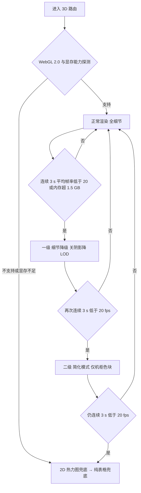

# 3D 可视化需求说明

| 项 | 内容 |
|---|---|
| 文档编号 | CDCIM-P1-SRS-09 |
| 版本 / 状态 | v0.2 · 帧率判据口径已统一，待评审 |
| 所属阶段 | P1 需求工程 |
| 论文价值 | ★★★★☆ 支撑论文「性能战术」「资源调度」「人机交互设计」「数字孪生」四类论点的直接素材；提供「无 GPU 环境下如何用实例化 + LOD + 降级链把 3D 做成可用功能」的完整论证 |
| 上游依据 | [需求规格说明书](02-需求规格说明书.md)（FR-M5-01 ~ 07、NFR-PERF-03/04、NFR-USE-01、NFR-AVAIL-04）、[质量属性场景表](03-质量属性场景表.md)（QA-PERF-03/04、QA-USE-01）、[ADR-0004 3D 可视化](../09-决策/ADR-0004-3D可视化-Threejs机房级数字孪生.md)、[数据字典初稿](08-数据字典初稿.md)（`space_node`）、[文档规范](../90-规范/01-文档规范.md)、[图表规范](../90-规范/02-图表规范.md) |
| 下游承接 | P2 前端渲染架构章节与 ATAM 的「表现力 vs 性能」权衡点、P3 场景 JSON Schema 与坐标体系、P5 实现、P6 帧率实测 |

> **口径声明**：本文所有性能数字均为**设计目标值（验收门槛）**，不是实测值，表中统一标注「目标值，待 P6 实测」。实测帧率、首屏与内存只在 P6 产生，论文「实施效果」段引用 P6 数据，本文不得被引用为「已达成」。凡与 [ADR-0004](../09-决策/ADR-0004-3D可视化-Threejs机房级数字孪生.md) 不一致处，以本文件的量化口径为准并在第 10 节登记。

---

## 1. 文档目的

### 1.1 3D 要解决什么

3D 在本项目中只承担一件事：**空间态势感知**——让值班员在告警发生后的第一时间，把「设备编号」这个抽象标识转换成「哪个机房、哪一列、第几个机柜」这个物理位置，并同时看到该位置周边的受影响范围。

这句话拆开是三个可验证的能力：

| 能力 | 具体表现 | 对应需求 |
|---|---|---|
| 位置可视化 | 3 机房、约 120 个机柜的相对位置、列与通道走向、精密空调与机柜的空间关系一屏可见 | FR-M5-03 |
| 告警空间化 | 告警条目一键把相机送到目标机柜，并高亮同列/同排的影响范围 | FR-M5-04 |
| 状态空间化 | 温度、在线状态、告警级别直接映射为机柜外观，不查表即可看出「哪一片在升温」 | FR-M5-05 |

### 1.2 3D 不是什么

写清边界比写清功能更重要，因为「3D」这个词天然诱导过度设计。

**表 TAB-SRS-30　3D 能力边界**

| 它是什么 | 它不是什么 | 理由 |
|---|---|---|
| 机房级 + 机柜级的空间表达 | 不是 U 位级、板卡级、端口级的精细建模 | 集显环境下几何复杂度直接换算成帧率；机柜级已能回答「哪里出问题」，U 位级只增加成本不增加决策价值（ADR-0004 第 4 节） |
| 参数化生成的几何体 + 状态着色 | 不是 BIM/CAD 级还原，不追求外观逼真 | 建模工作量与维护成本不可持续；换机房只改 JSON 配置（第 6 节） |
| 实时状态的颜色/图标映射 | 不是视频孪生，不贴实时视频流纹理 | 视频纹理需解码 + 上传显存，集显无法承受；视频联动由 FR-M4-04 的独立窗口承载 |
| 2D 大屏的补充视图 | 不是 2D 的替代品 | 信息密度上 2D 更优；两者互补（ADR-0004 第 4 节第 4 条） |
| 独立路由的增强功能 | **不是告警主链路的一环** | 3D 崩溃、降级、回落均不影响后端告警判定与推送（NFR-AVAIL-04、C-14） |

一句话：**3D 是「看得见位置」的手段，不是「看起来高级」的目的。**

---

## 2. 业务价值论证

### 2.1 两条处置路径的拆解

以「大屏出现 1 条紧急告警，值班员需确认是哪个机柜的哪台设备」为例。

**表 TAB-SRS-31　定位路径对比（表格查编号 vs 3D 看位置）**

| 步骤 | 路径 A：表格 / 台账 | 路径 B：3D 空间定位 |
|---|---|---|
| ① 获取告警对象 | 打开告警工作台，读设备名与编号（1 次点击） | 大屏告警条目已在屏（0 次点击） |
| ② 换算物理位置 | 复制编号 → 打开设备台账查询（1 次点击 + 输入）→ 读「所属机柜」字段 | 点击「定位」（1 次点击） |
| ③ 建立空间概念 | 由机柜编码 `RM-A/ROW-03/RACK-012` 脑内换算为机房/列/排，或再开 2D 平面图（1 次点击） | 相机飞行至目标并高亮，位置关系直接可见（0 次点击） |
| ④ 判断影响范围 | 需再查同列/同排设备清单（1 ~ 2 次点击） | 同列/同排影响范围自动高亮（0 次点击） |
| ⑤ 现场核实（可选） | 按编码找机柜，冷通道编号不熟时易走错列 | 记住「第 3 列第 2 柜、靠冷通道侧」再走 |
| **合计（不含现场步行）** | **4 ~ 6 次点击，30 ~ 60 s** | **2 ~ 3 次点击，≤ 10 s** |

路径 B 的终点与 [QA-USE-01](03-质量属性场景表.md) 的判据一致：**≤ 3 次点击、≤ 10 s 到达目标设备**（NFR-USE-01）。该判据是本文与 SRS 的共用验收口径，不是本文另立的新指标。

### 2.2 收益估算（估算值，P6 校准）

| 项 | 取值 | 说明 |
|---|---|---|
| 单次定位节省时间 | 20 ~ 30 s | 路径 B 相对路径 A 的差值下界，保守取 20 s |
| 每班需空间定位的告警 | 10 ~ 20 条 | 按告警事件日均 400 ~ 800 条中约 5% 需现场/空间确认估算 |
| 每班节省 | 3 ~ 10 min | 20 s × 10 ~ 20 条 |
| 年化（3 班制） | 约 55 ~ 180 h | 仅人力时间，不含走错列导致的处置延迟 |

> 上述为**按点击路径拆解的估算**，不是实测。P6 以 QA-USE-01 的 5 名试用者 × 3 次任务实测校准；论文引用时必须写明「估算，实测见 P6」。

### 2.3 为什么值得为它付出成本

3D 的代价是明确的：前端包体积增加（three.js 约 600 KB gzip，ADR-0004 第 5 节）、建模配置工作量、集显帧率风险。这些代价之所以可接受，是因为：

1. **它替换的是最耗时的一步**——「编号 → 空间」的换算，这一步在纯表格里无法消除，只能靠人的记忆；
2. **它与告警降噪形成合力**——降噪把 200 条原始告警压成 ≤ 5 个事件（FR-M3-07），3D 把每个事件直接落到空间位置，两者叠加才真正缩短「感知 → 定位」的链路；
3. **代价可控且可回退**——路由懒加载保证 2D 首屏不受影响，三级降级保证任何设备上都不出现白屏，最差退化为表格清单。

---

## 3. 场景范围与粒度

### 3.1 规模基线

**表 TAB-SRS-32　场景对象与规模（单机房 / 全项目）**

| 对象 | 单机房 | 合计 | 渲染方式 | 备注 |
|---|---|---|---|---|
| 机房壳体（地面、墙、门洞示意） | 1 | 3 | 普通 Mesh（合并为 1 个几何体） | 只做内表面，不做外立面 |
| 列（ROW） | 13 | 39 | 不单独建模，由机柜阵列位置体现 | 列号用 Sprite 标签 |
| 机柜 | 40 | 120 | **InstancedMesh（1 次 draw call）** | 柜体 + 柜门 + 状态灯合并为一个实例几何 |
| 机柜状态灯 | 40 | 120 | InstancedMesh（附着于柜体实例，用实例色表达） | 不单独占 draw call |
| 精密空调 | 4 | 12 | 普通 Mesh（低模） | 参数化盒体 + 出风口色块 |
| UPS / 配电柜 | 2 | 6 | 普通 Mesh（低模） | 手动坐标 |
| 桥架 / 冷通道封闭 / 管线 | 3 段 | 9 段 | 合并为 1 ~ 3 个 Line/管状几何 | 简化模式可整体隐藏 |
| 列号与柜号标签 | ≤ 20 | ≤ 60 | Sprite 合并到 1 张图集 | 远景自动隐藏 |
| 告警高亮体 | ≤ 10 | ≤ 30 | 独立 Mesh（半透明外框） | 数量少，可接受额外 draw call |
| 测点 | 约 667 | 2000 | 不直接渲染，聚合到机柜（温度取进风温度、状态取最高级别） | 避免 2000 个对象进场景 |

粒度结论：**机房级（壳体 + 空调 + 管线）+ 机柜级（柜体 + 状态）**，明确不做 U 位与板卡（与数据字典 `space_node` 的 `u_slot` 保留但不渲染一致）。

### 3.2 做 / 不做清单

| 做 | 不做 | 依据 |
|---|---|---|
| 3 机房总览与单机房视图切换 | 园区/楼栋级宏观视图 | 无业务需求支撑，属范围蔓延 |
| 机柜阵列位置、列号、冷通道走向 | 机柜内部设备排布（U 位） | 无 GPU 环境能力边界 |
| 机柜进风温度热力着色（≥ 5 档） | 机房气流场 CFD 仿真 | 计算量与数据源均不具备 |
| 告警机柜定位 + 同列/同排影响范围高亮 | 告警在 3D 中的连线传播动画 | 动画成本高、信息增益低 |
| 机柜拾取 → 详情面板（跳转 2D 详情页） | 在 3D 内直接编辑设备台账 | 编辑类操作留在 2D 表单，避免 3D 承担表单职责 |
| 轨道旋转/缩放/平移、视角复位、全屏 | 第一人称漫游（WASD 走入机房） | 无价值增益，且易迷失方向 |
| 键盘导航与读屏播报 | 手势/触屏专用交互 | 目标环境为桌面浏览器（A-5 不做 App） |
| 2D 热力图与纯表格兜底 | 视频流纹理、实时视频上墙到 3D | 显存与解码能力不足 |

---

## 4. 用户交互需求

编号 `UX-3D-01 ~ UX-3D-10`。所有交互必须同时具备鼠标与键盘两条通路（键盘约定见 4.2），这是可访问性的硬要求而非加分项。

**表 TAB-SRS-33　3D 交互需求**

| 编号 | 交互 | 触发方式 | 响应 | 验收判据（目标值） |
|---|---|---|---|---|
| UX-3D-01 | 轨道旋转 / 缩放 / 平移 | 左键拖拽旋转；滚轮缩放；右键或 `Shift`+左键平移；键盘 `+` / `-` 缩放 | 相机绕场景中心轨道运动，缩放有最小/最大距离限制（防止穿模与无限拉远） | 拖拽跟手无卡顿感（交互期间帧率不低于 PERF-3D-02 的 80%）；缩放范围限制生效（100% 不穿入机柜内部）；连续操作 60 s 无相机翻转 |
| UX-3D-02 | 机柜拾取与详情 | 鼠标悬停高亮、单击选中；键盘 `Tab` 聚焦机柜、`Enter` 打开 | 悬停显示机柜标签（编号 + 温度 + 最高告警级别）与描边；单击打开右侧详情面板，含「查看设备明细」跳转 2D 详情页 | 悬停到高亮 ≤ 100 ms；拾取命中误差 0（点击机柜 A 不得选中机柜 B，抽检 20 次）；详情面板 1 次点击可达设备列表 |
| UX-3D-03 | 告警空间定位与影响范围高亮 | 告警工作台/大屏告警条目点击「定位」；URL 携带 `rack_id` 直接进入 | 相机飞行至目标机柜（路径平滑，不与机柜穿插），目标柜高亮描边，同列与同排机柜以低饱和度底色标记为影响范围；顶部显示「返回上一视角」 | 点击到定位完成（相机停止 + 高亮可见）**≤ 1.5 s**；影响范围与实际受影响机柜一致（抽检 10 次全对，对应 FR-M5-04）；`Esc` 可返回上一视角 |
| UX-3D-04 | 温度热力切换 | 工具栏「温度热力」开关；快捷键 `H` | 在「状态着色」与「温度着色」之间切换；切换时只更新实例颜色/顶点色，**不重建几何**；切至温度模式显示色标图例 | 切换响应 ≤ 200 ms；颜色与数值映射错档 0 例（抽检 20 柜，对应 FR-M5-05）；色标图例与百分比/区间文字一致 |
| UX-3D-05 | 机房 / 楼层切换 | 顶部机房切换器（RM-A / RM-B / RM-C，含楼层标注）；键盘 `Tab` 到切换器 + 方向键选择 + `Enter` | 卸载当前场景、加载目标机房配置，相机复位到该机房默认视角；切换过程显示加载态与进度 | 单机房场景切换 ≤ 1.5 s（本地缓存命中 ≤ 800 ms）；切换失败（JSON 404/解析失败）显示错误提示并可重试，不留白屏；切换不触发整页刷新 |
| UX-3D-06 | 视角复位 | 工具栏「复位」按钮；快捷键 `R`；双击空白处 | 相机动画回到当前机房默认视角（俯视 45°、含全部机柜） | 复位动画 ≤ 800 ms；复位后场景完整在视锥内（无裁切，100%）；复位不改变当前着色模式与选中状态 |
| UX-3D-07 | 搜索并定位 | 搜索框输入机柜编号/名称（支持 `RM-A` `A-03-02` `RACK-012` 三种写法）；下拉候选 + `Enter` | 模糊匹配候选 ≤ 10 条，选中后复用 UX-3D-03 的相机飞行逻辑，并在目标处显示标签 2 s | 输入到候选出现 ≤ 300 ms（单机房 40 柜规模）；三种编号写法均可命中（各验证 5 次，命中率 100%）；无结果时提示「未找到，请检查编号」而非静默失败 |
| UX-3D-08 | 图例与色标 | 常驻左下角图例区，随着色模式切换；可折叠 | 温度模式显示 5 档色阶 + 区间数值 + 每档图案；状态模式显示正常/告警/离线/维护/未知 5 种图例 | 图例项与实际渲染映射一一对应（逐项核对，0 偏差）；折叠后不遮挡机柜（1366×768 下检查）；图例在灰度打印下仍可区分（见 7.3） |
| UX-3D-09 | 全屏 | 工具栏「全屏」；快捷键 `F`；`Esc` 退出全屏 | 进入浏览器全屏，画布自适应分辨率（含 DPR 变化时重建 renderer）；退出恢复原布局 | 全屏切换 ≤ 500 ms；切换后无拉伸变形（宽高比正确）；`Esc` 退出后布局与进入前一致（元素位置偏差 0） |
| UX-3D-10 | 2D / 3D 切换 | 视图切换按钮（大屏右上）；快捷键 `V`；URL 参数 `view=2d\|3d` | 3D ↔ 2D 平面图互切，保持当前机房与选中的机柜不变；2D 侧提供等价的状态、告警定位、热力三项能力 | 切换 ≤ 1 s；切换后选中机柜保持一致（100%）；URL 可直接打开指定视图（刷新后保持，100%）；2D 侧三项功能各验证 1 次均可用（对应 FR-M5-07） |

### 4.1 交互约束三条

1. **任何交互都不得触发全场景重建**——状态更新走实例属性与顶点色，几何只在机房切换时重建（ADR-0004 第 3 节）；
2. **相机动画可中断**——用户在任何飞行过程中拖拽即接管相机，动画立即让位，不允许「抢镜头」；
3. **降级状态下交互不降级**——L1/L2 降级后，拾取、定位、热力、搜索四项必须保持可用（对应 FR-M5-06 的判据）。

### 4.2 键盘可达性与可访问性约定

**表 TAB-SRS-34　3D 键盘与辅助技术约定**

| 按键 | 行为 | 说明 |
|---|---|---|
| `Tab` / `Shift`+`Tab` | 在工具栏控件与机柜之间移动焦点 | 画布获得焦点后进入「机柜导航模式」，焦点顺序按「列号 → 列内序号」排序，与空间位置一致 |
| 方向键 | 在同列内上下移动机柜焦点；`Ctrl`+方向键跨列移动 | 焦点机柜以 2 px 高对比描边 + 常驻文字标签表示，不依赖颜色 |
| `Enter` / `Space` | 选中焦点机柜并打开详情 | 与鼠标单击等价 |
| `Esc` | 依次退出：详情面板 → 定位高亮 → 全屏 → 机柜导航模式 | 逐层退出，不一次跳回大屏，避免误操作丢失上下文 |
| `+` / `-`、`PageUp` / `PageDown` | 缩放 | 与滚轮等价 |
| `R` / `H` / `F` / `V` | 复位 / 热力 / 全屏 / 2D-3D 切换 | 控件带 `aria-keyshortcuts` 声明 |
| 读屏播报 | 焦点机柜变化时通过 `aria-live="polite"` 播报「机房 A 第 3 列第 2 柜，温度 27.4 摄氏度，重要告警」 | 播报内容含位置、温度、最高告警级别三要素 |
| `prefers-reduced-motion` | 相机飞行改为淡入淡出切换；关闭告警呼吸动画与状态灯闪烁 | 尊重系统级动效偏好 |

可访问性不是「额外做一套」，而是上表每条交互的验收项之一：UX-3D-02/03/05/07 的验收判据中，键盘路径必须与鼠标路径得到同一结果。

---

## 5. 渲染性能需求

### 5.1 环境前提

性能指标只在**客户端浏览器渲染进程**上测量。原型环境中浏览器运行在 Windows 侧、应用容器运行在 WSL 内，因此：

- 帧率、首屏、内存**不得在容器内或远程桌面中测**（虚拟机 GPU 与远程桌面协议会显著劣化结果，且不可复现）；
- 指标只对「集显机型」成立，机型定义见 9.2；
- 所有指标为目标值，待 P6 实测。

### 5.2 指标表

**表 TAB-SRS-35　3D 渲染性能指标（目标值，待 P6 实测）**

| 编号 | 指标 | 目标值 | 测量方法 | 观测点 |
|---|---|---|---|---|
| PERF-3D-01 | 首屏可交互时间 | ≤ 3 s（冷缓存，P95，10 次） | Chrome DevTools 清缓存后加载 `/#/scene/RM-A`，从路由 chunk 请求发起到首帧绘制完成 | 浏览器渲染进程：首个 `requestAnimationFrame` 回调内打点，与 Navigation Timing 起点对齐 |
| PERF-3D-02 | 稳定帧率 | 平均 **≥ 20 fps**，目标 25 fps；1% low ≥ 15 fps（连续 60 s，含旋转/缩放/热力切换） | 连续 60 s 用 rAF 时间戳采样帧间隔，统计均值与 1% low；脚本内置采样开关（调试模式可见） | 浏览器渲染进程 rAF 时间戳序列 |
| PERF-3D-03 | 渲染内存 | ≤ 1.5 GB（JS heap + GPU 估算峰值）；连续交互 30 min 增长 ≤ 50 MB | Chrome Performance 面板 Memory 录制 + `performance.memory` 采样（1 s 粒度） | 渲染进程峰值；30 min 前后对比 |
| PERF-3D-04 | draw call 上限 | 单帧 ≤ **60** 次，典型 ≤ 40 次；120 个机柜恒为 **1** 次 | 调试模式下读取 `renderer.info.render.calls` 并显示于 HUD；亦可用 Spector.js 抓帧核对 | 单帧统计（取 60 s 内最大值） |
| PERF-3D-05 | 三角面预算 | 全场景 ≤ **15 万**面；L2 远景 ≤ 6 万面 | `renderer.info.render.triangles`（每帧）与资源清单核对 | 单帧提交三角面数，取 60 s 内最大值 |
| PERF-3D-06 | 纹理预算 | 单张 ≤ 512×512 px；总量 ≤ **64 MB**；禁止视频纹理 | `renderer.info.memory.textures` + 纹理资源清单（尺寸 × 4 B × 1.33 mipmap） | 加载完成后统计一次，交互 30 min 后复测（不得增长） |
| PERF-3D-07 | 降级触发条件 | 连续 **3 s** 平均 fps < 20 **或** 渲染内存 > 1.5 GB **或** WebGL 上下文丢失 → 进入一级降级；每级判定窗口 3 s；降级动作 ≤ 2 s；**不自动升档** | 注入方式：①人为放大窗口/关闭硬件加速制造低帧率；②注入大纹理逼近内存阈值；③`WEBGL_lose_context` 扩展强制丢失上下文。观察降级与提示 | 降级状态机日志（时间戳 + 触发指标 + 降级级别）；界面「已降级」标识出现时刻 |
| PERF-3D-08 | 降级后指标 | 一级降级后平均 ≥ 25 fps；二级降级后平均 ≥ 20 fps；2D 兜底首屏 ≤ 2 s；降级后拾取/定位/热力/搜索四项可用 | 同 PERF-3D-02 采样方法，分别在 L1、L2、L3 状态下各测 60 s；四项功能各验证 1 次 | 各级别下的 rAF 采样与功能验证记录 |

### 5.3 与 SRS 阈值的关系（口径已统一）

初稿曾出现两套阈值：SRS 的 FR-M5-06 原文写「连续 5 s fps < 15 触发降级」，而 ADR-0004 与 QA-PERF-04 写「连续 3 s < 20 fps」。**评审时已统一，SRS v0.5 已修订 FR-M5-06**：

| 口径 | 阈值 | 持续时间 | 状态 |
|---|---|---|---|
| SRS FR-M5-06（v0.5 修订后） | 平均 fps < 20 **或** 渲染内存 > 1.5 GB | 3 s | **唯一判据**，逐级降至 L2、L3 |
| 本文 PERF-3D-07 | 同上 | 3 s | 与 SRS 一致 |
| ADR-0004 / QA-PERF-04 | fps < 20 | 3 s | 与 SRS 一致 |

**不再保留 15 fps / 5 s 的并行判据**：两套阈值同时存在会导致实现时不知道该听哪条，且 15 fps 已经低到画面不可用，作为「快速通道」并无实际收益。15 fps 仅保留在 PERF-3D-02 的「1% low ≥ 15 fps」中，属帧率稳定性指标，不是降级触发条件。

### 5.4 3D 不得阻塞 2D 大屏

这是硬约束，不是优化建议。四条落地要求：

1. **独立路由 + 路由级动态加载**：3D 代码不与大屏同 chunk，大屏首屏不下载 three.js；
2. **首屏体积预算**：见下表，3D 相关字节不计入 2D 首屏关键路径；
3. **预取只在意图明确时触发**：用户鼠标悬停或聚焦「3D 视图」入口 300 ms 后才 `prefetch`，不在页面加载时预取；
4. **故障隔离**：3D chunk 加载失败、渲染异常、WebGL 上下文丢失，一律捕获并降级为 2D，不在大屏抛错、不阻塞大屏计时器与数据订阅（NFR-AVAIL-04）。

**表 TAB-SRS-36　3D 首屏体积预算（目标值，待 P6 实测）**

| 项 | 预算 | 是否计入 2D 首屏 | 说明 |
|---|---|---|---|
| 2D 大屏基线（Vue3 + 图表 + 业务） | ≤ 350 KB gzip | 是 | 本文不控制，仅作为对比基线 |
| 3D 路由 chunk（three.js 核心 + 加载器 + 交互） | ≤ **800 KB** gzip | 否 | three.js 约 600 KB（ADR-0004 口径）+ 业务代码 ≤ 200 KB；超出则先裁后建 |
| 场景配置 JSON（单机房） | ≤ 120 KB 未压缩 / ≤ 30 KB gzip | 否 | 39 字段 × 40 机柜，规模可控 |
| 首屏纹理（共享图集 2 张 512²） | ≤ 2 MB | 否 | 其余纹理按需加载 |
| 其他机房 JSON | 首屏不加载 | 否 | 切换机房时按需拉取并缓存 |
| 3D 首屏请求数 | ≤ 4 个（chunk + JSON + 2 纹理） | 否 | 减少串行等待 |

验收：Chrome Network 面板勾选「Disable cache」，记录大屏首屏传输字节，`three` 与 `scene-` 前缀请求出现次数为 **0**；再进入 3D 路由，累计 3D 相关传输字节 ≤ 830 KB gzip。

---

## 6. 场景数据契约

### 6.1 设计原则

1. **布局与代码解耦**：换机房、加机柜只改 JSON，不改前端代码（对应 NFR-MOD-03 的精神）；
2. **参数化优先**：机柜阵列由「行列数 + 间距 + 尺寸」生成，只有空调、UPS、管线等特殊对象手配坐标；
3. **字段最小化**：只放渲染必需字段，业务字段通过 `node_id` / `device_id` 回查接口，避免 JSON 变成数据副本；
4. **与主数据同源**：字段命名对齐 [数据字典](08-数据字典初稿.md) 的 `space_node` / `device`，不另造同义词。

### 6.2 结构示例（单机房）

```json
{
  "schema_version": "1.0",
  "scene_id": "RM-A",
  "room": { "room_id": 101, "name": "机房 A", "floor": "B1", "size": [18.0, 3.2, 12.0] },
  "coordinate": { "unit": "m", "origin": "south-west-floor-corner", "up_axis": "+Y", "forward_axis": "-Z" },
  "generate": { "cols": 13, "racks_per_col": 3, "col_spacing": 2.4, "rack_spacing": 0.65, "rack_size": [0.6, 2.0, 1.2] },
  "racks": [
    { "node_id": 3001, "node_code": "RM-A/ROW-03/RACK-012", "label": "A-03-02", "col_index": 3, "seq_in_col": 2,
      "pos": [7.2, 0, 0.65], "size": [0.6, 2.0, 1.2], "orientation": "front_-Z",
      "capacity_u": 42, "capacity_kw": 8.0, "device_ids": [2001, 2002] }
  ],
  "devices": [
    { "device_id": 2001, "device_type": "ups", "rack_id": 3001, "u_position": 10, "label": "UPS-01" }
  ],
  "pipes": [
    { "pipe_id": 9001, "pipe_type": "cooling", "path": [[0, 2.8, 0], [18, 2.8, 0]], "color_key": "coolant" }
  ],
  "legends": [
    { "legend_id": "temp", "type": "temp", "unit": "℃", "stops": [22, 25, 28, 30] }
  ]
}
```

### 6.3 字段表

**表 TAB-SRS-37　场景配置字段（39 项）**

| # | 字段路径 | 类型 | 必填 | 说明 | 示例 |
|---|---|---|---|---|---|
| 1 | `schema_version` | string | 是 | 契约版本，前端按版本做兼容校验，不识别则拒绝加载并提示 | `"1.0"` |
| 2 | `scene_id` | string | 是 | 场景标识，与机房编码一致 | `"RM-A"` |
| 3 | `room.room_id` | int | 是 | 机房主键，对应 `space_node.node_id`（room 层） | `101` |
| 4 | `room.name` | string | 是 | 机房展示名 | `"机房 A"` |
| 5 | `room.floor` | string | 否 | 楼层标识，用于切换器分组 | `"B1"` |
| 6 | `room.size` | number[3] | 是 | 机房内部净尺寸 `[宽, 高, 深]`，米 | `[18.0, 3.2, 12.0]` |
| 7 | `coordinate.unit` | string | 是 | 长度单位，本期固定 `"m"` | `"m"` |
| 8 | `coordinate.origin` | string | 是 | 原点语义，见 6.4 | `"south-west-floor-corner"` |
| 9 | `coordinate.up_axis` | string | 是 | 上方向轴，本期固定 `"+Y"` | `"+Y"` |
| 10 | `coordinate.forward_axis` | string | 是 | 机柜正面朝向，本期固定 `"-Z"` | `"-Z"` |
| 11 | `generate.cols` | int | 否 | 参数化列数；缺省时完全按 `racks[].pos` 摆放 | `13` |
| 12 | `generate.racks_per_col` | int | 否 | 每列机柜数 | `3` |
| 13 | `generate.col_spacing` | number | 否 | 相邻列中心距（米） | `2.4` |
| 14 | `generate.rack_spacing` | number | 否 | 同列相邻机柜中心距（米） | `0.65` |
| 15 | `generate.rack_size` | number[3] | 否 | 默认机柜尺寸 `[宽, 高, 深]`，米 | `[0.6, 2.0, 1.2]` |
| 16 | `racks[].node_id` | int | 是 | 机柜节点主键，与 `space_node` 一致 | `3001` |
| 17 | `racks[].node_code` | string | 是 | 业务编码，与台账一致，用于搜索 | `"RM-A/ROW-03/RACK-012"` |
| 18 | `racks[].label` | string | 是 | 场景内短标签（列-位），避免编码过长遮挡 | `"A-03-02"` |
| 19 | `racks[].col_index` | int | 是 | 列序号，从 1 开始，决定空间导航顺序 | `3` |
| 20 | `racks[].seq_in_col` | int | 是 | 列内序号，从 1 开始 | `2` |
| 21 | `racks[].pos` | number[3] | 是 | 机柜中心点坐标 `[x, y, z]`，米；`y` 为底面高度（落地柜为 0） | `[7.2, 0, 0.65]` |
| 22 | `racks[].size` | number[3] | 否 | 覆盖默认尺寸，缺省取 `generate.rack_size` | `[0.6, 2.0, 1.2]` |
| 23 | `racks[].orientation` | string | 是 | 正面朝向枚举：`front_+Z` / `front_-Z` / `front_+X` / `front_-X` | `"front_-Z"` |
| 24 | `racks[].capacity_u` | int | 否 | 容量 U 数，用于详情展示（不渲染 U 位） | `42` |
| 25 | `racks[].capacity_kw` | number | 否 | 额定功率，用于详情与容量视图 | `8.0` |
| 26 | `racks[].device_ids` | int[] | 否 | 柜内设备主键列表，点击详情时按此查询 | `[2001, 2002]` |
| 27 | `devices[].device_id` | int | 是 | 设备主键，对应 `device.device_id` | `2001` |
| 28 | `devices[].device_type` | string | 是 | 设备类型枚举：`ups` / `pdu` / `crac` / `env` / `access` / `network` | `"ups"` |
| 29 | `devices[].rack_id` | int | 是 | 所属机柜 `node_id`；机房级设备填 `null` | `3001` |
| 30 | `devices[].u_position` | int | 否 | 起始 U 位，仅供详情展示，不参与渲染 | `10` |
| 31 | `devices[].label` | string | 是 | 设备短名，用于标签与搜索 | `"UPS-01"` |
| 32 | `pipes[].pipe_id` | int | 是 | 管线主键 | `9001` |
| 33 | `pipes[].pipe_type` | string | 是 | 枚举：`cooling` / `power` / `network` | `"cooling"` |
| 34 | `pipes[].path` | number[3][] | 是 | 折线顶点序列，米，至少 2 个点 | `[[0,2.8,0],[18,2.8,0]]` |
| 35 | `pipes[].color_key` | string | 否 | 配色键，映射到样式表，避免 JSON 里写死颜色 | `"coolant"` |
| 36 | `legends[].legend_id` | string | 是 | 图例标识 | `"temp"` |
| 37 | `legends[].type` | string | 是 | 枚举：`temp` / `alarm` / `status` | `"temp"` |
| 38 | `legends[].unit` | string | 否 | 单位，温度必填 | `"℃"` |
| 39 | `legends[].stops` | number[] | 是 | 分档边界（升序），档数 = 边界数 + 1 | `[22, 25, 28, 30]` |

### 6.4 坐标体系

| 项 | 约定 | 理由 |
|---|---|---|
| 单位 | 米（m），前端不做二次缩放（1 场景单位 = 1 m） | 与 `space_node.pos_x/y/z` 的 `numeric(8,3)` 直接对应，避免换算误差 |
| 原点 | 机房地面西南角（`x` 最小、`z` 最大方向的墙角），`y = 0` 为地面 | 现场放线时以墙角为基准最易定位，图纸与实测可直接对齐 |
| 轴向 | 右手坐标系，`+X` 向东（沿列方向），`+Y` 向上，`+Z` 向南（沿通道方向） | 与 Three.js 默认 Y-up 一致，减少转换代码 |
| 朝向 | 机柜正面朝 `-Z`（冷通道），背面朝 `+Z`（热通道） | 与典型冷热通道布局一致；两面着色不同，便于识别 |
| 坐标来源 | `racks[].pos` 可由 `generate` 规则生成，也可由台账 `pos_x/y/z` 覆盖；两者冲突时以 `racks[].pos` 为准 | 参数化满足规整布局，手动坐标满足特殊摆放 |
| 校验 | 加载时校验：所有机柜包围盒在 `room.size` 内、无重叠（容差 0.05 m）、`y ≥ 0` | 坐标错误是 3D 最常见的「看不见/穿模」原因，必须在加载期暴露 |

### 6.5 参数化生成规则

以「13 列 × 每列 3 柜」为例，生成公式：

| 项 | 规则 | 示例值 |
|---|---|---|
| 列中心 X 坐标 | `x = origin.x + (col_index - 1) × col_spacing` | 第 3 列：`0 + 2 × 2.4 = 4.8 m` |
| 列内 Z 坐标 | `z = origin.z + (seq_in_col - 1) × rack_spacing` | 第 2 位：`0 + 1 × 0.65 = 0.65 m` |
| 机柜中心 Y | 落地柜 `y = 0`（`pos.y` 为底面），渲染时按 `pos.y + size[1]/2` 抬升 | `1.0 m` |
| 默认尺寸 | 宽 0.6 m × 高 2.0 m × 深 1.2 m（42U 标准柜近似） | `[0.6, 2.0, 1.2]` |
| 列间距 | 2.4 m = 机柜深 1.2 m × 2 + 冷/热通道各 0.6 m（示意值，按现场实测覆盖） | `2.4` |
| 单机房规模核算 | `13 × 3 = 39` 柜 + 1 台独立网络柜手配 = 40 柜 | 3 机房合计 117 + 3 = 120 柜 |
| 特殊对象 | 空调、UPS、配电柜、管线一律显式给坐标，不参与参数化 | 见 `devices` / `pipes` |

> 说明：`13 × 3 + 1` 的设计使全项目列数为 39，与 [数据字典](08-数据字典初稿.md) 6.1 中「约 40 列」的估算口径一致（约数）；机柜 120 与 SRS 规模基线严格一致。

### 6.6 运行时状态增量（与场景配置分离）

场景配置是静态布局，状态是动态数据，两者必须分离，否则每次状态刷新都要重传布局。

**表 TAB-SRS-38　运行时状态增量字段（5 项，WebSocket 推送）**

| # | 字段 | 类型 | 必填 | 说明 | 示例 |
|---|---|---|---|---|---|
| 1 | `rack_id` | int | 是 | 机柜 `node_id`，增量定位键 | `3001` |
| 2 | `status` | string | 是 | 机柜综合状态：`normal` / `alarm` / `offline` / `maintenance` / `unknown` | `"alarm"` |
| 3 | `alarm_level` | string | 否 | 最高告警级别：`critical` / `major` / `minor` / `null` | `"major"` |
| 4 | `temp_inlet` | number | 否 | 进风温度（℃），缺省表示无有效数据 | `27.4` |
| 5 | `ts` | string | 是 | 数据时刻（ISO 8601，毫秒） | `"2026-11-26T10:12:03.412+08:00"` |

刷新约定：整体全量快照每 30 s 一次（对齐 FR-M5-05 的热力刷新周期），增量按变化推送；前端收到增量后 **≤ 200 ms** 内完成实例颜色更新，**不得重建几何**。

---

## 7. 视觉与信息设计

### 7.1 温度色标（5 档）

**表 TAB-SRS-39　温度分档与编码**

| 档 | 区间（℃） | 填充色 | 明度（近似） | 图案辅助 | 语义 |
|---|---|---|---|---|---|
| 1 | < 22 | `#2C7FB8`（蓝） | 0.42 | 无填充 | 偏冷，注意结露风险 |
| 2 | 22 ~ 25 | `#41B6C4`（青） | 0.62 | 稀疏斜线（25%） | 正常偏冷 |
| 3 | 25 ~ 28 | `#A1D76A`（黄绿） | 0.78 | 中密斜线（50%） | 正常 |
| 4 | 28 ~ 30 | `#F4A261`（橙） | 0.68 | 密斜线（75%） | 偏高，关注 |
| 5 | > 30 | `#D62728`（红） | 0.33 | 交叉网纹（100%） | 超限，需处置 |

规则：

1. **色标不与告警级别共用色相**：温度用「蓝-青-绿-橙-红」连续序列，告警用「红-橙-黄」离散序列，两者靠图例与图案区分；
2. 档位边界可由 `legends[].stops` 配置，默认值待现场 SOP 确认（第 10 节 Q2）；
3. 灰度下靠**图案密度 + 明度阶梯**区分，蓝色与红色明度分别为 0.42 与 0.33，接近，故必须叠加图案（第 7.3 节）。

### 7.2 告警级别与机柜状态

| 表达对象 | 视觉编码 | 辅助编码（不依赖颜色） |
|---|---|---|
| 紧急（critical） | 红色 `#D62728` + 外发光 | 三角警示图标 + 1.5 s 周期呼吸（幅度 ≤ 20% 亮度，可在设置中关闭）+ 描边加粗 |
| 重要（major） | 橙色 `#E8762C` | 菱形图标 + 静态描边 |
| 一般（minor） | 黄色 `#E3B505` | 圆形图标 + 细描边 |
| 正常 | 中性灰蓝 `#7F8C9B`（状态模式） | 无图标 |
| 离线 | 深灰 `#4D565E` + 斜纹 | 断线图标 + 「离线」文字标签（近景可见） |
| 维护中 | 灰绿 `#8FA98F` + 虚线边框 | 扳手图标，且**不参与告警着色**（与 `space_node.node_status` 一致） |
| 未知 | 浅灰 `#BFC5CB` + 问号 | 问号图标，表示数据缺失而非正常 |

明度设计：红 0.33 / 橙 0.55 / 黄 0.72，三档在灰度下明度差 ≥ 0.17，配合图标形状（三角/菱形/圆）可完全区分。

### 7.3 灰度可辨方案（论文黑白印刷要求）

[图表规范](../90-规范/02-图表规范.md) 第 5 节要求「不得仅靠颜色区分元素」。3D 截图为彩色，但论文印刷为灰度，故：

1. 每档温度**必须有对应图案**（第 7.1 节表），截图在灰度下仍可按纹理密度读出档位；
2. 每级告警**必须有形状不同的图标**，不依赖色相；
3. 图例区同时给出「颜色块 + 图案 + 图标 + 文字区间」，四项冗余；
4. 关键截图在论文中配文字标注（如「红/深色 = > 30 ℃」），不假设读者能分辨颜色。

### 7.4 信息层级

| 层级 | 内容 | 出现条件 |
|---|---|---|
| 第一层（远看） | 机柜色块（状态或温度）、机房轮廓、列走向 | 始终 |
| 第二层（中看） | 列号标签、选中机柜描边、影响范围标记 | 视距 < 25 m 或选中态 |
| 第三层（近看） | 机柜短标签（温度 + 级别图标）、设备标签 | 视距 < 8 m 或悬停/焦点态 |
| 第四层（点击后） | 右侧详情面板（编号、容量、设备清单、告警列表、跳转 2D） | 选中态 |

层级切换由 LOD 与视距驱动，标签总量受控（≤ 60 个 Sprite），避免「标签糊满屏」。

---

## 8. 降级策略

### 8.1 决策流程



**图 FIG-SRS-08　3D 渲染降级决策流程**

> 图注：本图回答「3D 在什么条件下、按什么顺序退让，退到哪一步为止」。节点 I 同时代表 2D 兜底与纯表格兜底两步（图中合并以控制节点数），两者的区分条件见 8.2 表。

### 8.2 各级降级的功能保留与损失

**表 TAB-SRS-40　降级级别定义**

| 级别 | 名称 | 触发条件（含持续时间） | 保留功能 | 损失功能 | 恢复条件 |
|---|---|---|---|---|---|
| L0 | 全细节 | — | 全部 | — | — |
| L1 | 细节降级 | 连续 **3 s** 平均 fps < 20 **或** 渲染内存 > 1.5 GB | 机柜实例化渲染、状态/温度着色、拾取、定位高亮、搜索、图例、全屏、2D 切换 | 阴影、环境光遮蔽、抗锯齿、柜门细节网格、管线贴图、告警呼吸动画、非关键装饰 | **不自动升档**（防抖动）；用户点击「恢复画质」或重新进入路由后重试 L0 |
| L2 | 简化模式 | L1 生效后再次连续 **3 s** 平均 fps < 20 | 机柜色块、定位高亮、着色切换（改为 5 档纯色，无渐变）、图例、搜索、2D 切换 | 纹理、状态灯细节、管线、设备标签、列号标签（保留选中柜标签）、透明效果 | 同 L1；另提供「锁定简化模式」开关，供低配机长期使用 |
| L3 | 2D 热力图兜底 | L2 后仍连续 **3 s** < 20 fps；或 WebGL 上下文丢失；或显存不足；或 3D chunk 加载失败 | 机房平面图、机柜状态着色、告警定位跳转、温度热力（同 5 档色标）、图例 | 三维视角、遮挡关系、空间纵深 | 用户点击「重试 3D」（≤ 3 次），成功后回 L0；刷新页面亦重试 |
| L4 | 纯表格兜底 | 2D 渲染亦失败（Canvas 不可用）**或** 用户手动选择「纯列表视图」 | 机柜/设备清单、按温度排序、告警定位跳转（跳转至 2D 或详情页） | 全部图形化表达 | 手动切回 2D/3D |

### 8.3 降级的三条硬规则

1. **降级必须可观测**：界面上常驻「已降级（L1/L2）」标识，并说明原因（帧率/内存/能力），不静默降级——值班员需要知道自己看到的画面是简化过的；
2. **降级不得损失判断能力**：状态、温度、告警定位三类信息在 L1/L2/L3 中必须全部保留，只允许损失装饰与精度；
3. **降级不得影响后端**：3D 的任何降级、崩溃、回落都不产生后端请求风暴，不上报告警，不写审计（除用户主动操作外），符合 NFR-AVAIL-04 与 C-14。

---

## 9. 验收判据汇总

### 9.1 判据表

**表 TAB-SRS-41　3D 需求验收判据**

| 需求编号 | 判据 | 测试方法 | 测试设备 |
|---|---|---|---|
| UX-3D-01 | 拖拽跟手、缩放范围受限、60 s 无相机翻转 | 人工操作 3 轮 + 交互期间帧率采样 | 集显机型 A |
| UX-3D-02 | 悬停高亮 ≤ 100 ms；拾取命中正确率 100%（20 次） | 人工逐柜点击 + 录屏计时 | 集显机型 A |
| UX-3D-03 | 定位完成 ≤ 1.5 s；影响范围 10/10 正确；`Esc` 可返回 | 从告警工作台触发 10 次，逐次核对高亮集合 | 集显机型 A |
| UX-3D-04 | 切换 ≤ 200 ms；颜色映射 20 柜 0 错档；图例一致 | 抽样 20 柜比对温度值与显示档位 | 集显机型 A |
| UX-3D-05 | 机房切换 ≤ 1.5 s；失败可重试无白屏 | 3 机房各切 3 次 + 构造 JSON 404 2 次 | 集显机型 A |
| UX-3D-06 | 复位 ≤ 800 ms；复位后场景完整在视锥内 | 3 机房各 3 次，截图核对 | 集显机型 A |
| UX-3D-07 | 候选 ≤ 300 ms；三种写法命中率 100%；无结果有提示 | 每种写法 5 次输入 | 集显机型 A |
| UX-3D-08 | 图例与渲染映射 0 偏差；灰度可辨 | 逐项核对 + 灰度截图目视 | 集显机型 A |
| UX-3D-09 | 全屏 ≤ 500 ms；无拉伸；退出布局一致 | 3 次进入/退出，测量元素位置 | 集显机型 A |
| UX-3D-10 | 切换 ≤ 1 s；选中保持；2D 三项功能可用 | 3D↔2D 各 5 次 + 功能逐项验证 | 集显机型 A |
| UX-3D-02/03/05/07（键盘路径） | 键盘可完成拾取、定位、切换、搜索，结果与鼠标一致 | 全程仅用键盘完成 4 项任务 | 集显机型 A |
| PERF-3D-01 | 首屏 ≤ 3 s（P95，10 次）；3D 字节不进 2D 首屏 | DevTools 清缓存 10 次 + Network 字节核对 | 集显机型 A、B |
| PERF-3D-02 | 平均 ≥ 20 fps、目标 25；1% low ≥ 15 | 连续 60 s rAF 采样，3 轮 | 集显机型 A、B |
| PERF-3D-03 | 内存 ≤ 1.5 GB；30 min 增长 ≤ 50 MB | Performance 面板录制 + 内存采样 | 集显机型 A |
| PERF-3D-04 | draw call ≤ 60（典型 ≤ 40），机柜 = 1 | 调试 HUD / Spector.js 抓帧 | 集显机型 A |
| PERF-3D-05 | 三角面 ≤ 15 万；L2 ≤ 6 万 | `renderer.info` 读数 | 集显机型 A |
| PERF-3D-06 | 单张 ≤ 512²，总量 ≤ 64 MB，无视频纹理 | 资源清单 + `renderer.info.memory` | 集显机型 A |
| PERF-3D-07 | 3 s 判据触发；动作 ≤ 2 s；不自动升档 | 三种注入方式各 2 次（低帧率/内存/上下文丢失） | 集显机型 A |
| PERF-3D-08 | L1 ≥ 25 fps、L2 ≥ 20 fps、L3 首屏 ≤ 2 s；四项功能可用 | 各级别 60 s 采样 + 功能验证 | 集显机型 A |
| FR-M5-07（回落） | 禁用 WebGL 后 100% 回落 2D，无空白/报错 | 3 个浏览器各 1 次（Chrome/Edge/Firefox） | 集显机型 A |
| NFR-AVAIL-04（隔离） | 注入 3D 异常 3 次，告警推送成功率 100% | 强制抛错 + 关闭 WebGL 上下文，核对后端推送 | 集显机型 A + 后端 |

### 9.2 「集显机型」的定义

**表 TAB-SRS-42　集显基准机型最低配置（验收门槛）**

| 项 | 最低要求 | 说明 |
|---|---|---|
| GPU | Intel UHD Graphics 620 或同级；AMD Radeon Vega 8 或同级 | 2018 年后主流商用笔记本集显水平，不选用 Iris Xe 等较新集显作为门槛，避免「只在好机器上达标」 |
| 显存 | 与系统内存共享，系统分配 ≥ 512 MB | 集显无独立显存，按共享显存计 |
| CPU | ≥ 4 核，基准频率 ≥ 1.6 GHz | 对应 i5-8250U / R5-2500U 级 |
| 内存 | 8 GB | 与 C-01 的 8 GB 约束一致 |
| 分辨率 | 1920×1080，浏览器缩放 100% | 缩放会改变实际渲染像素数，必须固定 |
| 浏览器 | Chrome / Edge 100+，WebGL 2.0 可用，硬件加速开启 | 关闭硬件加速等同软件渲染，不属于验收环境 |
| 操作系统 | Windows 11 或信创桌面 OS（麒麟/统信） | 与 SRS 3.3 运行环境一致 |
| 电源 | 接入电源，电源模式「平衡」 | 节能模式会主动降频，导致结果不可复现 |
| 机型数量 | **≥ 2 台不同 GPU 的集显机型**，各测 1 轮 | 避免单一机型结论；两台结果均达标才算通过 |

> 若最终确认现场值班机为 Iris Xe 等较新集显，可将门槛上调，但**不得低于本表**——门槛只能抬高不能降低，否则「集显可跑」的承诺失去意义（第 10 节 Q1）。

---

## 10. 待确认事项

| # | 待确认点 | 本文暂定 | 备选 / 影响 | 建议 |
|---|---|---|---|---|
| Q1 | **集显基准机型的具体型号** | Intel UHD 620 / AMD Vega 8 级，≥ 2 台不同 GPU 机型 | 若现场值班机为 Iris Xe 级，可将门槛上调；若现场存在更老机型（如 HD 620 之前），需下调分辨率或接受 L2 常驻 | 建议以「实际值班机最低配」为门槛，并在 P5 前实测一台真实设备，避免验收机与使用机脱节 |
| Q2 | **温度色标档位边界** | < 22 / 22–25 / 25–28 / 28–30 / > 30 ℃ | 现场 SOP 若以 18–27 ℃ 为冷通道推荐区间，第 3 档偏宽；可按 `legends[].stops` 配置覆盖 | 建议由环境与设备组按现行 SOP 给出边界，配置化落地，不改代码 |
| Q3 | **3D 是否为演示必须项** | 按 SRS 8.2 列为第三批（C 类），保留即有 2D/表格兜底 | 若 P5 裁剪 3D，则 QA-PERF-04 需改为「已作废」，BR-10 由 FR-M5-02 + FR-M5-07 承接 | 建议保留 3D（它承载 BR-10 的空间定位价值），但在 P5 范围评审时一次性决定；保留则 QA-PERF-04 **条件升档为 P1** 并纳入验收 |

---

## 考点映射

| 考纲知识点 | 本文件对应内容 | 论文可用位置 | 真题溯源 |
|---|---|---|---|
| 性能战术（资源调度 / 减少需求） | 第 5 节 draw call 与三角面预算、第 3 节实例化渲染、LOD 分级 | 论文「性能设计」段：以 InstancedMesh 将 120 次 draw call 压到 1 次，是数量级优化的典型例证 | 2025 下 性能测试、2022 下 系统性能设计 |
| 资源调度与降级设计 | 第 8 节五级降级链、触发与恢复条件、功能保留/损失表 | 论文「性能设计」或「可靠性设计」段的降级策略论述 | 2024 下 软件可靠性、2023 下 高可用设计 |
| 人机交互设计 | 第 4 节 10 条交互需求 + 键盘可达性约定、第 7 节视觉编码 | 论文「人机交互」段：以「3 次点击 ≤ 10 s」定义定位效率，并用形状/图案冗余保证灰度与无障碍可用 | 2023 上 人机交互、2024 上 界面设计 |
| 数字孪生与可视化 | 第 1 节能力边界、第 6 节场景数据契约与坐标体系 | 论文「系统实现」段：布局与代码解耦，参数化生成 + JSON 契约支撑换机房不改代码 | 2023 下 数字孪生、2024 下 数据可视化 |
| 架构权衡（表现力 vs 性能） | 第 2.3 节成本论证、第 5.4 节 3D 不阻塞 2D、第 10 节 Q3 | 论文 ATAM 段：3D 的收益（定位效率）与代价（包体积、帧率风险）及缓解手段 | 2023 上 架构评估 |
| 可访问性设计 | 第 4.2 节 Tab/方向键/Esc/读屏播报、`prefers-reduced-motion` | 论文「人机交互」段的非功能考量，体现设计完整性 | 评分点为「设计考虑的全面性」 |

## 论文可引用段落

> 本段适用于「系统架构设计」「性能设计」「人机交互设计」「数字孪生与可视化」类论文的可视化或性能章节。
>
> 三维机房视图在本项目中不是装饰，而是用来消除「设备编号到物理位置」的换算成本。表格路径需 4 到 6 次点击、30 到 60 秒，三维路径通过告警条目一键飞行与影响范围高亮，可在 3 次点击、10 秒内到达目标机柜。真正的约束不是功能而是环境：现场没有独立显卡，几何复杂度直接换算成帧率。因此粒度定在机房级与机柜级，不做 U 位与板卡；用 InstancedMesh 把 120 个机柜压成一次绘制调用，用三级 LOD 控制三角面，并把首屏体积预算、draw call 与纹理上限写进需求。同时设计五级降级链：连续 3 秒低于 20 fps 先关阴影降 LOD，再退化为色块简化模式，仍不足则回落二维热力图与纯表格，且不自动升档以避免抖动。这样三维视图最差只是退化为二维，不会白屏，也不会拖慢二维大屏。

## 变更记录

| 版本 | 日期 | 变更 |
|---|---|---|
| v0.1 | 2026-11-26 | 初稿。含 10 条交互需求（UX-3D-01 ~ 10）、8 条渲染性能指标（PERF-3D-01 ~ 08）、场景数据契约（配置 39 字段 + 运行时 5 字段）、五级降级链与决策流程图、视觉编码方案、验收判据汇总与 3 项待确认 |
| v0.2 | 2026-11-26 | 评审修正：帧率降级阈值与 SRS FR-M5-06 统一为「20 fps / 3 s 或内存 > 1.5 GB」，删除 15 fps / 5 s 并行判据（5.3 节重写） |
