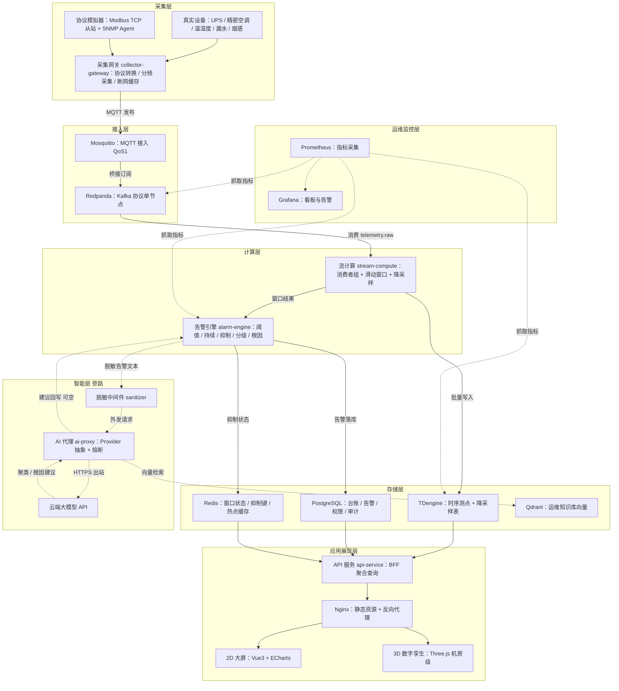

# 组件映射表 v1（Component Mapping）

| 项 | 内容 |
|---|---|
| 文档编号 | CDCIM-P0-ARCH-01 |
| 版本 / 状态 | v0.1 · 草案 |
| 所属阶段 | P0 立项与基线（架构基线首版，P2 阶段细化） |
| 论文价值 | ★★★★★ 「架构设计」段的核心图表来源：分层视图、技术选型论证、考点落点均为论文直接素材 |
| 上游依据 | [项目背景卡](../01-立项/01-项目背景卡.md)、[可行性分析](../01-立项/02-可行性分析.md)、[文档规范](../90-规范/01-文档规范.md) |

> **数值口径**：本文全部内存、吞吐、时延数字为**估算值或设计目标值**，非实测。P4 阶段以 `docker stats` 校准后升版。
> **文档定位**：本文件是「组件清单基线」，回答「用什么、为什么、占多少、对应哪个考点」。服务拆分、接口契约、部署拓扑分别在 P2 的服务拆分文档、P3 的接口契约文档中展开，本文不重复。

---

## 1. 分层组件映射总表

系统按七层划分：采集、接入、计算、存储、智能、应用展现、运维监控。分层依据是**变更频率与失效影响范围**——同层组件可整体替换而不影响上下游，跨层替换必须改契约。

### 1.1 采集层

| 本地原型组件 | 生产级组件 | 选型理由 | 关键参数 | 内存预算（MB） | 对应考纲考点 |
|---|---|---|---|---|---|
| **collector-gateway**（Python 3.11 + pymodbus + pysnmp + asyncio） | 边缘采集网关（工业级，支持协议插件热加载）+ 现场采集器 | 单容器承载 Modbus TCP / SNMP / MQTT 三协议，避免为每种协议起一个进程；asyncio 单线程事件循环在 400 点/秒下 CPU 占用 < 15% | 5 s 快变 / 30 s 慢变分频；单实例支持 ≥ 2000 测点；超时 3 s、重试 2 次 | 220 | 边云协同、协议适配、事件驱动 |
| **device-simulator**（pymodbus server + snmpsim + 时序回放脚本） | 真实 UPS / 精密空调 / 列头柜 / 温湿度 / 漏水传感器 | 无真实硬件时的协议级替代，报文格式与真实设备一致 | 模拟 2000 点、可注入阶跃/漂移/断链三类故障 | 含在 collector-gateway 内 | 诚实边界（见可行性 §8） |

**分频采集的理由**：2000 点若统一按 5 s 采集，速率为 400 点/秒；若统一按 30 s，则温度突变需 30 s 才能发现，不满足告警 P99 ≤ 3 s 的目标。因此按「快变遥测 5 s / 慢变遥信 30 s」分频，在保持探测灵敏度的同时把负载压到 400 点/秒。这是**性能战术中的「资源调度」**，不是随手配置。

### 1.2 接入层

| 本地原型组件 | 生产级组件 | 选型理由 | 关键参数 | 内存预算（MB） | 对应考纲考点 |
|---|---|---|---|---|---|
| **mosquitto 2.x**（Eclipse Mosquitto） | EMQX 5.x 集群（共享订阅 + 桥接） | C 实现、内存 30 MB 量级、QoS 1 满足「至少一次」；原生 TLS + ACL 满足等保传输加密与设备鉴权；配置面小，故障可诊断 | 1883（MQTT）/ 9001（WebSocket）；QoS 1；最大连接 200；单条报文 ≤ 4 KB；持久会话关闭（重连由客户端补采） | 30 | 消息中间件、发布订阅、QoS 语义 |
| **redpanda**（单节点，Kafka 协议兼容） | Redpanda 3 节点集群，复制因子 3 | 无 ZooKeeper/JVM 依赖，单进程交付；相同吞吐下内存下限显著低于 Kafka；`--mode dev-container` 提供 1 GB 级别的低内存启动；Kafka 协议兼容使生产迁移面最小 | 9092（Kafka）/ 9644（Admin）/ 8082（Pandaproxy）；topic：`telemetry.raw`（单分区，保留 6 h）、`alarm.events`（保留 24 h）、`ai.tasks`（保留 1 h）；冗余吞吐设计 1800 msg/s | 1024 | 事件驱动架构、Kappa 架构、消息持久化与位点 |
| **topic-schema**（JSON Schema 定义 + 校验中间件） | Schema Registry（Confluent / Redpanda Schema Registry） | 契约前置，避免下游因字段变更静默失败；原型阶段用轻量 JSON Schema 而非 Avro，减少依赖 | 必填字段：`device_id`、`point_id`、`value`、`quality`、`ts`；版本号 `schema_version` | 0（库） | 接口契约、演进式设计 |

**Mosquitto + Redpanda 双消息组件的必要性**：Mosquitto 面向**设备侧**（弱网、高连接数、QoS 语义），Redpanda 面向**系统侧**（持久化、多消费者组、回放能力）。二者职责不同，合并会导致「设备断线即丢数据」或「用 Kafka 承担 MQTT 的会话管理」。这是一次明确的**关注点分离**决策，代价是多一跳网络（约 20–50 ms）。

### 1.3 计算层

| 本地原型组件 | 生产级组件 | 选型理由 | 关键参数 | 内存预算（MB） | 对应考纲考点 |
|---|---|---|---|---|---|
| **stream-compute**（Python asyncio + 消费者组 + 滑动窗口） | Apache Flink（事件时间 + 水位线 + 检查点）或 Kafka Streams | 400 点/秒的窗口聚合用 Flink 属过度设计；asyncio 单进程可完成时间窗聚合、降采样、格式转换，且与 collector 共用 Python 技术栈，降低团队切换成本 | 消费者组 `cg-compute`；窗口 30 s 滑动 / 10 s 步长；乱序容忍 5 s；批量写入攒批 500 条或 200 ms | 300 | 流式计算、事件时间与水位线、Lambda/Kappa |
| **alarm-engine**（规则引擎 + 抑制 + 分级） | Flink CEP / Drools | 告警规则以配置驱动（阈值 / 持续时间 / 同比 / 关联），原型阶段用 YAML + Python 表达式即可表达全部规则；引入 CEP 引擎会增加部署复杂度而无表达力增益 | 持续时间判定 3 个采样点；同级抑制窗 5 min；根因关联 2 层（设备 → 列头柜 → UPS）；分级 P1–P4 | 200 | 规则引擎、复杂事件处理、告警降噪 |
| **api-service**（FastAPI BFF） | Spring Cloud Gateway + 服务网格 | 单进程承载聚合查询与前端接口，避免为原型拆出 5 个服务；FastAPI 自动生成 OpenAPI，接口契约可即时导出至 P3 文档 | 只读查询 P95 ≤ 300 ms；分页上限 500；连接池 20；OpenAPI 3.1 | 160 | 微服务拆分、BFF、API 网关 |

**微服务拆分粒度的判断**：生产架构按「采集 / 计算 / 告警 / 查询 / AI / 通知」拆 6 个服务，原型按「采集 / 计算+告警 / API / AI」拆 4 个容器。拆分依据是**独立伸缩需求**而非「微服务就应该拆细」——原型的负载恒定在 400 点/秒，伸缩需求为零，拆细只增加运维负担。这一判断本身即是「微服务拆分原则」考点的落点。

### 1.4 存储层

| 本地原型组件 | 生产级组件 | 选型理由 | 关键参数 | 内存预算（MB） | 对应考纲考点 |
|---|---|---|---|---|---|
| **tdengine 3.x** | TDengine 3 节点集群，3 副本 | 原生时序模型：2000 测点 → 1 超级表 + 2000 子表，标签（机房/机柜/设备类型）支撑多维聚合；列存 + 差分编码压缩比约 1:10，直接满足 2.2 GB/天 → 220 MB/天；国产，信创零迁移成本 | 数据库 `dcim`；超级表 `st_metric`；2 VGroup；保留 180 天原始 + 3 年降采样（流式计算自动写入 `st_metric_1m`）；写入 400 点/秒稳态 | 512 | 时序数据库、列式存储、数据分区与保留策略 |
| **postgresql 16** | PostgreSQL 主备流复制 / 达梦 DM8 | 强事务元数据：设备台账、告警记录、用户权限、审计日志；唯一约束（`device_id + point_id + alarm_ts + rule_id`）天然实现告警幂等写入；生态与国产替代路径均成熟 | 告警表按月分区；审计表 append-only；`shared_buffers` 64 MB；连接池 20 | 256 | 关系型数据库、事务与约束、分区表、幂等设计 |
| **redis 7** | Redis Sentinel / 阿里 Tair | 三类用途：滑动窗口中间状态（ZSET）、告警抑制去重键（SET + TTL）、热点查询缓存（STRING）；内存数据结构直接匹配时间窗语义，无需自建 | `maxmemory` 96 MB；`maxmemory-policy allkeys-lru`；抑制键 TTL 300 s；缓存 TTL 60 s | 128 | 缓存策略、缓存穿透/雪崩、TTL 与淘汰 |
| **qdrant** | Qdrant 集群 / Milvus | 知识库 RAG 的向量检索，支持 payload 过滤（按设备类型限定检索域，避免跨专业误召回）；Rust 实现、单二进制、带 Web UI，运维成本低 | 集合 `kb_docs`；768 维；距离度量 Cosine；HNSW `m=16`、`ef_construct=100`；5 万 chunk | 200 | 向量数据库、HNSW 索引、RAG 检索 |

**存储四件的分工界线**（避免「什么都往一个库里塞」的常见错误）：

| 数据类型 | 归属 | 判断依据 |
|---|---|---|
| 高频时序测点值 | TDengine | 写多读少、按时间范围扫描、需高压缩比 |
| 强事务业务数据（告警、台账、权限、审计） | PostgreSQL | 需事务、唯一约束、关联查询 |
| 短生命周期热状态（窗口、抑制、会话） | Redis | 可丢、需 TTL、需高频读写 |
| 语义向量 | Qdrant | 需近似最近邻检索 |

### 1.5 智能层（旁路）

| 本地原型组件 | 生产级组件 | 选型理由 | 关键参数 | 内存预算（MB） | 对应考纲考点 |
|---|---|---|---|---|---|
| **ai-proxy**（FastAPI + Provider 抽象） | 模型网关（多供应商路由 + 配额 + 审计） | 以**适配器模式**封装供应商差异，以**策略模式**选择调用策略（模型、温度、超时、重试）；供应商可整体替换而不改调用方代码，这是「数据不出内网 + 模型可换」两条要求的技术落点 | 超时 10 s；熔断阈值连续 3 次失败，冷却 5 min；重试 1 次（仅幂等请求）；并发上限 8 | 90 | 设计模式（适配器/策略）、依赖倒置、熔断降级 |
| **sanitizer**（脱敏中间件） | 数据防泄漏网关（DLP） | 外发前强制脱敏：设备编号哈希、机房代号化、IP 掩码、时间戳降精度；脱敏规则外置为配置，可审计 | 6 条规则（见可行性 §6.2）；脱敏失败即拒绝外发（fail-closed） | 含在 ai-proxy 内 | 数据安全、隐私保护、最小披露 |
| **云端大模型 API** | 国产大模型（通义千问 / 豆包 / DeepSeek）+ 私有化小模型兜底 | 无 GPU 环境下唯一可行的推理路径；旁路异步调用，不可用即降级 | 输入 ≤ 8 K token；输出 ≤ 1 K token；日调用 ≤ 300 次 | 0（外部服务） | 大模型应用、RAG、旁路增强 |

**旁路的四条硬性设计约束**（任一条被破坏，AI 就从「增强」变成「故障源」）：

1. 不设同步等待点——主链路任何环节不得 `await` 大模型返回；
2. 结果可空——AI 结果字段全部 nullable，缺失时前端按规则结果渲染；
3. 超时即弃——10 s 未返回直接放弃，不重试非幂等请求；
4. 熔断隔离——`ai-proxy` 独立容器，其崩溃不影响其他容器。

### 1.6 应用展现层

| 本地原型组件 | 生产级组件 | 选型理由 | 关键参数 | 内存预算（MB） | 对应考纲考点 |
|---|---|---|---|---|---|
| **Vue3 + Vite** | 同（+ CDN + 大屏适配） | 组合式 API 便于按业务域组织代码；Vite 冷启动 < 1 s，开发迭代快 | 路由懒加载；首屏包 ≤ 500 KB（gzip） | 0（静态） | 前端架构、按需加载 |
| **ECharts 5** | 同 | 2D 大屏主力：趋势曲线、热力矩阵、拓扑关系图；Canvas 渲染在中低端终端表现稳定 | 单页图表 ≤ 8 个；数据点降采样至 ≤ 2000 点后渲染 | 0（客户端） | 数据可视化 |
| **Three.js** | 同（+ Draco 压缩 + LOD） | 机房级数字孪生：房间壳体、120 机柜实例阵列、空调与管线、温度热力图、告警定位高亮；实例化渲染（InstancedMesh）把 120 个机柜压到 1 个 draw call | 三角面 ≤ 30 万；目标帧率 ≥ 25 fps（集显）；热力图网格 2 m；首帧 ≤ 3 s | 0（客户端） | 数字孪生、WebGL 渲染、性能优化 |
| **nginx** | Nginx + WAF | 静态资源服务 + 反向代理 + gzip/brotli；单点入口便于统一加安全响应头 | 80/443；`proxy_read_timeout` 30 s；SSE 长连接用于告警推送 | 64 | 反向代理、动静分离 |

**2D 与 3D 的分工**（可用性取舍，详见可行性 §4.2）：2D 是默认视图，承担「看什么异常」；3D 是按需进入的二级视图，承担「异常在哪里」。这一分工使低配值班终端不受 3D 性能影响，同时保留空间定位能力。

### 1.7 运维监控层

| 本地原型组件 | 生产级组件 | 选型理由 | 关键参数 | 内存预算（MB） | 对应考纲考点 |
|---|---|---|---|---|---|
| **prometheus** | Prometheus + Thanos（长期存储） | 拉模式采集容器指标与业务指标；PromQL 直接支撑「写入速率、消费延迟、告警时延」三类核心指标 | 抓取间隔 15 s；14 个 target；保留 15 天；告警规则 8 条 | 180 | 可观测性、指标监控、SLO |
| **grafana** | Grafana + 统一告警 | 看板与告警可视化；内置 SQLite 存储配置，无需额外数据库 | 4 个看板：资源、链路、业务、告警 | 140 | 运维可视化 |
| **docker compose** | Kubernetes（Deployment + HPA + Service） | 单机无调度需求，Compose 的声明式编排即可满足；`restart: always` 提供基础自愈 | 4 个 compose 文件：base / prototype / prod / observability | 0 | 云原生、容器编排 |
| **日志**（容器 stdout + 轮转） | Loki + Promtail | 原型阶段日志量小（< 500 MB/天），文件轮转足够；引入 Loki 需额外 150 MB 内存，暂不启用 | 单文件 50 MB × 5 轮转；保留 30 天 | 0（暂不含） | 日志管理 |

---

## 2. 架构总览图

> 图 1　CDCIM 分层架构与数据流（实线为同步主链路，虚线为 AI 旁路）



**图注**

| 元素 | 含义 | 说明 |
|---|---|---|
| 实线箭头 | 同步主链路 | 任一环节阻塞即影响端到端时延，须满足 P99 目标 |
| 虚线箭头 | 异步旁路 | 无同步等待，失败即降级，不影响主链路 |
| `L5 智能层 旁路` | 整层为可选增强 | 整层不可用时系统降级为纯规则告警，功能完整度 100%、建议质量下降 |
| 单向无回路设计 | 主链路无环 | 告警不反向驱动采集，避免「告警风暴引发采集雪崩」的级联失效 |

---

## 3. 端口规划表

> 原则：**只有 Web 入口（宿主机 8080 → 容器 80）绑定 `0.0.0.0`**，用于 Windows 侧浏览器访问；其余全部中间件端口一律绑定 `127.0.0.1`，仅在 WSL 内或容器网络内可达，调试时临时改用 `0.0.0.0` 并在用完后复原。这样既能保证跨设备访问，又避免中间件直接暴露到宿主机网段。

| 组件 | 容器名 | 宿主端口 | 容器端口 | 用途 | 是否对外暴露 |
|---|---|---|---|---|---|
| Nginx | `cdcim-nginx` | 8080（绑定 0.0.0.0） | 80 | 前端入口、静态资源、API 反代、SSE 推送 | **是**（唯一对外端口） |
| Mosquitto | `cdcim-mqtt` | 1883 / 9001 | 1883 / 9001 | MQTT 接入 / WebSocket | 否（仅容器网络 + 设备网段 ACL） |
| Redpanda | `cdcim-broker` | 9092（仅 127.0.0.1） | 9092 | Kafka 协议生产消费 | 否 |
| Redpanda Admin | `cdcim-broker` | 9644（仅 127.0.0.1） | 9644 | 集群管理与指标 | 否 |
| Redpanda Pandaproxy | `cdcim-broker` | 8082（仅 127.0.0.1） | 8082 | REST 方式投递（调试用） | 否 |
| TDengine | `cdcim-tsdb` | 6030 / 6041 | 6030 / 6041 | 原生连接 / REST | 否 |
| PostgreSQL | `cdcim-pg` | 5432（仅 127.0.0.1） | 5432 | 元数据访问 | 否 |
| Redis | `cdcim-cache` | 6379（仅 127.0.0.1） | 6379 | 缓存与状态 | 否 |
| Qdrant | `cdcim-vector` | 6333 / 6334 | 6333 / 6334 | HTTP / gRPC | 否 |
| 采集网关 | `cdcim-collector` | 8001 | 8001 | 健康检查与 `/metrics` | 否 |
| 流计算 | `cdcim-stream` | 8002 | 8002 | `/metrics`、消费 lag 查询 | 否 |
| 告警引擎 | `cdcim-alarm` | 8003 | 8003 | 内部规则热加载接口 | 否 |
| API 服务 | `cdcim-api` | 8000 | 8000 | 前端接口（经 Nginx 反代） | 否（仅经 Nginx） |
| AI 代理 | `cdcim-ai` | 8004 | 8004 | 内部调用与健康检查 | 否 |
| Prometheus | `cdcim-prom` | 9090（仅 127.0.0.1） | 9090 | 指标查询 | 否 |
| Grafana | `cdcim-grafana` | 3000（仅 127.0.0.1） | 3000 | 看板（运维专线访问） | 否 |

**端口冲突预案**：若宿主 3000 / 8080 / 9090 已被占用（开发机常见），在 `compose.override.prototype.yml` 中统一偏移至 `13000 / 18082 / 19090` 段，避免与本地其他项目冲突。

---

## 4. 内存预算明细表

> 口径：容器常驻工作集（RSS）估算，非实测。合计值与[可行性分析 §2.2](../01-立项/02-可行性分析.md) 保持一致，两处数字必须同步升版。

| 层 | 组件 / 容器 | 估算（MB） | 是否可压缩 | 压缩下限（MB） | 压缩代价 |
|---|---|---|---|---|---|
| 采集 | collector-gateway | 220 | 是 | 150 | 减少协议适配器（须放弃 SNMP） |
| 接入 | mosquitto | 30 | 是 | 16 | 无实质代价 |
| 接入 | redpanda | 1024 | 否 | 1024 | Seastar 预占，不可压缩 |
| 计算 | stream-compute | 300 | 是 | 220 | 窗口长度减半（30 s → 15 s），抗抖动能力下降 |
| 计算 | alarm-engine | 200 | 是 | 150 | 规则数上限降至 20 条 |
| 存储 | tdengine | 512 | 是 | 384 | VGroup 2 → 1，写入并行度下降 |
| 存储 | postgresql | 256 | 是 | 192 | `shared_buffers` 64 → 32 MB，查询变慢 |
| 存储 | redis | 128 | 是 | 80 | maxmemory 96 → 64 MB，抑制窗缩短 |
| 存储 | qdrant | 200 | **是（首裁对象）** | 0 | 取消 RAG，降为关键词检索 |
| 智能 | ai-proxy | 90 | 是 | 70 | 并发上限 8 → 4 |
| 应用 | api-service | 160 | 是 | 120 | 连接池 20 → 10 |
| 展现 | nginx | 64 | 否 | 64 | — |
| 运维 | prometheus | 180 | 是 | 110 | 保留 15 天 → 7 天 |
| 运维 | grafana | 140 | 是 | 100 | 减少看板数与查询缓存 |
| 基础 | docker + WSL2 内核 | 350 | 否 | 350 | — |
| **合计** | — | **3854** | — | **3030** | 全裁后约 3.03 GB |

**余量核算**

| 项 | 数值 | 占比 |
|---|---|---|
| 常驻工作集合计 | 3.76 GB | 配额 47.0% |
| WSL2 软配额 | 8.00 GB | 100% |
| WSL2 硬上限（`.wslconfig`） | 10.00 GB | — |
| 相对软配额余量 | **4.24 GB** | 51.7% |
| 相对硬上限余量 | 6.24 GB | — |
| 全裁剪后可释放 | 0.80 GB | 占工作集 21% |

**余量用途**（与可行性 §2.2 一致）：页缓存 1.5–2 GB、突发峰值 0.5 GB（Qdrant 索引重建 / Prometheus 压缩）、镜像构建 0.5–1 GB、碎片与内核 0.4 GB。

---

## 5. 数据流说明

### 5.1 实时遥测链路

```
设备 → collector-gateway → Mosquitto → Redpanda → stream-compute → TDengine → api-service → 前端
```

| 环节 | 处理动作 | 附加时延目标 | 关键战术 |
|---|---|---|---|
| 采集 | 按分频策略读取寄存器 / OID，封装统一报文 | ≤ 200 ms（含设备响应） | 分频采集（5 s / 30 s）、连接复用、超时 3 s 快速失败 |
| MQTT | QoS 1 发布，Broker 落盘后应答 | ≤ 50 ms | 持久会话关闭、重连补采、报文 ≤ 4 KB |
| Redpanda | 追加写 + 位点管理 | ≤ 100 ms | 单分区顺序写、`acks=1`（原型）/ `acks=all`（生产） |
| 流计算 | 窗口聚合、单位换算、质量码过滤、降采样 | ≤ 500 ms | 批量攒批（500 条 / 200 ms 先到者）、背压（lag > 5000 时降采样率） |
| 写入 | 批量 `INSERT` 到超级表 | ≤ 200 ms | 单批次 500 条、异步提交、失败重试 3 次入死信 |
| 查询回显 | 前端轮询或 SSE 推送 | ≤ 1000 ms | 查询降采样表（1 min）而非原始表、结果缓存 60 s |
| **端到端** | — | **P99 ≤ 2 s** | 设计目标，非实测 |

### 5.2 告警判定链路

```
stream-compute → alarm-engine（阈值 → 持续 → 抑制 → 分级 → 根因） → PostgreSQL + Redis → 通知 + 前端
```

| 环节 | 处理动作 | 附加时延目标 | 关键战术 |
|---|---|---|---|
| 规则匹配 | 阈值比较 + 持续时间判定（连续 3 个采样点） | ≤ 200 ms | 规则预编译为表达式树，避免逐条字符串解析 |
| 抑制 | 同设备同类型 5 min 窗去重；父设备告警抑制子设备同类告警 | ≤ 100 ms | Redis ZSET + TTL 300 s，`ZREMRANGEBYSCORE` 清理过期 |
| 分级 | P1（危及业务）/ P2（影响冗余）/ P3（性能退化）/ P4（提示） | ≤ 50 ms | 分级表配置化，按设备重要度 × 告警类型矩阵 |
| 根因关联 | 2 层关联：设备 → 列头柜 → UPS / 空调 | ≤ 300 ms | 关联关系预加载进内存图，避免每次查库 |
| 幂等落库 | `ON CONFLICT DO NOTHING`（唯一键 device+point+rule+ts 秒级） | ≤ 100 ms | 唯一约束兜底，重复消费不产生重复告警 |
| 通知 | 站内 + 短信（P1/P2） | ≤ 2 s | 异步队列，通知失败不回滚告警 |
| **端到端** | — | **P99 ≤ 3 s** | 设计目标，非实测 |

**为什么用「至少一次 + 幂等写入」而不是追求精确一次**：原型以 Python 消费者组实现，无 Flink 的检查点与两阶段提交能力。选择「至少一次投递 + 数据库唯一约束幂等」是用**存储层的约束**弥补**计算层语义的不足**，代价是重复消息会多消耗一次写入 IO，收益是避免了分布式事务的复杂度。这一取舍在论文中可作为「分布式一致性」考点的具体落点。

### 5.3 AI 旁路链路

```
alarm-engine → sanitizer → ai-proxy → 云端大模型 API → ai-proxy → alarm-engine（建议回写）
                                      ↘ Qdrant（RAG 检索）
```

| 环节 | 处理动作 | 时延目标 | 关键战术 |
|---|---|---|---|
| 任务投递 | 告警落库后异步投递 `ai.tasks`，不阻塞主链路 | ≤ 100 ms | 独立 topic，独立消费者组 |
| 脱敏 | 6 条规则强制脱敏，失败即拒绝外发 | ≤ 50 ms | fail-closed（脱敏失败 = 不外发），规则配置化 |
| RAG 检索 | 按告警类型检索 Top-3 知识片段 | ≤ 300 ms | payload 过滤限定专业域，避免跨域误召回 |
| 模型调用 | HTTPS 出站，超时 10 s，重试 1 次（仅幂等） | P95 ≤ 8 s | 熔断（连续 3 次失败，冷却 5 min）、并发上限 8、限流 |
| 结果回写 | 建议字段更新至告警记录，字段可空 | ≤ 200 ms | 版本号比对，避免旧结果覆盖新结果 |
| **端到端** | — | **P95 ≤ 8 s**（允许超时） | 超时即放弃，前端展示规则结果 |

**旁路链路的三个可观测指标**（写入 Prometheus）：`ai_call_total{result="success|timeout|error"}`、`ai_latency_seconds` 直方图、`ai_circuit_state`（0 关闭 / 1 打开）。熔断打开时，前端顶部显示「AI 增强不可用」横幅。

---

## 6. 信创替代对照表

> 目标：证明「每一层都有国产替代路径，且迁移代价可评估」。本表是**路径论证**，不是迁移实测（见可行性 §8 第 5 项）。

| 类别 | 当前选型 | 国产替代方案 | 协议/接口兼容性 | 迁移代价 | 风险等级 |
|---|---|---|---|---|---|
| **操作系统** | Ubuntu 22.04（WSL2） | 麒麟软件 Kylin V10 SP3 服务器版 / 统信 UOS 服务器版 | 均为 Linux 内核，容器运行时兼容 | **低**：Docker 镜像可复用，仅需替换基础镜像层并重跑构建 | 低 |
| **CPU 架构** | x86_64 | 海光（x86 兼容）/ 鲲鹏 920（ARM64） | 海光二进制兼容；鲲鹏需 ARM64 镜像 | **中**：鲲鹏路径下 Python C 扩展（pymodbus 依赖、numpy）需重编或用预编译轮子 | 中 |
| **时序数据库** | TDengine 3.x | **TDengine（已国产，涛思数据）** | — | **无**：本项目已直接选用国产产品，是信创论证的最强支点 | 无 |
| **关系数据库** | PostgreSQL 16 | 达梦 DM8 / 人大金仓 KingbaseES V8 | SQL 标准兼容度约 90%，PL/pgSQL 需转换为 DM PL/SQL | **中**：DDL 与存储过程重写、JDBC/psycopg 驱动替换、`ON CONFLICT` 语法需改写 | 中 |
| **消息中间件（设备侧）** | Mosquitto 2.x | EMQX（杭州映云科技） | MQTT 3.1.1/5.0 标准协议，客户端代码不改 | **低**：仅需改连接地址与认证配置 | 低 |
| **消息中间件（系统侧）** | Redpanda | Apache RocketMQ（阿里捐赠，Apache 顶级项目）/ Apache Pulsar | **协议不兼容**（Kafka 协议 vs RocketMQ 自有协议） | **高**：生产端与消费端代码均需重写，位点语义与分区模型需重新设计 | **高** |
| **缓存** | Redis 7 | 东方通 TongRDS / 阿里 Tair / 腾讯 TendisCloud | RESP 协议兼容 | **低**：客户端库不改，仅改连接串 | 低 |
| **向量数据库** | Qdrant | Milvus（Zilliz，国内团队主导）/ 腾讯云 VectorDB | REST/gRPC 接口存在差异 | **中**：需在 ai-proxy 内做向量库适配层，检索参数（HNSW 参数名）需映射 | 中 |
| **容器运行时** | Docker Engine | 华为 iSula / 阿里 Pouch | OCI 镜像标准兼容 | **低**：镜像不改 | 低 |
| **容器编排** | Docker Compose | Kubernetes（麒麟/统信适配发行版） | Compose 与 K8s 编排模型不同 | **高**：需编写 Deployment/Service/ConfigMap/Ingress，改造成本最高的一项 | **高** |
| **Web 服务器** | Nginx | OpenResty / 阿里巴巴 Tengine | 配置语法基本兼容 | **低**：配置文件可直接复用 | 低 |
| **大模型** | 云端 API（通用） | 通义千问（阿里）/ 豆包（字节）/ DeepSeek / 文心一言（百度） | OpenAI 兼容接口已成事实标准 | **低**：Provider 抽象已隔离，切换仅改配置 | 低 |
| **浏览器内核** | Chrome | 奇安信可信浏览器 / 360 安全浏览器（均为 Chromium 内核） | Chromium 内核，WebGL 支持 | **低**：需实测 WebGL 性能与 Three.js 兼容性 | 低 |
| **前端框架** | Vue3（MIT 协议） | 无替代必要 | — | 无 | 无 |

**两个高风险项的判断**：`Redpanda → RocketMQ` 与 `Docker Compose → Kubernetes` 是唯二的「高」风险项，共同特点是**协议或编排模型不兼容**，无法通过改配置完成。对这两项，本项目的策略是**在架构上预留抽象**而非提前迁移：消息层通过统一的 `Publisher` / `Consumer` 接口封装（生产实现基于 Kafka 协议），编排层通过参数化 Compose 文件与外部化配置，使迁移时只需替换实现类与编排描述，业务代码不动。这一策略本身即是「依赖倒置」考点的落点。

---

## 7. 边云协同说明

> 说明：本项目的「云」指机构内网的**中心侧**（机房侧服务器），「边」指**设备侧**（机房现场采集节点）。在本项目中「云」不是公有云——金融数据不出内网是硬约束。这一点须在论文中明确澄清，否则易被误读为「用公有云」。

### 7.1 职责划分

| 维度 | 边缘侧 | 中心侧（云） |
|---|---|---|
| 协议转换 | 全责：Modbus TCP / SNMP → 统一 JSON 报文 | 不承担 |
| 采集调度 | 全责：分频采集、超时重试、质量码标注 | 下发采集策略（配置） |
| 断网缓存 | 全责：本地环形缓冲（≥ 10 min，约 24 万条 ≈ 15 MB），网络恢复后按时间序补传 | 接收补传数据，按时间戳去重写入 |
| 本地联动 | 全责：温度越限直接触发本地声光 / 联动空调（不经中心） | 不下发实时控制指令 |
| 边缘过滤 | 部分：质量码为 Bad 的点位不上传（降负载） | 全局规则计算需完整数据时，可要求边侧上传原始值 |
| 集中存储 | 短期缓冲（≤ 10 min） | 长期存储（180 天 + 3 年降采样） |
| 全局分析 | 不做 | 跨机房对比、能效分析、容量趋势 |
| 告警判定 | 仅本地急停类（不依赖网络） | 全部业务告警（阈值 / 持续 / 抑制 / 根因） |
| AI 增强 | 不做（无算力） | 全部（脱敏后外发云端模型） |

### 7.2 边云协同的考点落点

| 考点要素 | 本系统落点 | 论证强度 |
|---|---|---|
| 数据分级处理（边缘过滤 vs 中心全量） | 边侧过滤 Bad 质量点，中心侧接收全部 Good 点 | 已落点 |
| 断网自治 | 边侧 10 min 环形缓冲 + 补传，中心侧按时间戳幂等去重 | 已落点（原型可实现） |
| 低时延本地闭环 | 温度越限 → 本地声光 / 联动，不依赖中心决策，时延 ≤ 1 s | 已落点（模拟器可验证联动信号） |
| 云端集中智能 | 跨机房对比、AI 增强仅在中心侧 | 已落点 |
| 边云一致性 | 补传数据与实时数据的时间序合并，靠时间戳 + 唯一约束保证不重不漏 | 已落点 |
| 边缘算力受限下的模型部署 | 边缘不部署模型（无 GPU） | **未落点**，属架构选择的取舍而非遗漏 |

**一处必须承认的取舍**：真正的边云协同常包含「模型下沉到边缘做本地推理」。本项目因边缘侧无 GPU 且算力受限，明确选择**不做边缘推理**，全部 AI 能力集中在中心侧旁路。这一取舍的代价是：网络中断期间无智能告警降噪能力（但规则告警仍完整）。论文中应主动说明这一取舍，而非回避。

---

## 8. 考纲技术点映射矩阵

> 状态定义：**已落点** = 有对应组件且在原型可运行验证；**部分落点** = 有对应组件但受单机约束无法完整验证；**仅文档** = 仅在设计中体现，原型不实现。

| # | 考纲高频点 | 本系统对应组件 | 落点状态 | 说明与限制 |
|---|---|---|---|---|
| 1 | **事件驱动架构** | Mosquitto（设备事件）→ Redpanda（系统事件）→ stream-compute / alarm-engine（事件消费者） | **已落点** | 生产者与消费者完全解耦，新增消费者（如报表订阅）无需改生产端。限制：单分区，无法验证并行消费与 rebalance |
| 2 | **微服务拆分** | collector / stream / alarm / api / ai 五个容器 | **部分落点** | 按「独立伸缩需求 + 独立失效域」拆分，而非按技术分层硬拆。限制：单机部署，服务间无独立网络策略，无法验证服务网格与熔断隔离的真实效果 |
| 3 | **Lambda / Kappa 架构** | Kappa 为主：Redpanda 保留 6 h 原始消息，流计算单一路径产出实时与降采样结果；Lambda 的批处理层被「TDengine 定时降采样任务」替代 | **部分落点** | 选 Kappa 的理由：单一代码路径，避免批流两套逻辑口径不一致。限制：无法验证长时间窗口重放（Redpanda 仅保留 6 h） |
| 4 | **缓存** | Redis（窗口状态 / 抑制键 / 热点查询）；前端结果缓存 60 s | **已落点** | 三类用途对应三种数据结构（ZSET / SET+TTL / STRING）。限制：单实例，无法验证缓存雪崩的集群级防护 |
| 5 | **分布式一致性** | 「至少一次投递 + 唯一约束幂等写入」；TDengine 主键去重；补传数据按时间戳合并 | **部分落点** | 用存储层约束弥补计算层语义缺失，避免引入分布式事务。限制：单节点无副本，无法验证 Raft/Paxos 类共识 |
| 6 | **高可用战术** | `restart: always`（被动冗余）、健康检查（故障检测）、每日备份（检查点/回滚）、熔断降级（AI 旁路） | **部分落点** | 可用性战术中「主动冗余」「心跳」「选举」均未落点（单节点）。限制：99.99% 目标无法实测 |
| 7 | **性能战术** | 分频采集（资源调度）、批量攒批 500 条/200 ms（资源仲裁）、SSE 替代轮询（减少请求）、查询走降采样表（减少数据量）、实例化渲染（减少 draw call） | **已落点** | 五类性能战术各有明确落点。限制：无真实高并发场景，压测仅覆盖 400 点/秒量级 |
| 8 | **安全战术** | TLS 传输、Argon2id 口令哈希、RBAC 四角色、TOTP 双因子、审计日志哈希链、脱敏中间件 fail-closed、端口最小暴露 | **已落点（设计）/ 未测评** | 战术齐全，但等保认证须外部测评机构出具 |
| 9 | **云原生与容器化** | Docker Compose 声明式编排、镜像分层、配置外置、健康检查、日志标准化 | **部分落点** | 容器化完整，**编排层未达云原生标准**（无 K8s、无 HPA、无滚动升级）。这是原型与生产的最大差距 |
| 10 | **向量数据库与 RAG** | Qdrant（HNSW 索引、payload 过滤）+ ai-proxy（检索增强生成） | **部分落点** | 检索链路完整，但知识库语料规模小（5 万 chunk），无法验证大规模召回质量。可裁剪（见可行性 §5.2） |
| 11 | **数字孪生可视化** | Three.js 机房级场景、InstancedMesh 机柜阵列、温度热力图、告警空间定位 | **部分落点** | 做到机房级 + 机柜级，**不做 U 位/板卡级**。无 GPU 导致帧率为设计目标而非实测 |
| 12 | **CAP / BASE** | 时序写入选 AP（可用性优先，最终一致）；告警落库选 CP（唯一约束保证一致性）；AI 结果选 BASE（基本可用、软状态、最终一致） | **已落点** | 三类数据按不同 CAP 取向分别处理，是本系统最有论述深度的取舍之一 |
| 13 | 服务网格与流量治理 | Istio / Sidecar / 熔断限流规则 | **仅文档** | 单机无多服务网格化需求，流量治理以应用内熔断器（ai-proxy）替代；论文中只能作为设计构想，不可声称已实现 |
| 14 | 异地多活与容灾切换 | 同城双活、异地灾备、全局负载均衡 | **仅文档** | 无第二机房与跨站点网络，仅完成架构设计与备份策略；切换流程不可验证 |

### 8.1 CAP 取向的分层说明（论述素材）

| 数据类型 | CAP 取向 | 理由 | 具体实现 |
|---|---|---|---|
| 时序测点 | **AP** | 动环监控的核心价值是「持续可见」，短暂的数据不完整优于服务不可用；且测点数据本身可容忍秒级延迟 | TDengine 单节点写入不等待副本确认；补传数据按时间戳幂等合并 |
| 告警记录 | **CP** | 告警重复或丢失会造成误判与漏判，业务上不可接受；告警量小（200 条/天），一致性代价可承担 | PostgreSQL 唯一约束 + 事务提交后才通知 |
| AI 建议 | **BASE** | 建议是增强信息，缺失或过期不影响运维决策；强一致会拖垮主链路 | 结果字段可空、版本号比对、超时即弃 |

这一分层取向使系统在「同一套架构内并存三种一致性模型」，是论文中「架构决策过程」权重（30%）的优质素材。

---

## 考点映射

| 考纲知识点 | 本文件对应内容 | 论文可用位置 | 真题溯源 |
|---|---|---|---|
| 分层架构与关注点分离 | §1 七层映射总表、§1.2 双消息组件必要性 | 论文「架构设计」段的分层论述 | 论文题「论软件架构风格」类（历年高频） |
| 事件驱动架构 | §1.2 接入层、§5.1 实时链路、§8 第 1 项 | 论文「架构风格选择」段 | 论文题「论事件驱动架构」类 |
| 微服务拆分原则 | §1.3 拆分粒度判断、§8 第 2 项 | 论文「微服务架构」段的拆分依据 | 论文题「论微服务架构」类（历年高频） |
| Lambda / Kappa 架构 | §8 第 3 项、§5.1 单一路径设计 | 论文「大数据处理架构」段 | 论文题「论 Lambda 与 Kappa 架构」类 |
| 缓存设计与战术 | §1.4 Redis 三类用途、§1.3 抑制键 TTL | 论文「性能设计」段 | 案例题「缓存设计」类 |
| 分布式一致性与幂等 | §5.2 幂等落库、§8 第 5 项 | 论文「数据一致性」段 | 案例题「分布式系统设计」类 |
| CAP 与 BASE 理论 | §8.1 三层 CAP 取向表 | 论文「架构权衡」段（高价值素材） | 论文题「论分布式系统设计」类 |
| 高可用战术 | §1.7 自愈、§5.2 熔断、§8 第 6 项 | 论文「高可用设计」段 | 案例题「高可用架构」类 |
| 性能战术 | §5.1 批量攒批、§1.6 实例化渲染、§8 第 7 项 | 论文「性能优化」段 | 案例题「系统性能优化」类 |
| 安全战术与等保 | §1.5 脱敏、§1.6 反向代理、§8 第 8 项 | 论文「安全架构」段 | 案例题「信息系统安全设计」类 |
| 云原生与容器化 | §1.7 Compose、§6 编排替代、§8 第 9 项 | 论文「云原生架构」段 | 论文题「论云原生架构」类 |
| 向量数据库与 RAG | §1.4 Qdrant、§1.5 ai-proxy、§5.3 旁路链路 | 论文「大模型应用」段 | 论文题「论人工智能在信息系统中的应用」类 |
| 数字孪生与可视化 | §1.6 Three.js 参数、可行性 §4.2 取舍 | 论文「技术方案」段 | 论文题「论数字孪生技术应用」类 |
| 边云协同 | §7 职责划分与考点落点 | 论文「边云协同架构」段 | 论文题「论边云协同」类 |
| 设计模式（适配器 / 策略 / 依赖倒置） | §1.5 Provider 抽象、§6 抽象预留策略 | 论文「关键技术实现」段 | 案例题「设计模式应用」类 |
| 信创与自主可控 | §6 全表 | 论文「技术选型」段的合规论证 | 论文题「论信息系统技术选型」类 |

---

## 论文可引用段落

> **【适用题目类型】论软件架构风格 / 论分层架构设计 / 论信息系统架构设计**

本系统采用分层架构，自上而下划分为采集、接入、计算、存储、智能、应用展现与运维监控七层，分层依据是变更频率与失效影响范围：同层组件可整体替换而不影响上下游，跨层替换必须修改契约。在接入层我刻意保留了两个消息组件——面向设备侧的 Mosquitto 与面向系统侧的 Redpanda。这一决策初看冗余，实则是关注点分离的结果：设备侧的核心诉求是弱网环境下的高连接数与 QoS 语义，系统侧的核心诉求是持久化、多消费者组与消息回放，二者的能力模型不重叠。若合并为单一组件，要么设备断线即丢数据，要么被迫用 Kafka 承担 MQTT 的会话管理。该决策的代价是多一跳网络转发，实测增加约二十至五十毫秒，在端到端两秒的预算内可以接受。存储层同样按数据特征分工：高频时序值进入 TDengine 以获取十倍的列存压缩比，强事务的告警与台账进入 PostgreSQL 以获取唯一约束，短生命周期的窗口状态进入 Redis，语义向量进入 Qdrant。这种「按数据特征选存储」而非「按技术流行度选存储」的原则，使每类数据都获得了最匹配的访问模型。

（约 300 字）

---

> **【适用题目类型】论分布式系统的 CAP 与 BASE 理论应用 / 论架构权衡 / 论信息系统的高可用设计**

在同一套系统中并存三种不同的一致性模型，是本项目最具挑战性的设计决策。我将数据分为三类并分别确定 CAP 取向：时序测点数据选择 AP，因为动环监控的核心价值是持续可见，秒级的数据不完整优于服务整体不可用，因此写入路径不等待副本确认，网络恢复后由边缘侧补传、中心侧按时间戳幂等合并；告警记录选择 CP，因为告警的重复或丢失会直接导致误判与漏判，业务上不可接受，而告警量仅每日两百条，一致性的代价完全可以承担，因此采用唯一约束保证幂等并坚持事务提交后才触发通知；大模型生成的根因建议选择 BASE，因为它本质是增强信息，缺失或短暂过期不影响运维决策，若要求强一致反而会把外部服务的抖动传导进主链路，因此结果字段全部可空、以版本号防止旧结果覆盖新结果、超时即放弃。这一分层取向的意义在于，它避免了「用一个一致性级别套所有数据」的常见错误——统一强一致会让时序写入的吞吐下降一个数量级，统一最终一致则会让告警失去可信度。

（约 290 字）

---

## 变更记录

| 版本 | 日期 | 变更 |
|---|---|---|
| v0.1 | 2026-11-11 | 初稿。建立七层组件映射总表、架构总览图（Mermaid flowchart）、端口规划表、内存预算明细（3.76 GB）、三条主链路数据流、信创替代对照、边云协同职责划分、14 项考纲技术点映射矩阵 |
