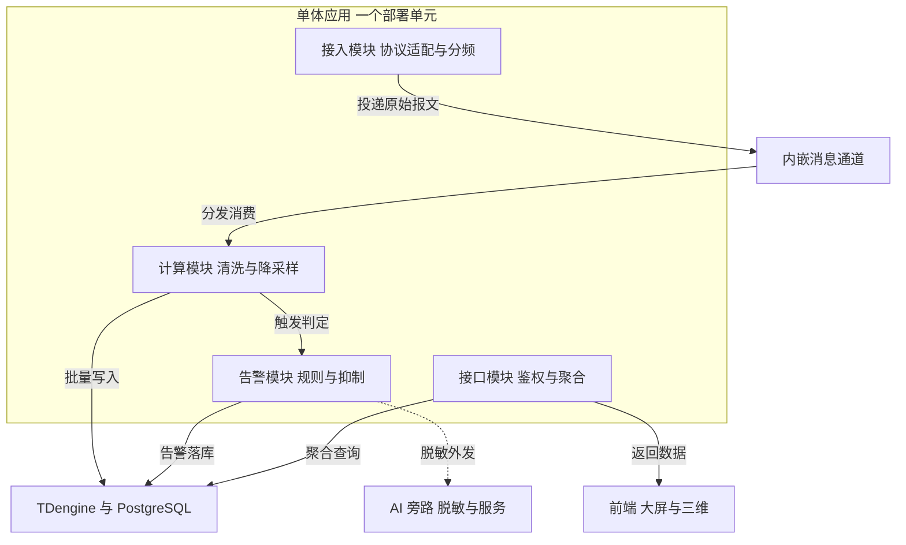
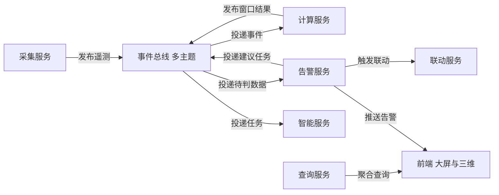
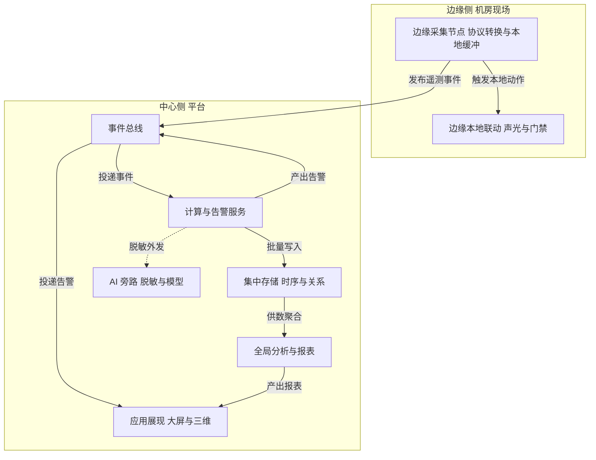
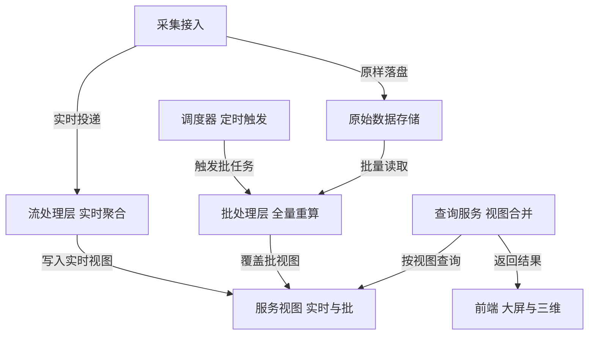

# 架构风格候选方案对比

| 项 | 内容 |
|---|---|
| 文档编号 | CDCIM-P2-ARCH-01 |
| 版本 / 状态 | v0.1 · 草案（待评审） |
| 所属阶段 | P2 架构设计 |
| 论文价值 | ★★★★★ 论文「架构风格选择」整段的唯一素材来源；四个候选的「约束 → 候选 → 决策 → 代价」链条可直接改写为「架构决策过程」段，第 6 节的「逻辑微服务 / 物理单机」论证是应对评审追问的核心弹药 |
| 上游依据 | [质量属性效用树](../02-需求/04-质量属性效用树.md)（7 分支 24 叶子、Top8）、[质量属性场景表](../02-需求/03-质量属性场景表.md)（24 条 QA 度量）、[需求规格说明书](../02-需求/02-需求规格说明书.md)（69 FR / 31 NFR）、[约束清单](../01-立项/06-约束清单.md)（C-01 ~ C-22）、[组件映射表 v1](01-组件映射表-v1.md)、[ADR-0002](../09-决策/ADR-0002-原型技术栈-A档精简真栈.md)、[ADR-0003](../09-决策/ADR-0003-大模型接入-旁路化与脱敏.md)、[可行性分析](../01-立项/02-可行性分析.md) |
| 下游承接 | ATAM 架构权衡评估报告（以本文选定方案为评估对象）、4+1 视图（以本文的边界划分为逻辑视图起点）、ADR-0006（架构风格选型定稿）、组件映射表 v2（回改第 7 节边云协同的定位） |

> **口径声明**：本文全部分值、人日、内存数字均为**判断或估算**，不是测量值。评分是五级量表下的相对判断，总分只用于排序，不得被引用为「性能得分 3 分」这类物理量。实测数据只在 P6 产生，人日估算仅在本文内部横向可比。
> **写作纪律**：凡本文写「推定」「估算」「按 X 推算」，均表示未经实测；凡引用上游文档的数字，一律标注出处，不另行解释口径。

---

## 1. 文档目的与决策范围

### 1.1 本文回答什么

一句话：**在 C-01（8 GB 内存）、C-03（单机）、C-20（3.5 人日/周）三条硬约束下，用哪一种架构风格把组件映射表 v1 中的组件组织起来。**

拆成三个可判定的子问题：

| # | 子问题 | 本文的产出 |
|---|---|---|
| P-1 | 四类主流风格（分层、事件驱动微服务、边云协同、管道-过滤器）中，哪一类能在本约束下同时满足 Top8 场景 | 第 3 ~ 4 节的候选与矩阵 |
| P-2 | 组件之间的边界按什么划分，划分到什么粒度 | 第 5 节选定方案 + 第 3 节各候选的单元清单 |
| P-3 | 「逻辑架构」与「物理部署」的关系如何表述，才既真实又经得起追问 | 第 6 节（本文最容易被质疑的一节） |

### 1.2 本文不决定什么

| 不决定 | 归属 | 理由 |
|---|---|---|
| 服务内部的分层、包结构与类图 | P3 详细设计 | 风格决定边界，详细设计决定边界内的实现 |
| 接口报文字段、topic 命名与 schema | P3 接口契约 | 本文只决定「有没有这条通道」，不决定通道里放什么 |
| 中间件版本、容器参数、mem_limit 具体值 | P4 骨架部署（已由 ADR-0002 定档） | 选型已在 ADR-0002 完成，本文不重开 |
| 安全战术的逐条实现（口令策略、哈希算法、TLS 套件） | P3 / P4 | 四候选的安全战术完全相同，不构成风格差异（见 4.3 节说明） |
| 生产集群的节点数、副本因子、容灾拓扑 | 设计章节（诚实边界 B-03） | 无第二机房与跨站网络，只能作设计论证 |
| 是否裁掉 3D、是否保留 RAG | P5 范围评审 | 属功能裁剪，不属风格选择 |

### 1.3 与既有决策的关系

本文**不推翻任何既有决策**，只补上一个此前缺失的环节：

| 既有决策 | 它回答的问题 | 本文补上的问题 |
|---|---|---|
| ADR-0002（A 档精简真栈） | 「用什么组件」（Redpanda、Python、TDengine） | 「这些组件怎么组织」 |
| ADR-0003（大模型旁路化） | 「AI 放在哪里」 | 「旁路边界如何与主干的边界对齐」 |
| 组件映射表 v1 §7（边云协同） | 「边缘与中心各承担什么职责」 | 「边云协同是主干风格，还是一层附加说明」——本文的结论是前者，因此组件映射表 v2 需回改该节的定位 |
| 约束清单 §8（约束 → 决策矩阵） | 「哪条约束触发哪个决策」 | 「多条约束叠加后，四种风格各剩几分」 |

### 1.4 一条必须先说明的评分纪律

本文用 5 分制，但**分值不是测量值**。为防评审追问「凭什么给 4 分不是 3.5 分」，事先约定三条规则：

1. **锚点固定**：5 = 该维度在四候选中最好且无可指摘；3 = 可接受但需额外战术补偿；1 = 该维度上方案不成立；2 与 4 为相邻锚点之间的插值档。中间档只取整数，不取 3.5——半分的精度是虚假的。
2. **分差 < 0.2 视为同档**：总分差小于 0.2 时不宣布胜负，改用 Top8 满足度（4.4 节）与硬约束贴近度决胜。这条规则在第 5 节实际用到了。
3. **分数必带理由**：每个维度分都配一句「为什么」，且该句必须能被反证（例如「单进程 GIL 使峰值裕度最小」可被压测证伪）。理由与分值分两表并置（4.2 节），评审时须对照阅读——只有分数没有理由的格子，视为未完成。

---

## 2. 架构驱动的输入

### 2.1 为什么只取这三类输入

架构评估的输入可以列十几项，但只有三类能真正驱动风格选择。区分标准是：**它能否单独改变候选方案的排序**。

| 输入 | 回答的问题 | 对候选方案的作用 | 若缺这一类会怎样 |
|---|---|---|---|
| **关键用例**（本文取 8 条） | 系统必须承担哪些职责，职责之间的数据流与控制流是什么形状 | 决定「必须存在哪些边界」——候选方案是否**完整** | 对比退化为组件清单对照，四个方案看起来只是「拆分粗细不同」 |
| **约束**（本文筛出 10 条） | 哪些方案在物理上不成立 | 一票否决或强制降档——候选方案是否**可行** | 会选出一个在 8 GB 下跑不起来的方案，且要到 P5 才发现 |
| **Top8 质量属性场景** | 在多个可行方案之间如何排序 | 决定评分权重与决胜规则——候选方案谁**更优** | 「四个都挺好」无法收敛，最终由技术偏好决定 |

三者分别对应**完整性、可行性、优劣性**，缺任一类，第 4 节的矩阵就会塌成一张印象表。安全性场景（4 条 P1）不在三类输入之列，理由见 4.3 节：它对四种风格无区分力。

### 2.2 关键用例（8 条）

**表 TAB-ARCH-01　架构驱动的关键用例**

| 编号 | 用例 | 主要 FR | 数据流与控制流特征 | 对架构风格的强制要求 |
|---|---|---|---|---|
| UC-01 | 稳态采集入库 | FR-M1-01/02、FR-M2-02 | 单向流、无回路，稳态 400 点/秒 | 必须存在「采集 → 接入 → 计算 → 存储」四段边界，且段间可异步 |
| UC-02 | 峰值突增不丢 | FR-M2-07 | 速率跃升 4.5 倍，需有末端承接背压 | 边界之间必须有缓冲与消费位点，不能在进程内直连 |
| UC-03 | 告警风暴判定 | FR-M3-01 ~ 09 | 数据面与判定面并发，判定需独占资源 | 判定域必须可独立限流与独立降级，与计算域分开 |
| UC-04 | 断网补传 | FR-M1-06、FR-M2-06 | 双向（正常上报 / 断后补传），时间序要求严格 | 必须存在「现场侧自治单元」，不能全靠中心侧兜底 |
| UC-05 | 送模脱敏 | FR-M6-07、FR-M6-03 | 单向出站、可失败可缺失、强制串接 | 必须存在明确的「出网边界」，且该边界不可绕过 |
| UC-06 | 规则热更新 | FR-M3-12 | 控制面（配置）与数据面（判定）分离 | 配置必须外置为独立单元，不能编译进判定进程的镜像 |
| UC-07 | 历史回溯与回放 | FR-M2-04/06/10、FR-M5-08 | 读多写少，需重放历史区间 | 存储可被独立读取；回放通道与在线路径物理隔离 |
| UC-08 | 联动失败不影响告警 | FR-M4-02/07 | 同步调用外部平台，失败率高 | 联动域与告警域必须异步隔离，不得共享失败域 |

这 8 条用例的分布值得留意：**7 条是「边界在哪里」的问题，1 条（UC-07）是「存储怎么分层」的问题**。这说明本项目的风格选择本质上是**边界划分问题**，而不是分层数量问题——这也解释了为什么「分层单体」在本项目里天然吃亏：它的边界是逻辑的，而 4 条用例（UC-02/03/04/08）要求边界具备失效隔离能力。

### 2.3 约束筛选（10 条，其中 6 条有强区分力）

从 C-01 ~ C-22 中筛出对「风格选择」有影响者，并标注区分力。**区分力的定义**：强 = 能单独否决某个候选；中 = 影响评分但不决定生死；弱 = 对四候选几乎无差别。

**表 TAB-ARCH-02　约束筛选与区分力**

| 约束 | 内容摘要 | 级别 | 区分力 | 说明 |
|---|---|---|---|---|
| C-01 | 内存配额 8 GB，硬上限 10 GB | H | **强** | 直接淘汰「Lambda 常驻」与「六服务各留足内存」两种设想 |
| C-03 | 单机部署，非集群 | H | **强** | 淘汰一切「靠多节点做高可用」的论证路径 |
| C-14 | 监控系统自身不可成为故障源 | H | **强** | 要求失效域隔离；这条同时否掉了分层单体（四模块同进程）与 Lambda（依赖链最长） |
| C-09 | 数据不出内网，送模须脱敏 | H | **强** | 强制「出网边界」存在（UC-05），四种风格都必须回答它挂在哪 |
| C-19 | 不引入需 JDK 的常驻组件 | S | **强** | 与 C-01 叠加后，Flink 只能按需 profile，Lambda 的批层失去常态承载 |
| C-20 | 3.5 人日/周的业余投入 | H | **强** | 成本权重取 15% 的直接依据；多边界方案在人力上不可交付 |
| C-16 | 至少一次投递 + 幂等写入 | H | 中 | 三种事件驱动方案都要做位点与幂等，不区分风格 |
| C-15 | 入库 P99 ≤ 2 s、判定 P99 ≤ 3 s | S | 中 | 淘汰同步跨服务编排，但不区分异步方案之间的差异 |
| C-02 | 无 GPU | H | 弱 | 只影响 3D 渲染与本地模型部署，对后端风格无差别 |
| C-17 | 测点可扩至万级 | S | 弱 | 只影响分区键设计，不影响风格 |

**两条强区分力约束的叠加效应**（C-01 + C-20）值得单独说明：任一条单独存在时，六服务拆分仍可辩护——内存宽松则拆细无妨，人力充足则编排成本可吸收。两条同时成立时，「边界数量」直接等价于「每周要维护的部署单元数」，而 C-20 给出的时间是固定值。这是本文所有评分中最硬的一处推导。

### 2.4 Top8 质量属性场景

**表 TAB-ARCH-03　Top8 场景及其对风格的驱动方式**

| 名次 | 场景 | （重要性, 难度） | 为什么它驱动风格，而不只是驱动战术 |
|---|---|---|---|
| 1 | QA-PERF-02 峰值突增不丢 | (H, H) | 背压必须有「物理末端」承接（边侧缓冲或消费位点），而末端的**位置**由风格决定 |
| 2 | QA-PERF-06 风暴下判定 | (H, H) | 判定域与计算域是否同进程，决定风暴期两者是否互相拖累 |
| 3 | QA-AVAIL-01 总线崩溃 | (H, H) | 「崩溃后谁能继续跑」直接等价于「失效域怎么划」 |
| 4 | QA-AVAIL-05 断网补传 | (H, H) | 唯一可量化可用性预算的场景（30 min = 全年预算 57%），它要求一个**在网外仍能工作**的单元 |
| 5 | QA-SEC-02 外发脱敏 | (H, H) | 要求一个不可绕过的出网边界（对四候选同分，见 4.3） |
| 6 | QA-PERF-01 稳态入库时延 | (H, M) | 基线指标，四候选均可达，作用是**否决性校验** |
| 7 | QA-PERF-03 大屏首屏 | (H, M) | 由前端与缓存决定，与后端风格无关，同为否决性校验 |
| 8 | QA-AVAIL-03 大模型不可用 | (H, M) | 由 ADR-0003 的旁路决策保证，任何风格下都可独立部署 |

**读法**：第 1 ~ 4 名是**风格敏感**的（末端位置、失效域划分、网外单元），第 6 ~ 8 名是**风格中性**的（基线性能、前端体验、旁路隔离）。因此第 5 节的决胜规则只用前四条，而不是把八条等权相加——等权相加会让三条中性场景稀释掉真正的差异。

---

## 3. 候选方案

四个候选共享同一套组件基线（组件映射表 v1 的七层组件）与同一套已定战术（幂等写入、批量写、脱敏串接、AI 旁路）。它们**不是**组件的不同集合，而是同一批组件的不同组织方式。这一点必须在阅读前明确，否则四个方案看起来像四种技术栈。为便于横向比较，下文统一采用一个公共基数：**中间件与运维容器 9 个**（Mosquitto、Redpanda、TDengine、PostgreSQL、Redis、Qdrant、Nginx、Prometheus、Grafana）加 Docker 与 WSL2 基础开销，合计约 2.88 GB，四方案相同；**AI 旁路单独计 1 个单元、约 0.09 GB**，四方案也都存在，差异只体现在业务单元的数量与切法上。

### 3.1 候选 A：分层单体 + 消息队列

**一句话定义**：四个业务模块（接入 / 计算 / 告警 / 接口）编译为一个部署单元，模块之间不直接内存调用，而是通过进程内的消息通道解耦，外部仍保留 Mosquitto 与 Redpanda 作为设备侧与持久化边界。

**结构说明**：单体的「分层」体现在模块的调用方向严格自上而下——接口层只能调告警层与查询，告警层只能消费计算层产出的窗口结果，计算层只能消费接入层投递的原始报文，反向无调用。模块之间用一条进程内队列（或轻量 broker 客户端）传递消息，使「换掉告警模块的实现」不必改计算模块——这是单体中保留可修改性的常见做法，代价是消息序列化在进程内也要付一次。结构如图 FIG-ARCH-01 所示。

**图 FIG-ARCH-01　候选 A 分层单体的结构**——回答「一个进程内如何保留边界」。

**组件清单**

| 单元 | 承载组件 | 边界性质 |
|---|---|---|
| 接入模块 | collector-gateway 的协议适配与分频逻辑（内联） | 逻辑边界，无独立进程 |
| 计算模块 | stream-compute 的窗口与降采样逻辑（内联） | 逻辑边界 |
| 告警模块 | alarm-engine 的规则、抑制、聚类逻辑（内联） | 逻辑边界 |
| 接口模块 | api-service 的聚合查询与鉴权（内联） | 逻辑边界，唯一对外入口 |
| 外部组件 | Mosquitto、Redpanda、TDengine、PostgreSQL、Redis、Qdrant、ai-proxy、nginx、Prometheus、Grafana | 独立容器 |

**部署形态**：2 个单元（单体 + AI 旁路）+ 9 个中间件与运维容器，共 11 个部署单元；一次发布即业务整体发布，回滚即整体回滚。

**满足的 QA 场景**：QA-PERF-01（进程内调用最省时延）、QA-PERF-03（前端与缓存不变）、QA-SEC-02/03/04（安全战术与风格无关）、QA-AVAIL-03（AI 旁路仍可独立部署）、QA-MOD-02（规则热加载可在进程内实现）。

**明显短板**

1. **失效域只有一个**：四个模块同进程，一次 OOM 同时失去采集、判定与接口，与 QA-AVAIL-04「单容器 OOM 不影响告警」直接冲突；
2. **独立升级不成立**：NFR-MOD-04 要求「单服务发布中断 ≤ 1 min、其他服务不可用 0 s」，单体做不到，改一行也要整体重启；
3. **断网补传缺显式边界**：本地队列只能放在采集模块内部，责任归属在验收时说不清（是采集没存，还是单体重启丢了）。

**8 GB 单机可行性判断**：**最可行**。四个模块合并后约 620 MB（相对各自独立部署的 880 MB，省下约 260 MB 的解释器与依赖开销），加上公共基数 2.88 GB 与 AI 旁路 90 MB，合计约 3.59 GB，占配额 45%，余量约 4.4 GB。这一项它拿满分，也正是它不能被简单否掉的原因。

### 3.2 候选 B：事件驱动微服务

**一句话定义**：按业务能力拆为六个服务（采集 / 计算 / 告警 / 联动 / 智能 / 查询），服务间只通过事件总线通信，各自独立部署、独立数据、独立失效。

**结构说明**：拆分依据是限界上下文，而不是技术层次——「告警」之所以独立，是因为它的规则生命周期、变更频率与失效后果都与「计算」不同，而不是因为它用了不同的技术。服务之间的耦合只剩三样：topic 契约、schema 版本、消费位点。任何服务下线，其余服务继续运行，只表现为该能力缺失。这是标准的微服务形态，也是本方案在「风格纯度」上拿满分的理由。结构如图 FIG-ARCH-02 所示。

**图 FIG-ARCH-02　候选 B 事件驱动微服务的结构**——回答「六个边界如何只靠事件连接」。

**组件清单**

| 服务 | 承载组件 | 独立数据 |
|---|---|---|
| 采集服务 | collector-gateway（独立容器） | 本地磁盘队列 |
| 计算服务 | stream-compute | Redis 窗口状态 |
| 告警服务 | alarm-engine | PostgreSQL 告警表 + Redis 抑制键 |
| 联动服务 | 新增 link-service（门禁、视频适配器） | PostgreSQL 联动记录 |
| 智能服务 | ai-proxy + sanitizer | Qdrant 向量库、PostgreSQL 建议字段 |
| 查询服务 | api-service | 只读视图，不持有数据 |

**部署形态**：6 个业务容器（含智能服务）+ 9 个中间件与运维容器，共 15 个部署单元；每个服务独立镜像、独立健康检查、独立重启策略。

**满足的 QA 场景**：QA-PERF-02（消费组并行、位点续传）、QA-PERF-06（告警独立资源域）、QA-AVAIL-01（单服务重启不影响他者）、QA-AVAIL-04（故障隔离天然成立）、QA-MOD-01/02/03/04（全部独立升级类场景）、QA-TEST-01（按服务注入故障）。

**明显短板**

1. **断网补传只有半个答案**：补传能力仍要落在采集服务内部，「现场侧自治」没有一个独立的部署边界，验收时无法区分「边侧没存」与「中心侧没收」；
2. **六服务 × 单机 × 一人**：每个 Python 服务有 60 ~ 90 MB 的固定开销（解释器 + 依赖），六个服务把可用内存切得很碎，启动依赖顺序也变复杂；
3. **独立伸缩的收益为零**：负载恒定在 400 点/秒，没有哪个服务需要单独扩容——组件映射表 v1 §1.3 已作过同一判断（「拆细只增加运维负担」）。

**8 GB 单机可行性判断**：**可行但紧**。估算约 3.97 GB（公共基数 2.88 GB + 六单元 1.09 GB），占配额 50%，余量约 4.0 GB。数字上过得去，真正的代价不在内存而在**启动与排障**：15 个单元的服务依赖顺序、日志分散在 15 处、一次链路异常要在六个服务间跳。这在 C-20 的业余投入下是实打实的负担。

### 3.3 候选 C：边云协同 + 事件驱动

**一句话定义**：把系统切成两个物理层级——**边缘侧**（机房现场：协议转换、分频采集、本地缓冲、本地联动）与**中心侧**（平台：事件总线、计算与告警、集中存储、全局分析、AI 旁路、展现），两层之间只通过事件通道通信，中心侧内部再按事件驱动拆分。

> **术语澄清**：本文的「云」指**机构内网的中心侧服务器**，不是公有云。金融数据不出内网是硬约束（C-09），若把「云」理解为公有云，本方案的合规前提即刻不成立。组件映射表 v1 §7 已作同样澄清，此处再标一次是因为「边云协同」被误读为「上公有云」的频率很高。

**结构说明**：这个候选的关键不是「多了一层」，而是**把断网自治变成一个部署边界**。边缘侧在网外仍能完成三件事：继续采集并落本地队列、按本地规则触发急停类联动、在网络恢复后按事件时间补传。中心侧的一切失效（重启、OOM、升级）都不影响边侧继续工作，反之亦然——这正是「失效域」在物理上的划分，而不是逻辑上的约定。结构如图 FIG-ARCH-03 所示。

**图 FIG-ARCH-03　候选 C 边云协同的结构**——回答「断网时哪个单元还在工作」。图中两个 subgraph 表示层次边界（不计入节点数），共 8 个节点；边缘侧的两个箱体是同一部署单元内的两个功能块（采集与缓冲、本地联动），不是两个容器。

**组件清单**

| 侧 | 单元 | 承载组件 | 边界性质 |
|---|---|---|---|
| 边缘 | **1 个部署单元**：采集与缓冲（功能块一） | collector-gateway + 本地磁盘队列（≥ 100 MB 配额） | **物理边界**：断网后仍独立工作 |
| 边缘 | 　同上单元内：本地联动（功能块二） | 边缘规则子集 + 声光/门禁驱动 | 物理边界：不依赖中心决策，与采集同容器 |
| 中心 | 计算与告警服务 | stream-compute + alarm-engine 合并为一个消费单元 | 逻辑边界，可独立重启 |
| 中心 | 查询服务 | api-service + 前端聚合接口 | 逻辑边界 |
| 中心 | 智能服务 | sanitizer + ai-proxy + Qdrant 检索 | 物理边界：可整层下线 |
| 中心 | 分析与报表 | 定时聚合、PUE 与容量趋势任务 | 逻辑边界，可裁 |
| 公共 | 事件总线与集中存储 | Mosquitto、Redpanda、TDengine、PostgreSQL、Redis | 中间件层，计入公共基数 |

**部署形态**：边缘 1 个 + 中心 4 个业务单元 + 9 个中间件与运维容器，共 14 个部署单元；若边端并入采集容器则为 13 个。生产形态下边端替换为工业网关，中心侧扩展为 3 节点集群。

**满足的 QA 场景**：QA-PERF-02（边侧缓冲是背压的物理末端）、QA-PERF-06（告警独立消费单元 + AI 旁路隔离）、QA-AVAIL-01（边侧在中心侧重启期间持续缓冲，补传由边侧负责）、QA-AVAIL-05（边侧全责，天然满足 30 min / 108 万条）、QA-AVAIL-04（边云两级失效域）、QA-MOD-01（新增协议只改边端适配器，中心侧零改动）、QA-SEC-02（出网边界在中心侧，且中心侧断网不影响边侧采集）。

**明显短板**

1. **「伪边缘」**：原型中边与云在同一宿主机上，物理上是两个容器而非两台设备，「边云协同」的说服力依赖网络隔离手段（`docker network disconnect`）而非真实链路；
2. **双端契约**：边云之间多一层契约，任何一处字段变更都要两端同步发布，可修改性比纯微服务低一档；
3. **排障跨端**：一次告警异常的 trace 要跨边云两段日志，定位链路比单端长。

**8 GB 单机可行性判断**：**可行且有余量**。估算约 3.87 GB（边端 260 MB + 中心四单元 730 MB，含智能服务 90 MB + 公共基数 2.88 GB），占配额 48%，余量约 4.1 GB。边端在原型期与采集容器合并可再省约 100 MB；若独立成容器，多出的开销也在余量之内。

### 3.4 候选 D：管道-过滤器（Lambda）

**一句话定义**：批流分离——原始数据同时进入「流处理层」（实时聚合与告警）与「批处理层」（全量重算与对账），再由服务层合并两层视图对外提供查询。

**结构说明**：Lambda 的原始动机是「流层求快、批层求准」，用批层定期重算修正流层的近似结果。对本项目而言，批层的吸引力在于**历史回放与规则验证**（QA-TEST-02 要求回放 1 h 区间并与当时落库结果比对，一致率 ≥ 99%）。但它的代价是两套逻辑：同一个聚合口径要在流层与批层各实现一次，且要保持一致——这正是 Kappa 架构试图消除的问题。结构如图 FIG-ARCH-04 所示。

**图 FIG-ARCH-04　候选 D 管道-过滤器（Lambda）的结构**——回答「批流两层的职责与合并点」。

**组件清单**

| 层 | 单元 | 承载组件 | 说明 |
|---|---|---|---|
| 接入 | 采集与投递 | collector-gateway + Mosquitto | 双路投递（流 / 落盘） |
| 流层 | 实时聚合与告警 | stream-compute + alarm-engine | 常驻 |
| 批层 | 全量重算与对账 | Flink（compose profile 按需拉起）或 TDengine 定时任务 | 非常驻 |
| 存储 | 原始与视图 | TDengine（原始 + 实时视图 + 批视图） | 三套表 |
| 服务 | 视图合并与查询 | api-service | 需处理两视图的一致性窗口 |
| 调度 | 批任务触发 | 外部 cron 或 compose 定时器 | 独立单元 |

**部署形态**：5 个常驻业务单元（采集、流、服务、调度、AI）+ 9 个中间件与运维容器 = 14 个部署单元，批任务拉起时 15 个，其中批层不常驻；批任务运行时临时拉起 Flink 容器（ADR-0002 的 `--profile flink`），运行结束后释放。

**满足的 QA 场景**：QA-TEST-02（批层可全量重算并逐条对账，回放验证能力最强）、QA-PERF-05（批视图可直接服务长区间查询）、QA-PERF-01（流层满足基线时延）、QA-SEC-02（脱敏仍在服务层串接）。

**明显短板**

1. **批层在 8 GB 下不能常驻**：Flink 拉起后峰值 5.5 ~ 6.1 GB，逼近 8 GB 软配额，意味着「准确性修正」这件事只能人工触发、不能自动常态运行——一个需要手动启动的分层，等于没有分层；
2. **两套口径**：FR-M2-03 的聚合口径（缺失不插值、按质量码统计有效点数）要在两处实现，误差 ≤ 0.5% 的要求在双实现下更难保证；
3. **不解决断网**：批流分离是计算侧的组织方式，对 QA-AVAIL-05 无任何帮助，反而因为多一条落盘路径使补传更复杂。

**8 GB 单机可行性判断**：**常态可行，峰值不可行**。常驻部分约 3.69 GB（公共基数 2.88 GB + 五单元 0.81 GB），但批层一拉起即到 5.5 ~ 6.1 GB，余量不足 2 GB，无法支撑「7×24 系统 + 定期批任务」的组合。ADR-0002 已把 Flink 定为「按需 profile，用于演示与素材录制」，本文的判断与之一致：**它适合论证，不适合承载**。

### 3.5 四候选的部署形态与资源对照

**表 TAB-ARCH-04　候选方案部署形态与资源估算**

| 项 | A 分层单体 | B 事件驱动微服务 | C 边云协同 | D 管道-过滤器 |
|---|---|---|---|---|
| 业务部署单元 | 1（含 AI 则 2） | 6 | 5（边 1 + 中心 4） | 6（含批层） |
| 总容器数（估） | 11 | 15 | 14 | 15（含按需批层） |
| 常驻内存估算 | 3.59 GB | 3.97 GB | 3.87 GB | 3.69 GB |
| 峰值内存估算 | 3.6 GB | 4.0 GB | 3.9 GB | 5.5 ~ 6.1 GB（批层拉起） |
| 占 8 GB 配额 | 45% | 50% | 48% | 46%（峰值 69% ~ 76%） |
| 生产形态 | 单体多副本 | 六服务 + K8s | 边缘网关 + 中心集群 | 流批两套集群 |
| 增量人日（估） | 16 | 42 | 42 | 52 |

**人日估算口径**（可复现，不含四方案共有的横向能力）：`人日 = 4 × 业务部署单元数 + 2 × 跨边界契约数 + 6 × 部署形态数`。其中「部署形态数」指单机（1）还是双端（2）；四方案共有的幂等写入、脱敏、审计、前端等横向能力约 15 人日，不计入增量。A = 4×1 + 2×3 + 6×1 = 16；B = 4×6 + 2×6 + 6×1 = 42；C = 4×5 + 2×5 + 6×2 = 42；D = 4×6 + 2×6 + 6×1 = 42，另加批流口径对齐 10 人日 = 52。

这个口径得出一个反直觉但有意义的结论：**C 与 B 的增量工作量相同**。C 多了一条双端编排（+6），但少了一个业务单元（−4）与一条契约（−2），恰好抵消。也就是说，边云协同带来的断网自治，在本项目的人力预算下几乎是「免费」的——这一条是第 5 节决策的关键论据之一。

---

## 4. 对比矩阵

### 4.1 权重与来源

**表 TAB-ARCH-05　评价维度权重及其来源**

| 维度 | 权重 | 来源 |
|---|---|---|
| 可用性 | 20% | Top8 中占 3 条（AVAIL-01/03/05）；99.99% 是唯一带「预算」概念的指标；C-14 为硬约束 |
| 性能 | 20% | Top8 中占 4 条（PERF-01/02/03/06）；C-15 虽为软约束，却直接定义了 QA-PERF-01 与 QA-PERF-06 两条 P1 场景的度量 |
| 落地成本 | 15% | C-20（3.5 人日/周）与 C-22（兼职 18 人日）为硬约束，超支即不可交付 |
| 可修改性 | 12% | P1 中 1 条（MOD-02）+ 2 条 P2 增长场景；NFR-MOD-04 独立升级是「是不是微服务」的直接判据 |
| 单机可行性 | 10% | C-01 硬约束；同时作为**门槛项**：≤ 2 分方案直接淘汰，不靠加权救回 |
| 架构风格纯度 | 10% | 论文命题「论架构风格」要求名实相符；也是评审追问的高发点（见第 6 节） |
| 可测试性 | 8% | 2 条 P2 场景；且 P6 的故障注入是全部 NFR 的验证手段，测试能力弱化会连带削弱证据强度 |
| 论文可论述性 | 5% | C-21 使论文素材成为项目目标之一，但它不能压过工程可行性，故取最低权重 |
| **合计** | **100%** | — |

**为什么加权而不等权**：等权意味着「论文可论述性」与「可用性」同重，这在本项目里明显失真——可用性不达标会否决验收，论文写得再好也无用。权重的两处取舍需要说明：① 性能与可用性同为 20% 而非按 P1 条数（各 5/16 ≈ 31%）分配，是因为二者合计 40% 后仍要给成本与可修改性留出空间，否则矩阵会退化为单一维度的排序；② 可测试性给到 8% 而非更低，是因为它承担「让其他指标可被证明」的职责，属于间接放大项。

### 4.2 评分矩阵（分值表 + 理由表）

评分分两张表呈现：一张以候选为行、维度为列，便于扫读分值与排序；一张以维度为行，便于把 32 条理由写到可读的长度。两表数值严格一致，任一处改动须同步另一处。

**表 TAB-ARCH-06　各维度分值与加权总分（行 = 候选方案）**

| 候选 | 可用性 20% | 性能 20% | 成本 15% | 可修改性 12% | 单机 10% | 纯度 10% | 可测试 8% | 论文 5% | 加权总分 |
|---|---|---|---|---|---|---|---|---|---|
| A 分层单体 | 2 | 3 | 5 | 2 | 5 | 4 | 3 | 3 | **3.28** |
| B 事件驱动微服务 | 4 | 4 | 3 | 5 | 3 | 5 | 5 | 5 | **4.10** |
| C 边云协同 | 5 | 4 | 3 | 5 | 4 | 4 | 4 | 5 | **4.22** |
| D 管道-过滤器 | 3 | 3 | 2 | 3 | 2 | 5 | 4 | 4 | **3.08** |

**表 TAB-ARCH-07　各维度评分理由（行 = 维度，便于同维度横向比较）**

| 维度（权重） | A 分层单体 | B 事件驱动微服务 | C 边云协同 | D 管道-过滤器 |
|---|---|---|---|---|
| 可用性（20%） | **2**　四模块同进程，一次 OOM 同时失去采集、判定与接口，只能整机重启，无失效域隔离 | **4**　服务独立失效域，单服务 OOM 不波及告警；但缺边侧自治，AVAIL-05 只能落在采集服务内部 | **5**　边侧自治直接命中断网补传与本地闭环；边云两级失效域，30 min 断连不消耗中心侧可用性 | **3**　批层可重跑补数，但依赖链最长，且批层不能常驻使「重跑」在常态下不可用 |
| 性能（20%） | **3**　进程内调用省掉序列化，稳态最快；但单进程 GIL 与内存争抢使峰值裕度最小，背压只能在进程内传导 | **4**　消费组并行、背压分级传导；代价是每跳多一次序列化与反序列化 | **4**　本地闭环约 1 s，中心侧异步；跨边云多一跳，但该跳在断网时是隔离点而非瓶颈 | **3**　流层可满足实时，但批流并行争抢同一份 CPU 与磁盘带宽，峰值期互相拖累 |
| 落地成本（15%） | **5**　16 人日，最低；单骨架三契约 | **3**　42 人日；六骨架六契约，编排与联调占三分之一 | **3**　42 人日，与 B 持平；用两端五单元替代六服务，省下的编排换成断网自治 | **2**　52 人日；批流两套逻辑的口径对齐是最易返工处 |
| 可修改性（12%） | **2**　模块边界靠约定维持，NFR-MOD-04 不成立；改一行需整体发布 | **5**　独立部署、独立数据、独立升级，MOD-01/02/03/04 天然满足 | **5**　新增协议只改边端适配器，中心侧零改动；规则热更新在中心侧，边端无关 | **3**　实时与批两套逻辑，口径变更要改两处，正是 Kappa 想消除的问题 |
| 单机可行性（10%） | **5**　3.59 GB，占配额 45%，余量最大 | **3**　3.97 GB；六个解释器把每服务可用内存压到 60 ~ 90 MB，启动顺序复杂 | **4**　3.87 GB；边端可裁剪，原型期并入采集容器可再省 100 MB | **2**　常驻 3.69 GB，批层拉起后 5.5 ~ 6.1 GB，7×24 不可常态运行 |
| 架构风格纯度（10%） | **4**　分层清晰、名实相符；但「内部消息解耦」使其成为分层 + 隐式管道，严格说非纯分层 | **5**　事件驱动 + 微服务，边界、独立数据、异步通信三条判据完整成立，风格最纯 | **4**　边云协同与事件驱动两种风格叠加；单机下边与云同宿主，物理纯度打折 | **5**　管道-过滤器与 Lambda 的教科书形态，边界与阶段清晰 |
| 可测试性（8%） | **3**　单体易启动、易端到端回放；但故障只能整机注入，无法按组件隔离验证 AVAIL-04 | **5**　服务可独立启动、按服务注入故障、契约测试可自动化 | **4**　断网可注入、边端可独立回放；但 trace 跨两端，定位链路比单端长 | **4**　批层可全量重算并逐条对账，回放能力最强；但两套期望值需分别维护 |
| 论文可论述性（5%） | **3**　风格经典，但「为何不做微服务」需额外辩解，且难支撑事件驱动与边云协同两道高频题 | **5**　直接对应「微服务」「事件驱动」两题 | **5**　对应「边云协同」「事件驱动」；断网补传是唯一可量化可用性预算的实例 | **4**　对应 Lambda / Kappa；但「为何最终 Kappa 化」要多写一段 |
| **加权总分** | **3.28** | **4.10** | **4.22** | **3.08** |

**总分计算方式**：总分 = Σ（维度分 × 权重），线性加权，满分 5.00。复算校验：A = 0.40+0.40+0.60+0.24+0.24+0.75+0.50+0.15 = 3.28；B = 0.50+0.80+0.80+0.60+0.45+0.45+0.40+0.25 = 4.10；C = 0.40+1.00+0.80+0.60+0.45+0.45+0.40+0.25 = 4.22；D = 0.50+0.60+0.60+0.36+0.30+0.20+0.32+0.20 = 3.08。加权求和而非几何平均，是因为低分需要被「惩罚」而非被其他维度的优势「补偿」——几何平均会让可用性 2 分被成本 5 分拉回过多。

### 4.3 一个被剔除的维度：安全性

安全性在效用树中占 4 条 P1 叶子（含 1 条（H,H）），看起来应当单列。本文**不单列**，理由是可核查的：四候选的安全战术完全相同——网关鉴权 + RBAC 中间件 + 脱敏中间件强制串接 + 审计表只追加。这四件事与「模块怎么组织」无关，在任何一个候选里都挂在同一位置（对外入口与出网边界）。

若强行单列，四方案均为 4 分；其中 A 因审计写入与业务写入共享失败域可再扣 1 分，按 10% 权重折算仅影响总分 0.10，不足以改变任何排序。**剔除一个对候选无区分力的维度，本身就是 ATAM 的常规动作**——保留它只会稀释真正有区分力的四个维度。这一判断须在 ATAM 报告中复核，若后续发现某方案确实破坏了脱敏串接（例如 D 的双路投递中有一条绕过 sanitizer），则须把安全性重新纳入。

### 4.4 Top8 场景满足度

**表 TAB-ARCH-08　Top8 场景的满足度（✔ 满足 / △ 需额外战术补偿 / ✘ 不满足）**

| 场景 | A | B | C | D | 判定说明 |
|---|---|---|---|---|---|
| QA-PERF-02 峰值不丢 | △ | ✔ | ✔ | △ | 单体背压只能在进程内传导；C 的边侧缓冲是物理末端，B 靠消费组 + 位点；D 的批层与流层抢带宽 |
| QA-PERF-06 风暴判定 | △ | ✔ | ✔ | △ | 单体的判定与计算同进程，风暴期 CPU 互抢；B/C 的告警是独立消费单元 |
| QA-AVAIL-01 总线崩溃 | △ | ✔ | ✔ | △ | 单体重启即四模块同时中断；C 的边侧在中心侧重启期间继续缓冲 |
| QA-AVAIL-05 断网补传 | △ | △ | ✔ | ✘ | A 无显式边侧边界，责任归属说不清；B 只能落在采集服务内部；D 的批流分离不解决断网，反使补传路径更复杂 |
| QA-SEC-02 外发脱敏 | ✔ | ✔ | ✔ | ✔ | 脱敏中间件是共享横切，与风格无关（见 4.3） |
| QA-PERF-01 稳态入库 | ✔ | ✔ | ✔ | ✔ | 400 点/秒对四者均非瓶颈 |
| QA-PERF-03 大屏首屏 | ✔ | ✔ | ✔ | ✔ | 首屏由前端与缓存决定，与后端风格无关 |
| QA-AVAIL-03 大模型不可用 | ✔ | ✔ | ✔ | ✔ | AI 旁路由 ADR-0003 保证，任何风格下都可整层下线 |
| **分布** | **4✔ 4△** | **7✔ 1△** | **8✔** | **4✔ 3△ 1✘** | — |

**两条读法**：

1. 后四条全 ✔ 的场景不构成区分力，它们的作用是**否决性校验**——任何候选若在此失分，说明它破坏了已定战术，应直接淘汰而不进入评分。本轮的四个候选都通过了校验，这说明候选集合本身是合理的。
2. 真正拉开差距的是 AVAIL-05 与 AVAIL-01，即**「断网与崩溃时谁能自己活着」**。这两条恰好是效用树中（H,H）的第 3、4 名，也是全年可用性预算的唯一量化来源（30 min 断网 = 57% 预算）。风格选择的重心因此可以一句话概括：**不是选谁跑得快，而是选谁在坏天气里还在跑。**

---

## 5. 决策

### 5.1 选定方案

**选定候选 C（边云协同 + 事件驱动），并在中心侧内部采用候选 B 的服务边界划分。**

准确表述：以边云协同为**物理与失效域的主干**，以事件驱动为**中心侧内部的通信主干**；中心侧按限界上下文划分为 4 个部署单元（计算与告警合并、查询、智能、分析），联动与通知并入告警单元（理由是联动本身由告警触发、且失败必须不影响告警，合并在同一消费单元内反而更容易保证「联动失败不阻塞推送」）。

最终形态一句话：**逻辑上是事件驱动微服务 + 边云协同，物理上是同一宿主上的 5 个容器。**

### 5.2 三条核心理由

**理由一：它是唯一在 Top8 中拿到 8 个 ✔ 的方案，且优势集中在不可退让区。**
其余三个候选在同一张表上分别失分 4 条、1 条、4 条，失分点全部落在（H,H）场景上。而（H,H）场景的性质是：任一条无可行战术，方案需退回风格层重选，不能在详细设计层打补丁（效用树 §5.1 已作此规定）。C 的两条关键差异——边侧自治与两级失效域——恰好覆盖第 3、4 名场景，这两条合计占全年可用性预算的绝大部分。

**理由二：它与已定决策同向，不推翻任何既有结论。**
ADR-0002 已选定事件驱动栈（Mosquitto → Redpanda → 消费者组），组件映射表 v1 §7 已把「断网自治」「低时延本地闭环」标注为「已落点（原型可实现）」。选 C 不需要重开任何 ADR；选 B 反而与组件映射表 §1.3 的判断冲突（「原型按 4 容器拆分，拆细只增加运维负担」），会把业务单元从 5 个推到 6 个、跨边界契约从 5 条推到 6 条，并让每个服务可分到的内存再薄一层。**一个方案如果需要先推翻自己上一阶段的判断才能成立，它的可信度本身就该被质疑。**

**理由三：它的增量成本与 B 相同，等于用同样的钱多买了一项能力。**
按 3.5 节的口径，C 与 B 的增量工作量都是 42 人日：C 多一条双端编排（+6），但少一个业务单元（−4）与一条契约（−2），恰好抵消。在 C-20 的固定预算下，这意味着一项**零边际成本的能力升级**——断网自治不需要额外排期，只需要把边界的划法改一下。这类机会在真实项目中不常见，遇到时应当抓住。

### 5.3 被否决方案的理由

三个方案都不是「设计得不好」，而是在本项目的约束组合下**不划算**。逐条说明，避免把否决写成贬低。

**候选 A（分层单体）——不是不好，而是在本约束下不划算。**
它是最省、最稳的起点：16 人日、3.59 GB、一个骨架三个契约，任何团队都能在两周内跑通闭环。若这是一个只要求「跑起来看效果」的演示系统，A 就是正确答案。否决它的原因只有一条：QA-AVAIL-05 要求「断网 30 min 后补传、丢失 0 条、时间戳偏差 0」，而 A 的本地队列只能放在采集模块内部，与业务共享同一个进程与同一次重启——验收时无法把「边侧存住了」与「进程没崩」分开证明。**在 99.99% 这个指标上，说不清就等于做不到。**

**候选 B（事件驱动微服务）——不是不好，而是在本约束下不划算：它的形态已被 C 完整吸收。**
B 的六服务边界（采集/计算/告警/联动/智能/查询）正是 C 中心侧的结构，本文对 B 的评分（4.10）与 C（4.22）仅差 0.12，按 1.4 节的规则属**同档**。否决的不是 B 的拆分方式，而是「六服务 × 单机 × 一人维护」这一组合：它把运维复杂度提前到项目最没有余力的阶段，而独立伸缩的收益在 400 点/秒的恒定负载下接近于零。**同档时看不可退让区，B 在 AVAIL-05 上只能给 △。**至于 0.12 分的构成，也要说清楚：C 在可用性上多得 0.20、在单机可行性上多得 0.10，又在风格纯度上少 0.10、可测试性上少 0.08，净差 0.12——即使在 B 更擅长的两个维度上让出 0.18 分，C 仍然领先，这才是判据可信的原因。

**候选 D（管道-过滤器 / Lambda）——不是不好，而是在本约束下不划算：它的核心价值无法在本环境常态兑现。**
Lambda 的批层是为「准确性修正」而生的，本项目也确实需要它——QA-TEST-02 的回放比对、FR-M2-03 的聚合误差 ≤ 0.5%，都与批层能力高度契合。问题在于 8 GB 内存让 Flink 只能按需拉起（峰值 5.5 ~ 6.1 GB），一个需要手动启动的分层无法承担 7×24 系统的常态职责。本文的替代判断是**Kappa 化**：用单一流路径 + TDengine 定时降采样任务承担批层的部分职责，牺牲「全量重算」换取「单一口径」，并把这一取舍记录为架构决策而非技术缺陷。

### 5.4 决策的失效条件与降级顺序

一个没有失效条件的决策不是决策。本决策在以下两种情况下需重开：

| 失效条件 | 判据 | 处置 |
|---|---|---|
| 内存超阈值 | P5 的 4000 测点压测显示 5 单元 + 公共容器超过 6.8 GB（NFR-SCALE-01 的 85% 阈值，按 4000 测点口径） | 按「边端并入采集容器 → 联动并入告警 → 裁 Qdrant」顺序降级；**不得反向裁掉边侧缓冲**，因为它是 AVAIL-05 的唯一承载 |
| 边云契约失控 | 双端契约版本在 P5 期间出现 ≥ 3 次不兼容变更 | 退化为中心侧内部事件驱动（即候选 B），边侧仅保留采集与缓冲，把「本地联动」移回中心侧——损失 QA-INTEROP-01 的低时延闭环，但保住主链路 |

---

## 6. 选定方案的架构风格定位说明

> 这一节回答本文最容易被追问的问题：**「跑在一台机器上的东西，凭什么叫微服务？」** 若这一节说服不了评审，前面四节的评分都失去意义。

### 6.1 三个被混为一谈的概念

| 概念 | 回答的问题 | 由什么决定 | 本项目的取值 |
|---|---|---|---|
| **逻辑边界** | 系统内部有几个职责域，它们之间靠什么耦合 | 业务能力（限界上下文）与失效后果 | 6 个限界上下文，只靠事件与 REST 耦合 |
| **部署形态** | 这些边界跑在几个进程、几台机器上 | 资源约束（C-01/C-03）与运维能力（C-20） | 5 个业务容器 + 9 个公共容器，同一宿主 |
| **组织边界** | 谁负责哪一块，谁能改哪一块 | 团队结构与职责分工 | 单人负责全部，但按契约自治（谁改边界谁升契约版本） |

三者可以独立变化，且现实中经常不同步：一个组织可以按微服务分工却部署在一个集群里（常见），也可以像本项目这样逻辑上分而物理上合。**「微服务」描述的是前两个概念中的第一个，不是第二个。** 把它等同于「多台机器」是一种常见的误读——如果这个等式成立，那么一个跑在 Kubernetes 上的单体也就自动成了微服务，这显然是荒谬的。

### 6.2 四条判据的逐条核对

微服务没有 ISO 定义，本文采用业界较通行的四条判据，并逐条核对本方案。**采用这四条而不是自造标准，是为了让核对过程可被外部检验。**

**表 TAB-ARCH-09　微服务四判据的成立情况**

| # | 判据 | 性质 | 本方案是否成立 | 证据 | 例外与降级 |
|---|---|---|---|---|---|
| 1 | 按业务能力划分，边界与业务域对齐 | 逻辑 | **成立** | 6 个限界上下文：采集、计算、告警、联动、查询、智能；每个边界的变更频率与失效后果不同（告警规则年变更 ≤ 500 次，采集协议基本不变） | 无 |
| 2 | 每个服务独立的数据存储，不共享表 | 逻辑 | **成立** | TDengine 库、PostgreSQL schema、Redis DB、Qdrant collection 各自归属；查询服务只读视图，不持有数据 | Redis 物理上单实例，按 DB 编号隔离——这是资源约束下的妥协，逻辑隔离成立、物理隔离不成立 |
| 3 | 服务间通过轻量机制通信，不共享内存 | 逻辑 | **成立** | 只通过 Redpanda topic 与 REST 通信；进程间无共享内存、无共享文件、无跨进程事务 | 边云之间多一层契约（同属此条） |
| 4 | 可独立部署、独立伸缩 | 物理 | **部分成立** | 独立部署成立（独立镜像、独立健康检查、独立重启）；**独立伸缩不成立**——单机 CPU 与内存总量固定，没有独立的伸缩维度可施 | 以「独立重启 + 独立降级」替代伸缩；在论文中标注为设计目标而非已实现 |

**结论的准确表述**：前三条判据（边界、独立数据、异步通信）是本方案的**逻辑属性**，在原型中完整成立并已进入验收判据（QA-MOD-01 的「下游 0 改动」、QA-MOD-04 的「其他服务不可用时长 0 s」都是这三条的可测形式）；第四条判据（独立伸缩）是**物理属性**，受 C-01 与 C-03 直接压制，无法在单机成立。因此本方案的准确称谓是「**逻辑架构为事件驱动微服务 + 边云协同、物理部署为单机容器**」，而不是「一个微服务系统」。

这个表述看起来是在打折扣，实际上是更严格：它把「哪些成立、哪些不成立、不成立的部分用什么替代」三件事同时说清楚了。**含糊其辞地说「我们用了微服务」才是真正的风险**——评审只要问一句「那你几个节点」就会露底。

### 6.3 若迁移到集群，哪些不需要改

判断「是不是微服务」有一个比定义更可操作的标准：**迁移到集群时，要不要重写业务代码。** 若不需要，说明边界是真的；若需要，说明之前只是分层。

**表 TAB-ARCH-10　迁移影响清单（单机容器 → 集群）**

| 项 | 是否需改 | 依据 |
|---|---|---|
| 限界上下文与服务边界 | **不改** | 边界由业务能力决定，与部署粒度无关 |
| topic 命名与事件契约 | **不改** | Redpanda 与 Kafka 同协议族，分区与位点语义一致（ADR-0002 §4.2） |
| 消费者组与位点语义 | **不改** | 同一协议族，`group.id` 与 `offset` 语义相同 |
| 数据模型与 schema | **不改** | 每服务独立 schema 已按此设计，无跨服务外键 |
| 业务代码 | **不改** | 服务无状态，状态外置在 Redis 与 PostgreSQL；无本地文件依赖（除边侧队列，见下） |
| 部署描述 | **要改** | Compose → K8s Deployment / Service / ConfigMap / Ingress；组件映射表 §6 已列为「高风险项」 |
| 副本与一致性参数 | **要改** | 单副本 → 3 副本；`acks=1` → `acks=all`；RF=1 → RF=3 |
| 边端部署形态 | **要改** | 边端由容器 → 工业网关或边缘节点；队列由本地磁盘 → 工业级存储 |
| 观测与流量治理 | **要改** | 应用内熔断 → 服务网格；日志聚合 → Loki；指标 → Prometheus 联邦 |

**9 项中 5 项不改、4 项要改，且要改的全部集中在「部署与运维层」，业务与契约层零改动。** 这就是本文判断边界为真的依据。反过来说，如果选的是候选 A（分层单体），迁移时「接入模块 → 采集服务」需要改调用点为消息投递、把进程内事务边界拆成最终一致——那是**重写**，不是迁移。

### 6.4 为什么不在原型里先做单体、生产再拆

这是最常被提出的反问，答案有三层：

1. **成本不对称**：现在按边界拆，增量成本是「每条契约 2 人日」（见 3.5 节口径）；将来从单体里抽服务，成本是「改调用点 + 拆事务边界 + 重建幂等 + 重跑回归」，经验上 3 ~ 5 倍于前者；
2. **验证对象不同**：原型的目的是验证**边界与契约是否成立**（QA-MOD-01 的「下游 0 改动」只能在边界真实存在时才能验证），而不是验证节点容灾——后者本就属诚实边界 B-03，不在本期范围；
3. **约束会变而边界不会**：生产目标是 3 节点集群（SRS §3.3），若原型按单体设计，等于用一个与目标形态不同的架构去证明目标形态可行，这个证明不成立。

---

## 7. 风险与缓解

**表 TAB-ARCH-11　选型带来的风险**

| # | 风险 | 触发条件 | 影响 | 缓解 | 责任阶段 |
|---|---|---|---|---|---|
| R-1 | **「伪边缘」被质疑** | 评审指出边与云同宿主，「边云协同」只是两个容器 | 第 6 节的论证可信度被连带削弱，风格纯度扣分 | ① 用 `docker network disconnect` 制造真实断链，验收用「断链 30 min」而非「拔网线」；② 边端独立成容器（而非与采集合并），使失效域在 `docker ps` 层面可见；③ 论文中明示「原型以容器边界模拟边云，生产替换为工业网关」，标注为设计验证 | P5 / P7 |
| R-2 | **双端契约版本漂移** | 边端与中心侧在 P5 期间各自升级，契约出现不兼容 | 补传数据被中心侧拒收，AVAIL-05 直接失效 | ① 契约带 `schema_version`，边端兼容最近 2 个版本；② 契约测试进 CI，任一端口破坏兼容即阻断合并；③ 边端升级滞后于中心侧一个版本（先中心后边端） | P3 / P5 |
| R-3 | **边侧队列配额缺口** | 断网 30 min、600 点/秒、累计约 108 万条 | 按每条 64 B 净荷 + 约 36 ~ 66 B 队列开销估算，需 100 ~ 130 MB，而 FR-M1-06 只要求「≥ 100 MB 配额」——缺口约 0 ~ 30% | ① 容量口径在 P3 核定（见第 8 节 Q-1）；② 队列按 zstd 压缩落盘（时序数值压缩比经验值 3 ~ 5 倍）；③ 队列水位 80% 触发「缓冲将满」告警，把不可控的丢数据变成可控的提前告警 | P3 |
| R-4 | **单机内存贴近阈值** | 5 单元 + 公共容器达 3.87 GB，叠加页缓存与构建峰值 | 逼近 8 GB 软配额，OOM 概率上升，NFR-SCALE-01 的 85% 阈值无余量 | ① 按 5.4 节的降级顺序处置；② `mem_limit` 逐容器显式声明（ADR-0002 §3.4）；③ 边端原型期与采集合并，省约 100 MB | P4 / P5 |
| R-5 | **「微服务」表述被判名不副实** | 评审以「单机部署」直接否定微服务属性 | 论文「架构风格」段被判定为虚构或夸大 | ① 全文统一使用「逻辑架构 / 物理部署」两层表述，不单独使用「微服务系统」这一说法；② 6.2 节的四判据核对表可作为答辩材料；③ 6.3 节迁移清单给出可操作判据，把争论从定义转到事实 | P7 |

五条风险中有三条（R-1、R-2、R-5）与「边云协同 + 逻辑微服务」这一组合直接相关，这是选型的固有代价，不是执行失误。另两条（R-3、R-4）是资源约束的固有代价，换任何方案都存在，只是表现形式不同。

---

## 8. 待确认事项

| # | 待确认点 | 本文暂定 | 影响面 | 建议 |
|---|---|---|---|---|
| Q-1 | **边侧本地队列的容量与压缩口径** | **已闭环**：P2 校核阶段采纳建议，FR-M1-06 与场景表、用例集、用户故事统一上调为「配额 ≥ 150 MB（108–140 MB 峰值需求 + 约 10% 余量），占用 80% 触发预警」，不依赖压缩比假设 | FR-M1-06、QA-AVAIL-05、磁盘配额 | 已按 150 MB 落地；压缩（zstd）保留为可选优化，不作为验收前提 |
| Q-2 | **原型期边端是否独立成容器** | 暂定独立成容器（14 个部署单元），以便用 `docker network` 隔离验证断网 | 内存估算（+100 MB）、R-1 的可验证性、部署复杂度 | 建议独立成容器。理由：若边端与采集合并，「伪边缘」的质疑无法用事实回应，只能靠文字辩解——而 R-1 恰恰是本文最脆弱的一处 |
| Q-3 | **「云端」一词是否统一改为「中心侧」** | 暂定全文用「边缘侧 / 中心侧」，仅在引用组件映射表 §7 时保留「云」字 | 论文表述的一致性；避免被误读为使用公有云 | 建议统一。组件映射表 §7 已澄清「本项目云指机构内网中心侧」，但该澄清藏在说明里，读者先看到的是术语。本文首次出现处已加括注，P7 统稿时建议全局替换 |

三项均不阻塞 ATAM 的开展。Q-1 需在 P3 接口契约前闭环；Q-2 需在 P5 骨架部署前闭环；Q-3 可在 P7 统稿时处理。

---

## 考点映射

| 考纲知识点 | 本文件对应内容 | 论文可用位置 | 真题溯源 |
|---|---|---|---|
| 软件架构风格（分层 / 事件驱动 / 管道-过滤器 / 边云协同） | 第 3 节四候选的结构、组件清单与短板；图 FIG-ARCH-01 ~ 04 | 论文「架构风格选择」段的候选对比 | 论文题「论软件架构风格」类（历年高频） |
| 架构决策过程（约束 → 候选 → 决策 → 代价） | 第 2 节三类输入 + 第 5 节决策 + 各候选的「明显短板」 | 论文「架构决策过程」段（该段占分权重最高） | 评分要求「决策必须带理由与代价」 |
| 质量属性权衡与 ATAM 敏感点 / 权衡点 | 第 4.4 节 Top8 满足度、第 5.2 节理由一、第 7 节风险 | 论文「架构评估」段的权衡实例 | 2023 上、2024 上 架构评估 |
| 微服务的判据与边界划分 | 第 6.1 ~ 6.2 节四判据核对、表 TAB-ARCH-09 | 论文「微服务架构」段的拆分依据与边界论证 | 论文题「论微服务架构」类（历年高频） |
| 事件驱动架构与异步解耦 | 第 3.2 / 3.3 节的事件总线、消费组、位点 | 论文「事件驱动」段的通信机制说明 | 论文题「论事件驱动架构」类 |
| 边云协同与断网自治 | 第 3.3 节边侧职责、第 6.3 节边端迁移、QA-AVAIL-05 | 论文「边云协同」段的职责划分 | 论文题「论边云协同」类 |
| Lambda / Kappa 架构 | 第 3.4 节候选 D 与 5.3 节的 Kappa 化判断 | 论文「大数据处理架构」段的取舍 | 论文题「论 Lambda 与 Kappa」类 |
| 架构风格与实际部署的关系（名实相符） | 第 6 节全节，尤其 6.1 三概念表与 6.3 迁移清单 | 论文「经验总结」段的方法论反思 | 答辩与案例分析的高频追问点 |

## 论文可引用段落

> 本段适用于「论软件架构风格」「论微服务架构」「论边云协同」类论文的架构选型部分，约 348 字。
>
> 架构风格的选择不能停在名词层面。我先固定三类输入：关键用例界定系统必须承担的职责与流向，约束界定哪些方案在物理上不成立，前八位场景界定如何在可行方案之间排序。随后我按五级量表比较四种风格，并约定分差小于零点二视为同档、改用场景满足度决胜，避免为半分之争。最终选定边云协同与事件驱动的组合：五条高难度场景上全部有明确落点，断网三十分钟的补传由现场侧自治承担，而非靠中心侧硬撑，代价是多一层双端契约。它的逻辑架构是六个限界上下文与独立数据，物理部署却是同一宿主上的五个容器。我没有混淆这两件事：微服务四条判据中，前三条在原型中成立，独立伸缩受八 GB 内存压制无法成立，以独立重启与独立降级替代。判断边界是否为真，不看部署在几台机器上，而看迁移时要不要重写业务代码——本方案九项迁移要素中五项无需改动。

## 变更记录

| 版本 | 日期 | 变更 |
|---|---|---|
| v0.1 | 2026-11-26 | 初稿。含三类架构驱动输入（8 条关键用例、10 条约束筛选、Top8 场景）、四个候选方案（分层单体 / 事件驱动微服务 / 边云协同 / 管道-过滤器）及其结构图与资源估算、8 维加权评分（分值表与理由表并置，权重来源可查、总分算法可复算）、Top8 满足度表、决策与三条理由、被否决方案的三段式说明、逻辑微服务与物理单机的四判据核对与九项迁移清单、5 条风险、3 项待确认 |
