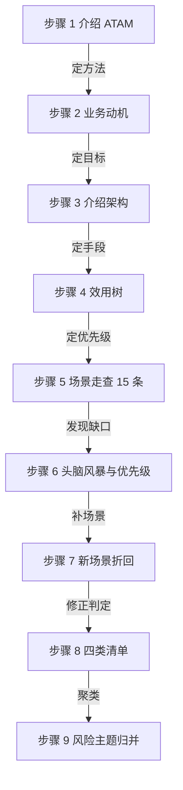
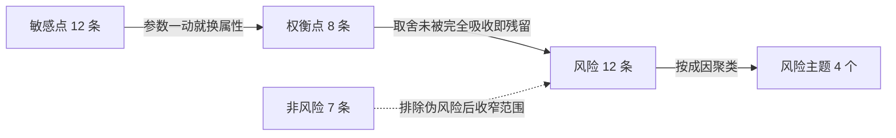

# ATAM 架构权衡评估报告

| 项 | 内容 |
|---|---|
| 文档编号 | CDCIM-P2-ARCH-02 |
| 版本 / 状态 | v1.0 · 草案（待评审） |
| 所属阶段 | P2 架构设计 |
| 论文价值 | ★★★★★ 「架构评估（ATAM）」整段的唯一素材来源：九步流程的本地化落地、15 条场景走查、12 个敏感点、8 个权衡点、12 条风险与 7 条非风险，可直接改写为论文的「评估方法 + 评估结果 + 权衡论证」三段 |
| 评估对象 | [架构风格候选方案对比](02-架构风格候选方案对比.md) 第 5 节选定的 **候选 C：边云协同 + 事件驱动**（ADR-0006） |
| 上游依据 | [质量属性效用树](../02-需求/04-质量属性效用树.md)（7 分支 24 叶子 / Top8 / (H,H) 5 条）、[质量属性场景表](../02-需求/03-质量属性场景表.md)（24 条 QA 六要素）、[架构风格候选方案对比](02-架构风格候选方案对比.md)（评分矩阵与微服务判据）、[数据架构设计](10-数据架构设计.md)（简化流式 / 双路径写 / 幂等 / 水位线）、[安全架构与等保对照](11-安全架构与等保对照.md)（fail-closed 分档 / 审计五层）、[ADR-0003](../09-决策/ADR-0003-大模型接入-旁路化与脱敏.md)、[ADR-0006](../09-决策/ADR-0006-架构风格-边云协同与事件驱动.md)、[ADR-0007](../09-决策/ADR-0007-数据处理架构-简化流式与存储层重算.md)、[约束清单](../01-立项/06-约束清单.md)（C-01 ~ C-22）、[组件映射表 v1](01-组件映射表-v1.md) |
| 下游承接 | P3 详细设计（按风险清单与前提条件落 DDL、契约、参数）、P5 范围评审（3D 条件升档规则）、P6 测试（按本报告的风险项设计压测与故障注入用例）、P7 论文「架构评估」章 |

> **口径声明（全文适用）**：本报告是**设计阶段的架构分析**，不是实测报告。文中所有「满足 / 有风险 / 不满足」均为**依据设计的可推导性得出的判定**，不表示已通过测试；实测证据只在 P6 产生。凡引用上游数字，一律标注出处，不另立口径。
>
> **表格编号说明**：图与表沿用架构阶段连续序号。01 ~ 58 已被[组件映射表 v1](01-组件映射表-v1.md)、[数据架构设计](10-数据架构设计.md)、[安全架构与等保对照](11-安全架构与等保对照.md)占用，本文件表从 **TAB-ARCH-59** 起、图从 **FIG-ARCH-12** 起。

---

## 1. 评估说明

### 1.1 为什么做这次评估

P2 阶段已经完成了三件「拍板」的事：选定边云协同 + 事件驱动（ADR-0006）、选定简化流式 + 存储层重算（ADR-0007）、选定 AI 旁路化（ADR-0003）。但这三件事各自成立，不等于**合起来**成立。举例：边云协同为了断网自治把缓冲放到边侧，而 8 GB 内存限制又要求边端尽可能合并到采集容器——两个正确的决策在「配额」这个点上会互相挤压。ATAM 的作用就是把这类「各自正确、叠加后相互牵制」的地方找出来，而不是再写一遍架构说明书。

因此本报告的目的有三个，且只有这三个：

1. **找出敏感点**——哪些**具体参数**一动，某个质量属性就会显著变好或变坏（不是「性能敏感」这种空话，而是「攒批窗口 200 ms 占入库预算的 40%」）；
2. **找出权衡点**——哪些地方**必然**要拿 A 属性换 B 属性，且两边都有代价（只写收益的取舍不是权衡，是宣传）；
3. **给出可否进入详细设计的判定**——以及进入的前提条件。

### 1.2 参与角色（诚实说明：本项目无外部评估员）

标准 ATAM 要求至少三方分离：评估组长（不参与设计）、项目决策者、干系人代表。本项目**不具备这个条件**——它由单人业余推进（C-20），没有独立评估团队。本报告因此采用**简化 ATAM（自评型）**，角色合并情况如实列出：

**表 TAB-ARCH-59　评估角色与职责（含角色合并声明）**

| 角色 | 标准 ATAM 中由谁承担 | 本项目实际由谁承担 | 角色合并带来的偏差与缓解 |
|---|---|---|---|
| 评估组长 | 外部架构师，不参与被评估方案的设计 | **架构师本人兼任** | 偏差：倾向于为自己的决策找理由。缓解：① 每个判定必须引用上游度量编号，不能只写结论；② 强制写「不满足 / 有风险」的判定（本报告 15 条走查中有 5 条为「有风险」），并单列 7 条「非风险」以证明评估不是一味找问题；③ 结论中保留 5 项前提条件，把「未验证」与「已验证」严格分开 |
| 项目决策者 | 项目经理 / 技术负责人 | 架构师（同一人） | 偏差：无人对评估结论行使否决权。缓解：结论标注「待 P2 门禁确认」，由用户（需求方）在门禁上确认 |
| 业务代表 | 业务方 | **需求方（用户）**，异步确认 | 偏差：无法现场追问。缓解：涉及业务口径的判定（如可用性预算、降噪压缩比）全部回引 BRD / 场景表原文，不自行解释 |
| 质量属性提供者 | 性能 / 安全 / 运维专家分别出场景 | 架构师代理，场景来自 P1 已定稿的场景表 | 偏差：场景的「难度」判断可能低估。缓解：难度标签沿用效用树（P1 已按可核查规则定级），本次不重新打分 |
| 记录员 | 独立记录 | 架构师 | 偏差：无交叉核对。缓解：全部结论以表格固化，便于后续逐条复核 |

> **一句必须写进论文的话**：这次评估的可信度不来自「有多少专家参加」，而来自「每个判定能不能被一个没参与设计的人按文档复核」。角色合并是事实，掩盖它比承认它危险得多。

### 1.3 输入物

**表 TAB-ARCH-60　评估输入物清单**

| # | 输入物 | 在 ATAM 中的作用 | 本报告的使用方式 |
|---|---|---|---|
| 1 | [质量属性效用树](../02-需求/04-质量属性效用树.md)（24 叶子、Top8、(H,H) 5 条） | 步骤 4 的产出物，界定「评估什么」 | 直接引用 Top8 与 (H,H) 结论，不重画全树 |
| 2 | [质量属性场景表](../02-需求/03-质量属性场景表.md)（24 条六要素） | 场景度量与观测点 | 走查表中的度量与观测点全部取自此处 |
| 3 | [架构风格候选方案对比](02-架构风格候选方案对比.md) | 步骤 3 的架构描述、步骤 5 的对比基线 | 引用其第 4.4 节 Top8 满足度作为「候选期判定」，本报告做「选定后复核」 |
| 4 | [数据架构设计](10-数据架构设计.md) | 性能与一致性的实现依据 | 引用双路径写（§3.5）、幂等（§6.2）、水位线（§6.3）、容量（§8） |
| 5 | [安全架构与等保对照](11-安全架构与等保对照.md) | 安全性场景的实现依据 | 引用 fail-closed 分档（TAB-ARCH-36）、三道闸门（TAB-ARCH-54）、审计五层（§8.4） |
| 6 | ADR-0003 / 0006 / 0007 | 三个已定决策 | 权衡点分析时以其「代价」章节为起点 |
| 7 | [组件映射表 v1](01-组件映射表-v1.md) | 组件参数（内存配额、超时、熔断、并发上限） | **敏感点的参数值主要来自此处**，也是发现跨文档参数冲突的地方 |
| 8 | [约束清单](../01-立项/06-约束清单.md)（C-01 ~ C-22） | 步骤 2 的业务与环境约束 | 作为判定「可行性」的一票否决依据 |

**不纳入本次评估的输入**：实测压测数据（P6 才有）、生产集群拓扑（诚实边界 B-03）、第三方测评结论（不在范围）。缺这三类不构成评估缺陷，但如果把它们「假定为已知」，评估就会失真。

### 1.4 时间盒与评估形式

**表 TAB-ARCH-61　时间盒**

| 项 | 内容 |
|---|---|
| 形式 | **书面自评 + 需求方异步确认**，不设集中评审会（无外部评估员，开会的仪式感大于信息量） |
| 时间盒 | 3 个工作单元，累计约 **8 h**：单元一（步骤 1 ~ 4，约 2 h）、单元二（步骤 5 场景走查，约 4 h）、单元三（步骤 6 ~ 9 与结论，约 2 h） |
| 走查规模 | 15 条场景（覆盖 Top8 全部 + 3 条安全性场景 + 4 条其余 H 级场景），占 24 条叶子的 62.5% |
| 超出时间盒的处置 | 若走查超时，**优先保证 Top8 全部走完**，其余场景降为「书面核验」（只判满足度、不做敏感点分析）——本报告实际未触发该降级 |
| 未覆盖 | 24 条中的 9 条（见第 6.2 节），理由逐条给出 |

### 1.5 评估自身的局限（三条）

1. **无实测**：全部判定基于设计推导。设计推导能证明「结构上不会丢数据」，但不能证明「1800 msg/s 下 CPU 够用」，后者必须 P6 压测。
2. **角色合并**：见 1.2，架构师自评天然偏向「证明方案可行」。本报告的对抗手段是强制产出「有风险」判定与「非风险」清单。
3. **单场景源**：24 条场景全部来自同一份 P1 文档，若场景表本身漏了某类事件（例如「配置中心自身不可用」），本次评估也发现不了——这一条在第 6.3 节以「头脑风暴补场景」的方式部分弥补，但补出的场景不进效用树，只作评估期检查项。

---

## 2. 第 1 步　介绍 ATAM

### 2.1 方法要点（只写与本项目相关的部分）

ATAM（Architecture Tradeoff Analysis Method）的核心不是「打分」，而是三件事：**用可判定的场景检验架构**、**在场景与架构的交叉点上找敏感点与权衡点**、**把无法用架构手段消除的隐患固化为风险**。它明确**不产出「架构得分 87 分」这类结论**——那既不可复现，也诱导评审去做数字游戏。

本报告保留 ATAM 的九步骨架，但做了两处本地化调整，理由一并给出：

| 调整 | 标准做法 | 本项目做法 | 理由 |
|---|---|---|---|
| 不设集中评审会 | 干系人集中 2 ~ 3 天 | 书面自评 + 异步确认 | 无外部评估员，集中开会只会把「一个人的判断」包装成「集体共识」 |
| 权衡点必须双边写代价 | 记录「哪个属性换哪个属性」 | 额外要求写出**两侧各自的代价**，并标注是否已被 ADR 接受 | 单边写代价的「权衡」通常等价于「我选了 A，B 不重要」，这在评审中最容易被推翻 |

### 2.2 九步与本报告的对应

**表 TAB-ARCH-62　ATAM 九步 → 本报告章节 → 产出物**

| 步骤 | 标准名称 | 本报告章节 | 产出物 |
|---|---|---|---|
| 1 | 介绍 ATAM | 第 2 节 | 方法说明与两处本地化调整 |
| 2 | 介绍业务动机 | 第 3 节 | G-1 ~ G-6、约束摘要、干系人诉求 |
| 3 | 介绍架构 | 第 4 节 | 14 条架构方法及其「解决什么问题」 |
| 4 | 生成质量属性效用树 | 第 5 节 | 引用 Top8 与 (H,H) 5 条（不重画） |
| 5 | 分析架构方法（第一遍） | 第 6 节 | **15 条场景走查表（核心章节）** |
| 6 | 头脑风暴与场景优先级 | 第 7 节 | 场景来源、选取与排除、5 条评估期新场景 |
| 7 | 分析架构方法（第二遍，折回） | 第 8 节 | 新场景折回后的新增风险判定 |
| 8 | 呈现结果 | 第 9 节 | 敏感点 / 权衡点 / 风险 / 非风险 四张清单 |
| 9 | 风险主题归并 | 第 10 节 | 4 个风险主题与应对策略 |



**图 FIG-ARCH-12　ATAM 九步与本报告的推进路线**

> 图注：本图回答「这份报告是怎么一步步推出来的」。九步是方法规定的固定结构，因此图中主干节点固定为 9 个，不受图表规范「7±2」约束（该规则针对自选结构的架构图，不针对方法流程）。连线上的动词标明每一步向下一步传递的是什么，而不是简单的顺序箭头。

---

## 3. 第 2 步　介绍业务动机

### 3.1 业务目标与它对架构的压力点

**表 TAB-ARCH-63　业务目标与架构压力点**

| 目标 | 内容 | 目标值 | 主要压到哪个质量属性 | 在架构上的落点 |
|---|---|---|---|---|
| G-1 | 缩短告警响应时间 | 8 min → **≤ 1 min**（P95） | 性能（判定时延 + 首屏）、易用性（点击步数） | 流式就地判定、大屏首屏缓存、三级钻取 |
| G-2 | 降低重复告警干扰 | 约 65% → **≤ 20%** | 性能（风暴期判定）、可修改性（规则可调） | 同源抑制 + 父子抑制 + 聚类；规则热更新 |
| G-3 | 缩短故障根因定位 | 25 min → **≤ 5 min** | 易用性、性能 | 拓扑根因 + 3D/2D 空间定位 |
| G-4 | 满足数据留存合规 | 7 天 → 原始 **≥ 180 天**、降采样 **≥ 3 年** | 性能（历史查询）、可伸缩性（容量） | 热温冷分层、三级降采样表、区间路由 |
| G-5 | 减少人工巡检 | 2 人·次/日 → **≤ 0.5** | 可修改性（新设备类型快速接入） | 测点模板 + 台账驱动 |
| G-6 | 提升系统可用性 | **≥ 99.99%**（年停机 ≤ 52.6 min） | 可用性（全部 5 条场景） | 边侧自治、失效域隔离、AI 旁路、进程自愈 |

**一处需要点明的结构关系**：G-6 是唯一被两个分支共同支撑的目标（性能的 QA-PERF-02 与可用性的全部场景）。这意味着「只做容错、不做背压」达不到 99.99%——峰值时被压垮与组件崩溃在用户视角是同一种失效。这一点决定了本报告在第 6 节不能用「可用性场景过了就算 G-6 过了」的方式收尾。

### 3.2 约束摘要（按对评估的约束力分组）

**表 TAB-ARCH-64　约束摘要与评估影响**

| 组 | 约束 | 摘要 | 对评估的约束力 |
|---|---|---|---|
| **资源硬顶** | C-01 / C-02 / C-03 | 8 GB 内存（硬顶 10 GB）、无 GPU、单机非集群 | **最强**：直接否掉「靠多节点做高可用」「本地跑模型」两条路径，是所有「有风险」判定的共同根因 |
| | C-19 | 不引入需 JDK 的常驻组件（Flink 按需除外） | 强：把批层从常态路径上排除（ADR-0007） |
| | C-07 / C-04 | 仅 Web 端口绑 `0.0.0.0`；两机同构 | 中：决定安全边界只能做「单入口 + 应用层鉴权」 |
| **合规红线** | C-08 / C-09 / C-10 | 等保三级、数据不出内网、审计留存 ≥ 6 个月且不可篡改 | **一票否决**：安全性场景不参与「业务价值」排序，但失败即功能下架 |
| | C-12 / C-13 | AI 不得驱动控制；密钥不入库不进日志 | 强：决定 AI 只能输出「建议」类型 |
| **业务硬约束** | C-14 | 监控系统自身不可成为故障源 | **最强**：主链路零外部依赖，是 AI 旁路化的直接依据 |
| | C-15 | 入库 P99 ≤ 2 s、判定 P99 ≤ 3 s | 强：所有性能判定都以它为口径 |
| | C-16 | 至少一次投递 + 幂等写入 | 强：「不丢」只能靠位点 + 幂等 + 边侧队列三件套，不能靠「不出故障」 |
| | C-17 | 测点可扩至万级（当前按 2000 验收） | 中：只影响分区键与容量规划，不影响风格 |
| **成本与人力** | C-20 / C-22 | 3.5 人日/周；兼职 18 人日 | **强**：任何「多一个部署单元」的方案都要先过这一关，也是本报告判定「缓解措施是否可落地」的尺子 |

### 3.3 关键干系人诉求（转为可评估的关注点）

**表 TAB-ARCH-65　干系人诉求 → 评估关注点**

| 干系人 | 最在意什么（原话式诉求） | 转为评估关注点 | 对应场景 |
|---|---|---|---|
| 值班员 | 「大屏别卡，告警别漏，点三下能看到是哪台设备」 | 首屏 ≤ 3 s、不漏报、≤ 3 次点击 | QA-PERF-03、QA-PERF-06、QA-USE-01 |
| 运维工程师 | 「调个阈值不要停机，出问题能回滚」 | 热更新 ≤ 10 s、回滚 ≤ 10 s、发布中断 ≤ 1 min | QA-MOD-02、QA-MOD-03 |
| 系统管理员 | 「审计要能查、不能被人改」 | 审计覆盖率 100%、UPDATE/DELETE 拒绝、6 个月可查 | QA-SEC-03 |
| 信息安全（合规视角） | 「数据不许出内网，出去必须脱敏」 | 外发 0 真实标识、默认关闭、可追溯 | QA-SEC-02、QA-SEC-04 |
| 业务主管 | 「一年不能停超过 52 分钟」 | 年可用性预算 52.6 min、断网 30 min 占 57% | QA-AVAIL-01/02/03/04/05 |
| 开发与维护者（本人） | 「14 个容器，一个人维护得过来吗」 | 部署单元数、排障链路长度、契约数量 | 全部（作为成本约束贯穿判定） |

### 3.4 业务动机对评估的一条硬约束

业务侧对「实时」的定义是 **G-1 的 1 min 端到端**，而技术侧对「实时」的定义是 **P99 ≤ 2 s 入库 + P99 ≤ 3 s 判定**。两者的差额（约 50 s）留给人（看屏、判断、点击）。这条差额有两个后果：① 架构不能用「再快一点」来掩盖交互设计的缺陷；② 任何把降采样 60 s 延迟算进「实时」的说法都是口径错误——这一点在 QA-PERF-01 的走查中被显式检验（见 S6）。

---

## 4. 第 3 步　介绍架构

### 4.1 一句话架构

**逻辑上是 6 个限界上下文的事件驱动微服务，物理上是同一宿主上的 5 个业务容器 + 9 个公共容器，边缘侧 1 个自治单元承担断网缓冲与本地闭环。**（ADR-0006 §3）

### 4.2 架构方法清单：每条回答「解决什么问题」

ATAM 要求把架构方法（战术）逐条列出并说明它响应哪个质量属性。下表 14 条，是本报告后续所有走查的「手段库」——第 6 节每条判定都必须能指回这里的编号。

**表 TAB-ARCH-66　架构方法清单**

| # | 架构方法 | 具体做法 | 解决什么问题（对应属性） | 出处 |
|---|---|---|---|---|
| A-01 | 七层逻辑分层 | 采集 / 接入 / 计算 / 存储 / 智能 / 展现 / 运维，跨层只经契约 | 变更影响可控（可修改性） | 组件映射表 §1 |
| A-02 | 边云两级失效域 | 边缘侧独立部署单元，断网仍可采集、落盘、本地联动 | 断网不丢、中心故障不影响现场（可用性） | ADR-0006 §3 |
| A-03 | 事件驱动异步解耦 | Mosquitto → Redpanda → 多消费组，位点手动提交 | 峰值背压可传导、单服务崩溃不波及其他（性能 / 可用性） | ADR-0002、ADR-0006 |
| A-04 | 简化流式 + 存储层重算 | 单条实时链路；重算读 TDengine 历史 + 同一聚合函数库 | 消除批流双实现的口径漂移（一致性 / 可修改性） | ADR-0007 |
| A-05 | 双路径写 | 明细同步直写不等窗口；降采样走异步旁路 + 60 s 水位线 | 让 P99 ≤ 2 s 不被窗口逻辑污染（性能） | 数据架构 §3.5 |
| A-06 | 至少一次 + 幂等 | 位点写成功后提交；时序按 `(device,point,ts)` 覆盖、告警按指纹唯一、控制按 `request_id` | 重复不产生重复结果（数据完整性） | 数据架构 §6.2 |
| A-07 | 水位线双条件 | 事件时间 + 处理时间兜底，窗口结束 60 s 强制关闭 | 防「设备断线导致窗口永不关闭」（可用性 / 正确性） | 数据架构 §6.3 |
| A-08 | AI 旁路 + 三级降级 | 无同步 `await`；超时即弃 → 熔断 → 配置关闭；结果字段可空 | AI 缺失不损主链路（可用性） | ADR-0003、安全架构 SEC-V-02 |
| A-09 | 脱敏三道闸门 + fail-closed | 白名单剥离 → 黑名单扫描 → 5% 回环抽检；任一失败拒发 | 外发零真实标识（安全性） | 安全架构 §7.2 |
| A-10 | 安全 fail-closed 分档 | 写 / 控制类 fail-closed；只读类允许降级 | 既不做「静默放行」，也不让安全组件成为监控盲区（安全 vs 可用性） | 安全架构 TAB-ARCH-36 |
| A-11 | 审计五层防篡改 | 应用只 INSERT + DB 账号隔离 + 触发器 + `prev_hash` 链 + 每日锚定 | 篡改可检测（不可否认性） | 安全架构 §8.4 |
| A-12 | 降级链（体验侧） | 3D：关阴影 → 降 LOD → 减装饰 → 回落 2D；AI：建议 → 模板 → 关键词检索 | 低配终端与外部依赖缺失时仍可用（可用性 / 易用性） | ADR-0004、安全架构 §7.5 |
| A-13 | 四库分工 + 单一写主体 | 时序 / 事务 / 运行态 / 向量四类访问模型分库；账号级写权限隔离 | 各取所长、误写变权限拒绝（性能 / 完整性） | 数据架构 §5.5、§9.2 |
| A-14 | 容器化 + 独立重启 | 每单元独立镜像 / 健康检查 / `restart: always`；`mem_limit` 逐容器声明 | 单容器故障可自愈、资源不互相拖垮（可用性） | 组件映射表 §1.7、安全架构 SEC-V-05 |

### 4.3 方法之间的关系（三条依赖，决定风险传播方向）

1. **A-02 依赖 A-03**：边侧缓冲要成立，前提是中心侧接收端能「按位点续传」；若位点语义坏了，边侧存得再好也补不进去。
2. **A-05 依赖 A-04**：双路径写之所以能保证两条路径口径一致，是因为它们共用同一聚合函数库；这条依赖一旦破坏，退化为 Lambda 的口径漂移。
3. **A-08 / A-09 依赖 A-10**：AI 旁路的「可降级」与脱敏的「拒发」是两种相反的失败方向（一个宁可没有、一个宁可没有也不发），必须由 fail-closed 分档统一裁决，否则会在同一条链路上互相打架。

> 这三条依赖是第 10 节风险归并的依据：**风险不会孤立发生，它会顺着依赖链走**。

---

## 5. 第 4 步　质量属性效用树

### 5.1 只引用结论，不重复全树

效用树已在 P1 定稿（[FIG-SRS-01](../02-需求/04-质量属性效用树.md)），本报告不重画、不改标签、不重排。ATAM 在本步只需回答一个问题：**评估的对象集合是否已由业务与合规充分覆盖**。答案是覆盖，但有一处结构缺陷需要在评估中显式承接：

- 7 个分支、24 个叶子；H 级叶子 15 条（62.5%）；（H,H）5 条；
- **结构缺陷**：互操作与可伸缩被合并为一个分支，且互操作仅 1 条叶子、无独立 NFR（P1 已登记 S5-Q1）。本报告按 P1 的建议，把「互操作性覆盖不足」列为**架构风险 R-10**，而不是在评估中悄悄忽略。

### 5.2 Top8 与 (H,H) 5 条

**表 TAB-ARCH-67　Top8 场景（评估顺序，非价值排序）**

| 名次 | 场景 | （重要性, 难度） | 一句话评估意图 | 本报告走查编号 |
|---|---|---|---|---|
| 1 | QA-PERF-02 峰值突增不丢 | (H, H) | 验证「不丢」是结构性的还是运气 | S1 |
| 2 | QA-PERF-06 风暴下判定 | (H, H) | 验证高负载与高正确性能否同时成立 | S2 |
| 3 | QA-AVAIL-01 总线崩溃 | (H, H) | 验证单点崩溃后谁还在工作 | S3 |
| 4 | QA-AVAIL-05 断网补传 | (H, H) | 验证唯一可量化的可用性预算消耗 | S4 |
| 5 | QA-SEC-02 外发脱敏 | (H, H) | 验证一票否决项是否有结构性保证 | S5 |
| 6 | QA-PERF-01 稳态入库时延 | (H, M) | 验证时延预算分解是否成立 | S6 |
| 7 | QA-PERF-03 大屏首屏 | (H, M) | 验证人机入口不被后端拖累 | S7 |
| 8 | QA-AVAIL-03 大模型不可用 | (H, M) | 验证旁路架构是否真实成立 | S8 |

**关于排序的一句声明**（承接效用树 S5-Q3）：同档内排序只用于确定走查顺序，不代表价值高低；真正的不可退让集合是 Top5（全部为 (H,H)）。

### 5.3 本次走查的场景集合（15 条）

Top8（8 条）+ 安全性补 2 条（QA-SEC-03 审计、QA-SEC-04 双人复核）+ 其余 H 级补 3 条（QA-AVAIL-02 写失败、QA-AVAIL-04 单容器 OOM、QA-MOD-02 规则热更新）+ 2 条高难度非 H 场景（QA-PERF-04 3D、QA-INTEROP-01 门禁视频）= 15 条。

补这 7 条的理由各不相同，不能概括为「多评估几条更保险」：

| 补入场景 | 补入理由（一句话） |
|---|---|
| QA-SEC-03 | 审计是「不可否认性」的唯一证据来源，且是等保强制项（C-10），必须验证防篡改强度与写入开销的取舍 |
| QA-SEC-04 | 唯一涉及物理动作的场景，失败后果不可逆；且它与 RBAC 的人力结构（只有管理员能复核）存在真实冲突 |
| QA-AVAIL-02 | 与 QA-AVAIL-01 的失效点不同：一个是总线崩溃，一个是库崩溃；后者直接决定「积压能撑多久」 |
| QA-AVAIL-04 | 唯一直接检验「失效域划分是否成立」的场景，而候选 C 为省内存把计算与告警合并成一个单元，这里最可能出问题 |
| QA-MOD-02 | 唯一把「配置面与数据面分离」变成可测指标的场景（≤ 10 s 生效、0 次重启） |
| QA-PERF-04 | 3D 是唯一受「无 GPU」直接压制的性能场景，也是「降级阈值」这一权衡点的唯一来源 |
| QA-INTEROP-01 | 唯一同时依赖两个外部平台（门禁、视频）的场景，是「外部依赖型风险」的代表 |

---

## 6. 第 5 步　分析架构方法（第一遍：15 条场景走查）

### 6.1 走查表的读法

每条场景一张五列小表，五列固定为：**场景、相关架构决策、敏感点、权衡点、判定**。三条约定：

1. **敏感点必须写成「哪个参数 → 对哪个属性 → 往哪个方向变」**。写成「性能敏感」即视为未完成。
2. **权衡点必须两边都写代价**，且标注该取舍是否已被 ADR 显式接受。只写一侧的，视为未完成。
3. **判定只用三档**：`满足` / `有风险` / `不满足`。`满足` 指「按设计可推导成立」，不等于已实测；凡依赖未实测前提的，在「依据」里写清依赖什么。

### 6.2 走查正文

**表 TAB-ARCH-68　S1　QA-PERF-02 峰值突增 1800 msg/s 不丢不积压**

| 项 | 内容 |
|---|---|
| 场景 | 消息速率由 400 点/秒跃升至 1800 msg/s 持续 10 min，要求丢弃 0 条、消费 lag ≤ 10 s、入库 P99 ≤ 5 s、结束后 5 min 内 lag 回落至 ≤ 1 s |
| 相关架构决策 | A-02 边侧队列作背压物理末端；A-03 多分区 + 消费组 + 位点手动提交；A-06 幂等覆盖写；A-14 逐容器 `mem_limit`（数据架构 §3.5、§6.2；ADR-0006 §3） |
| 敏感点 | ① **消费 lag 阈值 5000 条**（数据架构 §6.1）→ 对性能：**上调**则峰值时下游被压垮的风险上升，**下调**则正常抖动即触发降采样、非关键测点被无谓丢弃；② **攒批 500 条 / 200 ms**（谁先到触发）→ 对性能：批量**放大**则吞吐上升但入库 P99 抬升，**缩小**则写放大与 IOPS 上升；③ **边侧队列 150 MB** → 对可用性：**上调**延长可承接时长但占磁盘，**下调**则 1800 msg/s 下承接窗口缩短 |
| 权衡点 | **吞吐 vs 时延**：攒批 500 条可提高峰值吞吐，但稳态 400 点/秒下 200 ms 内只攒到约 80 条，实际几乎总是「时间先到」，因此攒批参数在低速率下退化为「每 200 ms 一次小批」——写放大高于设计预期（代价落在 TDengine 写入次数上，已被 ADR-0007 §5 的「批量写」假设部分吸收，但未量化）。**不丢 vs 完整率**：lag > 5000 时采集侧降采样率、只保 `critical_flag` 测点（数据架构 §6.1）。代价：非关键测点的峰值期数据出现空洞，而场景只要求「丢弃 0 条」——**降采样不等于丢弃，但会改变数据密度**，这一点必须在验收口径中说清，否则「不丢」与「保完整」会被混为一谈 |
| 判定 | **满足**。依据：丢弃 0 条由「位点只在写成功后提交 + 边侧队列兜底」结构性保证（A-03 + A-06），不依赖「系统不出故障」；lag ≤ 10 s 在 1800 msg/s 下的实际裕度取决于 5 个单元在峰值时的 CPU 余量，**该数值未实测**，属 P6 必测项。风险点不在「会不会丢」，而在「峰值期非关键测点密度下降是否被业务接受」——这条列入 10.1 的接口清单 |

**表 TAB-ARCH-69　S2　QA-PERF-06 告警风暴下的判定时延与收敛**

| 项 | 内容 |
|---|---|
| 场景 | 3 min 内 200 条原始告警 + 同时 1800 msg/s 数据面 + AI 超时；要求判定 P99 ≤ 3 s、收敛 ≤ 5 个事件（压缩比 ≥ 40:1）、重复率 ≤ 20%、被抑制告警 100% 可检索、AI 开关两态下告警条数一致 |
| 相关架构决策 | A-03 告警为独立消费单元；A-08 AI 旁路隔离；规则表达式树预编译；Redis 抑制键 TTL 300 s；内存拓扑图父子抑制（数据架构 TAB-ARCH-20） |
| 敏感点 | ① **同源抑制窗口 5 min / 抑制键 TTL 300 s** → 对性能与正确性：窗口**拉长**则重复推送下降但持续故障的再告警被吞（漏报风险上升），**缩短**则风暴期推送条数上升、值班员疲劳；② **聚类相似度阈值与时间窗**（参数当前未在文档中定量）→ 对性能：阈值**放宽**压缩比上升但事件可解释性下降（把不同根因并成一个事件），**收紧**则收敛比达不到 40:1；③ **判定并发度**（单进程 asyncio）→ 对性能：并发度**过高**则 CPU 争抢使 P99 逼近 3 s |
| 权衡点 | **压缩比 vs 可检索性**：抑制与聚类把 200 条压到 ≤ 5 个事件，代价是被抑制的 195+ 条必须 100% 落库并可检索（场景度量 ⑤）——即「抑制 ≠ 丢弃」，存储与索引成本不能省，这是本项目明确不接受「只留聚类结果」的原因。**灵敏度 vs 疲劳**：抑制窗口拉长换来的低重复率，代价是同一根因的二次恶化可能不再单独推送，只能靠「事件再次升级」机制弥补（当前靠 `alarm_event` 状态机，但升级规则未在 P2 定量） |
| 判定 | **有风险**。依据：时延维度可满足——链路 B 的预算分解合计约 1300 ms，相对 3 s 留 1.7 s 余量（数据架构 TAB-ARCH-20）；但收敛维度（≤ 5 个事件 / 40:1）**依赖尚未定量的聚类参数**，本报告无法给出可推导的判定。这不是「架构错了」，而是「关键参数还缺一个决定」，列入前提条件 PC-02 |

**表 TAB-ARCH-70　S3　QA-AVAIL-01 消息总线进程崩溃后自愈不丢数据**

| 项 | 内容 |
|---|---|
| 场景 | Mosquitto 与 Redpanda 先后 `kill -9`，链路中断约 90 s，各注入 3 次；要求自愈 ≤ 30 s、丢 0 条、恢复后 5 min 内 lag 清零、人工干预 0 次 |
| 相关架构决策 | A-02 边侧本地队列；A-14 健康检查 + `restart: always`；A-03 位点续传；A-06 幂等覆盖（ADR-0006 §5、组件映射表 §1.7） |
| 敏感点 | ① **边侧队列的 fsync 策略**（当前文档未定义）→ 对可用性：**每条 fsync** 则 `kill -9` 不丢但写入吞吐下降，**批量/定时 fsync** 则吞吐正常但崩溃瞬间可能丢最近一批——这是「丢 0 条」能否成立的**唯一结构性缺口**；② **健康检查间隔 × 失败阈值**（如 5 s × 3 次 = 15 s 检测 + 约 10 s 重启 ≈ 25 s）→ 对可用性：**调快**则抖动误杀导致频繁重启，**调慢**则自愈超 30 s；③ **位点提交时机**（写成功后）→ 对数据完整性：提交**提前**会丢，提交**滞后**只会重复（由幂等吸收） |
| 权衡点 | **自愈速度 vs 误判**：把检测压到 15 s 以内才能凑出 30 s 的自愈预算，代价是网络抖动或 GC 停顿可能被误判为死亡并触发重启（重启期间该单元短暂不可用）。**至少一次 vs 恰好一次**：位点只保证不丢（至少一次），「恰好一次」由幂等覆盖近似实现，代价是崩溃恢复后必然出现一批重复消息与重复写入 IO（数据架构 §5.3 明确「不做消息级去重」） |
| 判定 | **满足**。依据：自愈 ≤ 30 s 的分解在数量级上成立（检测 15 s + 重启 10 s），但**依赖容器重启耗时未实测**；丢 0 条在「中心侧崩溃」这一侧由边侧队列结构性保证，唯一未闭合点是**边侧队列自身的落盘策略**——`kill -9` 打的是总线和消费端，边侧仍在运行，因此本场景不暴露该缺口；但若同时发生边侧掉电，则缺口暴露（该情形见第 8 节 N-01）。风险单列为 R-01 |

**表 TAB-ARCH-71　S4　QA-AVAIL-05 单机房断网 30 min 后补传**

| 项 | 内容 |
|---|---|
| 场景 | 机房 A 断连 30 min、600 点/秒、累计约 108 万条；要求恢复后 5 min 内补齐、丢 0 条、`ts` 偏差 0 ms、该事件计入年不可用 ≤ 30 min（占全年 52.6 min 预算的 57%） |
| 相关架构决策 | A-02 边侧自治（全责）；边侧队列 150 MB（80% 预警）；事件时间补传；A-07 水位线 60 s；迟到旁路表 `telemetry_late_bypass`（数据架构 TAB-ARCH-23） |
| 敏感点 | ① **队列配额 150 MB vs 峰值需求 108–140 MB** → 对可用性：**上调**提高断网容忍时长但占磁盘，**下调**则 30 min 断网即溢出；按 80% 预警线（120 MB）计，30 min 断网**必然触发「缓冲将满」告警**，余量仅 10 MB（约 7%）；② **补传速率**：5 min 补 108 万条 = **≥ 3600 条/秒**，是稳态 400 点/秒的 9 倍（单机房口径 600 点/秒的 6 倍）→ 对性能：**不限速**则与在线链路争 CPU/带宽，**限速**则超 5 min；③ **水位线 60 s** → 对数据完整性：补传数据的时间戳全部早于水位线，**100% 进入旁路表，不修正已发布聚合** |
| 权衡点 | **磁盘配额 vs 数据不丢**：150 MB 是「刚好够 30 min」，不是「有余量」；要留出余量需上调配额或启用 zstd（压缩比 3 ~ 5 倍），代价是边端 CPU 与实现复杂度（压缩在边侧做，而边侧是最不能出问题的地方）。**补传速度 vs 在线稳定**：快补会冲击在线链路，慢补违背「5 min 内补齐」；这与可用性预算直接挂钩——补传越慢，计入不可用的时长越长（该事件已占全年预算 57%）。**聚合修正 vs 结果稳定**：30 min 断网期间的降采样结果**不会**被修正（数据全部判为迟到），代价是「明细完整、聚合有洞」，报表侧必须能解释这一现象 |
| 判定 | **有风险**。依据：「明细丢 0 条」「`ts` 偏差 0 ms」可满足（边侧按事件时间落盘，补传保留原时间戳）；但两条指标存在结构性张力：① 队列余量仅约 7%，且 80% 预警线低于峰值需求，等于「预警器在正常断网中必然响」；② 「5 min 内补齐」要求 9 倍稳态吞吐，单机 CPU 余量（5 单元 + 公共容器已占 48%）**不足以支撑 9 倍瞬时吞吐**；③ 该场景的「数据完整率 100%」若被理解为「聚合也正确」，则**不满足**——必须拆成「明细完整率」与「聚合修正率」两个口径。这三条分别对应风险 R-01、R-02、R-03，是本报告最重要的发现 |

**表 TAB-ARCH-72　S5　QA-SEC-02 送模外发全链路脱敏与加密**

| 项 | 内容 |
|---|---|
| 场景 | 100 条含真实设备编号 / IP / 机房位置 / 人名的请求送模，另构造 5 条命中黑名单的请求；要求抓包审计真实标识出现 0 次、5 条构造请求 100% 拦截、TLS ≥ 1.2、全库/日志/前端产物密钥 0 命中 |
| 相关架构决策 | A-09 三道闸门 + 拒发；A-10 fail-closed；出站域名白名单 + TLS 校验 + 日配额；密钥 `.env` 外置 + `secret://` 引用；**出厂默认关闭**（安全架构 §7.2 ~ §7.4） |
| 敏感点 | ① **白名单字段集大小** → 对安全与性能（AI 效果）：字段**增一列**，泄露面即扩大一格且需重新做脱敏回归；**减一列**则模型可用的结构化特征变少、建议精度下降；② **黑名单正则覆盖率** → 对安全：漏掉一类模式（如内部机柜编码规则）即整条路径失效，且失败是「静默通过」而非报错；③ **脱敏超时 50 ms** → 对可用性：超时即放弃本次外发，**下调**则建议缺失率上升，**上调**则 AI 响应变慢 |
| 权衡点 | **安全 vs AI 可用性**：fail-closed 意味着「脱敏组件故障 = AI 全失」，这与可用性目标方向相反，但被 ADR-0003 明确接受——因为 AI 是旁路，损失的是建议而非告警。**语义保真 vs 泄露面**：设备编号哈希化、拓扑逻辑化后，模型无法区分「同一机房两台同类设备」，跨设备对比类建议的质量必然下降；这是主动付出的代价，不是缺陷（安全架构 §7.5 以降级路径承接）。**默认关闭 vs 演示效果**：出厂 `AI_EXTERNAL_ENABLED=false` 使真实外发为 0，代价是演示只能用 mock Provider，验收时「脱敏有效」只能在测试通道证明（SA-Q1 已登记） |
| 判定 | **满足**（结构化路径）。依据：三道闸门顺序执行且任一失败即拒发，属于「结构性拦截」而非「规则过滤」，因此 100 条抓包 0 命中可推导成立；5 条构造请求的拦截由黑名单 + 白名单双保险保证。**残余风险**：自由文本中的隐晦位置描述（如「三楼东侧第二台」）无法被正则覆盖（安全架构 T-I-01 已承认），缓解手段是「只送结构化统计量、不送自由文本」——该约束必须在 P3 的 Prompt 模板中强制，列入前提条件 PC-03 |

**表 TAB-ARCH-73　S6　QA-PERF-01 稳态采集入库时延**

| 项 | 内容 |
|---|---|
| 场景 | 2000 测点、稳态约 400 点/秒持续 10 min；要求 `t_可查询 − t_采集` P99 ≤ 2 s、P50 ≤ 800 ms，观测点为 TDengine 子表写入完成时刻与记录内 `ts` 之差 |
| 相关架构决策 | A-05 双路径写（明细不等窗口）；分频采集 5 s / 30 s；Mosquitto QoS 1 + Redpanda 单分区顺序写；攒批 500 条 / 200 ms；TDengine 写入即查（数据架构 TAB-ARCH-19） |
| 敏感点 | ① **攒批 200 ms** → 对性能：占 500 ms 流计算预算的 40%，**上调**则吞吐更好但 P99 逼近 2 s，**下调**则写次数上升；② **Redpanda `acks`**：原型 `acks=1`、生产 `acks=all` → 对可靠性 vs 时延：`acks=1` 少一次多数派确认（时延低），但 broker 在确认后崩溃可能丢最后一批；③ **TDengine `VGROUPS 2`** → 对性能与内存：**增加 vgroup** 提升写入并行度但抬内存，单机 8 GB 下不可随意加；④ **分频比例**（快变 5 s / 慢变 30 s）→ 对性能：慢变比例**提高**可降负载，但温度类突变的发现时延上升 |
| 权衡点 | **时延 vs 耐久**：原型 `acks=1` 换取约 100 ms 的预算余量，代价是「broker 崩溃丢最后一批」的理论窗口；该取舍已被 ADR-0002 接受，但**必须在论文中写明原型与生产的差异**，否则「不丢」的论证在 `acks=1` 下并不严格成立。**时延 vs 写效率**：攒批越大写放大越小，但 200 ms 是 P99 ≤ 2 s 的前置约束，不能为吞吐牺牲它 |
| 判定 | **满足**。依据：链路 A 预算分解合计约 1050 ms，相对 2 s 留 950 ms 余量（数据架构 TAB-ARCH-19）；且 P99 的观测点被定义为「明细写入完成」，与 60 s 窗口无关（A-05 的作用）。**一条必须写进验收口径的提醒**：稳态 400 点/秒下 200 ms 只能攒约 80 条，因此「500 条或 200 ms 先到者触发」实际长期按时间触发，写入次数约为设计值的 6 倍——这不影响时延判定，但影响 TDengine 的写入压力评估 |

**表 TAB-ARCH-74　S7　QA-PERF-03 大屏首屏在 20 并发下可交互**

| 项 | 内容 |
|---|---|
| 场景 | 冷缓存 P95 ≤ 5 s、热缓存 P95 ≤ 3 s 可交互；20 并发下聚合接口 P95 ≤ 2 s、错误率 < 1%；注入 30 s 数据延迟时「数据延迟」标记出现率 100% |
| 相关架构决策 | Redis 总览缓存 60 s TTL + `last_row`；WebSocket 5 s 增量推送；骨架屏；前端路由懒加载、首屏包 ≤ 500 KB；后端断流降级提示（组件映射表 §1.6、数据架构 TAB-ARCH-16） |
| 敏感点 | ① **缓存 TTL 60 s** → 对性能与新鲜度：**拉长**提高命中率但数据陈旧，**缩短**则聚合接口压力上升；② **WebSocket 增量周期 5 s** → 对性能：**缩短**提高实时感但推送与前端渲染压力上升；③ **首屏包体积 500 KB** → 对性能：**增大**则冷启动变慢直接吃掉 3 s 预算；④ **缓存与增量的关系**（当前文档未显式定义）→ 对一致性：若 5 s 增量推送的数据来自 60 s 缓存，则同一数值会被重复推送 12 次，用户看到「不动的曲线」 |
| 权衡点 | **缓存命中率 vs 数据新鲜度**：60 s TTL 是为 20 并发下的聚合接口 P95 ≤ 2 s 服务的，代价是大屏「当前值」最坏可能滞后 60 s；而 G-1 的 1 min 响应要求人在 1 min 内看到告警——若大屏数值滞后 60 s，人看到的可能是「已经恢复」的旧值。这一冲突的解法是「告警推送走独立通道（SSE/WebSocket 直推），不经过总览缓存」，代价是多一条推送链路与一套连接管理。**流畅 vs 完整**：首屏只渲染关键区域（PUE、总功率、告警 Top N、健康度），代价是其他区块需二次加载 |
| 判定 | **满足**。依据：首屏由前端与缓存决定，与后端风格无关（候选对比 TAB-ARCH-08 已判）；战术（缓存 + 骨架屏 + 懒加载）成熟且已在组件映射表定参。**遗留的敏感点须在 P3 锁定**：明确「5 s 增量绕过 60 s 缓存」还是「增量复用缓存」，两者对「数据延迟标记」的触发逻辑影响不同——列入前提条件 PC-04 |

**表 TAB-ARCH-75　S8　QA-AVAIL-03 大模型与向量库同时不可用**

| 项 | 内容 |
|---|---|
| 场景 | AI 与向量库同时不可用 30 min，期间 15 次建议请求与 10 次问答；要求采集/告警/推送/大屏四项可用度 100%、整体功能完整度 ≥ 95%、占位提示 100%、单次等待 P99 ≤ 20 s 且并发 15 时拒绝率 0 |
| 相关架构决策 | A-08 旁路 + 无同步 `await` + 结果字段可空；10 s 超时；连续失败熔断；模板与关键词检索降级；前端占位组件（ADR-0003 §3、安全架构 §7.5） |
| 敏感点 | ① **请求超时 10 s**（ADR-0003 / 组件映射表）→ 对可用性：**上调**则 20 s 内的等待预算被吃满、线程/连接占用时间变长，**下调**则正常慢响应被误判失败；② **ai-proxy 并发上限 8**（组件映射表 §1.5）→ 对可用性：与场景「并发 15 时拒绝率 0」**直接冲突**——8 个槽位、每次最长占 10 s，第 9 ~ 15 个请求要么排队（累计等待可能超 20 s）要么被拒；③ **熔断阈值**：组件映射表写「连续 3 次失败、冷却 5 min」，安全架构 SEC-V-02 写「连续 5 次失败、熔断 10 min」→ 对可用性与安全：两处口径不一致，取哪个都需明确，否则实现时按文档打架 |
| 权衡点 | **隔离性 vs 并发承载**：旁路隔离保证了主链路不受影响（这部分是结构性成立的），但为了省内存把并发上限设为 8，代价是在 15 并发的验收条件下**无法同时满足「拒绝率 0」与「P99 ≤ 20 s」**。可选解法两条，各有代价：① 池扩容到 ≥ 15（内存 + 少量，但 8 GB 下每加一个槽都是净支出）；② 把「拒绝率 0」改为「不阻塞主链路 + 降级可感知」（改验收口径，代价是要说服需求方）。**AI 时效 vs 主链路资源**：10 s 超时保证了等待有界，代价是 15 个并发槽在故障期被长时间占用（连接池与内存压力） |
| 判定 | **有风险**。依据：隔离维度**满足**——主链路零外部依赖（C-14），AI 缺失只损失建议，四项可用度 100% 由结构保证；但并发维度**存在设计冲突**（上限 8 vs 需 15），且熔断参数在组件映射表与安全架构两处不一致。这两项均属「参数与契约问题」，不是风格问题，修正成本低但必须在 P3 前闭合，列入 R-04 与前提条件 PC-05 |

**表 TAB-ARCH-76　S9　QA-SEC-03 写操作审计留痕与防篡改**

| 项 | 内容 |
|---|---|
| 场景 | 50 类写操作审计覆盖率 100%；6 个月组合查询 P95 ≤ 3 s；UPDATE/DELETE 100% 拒绝且触发新审计；留存 ≥ 6 个月；导出含校验值 |
| 相关架构决策 | A-11 五层防篡改；`audit_log` 月分区 + BRIN(`created_at`) + 两条 B-Tree；归档先校验后 `DROP PARTITION`（安全架构 §8.4、数据架构 TAB-ARCH-15） |
| 敏感点 | ① **哈希链串行化**：`record_hash = SHA-256(prev_hash ‖ 规范化字段)` 使写入必须逐条有序 → 对性能：**并发写入需加锁或单写线程**，写吞吐上限由链头决定（5 万/天 ≈ 0.58 条/秒，平均无压力，但**峰值集中**时排队）；② **BRIN 索引** → 对查询性能：对 `created_at` 顺序写友好，但**补录 / 乱序导入**时过滤效果显著下降；③ **分区键含 `created_at`** → 对完整性：分区表唯一约束必须含分区键，这是幂等键设计的硬限制（同类问题在告警表已登记） |
| 权衡点 | **防篡改强度 vs 写入开销**：链式哈希把每条审计与前一条绑定，代价是写入只能串行、且无法并行批量生成哈希；收益是「改一行则全链断裂」。**可检测 vs 不可篡改**：五层手段的强度上限是「可检测」（无 WORM、无独立日志服务器），代价是必须承认「有 DB owner 权限且能改锚定文件者可重建整条链」——这一条已写入诚实边界，不在评估中拔高。**留存 vs 体积**：16 个月分区 + `DROP PARTITION`，代价是无法对已归档区间做在线关联查询（需走归档工具） |
| 判定 | **满足**。依据：覆盖率 100% 由「统一审计切面 + 不可授予 `audit:write` 权限」结构性保证（安全架构 TAB-ARCH-44 第 14/15 行）；UPDATE/DELETE 拒绝由「应用无该方法 + DB 账号无权限 + 触发器抛异常」三层叠加，任一单层失效仍有两层兜底。写入开销在 0.58 条/秒的平均量级下不构成瓶颈，仅在风暴期需观察；列入 R-06（低严重度） |

**表 TAB-ARCH-77　S10　QA-SEC-04 危险操作双人复核与 AI 不可驱动控制**

| 项 | 内容 |
|---|---|
| 场景 | 单人提交「门禁常开」并自审 3 次；5 次以 AI 结果为控制入参；尝试登记「远程开门」；要求单人下发 0 次、自审 100% 拒绝、AI 入参 100% 拒绝、接口清单无「远程开门」、≤ 2 s 下发且 ≤ 5 s 回读一致 |
| 相关架构决策 | 角色矩阵第 9/10 行（提交与复核彻底分离）+ `separation_group`；复核人 ≠ 提交人；`request_id` 幂等 + 防重放；AI 输出类型定型为「只读建议字段」（安全架构 SEC-Z-03/04、§4.7） |
| 敏感点 | ① **复核角色唯一性**（仅管理员可复核）→ 对可用性：管理员离职 / 休假 / 单账号故障时，**门禁常开无人可批**，流程整体阻塞；② **复核超时 5 min** → 对可用性：**缩短**则夜间处置来不及，**延长**则「待复核」积压、误批概率上升；③ **AI 建议字段与控制入参的类型隔离** → 对安全：一旦某张表或某个 JSON 字段同时承载「建议」与「指令」，类型校验即失效 |
| 权衡点 | **职责分离 vs 可操作性**：把复核权收到管理员一人，换来的是「单人无法完成物理放行」；代价是**人力单点**——这是安全设计里典型的「制度补偿技术」取舍，架构层面无法消除，只能通过「配置第二管理员」的运营约束缓解。**安全 vs 时效**：≤ 2 s 下发是「复核通过后」的指标，不包含等待复核的时间；若业务把「2 s」误解为端到端，会与双人复核直接矛盾 |
| 判定 | **满足**（安全维度）。依据：单人下发 0 次由「状态机停留待复核 + 复核人 ≠ 提交人」结构性保证；AI 入参注入由「控制接口来源校验 + 输出类型定型」拒绝；「远程开门」在接口清单中不存在（Q-3 已确认）。**但运营风险成立**：单一复核角色在只有 1 名管理员时构成流程单点，列入 R-07 |

**表 TAB-ARCH-78　S11　QA-AVAIL-02 时序库写入失败期间积压与续写**

| 项 | 内容 |
|---|---|
| 场景 | TDengine 不可用 5 min，期间写入与查询同时失败；要求恢复后 5 min 内积压清零、数据完整率 100%、延迟标记 100%、停库期间告警判定与推送成功率 100% |
| 相关架构决策 | A-03 消费端停位点、积压留在 Redpanda（保留 6 h）；告警为独立消费组；大屏断流降级提示（数据架构 TAB-ARCH-16、§6.2） |
| 敏感点 | ① **Redpanda 保留期 6 h** → 对可用性：停库**超过 6 h** 则积压被截断，位点回退后数据不可重放（真实丢数据）；5 min 故障相对 6 h 有 72 倍余量；② **位点提交条件**（写成功后）→ 对完整性：条件**放宽**即丢数据；③ **告警独立消费组** → 对可用性：库故障不阻塞判定，这是「一次故障不引发两类失效」的关键 |
| 权衡点 | **积压留存时长 vs 磁盘**：6 h 保留约为 0.55 GB（2.2 GB/天口径），代价是磁盘占用；若把保留期拉到 30 天以支持「任意故障重放」（即 Kappa 方案），磁盘需 66 GB，直接与预算冲突——这正是 ADR-0007 否决 Kappa 的量化依据。**停位点 vs 实时性**：停位点保证不丢，代价是恢复瞬间的「补写洪峰」与在线写入争 IO |
| 判定 | **满足**。依据：5 min 故障 vs 6 h 保留期，余量为数量级；「积压清零 ≤ 5 min」在 400 点/秒下需补写约 12 万条，按批量写能力可达成（依赖 TDengine 恢复后的写入吞吐，未实测）。数据完整率 100% 由「写成功才提交位点」结构性保证 |

**表 TAB-ARCH-79　S12　QA-AVAIL-04 单容器 OOM 与前端崩溃的故障隔离**

| 项 | 内容 |
|---|---|
| 场景 | 计算服务容器被 OOM Kill（8 GB 配额下）；同时 3 次强制关闭浏览器、3 次注入 3D 渲染异常；要求容器重启至恢复消费 ≤ 30 s、丢 0 条、6 次前端异常下告警推送成功率 100%、30 天重启 0 次、CPU 95% 时 30 s 内降级 |
| 相关架构决策 | A-14 `mem_limit` + 健康检查 + `restart: always`；采集侧过载降级保 `critical`；前端独立渲染进程；**计算与告警合并为一个消费单元**（候选对比 §5.1） |
| 敏感点 | ① **单容器 `mem_limit` 分配** → 对可用性：**收紧**则 OOM 频率上升，**放宽**则一个单元可拖垮宿主（8 GB 总配额下无隔离余量）；② **降级触发阈值（CPU 95% / 30 s）** → 对性能：**提前**触发则非关键测点过早降采样，**滞后**则主链路已被拖慢；③ **计算与告警合并的单元大小** → 对可用性：合并省下约 80 ~ 120 MB 解释器开销，代价是**该单元 OOM 时判定与计算同时失效** |
| 权衡点 | **内存效率 vs 失效域隔离**：候选 C 为在 8 GB 内多留余量，把 `stream-compute` 与 `alarm-engine` 合并为一个消费单元（省一个容器）；代价直接命中本场景——「单容器 OOM 不影响告警」在合并后**不再成立**，OOM 会同时中断窗口聚合与告警判定。这是本报告发现的**第二重要问题**（第一为 S4 的队列余量）：它是两个正确决策（省内存 / 分区隔离）在同一个点上的碰撞。可选解法：① 拆回两个单元（+80 ~ 120 MB，需从别处借内存）；② 保留合并但把告警子进程设为优先重启对象（复杂度换内存）；③ 降低告警单元的内存占用（如把抑制状态更多外置到 Redis，代价是多一跳） |
| 判定 | **有风险**。依据：容器级隔离本身成立（`restart: always` + 健康检查 + 逐容器限额），前端崩溃不影响后端推送亦成立（独立渲染进程）；但「OOM 后告警仍可用」在计算与告警合并的前提下**不成立**——按设计推导，合并单元 OOM 会使判定中断至重启完成（≤ 30 s 内），其间告警延迟而非丢失。因此判「有风险」而非「不满足」：数据不丢，但「推送成功率 100%」在 OOM 窗口内无法保证。列入 R-05（高） |

**表 TAB-ARCH-80　S13　QA-MOD-02 告警规则热更新与灰度回滚**

| 项 | 内容 |
|---|---|
| 场景 | 改 10 条规则的阈值与持续时长，1 条灰度至机房 A，观察 30 min 后全量，再一键回滚；要求生效 ≤ 10 s、灰度期非灰度机房误判 0 条、回滚 ≤ 10 s、服务重启 0 次、变更前后告警不漏报 |
| 相关架构决策 | 规则配置中心外置 + 热加载通道 + 灰度路由（按机房）+ 版本快照与回滚（组件映射表 §1.3、候选对比 UC-06） |
| 敏感点 | ① **热加载生效方式**（推送 vs 轮询）→ 对可修改性：**推送**快但可能出现「部分实例已切、部分未切」的窗口，**轮询**一致但有延迟；② **灰度维度（机房）** → 对可修改性：维度**越多**（机房 × 设备类型 × 规则组）越精细但判定组合爆炸；③ **规则版本与告警指纹的一致性**：`alarm_fingerprint` 含 `window_start`，规则版本切换会使同一故障在切换前后的指纹不同 → 对正确性：可能产生「同一次故障两个告警」或「切换瞬间的窗口被两个版本各判一半」 |
| 权衡点 | **生效速度 vs 判定一致性**：把生效压到 10 s 内，代价是切换瞬间必然存在「同一时刻两种规则并存」的窗口（跨实例 + 跨窗口），因此「灰度期非灰度机房误判 0 条」只能对**稳态**成立，对切换瞬间的窗口无法保证为 0。**灰度 vs 排障成本**：灰度把影响面缩到 1 个机房，代价是排障时要同时知道「这条告警是哪个规则版本产生的」——必须把 `rule_version` 写进告警记录，否则回滚后无法复核 |
| 判定 | **满足**。依据：≤ 10 s 生效与 ≤ 10 s 回滚由「配置外置 + 版本快照」结构性保证，且不需要重启（0 次）；灰度期非灰度机房不受影响由「按机房路由」保证。**遗留问题**：规则版本与窗口指纹的交叉未在文档中定义，属 P3 需明确的契约细节，列入 R-08（中） |

**表 TAB-ARCH-81　S14　QA-PERF-04 3D 机房视图在集显下保持帧率**

| 项 | 内容 |
|---|---|
| 场景 | 120 机柜全量实例化 + 热力着色 + 告警色，集显 1920×1080 连续交互 60 s；要求平均 fps ≥ 20（目标 25）、1% low ≥ 15、首屏 ≤ 3 s、渲染内存 ≤ 1.5 GB、降级 ≤ 2 s 且降级后 ≥ 20 fps、WebGL 不可用时 100% 回落 2D |
| 相关架构决策 | A-12 降级链（关阴影 → 降 LOD → 减装饰，不自动升档）；InstancedMesh（120 机柜压到 1 draw call）；独立渲染进程；2D 回落（ADR-0004、组件映射表 §1.6） |
| 敏感点 | ① **降级触发阈值「连续 5 s < 15 fps」** → 对性能与可读性：阈值**等于 15**、而目标为 20，意味着 **15 ~ 20 fps 区间不触发降级**，系统可长期处于「目标未达成但不降级」的灰区；② **LOD 分级数量** → 对性能与可读性：级别**多**则帧率平滑但机柜编号/告警色精度下降，级别**少**则一降档视觉跳变明显；③ **热力网格 2 m** → 对性能与可读性：网格**变细**热力更准但顶点数上升，**变粗**则温度分布失真 |
| 权衡点 | **帧率 vs 可读性**：降级链每降一档都在牺牲信息密度——关阴影损失空间层次，降 LOD 损失机柜细节与编号清晰度，减装饰损失管线与通道的可辨识性；收益是交互不卡。**这是真实的双边代价**：不降级则值班员在卡顿中无法完成定位（G-3 失效），降级过度则定位精度下降（同样影响 G-3）。**20 fps 的由来**：20 fps 是「可交互」的经验下限而非业务指标（BR-10 只写「集显 ≥ 20 fps」），因此它更像一个「阈值约定」而不是「需求」，这一点在论文中应如实说明 |
| 判定 | **有风险**。依据：降级链与 2D 回落可保证「永远可用」，但不保证「集显下达 20 fps」——无 GPU 且集显型号差异大（Intel UHD 各代差别可达 2 倍），**当前无任何基线数据**，只能靠 LOD + 实例化 + 降级三段式提高概率。另有一条口径缺陷：触发阈值 15 fps 低于目标 20 fps，形成 5 fps 灰区，建议 P5 一并修订（见第 11 节前提条件 PC-06） |

**表 TAB-ARCH-82　S15　QA-INTEROP-01 门禁与视频平台对接及失败降级**

| 项 | 内容 |
|---|---|
| 场景 | 门禁下发 ≤ 2 s、回读一致 ≤ 5 s；视频首帧 P95 ≤ 5 s、取流失败 5 s 内回落抓拍 100%；3 次重试失败生成「联动失败」告警 100%；两平台全停时告警推送 100%；同一 `request_id` 提交 10 次只执行 1 次 |
| 相关架构决策 | 联动编排独立于告警（失败不阻塞推送）；门禁适配器 HTTPS/REST、视频适配器 GB/T 28181 或厂商 REST；重试 3 次间隔 2 s；5 s 回落抓拍；`request_id` 幂等 + 防重放（安全架构 SEC-V-03/04） |
| 敏感点 | ① **重试次数 × 间隔（3 × 2 s = 6 s）** → 对时效：重试总耗时已超过「下发 ≤ 2 s」的口径，说明「≤ 2 s」只约束单次调用，不约束含重试的端到端；② **视频首帧超时阈值** → 对体验：**放宽**则联动卡片长时间空白，**收紧**则频繁回落抓拍、失去实时画面；③ **外部平台协议未定**（GB/T 28181 与厂商 REST 二选一）→ 对可修改性：协议不同则适配器实现与重试语义都不同 |
| 权衡点 | **重试提升成功率 vs 时效**：3 次重试把门禁成功率从单次水平抬到可接受，代价是失败路径最长 6 s + 回读 5 s，值班员在此期间看不到「到底成没成」。**联动与告警解耦 vs 结果可见性**：把联动做成异步独立域保证「联动失败不影响告警推送」，代价是「告警已被确认、但联动其实失败了」这一状态容易被忽略，只能靠「联动失败单独生成告警」弥补。**幂等 vs 重试语义**：`request_id` 保证重复提交只执行一次，代价是平台侧若真的需要「再开一次门」，必须换新 `request_id`，业务上要能区分 |
| 判定 | **有风险**。依据：「告警不受影响」「失败可见」「幂等」三条由架构结构保证；但「门禁 ≤ 2 s、视频 P95 ≤ 5 s」是**外部平台性能**，架构只能通过重试、超时、回落、限流去适配，不能承诺。此外互操作仅有 1 条 NFR（P1 已登记 S5-Q1），覆盖不足本身即为风险（R-10） |

### 6.3 走查小结

15 条中 **10 条满足、5 条有风险、0 条不满足**。5 条「有风险」的分布值得注意：S2（聚类参数缺失）、S4（队列余量 + 补传速率）、S8（并发上限与熔断口径）、S12（计算告警合并的失效域）、S14（无 GPU 基线）。其中 S4 与 S12 是**架构层问题**（改参数或改边界才能解决），S2 / S8 / S14 是**参数与度量问题**（补数据、统口径即可）。

这个区分很重要：ATAM 的价值不在于「找出几个问题」，而在于**区分哪些问题必须在架构层解决、哪些只需在详细设计补齐**。若把 5 条都写成「风险」了事，等于放弃了评估的判断力。

---

## 7. 第 6 步　头脑风暴与场景优先级

### 7.1 这 24 条场景从哪来（一句溯源）

24 条场景**不是**这次评估头脑风暴出来的，而是 P1 从 SRS 的 31 条 NFR 逐条派生、经六要素校验后定稿的（[场景表](../02-需求/03-质量属性场景表.md) §1）。本次评估**不新增叶子**——这是效用树的红线（「叶子编号集合 ⊆ 场景编号集合」）。

因此第 6 步在本项目里做的是另一件事：**在既有 24 条之内决定走查哪些，以及在 24 条之外补哪些「评估期临时场景」**。前者是优先级问题，后者是覆盖率问题。

### 7.2 为什么选这 15 条

**表 TAB-ARCH-83　场景选取规则与排除理由**

| 集合 | 条数 | 场景 | 选取/排除理由 |
|---|---|---|---|
| **走查（本次）** | 15 | Top8 全部（PERF-01/02/03/06、AVAIL-01/03/05、SEC-02）+ SEC-03/04 + AVAIL-02/04 + MOD-02 + PERF-04 + INTEROP-01 | 规则：**凡「失效后果不可接受」且「失效机制跨 ≥ 2 个组件」者必走查**。Top8 由效用树规定；SEC-03/04 是合规一票否决项；AVAIL-02/04 是两个不同的失效点（库 / 容器）；MOD-02 是可修改性中唯一可量化的；PERF-04/INTEROP-01 是两类特殊压力（无 GPU、外部平台）的代表 |
| **书面核验（未走查）** | 6 | QA-PERF-05 历史查询、QA-SEC-01 越权拦截、QA-MOD-01 新增协议、QA-MOD-03 新增设备类型、QA-USE-01 告警定位、QA-USE-02 新人值班 | 规则：**后果重要但战术成熟、且失效不跨组件者，降为书面核验**。PERF-05 与 PERF-01 同链路、由降采样表 + 分区裁剪承接，其残余风险已并入 R-11；SEC-01 难度 L（网关鉴权 + RBAC，常规实现）；MOD-01/03 由适配器 SPI 与测点模板承接，风险在契约稳定性（已并入 R-08）；USE-01/02 主要是交互设计问题，架构压力小，「3 次点击」由钻取路径决定而非架构决定 |
| **不评估（可裁剪或已声明）** | 3 | QA-TEST-01、QA-TEST-02、QA-SCALE-01 | TEST-01/02 是「让别的指标可被证明」的手段，本身不构成架构压力，且其能力由 P6 的模拟器与回放通道提供；SCALE-01 为 P3 可裁剪项（C-17 只承诺按 2000 验收），按效用树 §6.1 处置为「只做容量推导、不做实测」 |
| 合计 | 24 | — | 15 + 6 + 3 = 24，与效用树叶子数一致 |

> **一个必须承认的偏斜**：走查集合按属性分布为性能 5 条（含 3D）、可用性 5 条、安全 3 条、可修改性 1 条、互操作 1 条——**易用性与可测试性各 0 条**。理由不是它们不重要，而是这两类属性的失效方式是「渐变」而非「突变」，在架构层几乎没有可判定的断点。这个偏斜本身是本报告的一个局限，写在此处以免被误读为「已全面覆盖」。

### 7.3 评估期补充的 5 条临时场景（不进效用树）

第 5 步走完后，按 ATAM 的要求做了一轮「还有什么会打垮它」的头脑风暴。补出的 5 条**不进入效用树、不新增编号体系**，只在本报告内以 `N-01 ~ N-05` 标记，用于第 8 节的折回分析。

**表 TAB-ARCH-84　评估期补充场景**

| 编号 | 临时场景（一句话） | 来源 | 为什么 24 条没覆盖 |
|---|---|---|---|
| N-01 | 单机房断网期间边侧队列写满（150 MB 打满）后的行为 | S4 的边界外推 | 场景表只测「30 min 断网 + 队列够用」，未定义「队列不够用」时的溢出策略 |
| N-02 | 边云契约版本不兼容，补传数据被中心侧拒收 | S3/S4 的依赖链 | 场景表按「契约正常」设计，未把「契约本身坏了」当作刺激 |
| N-03 | 规则灰度切换跨越窗口边界，同一故障被判两次/漏判 | S13 的时序边界 | 场景表测「变更前后告警不漏报」，但按稳态比较，未测切换瞬间 |
| N-04 | AI 外发开关被非授权开启 / 脱敏规则被自由文本绕过 | S5 的失效模式 | 场景表测「100 条已构造请求」，未测「规则本身被绕过」 |
| N-05 | 只有 1 名管理员且其不可用时，门禁常开无法复核 | S10 的人力单点 | 场景表把「复核人」当作始终可用的角色 |

---

## 8. 第 7 步　分析架构方法（第二遍：把新场景折回架构）

### 8.1 折回方法

逐条问三个问题：① 现有架构方法（A-01 ~ A-14）里有没有一条能承接？② 若有，是「结构性承接」还是「靠流程纪律」？③ 若没有，是新增风险，还是原判定的修正？

**表 TAB-ARCH-85　5 条临时场景的折回结论**

| 编号 | 承接的架构方法 | 承接性质 | 结论 |
|---|---|---|---|
| N-01 队列打满 | 无明确方法（仅有「80% 水位预警」） | **流程/监控**，非结构 | **新增风险 R-01**：溢出策略未定义。可选策略三条，各有代价：① 丢弃最旧（保最新，代价是断网前段数据永久丢失）；② 降采样落盘（保趋势、丢细节，代价是恢复后密度不一致）；③ 拒绝写入并告警（保住已有数据，代价是明确丢新数据）。**建议 P3 定为「按 critical_flag 分级：关键测点不丢、非关键测点降采样」** |
| N-02 契约不兼容 | A-06 幂等（部分承接：拒收后重投） | 结构（幂等）+ 流程（契约测试） | **新增风险 R-09**：`schema_version` + 兼容最近 2 个版本 + 契约测试进 CI 已在风险清单中登记（候选对比 R-2），本次复核确认它**未进入任何场景的度量**——即「没有场景在测它」。这是评估发现的覆盖缺口 |
| N-03 灰度跨窗口 | 无明确方法（`rule_version` 未进告警记录） | 无 | **原判定修正**：S13 判「满足」需加限定——「变更前后告警不漏报」只在**不跨窗口**时成立。不改变 S13 的判定档位，但把「`rule_version` 必须进告警记录与指纹」升为前提条件（PC-07） |
| N-04 脱敏被绕过 | A-09 三道闸门 + A-10 fail-closed（结构性承接白名单/黑名单路径） | 结构（结构化字段）/ 无（自由文本） | **已有风险，不新增**：安全架构 T-I-01 已承认「隐晦位置描述无法用正则覆盖」。折回结论是把缓解措施从「规则加强」改为「结构性限制」——**Prompt 模板只允许结构化统计量，禁止自由文本入模**，这条比加强正则更可靠 |
| N-05 单管理员 | 无（角色矩阵规定了「只有管理员可复核」） | 无 | **新增风险 R-07**（已在 S10 判定中登记）：属运营约束，架构不改；缓解为「配置 ≥ 2 名管理员」的部署前置条件 |

### 8.2 折回的净效果

- **新增风险 3 条**（R-01、R-07、R-09），其中 R-01 与 R-09 是本报告的新发现，R-07 在 S10 已预判；
- **修正判定 1 处**（S13 加限定条件）；
- **强化缓解措施 1 处**（N-04 从「加正则」改为「禁自由文本入模」）；
- **未推翻任何架构决策**：没有一条临时场景要求退回架构风格层重选（即没有触发效用树 §5.1 规定的「方案作废」条件）。这一点本身是评估的重要结论——**架构在风格层是稳的，问题集中在参数、契约与失效域边界**。



**图 FIG-ARCH-13　四类产出之间的推导关系**

> 图注：本图回答「敏感点、权衡点、风险、非风险为什么不是四张并列的清单」。敏感点是**位置**（哪里一动就变），权衡点是**取舍**（在位置上必须选一边），风险是**取舍之后仍未消除的残余**，非风险是**看着像风险但已被结构吸收**的部分——四者是同一条推导链上的四个环节，缺任一环，风险清单就会膨胀成「什么都担心」。

---

## 9. 第 8 步　呈现结果（四张标准输出表）

### 9.1 敏感点清单（12 条）

**表 TAB-ARCH-86　敏感点清单**

| 编号 | 敏感参数（具体到值） | 影响属性 | 影响方向（上调 / 下调的后果） | 来源 |
|---|---|---|---|---|
| SP-01 | 边侧本地队列配额 **150 MB**（预警线 80% = 120 MB） | 可用性 / 成本 | 上调：断网可承受时长延长，磁盘占用增加；下调：30 min 断网即溢出，且预警线低于峰值需求（140 MB）导致正常断网必响 | S4 |
| SP-02 | 攒批阈值 **500 条 / 200 ms**（先到触发） | 性能（时延 / 吞吐） | 上调批量：吞吐↑、入库 P99↑；缩小：写放大↑、IOPS↑；低速率下该参数实际退化为「固定 200 ms 一批」 | S1、S6 |
| SP-03 | 同源抑制窗口 **5 min**（抑制键 TTL 300 s） | 性能（重复率）/ 正确性（漏报） | 上调：重复推送↓、持续故障再告警被吞风险↑；下调：重复率↑、值班员疲劳 | S2 |
| SP-04 | 聚类相似度阈值与时间窗（**当前未定量**） | 性能（压缩比）/ 可解释性 | 放宽：压缩比↑、不同根因可能被并成一个事件；收紧：收敛比达不到 40:1 | S2 |
| SP-05 | 事件时间水位线 **60 s**（双条件） | 数据完整性 / 报表时效 | 上调：可修正的乱序范围↑、降采样可见延迟↑（约 60~90 s）；下调：正常抖动被判迟到、旁路表膨胀 | S4、S6 |
| SP-06 | 补传速率（**5 min 补完 108 万条 = ≥ 3600 条/秒**） | 性能 / 可用性 | 不限速：与在线链路争 CPU、可能拖慢入库 P99；限速：补传超 5 min、计入不可用时长增加 | S4 |
| SP-07 | AI 请求超时 **10 s** / `ai-proxy` 并发上限 **8** | 可用性（AI）/ 资源占用 | 超时上调：等待有界性变差、槽位占用时间↑；并发上限上调：15 并发可达标但内存支出↑；下调：拒绝率↑ | S8 |
| SP-08 | 3D 降级触发阈值 **连续 5 s < 15 fps**（目标 20 fps） | 性能（帧率）/ 易用性（可读性） | 阈值下调：更早降级、可读性提前受损；阈值上调或不动：15~20 fps 灰区长期存在、目标未达成却不降级 | S14 |
| SP-09 | Redis `maxmemory` **96 MB** + `allkeys-lru` | 可用性（判定正确性） | 内存上调：窗口状态被淘汰概率↓、但挤占其他单元；下调：窗口 ZSET 可能被淘汰 → 持续时间判定丢中间态 → 漏判 | 数据架构 §5.3 |
| SP-10 | 审计哈希链的**逐条串行哈希**（`prev_hash` 链） | 安全性（防篡改）/ 性能（写入吞吐） | 串行化程度↑（逐条）：防篡改强度↑、写入吞吐上限由链头决定；批量化：吞吐↑、链断裂定位粒度变粗 | S9 |
| SP-11 | 边云契约兼容窗口 **最近 2 个 `schema_version`** | 可修改性 / 可用性（补传） | 兼容版本数↑：升级自由度↑、测试矩阵膨胀；↓：任一端滞后即补传拒收 | N-02 |
| SP-12 | Qdrant **int8 标量量化**（768 维 → 约 38 MB） | 内存 / 准确性 | 量化强度↑：内存↓、召回率↓（目标 `recall@10 ≥ 0.95`，未实测）；不量化：200 MB 预算装不下 | 数据架构 §5.4 |

> **读法**：SP-01 ~ SP-08 是「本报告发现的、必须在 P3 前定值或定策略」的敏感点；SP-09 ~ SP-12 是「已定值但需在验收时盯住」的敏感点。两者的区别是**是否已有明确取值**，不是重要程度。

### 9.2 权衡点清单（8 条）

**表 TAB-ARCH-87　权衡点清单（每条双边写代价）**

| 编号 | 权衡点 | A 属性及代价 | B 属性及代价 | 取舍结论（是否已被 ADR 接受） |
|---|---|---|---|---|
| TP-01 | **3D 降级阈值 20 fps** | 体验（帧率）：不降级则交互卡顿，值班员放弃 3D 回 2D | 可读性：降 LOD / 关阴影 / 减装饰后，机柜编号与告警色精度下降，定位变慢 | 取「先保交互、再保细节」，降级后不自动升档。**部分接受**：降级链已在 ADR-0004 定，但 15 fps 阈值与 20 fps 目标之间的灰区未裁决（PC-06） |
| TP-02 | **AI 旁路化** | 建议时效：只能给「秒级到十秒级」的研判辅助，不能用于实时处置 | 主链路可用性：换来 AI 缺失时告警/推送/大屏 100% 可用（C-14） | **已接受**（ADR-0003 §5）。代价被明确定位为「研判辅助而非实时控制」 |
| TP-03 | **单机部署（不独立伸缩）** | 成本与内存：5 单元 + 9 公共容器 3.87 GB，占 48%，一人可维护 | 弹性：微服务第 4 条判据（独立伸缩）不成立，以「独立重启 + 独立降级」替代 | **已接受**（ADR-0006 §6）。代价是论文中不得称「独立伸缩已实现」 |
| TP-04 | **断连缓冲 150 MB** | 磁盘占用：边端常驻 150 MB 配额，且 80% 预警线低于峰值需求 | 数据不丢：30 min 断网（108 ~ 140 MB）明细 0 丢失 | **已接受但余量不足**（Q-1 已闭环至 150 MB）。余量仅约 7%，溢出策略仍缺（R-01） |
| TP-05 | **审计哈希链** | 防篡改强度：改一行即全链断裂，能定位到 `audit_id` | 写入开销：逐条串行哈希，峰值期写入排队；且强度上限为「可检测」而非「不可篡改」 | **已接受**（安全架构 SA-Q2）。代价是必须承认无 WORM |
| TP-06 | **脱敏 fail-closed** | 合规安全：脱敏组件故障即拒发，外发 0 泄露 | AI 可用性：脱敏超时 50 ms 即放弃本次外发，建议缺失 | **已接受**（安全架构 §7.3）。代价是「宁可不建议，不可泄露」 |
| TP-07 | **简化流式 vs Lambda** | 口径一致性：明细与聚合共用同一 `aggregate()`，误差来源只剩浮点顺序 | 重算深度与延迟：超过 180 天只能重算降采样，重算读盘与在线查询争 IO | **已接受**（ADR-0007 §5）。代价是放弃批层的「全量重算」能力 |
| TP-08 | **计算与告警合并为一个消费单元** | 内存效率：省一个容器（约 80 ~ 120 MB），单机 8 GB 下是净收益 | 失效域隔离：该单元 OOM 时判定与计算同时中断，QA-AVAIL-04 的「告警不受影响」不再成立 | **未接受**：候选对比 §5.1 为省内存做了合并，但未评估它对 AVAIL-04 的影响。本报告建议在 P3 前裁决（R-05） |

> **这 8 条的共同点**：没有一条是「A 好 B 坏」。凡能写成「A 好 B 坏」的，都不是权衡点，是决策。TP-08 是唯一一条「取舍后才发现代价超出预期」的，这也说明 ATAM 的第一遍走查（步骤 5）与第二遍折回（步骤 7）不能省——第一遍看单场景，第二遍才看交叉。

### 9.3 风险清单（12 条）

**表 TAB-ARCH-88　风险清单**

| 编号 | 风险 | 影响 | 严重度 | 缓解措施 | 责任阶段 |
|---|---|---|---|---|---|
| R-01 | **边侧队列溢出策略缺失**：30 min 断网需求 108 ~ 140 MB，配额 150 MB，余量 7%；队列打满后的行为（丢最旧 / 降采样 / 拒写）未定义 | 打满即发生**未受控的数据丢失**，且「丢 0 条」的承诺在溢出场景下失效 | **高** | ① P3 定义分级溢出策略（关键测点不丢、非关键测点降采样落盘）；② 启用 zstd（3 ~ 5 倍）作为可选项；③ 80% 预警线改为「按剩余可写时长」而非百分比 | P3 / P5 |
| R-02 | **补传速率与单机算力不匹配**：5 min 补 108 万条需 ≥ 3600 条/秒，是稳态的 6 ~ 9 倍 | 「5 min 内补齐」大概率不可达，实际补传时长延长 → 计入不可用时长增加（该事件已占全年预算 57%） | **高** | ① P3 把「5 min」改为「按补传速率与在线链路错峰，目标 ≤ 15 min」并重算可用性预算；② 补传走独立消费组限速，避免冲击在线 P99 | P3 |
| R-03 | **聚合不修正的认知风险**：断网 30 min 的数据时间戳全部早于水位线，100% 入旁路表、不修正已发布聚合 | 「明细完整率 100%」与「聚合正确」被混为一谈；报表出现「明细与汇总对不上」被误判为 bug | **中** | ① 数据质量页显式标注 `is_late` 与旁路表口径；② 验收口径拆成「明细完整率」与「聚合修正率」两个指标；③ 报表脚注说明 60 s 水位线规则 | P3 / P6 |
| R-04 | **AI 并发上限与熔断参数冲突**：`ai-proxy` 并发上限 8 vs 场景需 15 并发拒绝率 0；熔断「3 次/5 min」（组件映射表）与「5 次/10 min」（安全架构）不一致 | 验收时「拒绝率 0」与「P99 ≤ 20 s」无法同时满足；两处文档口径打架导致实现歧义 | **中** | ① 统一熔断口径（建议 5 次 / 10 min，与安全架构一致）；② 并发槽扩到 ≥ 15 或把验收改为「不阻塞主链路 + 降级可感知」；③ 在 P3 接口契约中锁定 | P3 |
| R-05 | **计算与告警合并导致失效域耦合**：合并单元 OOM 时判定与计算同时中断 | QA-AVAIL-04 的「OOM 后告警推送成功率 100%」在 OOM 窗口内不成立（数据不丢，但推送延迟） | **高** | ① 拆回两个单元（+80 ~ 120 MB，从 Qdrant/Grafana 保留期或边端合并中借）；② 或保留合并但告警子进程优先重启 + OOM 前置告警；③ 二者取其一须在 P3 前裁决（TP-08） | P3 |
| R-06 | **审计哈希链在风暴期可能成为写路径瓶颈**：逐条串行哈希，5 万/天平均 0.58 条/秒但峰值集中 | 风暴期审计写入排队，若审计切面在业务事务内则拖慢写操作（安全架构要求写操作 fail-closed） | **低** | ① 审计写入与业务事务解耦（异步但保证「写成功才提交业务」的顺序语义）；② 监控审计写入 P99；③ 峰值期允许「审计批量入缓冲区、按序成链」 | P3 |
| R-07 | **复核角色单点**：仅管理员可复核门禁，只有 1 名管理员时流程阻塞 | 管理员不可用时「门禁常开」无法批准，应急处置能力下降 | **中** | 运营前置条件：部署时配置 ≥ 2 名管理员；架构不改（职责分离优先） | P5 / P6 |
| R-08 | **规则版本与窗口指纹交叉未定义**：灰度切换跨越窗口边界，同一故障可能被判两次或漏判；`rule_version` 未进告警记录 | 变更瞬间的告警条数不可解释，回滚后无法复核 | **中** | ① `rule_version` 写入告警记录与指纹；② 灰度切换时强制「等待当前窗口关闭后再切换」，代价是生效延迟 +≤ 60 s；③ 契约在 P3 锁定 | P3 |
| R-09 | **边云契约漂移且无场景覆盖**：`schema_version` 兼容策略已在风险表登记，但 24 条场景中**没有一条在测它** | 契约不兼容时补传被拒收，QA-AVAIL-05 直接失效，而验收用例不会发现 | **高** | ① 契约测试进 CI，破坏兼容即阻断合并；② 边端升级滞后中心侧一个版本；③ **在 P6 增补一条「契约不兼容」故障注入用例**（补场景缺口） | P3 / P5 |
| R-10 | **互操作性覆盖不足**：仅 1 条 NFR、1 条场景，两个外部平台协议未定（GB/T 28181 或厂商 REST） | 门禁/视频对接成功率完全依赖外部，架构只能保证「失败可见」；协议变更即需改适配器 | **中** | ① 适配器 SPI 已预留（QA-MOD-01 承接）；② 在 SRS 增补互操作 NFR 的细化条款（P1 已建议）；③ 验收只承诺「失败可见 + 告警不受影响」，不承诺平台侧时延 | P1 / P3 |
| R-11 | **降采样 rollup 级联重算放大**：迟到数据重算需 1 m → 5 m → 1 h 级联，计算量最多放大 60 倍 | 迟到风暴时 CPU 争抢，可能拖慢同步链路的入库 P99 | **中** | ① 按 `(point_id, window)` 精确定位受影响窗口，不全表重算；② 重算限速 + 低峰执行；③ 监控重算任务与入库 P99 的相关性 | P3 / P6 |
| R-12 | **上游吞吐口径不一致**：QA-AVAIL-05 写「机房 A 600 点/秒」，QA-PERF-01 写「3 机房合计 400 点/秒」——单机房大于三机房合计，逻辑冲突 | 队列容量、补传速率、lag 阈值三条推导的**基数不唯一**，R-01 与 R-02 的定量结论会随之摆动 | **中** | ① P1 回改场景表统一口径（建议：稳态 400 点/秒为三机房合计，断网单机房按 600 点/秒为其峰值份额并注明「峰值口径」）；② 本报告的队列与补传推导按「600 点/秒」这一更保守口径进行 | P1 / P3 |

> **严重度判据**（避免印象打分）：**高** = 直接导致某条 P1 场景的承诺不可达成或数据丢失；**中** = 削弱指标但不改变可用性，或造成口径歧义需返工；**低** = 有明确缓解且不影响验收。
>
> **一条不列入风险表但必须定值的未闭合项**：QA-PERF-06 的**聚类相似度阈值与时间窗**当前在任何文档中都没有取值（S2 因此判「有风险」）。它不列入风险表的原因是——它不是「可能出问题」，而是「问题已经确定存在，只差一个数值」，性质更接近待办而非风险。处置见前提条件 PC-02。

### 9.4 非风险清单（7 条）

ATAM 的这一步常被跳过，但它是评估可信度的关键：**只列风险的报告，读者无法判断评估者是否真的读懂了架构**。以下 7 条都是「第一眼像风险、实际已被结构吸收」的项，逐条给验证依据。

**表 TAB-ARCH-89　非风险清单**

| 编号 | 看起来像什么风险 | 为什么不是风险（结构性依据） | 验证依据 / 边界 |
|---|---|---|---|
| NR-01 | **单机部署会导致数据丢失**（没有集群、没有副本） | 数据丢失的边界不在「节点数」，而在「投递语义 + 位点 + 幂等」三件套。A-03（位点写成功后提交）+ A-06（幂等覆盖）+ A-02（边侧队列）共同构成 RPO = 0 的结构；节点数只影响 RTO（自愈时长），不影响 RPO | 依据：数据架构 §6.2 幂等矩阵；边界：宿主磁盘物理损坏仍会丢（备份恢复承担，属 RTO 范畴） |
| NR-02 | **AI 不可用会拖垮告警链路** | 主链路零外部依赖（C-14），旁路无同步 `await`，AI 结果字段全部可空，超时即弃 | 依据：ADR-0003 §3、安全架构 §7.3；边界：若未来需求允许 AI 直连控制，此结论立即失效（须重新评估） |
| NR-03 | **降采样 60 s 延迟会破坏「入库 P99 ≤ 2 s」** | 双路径写把两条路径彻底分开：明细同步直写不等窗口，`P99 ≤ 2 s` 的观测点定义在「子表写入完成 − 记录内 `ts`」，窗口逻辑不在分母内 | 依据：数据架构 §3.5、TAB-ARCH-12；边界：若有人把「汇总可查」也纳入该指标，则指标定义被偷换 |
| NR-04 | **「一个超级表 + 300 子表」在 2000 测点下会成为查询瓶颈** | 5 个 TAG 覆盖全部高频过滤维度（设备/机房/机柜/类型/关键标志），单数据文件组约 2.2 GB，`last_row` 缓存支撑大屏取最新值不扫表 | 依据：数据架构 §5.1；边界：**4000 子表时 TAG 元数据与 vgroup 需重估**——这条边界已登记在 QA-SCALE-01，不在 2000 口径内 |
| NR-05 | **简化流式会失去「历史复盘」能力** | 承诺范围内不需要全量重放：回放验证只需 1 h 区间（FR-M2-10），消息保留 6 h 足够；口径变更后的重算读 TDengine 原始表（180 天）+ 同一聚合函数库即可 | 依据：ADR-0007 §5、数据架构 §3.4；边界：**超过 180 天的秒级明细不可重算**，只能重算降采样——这是已声明的裁剪，不是缺陷 |
| NR-06 | **审计只追加会把磁盘写满** | 月分区 + 16 个月保留 + `DROP PARTITION`（非 `DELETE`）+ 归档前校验，使占用有界：日均 5 万行、180 天约 3.6 GB，PG 总计约 4.2 GB（数据架构 TAB-ARCH-28） | 依据：数据架构 §5.2、§8.1；边界：若业务把「只读查询」也全量审计（当前明确不记，仅采样），行数会翻数倍 |
| NR-07 | **单机跑 5 个容器却自称「微服务」，属名不副实** | 这是**表述风险而非架构风险**：四条判据中前三条（业务边界、独立数据、异步通信）在原型中成立，第四条（独立伸缩）受 C-01 压制，已用「独立重启 + 独立降级」替代并在文档中统一表述 | 依据：候选对比 §6.2 四判据表、§6.3 九项迁移清单（5 项不改）；边界：若论文写成「我们实现了微服务的全部特征」，即由非风险转为**真实风险**（表述失实）。这正是本报告把它列入非风险清单的原因——**风险不在架构里，在写法里** |

> **非风险清单的价值**：NR-01 与 NR-03 是两条最容易被评审追问的「伪风险」。把它们写清楚，等于提前把答辩时最有杀伤力的两个问题挡掉。NR-07 则相反——它提醒「同一件事，说对了是非风险，说错了是硬伤」。

---

## 10. 第 9 步　风险主题归并

### 10.1 四个主题

把 12 条风险按**成因**（不是按属性）聚类，得到 4 个主题。按属性聚类会得到「性能 3 条、可用性 5 条」这种无法指导行动的分布；按成因聚类才能对应到「谁在哪个阶段做什么」。

**表 TAB-ARCH-90　风险主题归并与应对策略**

| 主题 | 含风险 | 共同成因（一句话） | 应对策略（主题级） | 若不处理的后果 |
|---|---|---|---|---|
| **M1 资源约束型** | R-01、R-02、R-05、R-06 | 8 GB 内存与磁盘配额是固定值，所有「多留一点余量」的需求都在同一个池子里抢——省内存的合并、扩缓冲的配额、补传的算力，本质是同一笔账 | ① 建立**一张资源账**（内存 / 磁盘 / CPU 三列），任何 P3 变更先记账；② 明确优先级顺序：**边侧缓冲 > 告警独立失效域 > AI 建议 > 3D**，前者不可被后者挤占（承接候选对比 §5.4 的降级顺序）；③ 把「余量」定义成可核查的数字（如内存余量 ≥ 1.2 GB），而不是「还有空间」 | 会出现「每个决策都合理、合起来 OOM」的典型失败；且失败点会落在最不该失的地方（边侧缓冲或告警） |
| **M2 外部依赖型** | R-04、R-07、R-10 | 系统对三样东西没有控制权：云端模型、门禁/视频平台、人（管理员）。架构能做的是「隔离 + 可见 + 可降级」，不能承诺它们的性能与可用性 | ① 所有外部依赖统一纳入**降级矩阵**（依赖 × 缺失时的行为 × 用户可见提示），新增依赖必须填表；② 验收只承诺「我方侧的行为」（失败可见、告警不受影响、可重试），**不承诺对方侧指标**；③ 人力依赖（管理员复核）转为部署前置条件，写进运维手册 | 验收时被要求承诺外部平台时延，做不到 → 要么改口径要么改架构，两者都昂贵 |
| **M3 契约漂移型** | R-08、R-09、R-11、R-12 | 系统里有 4 类「两处必须一致」的东西：边云消息契约、规则版本与告警指纹、降采样与明细的口径、文档之间的数字口径。它们都靠**约定**维持，不靠类型系统或编译器 | ① **契约测试进 CI**（边云契约、聚合口径一致性）；② **单一口径登记**（数据架构 §9.4 已建表，本次把 R-12 的吞吐口径补进去）；③ 跨文档数字改动必须**同版发布**，不允许单侧修改 | 最隐蔽的一类失效：系统不报错，但两处算出的数不一样，且往往到验收或复盘时才发现 |
| **M4 验证保真型** | （由非风险 NR-01/02/03 的反面构成）**伪边缘、集显基线、无节点容灾** | 原型环境与生产环境存在结构性差异：边与云同宿主、无 GPU、单机。这些差异使「验证通过」与「生产可用」之间有一段无法用测试填补的距离 | ① 论文与验收文档中**逐项声明不可验证边界**（安全架构 §9.2 的 12 项 + 本报告的 3 项）；② 能用**行为等价**替代的尽量替代（如用 `docker network disconnect` 模拟断网，验证的是「边侧能否自治」这一行为，而非「网线拔掉」这一物理事实）；③ 不能替代的（节点级容灾）明确标注「设计论证，未实测」 | 把「原型验证通过」写成「生产可用」，一旦被追问即全盘失信——这是评分红线「不得虚构」的直接触发点 |

### 10.2 主题之间的关系

四个主题不是并列的，它们有一条清晰的传导链：

```text
M1 资源约束 ──(省内存 → 合并单元)──▶ 失效域变小（R-05）
        │                                        │
        └──(配额刚好够 → 无余量)──▶ 溢出无策略（R-01）
                                                 ▼
M3 契约漂移 ──(口径不一致)──▶ 定量结论摆动（R-12）──▶ 验收争议
                                                 ▲
M2 外部依赖 ──(不可承诺)──▶ 降级矩阵缺失（R-04/R-10）
                                                 │
M4 验证保真 ──(环境差异)──▶ 「验证过」≠「生产可用」──┘
```

这条链说明一件事：**本项目的风险主要不是「某个组件不行」，而是「约束太紧时，正确的局部决策会互相挤压」**。因此主题级应对策略的核心不是逐条打补丁，而是建立三样东西：一张资源账（M1）、一张降级矩阵（M2）、一套契约测试与口径登记（M3），再加一份诚实的边界声明（M4）。

---

## 11. 评估结论

### 11.1 Top8 满足度评级

**表 TAB-ARCH-91　Top8 场景满足度评级**

| 名次 | 场景 | 评级 | 判定依据（可复核） | 若要保持评级，需满足的前提 |
|---|---|---|---|---|
| 1 | QA-PERF-02 峰值不丢 | **满足** | 丢弃 0 条由「位点写成功后提交 + 边侧队列」结构保证；lag ≤ 10 s 余量待实测 | P6 实测 1800 msg/s × 10 min；明确「降采样 ≠ 丢弃」的验收口径 |
| 2 | QA-PERF-06 风暴判定 | **有风险** | 时延可满足（预算 1300 ms / 3000 ms）；**收敛比 40:1 依赖未定量的聚类参数** | PC-02：P3 定量聚类相似度阈值与时间窗，并用回放验证压缩比 |
| 3 | QA-AVAIL-01 总线崩溃 | **满足** | 自愈路径 ≈ 25 s（检测 15 s + 重启 10 s）；丢 0 条由边侧队列保证 | P6 做 6 次 `kill -9` 注入；实测容器重启耗时 |
| 4 | QA-AVAIL-05 断网补传 | **有风险** | 明细不丢、时间戳 0 偏差可满足；但队列余量仅 7%、5 min 补完需 6 ~ 9 倍稳态吞吐、聚合不修正 | PC-01：队列溢出策略；PC-08：补传时限重定并重算可用性预算；口径拆分为「明细完整率 / 聚合修正率」 |
| 5 | QA-SEC-02 外发脱敏 | **满足** | 三道闸门顺序执行、任一失败拒发，属结构性拦截；默认关闭使真实外发为 0 | PC-03：Prompt 模板禁止自由文本入模；P6 做 100 条抓包 + 5 条构造请求 |
| 6 | QA-PERF-01 稳态入库 | **满足** | 预算 1050 ms / 2000 ms；观测点与窗口逻辑解耦（双路径写） | P6 实测 P99/P50；注意 200 ms 攒批在低速率下的写放大 |
| 7 | QA-PERF-03 大屏首屏 | **满足** | 由前端 + 缓存决定，与后端风格无关；战术成熟且已定参 | PC-04：明确「5 s 增量是否绕过 60 s 缓存」；P6 做 20 并发压测 |
| 8 | QA-AVAIL-03 大模型不可用 | **满足** | 主链路零外部依赖，四项可用度 100% 由结构保证；AI 缺失仅损失建议 | PC-05：统一熔断口径（3 次/5 min 与 5 次/10 min 二选一）并解决并发上限 8 vs 15 的冲突 |

**分布**：满足 **6 条**、有风险 **2 条**、不满足 **0 条**。

**15 条走查整体分布**：满足 10、有风险 5、不满足 0。

这个分布本身要解释清楚，否则会被误读为「过度乐观」：**0 条不满足，是因为本架构的风格层（边云两级失效域 + 事件驱动）确实覆盖了不可退让区**；5 条「有风险」集中在**参数、契约、失效域边界**三个层面，全部可在 P3 解决，无需退回风格层重选。按效用树 §5.1 的规定（「任一条 (H,H) 无可行战术则方案作废」），本报告确认：**5 条 (H,H) 场景均有可行战术，方案不需回退**。

### 11.2 「可以进入详细设计」的判定

**判定：可以进入 P3 详细设计，但须以下列 8 项前提条件为门禁。**

**表 TAB-ARCH-92　进入详细设计的前提条件**

| 编号 | 前提条件 | 对应风险 | 完成时点 | 不满足的后果 |
|---|---|---|---|---|
| PC-01 | 定义边侧队列**分级溢出策略**（关键测点不丢、非关键降采样），并把 80% 预警线改为「剩余可写时长」 | R-01 | P3 接口契约前 | 断网超 30 min 或数据密度上升时出现未受控丢失 |
| PC-02 | 定量**聚类相似度阈值与时间窗**，用回放数据验证压缩比 ≥ 40:1 | S2 走查未闭合项（见 9.3 节表后注） | P3 | QA-PERF-06 的收敛维度无法验收 |
| PC-03 | Prompt 模板强制「只送结构化统计量、禁止自由文本入模」 | N-04 | P3 | 脱敏的残余风险（隐晦位置描述）无法收敛 |
| PC-04 | 明确 WebSocket 增量与 60 s 缓存的关系（绕过 or 复用），并据此定义「数据延迟」标记的触发逻辑 | S7 | P3 | 大屏可能出现「数值不动」或「延迟标记误报」 |
| PC-05 | 统一 **AI 熔断口径**（3 次/5 min vs 5 次/10 min），并裁决并发上限（扩到 15 或改验收口径） | R-04 | P3 | QA-AVAIL-03 的「并发 15 拒绝率 0」无法验收 |
| PC-06 | 裁决 **3D 降级阈值**（15 fps 触发 vs 20 fps 目标之间的灰区），并明确 3D 若保留则 QA-PERF-04 升为 P1 | S14、TP-01 | P5 范围评审 | 出现「3D 上线但帧率不达标仍被接受」的口径漏洞 |
| PC-07 | `rule_version` 写入告警记录与 `alarm_fingerprint`；灰度切换时「等窗口关闭再切」 | R-08 | P3 | 规则变更瞬间的告警条数不可解释 |
| PC-08 | 重定**补传时限**（5 min → 按算力可达值，建议 ≤ 15 min）并**重算可用性预算**；同时把验收口径拆为「明细完整率 / 聚合修正率」 | R-02、R-03 | P3 | 年可用性 99.99% 的预算推导建立在不可达的补传速率上 |

> **8 项前提条件的共同性质**：全部是「定值 / 定口径 / 定策略」，没有一项要求改架构风格。这正是本报告最想给出的结论——**架构在风格层是稳的，风险集中在参数与契约的精度上**。反过来说，如果这 8 项不在 P3 前闭合，它们会在 P6 变成「测试做不出来」或「做出来不达标」，那时再改的代价是 P3 的数倍（候选对比 §6.4 的成本不对称论证同样适用于此）。

### 11.3 一句话总结

**这是一次「自评型简化 ATAM」：15 条场景、10 满足 / 5 有风险 / 0 不满足、12 敏感点、8 权衡点、12 风险、7 非风险、4 风险主题；架构可以进入详细设计，但必须带着 8 项前提条件进去。**

---

## 考点映射

| 考纲知识点 | 本文件对应内容 | 论文可用位置 | 真题溯源 |
|---|---|---|---|
| **ATAM 评估方法与九步流程** | 第 1 ~ 2 节（角色合并、时间盒、九步映射 TAB-ARCH-62、FIG-ARCH-12） | 论文「架构评估」段的**方法论主体**：先讲九步，再讲本项目如何本地化为「书面自评 + 异步确认」 | 2022 下、2023 上、2024 上、2025 上 架构评估 |
| **评估的角色与独立性** | 1.2 节 TAB-ARCH-59（角色合并声明与三条缓解） | 论文「架构评估」段的**可信度论证**，也是答辩时「谁评估的」这一问的正面回答 | 评分要求「评估过程真实可信」 |
| **敏感点（Sensitivity Point）** | 第 9.1 节 TAB-ARCH-86（12 条，每条含参数值 / 属性 / 影响方向） | 论文「架构权衡」段：用 SP-01（队列 150 MB）或 SP-08（20 fps / 15 fps 灰区）举例，说明「敏感点必须写到参数级」 | 2023 上、2024 上 架构评估 |
| **权衡点（Tradeoff Point）** | 第 9.2 节 TAB-ARCH-87（8 条，双边写代价） | 论文「架构权衡」段的核心：TP-02（AI 旁路）或 TP-08（合并单元的失效域）作为「真实取舍」的实例 | 2023 上 架构评估、2024 下 软件可靠性 |
| **风险与非风险** | 第 9.3 节（12 条）、第 9.4 节（7 条） | 论文「经验总结」段：非风险清单（NR-01 单机不丢数据、NR-07 名实相符）是加分项 | 评分要求「风险识别到位」 |
| **风险主题归并（Risk Themes）** | 第 10 节（M1 资源约束 / M2 外部依赖 / M3 契约漂移 / M4 验证保真） | 论文「架构评估」段的收尾：从 12 条风险到 4 个主题，说明「按成因聚类才能指导行动」 | 2024 上 架构评估 |
| **质量属性效用树（作为评估输入）** | 第 5 节（引用 Top8 与 (H,H) 5 条，不重画） | 论文「架构评估」段说明评估输入的来源 | 2023 上 架构评估 |
| **评估结论与门禁** | 第 11 节（Top8 逐条评级 + 8 项前提条件） | 论文「架构评估」段的结论句：「可以进入详细设计，但必须带着 N 项前提进去」 | 案例题常考「评估结论如何落地」 |
| **架构评估方法的比较（ATAM / SAAM / CBAM）** | 1.2 节隐含（为何选 ATAM：它产出敏感点与权衡点，而非打分） | 论文方法论段可一句带过三者差别：SAAM 偏场景、CBAM 偏经济、ATAM 偏权衡 | 2025 上 架构评估方法论 |

## 论文可引用段落

> 本段适用于「系统架构设计」「架构评估」「质量属性与架构权衡」类论文的架构评估部分，约 380 字。
>
> 架构评估的价值不在于给架构打分，而在于找出「哪个参数一动，哪个质量属性就变」。本项目受人力约束，无法组织外部评估组，我采用了自评型简化 ATAM，并如实记录角色合并：评估组长、决策者与记录员由我一人承担，业务代表由需求方异步确认。为对抗自评的偏向，我设了两条硬规则：每个判定必须引用上游的度量编号，不能只写结论；必须同时产出「有风险」判定与非风险清单，用后者证明评估不是一味找问题。评估走了十五条场景，覆盖八条最高优先级场景与三条安全性场景，结果是十条满足、五条有风险、零条不满足。真正有价值的是那五条：断网补传的边侧队列配额只有一百五十兆，峰值需求一百四十兆，余量百分之七，且队列打满后的行为根本没有定义；为省内存把计算与告警合并成一个消费单元，省下约一百兆，代价是单容器内存溢出时判定与计算同时中断，「告警不受影响」这条承诺不再成立。这两条都不是风格问题，而是「两个正确的决策在同一个资源池里互相挤压」。因此我的结论是：架构在风格层是稳的，可以进入详细设计，但必须带着八项前提条件进去——把参数定死、把口径统一、把溢出策略写出来。评估若只产出「架构合理」四个字，就等于没有评估。

## 变更记录

| 版本 | 日期 | 变更 |
|---|---|---|
| v1.0 | 2026-11-27 | 初稿。按 ATAM 九步组织：评估说明（含角色合并声明、8 h 时间盒、三条局限）→ 业务动机（G-1~G-6、约束四组、六类干系人）→ 14 条架构方法与三条依赖 → 效用树引用（Top8 + (H,H) 5 条 + 补入 7 条理由）→ **15 条场景走查**（10 满足 / 5 有风险 / 0 不满足）→ 场景选取与 5 条评估期临时场景 → 折回分析（新增 3 风险、修正 1 判定、强化 1 措施）→ 四张清单（敏感点 12 / 权衡点 8 / 风险 12 / 非风险 7）→ 4 个风险主题 → Top8 评级与 8 项前提条件。含图 FIG-ARCH-12（九步路线）、FIG-ARCH-13（四类产出推导关系），表 TAB-ARCH-59 ~ 92 |
