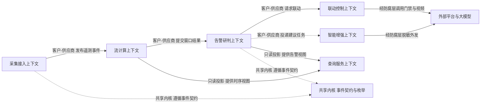

# 逻辑视图（Logical View）

| 项 | 内容 |
|---|---|
| 文档编号 | CDCIM-P2-ARCH-03 |
| 版本 / 状态 | v0.1 · 草案（待评审） |
| 所属阶段 | P2 架构设计 |
| 论文价值 | ★★★★★ 4+1 视图中的「逻辑视图」本体。分层职责与禁止项、6 个限界上下文、12 个关键抽象的不变式、允许/禁止依赖表，是论文「架构设计」段与答辩「为什么这样分、分了之后靠什么不散」的直接素材 |
| 上游依据 | [架构风格候选方案对比](02-架构风格候选方案对比.md)（选定候选 C、六上下文划分）、[组件映射表 v1](01-组件映射表-v1.md)（七层组件与端口）、[需求规格说明书](../02-需求/02-需求规格说明书.md)（69 FR / M1–M6）、[数据字典初稿](../02-需求/08-数据字典初稿.md)（14 逻辑实体 / 单一写主体）、[ADR-0006](../09-决策/ADR-0006-架构风格-边云协同与事件驱动.md) |
| 下游承接 | 进程视图（失效域与并发，本文不做）、开发视图（包结构，见 `05-开发视图.md`）、ATAM 报告的敏感点与权衡点、P3 详细设计（类图、接口契约、状态机） |

> **口径声明**：本文全部描述为**职责与边界的划法**，不含任何内存、容器数、线程模型、端口号。凡提及「边缘侧」均指**职责归属**，不指某台设备或某个容器——边端在原型里是否独立成容器，属进程视图与部署文档的判断（ADR-0006 §5 已记录为待验证项）。
>
> **与组件映射表的关系**：组件映射表回答「用什么组件、占多少内存、开哪个端口」，本文回答「这些组件各自负责什么、彼此之间允许怎样依赖」。两者冲突时以本文的**边界**为准、以组件映射表的**参数**为准，冲突项已在 §3.2 登记。

---

## 1. 视图目的与读者

### 1.1 本文回答的四个问题

| # | 问题 | 本文的产出 | 若答不上来的后果 |
|---|---|---|---|
| L-1 | 系统在逻辑上分成几层，每层的职责边界在哪里，**每层不允许做什么** | §2 六层职责与禁止项表（TAB-ARCH-82） | 「分层」退化为目录分层，跨层调用随处发生，改一处影响全链 |
| L-2 | 一共有多少个逻辑组件，每个组件归谁所有 | §3 逻辑组件清单（TAB-ARCH-83，22 个） | 组件数量与边界靠记忆维持，新人接手要重画一遍 |
| L-3 | 边界按什么划分，边界之间靠什么耦合，哪些耦合被禁止 | §4 六上下文与上下文映射（FIG-ARCH-13）、§6 依赖规则（TAB-ARCH-87） | 「微服务」只剩部署形态，逻辑上仍是一个大泥球 |
| L-4 | 领域里哪些概念是稳定的、不可违反的 | §5 十二个关键抽象及其不变式（TAB-ARCH-86） | 同一概念在五个服务里有五种写法，口径在联调时才暴露 |

### 1.2 本文明确不回答什么

4+1 视图的价值在于**分工**，任一视图越界都会让另外四个视图失效。下表是本文的边界，写在最前面以免读者误读：

**表 TAB-ARCH-81　本文的范围边界与归属**

| 本文不涉及 | 归属视图 / 文档 | 为什么不在本文 |
|---|---|---|
| 容器数量、内存配额、镜像大小 | 进程视图 + [组件映射表 v1 §4](01-组件映射表-v1.md) | 属资源分配，与职责划分无关；同一套逻辑边界可跑在 5 个容器或 3 节点集群上 |
| 线程、协程、事件循环、并发度 | 进程视图 | 并发模型是实现层选择（本项目为 asyncio 单线程事件循环），不影响「谁依赖谁」 |
| 端口、网络策略、volume 挂载 | 部署文档（P6） | 属运行环境配置 |
| 表结构、字段类型、索引 | [数据字典](../02-需求/08-数据字典初稿.md) + P3 DDL | 本文只声明「谁拥有哪份数据」，不声明「数据长什么样」 |
| 类、方法、包内文件划分 | [开发视图](05-开发视图.md) | 逻辑组件是稳定的，代码组织是可替换的 |
| 报文 schema 的字段级定义 | P3 接口契约 | 本文只声明「有一条契约、方向是什么」 |

**一处需要显式说明的越界**：§2 把「边缘层」列为一层。这看起来像部署描述，实际是**职责划分**——它的判据不是「跑在哪台机器」，而是「不依赖中心侧是否可用」。若把中心侧整体停掉，边缘层的职责清单仍然成立，这正是它能成为独立一层的理由。至于它在原型里是不是一个独立容器，本文不作判断。

### 1.3 读者与读法

| 读者 | 重点读 | 用途 |
|---|---|---|
| 评审 / 答辩 | §2、§4.3、§6 | 判断边界是否成立、是否有反向依赖 |
| 详细设计（P3） | §5、§6 | 类图从关键抽象展开，接口契约从上下文映射展开 |
| 开发（P5） | §3、§6 | 认领组件、确认允许的依赖方向 |
| 测试（P6） | §4.1 的失效后果列 | 设计故障注入点：每个上下文应能被单独打挂 |

---

## 2. 分层结构

### 2.1 六层的划分依据

分层依据有两条，缺一不可：**变更频率**（同一层的组件因同一类原因而变化）与**失效后果**（同一层的组件失效时，系统缺失的能力是同一类）。只按变更频率分，会得到「技术分层」（Controller / Service / DAO），那与业务边界无关；只按失效后果分，会得到「什么都独立」，与人力预算冲突。

**表 TAB-ARCH-82　六层职责边界与禁止项**

| 层 | 职责（只做这些） | 允许依赖 | **不允许做什么**（越界即视为设计缺陷） | 对应上下文 |
|---|---|---|---|---|
| **边缘层** | 协议转换、分频采集、死区过滤、质量码标注、断连缓冲与补传、不依赖中心的急停类动作 | 仅依赖本地资源与共享契约；**不依赖中心侧任何服务** | ① 不做业务告警判定（阈值/持续/抑制属告警研判层）；② 不跨网同步调用中心侧接口；③ 不做长期存储与聚合；④ 不做 AI 推理（无 GPU，见组件映射表 §7.2） | 采集接入、联动控制（边缘子集） |
| **接入层** | 协议无关的报文接入、QoS 语义、ACL、事件持久化与位点、契约校验 | 依赖边缘层输出与事件总线 | ① 不做任何业务判断（不识别告警、不算聚合）；② 不直接写业务库；③ 不承担设备协议适配（属边缘层） | 采集接入 |
| **计算层** | 清洗换算、窗口聚合、降采样、幂等写入、乱序与水印处理 | 依赖接入层事件与存储层写入接口 | ① 不做告警判定（规则属告警研判层）；② 不读告警表（避免判定与计算互相拖累）；③ 不做对外查询聚合（属应用层） | 流计算 |
| **存储层** | 时序、关系、缓存、向量四类数据的持久化与检索 | 不依赖任何业务层（被依赖方） | ① 不含业务规则（不在库内写触发器实现告警逻辑）；② 不反向回调业务服务；③ 不承担跨库事务（无分布式事务） | — （被六个上下文共享，按 schema 分权） |
| **应用层** | 人机接口、聚合查询、鉴权、审计切面、报表与定时分析任务、大屏与三维展现 | 依赖查询接口与只读视图 | ① 不直接访问数据库（必须经查询服务）；② 不做业务判定；③ 前端不得持有跨上下文的写权限 | 查询服务 + 展现 |
| **智能旁路层** | 脱敏、模型调用编排、RAG 检索、建议生成与回写（仅建议字段） | 依赖事件（建议任务）与只读数据；**主链路不依赖它** | ① 不参与任何告警判定；② 不写告警状态字段；③ 不设同步等待点（主链路任何环节不得等待模型返回）；④ 结果必须可空 | 智能增强 |

**运维监控不在六层之列**，作为**横切关注点**处理。理由：它不承载业务职责、不拥有业务数据、只读指标；把它列为一层会让「层」的概念同时容纳「职责域」与「观测手段」两类东西，反而模糊边界。观测组件在 §3 中列为第 22 个逻辑组件，标注为横切。

### 2.2 为什么是六层，而不是组件映射表的七层

组件映射表的七层是**技术分层**（采集 / 接入 / 计算 / 存储 / 智能 / 应用展现 / 运维监控），本文的六层是**职责分层**。两处差异必须说清，否则读者会以为漏了一层：

| 差异 | 组件映射表 | 本文 | 理由 |
|---|---|---|---|
| 边缘层 | 归入「采集层」 | 单列为第一层 | 「不依赖中心侧可用」是一条独立的职责判据，把它埋在采集层里，断网自治就成了采集组件的内部细节（候选对比 §3.3 的核心论点） |
| 智能层 | 单列 | 改名「智能旁路层」并加四条禁止项 | 「智能」不是职责，**「旁路」才是**。层名必须携带约束，否则新加入者会自然地把 AI 当成一个可调用的服务 |
| 运维监控 | 单列 | 降为横切 | 见 §2.1 末段 |

---

## 3. 逻辑组件清单

### 3.1 组件的三个准入属性

一个逻辑组件要成立，必须同时满足三条，缺一条就应并入相邻组件：**① 有单一的职责陈述**（一句话说清，不含「并且」）；**② 有显式的对外接口**（其余组件只能通过它交互）；**③ 有明确的数据所有权或纯函数性质**（要么拥有某张表/某个键空间，要么无状态）。

**表 TAB-ARCH-83　逻辑组件清单（22 个）**

| # | 逻辑组件 | 所属上下文 | 职责（一句话） | 对外接口 | 依赖方向 | 对应组件映射表条目 | 对应 FR |
|---|---|---|---|---|---|---|---|
| 1 | 采集执行器 | 采集接入 | 按协议族读写设备并输出统一报文 | 适配器 SPI（新增协议只实现该接口）+ 采集计划（只读） | 依赖 #2 缓冲与 #3 网关；不依赖中心侧任何服务 | collector-gateway | M1-01/02/04/05/07/08/10 |
| 2 | 边缘缓冲 | 采集接入 | 断连落盘、恢复后按事件时间补传 | 追加 / 顺序读 / 水位查询 | 被 #1 写入、被 #1 读取；不依赖总线 | collector-gateway 本地队列（≥150 MB） | M1-06 |
| 3 | 接入网关 | 采集接入 | 报文接入、QoS 1、ACL、规范化后投递总线 | MQTT 1883/9001；事件发布接口 | 依赖 #4 总线 | mosquitto + topic-schema | M1-01、M2-07（背压段） |
| 4 | 事件总线 | 横切（平台） | 持久化事件、多消费组、位点与回放 | topic 契约（`telemetry.raw` / `alarm.events` / `ai.tasks` / `meta.change`） | 被所有上下文依赖 | redpanda | M2-07/08/09 |
| 5 | 流计算器 | 流计算 | 清洗换算、窗口聚合、降采样并批量写入 | 消费 `telemetry.raw`；发布窗口结果 | 依赖 #4、#6、#8 | stream-compute | M2-01/02/03/05/06/07/10 |
| 6 | 时序存储 | 流计算（数据） | 原始与三级降采样的持久化与区间检索 | 写入 / 区间查询 / 最近值 | 被 #5 写、被 #16 读 | tdengine | M2-02/04、M5-08 |
| 7 | 关系存储 | 横切（平台） | 事务型业务数据，按上下文分 schema 与账号 | 各上下文独有 schema | 被依赖；不反向依赖 | postgresql | 全部事务类 FR |
| 8 | 状态缓存 | 横切（平台） | 窗口状态、抑制键、热点缓存（全部可重建） | 键空间约定（8 类键） | 被 #5/#9/#10/#16/#19 读写 | redis | M3-05/06、M5-01 |
| 9 | 规则判定器 | 告警研判 | 规则编译与执行，产出原始告警 | 消费窗口结果；规则热加载（≤10 s） | 依赖 #4、#7、#8 | alarm-engine（规则子集） | M3-01/02/03/04/09/12/13 |
| 10 | 降噪器 | 告警研判 | 同源抑制、父子抑制、聚类、分级 | 原始告警 → 告警事件 | 依赖 #8（抑制键）、#7 | alarm-engine（抑制与聚类子集） | M3-05/06/07/10/14 |
| 11 | 根因分析器 | 告警研判 | 结合拓扑与时序给出 Top3 根因与影响范围 | 查询接口（同步，≤5 s） | 依赖 #7（拓扑快照） | alarm-engine（根因子集） | M3-08、M5-04 |
| 12 | 通知路由器 | 告警研判 | 按级别路由渠道、未确认升级、送达留痕 | 渠道适配接口（短信 / IM / 大屏 / 工单） | 依赖 #4；失败不得回滚告警 | alarm-engine（通知子集） | M3-11 |
| 13 | 边缘联动器 | 联动控制（边缘子集） | 执行不依赖中心判定的急停类动作（本地声光、门禁常开） | 本地动作驱动接口 | 只依赖边缘层资源 | collector-gateway 内功能块 + 边缘规则子集 | M4-02（边缘路径） |
| 14 | 联动执行器 | 联动控制 | 策略匹配、人工确认、双人复核、门禁与视频适配、幂等与回读 | 确认 / 执行 / 回读接口（经防腐层调外部平台） | 依赖 #7、#12；**不依赖 #9 的判定结果** | 新增 link-service（组件映射表未列，见 §3.2） | M4-01/02/03/04/05/06/07/09 |
| 15 | 工单适配器 | 联动控制 | ITSM 建单与状态回写 | 建单 / 查状态 / 回写 | 依赖 #7；对外经防腐层 | api-service（建单适配段，P3 可拆） | M4 衍生、IF-EXT-07 |
| 16 | 查询聚合服务 | 查询服务 | BFF 聚合、分页、SSE 推送、报表与定时分析任务（巡检 / 能效） | REST + OpenAPI 3.1；SSE | 只读依赖 #6/#7/#8；**不写业务表** | api-service | M5-01/02/08/09/10/11/12、M2-11/12 |
| 17 | 权限与审计 | 查询服务 | 认证、RBAC 三角色、审计切面（只追加） | 鉴权中间件 + 审计写接口（仅 INSERT） | 被所有写操作调用 | api-service（鉴权与审计段） | M5-13、NFR-SEC-01~03 |
| 18 | 脱敏网关 | 智能增强 | 6 条规则强制脱敏，失败即拒绝外发 | 脱敏函数（fail-closed） | 被 #19 串接调用 | sanitizer | M6-07 |
| 19 | 智能代理 | 智能增强 | Provider 抽象、熔断、限流、RAG 编排、建议回写 | 建议任务消费 + 建议查询 | 依赖 #4、#18、#20；只写建议字段 | ai-proxy | M6-01/02/03/04/05/06/08/09/10/11 |
| 20 | 知识库服务 | 智能增强 | 切片、嵌入、去重、向量检索 | 检索（Top-K + payload 过滤）、摄取 | 依赖 #7、向量库 | qdrant + ingest worker | M6-04/05 |
| 21 | 应用展现 | 应用层 | 大屏、2D 钻取、3D 数字孪生、告警工作台，含降级路径 | 浏览器（唯一入口）；Nginx 反代 | 只依赖 #16 的 REST/SSE | Vue3 + ECharts + Three.js + nginx | M5-01~07、M6-01/02/10 |
| 22 | 观测组件 | 横切 | 指标采集、看板、自身告警规则 | `/metrics` 拉取 | 只读；不参与任何业务链路 | prometheus + grafana | NFR-TEST-04、可用性度量 |

### 3.2 与组件映射表的对应与四处差异

22 个逻辑组件覆盖组件映射表 v1 七层中的全部业务组件与中间件条目，只有三类未列入：`device-simulator`（测试替身）、`docker compose`（编排描述）、`日志`（输出通道而非组件）。另有四处差异必须登记，否则两份文档会被读出矛盾：

| # | 差异 | 处理 | 理由 |
|---|---|---|---|
| 1 | **device-simulator** 未列为逻辑组件 | 归入测试资产（见开发视图 §7） | 它是测试替身，与真实设备在逻辑上等价；把它列为组件会让「逻辑组件」混入非生产物 |
| 2 | **link-service** 在组件映射表中不存在（候选对比 §3.3 表格提到「新增 link-service」） | 本文列为 #14，并注明「组件映射表 v2 需回补」 | 联动必须有独立的失败域（FR-M4-07 要求联动失败不影响告警）；挂在告警进程内无法证明这一点。这是本文对上游文档的一处**修正**，须在组件映射表升版时同步 |
| 3 | **docker compose** 未列为逻辑组件 | 归入部署描述 | 编排描述不含职责，属开发/部署视图 |
| 4 | 组件映射表 §7「边缘本地联动触发声光 / 联动空调」 | 本文 #13 只保留「本地声光 + 门禁常开」，**不含空调调节** | SRS A-2 已确认联动不含空调远程调节；组件映射表该句属早期草案残留，以 SRS 为准 |

---

## 4. 限界上下文与上下文映射

### 4.1 六个上下文

上下文划分依据是**业务能力**，不是技术层次，也不是「一个组件一个上下文」——22 个组件收敛为 6 个上下文，收敛的判据是「变更频率与失效后果是否一致」。

**表 TAB-ARCH-84　六个限界上下文的职责与自有数据**

| 上下文 | 职责 | 自有数据（唯一写主体） | 对外契约 | 变更频率 | 失效后果（用于设计故障注入点） |
|---|---|---|---|---|---|
| **采集接入** | 把设备数据变成统一、可信、有质量码的事件 | 台账四表（`device` / `point_def` / `space_node` / `topology_link`，写入通道见 §4.4 例外 1）、边缘队列 | `telemetry.raw`、`meta.change` | 低（协议一年内基本不变） | 数据断流：所有下游同时失去输入，是**最高危**失效 |
| **流计算** | 把原始流变成可信值与多级聚合 | `st_metric`、三级降采样、`telemetry_late_bypass` | 窗口结果事件 | 低（聚合口径年变更 ≤ 2 次） | 数据不落库、聚合停更；告警判定仍可凭窗口状态运行一段时间 |
| **告警研判** | 把数据变成判断（规则、抑制、聚类、根因、通知） | `raw_alarm`、`alarm_event`、`alarm_rule` | `alarm.events`、建议任务 | 中（规则年变更 ≤ 500 次，且热加载） | 告警停推：核心业务价值丧失，但采集与存储不受影响 |
| **联动控制** | 在人工确认前提下调用门禁与视频 | `linkage_record` | 联动请求 / 结果事件 | 低 | 联动不可用但告警照常——这是**允许**的失效（FR-M4-07） |
| **查询服务** | 人机入口、聚合查询、鉴权、审计、报表 | `audit_log`、`energy_metric_daily`、权限五表 | REST + OpenAPI、SSE | 高（界面与报表按周迭代） | 界面不可用但采集与告警继续运行；运维处于「盲飞」状态 |
| **智能增强** | 旁路增强：聚类建议、根因建议、RAG、NL 查询 | `knowledge_item`、`kb_docs` | 建议字段回写（可空） | 高（模型与提示词按月变） | 建议缺失，功能完整度下降但核心可用（NFR-AVAIL-03） |

### 4.2 上下文映射图

**图 FIG-ARCH-13　六个限界上下文的映射关系**——回答「六个边界之间靠什么连接、连接处谁向谁负责」。实线为有契约义务的上下游（上游变更须升契约版本），虚线为无同步等待的旁路或只读引用；「外部平台与大模型」是唯一被两个上下文共享的外部依赖，两者各自持有一层防腐，互不复用适配代码。

### 4.3 三种关系类型的含义与代价

**表 TAB-ARCH-85　上下文关系的类型、契约与耦合代价**

| 上游 → 下游 | 关系类型 | 契约载体 | 上游变更的代价 | 本项目的取值理由 |
|---|---|---|---|---|
| 采集接入 → 流计算 | 客户-供应商 | `telemetry.raw` 主题 + JSON Schema（`schema_version`） | 升版本，边端兼容最近 2 版（候选对比 R-2） | 数据形态由上游定义，下游无法自造 |
| 流计算 → 告警研判 | 客户-供应商 | 窗口结果事件 | 升版本，告警侧需同步回归 | 判定必须吃「已清洗的窗口」，不能吃原始报文——否则清洗逻辑会在两处重复 |
| 告警研判 → 联动控制 | 客户-供应商 | 联动请求事件 / 接口 | 升版本 | 联动由告警触发，方向不可逆（禁止联动反向改告警状态） |
| 告警研判 → 智能增强 | 客户-供应商（异步） | `ai.tasks` | 升版本，允许下游滞后 | 建议是增强，允许「旧版本也能跑」 |
| 流计算 / 告警研判 → 查询服务 | 只读投影（共享数据库视图，非共享内核） | 只读视图 + 查询接口 | 视图字段只增不删 | 查询是纯读方，给它事件流会造成「为查一条曲线而消费全量流」的浪费 |
| 联动控制 → 外部平台 | **防腐层** | 平台适配器（门禁 / 视频 / ITSM 各自一个） | 外部接口变更只改适配器 | 外部协议不可控（GB/T 28181 或厂商 REST，SRS Q-2 未闭合），必须隔离 |
| 智能增强 → 外部大模型 | **防腐层** | Provider 抽象 | 换供应商只改配置 | ADR-0003 要求「模型可换」，抽象点必须在出网边界上 |
| 采集接入 / 告警研判 → 共享内核 | 共享内核 | 事件契约、枚举码值、错误码 | **全上下文同步升级** | 只放「线上格式」与「码值」，不放领域模型（理由见开发视图 §6） |

**共享内核为什么必须最小**：共享内核是唯一一处「改一次要全体同步」的地方，它的体积直接等于上下文的耦合度。本项目把它限定为三样东西——主题名与 schema、枚举码值（`alarm_level` 等 20 组）、错误码。**领域模型不进内核**，这是本文与开发视图共同守住的一条线。

### 4.4 边界是否为「真」的三条判据

判据不看文档写得多好，看三件可验证的事：

| # | 判据 | 本项目的证据 | 不成立的典型症状 |
|---|---|---|---|
| 1 | **单服务下线，其余继续** | 每个上下文有独立消费组与独立位点；联动下线时告警推送成功率仍为 100%（FR-M4-07 验收判据） | 下线一个服务，另一服务报「连接被拒」并停止工作 |
| 2 | **跨上下文只经事件或显式接口** | 六个上下文之间无共享表写权限（数据字典 §8 单一写主体） | 出现「A 服务直接 UPDATE B 服务的表」 |
| 3 | **契约变更须升版本** | `schema_version` 进消息头，边端兼容最近 2 版 | 改字段不升版本，靠「大家同时发版」维持 |

**两处被显式承认的例外**：

1. **台账的写入通道与所有权分离**。台账四表在业务上归采集接入上下文（它定义采集口径、被判定与展现共同引用），但写入走查询服务的管理端接口——因为人机写入口只应有一个，否则鉴权、审计、双人复核要在五个服务里各实现一遍。这不是边界被破坏，而是**所有权与写入通道刻意分离**，代价是台账变更必须先经应用层。此例外登记为待确认 1。
2. **分析与报表并入查询服务**。ADR-0006 §5.1 把「分析」列为独立部署单元，但逻辑上它与查询共用同一批只读数据、同一套聚合口径，且变更频率一致（按周），故本文不单列上下文。若 P5 出现「报表任务拖慢交互查询」的实测证据，再拆不迟——拆分成本远低于过早拆分的维护成本。

---

## 5. 关键抽象

### 5.1 十二个抽象及其不变式

选入标准：**跨上下文出现 ≥ 2 次**，或**承载一条不可违反的约束**。不变式（invariant）写成「任何时刻都必须为真」的句子，它是 P3 类图与 P6 用例的共同来源。

**表 TAB-ARCH-86　关键抽象与不变式**

| # | 抽象 | 所属上下文 | 职责 | 不变式（必须恒真） | 落地实体 |
|---|---|---|---|---|---|
| 1 | **测点 Point** | 采集接入 | 采集的最小单位，定义量纲、系数、死区、频率 | ① 一个测点只属一台设备；② `(scale_factor, offset_value)` 一经投运不得变更，变更即新测点；③ `critical_flag` 为真的测点在过载降级时不得停采 | `point_def` |
| 2 | **设备 Device** | 采集接入 | 台账最小管理单元，承载拓扑位置与父子关系 | ① `parent_device_id` 不得成环；② 退役不删除（`lifecycle_status = retired`）；③ `online_status` 只能由采集侧写，人工不可改 | `device` |
| 3 | **空间节点 SpaceNode** | 采集接入 | 机房 / 列 / 机柜 / U 位的四级空间 | ① 层级不可跳（rack 的父必须是 row）；② `room_id` 冗余必须与祖先链一致；③ `u_slot` 本期不渲染但不得删除 | `space_node` |
| 4 | **遥测样本 TelemetrySample** | 采集接入 → 流计算 | 一个测点在一个时刻的一个值（含质量码与时间来源） | ① `(device_id, point_id, ts)` 全局唯一，重复写入后到覆盖；② `quality` 不可为空；③ 同设备同测点 `ts` 单调不回退；④ 缺失即缺失，**不插值** | `st_metric` |
| 5 | **时间窗 Window** | 流计算 | 按事件时间累积样本、由水位线封闭的聚合单元 | ① 窗口一经封闭，只能以 `agg_version + 1` 重算，不得原地改写；② 迟到 > 60 s 的样本不进窗口，进旁路表；③ 窗口内缺失不插值，只记 `valid_count / sample_count` | `st_metric_1m/_5m/_1h` |
| 6 | **告警规则 AlarmRule** | 告警研判 | 一条可热加载、可灰度、可回滚的判定规则 | ① `alarm_level` 强制非空且只取三级；② 每次变更 `rule_version + 1`，旧版本保留；③ 规则表达式只允许白名单函数；④ 生效范围为空则拒绝保存 | `alarm_rule` |
| 7 | **原始告警 RawAlarm** | 告警研判 | 规则命中的单条记录（含被抑制与被聚并的） | ① 只追加不覆盖；② 被抑制条目必须留存且可检索；③ 幂等键 = `hash(rule_id, device_id, point_id, window_start)`；④ `ts_detect ≥ ts_event` | `raw_alarm` |
| 8 | **告警事件 AlarmEvent** | 告警研判 | 可处置的最小推送单元，吸收 N 条原始告警 | ① 状态机 9 条合法迁移，非法迁移必须拒绝并记审计；② `recovered` 不等于 `closed`（恢复仍需人工关闭）；③ `raw_count` / `suppressed_count` 必须与明细可对账；④ 一条事件只冗余一张主工单号 | `alarm_event` |
| 9 | **抑制键 SuppressionKey** | 告警研判 | 判定「同一根因在窗口内是否已推送」的短命状态 | ① TTL 与抑制窗口严格一致（默认 300 s），不得延长；② 键只存窗口起始时刻，不存计数结论；③ 缓存可比事实库先丢——丢失只导致重复推送，不导致漏判 | Redis `cdcim:sup:*` |
| 10 | **联动指令 LinkageCommand** | 联动控制 | 一次带人工确认的控制意图 | ① `confirm_required` 恒为真，无自动执行路径；② `request_id` 幂等 24 h；③ 复核人 ≠ 确认人（库层约束）；④ 超时置「结果未知」并必须回读核对 | `linkage_record` |
| 11 | **建议 Advice** | 智能增强 | 模型产出的只读增强信息（聚类 / 根因 / 答案） | ① 类型上不可作为控制入参；② 每条根因必须附 ≥1 条可点击证据，无证据即过滤；③ 结果可空（`timeout` / `unavailable` / `filtered`）；④ 只能写 `ai_suggest_*` 四列，无状态字段写权限 | `alarm_event.ai_suggest_*` + Redis `cdcim:ai:cache:*` |
| 12 | **元数据快照 MetadataSnapshot** | 告警研判 / 流计算 | 台账与规则在内存中的只读副本，带版本号 | ① 版本单调递增；② 只增不删（删除以 `disabled` 表达）；③ 快照过期时**继续用旧版服务，不阻塞、不回查库**；④ 快照与库的差异允许存在 ≤30 s | 进程内只读视图 + `meta.change` 事件 |

### 5.2 三条最贵的不变式

三处不变式一旦被破坏，修复成本远高于其他条款，需在 P3 与 P6 重点校验：

1. **遥测样本的幂等（#4-①）**。它是「至少一次投递」能生效的唯一支点。若幂等键设计错误，重复消息会变成重复记录，降采样与告警计数全部失真，且错误是**静默**的——不会报错，只会让统计慢慢偏。代价是每次写入都要比对主键，本项目把这个代价放在存储层（TDengine 主键去重），而不是应用层的「先查后写」。
2. **告警事件状态机（#8-①）**。`recovered → raised` 这一条尤其反直觉：条件在关闭前复发时，必须**回到原事件重新计数**，而不是新建事件。若不这样，同一次故障会裂成多条事件，降噪压缩比与重复告警率两个指标同时失效。代价是状态机比「新建即新记录」复杂一档，收益是「一次故障一条事件」这个业务语义成立。
3. **建议只读（#11-①）**。这不是靠注释约束，而是靠**类型与权限**：数据模型层区分「建议」与「指令」两种类型，控制接口校验来源；库里 AI 角色对 `alarm_event` 只有 4 个字段的 UPDATE 权限。若只用代码评审保证，任何一次「顺手加个自动处置」的提交都会破坏它（FR-M6-08 的验收方式是「构造 5 次注入，5 次被拒绝」）。

---

## 6. 依赖规则

### 6.1 允许与禁止

**表 TAB-ARCH-87　允许 / 禁止依赖对照**

| # | 情形 | 判定 | 依据 | 违反后的可观测症状 |
|---|---|---|---|---|
| 1 | 应用层 → 查询服务 → 存储层（只读） | **允许** | 自上而下单向 | — |
| 2 | 计算层 → 接入层（消费事件） | **允许** | 上游是数据来源 | — |
| 3 | 告警研判 → 流计算（消费窗口结果） | **允许** | 客户-供应商 | — |
| 4 | 任意上下文 → 共享内核（契约与枚举） | **允许**（只读） | 共享内核最小化 | — |
| 5 | 存储层 → 业务层（触发器回调、变更通知驱动业务） | **禁止** | 存储不应含业务规则 | 改一次库参数引发业务行为变化，且无人知道在哪改 |
| 6 | 告警研判 → 采集执行器（下发指令或要求重采） | **禁止** | 防「告警风暴引发采集雪崩」的级联失效（组件映射表 §2 图注） | 风暴期采集被拖慢，数据断流，告警更密集——正反馈 |
| 7 | 流计算 → 告警表（直接写 `alarm_event`） | **禁止** | 数据所有权；判定与计算必须能独立降级 | 两处都能造告警，口径不一致且无法定位来源 |
| 8 | 应用展现 → 数据库 / 事件总线 | **禁止** | 前端只能经查询服务 | 前端持有写权限后，审计与鉴权被绕过 |
| 9 | 智能增强 → 告警状态字段 | **禁止** | AI 不进主链路（FR-M6-08） | 断网时告警「卡在待处理」，且责任无法界定 |
| 10 | 边缘层 → 中心侧任何服务（同步调用） | **禁止** | 断网自治的前提 | 中心侧重启期间边侧停止采集，AVAIL-05 直接失效 |
| 11 | 联动控制 → 告警研判（回写告警状态） | **禁止** | 联动失败不得影响告警（FR-M4-07） | 视频平台超时导致告警状态机卡住 |
| 12 | 任意两个上下文之间共享一张表的写权限 | **禁止** | 单一写主体（数据字典 §8） | 双写冲突，谁最后写谁赢，事后无法追溯 |
| 13 | 环状依赖（A→B→…→A） | **禁止** | 循环依赖使独立部署与独立测试失效 | 编译/启动顺序耦合，无法单独起一个服务做验证 |

### 6.2 为什么第 6 条（禁止告警反驱采集）值得单列

它是本系统唯一一条**为阻断正反馈而设**的依赖禁令。动环监控的典型事故链是：某设备批量掉线 → 产生大量通信中断告警 → 告警系统为「补采确认」而要求采集侧立刻重采 → 采集侧本就因设备掉线在重试，负载上升 → 更多超时 → 更多告警。规则上这条链只需一次「顺手」的同步调用就能建立，事后极难拆除，因为它看起来是在「提高准确性」。

对应的结构手段是：判定所需的数据全部来自**已到达的窗口结果**与**内存快照**（#12），判定不回查设备、不回查时序库、不要求采集侧做任何事。这条规则同时解释了为什么 `alarm-engine` 的判定时延能稳定在 P99 ≤ 3 s——它从不等待任何外部动作。

---

## 7. 与需求的对应

**表 TAB-ARCH-88　功能模块与逻辑组件的对应矩阵**（■ 主要承载 · □ 协同参与）

| 模块 | 采集执行器 | 边缘缓冲 | 接入网关 | 流计算器 | 存储三件 | 规则判定器 | 降噪器 | 根因分析器 | 通知路由器 | 联动两个 | 查询聚合 | 智能三件 | 应用展现 |
|---|---|---|---|---|---|---|---|---|---|---|---|---|---|
| **M1 采集接入**（10） | ■ | ■ | ■ | □ | □ | | | | | | □ | | |
| **M2 计算与存储**（12） | □ | □ | □ | ■ | ■ | | | | | | □ | | |
| **M3 告警研判**（14） | | | | □ | ■ | ■ | ■ | ■ | ■ | | □ | □ | □ |
| **M4 联动控制**（9） | | | | | ■ | | | □ | □ | ■ | □ | | □ |
| **M5 可视化与报表**（13） | | | | □ | ■ | □ | | □ | | | ■ | □ | ■ |
| **M6 智能增强**（11） | | | | | ■ | □ | □ | □ | | | □ | ■ | ■ |

**覆盖校核**：69 条 FR 全部至少有一个 ■ 承载者，无「无主需求」。三条需要说明的分配：

1. **FR-M2-11（自动巡检）与 FR-M2-12（能效分析）** 落在查询聚合服务，而不是流计算器。理由：两者都是**定时批式**的只读聚合，与流计算的「按事件时间连续窗口」不是同一类工作；放在流计算器会让「实时链路」与「批式任务」共享同一个失败域，正是候选 D（Lambda）被否决时指出的问题。
2. **FR-M5-04（3D 空间定位）** 由根因分析器提供影响范围、由应用展现渲染，两边各占一半，故两列均为 □/■。
3. **FR-M1-09（协议可插拔）** 的验收判据是「下游 0 改动」，它检验的其实是 §6 第 5~12 条是否成立——这条需求是依赖规则的功能化表达。

---

## 8. 待确认事项

| # | 待确认点 | 本文暂定 | 备选 | 影响面 | 建议 |
|---|---|---|---|---|---|
| 1 | **台账主数据的写入通道** | 所有权归采集接入上下文，写入统一经查询服务的**管理端接口**（人机入口唯一） | 拆出独立 asset-service，由它独占台账写权限 | 上下文数量（6 → 7）、审计与鉴权的实现处、NFR-MOD-03 的「新增设备类型只改元数据」 | 建议维持现状：台账年变更 ≤ 30 台设备，独立服务的收益不抵多一个部署单元的成本；但需在 P3 明确「查询服务对台账只有代理写权限，校验规则由采集接入的 schema 提供」，避免变成任意写 |
| 2 | **报表与能效分析是否单列上下文** | 并入查询服务（同一批只读数据、同一变更频率） | 单列「分析」上下文与独立部署单元 | 上下文数量、ADR-0006 的「4 个中心单元」表述、FR-M2-11/12 的归属 | 建议维持并入；若 P5 压测出现「日报生成期间交互查询 P95 劣化 > 20%」，再拆并同步更新 ADR-0006 §3 与候选对比 §5.1 |

---

## 考点映射

| 考纲知识点 | 本文件对应内容 | 论文可用位置 | 真题溯源 |
|---|---|---|---|
| **4+1 视图方法** | 全文定位（§1.2 越界边界表把「进程/线程/端口」显式推给其他视图）、§2 分层、§4 上下文映射 | 论文「架构设计」段开头的视图分工说明：先说清每个视图回答什么，再说结论 | 论文题「论软件架构设计」类、2023 上「架构评估」 |
| **分层架构与关注点分离** | §2.1 六层职责与每层 3~4 条禁止项、§2.2 与七层技术分层的差异、§6.1 依赖方向 | 论文「分层架构」段：分层的判据是变更频率 + 失效后果，且必须写明「不允许做什么」 | 论文题「论分层架构」类（历年高频） |
| **限界上下文与上下文映射** | §4.1 六上下文、FIG-ARCH-13、§4.3 三种关系类型（客户-供应商 / 共享内核 / 防腐层）、§4.4 三条判据 | 论文「微服务架构」段的拆分依据；答辩「为什么是 6 个不是 4 个」的直接答案 | 论文题「论微服务架构」类、2024 下「论领域驱动设计」 |
| **依赖倒置与依赖规则** | §6.1 十三条允许/禁止表、§6.2 反驱禁令的正反馈分析 | 论文「关键技术实现」段：把「架构约束」写成可检查的规则，而不是口号 | 案例题「设计模式应用」、2023 下「软件架构风格」 |
| **领域建模与不变式** | §5 十二个抽象与 43 条不变式、§5.2 三条最贵的不变式 | 论文「领域模型」段：不变式是需求与代码之间的可验证契约 | 案例题「领域建模」「数据库设计」 |
| **数据所有权与单一写主体** | §4.1 自有数据列、§6.1 第 12 条、§4.4 例外 1 | 论文「数据架构」段：所有权与写入通道可以分离，但写主体不可分裂 | 2022 下「论数据架构设计」 |

---

## 论文可引用段落

> **【适用题目类型】论软件架构设计 / 论分层架构 / 论微服务架构**

逻辑视图要回答的不是「有几个模块」，而是「模块之间允许怎样依赖」。我把系统分为边缘、接入、计算、存储、应用、智能旁路六层，依据是变更频率与失效后果：同层因同一类原因变化，失效时缺失的是同一类能力。因此每层都必须同时写出「只做什么」与「不允许做什么」——计算层不允许做告警判定，智能旁路层不允许设同步等待点。六个限界上下文之间只有三种关系：客户与供应商、共享内核、防腐层。共享内核压到最小，只保留契约、码值与错误码，领域模型一律不进，因为内核每多一个类型，六个上下文同步升级的成本就多一分。最容易被忽略的是禁令：禁止告警反向驱动采集，那条看似提高准确性的调用会形成「掉线生告警、重采加剧超时」的正反馈，只能从依赖规则上堵死。

（约 295 字）

---

## 变更记录

| 版本 | 日期 | 变更 |
|---|---|---|
| v0.1 | 2026-11-27 | 初稿。建立六层职责与禁止项（TAB-ARCH-82）、22 个逻辑组件清单及其与组件映射表的四处差异登记（TAB-ARCH-83）、六个限界上下文与映射图（FIG-ARCH-13 / TAB-ARCH-84 / TAB-ARCH-85）、边界真伪三判据与两处例外、十二个关键抽象与 43 条不变式（TAB-ARCH-86）、十三条允许/禁止依赖（TAB-ARCH-87）、M1–M6 覆盖矩阵（TAB-ARCH-88）、2 项待确认 |
