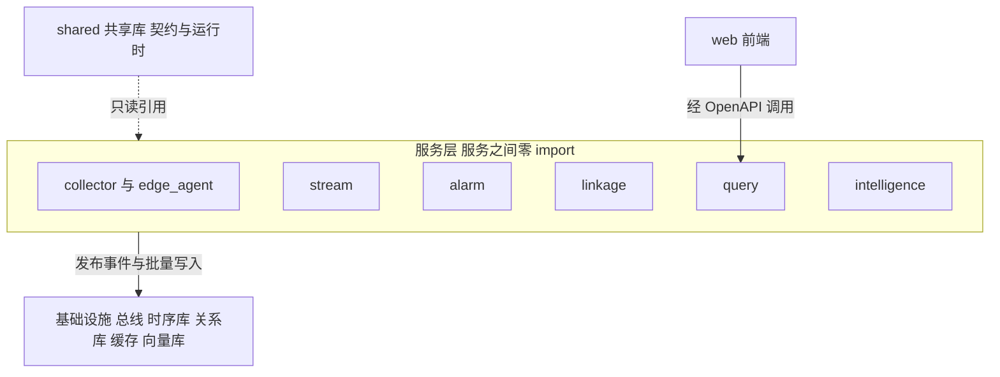

# 开发视图（Development View）

| 项 | 内容 |
|---|---|
| 文档编号 | CDCIM-P2-ARCH-04 |
| 版本 / 状态 | v0.1 · 草案（待评审） |
| 所属阶段 | P2 架构设计 |
| 论文价值 | ★★★★☆ 「模块化与包结构」「构建与依赖管理」两处考点的落点。目录按限界上下文划分而非按技术层划分、共享库最小化的取舍、多阶段构建与密钥治理，可作为论文「关键实现」段与答辩「代码怎么组织」的素材 |
| 上游依据 | [逻辑视图](04-逻辑视图.md)（6 上下文 / 22 逻辑组件 / 依赖规则）、[组件映射表 v1](01-组件映射表-v1.md)（技术栈与镜像）、[ADR-0002](../09-决策/ADR-0002-原型技术栈-A档精简真栈.md)（Python 3.11 + asyncio + Docker Compose）、[ADR-0006](../09-决策/ADR-0006-架构风格-边云协同与事件驱动.md)、[需求规格说明书](../02-需求/02-需求规格说明书.md)（NFR-MOD-01/04、NFR-SEC-06） |
| 下游承接 | P4 骨架搭建（目录创建、镜像与 compose 落地）、P5 实现（开发认领包）、P6 测试（测试目录与替身策略）、部署手册（P6） |

> **口径声明**：**P4 阶段才创建代码**，本文描述的是目录与包的**设计约定**，仓库中当前不存在 `core/` 与 `web/` 的真实实现。文中全部镜像大小、构建耗时均为**估算**（标注「估算」），实测值在 P4 记录到部署手册，不回写本文。
>
> **一条前置原则**：**目录结构是逻辑视图的投影，不是技术分层的投影。** 一个限界上下文对应 `core/` 下的一个目录；同一目录内可再按技术职责分子包，但**不允许**出现 `controllers/`、`services/`、`models/` 这类横跨全部上下文的顶层目录——那会让「改一个上下文」变成「改全仓」。

---

## 1. 视图目的

### 1.1 本文回答的三个问题

| # | 问题 | 产出 | 若不回答的后果 |
|---|---|---|---|
| D-1 | 代码放在哪里，一个新加入者能否在 10 min 内找到「改告警级别校验」的位置 | §2 目录树与目录职责表（TAB-ARCH-96） | 目录按个人习惯生长，三个月后无人敢删文件 |
| D-2 | 哪个包可以依赖哪个包，哪些依赖被禁止 | §3 包划分（TAB-ARCH-97）、§4 依赖方向图（FIG-ARCH-14） | 出现 `common/utils.py` 万能模块，所有服务互相 import |
| D-3 | 构建出什么产物，产物多大，密钥如何不进产物 | §5 构建与产物（TAB-ARCH-98）、§8 配置与密钥 | 镜像里带着 `.env` 与调试工具上线；构建慢到每次改一行等 10 min |

### 1.2 本文不回答什么

| 不在本文 | 归属 |
|---|---|
| 类图、方法签名、状态机实现 | P3 详细设计（源起逻辑视图 §5 的 12 个抽象） |
| 代码行数、函数复杂度、覆盖率目标 | P5 实现与 P6 测试 |
| compose 文件的具体服务定义、`mem_limit` 数值 | P4 骨架 + [组件映射表 §4](01-组件映射表-v1.md) |
| CI 流水线的触发规则与审批 | P6 / 工程实践，本文只约定「构建阶段」 |
| 前端组件树与路由表 | P3 前端设计 |

### 1.3 一个必须先讲清的判断

「一个上下文一个目录」在**单人体量**的项目里看起来过度设计——总共 3.5 人日/周，谁会去动别人的目录？但目录的价值不在「防别人」，而在**让边界可被机器检查**：一条 CI 规则（`core/alarm/**` 不得 import `core/stream/**`）能在 3 秒内判定边界是否被破坏，而一条口头约定不能。**能用一行脚本验证的约束，才配称为架构约束。**

---

## 2. 工程目录结构

### 2.1 目录树

```
cdcim/
├── core/                          后端服务：一个限界上下文一个目录（Python 3.11）
│   ├── shared/                    共享库，全仓唯一的跨服务依赖（见 §6）
│   │   ├── contracts/             主题名、JSON Schema、枚举码值、错误码
│   │   └── runtime/               配置加载、结构化日志、trace 注入、指标、总线客户端封装
│   ├── collector/                 采集接入：协议适配、分频调度、质量码、边缘队列
│   │   ├── adapters/              modbus / snmp / mqtt 三类适配器实现（新增协议只动这里）
│   │   ├── scheduler/             分频与超时重试
│   │   └── buffer/                落盘队列、补传、水位预警
│   ├── edge_agent/                边缘侧装配：本地联动与补传编排（是否独立镜像见待确认 1）
│   ├── stream/                    流计算：清洗换算、窗口聚合、降采样、幂等批量写
│   ├── alarm/                     告警研判：规则、抑制、聚类、根因、通知
│   ├── linkage/                   联动控制：策略匹配、人工确认、双人复核、门禁与视频适配
│   ├── query/                     查询服务：BFF 聚合、分页、SSE、报表与巡检定时任务
│   └── intelligence/              智能增强：脱敏、Provider 抽象、熔断、RAG、建议回写
├── web/                           前端（Vue3 + Vite），按视图域分目录而非按文件类型
│   ├── src/views/                 大屏、2D 三级钻取、告警工作台、报表
│   ├── src/charts/                ECharts 封装、2 000 点降采样渲染
│   ├── src/three/                 Three.js 场景、LOD、实例化渲染、降级链
│   └── src/api/                   OpenAPI 生成的客户端与 SSE 封装
├── deploy/                        编排与运行配置（**不含任何密钥**）
│   ├── compose/                   base / prototype / prod / observability 四份
│   ├── config/                    各服务配置模板（版本化，非密钥）
│   └── observability/             Prometheus 规则、Grafana 看板 JSON
├── tests/                         跨服务测试资产（服务内单测跟随各自代码目录）
│   ├── integration/               多容器联调、故障注入（断网 / 停库 / 杀进程）
│   ├── contract/                  边云双端契约测试
│   └── fixtures/                  协议模拟器脚本、回放样本
├── docs/                          文档体系（本文件所在目录）
└── scripts/                       启停、备份、导出等运维脚本
```

**目录层级**：最深 4 级（`cdcim/core/collector/adapters/`），再深一层的文件平铺在包内，不再设子目录。层级每多一级，`import` 路径就长一段、重构时的相对导入成本就高一档；4 级是「能表达上下文 → 组件 → 适配实现」的最短路径。

### 2.2 目录职责与禁止放入

**表 TAB-ARCH-96　目录职责与禁止项**

| 目录 | 一句话职责 | 允许放入 | **禁止放入** |
|---|---|---|---|
| `core/shared/contracts` | 定义跨上下文的线上格式 | 主题名常量、JSON Schema、枚举码值、错误码 | 任何领域对象、任何业务判断、任何 IO |
| `core/shared/runtime` | 各服务共用的技术骨架 | 配置加载、日志、trace、指标注册、总线客户端接口 | 业务编排、数据库模型、外部平台 SDK |
| `core/collector` | 把设备数据变成统一事件 | 协议适配、分频调度、质量码、本地队列 | 告警判定、聚合降采样、SQL 查询 |
| `core/edge_agent` | 边缘侧的装配与本地闭环 | 本地联动驱动、补传编排、边端配置 | 任何对中心侧的同步调用（逻辑视图 §6 第 10 条） |
| `core/stream` | 把原始流变成可信值与聚合 | 清洗换算、窗口、降采样、批量写 | 读告警表、规则判定、对外查询接口 |
| `core/alarm` | 把数据变成判断 | 规则、抑制、聚类、根因、通知路由 | 写时序表、调用采集侧、等待外部平台返回 |
| `core/linkage` | 在人工确认后调用外部平台 | 策略匹配、确认与复核、门禁与视频适配器 | 回写告警状态、自动执行路径 |
| `core/query` | 人机入口与只读聚合 | REST / SSE、鉴权、审计切面、报表任务 | 写业务表（除审计与台账代理写）、业务判定 |
| `core/intelligence` | 旁路增强 | 脱敏、Provider 抽象、RAG 编排、建议回写 | 写告警状态字段、参与判定、同步阻塞主链路 |
| `web` | 展现与交互 | 视图、图表、3D 场景、API 客户端 | 直连数据库、直连总线、存放密钥 |
| `deploy` | 编排与配置 | compose、配置模板、监控规则 | `.env`、证书私钥、任何凭据 |
| `tests` | 跨服务验证 | 契约测试、集成测试、模拟器脚本 | 被任何生产代码 import |

### 2.3 三条命名规则

1. **服务目录名 = 上下文名的小写下划线形式**（`alarm`、`intelligence`），不用技术名（`rule_engine`）也不用缩写（`alm`）。理由：目录名是团队唯一高频输入的标识符，它应当直接对应逻辑视图的措辞，减少一次翻译。
2. **适配器文件名 = 外部系统的协议名或产品名**（`modbus.py`、`gb28181.py`），一个适配器一个文件。这样「新增一类协议」的改动范围可以用 `ls` 一眼数出来，直接支撑 NFR-MOD-01 的「≤ 2 个文件」判据。
3. **禁止 `utils.py` / `common.py` / `helpers.py`**。需要共用就放进 `shared/` 并说明它属于契约还是运行时；放不进去，说明它其实是某个上下文的私有逻辑，应当留在原地。

---

## 3. 模块与包划分

**表 TAB-ARCH-97　包 / 模块的职责与依赖约束**

| 包 / 模块 | 职责 | 允许依赖 | 禁止依赖 | 构建产物 |
|---|---|---|---|---|
| `shared.contracts` | 线上格式的唯一来源 | 仅标准库与 schema 校验库 | 任何服务包、任何领域模型 | wheel（`cdcim-contracts`） |
| `shared.runtime` | 技术骨架：配置、日志、指标、总线客户端接口 | 标准库、pydantic、结构化日志库 | 任何服务包 | wheel（`cdcim-runtime`） |
| `collector` | 采集接入上下文 | `shared.*`、协议库（pymodbus / pysnmp / paho） | `stream` / `alarm` / `linkage` / `query` / `intelligence` | 镜像 `cdcim/collector` |
| `edge_agent` | 边缘侧装配 | `shared.*`、本地队列文件契约 | 任何服务包（**含 `collector`**）、任何中心侧网络调用 | 镜像 `cdcim/edge-agent`（或并入 collector，见待确认 1） |
| `stream` | 流计算上下文 | `shared.*`、TDengine 客户端 | `alarm` / `linkage` / `query` | 镜像 `cdcim/stream` |
| `alarm` | 告警研判上下文 | `shared.*`、PG 客户端、Redis 客户端 | `collector` / `stream` / `linkage` | 镜像 `cdcim/alarm` |
| `linkage` | 联动控制上下文 | `shared.*`、PG 客户端、外部平台适配器 | `alarm`（不得 import 其内部模块，只消费事件） | 镜像 `cdcim/linkage` |
| `query` | 查询服务上下文 | `shared.*`、只读视图、鉴权库 | 其他服务的内部模块 | 镜像 `cdcim/query` |
| `intelligence` | 智能增强上下文 | `shared.*`、HTTP 客户端、向量库客户端 | `alarm` 内部模块（只写建议字段） | 镜像 `cdcim/intelligence` |
| `web` | 前端产物 | OpenAPI 生成的客户端 | 任何后端源码、数据库驱动 | 静态资源（`dist/`，约 8 MB，估算） |
| `deploy` | 编排与配置 | 无（纯声明） | 任何代码 | compose 文件、配置模板 |
| `tests` | 跨服务验证 | 全部服务（测试可依赖，生产不可反向依赖） | 无 | 不产出交付物 |

**关于「服务之间零 import」的两处澄清**：

1. `alarm` 与 `linkage` 在同一个部署单元里（ADR-0006 §5.1 把联动并入告警单元），但**代码目录仍然分立、互不 import**。这是「部署合并」与「代码耦合」的刻意分离：合并部署是为了省内存，不合并代码是为了保住边界。若因同容器就允许互相 import，下一次拆分时就要先解耦——而那正是候选对比 §6.4 所说「3~5 倍成本」的来源。
2. `collector` 与 `edge_agent` 会被打进同一个边缘镜像（或两个同宿主镜像），但同样不互相 import：采集进程写完本地队列，联动模块只按**队列文件契约**顺序读，两者之间没有函数调用。若把「边端复用适配器代码」当成省事的理由，边云之间的边界就会从「文件契约」退化成「同一份内存」，断网验证（FR-M1-06）也就失去了独立观测点。

---

## 4. 依赖方向图



**图 FIG-ARCH-14　包与模块的依赖方向**——回答「谁可以 import 谁」。指向子图的箭头表示「该组内每个服务都依赖它」，不代表服务之间有依赖；`shared` 只被引用、不引用任何服务，因此依赖图是**严格两层的有向无环图**：`shared` → 服务 → 基础设施。前端只经 OpenAPI 客户端访问 `query`，不进入后端的包依赖图。

**四条依赖纪律**（每条都可用一行脚本检查）：

| # | 纪律 | 检查方式 | 违反后果 |
|---|---|---|---|
| 1 | `shared` 不得 import 任何服务包 | 静态扫描 `core/shared/**` 的 import | 共享库变成「反向依赖总闸」，改一处全线崩 |
| 2 | 服务之间零 import | 静态扫描跨目录 import（同容器内的 `alarm`↔`linkage` 同样适用） | 边界退化为目录约定，独立部署与独立测试失效 |
| 3 | `web` 只经 OpenAPI 客户端 | 扫描 `web/src` 是否出现直连地址与驱动 | 前端绕过鉴权与审计 |
| 4 | 依赖图中不得出现环 | 用 import 图做环检测（CI 每次提交） | 启动顺序耦合，无法单独起一个服务做验证 |

---

## 5. 构建与产物

### 5.1 镜像清单与大小预算

**表 TAB-ARCH-98　镜像与构建产物（大小均为估算，实测在 P4 记录）**

| 镜像 | 基础镜像 | 构建阶段 | 大小预算（估算） | 关键约束 |
|---|---|---|---|---|
| `cdcim/collector` | `python:3.11-slim` | builder → runtime | 230 MB | 含三个协议库；非 root（uid 10001） |
| `cdcim/edge-agent` | `python:3.11-slim` | builder → runtime | 200 MB | 与 collector 同镜像层但代码不互相 import；不含中心侧依赖 |
| `cdcim/stream` | `python:3.11-slim` | builder → runtime | 250 MB | 含数值计算依赖；不含规则引擎 |
| `cdcim/alarm` | `python:3.11-slim` | builder → runtime | 210 MB | 含 PG / Redis 客户端；不含协议库 |
| `cdcim/linkage` | `python:3.11-slim` | builder → runtime | 200 MB | 含外部平台适配器；外部 SDK 必须隔离在 `adapters/` |
| `cdcim/query` | `python:3.11-slim` | builder → runtime | 220 MB | 含 FastAPI / 鉴权库；只读驱动 |
| `cdcim/intelligence` | `python:3.11-slim` | builder → runtime | 200 MB | 仅 HTTP + 向量库客户端，不含模型权重 |
| `cdcim/web` | `nginx:1.25-alpine` | static build → runtime | 35 MB | 只含静态产物，无源码、无 `node_modules` |
| 合计（8 个镜像） | — | — | **约 1.5 GB** | 宿主磁盘需另留 2 ~ 3 GB 构建缓存（估算） |

**镜像大小与内存预算是两件事**，常被混为一谈：镜像大小决定**磁盘与拉取时间**，内存预算决定**运行时能否装下**（组件映射表 §4 合计 3.76 GB）。一个 250 MB 的镜像运行时可能只占 300 MB 内存，两者之间无固定比例。

### 5.2 多阶段构建策略

| 阶段 | 做什么 | 为什么单独成阶段 |
|---|---|---|
| `builder` | 装编译工具链、下载并编译 wheel 到 `/wheels` | 编译期依赖（gcc、头文件）体积可达 300 MB 以上，绝不能进运行时镜像 |
| `runtime` | 复制 wheel 离线安装（`--no-index`）、复制源码、切非 root、声明 `HEALTHCHECK` | 运行时镜像只含解释器 + 依赖 + 代码 |
| `static`（仅 web） | `npm ci && npm run build` 产出 `dist/` | Node 工具链约 400 MB，构建后即丢弃 |

三条实现纪律：① `pip install` 一律 `--no-cache-dir`，构建缓存只留在 builder 阶段；② 依赖版本在 `requirements.txt` 中**全量钉版本**（含传递依赖），否则「今天能构建、明天不能」；③ 私有源凭据用 `--secret` 挂载，不用 `ARG`（`ARG` 会留在镜像历史里）。

**构建耗时**：单服务增量构建**估算** 40 ~ 90 s（仅改源码，依赖层命中缓存）；全量冷构建**估算** 8 ~ 12 min（含基础镜像拉取与全部 wheel 编译），具体值在 P4 实测登记。此处给出区间而非单值，是因为它高度依赖宿主磁盘与网络，写成精确值即为虚构。

---

## 6. 共享代码策略

### 6.1 放什么、不放什么

**表 TAB-ARCH-99　共享库的准入清单**

| 类别 | 具体内容 | 判定 | 理由 |
|---|---|---|---|
| **放** | 主题名与 JSON Schema、枚举码值（20 组）、错误码 | 放 | 它们是**线上格式**，多方必须逐字一致，不一致即解析失败 |
| **放** | 配置加载、结构化日志、trace 注入、指标注册 | 放 | 纯技术骨架，无业务语义，改动不影响业务行为 |
| **放** | 总线客户端**接口**（Publisher / Consumer 抽象） | 放 | 依赖倒置的落点：业务依赖接口，实现可换（Kafka 协议 → 其他） |
| **不放** | 领域模型（`Point`、`Device`、`AlarmEvent` …） | 不放 | 见 §6.2 |
| **不放** | 业务规则（阈值比较、抑制判定、状态机迁移） | 不放 | 规则属于某个上下文，共用会让「改规则」变成「改全仓」 |
| **不放** | ORM 实体、数据库迁移脚本、跨服务的 DAO | 不放 | 数据所有权按上下文划分（逻辑视图 §4.1），共用 DAO 等于共用写权限 |
| **不放** | 外部平台 SDK 封装（门禁 / 视频 / ITSM） | 不放 | 它们属于防腐层，由使用方各自持有；共用会让「换视频平台」波及智能上下文 |
| **不放** | 测试替身与假数据 | 不放 | 生产依赖里出现测试代码，是最常见的镜像膨胀与漏洞来源 |

### 6.2 为什么禁止把领域模型放进共享库

这是一条容易被反驳的规则——「`Device` 在五个服务里都要用，为什么不共用？」理由有三条，按可验证性排序：

1. **它会让独立升级的判据失效**。假设 `Device` 加一个字段 `rated_power_kw`，放进共享库后，8 个镜像全部需要重建、全部需要回归、全部需要重发。NFR-MOD-04 要求「单服务发布中断 ≤ 1 min、其他服务不可用 0 s」，而共享库的变更天然是**全量发布**——这条需求当场不成立。若各自持有模型，则只有真正需要该字段的服务改动，其余服务零改动。
2. **它会把「契约」与「模型」混为一谈**。契约是**线上格式**（可以宽松、向后兼容、允许多余字段），领域模型是**内存中的行为载体**（有不变式、有方法、有生命周期）。二者演进节奏不同：契约只能加字段，模型可以重构。把它们塞进同一个包，等于强制模型跟着契约冻结。
3. **它让边界从「不可见」变成「不可查」**。领域模型共享后，任何服务都能构造任意上下文的实体并直接落库，`单一写主体`（数据字典 §8）就只剩文档约定。反之，模型各持一份时，「谁能写 `alarm_event`」在代码层就是显然的——只有 `alarm` 目录里有这个类。

**代价必须写明**：每个上下文要自己写一遍「事件 → 本地模型」的转换（约 20 ~ 40 行/事件类型，估算）。这是重复代码，但它换来的是**可独立演进**。重复的是映射，不是规则；映射写错会在契约测试里立刻暴露，规则写错则要等到线上。

### 6.3 共享库的版本规则

| 变更类型 | 版本动作 | 同步要求 |
|---|---|---|
| 加字段、加枚举值（向后兼容） | 次版本 +1 | 各服务按需升级，允许版本不一致 |
| 删字段、改语义、改枚举码值 | **主版本 +1** | **全部服务必须同批升级**，CI 阻断「混版部署」 |
| 仅修文档/注释 | 补丁 +1 | 无 |

「允许版本不一致」是这条规则的关键：它把共享库从「必须同时发布」的耦合点，降级为「可以分批升级」的普通依赖——这正是逻辑视图 §4.3 要求「共享内核必须最小」在构建层的对应手段。

---

## 7. 测试代码组织

**表 TAB-ARCH-100　测试类型、位置与替身策略**

| 测试类型 | 位置 | 依赖 | 替身策略 | 运行时机 |
|---|---|---|---|---|
| 单元测试 | `core/<service>/tests/unit/` | 无外部依赖 | 纯函数 + 内存实现；时间用可注入时钟 | 每次提交（目标 < 60 s，估算） |
| 集成测试 | `tests/integration/` | 真实中间件（compose `test` profile） | **不用 mock 数据库**；外部平台用 stub server | 合并前 |
| 契约测试 | `tests/contract/` | 真实 broker | 双端 schema 兼容校验（当前版 + 上一版） | 合并前 + 每夜 |
| 故障注入 | `tests/integration/fault/` | 真实栈 | 断网（`docker network disconnect`）、停库、杀进程 | P6 阶段 + 每夜（若时长允许） |
| 前端测试 | `web/tests/` | jsdom + 构建产物 | API 用 OpenAPI mock，3D 用固定帧序列 | 合并前 |

### 7.1 测试替身的三条纪律

1. **不 mock 数据库**。用真实 PostgreSQL / TDengine 容器，理由是 SQL 方言、约束行为、分区语义都无法被 mock 忠实还原——本项目恰恰重度依赖唯一约束做幂等（逻辑视图 §5.2 第 1 条），mock 掉的正是要验证的东西。
2. **总线两套替身，用途分开**。单元测试用**内存 double**（实现同一个 Publisher/Consumer 接口，走进程内队列），换取毫秒级执行；契约测试与集成测试必须用**真实 broker**，因为要验证的是位点、分区、重复投递——这些在内存 double 里不存在。
3. **外部平台一律用 stub server，不用 mock 对象**。门禁、视频、ITSM 的失败模式（超时、5xx、半成功）必须以 HTTP 层行为复现，否则「联动失败不影响告警」这条验收（FR-M4-07）在测试里永远为真。

### 7.2 契约测试的双端矩阵

边云之间多一层契约（逻辑视图 §4.3），因此契约测试必须覆盖**四种组合**，而不是一种：

| 边端版本 | 中心侧版本 | 期望 | 说明 |
|---|---|---|---|
| 当前 | 当前 | 通过 | 基线 |
| 上一版 | 当前 | **必须通过** | 边端升级滞后于中心侧（候选对比 R-2 的缓解措施） |
| 当前 | 上一版 | 通过（若字段只增） | 中心侧回滚场景 |
| 上两版 | 当前 | 失败（预期） | 明确「兼容最近 2 版」的边界，避免兼容承诺无限扩张 |

---

## 8. 配置与密钥

### 8.1 配置加载顺序

**表 TAB-ARCH-101　配置的四级来源与覆盖关系**

| 顺序 | 来源 | 存放位置 | 能否放密钥 | 说明 |
|---|---|---|---|---|
| 1（最低） | 代码内默认值 | 各服务 `settings.py` | **否** | 只放安全默认值（如超时 5 s、重试 3 次），不放任何地址与凭据 |
| 2 | 版本化配置文件 | `deploy/config/<service>.yml` | 否 | 随代码评审，可 diff；放业务参数（窗口长度、抑制窗口、限流阈值） |
| 3 | 环境变量 / `.env` | `.env`（**不入库**）、`.env.example`（入库） | 是（运行期注入） | 部署期差异（地址、端口、外部平台 URL） |
| 4（最高） | 命令行参数 | 启动命令 | 否 | 仅调试用；**生产禁止使用**，否则配置来源不可追溯 |

覆盖规则：后者覆盖前者；启动时打印**生效配置的哈希**（不打印值），用于核对「线上跑的到底是哪份配置」。必填项缺失即**启动失败**（fail-fast），不允许「用默认值静默启动」——静默启动会让配置错误延迟到业务异常时才暴露。

### 8.2 密钥的四条硬规则

| # | 规则 | 落地手段 | 对应需求 |
|---|---|---|---|
| 1 | 密钥不进镜像 | `.dockerignore` 显式排除 `.env`、`*.pem`；构建期用 `--secret` 而非 `ARG` | NFR-SEC-06 |
| 2 | 密钥不进日志 | 结构化日志的字段白名单；脱敏中间件覆盖 100% 出站与日志 | NFR-SEC-06 |
| 3 | 库里只存引用 | 台账 `credential_ref` 形如 `secret://snmp/a01`，真实凭据在宿主 secret 目录 | 数据字典 §4.2 |
| 4 | 密钥不进前端产物 | 前端只拿短期令牌；`dist/` 扫描黑名单串（0 命中为验收判据） | NFR-SEC-06 |

**`.env` 的边界**：它只放「部署期不同、且不构成凭据泄露」的项（服务地址、端口、日志级别、外部平台 URL）。凡属凭据（数据库口令、SNMP community、模型 API Key）一律走 secret 挂载——因为 `.env` 极易被 `cat`、被打包、被误传到聊天窗口，而 secret 文件有独立的权限位。

---

## 9. 与需求的对应

**表 TAB-ARCH-102　功能模块与非功能需求到代码位置的映射**

| 需求 | 落点 | 校核方式 |
|---|---|---|
| M1 采集接入（10 条） | `core/collector/adapters` + `scheduler` + `buffer`、`core/edge_agent` | 新增协议只改 `adapters/` 下 1~2 个文件（NFR-MOD-01） |
| M2 计算与存储（12 条） | `core/stream`（清洗、窗口、降采样、幂等写） | 窗口与水印参数在 `deploy/config/stream.yml`，不硬编码 |
| M3 告警研判（14 条） | `core/alarm`（规则、抑制、聚类、根因、通知） | 规则表达式白名单校验在 `alarm` 内部，不外泄 |
| M4 联动控制（9 条） | `core/linkage`（策略、确认、复核、适配器） | 外部平台适配器各自成文件，替换平台不改 `linkage` 其余部分 |
| M5 可视化与报表（13 条） | `core/query`（BFF、SSE、报表任务）+ `web` | 3D 降级链在 `web/src/three`，与 2D 视图解耦 |
| M6 智能增强（11 条） | `core/intelligence` | 建议类型只读由类型系统 + 库权限双重保证 |
| NFR-MOD-04 独立升级 | 每服务独立镜像 + 独立 compose 服务 | 单镜像重建不影响其他容器（发布演练在 P6） |
| NFR-TEST-01/02 故障注入与回放 | `tests/integration/fault`、`tests/fixtures` | 断网、停库、回放脚本可一键执行 |
| NFR-SEC-06 密钥不泄露 | `deploy` 不含 `.env`；secret 挂载；日志白名单 | 全仓扫描密钥串 0 命中 |

---

## 10. 待确认事项

| # | 待确认点 | 本文暂定 | 备选 | 影响面 | 建议 |
|---|---|---|---|---|---|
| 1 | **边端是否独立镜像** | `core/edge_agent` 独立目录、独立镜像（`cdcim/edge-agent`），与 `collector` 同镜像层但**代码不互相 import**，只经本地队列文件契约交互 | 与 collector 合并为单镜像单容器（共用同一进程入口） | 镜像数与磁盘（+200 MB 估算）、断网验证方式（`docker network` 能否只隔离边端）、构建矩阵 | 建议独立：ADR-0006 §5 与候选对比 R-1 都把「边端独立成容器」作为回应「伪边缘」质疑的事实手段；合并后该质疑只能靠文字辩解。若 P4 内存吃紧，按候选对比 §5.4 的降级顺序处理，**不得先改这条** |
| 2 | **契约代码是否由 schema 生成** | 手写 `contracts` 中的常量与校验器 | 由 JSON Schema 生成 dataclass / pydantic 模型 | `shared/contracts` 的构建产物（wheel vs 生成代码）、契约变更流程、IDE 补全体验 | 建议手写 + 运行时校验：原型期契约约 4 个主题，生成链路（codegen 工具 + 模板 + CI 钩子）的维护成本高于收益；若主题数增至 10 个以上再引入生成 |

---

## 考点映射

| 考纲知识点 | 本文件对应内容 | 论文可用位置 | 真题溯源 |
|---|---|---|---|
| **4+1 视图方法（开发视图）** | §1.2 边界表、§2 目录树、§4 依赖方向图 | 论文「架构设计」段说明「逻辑视图定边界、开发视图定落地」的分工 | 论文题「论软件架构设计」类 |
| **模块化与包结构** | §2.1 目录树、§2.2 目录禁止项、§2.3 命名规则、§3 包划分表 | 论文「模块化设计」段：目录是逻辑视图的投影，不是技术分层的投影；「禁止 utils.py」的具体理由 | 案例题「软件架构设计」「模块划分」 |
| **依赖倒置与依赖管理** | §4 四条依赖纪律、`shared.runtime` 的 Publisher/Consumer 抽象、§6.3 版本规则 | 论文「关键技术实现」段：把架构约束写成 CI 可检查的规则 | 案例题「设计模式应用」、2023 下「软件架构风格」 |
| **共享库的耦合代价** | §6.2 三条理由（独立升级失效 / 契约与模型混淆 / 边界不可查）及其代价说明 | 论文「经验总结」段：复用不等于共享，共享的边界要按变更频率划 | 答辩高频追问「公共模块怎么管」 |
| **构建与制品管理** | §5.1 镜像清单与预算、§5.2 多阶段构建、镜像大小与内存预算的区别 | 论文「实施与部署」段：为什么 builder 阶段不能进运行时镜像 | 案例题「系统部署与运维」 |
| **配置与密钥治理** | §8 四级配置来源、四条密钥规则、`.env` 边界 | 论文「安全设计」段：密钥不进镜像/日志/前端的三处落点 | 案例题「信息系统安全设计」 |
| **测试分层与测试替身** | §7 五类测试的位置与替身策略、§7.1 三条纪律、§7.2 双端契约矩阵 | 论文「测试与验证」段：为什么不能 mock 数据库、内存 double 与真实 broker 的分工 | 2025 下「性能测试」、案例题「软件测试」 |

---

## 论文可引用段落

> **【适用题目类型】论软件架构设计 / 论模块化设计 / 论系统实现与部署**

开发视图最容易被写成一份目录清单，但它真正要回答的是「谁能依赖谁」。我把目录按限界上下文划分，而不是按控制器、服务、模型这类技术层划分：技术层目录会让改一个业务领域变成改五个平行目录。共享库压到最小，只放线上格式、技术骨架与总线客户端接口；领域模型明确不进共享库，理由是可验证的——一旦共享，给设备模型加一个字段，八个镜像就要全部重建与回归，「单服务发布中断不超过一分钟、其他服务零不可用」这条判据当场失效。代价是每个上下文自己写一遍事件到本地模型的映射，约二三十行，换来可独立演进。为了让约定不靠自觉，我把它写成四条可用脚本检查的纪律，如服务间零 import、依赖图不得成环。

（约 290 字）

---

## 变更记录

| 版本 | 日期 | 变更 |
|---|---|---|
| v0.1 | 2026-11-27 | 初稿。建立 4 级目录树与 12 个目录的职责/禁止项（TAB-ARCH-96）、12 个包模块的依赖约束（TAB-ARCH-97）、依赖方向图与四条可检查纪律（FIG-ARCH-14）、8 个镜像的大小预算与多阶段构建策略（TAB-ARCH-98）、共享库准入清单与「禁止领域模型」的三条论证（TAB-ARCH-99）、五类测试的位置与替身纪律及双端契约矩阵（TAB-ARCH-100）、四级配置来源与四条密钥规则（TAB-ARCH-101）、需求到代码位置的映射（TAB-ARCH-102）、2 项待确认 |
