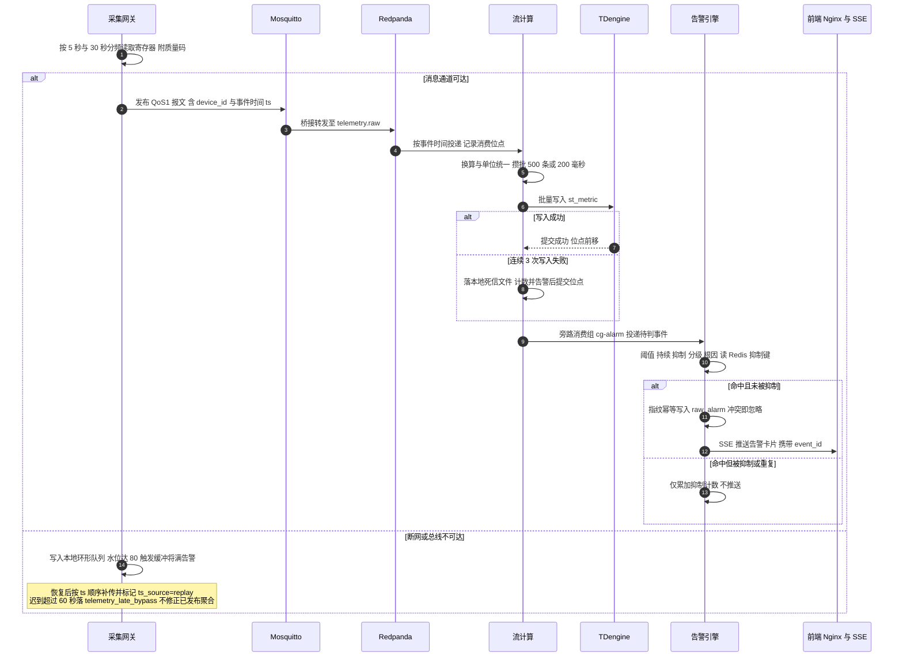
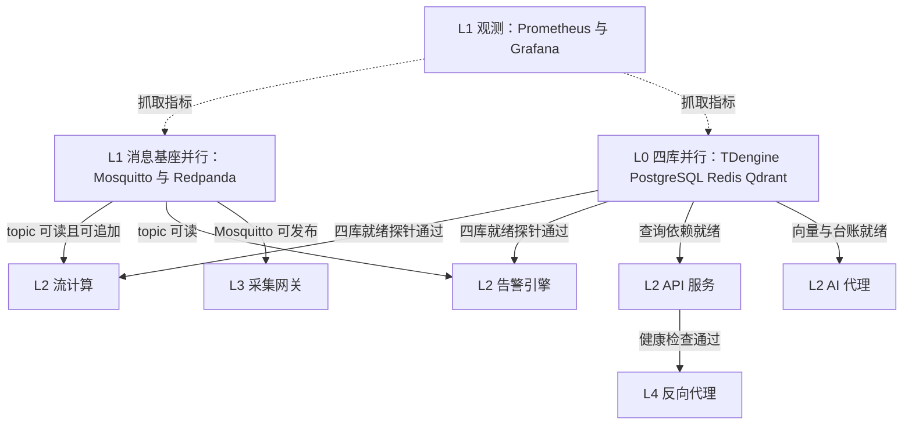

# 进程视图（Process View）

| 项 | 内容 |
|---|---|
| 文档编号 | CDCIM-P2-ARCH-05 |
| 版本 / 状态 | v0.1 · 草案（待评审） |
| 所属阶段 | P2 架构设计 |
| 论文价值 | ★★★★☆ 4+1 视图中的「进程视图」本体，承载「并发与线程模型」「部署架构」两个高频考点；核心素材是 §3「单分区决定并行度上限」的推导与 §7「判定链路不读时序库」的失效隔离结论，可直接改写为论文「并发设计」「高可用设计」两段 |
| 上游依据 | [架构风格候选方案对比](02-架构风格候选方案对比.md)（选定候选 C，14 个部署单元）、[组件映射表 v1](01-组件映射表-v1.md)（端口规划、内存预算、单分区 topic）、[数据架构设计](10-数据架构设计.md)（双路径写、窗口 60 s、幂等、批量写入）、[安全架构与等保对照](11-安全架构与等保对照.md)（fail-closed 分档、故障隔离）、[约束清单](../01-立项/06-约束清单.md)（C-01 / C-03 / C-07 / C-14）、[图表规范](../90-规范/02-图表规范.md) |
| 下游承接 | P3 详细设计的并发与线程池参数、P4 骨架部署的 healthcheck 与 restart 策略、P6 故障注入用例（按本文 §7 矩阵逐格构造）、P7 论文「并发设计」段 |

> **口径声明**：本文全部内存、时延、批大小、水位阈值为**设计目标或估算**，非实测；实测只在 P6 产生。凡引用上游数值，一律标注出处，不另行解释口径。
> **编号约定**：本文件承接架构阶段连续序号，图从 `FIG-ARCH-16` 起编、表从 `TAB-ARCH-106` 起编，避免与组件映射表（`TAB-ARCH-01 ~ 09`）、数据架构（`10 ~ 32`）、安全架构（`33 ~ 58`）已占用区段冲突。

---

## 1. 视图目的

逻辑视图回答「系统由哪些职责单元组成」，进程视图回答**这些单元在运行时如何共存**。具体是三个问题：

| # | 问题 | 本文的答案位置 | 不回答会出什么错 |
|---|---|---|---|
| P-1 | 哪些单元在同一进程、哪些跨进程？跨进程的边界是否等于失效域边界？ | §2 进程清单、§7 影响面矩阵 | 会写出「五个容器」却说不清「哪个容器挂了告警还在」——这正是 QA-AVAIL-04 的判据 |
| P-2 | 每条服务的并发靠什么实现：进程、线程、协程还是多 worker？同步阻塞点在哪？ | §3 并发模型 | 会用「多加几个 worker」掩盖单分区下的空转，或让一个同步数据库调用卡死整条事件循环 |
| P-3 | 峰值来了谁先扛不住、扛不住时往上游要什么？ | §6 背压链路 | 背压会变成「重启一下就好了」，而不是一条可观测的传导链 |

**本视图不回答**：包结构与类图（P3）、容器参数的具体镜像 tag（P4 部署文件）、告警规则的表达式语法（P3 接口契约）。这三项在进程视图里出现，只作为「影响并发的约束」被引用。

---

## 2. 部署单元与进程清单

**表 TAB-ARCH-106　14 个部署单元的进程模型**

| # | 单元（容器） | 进程模型 | 副本 | 内存上限（MB） | 启动层级 | 强依赖 |
|---|---|---|---|---|---|---|
| 1 | 采集网关 `cdcim-collector` | 单进程 1 worker，asyncio 事件循环 + 1 个有界线程池（4 线程，仅用于文件落盘与同步协议栈） | 1 | 256 | L3 | Mosquitto |
| 2 | MQTT 接入 `cdcim-mqtt` | 单进程多线程（libuv 线程池），自身不承载业务逻辑 | 1 | 64 | L1 | 无 |
| 3 | 事件总线 `cdcim-broker` | 单进程 Seastar，线程模型为 shard-per-core；原型以 `--mode dev-container` 限制为 1 core | 1 | 1152 | L1 | 无 |
| 4 | 流计算 `cdcim-stream` | 单进程 1 worker，asyncio 事件循环 + 有界线程池（4 线程，承载同步数据库驱动）；内含分析定时任务 | 1 | 384 | L2 | Redpanda、TDengine、Redis |
| 5 | 告警引擎 `cdcim-alarm` | 单进程 1 worker，asyncio 事件循环 + 规则执行线程池（2 线程） | 1 | 256 | L2 | Redpanda、PostgreSQL、Redis |
| 6 | 时序库 `cdcim-tsdb` | 单进程多线程（写线程组 + vnode 线程 + 查询线程池） | 1 | 640 | L0 | 无 |
| 7 | 关系库 `cdcim-pg` | 多进程（每连接一个 backend），连接池上限 20 | 1 | 320 | L0 | 无 |
| 8 | 缓存 `cdcim-cache` | 单进程单线程事件循环（7.x IO 线程默认关闭） | 1 | 160 | L0 | 无 |
| 9 | 向量库 `cdcim-vector` | 单进程 tokio 多线程 runtime | 1 | 256 | L0 | 无 |
| 10 | AI 代理 `cdcim-ai` | 单进程 1 worker，asyncio + 信号量限并发（8） | 1 | 128 | L2 | Qdrant、PostgreSQL |
| 11 | API 服务 `cdcim-api` | 单进程 1 worker（uvicorn），asyncio；SSE 长连接常驻协程 | 1 | 224 | L2 | PostgreSQL、TDengine、Redis |
| 12 | 反向代理 `cdcim-nginx` | master + 2 worker（epoll），无业务逻辑 | 1 | 96 | L4 | API 服务 |
| 13 | 指标 `cdcim-prom` | 单进程多 goroutine，拉模式 | 1 | 224 | L1 | 无（其余单元为被拉方） |
| 14 | 看板 `cdcim-grafana` | 单进程多 goroutine | 1 | 192 | L4 | Prometheus |

**内存上限合计 4 352 MB（≈4.25 GiB），估算工作集合计 3 504 MB（≈3.42 GiB）**，另需 Docker 与 WSL2 内核约 350 MB，总计 **3 854 MB（≈3.76 GiB），占 8 GB 配额的 47.0%，余量 4.24 GiB**——与[组件映射表 §4](01-组件映射表-v1.md)一致。上限之和大于估算之和是刻意的：上限用于「禁止单容器吃穿宿主」，不是预留，任一时点同时触顶的概率很低（四库与业务单元的峰值不同时到来）。

**三处口径需要先校准，否则后文数字对不上**（完整对照见 §8 表 TAB-ARCH-113）：

| # | 冲突点 | 上游写法 | 本文处理 |
|---|---|---|---|
| 1 | 中心侧业务单元数与容器数 | 架构风格文档 §3.3 与 §5.1 写「计算与告警合并为一个消费单元」，中心侧 4 个部署单元 | **以组件映射表为准**：`cdcim-stream`（8002）与 `cdcim-alarm`（8003）是两个容器；「合并」仅体现为同一消费单元族（共享告警链路与升级窗口），物理上不合并。中心侧 4 个业务容器 = 流计算、告警、API、AI；「分析」单元以定时任务形式**内嵌于流计算容器**，不单独成容器。总数仍为 14 |
| 2 | 内存合计 | 架构风格文档记 3.87 GB | 组件映射表记 3 854 MB。二者是**单位口径差**（3 854 MB = 3.854 GB 十进制 = 3.76 GiB 二进制），差额 0.4% 来自边端队列开销与取整，不构成数值冲突 |
| 3 | 边端内存 | 架构风格文档记 260 MB | 组件映射表记 220 MB（RSS 估算）。差额为边端本地队列的文件页缓存，不计入容器 RSS；本文在 §6 的队列水位中单独讨论，不重复计入内存预算 |

### 2.1 为什么副本数全是 1

C-03 规定单机部署，C-01 把内存压到 8 GB，两者叠加后「多副本」在本项目不成立：一个 Python 服务副本约 70 MB 固定开销，给告警引擎加一个副本等于再切走一个 Qdrant。因此可用性只能靠**「快速重启 + 位点续传 + 边端缓冲」**表达，而不是「副本冗余」。

这一点必须在论文中说明，否则「14 个容器但每样只有一个」会被读成设计缺陷。准确的表述是：**本系统用「状态外置」（窗口状态在 Redis、位点在 Redpanda、原始数据在边端队列）换取「进程无状态」，从而使单副本也能在崩溃后数十秒内（退避 5 ~ 20 s + 启动 10 s 内）恢复且不丢数据；副本冗余留到生产集群（§8 迁移清单）。**

---

## 3. 并发模型

### 3.1 一条总原则

**并发靠协程，隔离靠进程，并行靠消费组。**

- *靠协程*：单机内存受限，Python 每个进程 60 ~ 90 MB 的固定开销（解释器 + 依赖）是稀缺资源。asyncio 协程的栈开销在 KB 量级，用协程承载「等待 IO」的并发是唯一算术上成立的选择；
- *靠进程*：协程共享一个 GIL 与一个事件循环，一个未捕获的异常或一次同步阻塞会拖死整个循环。因此**不同失效域必须落在不同进程**——这是 §7 的物理基础；
- *靠消费组*：真正需要「并行走两条路」的地方是同一份事件被计算与判定同时消费，这由两个独立消费者组实现（`cg-compute`、`cg-alarm`），而不是由同一服务的多个副本实现。

### 3.2 逐服务的并发细节

**表 TAB-ARCH-107　各单元并发模型的同步阻塞点与异步边界**

| 单元 | 并发原语 | 同步阻塞点（必须隔离的地方） | 异步边界（不等结果的地方） | worker 数的判断依据 |
|---|---|---|---|---|
| 采集网关 | 1 事件循环；每设备 1 个轮询协程（2000 点约 300 设备）；1 个发布协程；1 个队列落盘协程 | 本地队列 `fsync` 与文件轮转（`asyncio.to_thread`，固定 1 线程，避免与协议栈争线程）；同步版 Modbus 客户端（改用 async 客户端后消除） | MQTT QoS1 发布不等业务确认，仅等 `PUBACK` 且超时 1 s；超时即转本地队列，不重试阻塞采集节拍 | **1**。多 worker 会让同一设备被两个进程同时轮询（需分布式锁），收益为零、代价是重复报文 |
| MQTT 接入 | 多线程（libuv） | 持久化落盘（配置为关闭持久会话，故无阻塞点） | 对生产者的 `PUBACK` 不等订阅者消费 | 不适用（中间件自有模型） |
| 事件总线 | Seastar shard-per-core | 段文件追加与刷盘（由 Seastar 自身异步化） | 生产者 `acks=1`（原型）不等全部副本 | 原型固定 1 core；提升 core 数是**生产迁移动作**（§8） |
| 流计算 | 1 事件循环；消费者协程 1 个；攒批写入协程 1 个；窗口推进定时协程 1 个；定时任务协程（日切、缺口扫描） | TDengine 同步驱动与 Redis 同步调用（收进 4 线程有界线程池）；聚合计算本身（400 点/秒下 < 5% CPU，不另开进程池） | 写库不等下游查询；窗口关闭与主路径**完全解耦**（双路径写，见数据架构 §3.5） | **1**。`telemetry.raw` 单分区，同组并行度上限为 1；开第 2 个 worker 只会争抢同一分区并被 rebalance 踢出 |
| 告警引擎 | 1 事件循环；消费者协程 1 个；规则执行线程池 2 线程（表达式树求值为纯 CPU） | PostgreSQL 幂等写入（同步驱动 → 线程池）；拓扑图遍历（内存内，< 1 ms，不隔离） | 通知投递不进判定路径（先落库后推送）；AI 建议任务异步投递 `ai.tasks` | **1**。`cg-alarm` 单分区消费；且判定必须与计算**分属不同进程**，否则风暴期共用事件循环（QA-PERF-06 失效） |
| API 服务 | 1 事件循环；每请求 1 协程；SSE 每连接 1 常驻协程 | 同步驱动回退路径（默认全 async：asyncpg / redis.asyncio / httpx，不落线程池） | 查询结果缓存 60 s 后异步刷新；SSE 推送不等前端确认 | **1**。多 worker 会让 SSE 广播跨进程（需 Redis pub/sub 转发），且值班终端并发 ≤ 10，多 worker 只增内存 |
| AI 代理 | 1 事件循环；`Semaphore(8)` 限并发；每任务 1 协程 | 无（HTTP 全 async，超时 10 s） | 全异步旁路，主链路从不 `await` 它 | **1**。并发上限 8 已在容器内约束，多 worker 会绕过上限 |
| 反向代理 | master + 2 epoll worker | 上游读超时 30 s | 静态资源与 SSE 分流 | **2**。SSE 长连接会占住 worker 连接槽，2 个 worker 提供基本冗余 |
| TDengine / PG / Redis / Qdrant | 各自原生模型（多线程 / 多进程 / 单线程 / tokio） | PG 每连接一 backend，连接池 20 即最多 20 进程 | Redis 单线程执行命令，不存在锁竞争 | 不适用 |

### 3.3 为什么是 asyncio + 多 worker 的「半个答案」

C-19 禁止引入 JDK 常驻组件，计算层只能是 Python；C-01 又把内存压到 8 GB。这两条约束把「用进程/线程换并行」的常规路径堵死了，剩下的可行解只有 asyncio。它的代价必须写明：

| 代价 | 具体表现 | 本项目的缓解 |
|---|---|---|
| GIL 使 CPU 并行度为 1 | 单进程内多线程无法并行做 CPU 密集计算 | 本项目没有 CPU 密集环节：400 点/秒的换算与窗口聚合 < 5% 单核；GPU 无关的向量检索在 Qdrant 侧 |
| 一次同步阻塞会拖死整条循环 | 同步数据库驱动一个慢查询（P99 300 ms）即可让 400 点/秒积压 | 强制「同步驱动必须进有界线程池」的编码规约；线程池满时**丢弃批次并计数**，不反压上游（与 SEC-V-05 一致） |
| 异常传播即整进程失效 | 未捕获异常导致事件循环退出，容器重启（约 5 ~ 10 s） | `restart: always` + 位点续传；边端在此窗口内继续缓冲，中心侧不丢数据 |
| 多 worker 在多处不可用 | 单分区消费、SSE 广播、协议连接持有三处都限制 worker = 1 | 已在表 TAB-ARCH-107 逐条给出判据——**不是「不想扩」，是「扩了无效或有害」** |

这条推导本身是论文的可用素材：**并发模型不是性能偏好，而是「内存约束 + 分区数 + 有状态连接」三者共同解出的唯一解。**

---

## 4. 消息流与数据流

一条遥测从采集到入库、再到告警推送到前端，完整时序如图 FIG-ARCH-16。选它作为本视图主图，是因为它同时包含主路径、旁路径与两条失败分支——**只看成功路径的时序图无法支撑「不丢数据」的论证**。

**图 FIG-ARCH-16　一条遥测的完整处理时序（含写失败与断网两条失败分支）**

图注：本图回答「一条数据在哪一步可能丢、丢了谁兜住」。三个要点：① 主路径与旁路径在 Redpanda 处分叉，窗口关闭（60 s）不在主路径上，故 P99 ≤ 2 s 不受影响（数据架构 §3.5）；② 写失败三次后**提交位点并继续消费**，死信文件可重放——这是「不阻塞」优先于「不丢」的一处主动取舍，代价是需一条补录任务；③ 断网分支的处置全在边端，中心侧在此期间不产生任何补偿动作，这正是候选 C 相比候选 B 的关键差异（QA-AVAIL-05）。

**三条失败路径的处置口径汇总**

| 失败点 | 判定依据 | 数据后果 | 补偿手段 | 是否消耗可用性预算 |
|---|---|---|---|---|
| MQTT/Broker 不可达 | 采集侧发布超时 1 s 或连接断开 | 数据进入边端环形队列（配额 150 MB，约 30 min @600 点/秒） | 恢复后按 `ts` 顺序补传，`ts_source=replay` | 是（QA-AVAIL-05 的 30 min 口径） |
| 时序库写失败 | 连续 3 次异常 | 当前批落死信文件，位点前移 | 每日 04:30 死信重放任务（幂等覆盖写） | 否（可查询性短暂缺失） |
| 告警落库失败 | 事务异常或唯一约束冲突 | 冲突 → 视为重复，静默丢弃；异常 → 重试 3 次后丢弃并计数 | 无（宁可漏一次推送，不可重复推送） | 是（按 fail-closed 分档，写操作优先一致） |

---

## 5. 启动与就绪顺序

启动顺序由**依赖的真实可服务时刻**决定，而不是由 compose 的书写顺序决定。`depends_on` 只能保证进程已起，不能保证端口可读写，因此每个 L0/L1 单元都必须带 `healthcheck`，上游用 `condition: service_healthy` 等待。

**图 FIG-ARCH-17　启动层级与就绪依赖**

图注：本图回答「谁必须等谁、哪些可并行」。实线为强依赖（箭头由被依赖方指向依赖方，即「前者就绪，后者才允许启动」）；虚线为观测关系，箭头方向即拉取方向，**不构成启动阻塞**，因此 Prometheus 可与任一层并行启动——它晚起只损失一段曲线，而早起的价值恰恰在于能记录别人的启动失败。五层不是五个串行阶段，同一层内全部并行。

**表 TAB-ARCH-108　启动层级与就绪判据**

| 层 | 单元 | 就绪判据（healthcheck 实际检查项） | 起始间隔 / 超时 / 重试 | `start_period` |
|---|---|---|---|---|
| L0 | TDengine | HTTP `/-/ping` 返回 200 且 `show databases` 含 `dcim` | 5 s / 3 s / 10 | 40 s |
| L0 | PostgreSQL | `pg_isready` 且目标 schema 的迁移版本号匹配 | 5 s / 3 s / 10 | 20 s |
| L0 | Redis | `PING` 返回 `PONG` 且 `maxmemory` 配置生效 | 5 s / 2 s / 10 | 10 s |
| L0 | Qdrant | `/readyz` 返回 200 且 `kb_docs` collection 存在 | 5 s / 3 s / 10 | 30 s |
| L1 | Mosquitto | `mosquitto_sub -t '$SYS/broker/uptime' -C 1` 有响应 | 5 s / 2 s / 10 | 10 s |
| L1 | Redpanda | `rpk cluster health` 报告 healthy 且三个 topic 均存在 | 5 s / 3 s / 15 | 40 s |
| L1 | Prometheus | `/-/healthy` | 15 s / 3 s / 5 | 20 s |
| L2 | 流计算 | `/healthz` 返回 200，且「最近一次成功写入的 `ingest_ts` 距当前 < 60 s」 | 10 s / 3 s / 6 | 30 s |
| L2 | 告警引擎 | `/healthz` 返回 200，且「规则版本号非空、Redis 可写、PG 可写」 | 10 s / 3 s / 6 | 30 s |
| L2 | API 服务 | `/healthz` 返回 200（只检查依赖可达，不做查询） | 10 s / 3 s / 6 | 20 s |
| L2 | AI 代理 | `/healthz` 恒返回 200，响应体内报告熔断状态与外发开关——**AI 不可用不得让服务变不健康** | 10 s / 3 s / 6 | 15 s |
| L3 | 采集网关 | `/healthz` 返回 200，且「MQTT 连接状态 + 队列水位」随响应体报告 | 10 s / 3 s / 6 | 20 s |
| L4 | Nginx | 反代 `/healthz` 经 API 返回 200 | 10 s / 3 s / 6 | 15 s |
| L4 | Grafana | `/api/health` 返回 200 | 15 s / 3 s / 5 | 20 s |

**三条判断规则**：

1. **必须等存储的单元**：流计算、告警、API、AI 四个业务单元——它们启动即会产生读写，仓促启动的后果是「健康但持续报错」，比启动失败更难排查；
2. **可以并行且不依赖任何单元的**：四个库、消息基座、Prometheus。观测单元应当**尽早**启动，否则故障恰好发生在启动期时没有任何曲线；
3. **唯一允许「依赖未就绪也报健康」的单元是 AI 代理**——它的职责是旁路增强，若因 Qdrant 未起而把容器标为 unhealthy，会被编排层反复重启，反而制造噪声。这条与安全架构的健康检查口径一致：**旁路的健康状态不能污染主链路的就绪判定。**

---

## 6. 资源竞争与背压

### 6.1 竞争点在哪

单机环境下，14 个单元竞争四类资源：CPU（10.0 份额，见物理视图 §6.2）、内存（8 GB 硬配额）、磁盘 IOPS（单盘，写入与查询共享）、网络（容器桥接，几乎不构成瓶颈）。真正的竞争集中在三处：

| 竞争点 | 争用方 | 冲突表现 | 处置 |
|---|---|---|---|
| 磁盘写带宽 | TDengine 追加写、PG WAL、Redpanda 段文件、死信与日志 | 峰值期写入延迟抬升，进而触发写重试 | 写入统一走「批量 + 顺序」，禁止随机小写；日志轮转独立目录 |
| 磁盘读带宽 | 大区间历史查询、重算任务、容器镜像层 | 查询 P95 劣化 | 大区间查询走降采样表（数据量降两个数量级）；重算限速单批 ≤ 5 000 行、固定 02:00 起跑、并发 1 |
| 消费位点推进 | 流计算与告警引擎共用同一 topic（不同组） | 两组 lag 不同步，一方积压不必然影响另一方 | 两组独立观测、独立告警；判定组 lag 优先级更高 |

### 6.2 背压链路

背压必须是**有观测点、有动作、有恢复条件**的链条，而不是「重启一下」。

**表 TAB-ARCH-109　背压链路：触发条件 → 上游动作**

| # | 触发条件（可观测） | 观测点 | 本级动作 | 上游动作 | 恢复条件 |
|---|---|---|---|---|---|
| B-1 | `cg-compute` lag > 5 000 条（≈12.5 s @400 点/秒） | 流计算 `/metrics` 暴露的 `consume_lag` | 攒批放大（500 → 2 000 条），降低写入次数 | 不改采集 | lag < 1 000 条持续 2 min |
| B-2 | `cg-compute` lag > 15 000 条（> 60 s） | 同上 | 对非关键测点抽稀（降采样率，保留 `critical_flag` 全量） | 采集侧按 FR-M1-08 降级，仅上报关键测点 | lag < 5 000 条 |
| B-3 | 边端队列水位 ≥ 80%（120 MB / 150 MB） | 采集网关 `/healthz` 响应体 | 提升压缩比（zstd）、`quality=Bad` 不再上传 | 无（边端即末梢） | 水位 < 50% |
| B-4 | 边端队列水位 ≥ 95% | 同上 | 按「非关键 → 最旧」顺序覆盖最旧数据，并记 `dropped_total` | 无 | 网络恢复排水后自动回落 |
| B-5 | 时序库连续 3 次写失败 | 流计算 `/metrics` 的 `write_fail_total` | 当前批落死信、位点前移、计数告警 | 不改上游（避免故障向上扩散） | 连续 10 批写入成功 |
| B-6 | Redis `evicted_keys > 0` | Redis INFO | 视为配置错误并告警（`allkeys-lru` 不应触发） | 无 | 人工确认 `maxmemory` 与键 TTL |
| B-7 | 容器内存达 limit（OOM kill 已发生） | Docker 事件 + `restart` 计数 | 该容器重启（5 ~ 10 s） | 告警引擎/流计算重启期间由边端缓冲承接 | `restart` 计数 30 min 内不再增长 |
| B-8 | PG 连接池用尽（20/20） | API `/metrics` 的 `pool_waiting` | 排队上限 8，超出直接 503（快速失败） | 无 | 排队下降至 0 |
| B-9 | AI 任务队列积压 > 100 或熔断打开 | AI `/metrics` | 丢弃新任务，不排队、不反压 | 无 | 熔断冷却 5 min 后恢复 |
| B-10 | 数据盘使用率 ≥ 70% / 80% / 90% | 磁盘水位 exporter | 按数据架构 §8.3 三档动作（预警 / 扩容 / 强制降级） | 无 | 扩容或归档后回落 |

**B-1 与 B-2 的分界为什么是 lag 而不是内存**：lag 是「消费速度落后于生产速度」的直接度量，内存只是它的滞后指标——等内存告警时已经丢了。同样，B-3 用「队列水位」而不是「磁盘剩余」，因为边端磁盘还承载镜像与日志，剩余空间不能代表队列健康度。

**一条不可越界的纪律**：背压只能向**上游**传导，且传导链最长两步（采集 → 边端队列）。任何一层的背压都不得反压到自己的下游——例如时序库写不动，不能让告警引擎跟着停：判定只读内存与 Redis，与时序库无关（§7）。

---

## 7. 故障隔离与重启策略

### 7.1 重启策略

**表 TAB-ARCH-110　容器重启策略**

| 单元类型 | 单元 | 策略 | 理由 |
|---|---|---|---|
| 有状态中间件 | TDengine、PostgreSQL、Redis、Redpanda | `unless-stopped` + `stop_grace_period: 30s` | 需要优雅停机以刷盘；`always` 会在人工停机后自动拉起，干扰演练 |
| 无状态业务 | 流计算、告警、API、AI、采集网关 | `always`，`restart` 退避 5 s / 10 s / 20 s | 依赖位点与边端队列兜底，重启即恢复；退避避免崩溃循环打满 CPU |
| 纯转发 | Nginx | `always` | 无状态 |
| 观测 | Prometheus、Grafana | `unless-stopped` | 掉线只损失曲线，不应干扰业务容器重启 |
| 一次性任务 | 备份、归档、重算、死信重放 | 不设 restart 策略，由宿主定时器（cron / systemd timer）拉起 | 任务级幂等，失败由下次触发补偿，不由编排层循环重试 |

> **口径提示**：一次性任务复用业务镜像的 `--job` 入口，由 `profiles: [jobs]` 拉起后退出，**不计入 14 个常驻单元**（与 ADR-0002 的 `--profile flink` 同一处理方式）。因此「14 个部署单元」指的是常驻容器数，不是「镜像数」，也不是「文件里出现过的服务条目数」。

### 7.2 故障影响面矩阵

**表 TAB-ARCH-111　单元故障的影响面（✔ 正常 · △ 降级 · ✘ 中断）**

| 崩溃单元 | 采集 | 入库 | 告警判定 | 告警推送 | 历史查询 | 是否命中告警主链路 | 关键说明 |
|---|---|---|---|---|---|---|---|
| 采集网关 | ✘ | △ | △ | ✔ | ✔ | **是** | 该边端覆盖的测点全部静默，无补偿；这是「采集是唯一数据源」的固有代价 |
| Mosquitto | △ | △ | △ | ✔ | ✔ | 是 | 采集侧转本地队列，恢复后补传；单点但重启约 3 s |
| Redpanda | △ | △ | ✘ | ✔ | ✔ | **是** | 边端缓冲兜住 30 min；判定在此窗口内不可用 |
| 流计算 | ✔ | ✘ | ✘ | ✔ | ✔ | **是** | 无窗口结果即无判定输入；采集与推送不受影响 |
| 告警引擎 | ✔ | ✔ | ✘ | ✘ | ✔ | **是** | 数据仍在入库，但判定与推送同时停——**最贵的单点** |
| TDengine | ✔ | ✘ | ✔ | ✔ | ✘ | 否 | 判定不读时序库，故告警仍可产生（写入死信待补） |
| PostgreSQL | ✔ | ✔ | ✘ | ✘ | △ | **是** | 幂等落库失败即无法推送（fail-closed 分档：写操作优先一致） |
| Redis | ✔ | ✔ | △ | △ | ✔ | 否（降级） | 抑制状态丢失 → 可能重复推送；下一周期自愈 |
| Qdrant | ✔ | ✔ | ✔ | ✔ | ✔ | 否 | AI 检索失败，建议降级为规则结果 |
| AI 代理 | ✔ | ✔ | ✔ | ✔ | ✔ | 否 | 旁路整层不可用，前端显示「AI 增强不可用」 |
| API 服务 | ✔ | ✔ | ✔ | ✘ | ✘ | 否（判定） | 推送通道断；前端重连后凭 `Last-Event-ID` 补推（见 7.3） |
| Nginx | ✔ | ✔ | ✔ | ✘ | ✘ | 否（判定） | 与 API 同因：入口不可达 |
| Prometheus | ✔ | ✔ | ✔ | ✔ | ✔ | 否 | 观测缺失，业务无感 |
| Grafana | ✔ | ✔ | ✔ | ✔ | ✔ | 否 | 同上 |

**两个必须说出口的结论**：

1. **判定链路不依赖时序库**。这是双路径写带来的额外收益：判定用的是 Redis 窗口状态与实时事件，历史查询才需要 TDengine。因此「时序库故障时告警仍能产生」不是巧合，是可设计的隔离。反例是 Lambda 类批流架构——判定若依赖批视图，时序库故障即同时失去判定能力。
2. **告警引擎是最贵的单点**。它同时承担判定与推送，崩溃即「数据在流、人不知道」。缓解手段只有三条：5 s 退避重启、规则与拓扑预加载（重启后不查库）、判定结果先落库后推送（重启后可从 `event_id` 续推）。**在单副本约束下，这已经是能给出的最强答复；真正的解法是生产环境的双副本 + 主备，属 §8 迁移内容。**

### 7.3 三处降级但不中断的设计

| 场景 | 机制 | 代价 |
|---|---|---|
| API 崩溃期间产生的告警 | SSE 携带单调 `event_id`；前端重连时带 `Last-Event-ID`，服务端从该 ID 之后补推（数据源为 PostgreSQL，非内存） | 补推需一次按时间范围查询，P99 约 200 ms；断连超过 5 min 改为只推摘要 |
| Redis 崩溃后的抑制 | 抑制键丢失 → 退化到「应用层最近 5 min 指纹集合」（进程内存，重启即失） | 极短时间内可能重复推送；不改变判定正确性 |
| AI 整层不可用 | `ai_suggest_*` 字段可空，前端按规则结果渲染；熔断状态存 Redis，进程重启不清零 | 建议质量下降，功能完整度不变（与安全架构 §7.5 一致） |

---

## 8. 定时任务

定时任务的归属原则是：**谁拥有数据，谁执行任务**。跨容器调度会引入分布式锁与时钟一致性两个新问题，而本项目只有一个写主体，没有必要。

**表 TAB-ARCH-112　定时任务清单**

| # | 任务 | 运行位置 | 周期 / 触发 | 幂等依据 | 失败处理 | 可观测指标 |
|---|---|---|---|---|---|---|
| J-1 | 1 min 窗口关闭与写入 | 流计算（常驻协程） | 每 60 s 检查双条件：`max_event_ts − 60 s ≥ window_end` 且 `wall_clock ≥ window_end + 60 s` | 覆盖写 + `agg_version + 1` | 下一轮自愈；连续 3 轮失败告警 | `window_closed_total`、`window_skipped_total` |
| J-2 | 5 min / 1 h 滚动汇总 | 流计算 | 由 J-1 触发级联（1m → 5m → 1h） | 同上 | 只重算受影响窗口及其祖先，不全表重算 | `rollup_lag_seconds` |
| J-3 | 日切能效指标 | 流计算 | 每日 00:10 | 整段覆盖 + `calc_version` | 重试 3 次；仍失败则次日 00:10 与人工补跑两条路 | `energy_job_result{status}` |
| J-4 | 降采样缺口扫描与补算 | 流计算 | 每 5 min 扫最近 2 h 的缺失窗口 | 按 `(point_id, window_start)` 定位，覆盖写 | 记缺口清单，下一轮再补；缺口 > 30 min 告警 | `agg_gap_count` |
| J-5 | 迟到旁路清理 | 流计算 | 每日 03:30 | `DROP PARTITION`（90 天前月分区） | 失败告警；不重试（下一日再删） | `late_bypass_rows` |
| J-6 | 审计链校验与链尾锚定 | 运维任务容器（复用业务镜像的 `--job` 入口，以 compose `profiles: [jobs]` 拉起，跑完即退；**一次性容器，不计入 14 个常驻单元**） | 每日 02:00 | 从最早未校验分区重算，锚定文件覆盖写 | 校验失败 → high 告警并中止归档 | `audit_chain_result`、`audit_anchor_hash` |
| J-7 | 归档导出（告警 / 审计 / 联动） | 同上（jobs profile） | 每日 03:00 扫描 `retention_until` | 导出文件带记录数与校验和，重跑覆盖同名文件 | 校验失败不删除；成功才 `DROP PARTITION` | `archive_rows_total` |
| J-8 | 全量备份 / 增量备份 | 宿主定时器（cron / systemd timer） | 每日 01:00 全量；每小时 :05 增量 | 备份清单含 SHA-256、行数、链尾哈希 | 失败重试 1 次并告警；不自动删除旧备份 | `backup_result`、`backup_duration` |
| J-9 | 拓扑与悬空引用巡检 | jobs profile | 每日 04:00 | 只读巡检，结果覆盖写 | 告警，不自动修复 | `dangling_ref_count` |
| J-10 | 死信重放 | jobs profile | 每日 04:30 | 按 `(device_id, point_id, ts)` 覆盖写 | 单条失败跳过并计失败数；> 1% 告警 | `dlq_replay_total{result}` |
| J-11 | 边端补传排水 | 采集网关（事件触发，非周期） | 网络恢复事件 | 按 `ts` 顺序 + `ts_source=replay`；同键以设备值为准 | 中断即停，下次恢复从队首继续（位点为文件偏移） | `buffer_backlog`、`replay_rate` |
| J-12 | 指标抓取 | Prometheus | 每 15 s，14 个 target | 拉模式无状态 | 单次失败留缺口，不影响业务 | `up{job}` |

**排期不重叠的理由**：01:00 全量备份会占满磁盘写带宽，02:00 审计校验是读密集，03:00 归档是读写混合，04:00 巡检是只读——四者错开一小时，避免单盘上互相拖累。这条看似琐碎的安排，在单盘环境里是必要的（数据架构 §7.2 已承认介质分离不成立）。

---

## 9. 待确认事项

| # | 待确认点 | 本文暂定 | 影响面 | 建议 |
|---|---|---|---|---|
| PQ-1 | **流计算与告警是否合并为一个容器** | 按组件映射表保持两个容器（中心侧 4 业务容器） | 合并可省约 180 MB 与一次序列化（约 20 ms），但判定与计算共享失效域，直接违反 QA-PERF-06「风暴下互不拖累」与 QA-AVAIL-04 | 建议维持两个。若 P5 压测显示总内存超 6.8 GB（NFR-SCALE-01 的 85% 阈值），按降级顺序先裁 Qdrant、再降 Grafana/Prometheus 保留期，**不优先合并这两个单元**——它们的分开是场景驱动的，不是风格驱动的 |
| PQ-2 | **API 的 uvicorn worker 数** | 1 worker（SSE 广播在进程内完成） | 改 2 worker 需引入 Redis pub/sub 转发 SSE，多约 40 MB 与一条订阅链；收益仅在「单 worker 被慢查询占满」时体现 | 建议保持 1 worker，并用「慢查询超时 5 s + 连接池排队上限 8」防占满。若 P6 实测单 worker 在 10 并发下 P95 > 300 ms，再评估；届时需同时评估 SSE 跨进程方案，不能只改 worker 数 |

---

## 考点映射

| 考纲知识点 | 本文件对应内容 | 论文可用位置 | 真题溯源 |
|---|---|---|---|
| **4+1 视图之进程视图** | 第 2 节 14 单元进程清单、第 4 节时序图、第 5 节启动顺序 | 论文「架构视图」段的进程视图小节；答辩时回答「运行时怎么跑」 | 论文题「论软件架构设计」类；案例题「架构视图」 |
| **并发与线程模型** | 第 3 节「协程 / 进程 / 消费组」三分法、表 TAB-ARCH-107 的同步阻塞点与异步边界、§3.3 的 asyncio 代价表 | 论文「并发设计」段的核心论据：为什么是 asyncio 而非多线程/多进程 | 案例题「系统性能优化」「高并发设计」 |
| **部署架构与容器编排** | 第 2 节副本数全为 1 的推导、第 7 节重启策略与退避、第 5 节健康检查分层 | 论文「部署设计」段；「云原生」段的编排能力与差距 | 论文题「论云原生架构」类；案例题「容器化部署」 |
| **高可用战术（故障隔离 / 被动冗余）** | 第 7 节影响面矩阵、§7.3 三处降级、表 TAB-ARCH-111 | 论文「高可用设计」段：失效域划分与「判定不依赖时序库」的隔离结论 | 案例题「高可用架构」；2023 上、2024 上 架构评估 |
| **背压与流量控制** | 第 6 节 10 条背压链路、B-1/B-2 的阈值分界论证 | 论文「性能设计」段的背压实例：为什么用 lag 而不是内存做触发条件 | 案例题「性能优化」；论文题「论系统性能优化」 |
| **定时任务与幂等** | 第 8 节 12 项任务、幂等依据列、排期错峰理由 | 论文「数据一致性」段：批任务的幂等与失败补偿 | 案例题「分布式系统设计」 |
| **资源约束驱动的设计** | §3.3 内存与进程数的权衡、§2.1 单副本的理由 | 论文「经验总结」段：约束如何解出唯一解，而不是靠偏好 | 评分要求「决策带理由与代价」 |

## 论文可引用段落

> **【适用题目类型】论软件架构设计（4+1 视图）/ 论系统的高并发与高可用设计 / 论云原生架构**

并发模型由约束解出，而非由偏好决定。八 GB 内存下每个 Python 进程有六七十兆固定开销，五个业务单元已占三百余兆；此时用多 worker 换并行，收益会被分区数抵消——遥测主题只有一个分区，同组并行度上限就是一，多开的进程只会空转。故并发放在协程层：采集网关用一个事件循环驱动全部设备轮询与发布，流计算用独立协程分别承担攒批写入与窗口推进，同步数据库驱动一律收进有界线程池，池满即丢弃批次并计数，绝不反压上游。真正需要并行的是计算与判定两个消费组，它们各持一个事件循环，故告警风暴时互不拖累。失效隔离同理：判定只读内存窗口与缓存、不读时序库，故时序库故障时告警仍可判定；最贵的单点是同时承担判定与推送的告警引擎，以规则预加载、快速重启与按事件编号续推缓解，真正的解法留给生产集群的双副本。

（约 300 字）

## 变更记录

| 版本 | 日期 | 变更 |
|---|---|---|
| v0.1 | 2026-11-27 | 初稿。含 14 个部署单元的进程模型清单（副本全为 1 的推导）、逐服务并发模型（同步阻塞点 / 异步边界 / worker 判据）、完整处理时序图（FIG-ARCH-16，含写失败与断网两条失败分支）、启动分层与就绪判据（FIG-ARCH-17、TAB-ARCH-108）、10 条背压链路、故障影响面矩阵与重启策略、12 项定时任务、与架构风格文档的三处口径校准、2 项待确认 |
