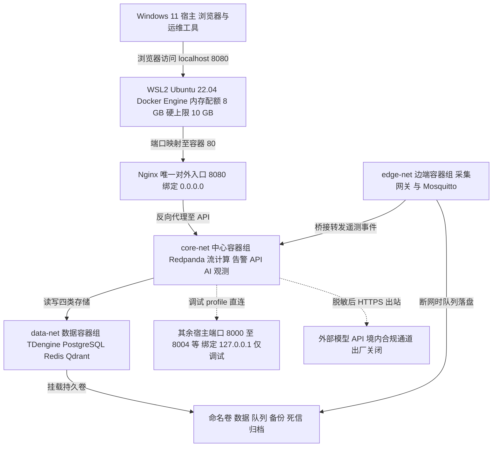
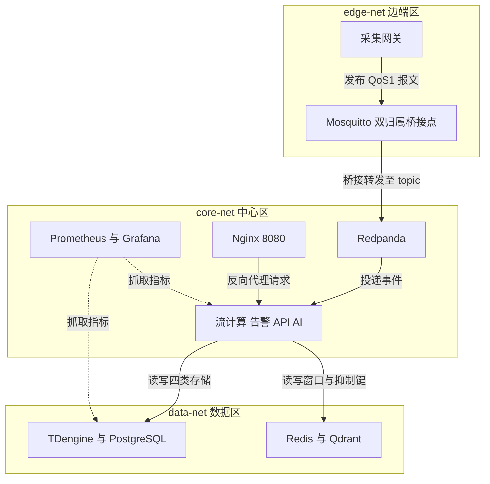

# 物理视图（Deployment View）

| 项 | 内容 |
|---|---|
| 文档编号 | CDCIM-P2-ARCH-06 |
| 版本 / 状态 | v0.1 · 草案（待评审） |
| 所属阶段 | P2 架构设计 |
| 论文价值 | ★★★★★ 4+1 视图中的「部署视图」本体，承载「部署架构」「容器编排」「可迁移性」三个考点；核心素材是 §4 三段网络分区的访问矩阵与 §8「九项迁移要素、五项不改」的判据，可直接改写为论文「部署设计」与「经验总结」两段 |
| 上游依据 | [进程视图](06-进程视图.md)（14 单元进程模型与启动层级）、[架构风格候选方案对比](02-架构风格候选方案对比.md)（选定候选 C 的部署形态）、[组件映射表 v1](01-组件映射表-v1.md)（端口规划表、内存预算明细）、[数据架构设计](10-数据架构设计.md)（容量与卷规划）、[安全架构与等保对照](11-安全架构与等保对照.md)（端口最小暴露、四分区）、[约束清单](../01-立项/06-约束清单.md)（C-01 / C-03 / C-04 / C-06 / C-07）、[图表规范](../90-规范/02-图表规范.md) |
| 下游承接 | P4 骨架部署的 compose 文件与 `.env` 模板、P6 端口扫描与故障注入用例、P7 论文「部署架构」段与「可迁移性」问答 |

> **口径声明**：全部内存、CPU、磁盘数字为**设计值或估算**，非实测；实测在 P4 以 `docker stats`、P6 以压测产生。凡与组件映射表不一致处，一律以组件映射表为准并在 §8 标注。
> **编号约定**：本文件承接架构阶段连续序号，表从 `TAB-ARCH-121` 起编、图从 `FIG-ARCH-18` 起编，与[进程视图](06-进程视图.md)（`FIG-ARCH-16/17`、`TAB-ARCH-106 ~ 113`）相接。

---

## 1. 视图目的

进程视图回答「谁和谁在同一进程」，物理视图回答**「这些进程放在哪、彼此怎么连、边界靠什么强制」**。三个具体问题：

| # | 问题 | 本文答案 | 不回答的后果 |
|---|---|---|---|
| P-1 | 14 个容器落在一台机器的什么位置？哪些端口对外、哪些只在容器网络内？ | §2 拓扑图、§3 端口映射表 | 「数据不出内网」会退化为一句口号——端口绑定才是它的物理形式 |
| P-2 | 边、中心、数据三段网络谁能访问谁？「断网」在单机上如何成为可执行的实验？ | §4 访问矩阵 | 边云协同的「失效域」无法被验证，只能靠文字辩解（这正是架构风格文档 R-1 的脆弱点） |
| P-3 | 8 GB 内存与单盘 75 GB 如何分给 14 个单元？换一台设备要改什么？迁到集群要改什么？ | §6 资源分配、§7 环境差异、§8 迁移清单 | 换设备即部署失败；「是不是微服务」的争论无法用事实回答 |

**本视图不回答**：容器内进程的并发模型（在进程视图）、镜像的分层与构建参数（P4）、Kubernetes 清单（不在本期范围）。文中出现的镜像 tag 均为**占位口径**，具体版本由 P4 锁定并写入依赖清单。

---

## 2. 物理部署拓扑

**一句话结论：一台 Windows 11 宿主机、一个 WSL2 实例、三段 Docker bridge 网络、14 个容器、1 个对外的 8080。**

**图 FIG-ARCH-18　单机物理部署拓扑**

图注：本图回答「东西放在哪、边界靠什么强制」。三个要点：① 只有一条实线穿出宿主（8080），其余端口映射全部落在 `127.0.0.1`，因此「端口最小暴露」是绑定地址的属性，不是文档里的承诺（C-07）；② `PRIV` 用虚线，表示调试 profile 才开启，默认编排不产生任何额外宿主端口；③ 通向外部模型的虚线出厂关闭，开关在 `.env`，与安全架构 §7.4 一致。图中 subgraph 未画出三段网络——网络分区单独成图（FIG-ARCH-19），因为「部署位置」与「访问关系」是两件事，合成一张会看不清。

**为什么边端在单机上仍要独立成容器**：物理上它与中心侧同宿主，「边云协同」的说服力完全依赖网络隔离手段。做法是把采集网关单独挂在 `edge-net`，与 `core-net` 之间只留 Mosquitto 一个双归属桥接点。这样 `docker network disconnect edge-net cdcim-collector` 就是一次**真实可执行的断网**，而不是「拔网线」的类比。代价是维护两个网络与一个双归属节点，收益是 QA-AVAIL-05 可以被演示而不只是被声明。

---

## 3. 容器清单与端口映射

**表 TAB-ARCH-121　14 个容器的镜像、端口、卷与内存上限**

| # | 单元 | 镜像（占位口径） | 宿主端口 | 绑定地址 | 数据卷 | 内存 limit | 依赖 |
|---|---|---|---|---|---|---|---|
| 1 | 采集网关 | `cdcim/collector-gateway:0.1`（python:3.11-slim 基座） | 8001 | `127.0.0.1` | `cdcim-collector-queue` | 256 MB | Mosquitto |
| 2 | MQTT 接入 | `eclipse-mosquitto:2.0` | 1883 / 9001 | `127.0.0.1`（原型由容器网络内的协议模拟器接入；接真实设备时改绑宿主局域网地址并叠加 Topic ACL） | `cdcim-mqtt-data` | 64 MB | 无 |
| 3 | 事件总线 | `redpandadata/redpanda:v24.2` | 9092 / 9644 / 8082 | `127.0.0.1` | `cdcim-broker-data` | 1152 MB | 无 |
| 4 | 流计算 | `cdcim/stream-compute:0.1` | 8002 | `127.0.0.1` | `cdcim-dlq`（只写） | 384 MB | Redpanda、TDengine、Redis |
| 5 | 告警引擎 | `cdcim/alarm-engine:0.1` | 8003 | `127.0.0.1` | 无（全走外部存储） | 256 MB | Redpanda、PostgreSQL、Redis |
| 6 | 时序库 | `tdengine/tdengine:3.3` | 6030 / 6041 | `127.0.0.1` | `cdcim-tsdb-data` | 640 MB | 无 |
| 7 | 关系库 | `postgres:16-alpine` | 5432 | `127.0.0.1` | `cdcim-pg-data` | 320 MB | 无 |
| 8 | 缓存 | `redis:7-alpine` | 6379 | `127.0.0.1` | `cdcim-cache-data` | 160 MB | 无 |
| 9 | 向量库 | `qdrant/qdrant:v1.12` | 6333 / 6334 | `127.0.0.1` | `cdcim-vector-data` | 256 MB | 无 |
| 10 | AI 代理 | `cdcim/ai-proxy:0.1` | 8004 | `127.0.0.1` | 无 | 128 MB | Qdrant、PostgreSQL |
| 11 | API 服务 | `cdcim/api-service:0.1` | 8000 | `127.0.0.1` | 无 | 224 MB | PostgreSQL、TDengine、Redis |
| 12 | 反向代理 | `nginx:1.27-alpine` | **8080** | **`0.0.0.0`** | `cdcim-nginx-cache`（可重建） | 96 MB | API 服务 |
| 13 | 指标 | `prom/prometheus:v2.54` | 9090 | `127.0.0.1` | `cdcim-prom-data` | 224 MB | 无 |
| 14 | 看板 | `grafana/grafana:11.2` | 3000 | `127.0.0.1` | `cdcim-grafana-data` | 192 MB | Prometheus |

**端口口径的三点说明**：

1. **只有 8080 绑 `0.0.0.0`**，其余全部 `127.0.0.1`。这是 C-07（Windows 浏览器经 localhost 访问）与安全架构 SEC-C-02 的同一条约束的两种表述——一处讲可用，一处讲安全，落地是同一行配置。
2. **5432 / 6379 / 6030 / 6333 / 8000 ~ 8004 等宿主映射默认关闭**，仅在 `compose.override.debug.yml` 中开启。组件映射表 §3 列出了这些端口，本文对其**收紧**（不取消端口号，只把默认值改为不映射）：单机同时装 PG 与 Redis 的开发机很常见，默认不映射可把宿主端口冲突面从 12 个降到 1 个（C-06）。这是口径收紧，不是冲突，已登记 §8。
3. **端口全部由 `.env` 驱动**，支持整体偏移。预案：若 8080 / 3000 / 9090 被占（开发机常见），改 `PORT_WEB=18082`、`PORT_GRAFANA=13000`、`PORT_PROM=19090`，只改一行、不改编排文件。

---

## 4. 网络分区

三段 bridge 网络，划分依据是**信任级别 + 访问方向**，而不是「按层分组」。判据是：**若这条连线不存在，系统是否仍然成立？** 若仍成立，说明它本来就不该存在。

**图 FIG-ARCH-19　三段网络分区与跨区流量**

图注：本图回答「谁能到谁、哪条线是唯一的」。**业务流量的跨区边只有四条**：采集→MQTT（区内）、MQTT→总线（双归属）、总线→业务（区内）、业务→数据（跨区）。**Mosquitto 是唯一双归属的业务节点**，因此它同时是边端的出口与断网的注入点——断开 `edge-net` 即可让边端与中心侧隔离，而中心侧内部链路完全不受影响。图中 `OBS` 横跨三段网络的虚线是观测面，不是业务流量（见下方「观测面的例外」）。

**表 TAB-ARCH-122　访问矩阵（✔ 允许 · ✘ 显式拒绝 · — 无关）**

| 源 → 目的 | 采集网关 | Mosquitto | Redpanda | 业务单元 | Nginx | 四库 | 外部模型 |
|---|---|---|---|---|---|---|---|
| 采集网关 | — | ✔（MQTT 发布） | **✘** | **✘** | ✘ | **✘** | ✘ |
| Mosquitto | ✘ | — | ✔（桥接生产） | ✘ | ✘ | ✘ | ✘ |
| Redpanda | ✘ | ✘ | — | ✔（投递） | ✘ | ✘ | ✘ |
| 业务单元 | ✘ | ✘ | ✔（仅流计算与告警消费） | 区内互调仅限 Nginx→API | — | ✔（分账号最小权限） | ✔（仅 AI 代理出站） |
| Nginx | ✘ | ✘ | ✘ | ✔（仅 API） | — | **✘** | ✘ |
| 四库 | ✘ | ✘ | ✘ | ✘ | ✘ | 互不直连 | ✘ |
| Prometheus | 拉取 `/metrics` | 拉取 | 拉取 | 拉取 | 拉取 | 拉取 | ✘ |

**四条拒绝是刻意的，各有理由**：

| 拒绝项 | 理由 | 若放开的后果 |
|---|---|---|
| 采集网关 ✘ Redpanda | 边端只能经 MQTT 出站，这是「边云契约唯一入口」的物理形式 | 边端可绕过契约直接写总线，双端契约版本失去约束力（风险 R-2 立即成立） |
| 采集网关 ✘ 四库 | 边端不持有全局视图，也不需要历史数据 | 边端成为数据区的第二个写主体，单一写主体约束（数据字典 §8）被破坏 |
| Nginx ✘ 四库 | 所有查询必须经 API 的鉴权与审计切面 | 绕过 RBAC 与审计直达数据库，等保「访问控制」「安全审计」两项同时失守 |
| 业务单元 ✘ 边端 | 中心侧不下发实时控制，本地联动由边端自治 | 「本地闭环不依赖中心决策」变成双向依赖，断网时边端反而被中心侧阻塞 |

**观测面的例外**：Prometheus 是唯一同时接入三段网络的单元，因为拉模式要求它能到达每个被观测容器的 `/metrics`。这不破坏分区纪律：① 它只有读权限，不产生任何写流量；② 它不上边端的业务链路，断开 `edge-net` 后只是丢失边端指标，采集仍按设计继续缓冲；③ 若评审要求更严格的隔离，可改为「每段网络放一个 Prometheus + 联邦汇总」，代价是多约 180 MB 内存——本期不采纳，登记为生产选项。

**方向性的诚实说明**：Docker bridge 的连通性是双向的，矩阵里的「✘」由应用实现保证（采集侧不配置任何指向 core/data 的客户端，防火墙只做兜底），而不是由网络设备强制。这意味着「拒绝」在当前环境里是**代码约束 + 可检测**，不是**物理不可达**。生产环境的 NetworkPolicy 才是强制手段，这一差距与安全架构 §1.3 的 G-05 同一性质。

**实现手段与强度**：原型用 Docker 自定义 bridge 上的「不接该网络」实现隔离（不接即不通），比 iptables 规则更可靠也更易读；生产替换为 VLAN + 防火墙策略 + NetworkPolicy。**必须承认的差距**：同一宿主的容器共享内核，网络隔离不防内核级横向移动；这一点在安全架构 §1.3 已列为 G-05/G-06，此处不重复辩解。

---

## 5. 存储卷与持久化

**表 TAB-ARCH-123　命名卷清单**

| # | 卷名 | 挂载点 | 内容 | 容量口径 | 可重建性 | 备份对象 |
|---|---|---|---|---|---|---|
| 1 | `cdcim-tsdb-data` | `/var/lib/taos` | 时序原始表与三级降采样表 | 180 天约 43 GB | **不可重建**（原始数据唯一副本） | 是（日增量 + 周全量） |
| 2 | `cdcim-pg-data` | `/var/lib/postgresql/data` | 台账、告警、规则、审计、用户 | 约 4.2 GB | **不可重建** | 是（日全量 + 小时增量） |
| 3 | `cdcim-collector-queue` | `/var/lib/collector/queue` | 边端环形队列（断网期间唯一副本） | 150 MB 配额 | **不可重建**（丢了就是丢了） | 否（运行时数据，靠补传排水后自然清空） |
| 4 | `cdcim-dlq` | `/var/lib/deadletter` | 写失败的死信批次文件 | ≤ 1 GB（超限告警） | 半可重建（可从边端重采） | 否 |
| 5 | `cdcim-broker-data` | `/var/lib/redpanda/data` | `telemetry.raw`（6 h）、`alarm.events`（24 h）、`ai.tasks`（1 h） | 约 1 GB | 半可重建（丢则 1 h 回放能力失效） | 否 |
| 6 | `cdcim-mqtt-data` | `/mosquitto/data` | 会话与 ACL 落盘（持久会话已关闭，仅留配置） | < 50 MB | 可重建（配置在 git） | 否 |
| 7 | `cdcim-vector-data` | `/qdrant/storage` | `kb_docs` 向量与 payload | 约 0.4 GB | 可重建（由 PG 的 `knowledge_item` 重嵌入，耗时约 30 min） | 否 |
| 8 | `cdcim-cache-data` | `/data` | Redis AOF（加速重启恢复） | ≤ 96 MB | 可重建（全部键可由库重建） | 否 |
| 9 | `cdcim-prom-data` | `/prometheus` | 指标时序（15 天） | 约 2 GB | 可重建（丢了只是没曲线） | 否 |
| 10 | `cdcim-grafana-data` | `/var/lib/grafana` | 看板定义与数据源配置 | < 100 MB | 可重建（看板 JSON 入 git，启动时 provisioning） | 否（以 git 为准） |
| 11 | `cdcim-nginx-cache` | `/var/cache/nginx` | 静态资源缓存 | < 200 MB | 可重建 | 否 |
| 12 | `cdcim-backup` | `/backup` | 备份产物与备份清单（含 SHA-256） | 约 5 GB 滚动 | **不可重建** | 是（再导出一份到 Windows 盘） |
| 13 | `cdcim-archive` | `/archive` | 告警/审计/联动归档导出文件 | 按年增长，约 2 GB/年 | **不可重建** | 是（异地一份） |

**三条持久化纪律**：

1. **不可重建的只有五个**：时序库、关系库、边端队列、备份、归档。其余八个卷丢了都能在 30 min 内重建——这条区分决定了备份对象清单，也决定了「哪些卷可以随便 `docker volume rm`」。
2. **备份不能和原卷同盘同宿主的唯一副本**。`cdcim-backup` 与 `cdcim-archive` 每日 01:30 之后由宿主脚本同步到 Windows 盘目录（C-04 要求两台设备同构，因此同步脚本不得写绝对路径，路径取自 `.env`）。单盘环境下「备份与原数据同盘」是必须承认的残余风险（安全架构 CE-09）。
3. **卷落在 WSL2 的 `ext4.vhdx` 内，不做绑定挂载**。理由：9p 文件系统（`/mnt/c`）的随机写性能约为 ext4 的十分之一，时序库直接落上去会拖垮写入。代价是 `vhdx` 只增不减，需季度执行一次压缩（`diskpart` / `Optimize-VHD`），并把「vhdx 实际占用」纳入 Prometheus 的磁盘水位观测——否则会出现「容器里看还剩 40 GB，宿主盘已满」的误判。

---

## 6. 单机资源分配

### 6.1 内存

**表 TAB-ARCH-124　8 GB 配额的逐单元分配**

| 单元 | 估算工作集（MB） | `mem_limit`（MB） | 上限/估算 | 说明 |
|---|---|---|---|---|
| 事件总线 | 1024 | 1152 | 1.13 | Seastar 预占，不可压缩（组件映射表 §4 标注为「否」） |
| 时序库 | 512 | 640 | 1.25 | 含 2 个 vgroup 的写缓存 |
| 流计算 | 300 | 384 | 1.28 | 含 4 线程池与攒批缓冲 |
| 关系库 | 256 | 320 | 1.25 | `shared_buffers` 64 MB + 20 连接 |
| 采集网关 | 220 | 256 | 1.16 | 含 150 MB 队列的文件页缓存不计入 RSS |
| 向量库 | 200 | 256 | 1.28 | int8 量化后约 38 MB 向量 + HNSW 图 |
| 告警引擎 | 200 | 256 | 1.28 | 规则与拓扑预加载常驻 |
| 指标 | 180 | 224 | 1.24 | 15 天本地存储，TSDB 块缓存 |
| API 服务 | 160 | 224 | 1.40 | 连接池与 SSE 连接缓冲 |
| 看板 | 140 | 192 | 1.37 | 查询缓存 |
| 缓存 | 128 | 160 | 1.25 | `maxmemory` 96 MB + 开销 |
| AI 代理 | 90 | 128 | 1.42 | 并发 8 的请求缓冲 |
| 反向代理 | 64 | 96 | 1.50 | 2 worker |
| MQTT 接入 | 30 | 64 | 2.13 | C 实现，本身就小；上限按最小可用值给 |
| **业务与中间件小计** | **3 504** | **4 352** | **1.24** | — |
| Docker + WSL2 内核 | 350 | —（不受 cgroup 约束） | — | 固定开销 |
| **合计** | **3 854（3.76 GiB）** | **4 702** | **1.22** | — |

**余量核算**

| 项 | 数值 | 占配额 |
|---|---|---|
| 估算工作集合计 | 3 854 MB | **47.0%** |
| 内存上限合计（含基础开销） | 4 702 MB | 57.4% |
| WSL2 软配额（`.wslconfig` `memory=8GB`） | 8 192 MB | 100% |
| 相对软配额余量 | **4 338 MB（4.24 GiB）** | 53.0%（按估算）／42.6%（按上限） |
| 硬上限（`memory=10GB` 备用） | 10 240 MB | — |

**上限之和为什么会超过估算 24%**：`mem_limit` 是「禁止越界」的天花板，不是预留。给每个容器留 1.2 ~ 1.5 倍余量，是为了让「批处理突发」「Qdrant 索引重建」「Prometheus 压缩」这类瞬时峰值不被 OOM kill 打断；而全容器同时触顶的概率极低——四库的峰值在启动与压缩期，业务单元的峰值在告警风暴期，两者不同时到来。**若真的同时触顶，总额 4.70 GB 仍在 8 GB 配额内**，这是上限设计的安全边界。

**余量的用途（与组件映射表 §4 一致）**：页缓存 1.5 ~ 2 GB（时序库与 PG 的实际读性能主要靠它）、突发峰值 0.5 GB、镜像构建 0.5 ~ 1 GB、碎片与内核 0.4 GB。

### 6.2 CPU

**表 TAB-ARCH-125　CPU 上限与相对份额**

| 单元 | `cpus` 上限 | `cpu_shares` | 依据 |
|---|---|---|---|
| 事件总线 | 2.0 | 1024 | Seastar 单核可跑，但压缩与段合并需突发核数 |
| 时序库 | 1.5 | 768 | 写入 400 点/秒 + 查询并发，压缩线程需额外核 |
| 关系库 | 1.0 | 512 | 20 连接，多为短事务 |
| 流计算 | 1.0 | 512 | 400 点/秒下实际占用 < 0.2 核，上限为风暴期与重算预留 |
| 采集网关 | 0.8 | 512 | 300 设备轮询，IO 等待为主 |
| 告警引擎 | 0.6 | 384 | 规则求值为 CPU 密集但量小 |
| API 服务 | 0.6 | 384 | 10 并发终端 |
| 向量库 | 0.5 | 256 | 检索 Top-5，5 万点规模 |
| 缓存 | 0.5 | 256 | 单线程，上限只是防抢占 |
| AI 代理 | 0.4 | 256 | IO 等待为主 |
| 反向代理 | 0.3 | 128 | 静态资源 + 反代 |
| 指标 | 0.3 | 128 | 15 s 抓取 14 个 target |
| 看板 | 0.3 | 128 | 按需查询 |
| MQTT 接入 | 0.2 | 128 | 200 连接 |
| **合计** | **10.0** | **5 376** | — |

**10.0 对 8 vCPU 是 1.25 倍超配，这是有意的**：`cpus` 是硬上限而非独占，只有被调度到时才占用物理核。超配成立的前提是「峰值不同时到来」——这条前提有据：写入峰值（设备批量上报）与查询峰值（值班交接时段）不同相位，重算任务固定在 02:00 低峰。**若 P6 压测发现超配导致长尾（P99 抖动），处理顺序是：先把事件总线降到 1.5、时序库降到 1.0，再动业务单元**——中间件的核数弹性大于业务单元，因为它们的主要瓶颈是磁盘而不是 CPU。

**宿主机最低配置**（C-04 要求两台设备同构）：x86_64 4 核 8 线程以上、物理内存 ≥ 16 GB（留给 Windows 与本机 Docker 之外的开销）、NVMe 可用空间 ≥ 100 GB（数据 75 GB + 镜像与临时 25 GB）。低于此配置时，`mem_limit` 需整体下调 20%，并按数据架构 §8.3 的降级顺序先裁 Qdrant。

---

## 7. 部署约束与环境差异

**表 TAB-ARCH-126　部署约束与环境差异**

| # | 约束/差异 | 具体要求 | 不满足时的表现 | 依据 |
|---|---|---|---|---|
| 1 | 两台设备同构 | WSL2 内核版本同 minor、Docker Engine 同 minor、时区均为 `Asia/Shanghai`、文件行尾 LF | 同一 compose 在一台能起、另一台健康检查超时 | C-04 |
| 2 | 禁止绝对路径 | 所有挂载用命名卷；确需宿主路径时取 `.env` 变量（如 `BACKUP_DIR`） | 「换机器就找不到卷」 | C-04 |
| 3 | 配置外置 | `.env` 提供 24 项：端口偏移、镜像仓库前缀、AI 外发开关、备份目录、数据根目录、各库口令引用（`secret://`） | 密钥进镜像，等保「密钥管理」失守 | C-13 / SEC-C-06 |
| 4 | 镜像加速 | 镜像仓库前缀集中在 `compose.images.yml` 一处，切换加速源只改一行 | 拉取超时，P4 起不来 | C-05 |
| 5 | 端口冲突预案 | 8080→18082、3000→13000、9090→19090 三档整体偏移；PG/Redis/TDengine/Qdrant 默认不映射宿主 | 与本机既有 MySQL/Redis 冲突 | C-06 |
| 6 | WSL2 内存配额 | `.wslconfig` 设 `memory=8GB`、`swap=2GB`、`processors=8` | 不设则默认取宿主一半，可能与 Windows 争抢 | C-01 |
| 7 | 磁盘预留 | 数据 75 GB（不是 50 GB），留备份与临时空间 | 第 5 个月即触 70% 预警线 | 数据架构 §8.4 |
| 8 | 时钟同步 | 容器内启用 NTP 客户端，偏差 ≤ 100 ms | 审计时间与事件时间漂移，等保 CE-03 与 SEC-N-02 失守 | C-08 |
| 9 | 镜像 tag 锁定 | 禁用 `latest`，全部固定 minor 版本，升级走变更流程 | 换机重建拉到新版本，行为漂移 | 可重复部署 |
| 10 | 资源上限显式声明 | 每个容器都写 `mem_limit` 与 `cpus`，不依赖默认值 | 单容器吃穿宿主，触发全局 OOM | C-01 / ADR-0002 |

**三处必须写进部署说明的「不做什么」**：

- **不用 Docker Desktop 的 WSL2 集成**，直接在 WSL2 内装 Docker Engine。理由：Desktop 在 Windows 侧多一层代理进程与 `vpnkit`，约 200 ~ 400 MB 内存开销在 8 GB 配额里是纯损失；代价是失去 Desktop 的 GUI 与端口转发的便利，需要手工在 `.wslconfig` 的 `[wsl2] localhostForwarding=true`（默认开启）下确认 `localhost:8080` 可通。此项列为待确认 PQ-1。
- **不做多宿主编排**。C-03 明确单机，引入 Swarm/K3s 只会增加 300 ~ 500 MB 内存与一套新的排障面。
- **不把数据卷放在 `/mnt/c`**。9p 协议随机写性能约为 ext4 的十分之一，时序库落上去的后果是写入超时与背压误触发。

---

## 8. 可迁移性

判断「这算不算微服务 / 能不能上生产」，有一个比定义更可操作的判据：**迁移到集群时，要不要改业务代码。** 表 TAB-ARCH-127 按九项要素逐条核对。

**表 TAB-ARCH-127　从单机容器到集群的迁移影响**

| # | 要素 | 是否需改 | 具体改动 | 依据 |
|---|---|---|---|---|
| 1 | 业务代码 | **不改** | 服务无状态，状态外置在 Redis / PostgreSQL；唯一本地状态是边端队列，属边端专属 | 进程视图 §2.1 |
| 2 | topic 命名与事件契约 | **不改** | Redpanda 与 Kafka 同协议族，分区与位点语义一致 | ADR-0002 §4.2 |
| 3 | 消费者组与位点语义 | **不改** | `group.id` 与 `offset` 语义相同；`cg-compute` / `cg-alarm` 直接沿用 | 组件映射表 §1.2 |
| 4 | 数据模型与幂等键 | **不改** | 无跨服务外键；幂等键在库层，与部署形态无关 | 数据架构 §6.2 |
| 5 | 端口语义与安全分区 | **不改** | 「仅入口对外、其余内网」的策略在 K8s 中由 Ingress + NetworkPolicy 表达，语义相同 | 安全架构 §3.2 |
| 6 | 部署描述 | **要改** | Compose → Deployment / Service / ConfigMap / Secret / Ingress；14 个单元对应 14 个工作负载 | 组件映射表 §6（列为高风险项） |
| 7 | 副本与一致性参数 | **要改** | 单副本 → 3 副本；`acks=1` → `acks=all`；RF=1 → RF=3；`cg-compute` 需扩分区数才能并行（单分区迁移后仍是 1 并行度） | 进程视图 §3.2 |
| 8 | 服务发现与配置 | **要改** | 容器名 DNS → K8s Service DNS；`.env` → ConfigMap + Secret（`secret://` 引用改为 Secret 挂载） | C-13 |
| 9 | 观测与流量治理 | **要改** | 日志 stdout 轮转 → Loki + Promtail；指标 → Prometheus 联邦或 Thanos；熔断 → 服务网格或保持应用内熔断 | 组件映射表 §1.7 |
| 10 | 存储 | **要改** | 命名卷 → PVC + StorageClass；时序库与关系库改为主备/集群形态 | 数据架构 §5 |
| 11 | 边端形态 | **要改** | 容器 → 工业网关或边缘节点；本地队列由容器卷改为工业级存储（掉电保护） | 架构风格 §6.3 |

**九项核心要素中五项不改**（业务代码、契约、位点、数据模型、安全语义），需改的全部落在「部署与运维层」。这就是「边界为真」的依据：**如果选的是分层单体，迁移时要把「模块间调用」改成「消息投递」、把进程内事务拆成最终一致——那是重写，不是迁移。**

**迁移的三个前置条件**（写清楚比写乐观更有用）：

| 条件 | 现状 | 迁移时必须先解决 |
|---|---|---|
| 单分区主题 | `telemetry.raw` 为单分区，消费并行度上限 1 | 扩到 6 ~ 12 分区（按机房或设备类型分键），否则 3 副本只是 1 个在干活 |
| SSE 广播 | 单进程内广播，无跨实例机制 | 引入 Redis pub/sub 或消息网关做跨实例分发 |
| 边端队列 | 容器卷 150 MB，靠宿主磁盘可靠性 | 工业级存储 + 掉电保护，否则「断网 30 min 不丢」在生产不可承诺 |

**表 TAB-ARCH-128　与上游文档的口径校准**

| # | 差异 | 上游写法 | 本文处理 |
|---|---|---|---|
| 1 | 宿主端口映射范围 | 组件映射表 §3 列出 5432 / 6379 / 6030 / 6041 / 6333 / 6334 / 8000 ~ 8004 | **收紧**：端口号不变，默认不映射宿主，仅调试 profile 开启；理由见 §3 说明 2。**不构成冲突** |
| 2 | 业务容器数 | 架构风格文档 §5.1 称「中心侧 4 个部署单元（计算与告警合并）」 | 以组件映射表为准：`cdcim-stream` 与 `cdcim-alarm` 为两个容器，中心侧 4 个业务容器 = 流计算 / 告警 / API / AI；「分析」以定时任务内嵌流计算容器。总数 14 不变（详见进程视图 §2 校准表） |
| 3 | 内存合计与余量占比 | 架构风格文档记 3.87 GB；组件映射表记 3 854 MB 占 47.0%、余量 4.24 GB 占 **51.7%** | 合计按组件映射表取 3 854 MB（= 3.76 GiB = 3.854 GB 十进制），差 0.4% 属取整与边端队列开销，**单位口径差而非数值冲突**；余量百分比**重算为 53.0%**——47.0% + 51.7% 不等于 100%，上游两项与其自身数值（3 854 MB / 4 338 MB / 8 192 MB）不自洽，本文以数值为准重算，并按文档规范标注 |
| 4 | 磁盘需求 | 数据字典 §7.2 记「50 GB 可满足 180 天」 | 本文按数据架构 §8.4 取 **75 GB 预留**（50 GB 在线 + 备份与临时）。两者是「装得下」与「能长期稳定运行」的区别，非矛盾 |
| 5 | 边端内存 | 架构风格文档记 260 MB | 组件映射表记 220 MB（RSS）；差额为队列文件页缓存，不计入容器 RSS，在 §5 卷容量中另行约束 |

---

## 9. 待确认事项

| # | 待确认点 | 本文暂定 | 影响面 | 建议 |
|---|---|---|---|---|
| PQ-1 | **WSL2 内直装 Docker Engine 还是用 Docker Desktop 的 WSL2 集成** | 直装 Engine（省 200 ~ 400 MB，无 `vpnkit` 代理层） | 内存余量、`localhost:8080` 转发是否开箱可用、两台设备的一致性 | 建议直装 Engine，并在 P4 于两台设备各验证一次「Windows 浏览器访问 `localhost:8080`」。若 `localhostForwarding` 在某台设备上不稳定，退化为「用 `wsl hostname -I` 的地址访问 + 防火墙放行」，此时 C-07 的表述需同步修改 |
| PQ-2 | **数据卷用命名卷还是绑定挂载到 Windows 盘** | 命名卷（ext4.vhdx 内，随机写性能约 9p 的 10 倍）+ 每日导出备份到 Windows 盘 | 备份便利性、vhdx 只增不减带来的季度压缩运维、跨设备数据迁移 | 建议维持命名卷。若后续需要「拔盘即迁移」，改为绑定挂载并接受写入性能下降；这一取舍在 P4 实测前不做定论，但**备份脚本必须现在就按「导出到宿主目录」设计**，否则将来切换成本更高 |

---

## 考点映射

| 考纲知识点 | 本文件对应内容 | 论文可用位置 | 真题溯源 |
|---|---|---|---|
| **4+1 视图之部署视图** | 第 2 节拓扑图（FIG-ARCH-18）、第 3 节 14 单元映射表 | 论文「架构视图」段的部署视图小节；答辩时回答「部署在哪、怎么连」 | 论文题「论软件架构设计」类；案例题「架构视图」 |
| **部署架构与网络分区** | 第 4 节三段网络、四条拒绝的理由、访问矩阵 | 论文「部署设计」段的核心：分区依据是「这条线不存在系统是否仍成立」 | 案例题「网络架构设计」；等保「安全区域边界」 |
| **容器编排与云原生** | 第 3 节端口与卷声明、第 7 节上限显式声明、§7「不做什么」三条 | 论文「云原生架构」段：Compose 的能力边界与 K8s 的差距 | 论文题「论云原生架构」类 |
| **端口最小暴露与安全边界** | §3 说明 1、§4 拒绝项「Nginx ✘ 四库」 | 论文「安全架构」段的边界战术实例（与安全架构文档互为印证） | 案例题「信息系统安全设计」 |
| **可迁移性 / 迁移判据** | 第 8 节 11 项清单（5 项不改 / 6 项要改）、三个前置条件 | 论文「经验总结」段的方法论：判断边界是否为真，看迁移要不要改业务代码 | 论文题「论微服务架构」；答辩高频追问 |
| **资源配额与容量规划** | §6.1 内存逐单元、§6.2 CPU 超配 1.25 倍的论证、§5 磁盘 75 GB | 论文「性能与容量」段的资源账：上限之和为何大于估算 | 案例题「系统容量规划」 |
| **诚实的技术边界** | §4 末段隔离强度差距、§5 纪律 2 的备份同盘风险、§8 三个前置条件 | 论文「不足与改进」段 | 评分红线「虚构情节」 |

## 论文可引用段落

> **【适用题目类型】论软件架构设计（4+1 视图）/ 论云原生架构 / 论信息系统部署方案**

部署视图要回答的不是用了几个容器，而是边界靠什么强制。全部容器运行在一台 Windows 宿主的 WSL2 实例内，共十四个单元，但只有一个端口对外：反向代理的八零八零绑全部网卡供浏览器访问，其余十三个端口连同四个数据库一律绑回环地址，调试时才按 profile 打开。这条规则同时满足两个看似无关的要求——宿主要能访问，中间件又不能暴露到网段。网络按信任级别切成边端、中心、数据三段，跨区通道仅四条，Mosquitto 是唯一的双归属节点；把采集网关单独挂在一个网络上，换来一个可执行的实验：断开它即是一次真实断网，边端继续缓冲，中心侧内部链路毫无影响，断网自治因此可被演示而不只是被声明。另四条拒绝连线各有理由，例如反向代理不得直连数据库，否则所有查询都能绕过鉴权与审计。资源按单元逐项配额，估算占四十七个百分点。迁移到集群时，业务代码、事件契约、位点语义、数据模型与安全语义五项不改，要改的全部落在部署与观测层——这才是边界为真的证据。

（约 300 字）

## 变更记录

| 版本 | 日期 | 变更 |
|---|---|---|
| v0.1 | 2026-11-27 | 初稿。含单机部署拓扑（FIG-ARCH-18）、14 容器端口与卷映射表（TAB-ARCH-121）、三段网络分区图与访问矩阵（FIG-ARCH-19、TAB-ARCH-122，含四条拒绝连线的理由）、13 个命名卷与可重建性分级、8 GB 内存逐单元分配与余量核算、CPU 上限与 1.25 倍超配论证、10 项部署约束与环境差异、11 项迁移影响清单与三个前置条件、与上游的五处口径校准、2 项待确认 |
