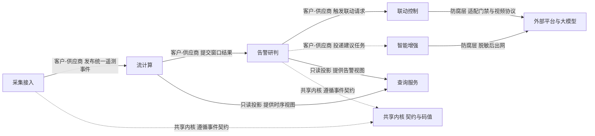

# 限界上下文与微服务拆分

| 项 | 内容 |
|---|---|
| 文档编号 | CDCIM-P2-ARCH-08 |
| 版本 / 状态 | v0.1 · 草案（待评审） |
| 所属阶段 | P2 架构设计 |
| 论文价值 | ★★★★★ 论文「微服务架构」「领域驱动设计」两题的**核心素材**：6 个限界上下文的识别依据、微服务四判据的逐条核对（含第 4 条为何不成立）、「为什么不做成 10+ 个服务」的量化反驳、无分布式事务下的三种一致性手段。§5 与 §5.3 可直接改写为论文「拆分依据」与「拆分粒度的取舍」两段；§9 是应对「你这是不是分布式单体」追问的正面回答 |
| 上游依据 | [逻辑视图](04-逻辑视图.md)（六上下文、22 逻辑组件、12 关键抽象、依赖规则）、[架构风格候选方案对比](02-架构风格候选方案对比.md)（选定候选 C、§6 微服务四判据、§3.5 人日口径）、[进程视图](06-进程视图.md)（14 部署单元、单分区导致并行度上限 1）、[物理视图](07-物理视图.md)（三网络分区、14 容器端口与内存）、[ATAM 架构权衡评估报告](03-ATAM架构权衡评估报告.md)（TP-08 计算告警合并、R-05 失效域耦合）、[需求规格说明书](../02-需求/02-需求规格说明书.md)（M1–M6 共 69 条 FR）、[数据字典初稿](../02-需求/08-数据字典初稿.md)（§8 数据血缘与单一写主体）、[开发视图](05-开发视图.md)（服务间零 import、共享库边界） |
| 下游承接 | P3 详细设计的上下文内聚合与领域服务划分、接口契约的边界归属、P5 骨架的单服务启动验证、P6 的「单服务打挂」故障注入用例、P7 论文「微服务架构」章 |

> **口径声明一（与已交付视图的关系）**：本文的拆分结论必须与逻辑视图（6 个上下文）、进程视图（14 个部署单元）、物理视图（3 段网络）完全一致。凡三份已交付视图已经定论的事项，本文**只解释、不改写**；发现的口径差异一律在 §6.3 与 §10 登记，不在正文中静默修正。
>
> **口径声明二（本文不写什么）**：本文不写类图、不写报文字段、不写内存参数的新取值。上下文内部的聚合根与实体划分属 P3；端口号、内存上限、副本数一律引用[物理视图 TAB-ARCH-121](07-物理视图.md)，本文只在映射表中转述，不另立数值。
>
> **口径声明三（团队边界判据不适用）**：本项目为**单人开发**（C-20，每周 3.5 人日），不存在多团队。康威定律所要求的「团队边界」判据在本项目中**不成立**，本文以「变更频率 + 责任人可归属」替代，并在 §2 第 4 条明确说明这一替代的理由与代价——**不虚构团队规模，是本文件可信度的前提**。

---

## 1. 文档目的

### 1.1 本文回答的四个问题

逻辑视图已经给出了「有 6 个上下文」这个结论，但没有回答**为什么是 6 个、为什么不是 4 个或 12 个**，也没有回答「拆开之后靠什么不散」。本文补的正是这一段推理：

| # | 问题 | 本文的产出 | 若答不上来的后果 |
|---|---|---|---|
| D-1 | 边界按什么判据划，每条判据违反了会怎样 | §2 六条拆分判据（TAB-ARCH-141） | 边界靠直觉维持，评审问一句「为什么不把通知也拆出去」即无法回答 |
| D-2 | 6 个上下文各自拥有什么、不做什么 | §3 逐上下文的职责、概念、数据、契约、**排除项**（TAB-ARCH-142 ~ 143） | 上下文变成「负责相关功能的模块」，「不做什么」无人声明，边界随需求漂移 |
| D-3 | 这算不算微服务，第四条判据不成立怎么办 | §5 四判据逐条核对（TAB-ARCH-145）与替代手段 | 论文被追问「你几个节点」即露底；或反过来把单机说成微服务而失实 |
| D-4 | 为什么不再拆细，凭什么说 6 个刚好 | §5.3 过度拆分的量化代价（TAB-ARCH-146） | 「拆得越细越微服务」的误解无法反驳，评审会认为拆得不够彻底 |

### 1.2 本文与相邻文档的分工

| 相邻文档 | 它回答的问题 | 本文与它的关系 |
|---|---|---|
| [逻辑视图](04-逻辑视图.md) | 分成几层、几个组件、谁依赖谁 | 本文**沿用**其六上下文与依赖规则，只补「判据」与「粒度」两层论证 |
| [架构风格候选方案对比](02-架构风格候选方案对比.md) | 四种风格选哪个 | 本文**细化**其 §6 的四判据核对，把「部分成立」展开为「哪一条不成立、用什么替代」 |
| [进程视图](06-进程视图.md) | 谁和谁在同一进程 | 本文给出「逻辑服务 → 容器」的映射，**冲突时以进程视图为准** |
| [物理视图](07-物理视图.md) | 放在哪、端口怎么绑 | 本文只转述端口与内存，**冲突时以物理视图为准** |
| [ATAM 报告](03-ATAM架构权衡评估报告.md) | 哪里是敏感点与权衡点 | 本文承接 TP-08（合并单元的失效域）与 R-05，把它从「风险」推进到「拆分结论」 |

---

## 2. 拆分原则

六条判据，每条都必须能回答「违反之后会出现什么可观测的坏结果」。只写「高内聚、低耦合」四个字的不叫判据，叫口号。

**表 TAB-ARCH-141　六条拆分判据、违反后果与本项目的取值**

| # | 判据 | 一句话定义 | 违反后会怎样（可观测） | 本项目的落地取值 |
|---|---|---|---|---|
| P-1 | **业务能力内聚** | 一个上下文能用一句不含「并且」的话说清职责 | 职责句里出现「并且」时，通常意味着两个变更原因被绑在一起：改 A 必须回归 B，且 B 的验收用例与 A 无关 | 6 个上下文的职责句均为单句（TAB-ARCH-142）；逻辑视图 22 个组件收敛为 6 个，收敛判据即此条 |
| P-2 | **数据所有权单一** | 每张表/每个键空间只有一个写主体，其他上下文只读 | 双写冲突，谁最后写谁赢，事后无法追溯；同一事实两个口径，联调时才暴露 | 数据字典 §8 的血缘表逐表指定写主体；**三处「所有权与写入通道分离」的例外已显式登记**（§3.4） |
| P-3 | **变更频率一致** | 同一上下文内的组件因同一类原因、以同一节奏变化 | 高频变更的部分绑住低频部分：改一次报表要重启采集进程，改一次提示词要重新回归告警判定 | 采集协议基本不变、聚合口径年变更 ≤ 2 次、规则年变更 ≤ 500 次（热加载）、界面按周迭代、模型按月变——五档频率对应六个上下文（联动与采集同属低频档） |
| P-4 | **团队边界**（**本项目不适用**） | 康威定律：系统边界应与人际沟通边界同构 | 若强行套用而团队只有一人，会得出「应该有 1 个服务」的荒谬结论，或反过来虚构 6 个团队为其背书 | **以「变更频率 + 责任人可归属」替代**：单人开发下，真实约束是「每周 3.5 人日能维护几个部署单元」，而不是「几个团队」。代价是失去了「边界自组织」这一收益，缓解手段是把契约写成可自动化检查的形式（契约测试、import 静态扫描） |
| P-5 | **事务边界** | 同一上下文内允许强一致（本地事务、唯一约束）；跨上下文只允许最终一致 | 跨上下文若要求强一致，就必须引入分布式事务或长事务锁表；本项目无此预算，且时序库根本不支持 | 6 个上下文两两之间**零分布式事务**；跨上下文一致性靠幂等键、事件携带状态、对账补偿三件套（§7） |
| P-6 | **契约可版本化** | 跨边界只经事件或显式接口，且契约能独立升版本 | 改字段靠「大家同时发版」维持，边端（升级滞后）必然被落下，补传数据被拒收 | `schema_version` 进消息头，边端兼容最近 2 版；共享内核只放契约、码值、错误码三样（§3.5） |

**六条判据的优先序**（冲突时谁让谁）：P-2 > P-5 > P-1 > P-3 > P-6 > P-4。理由是前两条一旦破坏会产生**静默的数据错误**（不报错、只是数慢慢偏），后四条破坏只产生**显性的维护成本**。本项目的实际取舍印证了这一顺序：为守住 P-2，宁可让台账的写入通道绕行到查询服务（§3.4 例外 1），也不让两个上下文同时拥有写权限。

**为什么不用「一个组件一个上下文」**：22 个逻辑组件若各自成上下文，会得到 22 个边界、21 条契约。判据 P-3 立刻否掉它——`规则判定器`、`降噪器`、`根因分析器`、`通知路由器` 四者的变更原因高度重合（都随「怎么判、怎么压、怎么通知」这三个业务口径变），拆开后每次调降噪策略都要同时改 4 个服务并回归 4 套用例。它们收敛为「告警研判」一个上下文，是 P-3 的直接结果。

---

## 3. 限界上下文识别

### 3.1 六个上下文的完整画像

**表 TAB-ARCH-142　六个限界上下文：职责、核心概念、不做什么**

| 上下文 | 职责（一句话，不含「并且」） | 核心领域概念（3–5 个） | **不做什么**（越界即视为设计缺陷） |
|---|---|---|---|
| **采集接入** | 把设备数据变成统一、可信、带质量码的事件 | 测点 Point、设备 Device、空间节点 SpaceNode、遥测样本 TelemetrySample、质量码 Quality | ① 不做阈值/持续/抑制等业务判定（属告警研判）；② 不做跨网同步调用中心侧接口；③ 不做长期存储与聚合；④ 不承担台账语义校验之外的人机鉴权 |
| **流计算** | 把原始流变成可信值与多级聚合 | 时间窗 Window、聚合版本 agg_version、迟到旁路 LateBypass、有效点数 valid_count | ① 不做告警判定（不读 `alarm_rule`，不写 `alarm_event`）；② 不做对外查询聚合与报表（属查询服务）；③ 不插值、不修正已发布聚合 |
| **告警研判** | 把数据变成判断（规则、抑制、聚类、根因、通知） | 告警规则 AlarmRule、原始告警 RawAlarm、告警事件 AlarmEvent、抑制键 SuppressionKey、元数据快照 MetadataSnapshot | ① 不下发任何设备控制；② 不反向要求采集侧重采（防正反馈，依赖规则第 6 条）；③ 不因通知失败而回滚告警状态；④ 不做 AI 推理（只投递建议任务） |
| **联动控制** | 在人工确认前提下调用门禁与视频，并把结果留痕 | 联动指令 LinkageCommand、确认与复核、幂等键 request_id、回读核对 | ① 无自动执行路径，`confirm_required` 恒为真；② 不回写告警状态（FR-M4-07）；③ 不提供空调/UPS 等运行参数调节（FR-M4-08）；④ 不接受 AI 输出作为控制入参 |
| **查询服务** | 对人提供聚合查询、鉴权、审计与报表 | 只读投影 Projection、审计链 AuditChain、RBAC 三角色、能效日指标 | ① 不持有业务写权限（台账与规则的写入只是**代理通道**，校验规则由属主提供）；② 只读访问业务表，除审计与权限两类自有表外不写任何表；③ 不做告警判定与联动决策 |
| **智能增强** | 旁路产出可空的建议，不进主链路 | 建议 Advice、证据引用 Evidence、脱敏规则、知识条目 KnowledgeItem、Provider 抽象 | ① 不参与任何告警判定；② 不写告警状态字段（只写 `ai_suggest_*` 四列）；③ 不设同步等待点（主链路任何环节不得 `await` 模型）；④ 结果必须可空 |

### 3.2 数据所有权与对外契约

**表 TAB-ARCH-143　六个上下文的数据所有权与对外契约**

| 上下文 | 自有数据（唯一写主体） | 对外契约（事件 + 接口） | 消费的上游契约 |
|---|---|---|---|
| 采集接入 | 台账四表 `device` / `point_def` / `space_node` / `topology_link`（**所有权**在此，写入通道见 §3.4 例外 1）、边缘环形队列 | 发布 `telemetry.raw`、发布 `meta.change`、开放采集计划只读接口、适配器 SPI | 无（它是数据源头） |
| 流计算 | `st_metric`、`st_metric_1m/_5m/_1h`、`telemetry_late_bypass`（**判定与落库方**：迟到的定义权归此，因只有它持有水位线） | 发布窗口结果事件、提供时序区间只读视图 | 消费 `telemetry.raw`、`meta.change` |
| 告警研判 | `raw_alarm`、`alarm_event`、`alarm_rule`（所有权；写入通道见 §3.4 例外 2）、Redis 抑制键 `cdcim:sup:*` | 发布 `alarm.events`、发布 `ai.tasks`、根因查询接口（同步，≤ 5 s） | 消费窗口结果、`meta.change` |
| 联动控制 | `linkage_record`、`ticket_link` | 联动请求/结果事件、确认/执行/回读接口（经防腐层调外部平台） | 消费 `alarm.events`（仅作触发，不回写） |
| 查询服务 | `audit_log`、`energy_metric_daily`、权限五表（`user_account` / `role` / `permission` / `user_role` / `role_permission`）、只读投影 | REST + OpenAPI 3.1、SSE 推送、报表导出 | 只读消费时序与告警视图 |
| 智能增强 | `knowledge_item`、`kb_docs`（Qdrant collection）、`alarm_event.ai_suggest_*` 四列、Redis `cdcim:ai:cache:*` | 建议任务消费、建议字段回写、检索接口 | 消费 `ai.tasks`、只读 `raw_alarm` / `alarm_event` |

**数据所有权与「写谁」的三条判定口径**（必须先讲清，否则表 143 与前文看似矛盾）：

1. **所有权 = 谁能定义这份数据的语义、生命周期与校验规则**；**写入通道 = 调用点从哪个进程发起**。两者可以分离，分离的目的是让「人机写入口只有一个」（鉴权与审计不必在六个服务里各实现一遍）。
2. **「迟到」的定义权不按数据来源分配，按「谁持有判定依据」分配**：迟到与否由「样本事件时间 vs 水位线」决定，水位线只在流计算进程内，因此 `telemetry_late_bypass` 的定义权与落库权同在流计算，采集接入不参与。若反过来按「数据来自采集」把定义权给它，边端就必须知道中心侧的水位线——那既不可能（断网时无水位线），也会产生两套迟到口径。
3. 审计是**唯一的多写主体表**：写入由统一审计切面在各服务内执行（只 INSERT），语义与表结构归查询服务。这不是破坏 P-2，因为审计的本质是「记录行为」而非「维护业务状态」，它的写主体天然是被审计方本身；若强行收敛到单一写服务，反而要在每个服务里多一次同步调用（§3.4 例外 3）。

### 3.3 为什么这六个而不是别的六个

三个反例，说明边界不是任意划的：

| 反例（曾考虑过的划法） | 为什么否决 | 触犯的判据 |
|---|---|---|
| 把「通知」拆成独立上下文 | 通知的变更原因（渠道、模板、升级节奏）与告警事件状态机强绑定：升级次数由 `alarm_event` 的确认状态驱动，拆开后通知服务要么反向读告警表（破坏 P-2），要么每条升级都回调查询接口（同步耦合，且失败即漏升级） | P-2、P-3 |
| 把「分析/报表」拆成独立上下文 | 与查询共用同一批只读视图与同一套聚合口径，变更频率同为「按周」；拆分后同一口径要在两处维护，且报表任务与交互查询分属两个进程后，「报表拖慢查询」这一原本不存在的耦合反而被制造出来 | P-1、P-3 |
| 把「规则判定」与「降噪」分开 | 二者共享同一个抑制键与同一个告警指纹，且判定顺序不可交换（先判后抑制）。拆开后要么共享 Redis 键空间（P-2 破坏），要么把窗口状态复制两份（数据一致性问题）。ATAM S2 已证明风暴期这两步必须在一个进程内完成才能守住 P99 ≤ 3 s | P-2、P-5 |

反之，**联动控制之所以独立成上下文**，恰恰因为它与告警研判在三件事上完全不同：数据所有权不同（`linkage_record`）、变更频率不同（对外平台协议一年内基本不变）、失效后果不同（联动不可用是「允许的失效」，告警不可用不是）。如果只按「联动由告警触发」就把它们合成一个上下文，会得出「告警的失败域应包含联动」的错误推论——而 FR-M4-07 要求的恰好相反。

### 3.4 三处被显式承认的例外

**边界若宣称「毫无例外」，通常是没人去核对。** 本设计有三处例外，逐条给出代价：

| # | 例外 | 事实 | 为什么不视为边界破坏 | 代价 |
|---|---|---|---|---|
| 1 | **台账四表的所有权与写入通道分离** | 语义归采集接入，写入统一经查询服务的管理端接口 | 人机写入口唯一，鉴权与审计只实现一次；若拆 asset-service，上下文数 6 → 7，多一个部署单元与一条契约，而台账年变更 ≤ 30 台设备 | 台账变更必须先经应用层；查询服务对台账只有**代理写权限**，校验规则必须由采集接入的 schema 提供（P3 需锁定，否则退化为任意写） |
| 2 | **告警规则的所有权与写入通道分离** | 语义（表达式白名单、版本、灰度范围）归告警研判，写入经查询服务的规则配置接口 | 与例外 1 同因：人机写入口唯一 | 规则热加载链路变成「接口 → 广播 → 引擎缓存」三段，生效时间预算（≤ 10 s）被切走一部分 |
| 3 | **审计的多写主体** | 各服务内的审计切面写 `audit_log`，语义归查询服务 | 审计记录的是「行为」，写主体天然是被审计方 | 表结构变更需通知全部服务；审计链的串行哈希在多进程下要保证顺序（安全架构已定为「按序成链」） |

> **数据字典 §8 的口径校准**：该表「写入方」列填的是 `api-service`，指的是**写入通道**，不是所有权。凡引用该表判断「谁拥有这份数据」时，须回到本文表 143。此差异属表述口径而非设计冲突，已在 §6.3 登记。

### 3.5 共享内核的边界（一句话，但必须写）

共享内核只有三样东西：**主题名与 schema、枚举码值（20 组）、错误码**。领域模型一律不进。理由是本项目最贵的一处耦合：内核是唯一「改一次要六个上下文同步升级」的地方，它的体积直接等于耦合度。若把 `AlarmEvent` 这个聚合放进内核，规则判定、降噪、通知、查询、AI 五方都会依赖它的字段，任何一次加字段都变成全量回归——而这正是「微服务拆了但没解耦」的典型形态。

---

## 4. 上下文映射图

**图 FIG-ARCH-20　六个限界上下文的映射关系与关系类型**

图注：本图回答「六个边界之间靠什么连接、连接处谁向谁负责」。实线为有契约义务的上下游（上游变更须升 `schema_version` 并回归下游），虚线为无同步等待的旁路或只读引用。四种关系类型的分布值得注意：**四条客户-供应商**（方向不可逆，下游不能自造数据）、**两条只读投影**（查询服务是纯读方，给它事件流会造成「为查一条曲线而消费全量流」的浪费）、**两条防腐层**（外部平台与大模型各自持有一层，互不复用适配代码——因为两者变更节奏与失败语义完全不同）、**一个最小化的共享内核**（只放契约与码值，不放领域模型）。图中未画「查询服务 → 外部」这条线，因为刻意不存在：前端与第三方都不允许绕过查询服务的鉴权与审计。

**四种关系类型在本项目的具体含义与代价**

**表 TAB-ARCH-144　关系类型的契约载体与耦合代价**

| 关系类型 | 出现处 | 契约载体 | 上游变更的代价 | 为什么必须用这一种 |
|---|---|---|---|---|
| 客户-供应商 | 采集→流计算、流计算→告警、告警→联动、告警→智能 | 主题 + JSON Schema（带 `schema_version`） | 升版本，边端兼容最近 2 版 | 数据形态由上游定义，下游无法自造；把方向反过来（下游要求上游改）就会形成双向依赖 |
| 只读投影 | 流计算→查询、告警→查询 | 只读视图 + 查询接口，字段只增不删 | 视图加列可不通知；删列须先停用 | 查询是纯读方，事件流对它是浪费 |
| 防腐层 | 联动→外部平台、智能→大模型 | 平台适配器 / Provider 抽象 | 只改适配器，不动领域 | 外部协议不可控（视频平台 GB/T 28181 与厂商 REST 尚未定，SRS Q-2），必须隔离 |
| 共享内核 | 采集/告警→契约与码值 | 主题名、schema、20 组枚举、错误码 | **全上下文同步升级** | 只在这一处接受「同步升级」，因为它换来的是「口径唯一」 |

---

## 5. 拆分粒度论证（核心章节）

### 5.1 微服务四判据的逐条核对

**表 TAB-ARCH-145　四判据的成立情况与替代手段**

| # | 判据 | 性质 | 是否成立 | 本项目的证据（可核） | 若不成立，用什么替代 |
|---|---|---|---|---|---|
| 1 | 按业务能力划分，边界与业务域对齐 | 逻辑 | **成立** | 6 个上下文各自对应 M1–M6 中的能力簇；变更频率相差两个数量级（采集协议一年内基本不变 vs 界面按周迭代） | — |
| 2 | 每个服务独立的数据存储，不共享表 | 逻辑 | **成立（含 3 处例外）** | 数据字典 §8 逐表指定唯一写主体；无跨服务外键；Redis 按前缀分键空间 | 例外见 §3.4；物理上仍共享 PostgreSQL 与 Redis **实例**（C-01 下的妥协），逻辑隔离成立、物理隔离不成立 |
| 3 | 服务间通过轻量机制通信，不共享内存 | 逻辑 | **成立** | 只有 Redpanda topic 与 REST 只读接口；服务间零 import（开发视图 §3 两条澄清）；无跨进程事务 | — |
| 4 | 可独立部署、独立伸缩 | 物理 | **独立部署成立，独立伸缩不成立** | 独立镜像、独立健康检查、`restart: always`、单容器重启不影响他者（进程视图 TAB-ARCH-111）；但 CPU 与内存总量固定，「多给告警一个副本」等于从 Qdrant 身上切走 256 MB | **以「独立重启 + 独立降级」替代伸缩**，见 §5.2 |

**一条补充判据（比第 4 条更可操作）**：迁移到集群时要不要重写业务代码。物理视图 TAB-ARCH-127 的 11 项核对中，业务代码、事件契约、位点语义、数据模型、安全语义**五项不改**，需改的全部落在部署与观测层。这是「边界为真」的硬证据——若选的是分层单体，迁移时要把模块间调用改成消息投递、把进程内事务拆成最终一致，那是重写。

### 5.2 第四条判据为什么必然不成立，以及替代手段为什么够用

**不成立的三重原因**，缺一不可：

1. **C-01（8 GB）**：每个 Python 服务有 60 ~ 90 MB 固定开销（解释器 + 依赖）。当前 5 个业务容器的工作集是 970 MB；若给告警加一个副本（+200 MB 工作集 / 256 MB 上限），就必须从 Qdrant（200 MB）或 Grafana + Prometheus（320 MB）身上切，等于用「告警双活」换掉「向量检索」或「观测」——两者都是已验收需求。
2. **C-03（单机）**：即使内存够，单机的 CPU 也只有 8 vCPU（已按 10.0 份额超配 1.25 倍）。副本不增加物理核，只增加调度竞争。
3. **单分区**（进程视图 §3.2）：`telemetry.raw` 为单分区，同一消费组的并行度上限为 1。**这一条最容易被忽略**——即使上集群、即使加 3 个副本，流计算与告警的有效并行度仍是 1，多出的副本只会被 rebalance 踢出而空转。因此「独立伸缩」在本架构里不是「暂时没做」，而是「做了也没有收益」。

**替代手段的三层，每一层都对应一条可测的验收判据**

| 替代手段 | 具体机制 | 覆盖了什么 | 验收判据 |
|---|---|---|---|
| **独立重启** | 每单元独立镜像 + `healthcheck` + `restart: always`，退避 5 / 10 / 20 s；位点续传 | 崩溃后自愈，且不牵连他者 | QA-AVAIL-01：`kill -9` 后自愈 ≤ 30 s、丢 0 条、人工干预 0 次 |
| **独立降级** | AI：熔断 + 结果可空；流计算：抽稀非关键测点；联动：失败只变卡片状态；查询：断流显示「数据延迟」标记 | 某能力不可用时，其余能力的承诺值不变 | QA-AVAIL-03（AI 整层下线，四项可用度 100%）、FR-M4-07（停视频平台，告警推送成功率 100%） |
| **独立消费组与位点** | `cg-compute` / `cg-alarm` 各自 lag 独立观测、独立告警 | 一方积压不必然拖累另一方 | 进程视图 B-1/B-2 的背压链只作用于本组 |

**必须说出口的一句话**：这三层替代的是「伸缩」与「冗余」，**不能替代「节点级容灾」**。宿主磁盘损坏、WSL2 崩溃这类故障，本架构没有答案，靠每日备份（RTO 以小时计）兜底。这一条属诚实边界，不在本文拔高。

### 5.3 反对过度拆分：为什么不做成 10+ 个服务

这是本文最需要给数字的一节。设想的「彻底微服务化」方案是：把 22 个逻辑组件按「一个组件一个服务」拆到 11 个业务服务（采集 / 接入网关 / 流计算 / 规则 / 降噪 / 根因 / 通知 / 联动 / 查询 / 脱敏 / 智能代理），容器数从 14 升到 20。

**表 TAB-ARCH-146　两种粒度的量化对比（估算口径，沿用候选对比 §3.5 的人日公式）**

| 维度 | 现状：6 上下文 / 5 业务容器 | 过度拆分：11 服务 / 11 业务容器 | 差额与解读 |
|---|---|---|---|
| 常驻容器数 | 14 | 20 | +6；日志分散点从 14 处变 20 处 |
| 业务容器工作集 | 970 MB | 约 1 420 MB（+6 × 75 MB 固定开销） | **+450 MB**，相当于「少一个 Qdrant + 一个 Grafana」 |
| 内存估算合计 | 3 854 MB（47.0% of 8 GB） | 约 4 300 MB（**52.5%**） | 余量从 4.24 GiB 降到 3.8 GiB；NFR-SCALE-01 的 85% 阈值余量被压缩一档 |
| `mem_limit` 之和 | 4 352 MB（业务与中间件） | 约 4 930 MB | 上限之和逼近 8 GB 的 60%，单容器触顶时的安全边界变薄 |
| 跨边界契约数 | 5（口径见候选对比 §3.5） | 10 | **+5**，每条按 2 人日计即 +10 人日 |
| 增量人日（同一公式 `4×单元 + 2×契约 + 6×部署形态`） | 42 | 76 | **+34 人日（+81%）**；按 C-20 的 3.5 人日/周，约 **+9.7 周**，即两个多月 |
| 告警链路跳数 | 4 跳（采集→总线→流→告警） | 7 跳（采集→接入→总线→流→规则→降噪→通知） | 每跳序列化 + 反序列化按 20 ~ 50 ms 估，判定 P99 预算被吃掉 **60 ~ 150 ms**（3 s 预算的 2% ~ 5%） |
| 单分区下的并行度 | 1 | 1 | **收益为零**：拆得再细，`telemetry.raw` 单分区仍只允许一个消费者并行 |
| L2 启动单元数 | 4 | 10 | 启动顺序与就绪判定的组合从 4 组变 10 组；排障时要逐跳确认「是哪一个没起来」 |
| 每次契约变更的影响面 | 6 个上下文 | 11 个服务 | 单人维护下，这是**认知成本**而非人力成本——它直接吃掉每周 3.5 人日里的回归时间 |

**结论的准确表述**：过度拆分的代价不是「多一点内存」，而是**用 450 MB 内存、34 人日、5 条契约，换一个在单分区下无法兑现的伸缩能力**。这笔交易在本项目的约束组合下不成立。反过来，若 C-01 放宽到 32 GB、C-03 允许 3 节点、且 `telemetry.raw` 扩到 12 分区，那么「把规则、降噪、根因拆开」会重新变得合理——**粒度的正确答案随约束变化，不存在普适的「拆到多细最好」**。这句话本身是论文可用的判断。

**一处必须同时承认的反向代价**：6 个上下文的粒度确实比「教科书微服务」粗。`告警研判` 内部承担了规则、抑制、聚类、根因、通知五件事，其内部耦合（共享抑制键与指纹）是真实的。粗粒度的代价是**单容器 OOM 会同时中断这五件事**——这正是 ATAM R-05 判定的「最贵的单点」。本设计接受这一代价，理由是：五件事的失败后果同为「告警停推」，它们之间没有「一个挂了另一个还能用」的业务语义；而真正需要隔离的是「告警 vs 流计算」（已分成两个容器，回答 QA-PERF-06）与「告警 vs 联动」（见 §6.3 的差异登记）。

---

## 6. 服务与部署单元的映射

### 6.1 逻辑服务 → 容器 → 端口 → 内存 → 副本

**表 TAB-ARCH-147　六个逻辑服务与 14 个部署单元的映射（数值转述自物理视图 TAB-ARCH-121，不另立口径）**

| # | 逻辑服务（上下文） | 承载容器 | 宿主端口 | 内存 limit | 副本 | 启动层级 | 网络分区 | 备注 |
|---|---|---|---|---|---|---|---|---|
| 1 | 采集接入 | `cdcim-collector`（含 `edge_agent` 装配） | 8001 | 256 MB | 1 | L3 | edge-net | 边缘环形队列挂 `cdcim-collector-queue`（150 MB 配额） |
| 2 | 流计算 | `cdcim-stream` | 8002 | 384 MB | 1 | L2 | core-net | 分析定时任务（巡检/能效）内嵌于此，不单独成容器 |
| 3 | 告警研判 | `cdcim-alarm` | 8003 | 256 MB | 1 | L2 | core-net | 规则、抑制、聚类、根因、通知五段同进程 |
| 4 | **联动控制** | **`cdcim-alarm`（同容器，独立代码目录 `linkage`、独立消费组、独立超时与降级）** | 8003（无独立端口） | **不额外占用** | 1 | L2 | core-net | **见 §6.3 差异 1**；逻辑边界成立，物理失效域未独立 |
| 5 | 查询服务 | `cdcim-api` | 8000 | 224 MB | 1 | L2 | core-net | 鉴权中间件 + 审计切面 + SSE + 报表任务 |
| 6 | 智能增强 | `cdcim-ai` | 8004 | 128 MB | 1 | L2 | core-net | 脱敏网关内嵌为强制前置模块（同进程 fail-closed，不单独成容器） |
| — | 边界与平台（不计入 6 服务） | `cdcim-mqtt` 64 / `cdcim-broker` 1152 / `cdcim-tsdb` 640 / `cdcim-pg` 320 / `cdcim-cache` 160 / `cdcim-vector` 256 / `cdcim-nginx` 96 / `cdcim-prom` 224 / `cdcim-grafana` 192 | 见物理视图 §3 | 合计 3 104 MB | 各 1 | L0/L1/L4 | edge/core/data | 9 个中间件与运维容器 |
| **合计** | **6 个逻辑服务** | **14 个常驻容器（5 业务 + 9 平台）** | **仅 8080 对外** | **4 352 MB** | **全为 1** | L0–L4 | 3 段 | — |

**三处映射关系需要读法说明**：

1. **服务数 ≠ 容器数**。6 个逻辑服务对应 5 个业务容器，因为联动控制与告警研判共享 `cdcim-alarm`。这与「6 个上下文」并不矛盾：上下文是**逻辑边界**，容器是**部署单元**，二者的对应关系可以是 1:1，也可以是 n:1（不能是 1:n——一个上下文拆到多个容器会失去单一写主体）。
2. **AI 并列独立**。智能增强占独立容器 `cdcim-ai`（128 MB，L2），理由是它可以整层下线（ADR-0003），且其依赖（Qdrant）与主链路无关。它的健康检查恒返回 200 并报告熔断状态——**旁路的健康状态不能污染主链路的就绪判定**（进程视图 §5 判断规则 3）。
3. **脱敏不单独成容器**。逻辑视图 #18 把脱敏网关列为独立逻辑组件，但它与智能代理是**强制串接**关系（fail-closed）：分进程会多一次跨进程调用，并多出一个「可能被绕过」的边界；同进程内以函数调用串接，「绕过」在类型上不可能发生。

### 6.2 与三份已交付视图的一致性核对

| 核对项 | 逻辑视图 | 进程视图 | 物理视图 | 本文 | 结论 |
|---|---|---|---|---|---|
| 上下文数 | 6 | — | — | 6 | 一致 |
| 部署单元数 | — | 14 | 14 | 14 | 一致 |
| 中心侧业务容器 | 「4 个中心单元」 | 4（流/告警/API/AI） | 4 | 4 | 一致（「分析」内嵌流计算） |
| 单分区导致并行度 1 | — | §3.2 明确 | §8 前置条件 | §5.2 引用 | 一致 |
| 联动是否独立容器 | **#14 列为新增 link-service** | 无 link 容器 | 无 link 容器 | 同容器 | **不一致，见 §6.3** |

### 6.3 差异登记（以已交付视图为准）

| # | 差异 | 逻辑视图的写法 | 进程/物理/开发视图的写法 | 本文处理（以已交付视图为准） |
|---|---|---|---|---|
| 1 | **联动控制的部署形态** | §3.2 差异 2：「联动必须有独立的失败域…挂在告警进程内无法证明这一点」，要求新增 `link-service` | 进程视图 14 单元中无 link 容器；物理视图 14 容器中无；开发视图 §3 澄清 1 明确「alarm 与 linkage 在同一个部署单元里，但代码目录分立、互不 import」 | **按同一容器处理**（§6.1 第 4 行）。逻辑边界保留（独立代码目录、独立消费组、独立超时与降级），**物理失效域未独立**。FR-M4-07 的「联动失败不影响告警」由「异步 + 独立消费组 + 独立超时」保证，而非进程隔离。这一让步登记为 §10 待确认 1。**附带一处口径**：开发视图 TAB-ARCH-98 的镜像清单含 `cdcim/linkage`（8 个镜像），属**构建产物**口径；**常驻容器**口径以物理视图的 14 个为准。两者不冲突：镜像可以多于容器（一个镜像可用于常驻容器与一次性任务），P4 落地时联动以同一镜像的独立入口随 `cdcim-alarm` 发布 |
| 2 | 数据字典「写入方」列的含义 | 逻辑视图 §4.4 例外 1 已声明「所有权与写入通道分离」 | 数据字典 §8 填 `api-service` | 表 143 同时给出「所有权」与「写入通道」，并在 §3.4 说明二者区别 |
| 3 | 智能增强的容器归属 | 逻辑视图列了脱敏、代理、知识库三个组件 | 物理视图只有 `cdcim-ai` 一个容器 + `cdcim-vector` | 三个逻辑组件映射到 1 个业务容器 + 1 个中间件容器（Qdrant），不另立 |

> **为什么差异 1 不是「将被修正的错误」**：省下的约 80 ~ 120 MB（一个 Python 单元）在 8 GB 配额里是实打实的余量，而它换走的是一项可测能力（进程级失效隔离）。ATAM TP-08 已判定这笔交易「取舍后代价超出预期」，但那一条针对的是「流计算与告警合并」——本文的合并不是同一个决定：流计算与告警分开（守 QA-PERF-06），联动与告警合并（因为两者失败语义同为「告警链路的附属能力失效」）。三条结论因此可以同时成立，但**必须在同一张资源账上记账**，不能各自为政。

---

## 7. 跨服务一致性策略

### 7.1 前提：本项目没有分布式事务，也不打算有

三条硬事实决定了这一点：① 时序库 TDengine 不支持跨库事务；② 跨上下文写入若包在一个事务里，会把「快链」（告警推送）绑在「慢链」（时序落库）上，直接违反 C-15；③ 边端与中心侧在断网时**根本不连通**，分布式事务在这种拓扑下无意义。

因此一致性只能靠三种手段组合，**每一种都对应一条可核的不变量**：

| 手段 | 解决什么 | 本项目的具体形式 | 不变量（必须恒真） |
|---|---|---|---|
| **幂等键** | 重复投递不产生重复结果（至少一次 → 效果上的恰好一次） | 时序 `(device_id, point_id, ts)` 覆盖写；原始告警 `hash(rule_id, device_id, point_id, window_start)` 唯一约束；联动 `request_id` 24 h 幂等；聚合 `(point_id, window_start)` 覆盖 + `agg_version + 1` | 同一幂等键重复到达，最终状态与只到达一次相同 |
| **事件携带状态**（事件溯源式） | 下游不需要回查上游就能算出正确结果 | 窗口结果事件携带 `valid_count / sample_count / agg_version`；告警事件携带 `raw_count / suppressed_count` 与完整状态机；边端补传携带原始 `ts` 与 `ts_source=replay` | 消费者只凭事件流 + 本地快照即可推进状态，**不发起同步回查** |
| **对账补偿** | 前两者都失效后的兜底与可发现性 | 日切条数比对（应有点数 vs 实有点数）；`raw_count` 与明细逐条比对；`J-4` 缺口扫描、`J-10` 死信重放、`J-9` 悬空引用巡检；联动超时「结果未知」后 30 s 回读核对 | 任何不一致必须在 **24 h 内被某条对账任务发现并留下记录**，不允许静默漂移 |

### 7.2 逐条数据流的一致性安排

**表 TAB-ARCH-148　跨上下文数据流 → 一致性手段 → 不一致时的可见后果**

| # | 跨上下文数据流 | 主要手段 | 辅助手段 | 不一致时的可见后果（可接受性） | 收敛时限 |
|---|---|---|---|---|---|
| 1 | 采集 → 流计算 → `st_metric` | 幂等键（时序三元组覆盖写） | 位点「写成功才提交」；死信重放 `J-10` | 重复消息被覆盖，**不可见**；若幂等键写错则条数虚高，**静默偏** | 即时（覆盖写）；日切对账兜底 |
| 2 | 流计算 → 告警（窗口结果） | 事件携带状态（窗口结果自带 `valid_count`） | 迟到 > 60 s 进旁路表，不修正已发布聚合 | 告警基于「当时的窗口」判定，事后重算不改历史告警——**这是刻意的**（判定不复算） | 不收敛（历史不改），由 `agg_version` 标注 |
| 3 | 告警 → 通知 / 前端 | 幂等键（`alarm_fingerprint` 唯一约束） | 状态机 9 条合法迁移拒绝非法跃迁；SSE 带 `Last-Event-ID` 补推 | 推送失败可补推；若状态被非法改写则拒绝并记审计 | 断连 ≤ 5 min 内补推；超时改推摘要 |
| 4 | 告警 → 联动 → 外部平台 | 幂等键（`request_id` + 防重放） | 超时 10 s 置「结果未知」→ 30 s 内回读核对；补偿动作「恢复原状态」 | 「告警已确认但门禁其实没开」这一状态**存在且可见**（卡片显示失败原因 + 独立生成联动失败告警） | ≤ 30 s（回读核对） |
| 5 | 智能 → `alarm_event.ai_suggest_*` | 事件携带状态（建议带版本号，防旧覆盖新） | 字段可空；AI 角色只有 4 列 UPDATE 权限 | 建议缺失、过期或为空，**均为合法状态**，前端按规则结果渲染 | 无要求（可空即正确） |
| 6 | 查询 → 时序/告警只读视图 | 不保证强一致（读投影） | 视图字段只增不删；断流显示「数据延迟」标记 | 查询结果可能滞后 ≤ 60 s（缓存 TTL），**必须在界面上标明**而非假装实时 | 60 s |
| 7 | 台账 `meta.change` → 各消费方 | 事件携带状态（版本号单调递增） | 快照过期继续用旧版，不阻塞、不回查库 | 允许 ≤ 30 s 版本差异；差异超过 30 s 由 `J-9` 巡检发现 | 30 s |
| 8 | 任意写操作 → `audit_log` | 无幂等键（**必须允许重复记录**） | 只追加 + `prev_hash` 链 + 每日锚定 | 审计多记无害，漏记即合规失守 | 即时；每日链校验 |

**三条读法**：

1. **能容忍「旧」的地方就不要追求「准」**：第 2 行（告警不复算历史聚合）与第 6 行（查询滞后 60 s）都是主动选择「旧但稳定」，代价写进了界面与报表口径。若强行追求「准」，就要引入重算回写，而重算风暴正是 ATAM R-11 的风险源。
2. **能容忍「重」的地方就不要追求「恰好一次」**：审计（第 8 行）宁可重复也不去重，因为「两次相同查询各记一条」本身是正确语义；时序（第 1 行）靠覆盖写实现「重也不出错」，比引入消息级去重便宜得多。
3. **「结果未知」是合法终态之前的一个显式状态**：第 4 行是全系统唯一需要「核对」的场景，因为门禁动作不可逆且外部平台可能已执行。把它显式建模（而不是靠重试掩盖），是本设计与「尽力而为的重试」的分界线。

---

## 8. 演进路径（单机 → 集群）

### 8.1 什么条件下才演进

不设「将来一定要上集群」这类无反例的目标。三个触发条件，任一成立才启动对应阶段：

| 触发条件 | 判据 | 说明 |
|---|---|---|
| T-1 | 生产环境立项（SRS §3.3 的 3 节点目标落地） | 与原型无关，是**环境变更**而非架构变更 |
| T-2 | 单节点内存 > 6.8 GB（NFR-SCALE-01 的 85% 阈值，按 4000 测点口径） | 先按降级顺序裁（Qdrant → Grafana/Prometheus 保留期），裁完仍不够才进阶段 1 |
| T-3 | 合规要求「告警数据与审计数据物理隔离」 | 直接进阶段 3 的拆库，可跳过阶段 2 |

### 8.2 三阶段演进表

**表 TAB-ARCH-149　三阶段演进：动作顺序、不动什么、代价**

| 阶段 | 名称 | 按顺序执行的动作 | **不动什么** | 代价 / 前置条件 |
|---|---|---|---|---|
| **阶段 1** | 集群化前置（不改边界） | ① `telemetry.raw` 扩到 6 ~ 12 分区（按机房或设备类型分键）；② `acks=1 → all`、RF=1 → 3；③ 四库迁独立节点，命名卷 → PVC；④ **联动拆为独立容器**（回到逻辑视图 #14 的原意）；⑤ 沿用现有 14 个单元的镜像与健康检查定义 | 业务代码、事件契约、位点语义、数据模型、幂等键（物理视图 TAB-ARCH-127 的五项） | ②③ 增加网络往返与磁盘占用；④ 需 +80 ~ 120 MB，从集群节点内存中支取（此时已不再是 8 GB 总上限）。**顺序不可颠倒**：先扩分区再加副本，否则 3 副本只有 1 个在干活 |
| **阶段 2** | 按上下文独立扩缩 | ① **先扩无状态读侧**：`cdcim-api` 2 ~ 3 副本 + Redis pub/sub 转发 SSE；② 再扩告警：主备或双副本，按分区消费；③ 流计算按分区数扩（分区是上限）；④ AI 独立节点池或独立命名空间（它的负载曲线与主链路无关） | 上下文边界与契约 | ① 引入 SSE 跨实例分发（当前为进程内广播）；② 告警双副本要求下游幂等仍然成立（已成立）；④ 多一套部署与配额 |
| **阶段 3** | 拆库（按「跨库 JOIN 少、被读方少」排序） | ① `audit_log`（只追加、无外键、被读方仅查询服务）；② `raw_alarm` / `alarm_event` / `alarm_rule`（单写主体、强一致域内聚）；③ 台账四表（**最后拆**，被 4 个上下文读，须先建只读投影或事件同步）；④ Redis 按上下文分实例；⑤ TDengine 与 Qdrant 已独立，只做主备 | 表结构、幂等键、字段语义 | ③ 是唯一有真实风险的拆库：拆完后「采集接入拥有、查询服务写入、四个上下文读取」的三角关系需要一次显式投影层，否则退化为四个上下文各自写缓存 |

**拆库顺序的判据只有一条**：**拆一个库的成本 ∝ 跨库 JOIN 数 × 被读方数量**。`audit_log` 两项都为 1（无 JOIN、只被查询服务读），成本最低；台账四表 JOIN 最多、被四个上下文读，成本最高。按成本递增排序，得到的顺序恰好也是「先易后难、每步都可独立回滚」的顺序——这不是巧合，而是同一个判据的两个侧面。

**一条反向的提醒**：阶段 3 的第 ② 步之后，`alarm_event` 与 `raw_alarm` 若分居两库，「关联告警展开」这个查询就变成跨库聚合。本项目的做法是**在告警研判上下文内部保持同库**（二者永远不拆开），因为它们的 JOIN 是高频且语义紧密的——**拆库的边界应当与上下文的边界重合，而不是更细**。上下文内部拆库，等于用基础设施手段破坏领域边界。

---

## 9. 反模式自查

**表 TAB-ARCH-150　六类反模式的逐条判定**

| # | 反模式 | 定义 | 本设计是否存在 | 判定依据 | 残余风险与处置 |
|---|---|---|---|---|---|
| 1 | **分布式单体** | 服务拆开了，但每次请求要同步穿过全部服务；改一处必须同时发布全部 | **否** | 告警判定链路**零同步外部调用**（不查设备、不查时序库、不调 AI）；主链路是「事件进、事件出」，无编排器；六个上下文可独立启动与独立回归 | 联动与告警同容器是**弱化点**（部署耦合），但无同步调用链，性质不同于分布式单体。处置见 §10 待确认 1 |
| 2 | **共享数据库** | 多个服务直接读写同一批表，schema 变更无法独立 | **部分存在（资源约束下的妥协）** | 物理上共用 1 个 PostgreSQL 实例与 1 个 Redis 实例；逻辑上按 schema / 前缀分权、账号级最小权限、单一写主体 | 真实风险：PG 故障会同时命中告警与查询（进程视图 TAB-ARCH-111 已标注「命中主链路」）。处置：阶段 3 拆库；在此之前靠「连接池上限 20 + 快速失败 503」限制放大 |
| 3 | **共享内核膨胀** | 公共库塞进领域模型，改一次全线回归 | **否** | 内核只有三样：主题名与 schema、20 组枚举、错误码；开发视图 §6.2 明文禁止领域模型进内核；`shared` 不得 import 任何服务包（CI 静态扫描） | 枚举仍是一处「改就全体同步」的点；处置：新增码值只追加不复用旧值，删除一律以 `disabled` 表达 |
| 4 | **隐式耦合：读方绑定上游 schema** | 查询服务通过只读视图直接依赖上游表结构 | **是（承认）** | 查询服务的「只读投影」是非共享内核的耦合，视图字段即上游 schema 的子集 | 缓解：视图字段**只增不删**；视图由上游上下文维护（属主负责），查询服务不得自行 ALTER；契约测试覆盖视图字段集合。若将来视图数超过 20 个，应改为由上游发布查询事件/物化视图 |
| 5 | **事件即 RPC**（贫血事件） | 事件只带 ID，消费方收到后回调上游查详情 | **基本否，一处例外** | 窗口结果事件自带 `valid_count`、告警事件自带完整状态与计数——消费方无需回查；**例外**是根因分析器提供的同步查询接口（≤ 5 s），它被 3D 定位调用 | 例外可控：该接口只读内存拓扑图，不触库；若将来根因改为异步，此例外消失 |
| 6 | **按技术分层拆分 / 一表一服务** | 出现 `notification-service`、`audit-service`、`device-service` 这类技术或表级服务 | **否** | 6 个上下文对应 M1–M6 的能力簇；23 张物理表（14 个逻辑实体）分布在 6 个上下文，无一表一服务 | — |

**自查的一条方法论**：反模式清单的价值不在于「全部判否」，而在于**第 2 条与第 4 条被判为「存在」**——如果一张自查表全是「否」，它大概率没有真查。本设计承认两处真实耦合（共享实例、只读视图绑定），并给出触发拆分/改造的条件，这比宣称「架构无耦合」可信。

---

## 10. 待确认事项

| # | 待确认点 | 本文暂定 | 备选 | 影响面 | 建议 |
|---|---|---|---|---|---|
| 1 | **联动控制是否拆为独立容器**（`link-service`） | 与 `cdcim-alarm` 同容器（依进程/物理/开发视图），逻辑边界靠独立代码目录 + 独立消费组 + 独立超时保证 | 拆出 `cdcim-link`（+80 ~ 120 MB，需从 Qdrant 或观测保留期借） | FR-M4-07 的验收方式（是否需要进程级证据）、14 → 15 个部署单元、与 ATAM TP-08/R-05 共用同一笔资源账 | 建议**暂不拆**，在 P6 用「杀联动协程 / 断外部平台」两级注入验证「告警推送成功率 100%」；若评审要求进程级证据，则在同一次资源裁决中与「流计算与告警是否合并」一并决定，避免两次各借一次内存 |
| 2 | **智能增强层的归属与边界**（**依赖 Q-4 结论**） | 独立上下文 + 独立容器 `cdcim-ai`；脱敏内嵌为强制前置 | 若 Q-4 否决外发：上下文保留、容器降级为「本地规则增强」，M6 中 9 条依赖外发的 FR 作废；或维持容器但仅保留关键词检索与模板 | M6 的 11 条 FR、`cdcim-ai` 的 128 MB 是否保留、ADR-0003 的适用性 | **本项结论以 Q-4 为准**（SRS §10，信息安全部书面确认「脱敏后可外发」）。须注意：**Q-4 改变的是上下文内部的能力集，不改变上下文边界**——边界由「建议不得进主链路」这条约束定义，与外发与否无关。拆分结论对 Q-4 两种结果均成立 |
| 3 | **台账与规则的「所有权 / 写入通道」分离是否在 P3 保持** | 保持分离（人机写入口唯一），查询服务仅持代理写权限，校验规则由属主提供 | 拆 `asset-service` 独占台账写权限（上下文 6 → 7） | 上下文数、审计与鉴权的实现处、NFR-MOD-03 的实现方式 | 建议保持。附带一项 P3 必须锁定：查询服务代写台账与规则时，校验规则以**属主发布的 schema** 为唯一来源，且与属主同版本发布，否则「代理写」会退化为「任意写」 |

---

## 考点映射

| 考纲知识点 | 本文件对应内容 | 论文可用位置 | 真题溯源 |
|---|---|---|---|
| **领域驱动设计（DDD）与限界上下文** | §3.1 六个上下文的职责句与核心概念、§3.3 三个反例（为什么不是别的六个）、§4 上下文映射的四种关系类型 | 论文「微服务架构」段或「领域驱动设计」段的**拆分依据主体**：先说判据，再说六个边界，最后说三个被否决的划法 | 论文题「论微服务架构」类（历年高频）、2024 下「论领域驱动设计」 |
| **上下文映射（Context Mapping）** | 图 FIG-ARCH-20、表 TAB-ARCH-144（客户-供应商 / 只读投影 / 防腐层 / 共享内核各自的契约载体与代价） | 论文「服务间通信」段：不是「用了消息队列」，而是「谁向谁负责、上游改了谁承担」 | 2023 下「论软件架构风格」、案例题「系统集成」 |
| **微服务的判据与拆分粒度** | §5.1 四判据逐条核对（TAB-ARCH-145）、§5.2 第四条不成立的三重原因与三层替代、§5.3 过度拆分的量化反驳（TAB-ARCH-146） | 论文「微服务架构」段的**核心论证**：先承认第四条不成立，再用数字说明为什么不再拆细——这是最容易被追问、也最能体现判断力的两处 | 论文题「论微服务架构」；答辩高频追问「你几个节点」「为什么不拆更细」 |
| **分布式一致性（无分布式事务）** | §7 三种手段（幂等键 / 事件携带状态 / 对账补偿）与 8 条数据流的逐条安排（TAB-ARCH-148） | 论文「数据一致性」段：不写「我们用了最终一致」，而写「哪条流用哪种手段、不一致时用户看到什么」 | 2022 下「论分布式系统设计」、案例题「分布式事务」 |
| **架构演进与可迁移性** | §8 三阶段演进表（TAB-ARCH-149）、拆库顺序判据（成本 ∝ 跨库 JOIN × 被读方数） | 论文「系统演化」或「经验总结」段：演进不是「将来上云」，而是「满足什么条件才动哪一步」 | 2023 上「论系统演化」、案例题「遗留系统改造」 |
| **反模式识别** | §9 六类反模式逐条判定，其中两条被判「存在」并给出触发改造的条件 | 论文「经验总结」段的方法论反思：自查表若全是「否」，说明没真查 | 评分要求「方案有反思、不虚构」 |
| **约束驱动的设计** | §2 P-4（团队边界判据不适用，以变更频率替代）、§5.2（C-01/C-03/单分区三重压制）、§5.3（450 MB / 34 人日 / 5 条契约） | 论文「架构决策」段：粒度不是偏好，是约束解出来的 | 评分要求「决策带理由与代价」 |

---

## 论文可引用段落

> **【适用题目类型】论微服务架构 / 论领域驱动设计 / 论分布式系统设计**

微服务的拆分不能从「拆得越细越彻底」出发，而要从判据出发。我用了五条：业务能力内聚、数据所有权单一、变更频率一致、事务边界、契约可版本化；团队边界一项在单人开发下不适用，以变更频率替代。前两条优先，因为它们被破坏后产生的是静默的数据错误。据此把二十二个逻辑组件收敛为六个上下文；三个被否决的划法各有原因，例如拆出通知服务会让升级次数反过来依赖告警状态机。四条通行判据中前三条成立，第四条独立伸缩不成立：八 GB 内存下每个进程有六十兆固定开销、单机只有八个核、遥测主题单分区使并行度上限为一，加副本只会空转。我因此以独立重启与独立降级替代伸缩。我也论证了为何不做成十一个服务：多四百五十兆内存、三十四人日、五条契约，换一个兑现不了的伸缩能力。粒度没有普适答案，它随约束变化。

（约 340 字）

---

## 变更记录

| 版本 | 日期 | 变更 |
|---|---|---|
| v0.1 | 2026-11-27 | 初稿。含六条拆分判据及其违反后果（TAB-ARCH-141）、六个限界上下文的职责/概念/排除项与数据所有权/契约（TAB-ARCH-142 / 143）、三处「所有权与写入通道分离」的例外、上下文映射图与四种关系类型（FIG-ARCH-20 / TAB-ARCH-144）、微服务四判据逐条核对与第四条不成立的三重原因及三层替代（TAB-ARCH-145）、过度拆分的量化反驳（TAB-ARCH-146，6 上下文 vs 11 服务：+6 容器 / +450 MB / +34 人日 / +5 契约 / 并行度不变）、服务与 14 部署单元的映射及三处口径差异登记（TAB-ARCH-147）、跨服务一致性三手段与 8 条数据流安排（TAB-ARCH-148）、三阶段演进路径与拆库顺序判据（TAB-ARCH-149）、六类反模式自查（TAB-ARCH-150，其中两条判「存在」）、3 项待确认（含 AI 层归属依赖 Q-4） |
