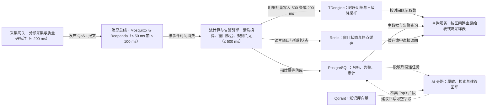

# 数据架构设计（Data Architecture）

| 项 | 内容 |
|---|---|
| 文档编号 | CDCIM-P2-ARCH-09 |
| 版本 / 状态 | v0.1 · 草案（待评审） |
| 所属阶段 | P2 架构设计 |
| 论文价值 | ★★★★★ 「数据架构」「大数据处理」两道论文题的核心素材：处理架构选型（Lambda / Kappa / 简化流式）、四类存储分工、数据分层、分区与生命周期、一致性口径，均有可直接引用的决策与代价 |
| 上游依据 | [需求规格说明书 §6 数据需求](../02-需求/02-需求规格说明书.md)、[数据字典初稿](../02-需求/08-数据字典初稿.md)（14 逻辑实体 / 23 张物理表 / 382 字段）、[质量属性场景表](../02-需求/03-质量属性场景表.md)（QA-PERF-01/02/05、QA-AVAIL-02/05、QA-SCALE-01）、[组件映射表 v1](01-组件映射表-v1.md)、[ADR-0002 原型技术栈](../09-决策/ADR-0002-原型技术栈-A档精简真栈.md) |
| 下游承接 | P3 详细设计（DDL、索引语句、分区脚本）、P5 实现（消费者与聚合任务）、P6 性能测试（容量与留存验证）、P7 论文「数据架构」章节 |

> **口径声明**：本文全部时延、吞吐、容量数字均为**设计目标**或**估算**，非实测；实测只在 P6 产生。文中 `P99 ≤ 2 s` 一类写法均指验收门槛，不表示已达成。
>
> **与数据字典的关系**：实体名、字段数、容量基数、键空间模式一律引用[数据字典](../02-需求/08-数据字典初稿.md)，本文不另立口径。凡本文与上游文档出现数值冲突，**以数据字典为准并在正文标注**（见 §5.1、§8.4）；冲突不改变业务口径，只影响物理参数。
>
> **编号约定**：图与表沿用架构阶段连续序号，本文件从 `10` 起编（`FIG-ARCH-10`、`TAB-ARCH-10`），避免与[组件映射表](01-组件映射表-v1.md)已占用的 `01` 段冲突。

---

## 1. 文档目的与范围

### 1.1 目的

数据字典回答「每个字段叫什么、多长、取什么值」，本文回答**剩下的五个问题**——这些问题不解决，字典再准确也无法落地：

1. **走哪条处理路径**：实时、准实时、离线重算各自在哪一层完成，用什么组件，为什么不用另一个（§3）；
2. **数据放在哪一层**：同一条测点数据在贴源、明细、汇总、应用四层各以什么形态存在，保留多久（§4）；
3. **四类存储的物理模型怎么定**：超级表与子表、TAG、分区、键空间、collection 参数，每项都要给出「为什么这样选」与「代价是什么」（§5）；
4. **一致性怎么收敛**：至少一次投递下如何做到效果上恰好一次，乱序与水位线如何处置，降采样何时触发（§6）；
5. **数据会老去**：热温冷如何迁移、何时归档、何时删除，容量何时需要扩容（§7、§8）。

### 1.2 范围

| 本文覆盖 | 本文不覆盖 |
|---|---|
| 处理架构选型与批层定位 | 具体 `CREATE TABLE` 语句、索引 DDL（P3） |
| 数据四层划分与层间映射 | 接口报文结构（P3 接口契约） |
| 四类存储的物理模型参数（分区、TAG、TTL、HNSW 参数） | 容器编排与部署拓扑（P4） |
| 端到端时延分解与一致性机制 | 实测吞吐与压缩比（P6） |
| 容量三档与扩容判据 | 采购与硬件选型（超范围） |

### 1.3 三个不写

- **不写 DDL**：本文只给「分区键、索引类型、唯一约束的语义」，语法留给 P3；
- **不写实测值**：压缩比 1:10、HNSW 召回率等均标「设计目标」，不冒充实测；
- **不改上游结论**：数据字典已锁定的实体数、字段数、幂等键、留存期，本文只引用不重定义。

### 1.4 读者与用法

| 读者 | 用法 |
|---|---|
| P3 详细设计 | 按 §5 的参数直接生成 DDL 与分区脚本；按 §6.4 实现聚合任务 |
| P5 开发 | 按 §6.2 实现幂等写入；按 §5.3 建立键空间与 TTL 常量 |
| P6 测试 | 按 §8 容量基线核对数据量；按 §7 验证归档与清理 |
| P7 论文 | §3 选型、§5 存储模型、§6 一致性三节可直接改写为论述段 |

---

## 2. 数据架构总览

**图 FIG-ARCH-10　CDCIM 数据架构与端到端时延目标**



**图注**

| 元素 | 含义 | 说明 |
|---|---|---|
| 实线 | 同步主链路 | 任一环节阻塞即计入端到端时延，须满足 P99 目标 |
| 虚线 | 异步旁路 | 无同步等待点，失败即降级（QA-AVAIL-03） |
| 括号内时延 | 该段附加预算 | 数值为设计目标，逐段依据见 §6.1 |
| 无反向箭头 | 主链路无环 | 告警不驱动采集，避免告警风暴引发采集雪崩 |

数据架构有三条性质，先摆结论再展开：

1. **一条主链路、两条旁路**。遥测从采集到可查询是一条不可分叉的同步链；降采样是挂在主链路侧的异步旁路，AI 建议是挂在告警之后的异步旁路。**判断某功能属于哪条路的唯一标准是：它阻塞入库会不会破坏 P99 ≤ 2 s。** 会阻塞的进旁路，不会的才允许留在主链路上。
2. **四类存储不是「四种数据库」，是四种访问模型**。时序（写多读少、按时间扫）、事务（强一致、有约束）、运行态（可丢、有 TTL）、向量（近似最近邻）四类访问模型各自的最优物理结构不兼容，塞进一个库必然有一类数据被牺牲（§5.5）。
3. **口径一致性靠「单一写主体 + 同源聚合函数」保证，不靠分布式事务**。跨库无事务是本项目的既定前提（数据字典 §8），因此一致性只能靠幂等键与版本号收敛（§6.2）。

---

## 3. 处理架构选型：Lambda vs Kappa vs 简化流式

### 3.1 三种候选在本项目的映射

| 候选 | 定义 | 在本项目会长成什么样 |
|---|---|---|
| **Lambda** | 批层（全量、离线、准精确）+ 速度层（增量、实时、近似）+ 服务层合并查询 | Flink / Spark 日批重算全量指标写入批表；Python 流任务产实时视图；查询时合并两表 |
| **Kappa** | 只保留流处理一条路径；重算靠「重置位点、重放消息」实现 | 扩 Redpanda 保留期至 ≥ 30 天，历史重算全部走消息重放；无批层 |
| **简化流式** | 单一流处理路径；重算靠「读存储层历史 + 同一套聚合函数」实现，不重放消息 | Python 流任务同时产明细与降采样；重算任务直接读 TDengine 原始表，用同一聚合库重算 |

三者的差别不在「实时不实时」——三者都能实时，差别在**重算能力放在哪里**：Lambda 放在批层代码，Kappa 放在消息留存，简化流式放在存储层。

### 3.2 对比

**表 TAB-ARCH-10　三种处理架构对比**

| 维度 | Lambda | Kappa | 简化流式 | 本项目权重 |
|---|---|---|---|---|
| **结果一致性** | 批流两套代码，同一指标两套实现，口径漂移是常态风险 | 单套代码，重放即重算，口径天然一致 | 单套代码 + 单一聚合函数库，口径一致 | 高（FR-M2-03 要求聚合与明细重算误差 ≤ 0.5%） |
| **端到端时延** | 速度层可做到秒级，但批层结果滞后一天，需在服务层做「谁的版本新」的合并逻辑 | 秒级，无合并问题 | 秒级；降采样结果受 60 s 水位线约束，可见延迟 ≈ 60~90 s | 高（P99 ≤ 2 s 指明细，不指汇总） |
| **复杂度** | 最高：两套运行时、两套依赖、两套监控、一套合并规则 | 中：一套运行时，但要求消息长期留存与可重放，位点管理复杂 | 低：一套运行时，重算只是一个定时读库的任务 | 高（单人业余推进，C-01 内存受限） |
| **单机 8 GB 可行性** | 低：Flink 单节点常驻 2–4 GB（ADR-0002 估算），叠加 Redpanda 1 GB 与四库后逼近上限 | 中：无需 Flink，但 Redpanda 长期留存需要磁盘与段合并开销 | **高**：常驻仅加一个 Python 消费者（预算 300 MB） | 决定性（C-01 硬约束） |
| **历史重算深度** | 无上限（批层可扫全量归档） | 受消息保留期限制，本项目仅 6 h | 受存储保留期限制，本项目 180 天原始 + 3 年降采样 | 中（回放验证只需 1 h，见 FR-M2-10） |
| **对本项目适配度** | 低 | 中 | **高** | — |

### 3.3 决策：选简化流式，Lambda 的批层降级为「按需重算」

**决策**：常驻架构采用**简化流式**——单一条流处理路径产出明细与三级降采样，不设常驻批层；重算以「按需定时任务读 TDengine 历史 + 同一聚合函数库」实现。**Lambda 不作为主架构**。

三条理由，按权重排序：

1. **口径一致性比技术完整性更重要。** 本系统对外承诺「聚合值与原始明细重算误差 ≤ 0.5%」（FR-M2-03）。Lambda 的批流双实现会让这条承诺变成「两套代码碰巧算出同一个数」，一旦有人只改了一侧，误差不可控且难以发现。简化流式让明细与聚合共用同一个 `aggregate()` 函数，重算与在线计算走同一段代码，误差来源只剩浮点累加顺序。
2. **Lambda 的批层在 8 GB 下没有位置。** Flink 单节点常驻 2–4 GB，与 Redpanda（1 GB 不可压缩）+ TDengine（512 MB）+ PG（256 MB）+ Redis + Qdrant 叠加后必然 OOM（ADR-0002 §2 已量化）。**在约束内不成立的方案不能因为「更完整」而入选**——这一点在论文中应作为主动取舍写明，而不是隐去。
3. **Kappa 的重放能力被磁盘预算否决。** Kappa 要求消息留存 ≥ 重算窗口。若要支撑「跨月复盘」（数据字典登记的归档场景），Redpanda 需保留 ≥ 30 天原始消息，按 2.2 GB/天未压缩估算约 66 GB，与本项目 50 GB 级磁盘预算冲突；即便压缩，段合并带来的写放大也不可忽视。**Kappa 的正确性依赖一个本项目买不起的前提**，故不选。

**被否决方案的处理**：不删除、不隐藏，作为「生产演进路径」登记——生产环境（多节点、有独立批处理集群）可将重算任务替换为 Flink 批作业，聚合函数库不变，因此迁移面仅为运行时而非逻辑，这一点在 §3.4 说明。

### 3.4 批层用什么实现：Python 定时任务为主，Flink 按需 profile 仅作演示

**表 TAB-ARCH-11　批处理能力的三种落点比较**

| 落点 | 实现 | 内存 | 适用场景 | 本项目定位 |
|---|---|---|---|---|
| **Python 定时任务**（采纳） | APScheduler / cron 触发，读 TDengine 原始表 → 调同一 `aggregate()` → 覆盖写汇总表 | 与 stream-compute 共用进程，无额外常驻 | 单日重算、单区间回放、口径变更后重算、日能效指标 | **主力**：`energy_metric_daily` 日切重算、降采样补算、FR-M2-10 回放验证 |
| **Flink 按需 profile**（保留但不常驻） | `docker compose --profile flink up` 拉起，跑一次即停 | 拉起时额外 2–3 GB | 需要真事件时间语义的长窗口重算、论文演示 | **演示与素材**：不作为任何 SLA 的依赖路径 |
| **不设常驻批层** | — | 0 | — | 明确不采纳（见 §3.3） |

**为什么定时任务够用**：重算的输入是**已经落库的历史数据**，不是消息流，因此不需要流运行时的状态管理、检查点与反压能力——这些都是「处理持续到达的数据」才需要的。一个读库、算、写库的批任务，其复杂度与它处理的区间长度无关，只与聚合函数有关。

**代价（必须写明）**：

| 代价 | 影响 | 缓解 |
|---|---|---|
| 无消息级重放，重算深度受存储保留期限制 | 超过 180 天的原始明细不可重算，只能重算降采样（3 年） | 降采样表保留 3 年，把「可重算范围」与「可查询范围」解耦；超 180 天只能重算到 1 min 粒度，不能恢复秒级明细 |
| 重算读盘，与在线查询争 I/O | 重算期间历史查询 P95 可能劣化 | 重算任务限速（单批 ≤ 5 000 行）、限定在业务低峰（默认 02:00），并限制并发 1 |
| 无 Flink 的精确一次与检查点 | 重算任务中断需重跑整段 | 重算幂等（覆盖写 + `agg_version`），重跑无副作用；区间按天切片，中断只损失当前天 |
| 聚合函数库成为单点 | 函数库有 bug 则在线与重算同时错 | 这正是**优点**而非缺点：错误同源、可一次修复、可一次性全量重算，比「只错一侧」更可控 |

### 3.5 「实时链路 P99 ≤ 2 s」在哪一层保证

这是本文最容易被误读的地方。**如果降采样的 60 s 水位线串在入库链路上，端到端时延就变成 60 s 以上，P99 ≤ 2 s 直接失效。** 因此架构上必须做**双路径写**：

**表 TAB-ARCH-12　双路径写与各自的责任**

| 路径 | 输入 | 处理 | 输出 | 时延约束 |
|---|---|---|---|---|
| **主路径（同步）** | `telemetry.raw` | 换算、单位统一、质量码、超量程标记 | 直接批量写 `st_metric`（500 条或 200 ms 攒批） | 全程 ≤ 1.05 s（预算见 §6.1），**此段即 P99 ≤ 2 s 的保证点** |
| **旁路径（异步）** | 同一份事件（独立消费组） | 按事件时间累积到窗口缓冲（Redis ZSET） | 水位线推进后写 `st_metric_1m/5m/1h` | ≈ 60~90 s，不进 P99 统计 |

**结论**：`P99 ≤ 2 s` 的观测点是「TDengine 子表写入完成时刻 − 记录内 `ts`」（与 QA-PERF-01 的观测点定义一致），保证者是**流计算的「写入提交即返回」与 TDengine 的「写入即可查」**，与窗口关闭逻辑**无关**。这句话必须在评审与论文中明确说出，否则「降采样要等 60 s」会被误判为架构缺陷。

**代价**：同一份事件被消费两次，CPU 与网络开销约翻倍（400 点/秒下可忽略）；两条路径的聚合口径必须由同一个函数库保证，若旁路径单独实现聚合，即刻退化为 Lambda 的口径漂移问题。

---

## 4. 数据分层设计

### 4.1 四层定义

**表 TAB-ARCH-13　数据分层与存储位置**

| 层 | 定位 | 一句话判据 | 时序数据落点 | 关系数据落点 | 粒度 | 保留期 |
|---|---|---|---|---|---|---|
| **贴源层 ODS** | 原样留存，不做业务加工 | 「如果解析器写错了，还能不能重来」 | `telemetry.raw`（Redpanda）+ `st_metric.raw_val` 列 | 无（业务系统直接写明细层） | 单条报文 / 单个原始寄存器值 | 消息 6 h；`raw_val` 随明细 180 天 |
| **明细层 DWD** | 清洗、换算、标准化后的单条事实 | 「一个测点一个时刻一行」 | `st_metric`（1 超级表 + 约 300 子表） | `point_def`、`device`、`alarm_event`、`raw_alarm`、`audit_log` | 单点单时刻 / 单条事件 | 时序 180 天；告警在线 90 天~1 年；审计 16 个月滚动 |
| **汇总层 DWS** | 预聚合，面向查询模式而非业务流程 | 「同一指标多粒度复用」 | `st_metric_1m` / `_5m` / `_1h` | `energy_metric_daily` | 1 min / 5 min / 1 h / 日 | 3 年（1 h 为 5 年）；能效 5 年 |
| **应用层 ADS** | 查询结果与展示态，可随时重建 | 「丢了能不能 1 s 内重算出来」 | `cdcim:cache:point:last:*`、`cdcim:cache:overview:*` | api-service 聚合视图、报表导出 | 结果集 / 快照 | 60 s（TTL 驱动，不持久化） |

### 4.2 时序数据如何映射到四层

以「A01 UPS 的 A 相输出电压在 10:00:03 的采样」为例，同一事实在四层的形态：

| 层 | 形态 | 存储 | 关键点 |
|---|---|---|---|
| ODS | `{"device":"UPS-A01","point":"UPS-A01-UA","raw":22135,"ts":"10:00:03.120","batch":"b20261126-1000"}` | Redpanda `telemetry.raw` 分区日志 | 保留 6 h，供解析器缺陷排查与 1 h 内回放（FR-M2-10） |
| DWD | `ts=10:00:03.120, point_id=7, val_double=221.35, quality=0, raw_val=22135, ts_source=0` | TDengine 子表 `t_ups_a01` | 换算系数在写入时应用；`raw_val` 使换算错误可回溯重算（FR-M2-01） |
| DWS | `ts=10:00:00, point_id=7, val_avg=221.1, val_max=221.6, sample_count=12, valid_count=12, quality_flag=0` | `st_metric_1m` | 12 个 5 s 采样点聚合；窗口关闭后写入（§6.4） |
| ADS | `{"v":221.35,"ts":"10:00:03","q":0}` | Redis `cdcim:cache:point:last:7`，TTL 60 s | 大屏「当前值」直接读缓存，不打时序库 |

**为什么 ODS 只停在消息层、不落盘一份原始报文**：原始报文的价值密度极低（2.2 GB/天），而其中已被解析的字段在 DWD 的 `raw_val` 中已保留；再落一份等于双倍写放大，且与 DWD 高度冗余。**代价**：若协议解析器漏解析了某个字段（而非算错），该字段在 6 h 后永久丢失，只能改解析器后从设备重采。这个代价被接受，理由是「漏解析」属上线前测试应覆盖的缺陷，而「算错系数」是运行期常见问题，后者已由 `raw_val` 覆盖。

### 4.3 关系数据如何映射

关系数据没有独立的 ODS —— 台账与告警由业务服务直接写入 DWD，没有「原样落一份再加工」的必要（写入前已在应用层完成校验）。这一点与传统数仓的「先入 ODS 再清洗」不同，原因是**本系统的写入方就是业务系统本身**，不是外部数据源投递的异构文件。

`energy_metric_daily` 是唯一同时具备「派生」与「可重算」性质的关系表，其分层归属为 DWS：由 `st_metric_1h`（不是原始表）按日汇总而来，`calc_version` 支持口径变更后整段覆盖（数据字典 §4.20）。

### 4.4 分层的两条硬规则

1. **同层不跨库 join**。DWS 的降采样表与 DWD 的原始表都在 TDengine，可 join；`energy_metric_daily`（PG）与 `st_metric_1h`（TDengine）**不 join**，日指标在计算时就已把所需时序值取到本地，落库后不再回查。理由：跨库 join 无法下推、无法用分区裁剪，且会把时序库抖动传导到报表链路（数据字典 §8「不跨库回查」）。
2. **向上只读，向下不回写**。ADS 不回写 DWS，DWS 不回写 DWD。唯一例外是 `agg_version` ——它由 DWS 写入时自增，属于「标注」而非「回写业务值」。

---

## 5. 存储模型设计

### 5.1 TDengine：超级表与子表

**表 TAB-ARCH-14　TDengine 物理模型要点**

| 项 | 取值 | 依据 |
|---|---|---|
| 数据库 | `dcim`，原型 `VGROUPS 2` / 生产 `6` | 数据字典 §4.5；2 个 vgroup 在 400 点/秒下写入并行度足够，且内存占用低于 4 组 |
| 超级表 | `st_metric`（11 列 + 5 TAG）、`st_metric_1m/5m/1h`（同构） | 一张超级表吸收全部设备类型（理由见下） |
| 子表 | 约 **300** 张，按设备一表，命名 `t_<device_code 小写化>` | 与 `device` 表 1:1，新增设备只建 1 张子表 |
| TAG | `device_id`、`room_id`、`rack_id`、`device_type`、`critical_flag` | 五个 TAG 覆盖全部高频过滤维度 |
| 列 | `ts`（时间主键）、`point_id`（普通列）、`val_double/int/bool`、`quality`、`ts_source`、`raw_val`、`ingest_ts`、`source_batch`、`is_late` | `point_id` 不能做 TAG 的理由见数据字典 §4.5（TAG 在子表内须为常量） |
| 分区 | `DURATION 10`（每 10 天一个数据文件组）、`KEEP 180` | 180 天约 18 个文件组，单组约 2.2 GB，便于按组淘汰 |
| 压缩 | `COMP 2`（一/二级压缩默认开启），设计目标压缩比 1:10 | 2.2 GB/天 → 220 MB/天；**1:10 是设计目标，非实测** |
| 缓存 | 开启 `last_row` / `last_value` | 「取最新值」不扫表，支撑大屏 5 s 刷新 |
| 写入 | `INSERT INTO t_x USING st_metric TAGS(...) VALUES(...)`，500 条或 200 ms 攒批 | 组件映射表 §5.1 |

**为什么一张超级表而不是「按设备类型建表」**：设备类型的差异（UPS 有电压电流、温湿度只有温度湿度）在列上已被 `val_double / val_int / val_bool` 三列吸收——类型差异体现为「哪一列为空」，而不是「有哪些列」。列存对稀疏列的压缩极其友好（NULL 位图 + 同列同类型连续编码），一张表可让「同类设备横向对比」和「同机房聚合」都只需扫一个表。**代价**：每行约有 60%~80% 的度量列为 NULL，若未来出现「某设备类型有 20 个专属字段」的需求，表会变宽，届时需评估是否拆表（当前最长设备 UPS 约 20~30 测点，仍在可接受范围）。

**为什么 TAG 是 5 个而不是 2 个或 10 个**：

| TAG | 解决的问题 | 不加的代价 |
|---|---|---|
| `device_id` | 跨子表按设备聚合；与 PG 台账对齐的唯一桥 | 无法按设备统计，只能逐子表查 |
| `room_id` | 3 机房过滤，缩小扫描范围 | 跨机房查询需扫全部子表 |
| `rack_id` | 机柜热力图（FR-M5-05），按机柜聚合 | 热力图需回查 `device` 表求机柜，多一跳 |
| `device_type` | 同类设备批量对比（所有 UPS 的负载率） | 只能按设备逐个查 |
| `critical_flag` | 降级时快速筛关键设备（FR-M1-08） | 降级查询需回查 `point_def` |

**代价**：TAG 是子表级元数据，**每个子表常驻一份**，TAG 越多元数据内存越大（300 子表 × 5 TAG 可忽略，但 4 000 子表时需重新评估）；更关键的是 **TAG 变更必须重建子表**，因此 `rack_id` 这类「设备搬迁会变」的字段一旦做 TAG，搬迁就要 `DROP` 重建。本项目的处理是：搬迁属低频操作（年 < 10 次），重建子表可接受，且重建时历史数据不需要迁移（TAG 只影响新写入与查询过滤口径），因此不额外做「TAG 变更」机制。

**为什么 `DURATION` 取 10 天**：`DURATION` 决定数据文件组的粒度——它是「可淘汰的最小单位」。取 10 天则最坏情况下多留 10 天数据（约 2.2 GB），换取文件组数量可控（18 组而非 180 组，减少打开文件与元数据）。若取 1 天，可精确到日淘汰但文件组增至 180 个，查询跨组元数据开销上升。**代价**：无法做「保留 180 天但精确到小时」的策略，实际保留期为 180~190 天。

---

### 5.2 PostgreSQL：主数据与事务

**表 TAB-ARCH-15　PostgreSQL 表与分区策略**

| 表 | 数据性质 | 分区 | 索引策略 | 依据 |
|---|---|---|---|---|
| `point_def` / `device` / `space_node` / `topology_link` / `alarm_rule` / `user_account` / `role` / `permission` / 关联表 / `knowledge_item` | 主数据，行数 ≤ 5 200 | **不分区** | B-Tree + 部分索引（如 `idx_device_online` 仅索引非 online 行） | 全表可常驻 `shared_buffers`（64 MB），分区只会增加 plan 开销 |
| `raw_alarm` | 只追加，2 000~5 000/天 | 月分区 `RANGE (ts_detect)` | `(device_id, ts_detect DESC)`、`(event_id)`、`(alarm_level, ts_detect DESC)` | 查询模式固定为「按设备/级别倒序取最近」，与分区键同向，可分区裁剪 |
| `alarm_event` | 状态机更新，400~800/天 | 月分区 `RANGE (first_occur_at)` | `(event_status, alarm_level, last_occur_at DESC)`（工作台主查询） | 与 QA-USE-01「1 万条下筛选 ≤ 1 s」对应 |
| `audit_log` | 只追加，5 万/天 | 月分区，保留 16 个月 | **BRIN** on `created_at` + B-Tree on `(actor_id, created_at)`、`(operation_type, created_at)` | 只追加且时间有序，BRIN 索引体积约为 B-Tree 的 1/1000 |
| `linkage_record` / `ticket_link` | 事务记录 | 月分区 | `(event_id)`、`(exec_status, created_at DESC)` | 保留 3 年 / 2 年，分区是唯一可行的清理手段 |
| `telemetry_late_bypass` | 迟到旁路 | 月分区 `RANGE (ts)` | `(device_id, ts DESC)`、部分索引 `WHERE process_status='pending'` | 90 天后 `DROP PARTITION` |

**为什么用分区而不是 `DELETE` 清理**：`DELETE` 在 PG 中只标删除位、留下死元组，需 `VACUUM` 回收，且会导致索引膨胀（审计表 5 万/天，1 年 1 825 万行，`DELETE` 后表体积不降）。`DROP PARTITION` 是元数据操作，瞬时完成且立即释放空间。**代价**：分区表的**唯一约束必须包含分区键**（PG 的硬性限制），这一条对幂等设计有直接影响，见下方「落地提示」。

**为什么 `audit_log` 用 BRIN 而不是 B-Tree**：BRIN 按物理块区间记录 min/max，适合「值随插入顺序单调递增」的列——`created_at` 完全符合。B-Tree 在 1 825 万行上约 400 MB，BRIN 约 0.4 MB。**代价**：BRIN 对「按 `actor_id` 随机查」完全无用（这是另一条 B-Tree 索引的职责），且当数据不是物理有序（如批量补传乱序写入）时 BRIN 的过滤效果显著下降。

**为什么不做独立表空间**：单机单盘环境下，表空间只是目录映射，既不能隔离 I/O，也不能分盘备份，只会增加运维复杂度。**代价**：无法「只备份审计表」或「把大表放 SSD、小表放 HDD」；这一能力留到生产环境（多盘）再引入，本文明确标注为「单盘不可得的收益，不是遗漏」。

> **落地提示（P3 必读）**：数据字典定义的 `uk_raw_alarm_fingerprint (alarm_fingerprint)` 与 `uk_alarm_event_code (event_code)` 在按月分区表上**无法直接创建**——PG 要求唯一索引包含全部分区键。两条可选路径：
> ① **唯一索引改为 `(alarm_fingerprint, ts_detect)`**，同时约定同一 fingerprint 的 `ts_detect` 取值口径（取抑制窗口关闭时刻而非处理时刻），使同指纹必然落在同一分区键值上；
> ② **放弃表级唯一约束**，幂等下沉到 Redis 抑制键（`cdcim:sup:rule:*` 已承担同源去重）+ 应用层最近 5 min 指纹集合。
> 本文倾向 **①**（约束在库层，不依赖进程内存），但其成立前提是 `ts_detect` 口径可被强约束，这一点列为 §10 待确认 3。

---

### 5.3 Redis：键空间与 TTL

**表 TAB-ARCH-16　Redis 键空间（引用数据字典 §4.21，共 8 条模式）**

| Key 模式 | 结构 | TTL | 用途 | 失效方式 |
|---|---|---|---|---|
| `cdcim:win:{device_id}:{point_id}` | ZSET（score=ts，member=val\|quality） | 600 s | 持续时间 / 变化率判定的滑动窗口 | 每次滚动 `ZREMRANGEBYSCORE` 清理 |
| `cdcim:sup:rule:{rule_id}:{device_id}:{point_id}` | STRING（窗口起始 ts） | 300 s | 同源抑制（FR-M3-05） | 到期自动失效 |
| `cdcim:sup:parent:{root_device_id}` | SET（下游 device_id） | 600 s | 父子抑制标记（FR-M3-06） | 上级恢复时主动删除 |
| `cdcim:cache:overview:{room_id}` | STRING（JSON） | 60 s | 大屏总览缓存 | LRU + TTL |
| `cdcim:cache:point:last:{point_id}` | STRING（`val\|ts\|quality`） | 60 s | 单点最新值 | LRU |
| `cdcim:ai:cb:{provider}` | STRING + HASH | 600 s | AI 熔断计数与冷却窗口 | 到期失效 |
| `cdcim:ai:cache:{alarm_fingerprint}` | STRING（JSON） | 3 600 s | 相同告警模式建议复用，压降 Token | LRU + TTL |
| `cdcim:ai:quota:{yyyymmdd}` | STRING（计数器） | 25 h | AI 日调用限流（FR-M6-09） | 自然日重置 |

> **口径提示**：数据字典正文称「6 类 key」，其 §4.21 实际列出 8 条模式。本文按 **8 条**治理，类数差异属字典内部计数口径问题，已登记待字典升版统一；不影响键空间设计。

**为什么全部可丢**：8 类键全部可由 PG / TDengine / 消息流重建——窗口中可丢掉未结算的判定状态（最坏结果是漏一次持续告警，由下一周期补判），缓存丢了只是变慢，熔断/配额丢了只是退化为不限流。这条性质使 `maxmemory-policy = allkeys-lru` 成为安全选择。**代价**：`allkeys-lru` 会在内存压力下**淘汰正在使用的窗口 ZSET**，导致持续时间判定丢失中间态。缓解：① `maxmemory` 96 MB 相对实际用量（估算 20~30 MB）余量充足，实践中不应触发淘汰；② 窗口键与缓存键的写入频率相差两个数量级，LRU 近似保护了高频窗口键；③ 监控 `evicted_keys`，非零即视为配置错误并告警。**不采用的方案**：拆双实例（一 `noeviction` 存状态、一 `allkeys-lru` 做缓存）——多 128 MB 内存换一个当前不存在的风险，不划算。

**为什么不把 Redis 当消息去重表**：MQTT QoS 1 的重复投递若在 Redis 里做「指纹集合」去重，5 min 窗口内需保存约 12 万条指纹（400 点/秒 × 300 s），约 15~20 MB，且与窗口状态争内存。本项目的选择是**完全不做消息级去重**，把幂等完全交给存储层唯一性（§6.2）——代价是重复消息会多一次写入 IO（覆盖写），收益是 Redis 内存与一致性责任边界清晰。

---

### 5.4 Qdrant：知识库向量

**表 TAB-ARCH-17　`kb_docs` collection 参数**

| 参数 | 取值 | 为什么 |
|---|---|---|
| `size` | 768 | 与 `knowledge_item.embedding_model`（`bge-m3`）输出维度对齐；换模型须全量重嵌入（数据字典 §4.14 已登记） |
| `distance` | Cosine | 文本嵌入的语义相似度通常按夹角度量；归一化后 Cosine 与 Dot 等价，选 Cosine 便于跨模型替换 |
| `hnsw m` / `ef_construct` | 16 / 100 | 5 万点规模下 `m=16` 已能保证图连通性；`ef_construct` 100 是召回与建索引时间的折中 |
| `on_disk_payload` | true | payload 含 `chunk_text`（数百字），5 万条约 100~150 MB，落盘避免常驻 |
| **量化** | **scalar int8** | 见下「内存账」 |
| 点 ID | `uuid5(kb_id + chunk_index)` | 确定性生成，重嵌入时覆盖而非新增，天然幂等 |
| 检索参数 | `limit=5`、`hnsw_ef=128`、`score_threshold=0.6`、filter 必带 `device_type_scope in [设备类型, "all"]` | `ef` 高于 `limit` 一个量级以保召回；filter 前置缩小候选集 |
| payload 索引 | `keyword`：`device_type_scope`、`doc_type`、`chunk_id`、`content_hash`；`integer`：`kb_id` | 过滤条件不加索引时 Qdrant 会退化为全量扫描 payload 再过滤，5 万点下延迟从毫秒级升到百毫秒级；`kb_id` 索引支撑按文档批量删除 |

**内存账（本文最容易被忽略的一处估算）**：50 000 chunk × 768 维 × 4 B = **约 147 MB** 原始向量，叠加 HNSW 图结构与 Rust 运行时，容器 `mem_limit` 200 MB **装不下**（组件映射表 §4 的 200 MB 预算在此处被证伪）。因此引入 **int8 标量量化**：768 → 768 × 1 B，向量降至 **约 38 MB**，图结构与运行时约 60~80 MB，总量落入 150 MB 以内，200 MB 预算成立。

**代价**：int8 量化使相似度排序出现误差，召回率下降。设计目标 `recall@10 ≥ 0.95`（**未实测**，P6 用 200 条标注查询验证）；缓解手段是「量化检索 Top-20 → 用原始向量重排 Top-5」，重排需要原向量，故 Qdrant 保留 `always_ram=false` 的原始向量于磁盘（`on_disk=true`），重排时按 ID 取回——代价是重排多一次磁盘读（5 万点规模下约 10~20 ms）。payload 索引的代价是写入时维护倒排结构（5 万点约 10 MB 内存，可忽略），但索引只能建在枚举与 ID 类字段上；若把 `chunk_text` 这类长文本误建索引，索引体积会膨胀数十倍并拖慢写入。

**为什么不用 Milvus / 单库承担**：5 万点规模下 Qdrant 单二进制即可，无需 etcd + MinIO + 多组件的 Milvus 栈；若把向量塞进 PG（`pgvector`），则 `pgvector` 的 HNSW 索引会与事务表争 `shared_buffers`（本项目仅 64 MB），并让「审计表只追加」与「向量索引重建」互相影响。**不适用场景**：若知识库涨到百万级 chunk，单机 Qdrant 的索引重建时间与内存都会失控，届时必须换集群版或专用向量服务。

---

### 5.5 四库边界复核

**表 TAB-ARCH-18　「什么不进这个库」清单**

| 存储 | 明确不承担 | 若强行承担的后果 |
|---|---|---|
| TDengine | 事务型更新（告警状态机、台账编辑）、多表 join、二级索引点查 | 列存更新需重写数据块，状态频繁变更的表会写放大数十倍 |
| PostgreSQL | 高频时序写入（3 456 万行/天）、大对象二进制（附件、录像） | 每日 3 456 万行 × 索引维护，写入路径在 8 GB 内存下必然崩溃 |
| Redis | 任何不可重建的数据、消息去重表、大 value（> 10 KB） | 内存 96 MB 上限下会触发淘汰，造成「缓冲丢失被误认为数据丢失」 |
| Qdrant | 结构化条件查询（应按设备类型统计数量）、原文全文检索（应回 PG） | 向量库的 filter 只服务于缩小检索域，做统计会全量扫 payload |

---

## 6. 数据流转与一致性

### 6.1 三条链路的端到端时延分解

**表 TAB-ARCH-19　链路 A：遥测入库（对应 QA-PERF-01，P99 ≤ 2 s）**

| 段 | 动作 | 预算 | 关键战术 |
|---|---|---|---|
| 采集 | 读寄存器 / OID，换算前校验，封装统一报文 | ≤ 200 ms | 分频采集、连接复用、超时 3 s 快速失败 |
| MQTT | QoS 1 发布，Broker 落盘后应答 | ≤ 50 ms | 持久会话关闭，重连由客户端补采 |
| Redpanda | 追加写、位点管理 | ≤ 100 ms | 单分区顺序写；原型 `acks=1`，生产 `acks=all` |
| 流计算 | 换算、单位统一、质量码、攒批 | ≤ 500 ms | 500 条或 200 ms 先到者触发；`lag > 5000` 时降采样率背压 |
| 入库 | 批量 `INSERT` 到超级表 | ≤ 200 ms | 异步提交、失败重试 3 次后入死信 |
| **合计** | — | **≈ 1 050 ms** | 相对 P99 ≤ 2 s 留约 950 ms 余量 |

**表 TAB-ARCH-20　链路 B：告警判定（对应 QA-PERF-06，P99 ≤ 3 s）**

| 段 | 动作 | 预算 |
|---|---|---|
| 采集 + MQTT + Redpanda | 同链路 A | 350 ms |
| 流计算转发 | 旁路消费组投递到告警引擎 | ≤ 100 ms |
| 规则匹配 | 阈值 / 持续时间 / 变化率（表达式树预编译） | ≤ 200 ms |
| 同源抑制 | Redis 抑制键判重 | ≤ 100 ms |
| 父子抑制 | 内存拓扑图遍历 + Redis 标记 | ≤ 100 ms |
| 分级 | 设备重要度 × 告警类型 → 三级 | ≤ 50 ms |
| 根因关联 | 设备 → 列头柜 → UPS 两层遍历 | ≤ 300 ms |
| 落库 | `raw_alarm` / `alarm_event` 幂等写入 | ≤ 100 ms |
| **合计** | — | **≈ 1 300 ms**，相对 3 s 留 1.7 s 余量 |

**表 TAB-ARCH-21　链路 C：降采样（对应 FR-M2-03、QA-SCALE-01 度量 ④）**

| 段 | 动作 | 预算 |
|---|---|---|
| 事件时间累积 | 写入 Redis 窗口 ZSET | 随主链路，无额外预算 |
| 水位线等待 | `watermark = max(ts) − 60 s ≥ window_end` | **60 s（设计上允许的迟到窗口）** |
| 窗口聚合 | 读窗口状态，算 avg/max/min/first/last/count | ≤ 500 ms |
| 写汇总表 | `INSERT` 到 `st_metric_1m`（覆盖写 + `agg_version`） | ≤ 200 ms |
| **合计** | — | **≈ 60.7 s**；SLA 表述为「窗口关闭后 90 s 内可查」 |

三条链路的时延不是同一种「快」：A 与 B 是**用户体验指标**（值班员感知），C 是**数据可用性指标**（报表与长区间查询）。把 C 的 60 s 拿去和 A 的 2 s 比较是口径错误，这一点在 §3.5 已用双路径写解释。

### 6.2 至少一次投递 + 幂等写入

**表 TAB-ARCH-22　四类写入的幂等实现**

| 数据对象 | 幂等键 | 库层语义 | 冲突处理 |
|---|---|---|---|
| 时序明细 | `(device_id, point_id, ts)`（落库等价 `(ts)` + `point_id` 列） | TDengine 同子表同 `ts` 覆盖写 | **后到覆盖**；补传与回放（`ts_source = replay`）改用 `INSERT IGNORE`（3.x 提供，P3 需实测确认版本行为），避免旧值覆盖在线值 |
| 原始告警 | `alarm_fingerprint = hash(rule_id, device_id, point_id, window_start)` | `INSERT ... ON CONFLICT DO NOTHING RETURNING` | 唯一约束拒绝即视为重复，**不重试、不报错** |
| 联动指令 | `request_id`（客户端生成 UUID） | `ON CONFLICT (request_id) DO NOTHING` | 24 h 内重复提交只执行 1 次（FR-M4-05） |
| 知识库向量 | `uuid5(kb_id + chunk_index)` | Qdrant upsert 同 ID 覆盖 | 重嵌入天然覆盖，不产生孤儿点 |

**三个必须说清的实现细节**：

1. **去重窗口不是「时间窗」，是「键空间」。** 本项目不做「最近 N 秒的指纹表」，而是让每个数据对象自带一个**业务上唯一**的键——`alarm_fingerprint` 里的 `window_start` 已经把抑制窗口编码进键，因此同一窗口内重复命中必然同指纹，与时间无关。这样去重不依赖缓冲区，进程重启不丢去重能力。**代价**：键的构造必须与业务窗口严格一致，若 `window_start` 精度（秒 vs 毫秒）两侧不一致，会出现「同一告警两个指纹」的漏网，因此 `window_start` 精度在 P3 必须锁定为秒级并对齐告警引擎与库。
2. **写入前不做跨库查询。** 幂等完全由库层唯一性兜底，不做「先 select 再 insert」——后者在并发下必然失败，且把时序库的读延迟引入写路径（FR-M2-05 明确要求「写入前不做跨库去重查询」）。
3. **覆盖次数只进指标，不进表。** 被覆盖的次数用 Prometheus 计数器记录，不回写业务表——因为「覆盖」发生时表里只保留一份，没有地方记「曾经来过两次」。**代价**：覆盖明细不可追溯，只能看到聚合后的计数；若需逐条追溯，必须开启消息侧审计，成本远高于收益，不做。

### 6.3 乱序与水位线

**表 TAB-ARCH-23　乱序处置规则（对应 FR-M2-06、数据字典 §6.2）**

| 情形 | 判定 | 处理 | 落点 |
|---|---|---|---|
| 准时 | `ts ≥ watermark` | 计入当前窗口 | Redis 窗口 ZSET |
| 迟到 ≤ 60 s | `window_end > ts ≥ watermark` | 补入原窗口，窗口重算，`agg_version + 1` | `st_metric_1m` 覆盖写 |
| 迟到 > 60 s | `ts < watermark` | 写 `telemetry_late_bypass`，**不修正已发布聚合**，计 `is_late = 1` | PG 旁路表 |
| 同键不同值 | 同 `(device, point, ts)` 两次到达 | `ts_source = device` 优先，否则后到覆盖 | 写侧比较，不入表 |

**水位线的两个条件（工程上必须双条件）**：

```
close(window) ⟺ (max_event_ts − 60 s ≥ window_end)  ∧  (wall_clock ≥ window_end + 60 s)
```

只用事件时间会有一个真实故障：**若某设备彻底断线，`max_event_ts` 停止前进，水位线永久停滞，所有窗口永不关闭**，报表全空。因此加入「处理时间兜底」——窗口结束后 60 s 无论有无新数据强制关闭，缺失按「不插值、`valid_count` 计 0」处理（数据字典 §6.3 口径）。**代价**：兜底关闭后若有迟到数据落进已关闭窗口，只能走旁路表，聚合结果不再修正；这是「宁可结果确定、不要结果随机」的取舍。

**为什么容忍 60 s 而不是 5 s 或 300 s**：60 s 覆盖了「单机房断网重连」「网关重启」「设备时钟跳变」三类现实场景的典型时长（QA-AVAIL-05 的补传场景需 5 min，但那类数据走旁路表，不属于「窗口内迟到」）。取 5 s 会把大量正常抖动判为迟到，取 300 s 则报表延迟到 5 min 才能看，与「分钟级可用」冲突。**代价**：任何超过 60 s 的乱序都不可修正，`is_late` 数据只在旁路表可查，长期统计会出现「明细与汇总对不上」的现象——这是设计选择，必须在数据质量页显式提示，不能让使用者误以为是 bug。

### 6.4 降采样触发时机与聚合口径

**表 TAB-ARCH-24　三级降采样的触发与口径**

| 表 | 触发时机 | 数据来源 | 聚合口径 | 写入语义 |
|---|---|---|---|---|
| `st_metric_1m` | `1 min` 窗口关闭（§6.3 双条件） | 原始事件窗口缓冲 | avg / max / min / first / last / count / valid_count | 覆盖写，`agg_version + 1` |
| `st_metric_5m` | 5 min 窗口关闭 | **`st_metric_1m` 的 5 个连续窗口**（rollup） | avg = `Σ(val_avg × valid_count) / Σ(valid_count)`；max/min 取极值；count 求和 | 同上 |
| `st_metric_1h` | 整点 + 60 s | `st_metric_1m` 的 60 个窗口（rollup） | 同上，**不存 first/last** | 同上 |
| `energy_metric_daily` | 每日 00:10 前（日切任务） | `st_metric_1h` | PUE = 总能耗 / IT 能耗；负载率 = 实际 / 额定 | 整段覆盖，`calc_version` 变更时 +1 |

**三条口径规则，缺一条就会算错**：

1. **不能对 avg 求 avg。** 5 min 与 1 h 的均值必须按有效点数加权，否则「数据齐全的窗口」与「只有 1 个点的窗口」权重相同，结果系统性偏移。加权后与直接按原始明细重算的误差应 ≤ 0.5%（FR-M2-03）。
2. **rollup 而不是重扫原始表。** 1 h 由 1 m 汇总，而非读 3 600 条原始数据。**代价**：迟到数据引发的重算必须**级联两级**（1 m → 5 m → 1 h），计算量放大最多 60 倍；缓解是按 `(point_id, window)` 精确定位受影响窗口，只重算该窗口及其祖先，不做全表重算。
3. **只对参与统计的测点降采样。** 仅 `point_type = analog` 且 `critical_flag` 或参与能效计算的测点（约 1 200 点），`discrete` 状态量不做统计降采样——对开关量算「平均」没有意义，状态变化序列应查原始表。**代价**：状态量的长区间查询（如「本周门禁开关了几次」）必须扫原始表，180 天以外的状态历史不可查（原始只留 180 天）。

### 6.5 一致性矩阵

**表 TAB-ARCH-25　按数据性质的 CAP 取向（引用组件映射表 §8.1，本文补「实现落点」）**

| 数据 | 取向 | 实现落点 | 不一致时的表现 |
|---|---|---|---|
| 时序明细 / 降采样 | **AP** | 单节点写入不等副本；补传按 `ts` 幂等合并 | 短暂查不到最新点（≤ 2 s），不影响业务判断 |
| 原始告警 / 告警事件 / 联动记录 | **CP** | 唯一约束 + 事务提交后才发通知 | 宁可生成失败（可重试）也不产生重复告警 |
| AI 建议 | **BASE** | 字段可空、`ai_suggest_at` 版本比对、超时即弃 | 建议为空或过期，前端按规则结果渲染 |
| Redis 运行态 | **无一致性要求** | TTL 驱动，可丢可重建 | 持续时间判定漏一轮，下轮补判 |

---

## 7. 热温冷分层与数据生命周期

### 7.1 状态迁移表

**表 TAB-ARCH-26　数据年龄 → 介质 → 查询路径 → 处置**

| 状态 | 年龄 | 存储介质 | 查询路径 | 处置动作 | 迁移触发 |
|---|---|---|---|---|---|
| **热** | 0 ~ 30 天 | TDengine 当前数据文件组（页缓存命中率高） | 原始表直查，或 1 min 降采样 | 无 | — |
| **温** | 31 ~ 180 天 | TDengine 早期文件组（页缓存不常驻） | 原始表（区间 > 7 天时优先走降采样） | 无 | 由 `DURATION 10` 自动切组，无需迁移任务 |
| **冷** | 181 天 ~ 3 年 | 降采样表（`KEEP 1095`）；原始表已按 `KEEP 180` 自动淘汰 | 1 min / 5 min / 1 h 降采样表 | 原始数据由 TDengine 按 `KEEP` 自动删除 | 时间跨越 180 天边界 |
| **归档** | 告警 ≥ 90 天 / 审计 ≥ 16 个月 / 联动 ≥ 3 年 | 导出文件（Parquet / CSV + 校验和）存本地备份盘 | 归档查询工具（按时间 + 操作人/设备） | `is_archived = true` → 导出校验 → `DROP PARTITION` | 归档任务每日 03:00 扫描 `retention_until` |
| **销毁** | 超出保留期且归档校验通过 | — | 不可查 | 删除归档文件（保留销毁记录于审计） | 归档文件保留期满 |

**图注/说明**：状态迁移是**单向**的，唯一例外是「归档 → 热」——若业务需要重新分析历史告警，可将归档文件重新导入 PG 的临时表，但**不回灌主表**（避免破坏分区边界与保留策略）。

### 7.2 单盘环境下必须承认的裁剪

FR-M2-04 要求「热数据与温数据分介质存放」，但本项目是**单机单盘**（C-08 约束）。因此：

- **原型**：热温冷全部在同一块磁盘上，仅通过「页缓存命中率 + 查询路径选择（原始表 vs 降采样表）」区分冷热，**物理介质分离不成立**；
- **生产设计**：热数据 SSD、温数据 HDD、归档对象存储，通过 TDengine 多级存储或按 `KEEP` 分库实现。

这一点必须写进论文的「诚实边界」，**不能声称已完成介质分层**。代价是：温数据的查询会与热数据争同一磁盘的 IOPS，大区间查询（180 天）在并发时可能拖慢实时写入——缓解手段是查询走降采样表（数据量降 2 个数量级）并对大区间查询限流（单用户并发 2）。

### 7.3 归档的三条硬约束

1. **先校验后删除**：`audit_log` 归档必须验证 `record_hash` 链完整（数据字典 §4.13 第 4 条），校验失败则中止并告警，**不删除**；
2. **分区整块删除**：只用 `DROP PARTITION`，不用 `DELETE`，避免膨胀与 `VACUUM` 依赖；
3. **销毁也留痕**：归档文件的删除本身写入审计（`operation_type = delete`，`target_type = system`），否则「数据已删除」无法自证合规。

---

## 8. 容量规划与增长

### 8.1 三档基线（引用数据字典 §7.1，口径一致）

**表 TAB-ARCH-27　容量三档**

| 档位 | 数值 | 构成 |
|---|---|---|
| **日增（未压缩）** | **约 2.4 GB/天** | 原始时序 2.2 GB + 告警/审计/其他 0.2 GB |
| **日增（压缩后）** | **约 240 MB/天** | 原始时序压缩至 220 MB（1:10）+ 其余不压缩 |
| **180 天占用** | **约 47 GB** | 原始 40 GB + 降采样 3.3 GB + 审计 3.6 GB + 其余 |
| **3 年占用（规划基数）** | **约 60 GB** | 原始恒定 40 GB（滚动）+ 降采样累计 + 归档 + 审计 1 年滚动 |

**表 TAB-ARCH-28　分存储占用（180 天稳态）**

| 存储 | 占用 | 主要构成 |
|---|---|---|
| TDengine 原始 `st_metric` | 40 GB | 220 MB/天 × 180 天，压缩比 1:10（设计目标） |
| TDengine 降采样三表 | 3.3 GB | 1 m 2.7 GB + 5 m 0.5 GB + 1 h 0.04 GB |
| PostgreSQL | 约 4.2 GB | 审计 3.6 GB + 告警 0.37 GB + 台账与其他 0.2 GB |
| Qdrant | 约 0.4 GB | 5 万 chunk（含 payload 落盘） |
| Redis | ≤ 96 MB | 上限，非实际占用 |
| 备份与归档文件 | 约 5 GB | 日备份增量 + 归档导出 |
| **合计** | **约 53 GB**（含备份）；纯在线数据 47 GB（字典口径，逐项相加约 47.9 GB） | — |

### 8.2 年增长曲线

**表 TAB-ARCH-29　容量增长（估算）**

| 时点 | 在线数据 | 增量来源 | 增长特征 |
|---|---|---|---|
| 第 1 月末 | ≈ 8 GB | 原始 6.6 GB + 降采样 0.5 GB + 审计 0.6 GB | 线性上升 |
| 第 6 月末 | ≈ 46 GB | 原始达 180 天上限（40 GB）+ 降采样 2.7 GB + 审计 3.6 GB | **阶跃**：前 6 个月斜率最陡 |
| 第 12 月末 | ≈ 54 GB | 原始停止增长（滚动），降采样与审计继续累积 | 斜率骤降 |
| 第 24 月末 | ≈ 59 GB | 仅降采样与归档增长 | 平台期，年增约 5 GB |
| 第 36 月末 | ≈ 65 GB（逐项相加；按字典规划基数记 **60 GB**） | 同上 | 平台期，年增约 6 GB |

**这条曲线最重要的一句话**：容量增长不是线性，而是「**6 个月填满 + 之后平台**」。因此扩容决策的窗口在第 3~6 个月，而不是第 12 个月之后——若等到 3 年规划期满才看磁盘，早已在 6 个月时触顶。这一判断直接影响 §8.3 的阈值设定：**用「剩余可写天数」而非「已用百分比」做预警**。

### 8.3 扩容与降级触发阈值

**表 TAB-ARCH-30　阈值与动作**

| 指标 | 预警 | 扩容 | 降级（强制） |
|---|---|---|---|
| 数据盘使用率 | ≥ 70%（剩余可写约 60 天） | ≥ 80%（约 40 天） | ≥ 90%（约 20 天） |
| 降级动作 | — | 增加磁盘 / 迁移归档 | ① 原始 `KEEP` 180 → 150 天；② 暂停 `st_metric_5m` 写入；③ 归档任务提前执行 |
| 容器内存（8 GB 配额） | ≥ 75%（6.0 GB） | — | ≥ 85%（6.8 GB）：按 Qdrant → Grafana → Prometheus 保留期顺序裁剪 |
| 消费 lag | > 10 s 持续 5 min | — | > 60 s：触发背压，采集侧降采样率（FR-M1-08 降级路径） |
| 测点数 | > 2 400 | > 2 000（接近设计基线） | > 2 000：按 NFR-SCALE-01 放宽时延至 P99 ≤ 3 s |
| 测点数翻倍（4 000） | — | 必须扩容：原始 4.4 GB/天 → 180 天 80 GB | 不扩容则原始保留期必须减半至 90 天 |

**扩容的定量判据（比百分比更可靠）**：`剩余可写天数 = (磁盘容量 × 0.8 − 当前占用) / 当前日增`。按压缩后 240 MB/天估算，50 GB 磁盘的可用容量为 40 GB，约 166 天填满，即**第 5 个月即触及 70% 预警线**。

由此得出一条与直觉不同的结论：数据字典 §7.2 的「50 GB 可满足」指的是「恰好装下 180 天的 47 GB 在线数据」，而按运维安全线（利用率 ≤ 80% 且留 5 GB 备份与临时空间）推算，**磁盘应按 75 GB 预留**（§8.4 第 3 项）。两者不矛盾，是「装得下」与「能长期稳定运行」的区别；若坚持 50 GB，则第 6 个月必须提前执行降级动作（原始 `KEEP` 降至 150 天）。

### 8.4 口径校准（与数据字典的差异说明）

按文档规范「冲突以数据字典为准并标注」，此处登记三处需要说明的差异：

| # | 差异 | 数据字典口径（采纳） | 来源差异 | 处理 |
|---|---|---|---|---|
| 1 | 1 min 降采样 3 年容量 | **12 GB**（1 200 有效点），磁盘按 16 GB 预留 | SRS §6.3 按 1 600 点估 16 GB | 规划基数取 12 GB，磁盘预留取 16 GB，两者差 4 GB 计入 §8.1 的「余量」 |
| 2 | 子表数量 | **约 300 张**（按设备） | 组件映射表 §1.4 写「2 000 子表」（按测点） | 以数据字典为准；组件映射表升版时同步修正。若按 2 000 子表，TAG 元数据与 `VGROUPS` 规划需重算 |
| 3 | 3 年 60 GB 的构成 | **60 GB** 为规划基数 | 逐项相加约 65 GB（含原始 40 GB 滚动），差 5 GB 来自降采样基数与取整 | 引用 60 GB 作规划基数（与字典一致），磁盘实际预留 **75 GB**（60 + 降采样 5 + 备份与临时 10） |

---

## 9. 数据治理

### 9.1 数据质量规则的落点

数据字典 §6 定义了 6 类规则，本文指其**执行位置**——规则写在文档里不算数，必须有人执行：

**表 TAB-ARCH-31　质量规则的执行点**

| 规则类 | 执行点 | 失败表现 | 可观测指标 |
|---|---|---|---|
| 时间精度与时区 | 采集侧 + 库层类型（`timestamptz(3)`） | 写入拒绝 | 时钟偏差 > 1 s 的条数 |
| 量程与枚举校验 | 采集侧（超量程标 `uncertain`）+ 库层（枚举用 CHECK） | `quality = 1`，不参与聚合 | `uncertain` 占比 |
| 缺失不插值 | 聚合时按 `valid_count / sample_count` | `quality_flag = 1` | 有效点占比分布 |
| 幂等 | 库层唯一键（§6.2） | 覆盖或拒绝，不产生重复 | 覆盖次数、冲突拒绝次数 |
| 单位统一 | 采集侧（`scale_factor`）+ 导入校验 | 导入拒绝 | 单位缺失的测点数 |
| 引用完整性 | 库层外键（台账类 `RESTRICT`，事件类不建） | 写入拒绝 | 悬空引用巡检结果（拓扑每日巡检） |

### 9.2 血缘：三条约束的延续

数据字典 §8 已给出 16 条链路与「单一写主体 / 不跨库回查 / AI 只写建议字段」三条约束。本文补一条**物理实现层**的保障：

- **单一写主体**在库层的落地方式是**数据库账号隔离**：`stream-compute` 只有 `st_metric*` 的写权限且无 `DELETE`；`alarm-engine` 只对 `raw_alarm` / `alarm_event` 有写权限；`api-service` 对主数据有写权限但对时序库只读。**没有账号隔离的「单一写主体」只是约定，不是约束。**
- 代价：账号数量增加（约 6 个角色），迁移与排障时需切换凭据；收益是「误写」从「可能发生」变为「权限拒绝」。

### 9.3 字典维护机制

| 变更类型 | 流程 | 强制动作 |
|---|---|---|
| 新增枚举值 | 改字典 §5 → 同步展示层映射 → 发布 | 旧值不删除，只追加；存储值不可复用 |
| 新增字段 | 改字典 §4 → `schema_version` +1 → 双写过渡期 | 下游按 `schema_version` 兼容读，不假设字段存在 |
| 修改字段语义 | **禁止原地改** | 新字段并存，旧字段标记 `deprecated`，一个发布周期后移除 |
| 修改容量口径 | 改字典 §7 → 本文 §8 同步 → 磁盘重规划 | 两处数字必须同版，否则以字典为准 |

### 9.4 指标口径唯一性

验收争议几乎全部来自「同一个指标两种算法」。本项目的处理是**每个对外指标只登记一处定义，其他地方引用不重述**：

**表 TAB-ARCH-32　指标口径登记（唯一来源，其他文档引用此表）**

| 指标 | 口径（唯一） | 易错点 |
|---|---|---|
| 采集到入库时延 | `t_TDengine写入完成 − 记录内 ts`，P99，10 min 滑动窗口 | 不能用「消息到达 Broker 时刻」代替 `ts`，否则不含采集耗时 |
| 告警判定时延 | `t_告警生成 − t_采集`，P99，不含通知送达 | 不能用「用户收到推送」为终点 |
| **重复告警率** | **推送口径**：`推送告警中同根因且同抑制窗口内重复的条数 ÷ 推送告警总数`，目标 ≤ 20% | 若改用「原始口径」（分母为全部原始告警），数值会小一个数量级，G-2 的达成判定会失真 |
| 降噪压缩比 | `原始告警数 ÷ 推送告警数`，风暴期 ≥ 10:1，日常 ≥ 2:1 | 分子含被抑制与被聚类条目，不含未命中规则的正常数据 |
| 年可用性 | `1 − 不可用分钟 / 年总分钟`，不可用 = 核心链路任一环节中断 > 1 min | 「降级但可用」不计入不可用，但需单独统计降级时长 |
| 聚合准确率 | `abs(聚合值 − 原始明细重算值) / 原始明细重算值`，≤ 0.5% | 分母用重算值而非聚合值，避免自我参照 |

**一处需要明确指出的一致性风险**：告警级别在早期文档中出现过「P1–P4 四级」与「critical/major/minor 三级」两种写法。本文一律按**三级**（数据字典 E1 已锁定，SRS A-1 确认不支持自定义级别），凡出现四级表述均属早期草案残留，不作为本文依据。

---

## 10. 待确认事项

| # | 待确认点 | 本文暂定 | 备选 | 影响面 | 建议 |
|---|---|---|---|---|---|
| 1 | **降采样参与测点口径与磁盘预留** | 1 200 有效点 → 3 年 12 GB，磁盘按 16 GB 预留 | 1 600 点 → 16 GB（SRS §6.3 口径） | `st_metric_1m` 的 `KEEP`、分区数、磁盘容量 | 保持 12 GB 规划 + 16 GB 预留不变。若 P5 实测有效点接近 1 600，需在扩容窗口（第 3~6 月）前重算，**不能等到 3 年期满**（§8.2） |
| 2 | **原始数据是否延长至 1 年** | 180 天（SRS Q-6 未闭合） | 1 年，原始占用 40 → 80 GB | §8 全部容量档、磁盘选购、`KEEP` 参数 | 建议维持 180 天：3 年降采样 + 告警归档已覆盖能效同比与故障复盘；若业务坚持 1 年，磁盘需按 115 GB 预留，且必须在第 1 月内完成扩容，否则第 6 月即触顶 |
| 3 | **告警幂等唯一键在分区表上的落地方式** | 唯一索引改为 `(alarm_fingerprint, ts_detect)`，并约定 `ts_detect` 取抑制窗口关闭时刻 | 放弃表级唯一，幂等下沉到 Redis 抑制键 + 应用层指纹集合 | `raw_alarm` 的 DDL、告警引擎写入逻辑、重复告警率口径 | 建议选前者（约束在库层更可靠），但需 P3 明确 `ts_detect` 语义是否允许偏离「处理时刻」。若不允许，则必须选后者，并在 §6.2 补一条「应用层去重依赖进程存活，重启后 5 min 内可能重投」的说明 |

---

## 考点映射

| 考纲知识点 | 本文件对应内容 | 论文可用位置 | 真题溯源 |
|---|---|---|---|
| **数据架构（分层与存储选型）** | §2 总览图、§4 四层设计、§5.5 四库边界、§4.4 两条硬规则 | 论文「数据架构设计」段的主体：先分层再选库，按访问模型而非技术流行度分工 | 2022 下「论数据架构设计」、2024 上「论大数据处理」 |
| **Lambda / Kappa 架构** | §3.2 三维对比、§3.3 选简化流式的三条理由、§3.4 批层落点、§3.5 双路径写 | 论文「大数据处理架构」段的核心论据：为什么不全量堆 Lambda，以及「批层降级为按需重算」的取舍 | 论文题「论 Lambda 与 Kappa 架构」类、案例题「大数据平台架构」 |
| **时序数据库建模** | §5.1 超级表 + 子表 + 5 TAG、TAG 数量权衡、`DURATION` 与 `KEEP`、压缩代价 | 论文「时序数据处理」段：写多读少场景为何不用关系表，以及 TAG 的「常量约束」如何反向决定子表粒度 | 案例题「时序数据处理」「数据库选型」 |
| **分区与分片** | §5.2 六张表的分区策略与分区键选择、分区表唯一约束限制、§5.1 `VGROUPS` 与 `DURATION` | 论文「数据库性能优化」「存储设计」段：分区键必须与查询模式同向，`DROP PARTITION` 替代 `DELETE` | 案例题「数据库性能优化」高频 |
| **缓存设计** | §5.3 八类键空间与 TTL、`allkeys-lru` 的淘汰风险、为何不做消息去重表 | 论文「性能设计」段：缓存的三类用途（状态/去重/热点）与「缓存中不存不可重建数据」的判据 | 案例题「缓存设计」、论文题「论系统性能优化」 |
| **数据治理** | §9 质量规则执行点、账号级单一写主体、字典维护流程、§9.4 指标口径唯一性 | 论文「数据治理」段：治理不是文档而是「谁执行、在哪执行、失败如何观测」 | 2023 下「论数据治理」 |
| **数据一致性与 CAP** | §6.2 幂等键设计、§6.3 水位线双条件、§6.5 一致性矩阵 | 论文「架构权衡」段：同一系统并存 AP / CP / BASE 三种取向的具体落点 | 论文题「论分布式系统设计」、案例题「分布式系统」 |
| **容量规划与可伸缩性** | §8 三档基线、增长曲线（阶跃 + 平台）、「剩余可写天数」判据 | 论文「实施效果」前的容量论证：为什么扩容窗口在第 3~6 月而不是第 12 月 | 案例题「系统容量规划」 |

---

## 论文可引用段落

> **【适用题目类型】论数据架构设计 / 论大数据处理 / 论时序数据处理**

数据架构的关键不在于选了几个数据库，而在于先划清「哪条路径必须快、哪条路径必须准」。本系统要求采集到可查询的 P99 不超过两秒，而降采样又必须容忍六十秒乱序，两者若落在同一条路径上会直接冲突。我的处理是拆成双路径：明细经清洗换算后直接批量写入时序库，不等待任何窗口；降采样在旁路按事件时间累积，水位线推进六十秒后封闭窗口写入汇总表。于是两秒目标落在「写入提交、立即可查」这一段，汇总结果允许晚九十秒可见——这个延迟是主动付出的代价，换来临界内迟到数据能被修正。处理架构选简化流式而非完整 Lambda：消息仅保留六小时，不足以跨月重放，故把重算下沉到存储层，用同一套聚合函数对历史按需重算，避免批流两套代码的口径漂移，代价是长窗口重算必须读盘。存储则按时序、事务、运行态、向量四类访问模型分工。

（约 310 字）

---

## 变更记录

| 版本 | 日期 | 变更 |
|---|---|---|
| v0.1 | 2026-11-26 | 初稿。建立数据架构总览图（FIG-ARCH-10）、处理架构三选一对比与简化流式决策、批层落点（Python 定时任务 + Flink 按需 profile）、四层数据分层、四类存储物理模型（TDengine 超级表/5 TAG/`DURATION 10`、PG 六张分区表与 BRIN、Redis 8 类键空间、Qdrant int8 量化）、三条链路时延分解、幂等与水位线机制、热温冷状态迁移、容量三档与增长曲线、数据治理与指标口径登记、3 项待确认 |
