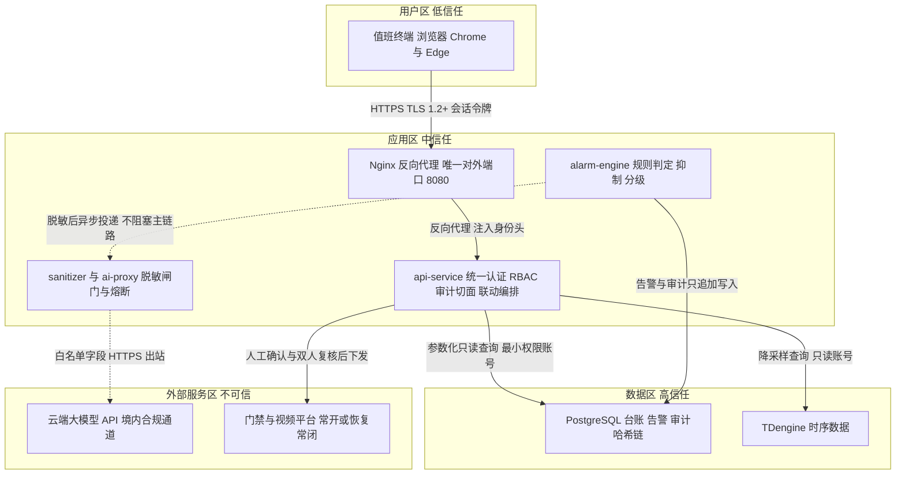

# 安全架构与等保对照（Security Architecture & Classified Protection Mapping）

| 项 | 内容 |
|---|---|
| 文档编号 | CDCIM-P2-ARCH-10 |
| 版本 / 状态 | v0.1 · 草案（待评审） |
| 所属阶段 | P2 架构设计 |
| 论文价值 | ★★★★★ 「安全架构」「信息系统安全」题目的核心素材：安全目标 → 战术 → 组件 → 验证的四段式推导，以及等保 2.0 三级对照、STRIDE 威胁建模、AI 外发合规控制三块可直接引用 |
| 上游依据 | [约束清单](../01-立项/06-约束清单.md)（C-08 ~ C-13、第 7 节不可验证边界）、[需求规格说明书](../02-需求/02-需求规格说明书.md)（NFR-SEC-01 ~ 06、FR-M4、FR-M5-13）、[质量属性场景表](../02-需求/03-质量属性场景表.md)（QA-SEC-01 ~ 04）、[AI 功能需求说明](../02-需求/09-AI功能需求说明.md)（脱敏规则、外发边界、AI-Q1）、[组件映射表 v1](01-组件映射表-v1.md)（端口策略、组件清单）、[ADR-0003](../09-决策/ADR-0003-大模型接入-旁路化与脱敏.md)、[文档规范](../90-规范/01-文档规范.md)、[图表规范](../90-规范/02-图表规范.md) |
| 下游承接 | P3 安全详细设计（权限点清单、脱敏规则实现、审计切面）、P6 安全测试用例与恢复演练、P7 论文「安全架构」素材卡 |

> **口径声明（全文适用）**：本文所有安全措施均为**设计目标与架构落点**，不是「已通过测评」的结论。等保 2.0 三级的**认证由第三方测评机构现场实施并出具报告，不在本项目范围**；本文只回答「要求是什么、我们落在哪、证据物是什么、原型能不能自证」。凡未实测者，一律标注「设计约束，未实测」。

---

## 1. 文档目的与安全边界

### 1.1 目的

本文要解决三个问题，且每个答案都要落到可检查的位置：

1. **安全目标如何从合规条文变成架构决策**——把等保 2.0 三级的控制点翻译为具体的认证、授权、审计、加密、脱敏战术，而不是贴一份合规清单；
2. **每条战术防的是什么威胁**——没有威胁指向的措施不进入清单，避免「为 checklist 而做安全」；
3. **哪些能自证、哪些必须由第三方认定**——把可验证项与不可验证项分开列，防止把设计意图写成既成事实。

### 1.2 安全边界

**表 TAB-ARCH-33　安全责任边界**

| 维度 | 在本文范围内（本系统承担） | 不在本文范围内（由既有设施、运维流程或第三方承担） |
|---|---|---|
| 应用安全 | 身份鉴别、会话管理、RBAC 授权、输入校验、越权拦截、审计留痕 | 代码安全审计报告、渗透测试实施 |
| 数据安全 | 传输加密、字段级存储加密、展示脱敏、外发脱敏、备份校验 | 数据库透明加密（TDE）、密钥硬件保护（HSM / 密码机） |
| 边界安全 | 端口最小暴露（仅 Web 8080 绑 `0.0.0.0`）、反向代理统一入口、应用层访问控制 | 防火墙策略、VLAN 划分、WAF、IDS/IPS、抗 DDoS 清洗 |
| 主机与容器 | 容器最小镜像、非 root 运行建议、资源限额、日志收敛 | 操作系统加固与补丁、主机入侵检测、镜像仓库治理 |
| 物理环境 | 采集温湿度、漏水、烟感、UPS 状态并告警；门禁状态回读 | 机房分区、物理门禁、消防、防雷、防静电、电力供应 |
| 合规认定 | 输出等保三级对照表、配置证据、自测记录 | **等保三级测评与认证、渗透测试报告出具、密码应用安全性评估** |

**边界的三句话说明**：

1. 本系统是**监控系统**，不是安全基础设施。它通过「监测 + 审计」为机房安全提供证据，但不替代门禁、消防、网络防护设备；
2. 「数据不出内网」指业务数据、原始时序、台账与审计均在内网存储与处理；唯一出网流量是**经三道闸门脱敏后的模型请求**（第 7 节），且出厂默认关闭；
3. 本文的对照表是**设计对照**，不是测评结论。等保测评机构会核查物理环境、网络架构、主机与数据库配置、管理制度，这些均超出单机原型的可验证能力。

### 1.3 已知安全差距（诚实边界）

**表 TAB-ARCH-34　原型环境的六项安全差距与论文写法**

| # | 差距 | 真实生产做法 | 本项目替代 | 残余风险 | 论文写法 |
|---|---|---|---|---|---|
| G-01 | **无 WAF** | 边界部署 WAF，拦截 SQL 注入、XSS、恶意爬虫 | 参数化查询、输出编码、JSON Schema 校验、限流 | 应用层 0day 与复杂注入仍可能穿透 | 「边界防护依赖生产环境 WAF，原型仅验证应用层参数化与输入校验」 |
| G-02 | **无硬件加密机 / HSM** | 密钥存于 KMS 或密码机，签名与加解密不出硬件 | `.env` 外置 + 文件权限 600 + `secret://` 引用 + 启动校验 | 宿主被 root 接管即可读取密钥 | 「密钥硬件保护为设计约束，未实测；原型以文件隔离与权限控制替代」 |
| G-03 | **无 WORM / 异地日志服务器** | 审计日志写入一次写多次读介质或独立日志服务器 | 只追加表 + 权限分离 + 触发器 + `prev_hash` 哈希链 + 每日链尾锚定 | 具备 DB owner 权限者可整表重写，只能「事后发现」 | 「审计防篡改强度为可检测，非不可篡改；WORM 属生产环境建设内容」 |
| G-04 | **单机无热冗余** | 双机热备 / 三节点集群，故障自动切换 | 进程级重启 + 每日全量 / 每小时增量备份 + 季度恢复演练 | 宿主故障期间服务中断 | 「高可用以进程自愈与备份恢复表达，节点级容灾未验证」 |
| G-05 | **无 IDS/IPS、无防病毒** | 主机 HIDS + 网络 IDS + 恶意代码扫描 | 最小镜像、仅暴露 8080、依赖锁定、镜像扫描流程（未实测） | 容器内恶意行为无法实时发现 | 「入侵检测为生产环境能力，原型仅做攻击面收敛」 |
| G-06 | **未做等保测评、未做渗透测试** | 第三方机构现场测评并出具报告 | 输出对照表 + 自测用例 + 配置证据 | 合规结论缺失 | **「设计满足等保三级要求，认证由第三方测评完成，不在本文范围」** |

> 这六条不是「以后再做」的待办，而是**必须在论文里主动说明的边界**。把差距写清楚，比声称「已满足」更可信，也是评分红线「不得虚构」的直接要求。

---

## 2. 安全目标与安全属性

### 2.1 五条安全属性的一句话定义

**表 TAB-ARCH-35　安全属性定义与度量口径**

| 属性 | 本项目口径（一句话） | 主要威胁 | 度量锚点 |
|---|---|---|---|
| **机密性** | 未授权主体在传输、存储、展示、日志、外发任一环节都拿不到真实资产数据与凭据 | 嗅探、拖库、截图、日志泄露、外发未脱敏 | 抓包 0 明文、库内 0 明文口令、外发 0 真实标识 |
| **完整性** | 数据与配置在采集、传输、落库、展示全过程不被未授权修改，且被修改后可被发现 | 中间人篡改、规则被私改、审计被洗 | 哈希链校验通过率、篡改检测告警、唯一约束冲突数 |
| **可用性** | 安全机制自身不成为故障源；安全组件故障时告警主链路仍可用，降级边界明确 | 暴力破解、资源耗尽、级联失败、安全组件拖垮主链路 | 告警推送成功率、鉴权组件故障时主链路可用度 |
| **不可否认性** | 任一写操作与控制动作可唯一归属到账号、会话、时间与来源 IP，操作人无法事后否认 | 否认开门、否认改规则、账号共用 | 审计覆盖率 100%、提交人与复核人可区分 |
| **可审计性** | 安全相关事件完整记录、可检索、可关联、满足留存与防篡改要求 | 审计缺失、日志被删、事件无法串联 | 留存 ≥ 6 个月、6 个月查询 P95 ≤ 3 s、trace_id 覆盖率 100% |

### 2.2 安全与可用性的冲突裁决

安全战术与可用性战术在本项目中**存在真实冲突**：严格 fail-closed 会让安全组件成为单点，fail-open 又会让安全形同虚设。本文的裁决原则是「按操作性质分档」，而不是全局一个开关。

**表 TAB-ARCH-36　fail-closed / fail-open 的分档裁决**

| 场景 | 默认取向 | 具体行为 | 理由 |
|---|---|---|---|
| 写操作 / 控制操作的审计写入失败 | **fail-closed** | 回滚业务事务，拒绝操作，返回 503 并告警 | 无审计即无追责，控制类操作不能「先做后补」 |
| 查询类操作的审计写入失败 | **降级** | 允许查询，写本地应急日志并计数告警，恢复后补录 | 只读不改变状态，可用性优先 |
| 鉴权服务不可用 | **fail-closed（新会话）/ 保留（已登录）** | 禁止新登录；已登录会话与告警推送不受影响 | 对齐 IF-EXT-12，避免认证组件成为监控单点 |
| 脱敏组件故障 | **fail-closed** | 拒绝外发，记审计，前端显示「AI 暂不可用」 | 宁可无建议，不可泄露资产信息 |
| 统一身份平台（IdP）不可用 | **fail-closed（新登录）** | 禁用本地应急账号以外的登录；已登录会话保留 | 防绕过 IdP 的本地后门 |
| TLS 证书过期或校验失败 | **fail-closed** | 拒绝出站连接并告警，不提供「跳过校验」开关 | 防中间人；证书轮换属运维流程 |

> 这张表是本文最重要的架构判断之一：**监控系统的第一职责是持续可见，所以只读链路允许降级；但凡改变状态或涉及物理动作，一律拒绝。** 论文中它可以直接作为「安全与可用性权衡点」的实例。

---

## 3. 安全架构总览

### 3.1 分区与跨区控制

按信任级别把系统划为四个区：**用户区**（浏览器终端）、**应用区**（Nginx、API、告警引擎、脱敏与 AI 网关）、**数据区**（PostgreSQL、TDengine）、**外部服务区**（云端大模型、门禁与视频平台）。分区依据是**信任级别与失效影响**，不是部署位置——单机原型中应用区与数据区同宿主，隔离靠 Docker 网络与端口绑定，**不是物理隔离**。

**图 FIG-ARCH-11　安全分区与跨区流量控制**

图注：本图回答「信任边界在哪、每条跨区流量靠什么控制」。实线为主链路，虚线为 AI 旁路；四个区之间共四条信任边界，控制手段见下表。单机原型中 Z2 与 Z3 同宿主，隔离强度弱于生产环境，这是必须说明的差距。

**表 TAB-ARCH-37　跨区流量与边界控制**

| 边界 | 流量 | 加密 | 身份与访问控制 | 审计 | 原型可验证性 |
|---|---|---|---|---|---|
| B1 用户区 → 应用区 | 页面、查询、确认、联动提交 | HTTPS，TLS 1.2+，禁用 1.0/1.1 与弱套件 | 会话令牌 + RBAC + 登录失败锁定 + 并发会话上限 | 登录、越权、写操作全记 | 可验证（本机抓包 + 用例） |
| B2 应用区 → 数据区 | SQL、时序写入与查询 | 回环/容器网络；跨主机时 PG `sslmode=require`、TDengine TLS | 分库分账号：写账号、只读账号、审计账号三分离 | 数据变更经应用审计切面记录 | 可验证（账号权限查询） |
| B3 应用区 → 外部服务区（模型） | 脱敏后的告警摘要、检索片段、问句 | HTTPS 出站，证书校验，禁跳过 | 三道脱敏闸门 + 出站域名白名单 + 日配额 + 熔断 | 每次外发一条脱敏审计，可追到 request_id | 可验证（抓包 + 审计检索） |
| B4 应用区 → 外部服务区（门禁/视频） | 常开 / 恢复常闭、取流、抓拍 | HTTPS / GB/T 28181 | 人工确认 + 双人复核 + `request_id` 防重放 | 提交、复核、执行、回读四段分别留痕 | 部分可验证（无真实平台，接口模拟） |

### 3.2 三条设计原则

1. **单一入口**：只有 Nginx 的 8080 绑 `0.0.0.0`，其余中间件一律 `127.0.0.1`。攻击面从「十几个端口」收敛到「一个入口 + 应用层鉴权」，这是单机环境性价比最高的边界战术；
2. **默认拒绝**：权限判定 `deny` 优先于 `grant`，未授权请求返回 403 并留痕；外部调用默认关闭（AI 外发出厂关闭），开启需双人操作；
3. **旁路不降安全**：AI 走异步旁路，但脱敏在旁路入口处完成，且是 fail-closed——旁路可以没有结果，不可以没有脱敏。

---

## 4. 安全战术清单

共 **30 条**，按属性分六组。每条给出「战术 / 实现手段 / 落地组件 / 防的是什么威胁 / 验证方法」。按考纲的安全战术族归类：认证、授权、保密、完整性属**抵抗攻击**；审计与越权拦截属**检测攻击**；备份恢复与降级属**从攻击中恢复**。

### 4.1 认证（Authentication）

**表 TAB-ARCH-38　认证战术（5 条）**

| 编号 | 安全战术 | 实现手段（含参数） | 落地组件 | 防的是什么威胁 | 验证方法 |
|---|---|---|---|---|---|
| SEC-A-01 | 口令强度与生命周期 | ≥ 12 位、含大写/小写/数字/符号中至少三类；90 天强制更换；Argon2id 加盐哈希；口令不入库明文、不入日志、不回显 | api-service 认证模块、`user_account.password_hash` | 弱口令撞库、离线彩虹表、长期不换口令导致凭据失效 | 构造 20 条弱口令全部拒绝；库内检索明文口令 0 命中；到期账号登录强制跳改密页 |
| SEC-A-02 | 失败锁定与抗枚举 | 连续 5 次失败锁定 10 min（`failed_login_count` / `locked_until`）；失败提示统一为「账号或凭据错误」，不区分账号是否存在；SNMP v3 认证失败不重试 | api-service、`user_account`、采集网关 | 在线口令爆破、账号枚举、SNMP 认证失败导致的设备锁定 | 第 6 次登录被拒且锁定到期时间正确（误差 ≤ 5 s）；不存在账号与错误口令的响应文本与时延一致 |
| SEC-A-03 | 双因子认证 | 管理员角色强制 TOTP；`mfa_secret_ref` 只存 `secret://totp/u12` 引用，不存密钥本体；OTP 校验窗口 ±1 步长，同一 OTP 不可重放 | api-service、`user_account.mfa_enabled` | 口令泄露后的账号接管、管理员权限被冒用 | 关闭 TOTP 的管理员账号无法登录；同一 OTP 二次使用被拒；密钥串全库检索 0 命中 |
| SEC-A-04 | 会话生命周期与并发控制 | 服务端会话；空闲 30 min 超时、绝对 8 h 超时；登出即失效；单账号并发 ≤ 3（`max_sessions`）；改密、改角色、禁用账号后强制失效全部会话 | api-service 会话管理、Redis 会话索引 | 会话固定、令牌盗用、账号共享、离职账号残留会话 | 空闲 31 min 后请求返回 401；改密后旧令牌 100% 401；第 4 个并发会话被拒 |
| SEC-A-05 | 统一身份源与应急账号 | 支持 LDAP / OIDC（IF-EXT-12）；IdP 不可用时禁新登录但保已有会话；本地应急账号仅 1 个，仅管理员持有，登录即触发 high 风险审计 | api-service、`user_account.idp_source` | IdP 单点故障导致监控瘫痪、私建本地后门账号 | 断开 IdP 后新登录 401、已登录会话仍收到告警；应急账号登录产生 high 审计记录 |

### 4.2 授权（Authorization）

**表 TAB-ARCH-39　授权战术（5 条）**

| 编号 | 安全战术 | 实现手段（含参数） | 落地组件 | 防的是什么威胁 | 验证方法 |
|---|---|---|---|---|---|
| SEC-Z-01 | 默认拒绝与 deny 优先 | 权限判定先查 `deny` 再查 `grant`；未命中任何授权即 403；403 一律写审计（含对象、角色、IP、会话） | api-service RBAC 中间件、`role_permission.effect` | 垂直越权（值班员调用规则接口）、水平越权（跨机房读数据）、隐式放行 | 40 条越权请求 100% 403、成功 0 次；403 均有对应审计且 5 s 内可按 IP 检索 |
| SEC-Z-02 | 三类角色最小权限 | 值班员 / 运维工程师 / 管理员三角色，权限点约 80 个按模块显式授予；**不做角色继承**（无 `parent_role_id`），避免隐式提权 | `role` / `permission` / `role_permission` | 权限蔓延、角色继承导致的越权路径不可静态分析 | 权限矩阵 100% 覆盖（19 功能点 × 3 角色逐格验证）；新增角色不自动获得任何权限 |
| SEC-Z-03 | 职责分离 | `separation_group = door_control`：配置门禁联动策略与复核门禁操作两权互斥；授予时校验同一用户不得同时具备两组权限 | 权限管理模块、`role.separation_group` | 单人完成「改策略 + 批准放行」的闭环，内部人滥用物理权限 | 构造同时授予两权的操作被拒；已有冲突账号在登录时告警并禁止门禁复核 |
| SEC-Z-04 | 危险操作双人复核 | 「门禁常开」`require_dual_control = true`；提交后进入待复核，复核人 ≠ 提交人；自审 100% 拒绝；复核超时 5 min 自动失效；动作仅「常开 / 恢复常闭」，**不提供远程开门**（Q-3 已确认，接口清单中不存在该动作） | api-service 联动编排、`linkage_record` | 单人误操作、账号被盗后的物理放行、审批流于形式、远程开门责任无法在系统层闭环 | 单人提交下发次数 = 0；第二人确认后 ≤ 2 s 下发；自审 3 次 3 次被拒；接口清单扫描「远程开门」0 命中 |
| SEC-Z-05 | 数据范围与导出管控 | `role.data_scope` 预留按机房隔离；全量历史导出需审批并记 high 风险审计；导出文件带记录数与校验值 | api-service 查询层、审计切面 | 批量拖取历史数据、内部人员离职前导出 | 值班员导出全量被拒；工程师导出留审批单号；导出文件校验值与库内一致 |

### 4.3 数据保密（Confidentiality）

**表 TAB-ARCH-40　保密战术（7 条）**

| 编号 | 安全战术 | 实现手段（含参数） | 落地组件 | 防的是什么威胁 | 验证方法 |
|---|---|---|---|---|---|
| SEC-C-01 | 传输加密 | 对外仅 HTTPS，TLS 1.2+，禁用 TLS 1.0/1.1、RC4、3DES；HSTS 建议开启；跨主机组件通信启用 TLS（PG `sslmode=require`、Mosquitto TLS） | Nginx、PostgreSQL、Mosquitto | 内网嗅探、ARP 欺骗后的中间人、明文凭据被抓包 | `openssl s_client` 校验协议与套件；抓包确认无明文口令与 Cookie |
| SEC-C-02 | 端口最小暴露 | 仅 Web 8080 绑 `0.0.0.0`；PG 5432、Redis 6379、TDengine 6030/6041、Qdrant 6333 等全部绑 `127.0.0.1`；容器间以服务名互访 | docker compose、宿主防火墙 | 中间件直接暴露被扫描利用（Redis 未授权、PG 弱口令） | 宿主侧端口扫描：除 8080 外全部 closed/filtered；`docker port` 清单与端口表一致 |
| SEC-C-03 | 存储加密 | 手机号等个人字段应用层 AES-GCM 加密后入库；备份文件加密；磁盘加密依赖宿主（BitLocker/LUKS，原型不强制） | api-service 加密组件、备份脚本 | 拖库、备份介质丢失、运维人员直读数据库 | 库内抽检手机号为密文；备份文件无明文手机号；密钥不在库内 |
| SEC-C-04 | 展示与日志脱敏 | 手机号展示 `138****1234`；姓名按角色显示；日志切面对 password / token / secret / phone / 设备 IP 做掩码 | 前端展示层、日志切面 | 截图外传、肩窥、日志成为泄露渠道 | 日志扫描敏感字段 0 命中；页面源码与接口响应中无完整手机号 |
| SEC-C-05 | 外发脱敏（三闸门） | 白名单字段剥离 → 黑名单正则扫描 → 5% 回环抽检；任一失败即拒发；设备编号哈希、拓扑逻辑化、去 IP 与位置、时间去绝对化 | sanitizer、ai-proxy | 资产信息外泄、位置可推断、模型侧反查真实设备 | 抓包 100 条外发请求，真实编号/IP/位置/人名 0 命中；5 条构造敏感请求 5/5 拦截 |
| SEC-C-06 | 密钥与凭据管理 | `.env` 外置、文件权限 600、`.gitignore` 排除；代码只读环境变量；`secret://` 引用；启动时校验缺失即拒绝启动；季度轮换 | 全部服务、部署脚本 | 密钥硬编码进镜像或仓库、日志打印、前端产物泄露 | 全库与镜像层检索密钥串 0 命中；前端 bundle 扫描 0 命中；缺失密钥时服务启动失败 |
| SEC-C-07 | 错误信息收敛 | 统一异常处理，对外只返回错误码与请求 ID；堆栈、SQL、内网路径只进服务端日志；关闭调试端点 | api-service、Nginx | 报错信息泄露表结构、内网拓扑、依赖版本 | 构造 10 类异常，响应体不含堆栈、SQL、路径；`/docs` 与调试端点在非开发环境关闭 |

### 4.4 数据完整性（Integrity）

**表 TAB-ARCH-41　完整性战术（4 条）**

| 编号 | 安全战术 | 实现手段（含参数） | 落地组件 | 防的是什么威胁 | 验证方法 |
|---|---|---|---|---|---|
| SEC-I-01 | 报文契约与输入校验 | 消息侧 JSON Schema 校验必填、类型、范围；接口侧参数化查询 + 类型白名单；非法报文入死信不落库 | topic-schema、api-service | 畸形数据污染时序库、SQL 注入、超量程数据进入聚合 | 注入 20 类畸形报文全部进死信；注入 10 条注入串全部被拒且无 SQL 报错 |
| SEC-I-02 | 幂等键与唯一约束 | 时序 `(device_id, point_id, ts)` 覆盖写；告警 `(rule_id, device_id, point_id, 窗口起点)` 唯一；控制 `request_id` 服务端去重 24 h | TDengine、PostgreSQL、Redis | 重复消息导致重复告警、重试导致重复开门、补传造成数据翻倍 | 注入 10% 重复消息，库内增量与理论值误差 0 条；同一 `request_id` 提交 10 次实际执行 1 次 |
| SEC-I-03 | 审计哈希链 | `record_hash = SHA-256(prev_hash ‖ 规范化字段)`；每日 02:00 校验全链；每日归档时把链尾哈希写入独立锚定文件与备份清单 | PostgreSQL `audit_log`、校验任务 | 事后篡改或删除审计记录以掩盖操作 | 篡改任意一行后校验任务在 24 h 内报错并定位行号；锚定文件与链尾一致 |
| SEC-I-04 | 备份校验与恢复演练 | 每日全量 + 每小时增量；备份清单含 SHA-256、行数、链尾哈希；每季度恢复演练并比对行数与哈希 | 备份脚本、备份介质 | 备份静默损坏、恢复时才发现不可用、审计链断裂 | 恢复后行数与源库一致、链校验通过；演练记录含耗时与差异项 |

### 4.5 不可否认（Non-repudiation）

**表 TAB-ARCH-42　不可否认战术（3 条）**

| 编号 | 安全战术 | 实现手段（含参数） | 落地组件 | 防的是什么威胁 | 验证方法 |
|---|---|---|---|---|---|
| SEC-N-01 | 全量写操作留痕 | 统一审计切面，记录操作人、角色快照、来源 IP、会话 ID、对象、参数摘要、变更前后值、结果；成功/失败/拒绝三态都记 | 审计切面、`audit_log` | 操作人否认「我改过规则 / 我确认过告警 / 我点过常开」 | 50 类写操作审计覆盖率 100%；`before_value` / `after_value` 可还原变更 |
| SEC-N-02 | 时间同步与服务端时钟 | 内网 NTP 每 10 min 校时，全链路偏差 ≤ 100 ms；审计时间一律取服务端时钟，不取客户端；偏差 > 1 s 在数据上标时间质量 | NTP 客户端、审计切面 | 时间倒拨伪造时序、以「时钟不准」为由推卸责任 | 审计时间与 NTP 基准偏差 ≤ 100 ms；修改客户端时间不影响审计时间戳 |
| SEC-N-03 | 双人签名与操作票号 | 提交人、复核人分别落审计，记录确认时间与操作票号；执行结果与回读状态同链存储 | api-service、`linkage_record` | 共同责任无法界定、复核人否认「我批过」 | 一次门禁常开产生 ≥ 4 条审计（提交/复核/执行/回读），可串成一条操作链 |

### 4.6 可用性安全（Availability Security）

**表 TAB-ARCH-43　可用性安全战术（6 条）**

| 编号 | 安全战术 | 实现手段（含参数） | 落地组件 | 防的是什么威胁 | 验证方法 |
|---|---|---|---|---|---|
| SEC-V-01 | 接口限流与配额 | 登录 5 次 / 5 min / IP；导出 1 次 / 10 min / 用户；AI 5 QPS、日 5000 次；普通接口按用户令牌桶限流 | Nginx、api-service、ai-proxy | 口令爆破、批量导出拖库、接口被刷导致服务不可用 | 超过阈值返回 429 且不影响其他用户；限流计数与日志可核对 |
| SEC-V-02 | 熔断与降级隔离 | AI 连续 5 次失败熔断 10 min；外部平台失败仅影响联动卡片，不阻塞告警推送；熔断状态存 Redis，进程重启不重置 | ai-proxy、api-service | 外部服务抖动级联拖垮主链路、熔断状态被重启绕过 | 断开模型 30 min，告警推送成功率 100%；熔断期内抓包 0 次外发 |
| SEC-V-03 | 防重放 | 控制请求携带 `request_id` + 客户端时间戳；服务端校验时间窗 ±60 s，`request_id` 缓存 24 h；超窗或重复直接拒绝 | api-service 联动编排、Redis | 抓包重放「门禁常开」指令、重试风暴 | 重放同一请求 10 次仅执行 1 次；时间戳超窗请求 100% 拒绝 |
| SEC-V-04 | 控制指令幂等与结果核对 | 同一 `request_id` 只执行一次；10 s 超时置「结果未知」；30 s 内回读设备真实状态并更新，不盲目重试 | api-service、`linkage_record` | 超时重试导致门禁反复动作、状态与记录不一致 | 注入超时后出现「结果未知」，核对任务 ≤ 30 s 完成并纠正状态 |
| SEC-V-05 | 组件故障隔离与资源限额 | 容器内存限额、`restart: always`、健康检查；AI 独立容器与独立消费组；线程池满即丢弃批次，不反压上游 | docker compose、ai-proxy | 单组件 OOM 拖垮宿主、AI 队列积压反压告警链路 | 逐容器 OOM 注入，其他服务可用；AI 队列满时主链路时延不劣化 |
| SEC-V-06 | fail-closed 边界定义 | 按表 TAB-ARCH-36 分档：写操作与控制操作 fail-closed，只读链路允许降级；所有降级在界面显式提示 | 全局异常处理、前端状态组件 | 安全组件故障时「静默放行」、或过度 fail-closed 导致监控盲区 | 逐场景注入故障，行为与裁决表 100% 一致；降级提示出现率 100% |

### 4.7 RBAC 权限矩阵

**表 TAB-ARCH-44　三角色权限矩阵（19 功能点 × 3 角色）**

图例：**读** = 查询/查看；**写** = 新增或修改；**执行** = 触发业务动作（确认、下发、导出、备份、复核）；**—** = 无权限，请求返回 403 并记审计。

| # | 功能点 | 权限编码 | 值班员 | 运维工程师 | 管理员 |
|---|---|---|---|---|---|
| 1 | 大屏与 2D/3D 视图 | `dashboard:read` | 读 | 读 | 读 |
| 2 | 测点历史曲线与导出当前区间 | `point:read` | 读 | 读 | 读 |
| 3 | 告警列表、详情、关联告警展开 | `alarm:read` | 读 | 读 | 读 |
| 4 | 告警确认 / 关闭 | `alarm:ack` | 执行 | 执行 | — |
| 5 | 告警规则（阈值/持续/变化率）配置 | `rule:write` | — | 写 | — |
| 6 | 联动策略配置（触发条件 + 动作） | `linkage:policy_write` | — | 写 | — |
| 7 | 设备与测点台账维护 | `device:write` | — | 写 | — |
| 8 | 巡检任务执行与结论复核 | `inspection:exec` | — | 执行 | — |
| 9 | 门禁联动**提交**（常开 / 恢复常闭） | `door:hold_open` | 执行（待复核） | 执行（待复核） | — |
| 10 | 门禁联动**复核** | `door:approve` | — | — | 执行（复核人 ≠ 提交人） |
| 11 | AI 建议查看与「有用/无用」反馈 | `ai:read` / `ai:feedback` | 读 + 执行 | 读 + 执行 | — |
| 12 | 知识库条目维护 | `kb:write` | — | 写 | — |
| 13 | 用户、角色与授权管理 | `user:write` | — | — | 写 |
| 14 | 审计日志查询 | `audit:read` | — | — | 读 |
| 15 | 审计日志导出 | `audit:export` | — | — | 执行（导出行为再记审计） |
| 16 | 备份恢复与系统参数配置 | `backup:exec` / `config:write` | — | — | 执行 |
| 17 | 告警检修挂起（屏蔽推送） | `alarm:hold` | — | 执行 | 执行 |
| 18 | 报表导出 | `report:export` | — | 执行 | 执行 |
| 19 | 历史降采样重算 | `data:repair` | — | — | 执行 |

**矩阵的三条设计说明**：

1. **管理员不处置告警**（第 4 行）——管理员的职责是「管人与管系统」，不是「管业务」。这一点常被忽略：若管理员可确认告警，则「删除审计掩盖误确认」的动机成立；
2. **门禁提交与复核彻底分离**（第 9、10 行）——值班员与工程师可提交，只有管理员可复核，且系统强制复核人 ≠ 提交人；配合 `separation_group`，同一账号无法同时具备两权；
3. **审计只读不可写**（第 14、15 行）——任何角色都没有 `audit:write` 权限，审计写入是服务内部切面行为，不暴露为可授予权限，从模型上消除「授权改审计」的可能。

> **与上游的一处口径差异**：[组件映射表](01-组件映射表-v1.md) §8 第 8 项将安全战术写作「RBAC 四角色」，而 SRS 3.2 与数据字典 E12 均为三角色。本文按 SRS 执行（三角色 16 功能点）。若评审认为需增设独立的「审计管理员」以满足审计管理职责分离（见 5.6 MC-02 的差距），应在 P3 作为第四角色增补，并同步修订 SRS 3.2、数据字典 E12 与本矩阵——**不在本文擅自扩角色**，以免与需求基线冲突。

### 4.8 安全需求追溯

**表 TAB-ARCH-45　安全需求 → 战术 → 场景 → 证据**

| 需求 | 内容摘要 | 对应战术 | 对应场景 | 验收证据 |
|---|---|---|---|---|
| NFR-SEC-01 | 统一身份鉴别（口令、更换、锁定、双因子） | SEC-A-01 ~ 05 | QA-SEC-01 | 弱口令拒绝、锁定计时、TOTP 用例记录 |
| NFR-SEC-02 | 最小权限与越权拒绝 | SEC-Z-01 ~ 05 | QA-SEC-01、QA-SEC-04 | 40 条越权用例 403、权限矩阵逐格核对 |
| NFR-SEC-03 | 全量写操作审计、不可改删 | SEC-I-03、SEC-N-01 ~ 03 | QA-SEC-03 | 50 类写操作审计、UPDATE/DELETE 拒绝记录 |
| NFR-SEC-04 | 关键链路加密传输 | SEC-C-01、SEC-C-02 | QA-SEC-02 | `openssl s_client` 输出、端口扫描结果 |
| NFR-SEC-05 | 外发 100% 脱敏 | SEC-C-05 | QA-SEC-02 | 100 条抓包审计、5 条构造请求拦截 |
| NFR-SEC-06 | 密钥与凭据不泄露 | SEC-C-06、SEC-C-04 | QA-SEC-02 | 全库/日志/前端产物三处扫描 0 命中 |
| FR-M4-06 / 09 | 控制审计、补偿、双人复核 | SEC-Z-03 / 04、SEC-N-03 | QA-SEC-04 | 操作链 4 条审计、自审拒绝记录 |
| FR-M5-13 | 审计查询与导出 | SEC-I-03、审计查询权限 | QA-SEC-03 | 6 个月查询 P95、导出校验值 |
| FR-M6-07 / 08 | 送模脱敏、AI 不可驱动控制 | SEC-C-05、类型定型 | QA-SEC-02、QA-SEC-04 | 脱敏审计、AI 入参注入 5 次拒绝 |

---

## 5. 等保 2.0 三级对照表

### 5.1 对照口径

- 依据《信息安全技术 网络安全等级保护基本要求》（GB/T 22239-2019）**第三级安全要求**的「技术要求」部分组织，按安全物理环境、安全通信网络、安全区域边界、安全计算环境、安全管理中心五类控制点展开；
- 「要求摘要」为便于阅读的意译，**不是条文原文**，正式测评以标准原文为准；
- 「本项目落点」写架构与组件位置，「证据物」写测评时可出示的材料；
- 「原型可验证性」三档：**可验证**（本机可自证）、**部分可验证**（有落点但受单机环境限制）、**不可验证**（依赖既有设施、第三方或未实现）；
- 本表共 **29 个控制点**，是**设计对照**，不构成测评结论。

### 5.2 安全物理环境

**表 TAB-ARCH-46　安全物理环境对照（4 项）**

| # | 控制点 | 要求摘要 | 本项目落点 | 证据物 | 原型可验证性 |
|---|---|---|---|---|---|
| PE-01 | 物理访问控制 | 机房出入口配置电子门禁，记录进入人员与时间 | 本系统不管理门禁授权，仅通过门禁平台回读状态并记录联动操作；物理门禁由机房既有系统承担 | 门禁平台对接记录、联动审计（提交/复核/执行/回读） | 不可验证（既有设施） |
| PE-02 | 电力供应 | 提供短期与长期备用电力，UPS 状态可监控 | 采集 UPS 输入/输出/电池状态，电池电压与剩余时间越限告警；不控制供电 | UPS 测点清单、告警用例、历史曲线 | 部分可验证（监测侧可验，供电切换不可验） |
| PE-03 | 温湿度控制 | 机房设置温湿度自动调节设施，参数可监控 | 温湿度采集 + 阈值 / 持续 / 变化率三类规则告警；联动仅提示，不调节空调 | 告警用例记录、3D 热力着色截图 | 可验证（协议模拟器） |
| PE-04 | 防雷击 / 防火 / 防水防潮 | 机房具备防雷、消防、漏水检测设施 | 接入烟感、漏水、防雷器状态量，异常即告警；设施本体由机房承担 | 模拟告警记录、设备台账 | 部分可验证（仅接入与告警可验） |

### 5.3 安全通信网络

**表 TAB-ARCH-47　安全通信网络对照（5 项）**

| # | 控制点 | 要求摘要 | 本项目落点 | 证据物 | 原型可验证性 |
|---|---|---|---|---|---|
| CN-01 | 网络架构 | 划分不同网络区域，关键网络设备与链路冗余，带宽满足业务高峰 | 单宿主 Docker 网络分区（应用/数据/外部），仅 8080 对外；**无 VLAN、无链路冗余**（单机差距） | compose 网络定义、端口规划表、1800 msg/s 压测记录 | 部分可验证（分区与端口可验，冗余不可验） |
| CN-02 | 通信传输保密性 | 采用密码技术保证通信过程中数据机密性 | 对外 HTTPS TLS 1.2+；PG `sslmode=require`；Mosquitto TLS 可选；单机回环流量不加密但绑 127.0.0.1 | `nginx.conf` TLS 配置、`openssl s_client` 输出、抓包样本 | 可验证 |
| CN-03 | 通信传输完整性 | 采用校验技术保证通信过程中数据完整性 | TLS record MAC 保证传输完整性；应用层 JSON Schema 校验 + 幂等键防篡改后重放；**未采用国密 HMAC** | 改包测试记录（篡改报文被 TLS/校验拒绝）、Schema 校验日志 | 部分可验证（TLS 完整性可验，国密未实现） |
| CN-04 | 带宽与优先级 | 保证业务高峰带宽，为重要业务分配优先级 | 未实现 QoS；以「峰值 1800 msg/s 不丢不积压」验证容量，超载时采集侧降级保关键测点 | 压测报告、降级告警记录 | 不可验证（无 QoS 能力） |
| CN-05 | 可信验证 | 基于可信根对通信设备进行可信验证，异常告警 | **未实现**（无 TPM、无可信启动、无度量基线） | 无 | 不可验证（显式差距） |

### 5.4 安全区域边界

**表 TAB-ARCH-48　安全区域边界对照（5 项）**

| # | 控制点 | 要求摘要 | 本项目落点 | 证据物 | 原型可验证性 |
|---|---|---|---|---|---|
| AB-01 | 边界防护 | 保证跨越边界的访问与数据流受控，非授权设备不得接入 | Nginx 唯一入口 + 端口最小暴露；宿主防火墙建议仅放行 8080；设备侧 MQTT ACL 限定 Topic | 端口扫描结果、Nginx 配置、MQTT ACL 配置 | 可验证 |
| AB-02 | 访问控制 | 在边界根据会话状态与应用类型实施访问控制 | Nginx `allow/deny` 限定内网段；应用层 RBAC 按会话与角色判定；**无 WAF**，复杂攻击依赖应用层校验 | 非白名单 IP 403/444 记录、越权用例 | 可验证（应用层）/ 部分（边界规则） |
| AB-03 | 入侵防范 | 检测并阻止入侵行为，最小化暴露面 | 输入校验、错误信息收敛、关闭调试端点、最小镜像；**无 IDS/IPS** | 注入用例拒绝记录、端口清单 | 部分可验证（暴露面可验，检测能力缺失） |
| AB-04 | 恶意代码防范 | 对恶意代码进行检测与清除 | 基础镜像精简、依赖版本锁定、镜像扫描流程（设计未实测）；无主机防病毒 | 依赖清单（SBOM 未生成） | 不可验证（未实测） |
| AB-05 | 边界安全审计 | 对边界访问行为进行审计 | Nginx access log（含来源 IP、状态码、UA）+ 应用登录/越权审计；日志轮转 30 天 | access.log 样例、审计查询结果 | 可验证 |

### 5.5 安全计算环境

**表 TAB-ARCH-49　安全计算环境对照（11 项）**

| # | 控制点 | 要求摘要 | 本项目落点 | 证据物 | 原型可验证性 |
|---|---|---|---|---|---|
| CE-01 | 身份鉴别 | 唯一身份标识、复杂度与定期更换、失败处理、远程管理防窃听、双因子 | Argon2id 哈希、12 位三类字符、90 天更换、5 次锁定 10 min、管理员 TOTP、HTTPS 传输 | 认证用例记录、`user_account` 字段、TOTP 登录日志 | 可验证 |
| CE-02 | 访问控制 | 主体客体授权、最小权限、职责分离 | 三角色 RBAC、deny 优先、不做角色继承、`door_control` 互斥组、双人复核 | 权限矩阵、越权用例、冲突授权拒绝记录 | 可验证 |
| CE-03 | 安全审计 | 覆盖重要用户与操作，记录日期时间/用户/事件类型/结果，审计记录保护、留存 ≥ 6 个月 | `audit_log` 22 字段、只追加、权限分离、触发器、哈希链、留存 1 年（法定 6 个月） | 审计表结构、50 类写操作记录、篡改拒绝记录 | 可验证 |
| CE-04 | 入侵防范（主机/应用） | 最小安装、关闭多余服务与端口、漏洞修补、限制终端接入 | 容器最小镜像、仅 8080 暴露、依赖锁定、非 root 运行建议；无主机 HIDS | 容器清单、端口清单、依赖锁文件 | 部分可验证 |
| CE-05 | 恶意代码防范 | 主机与网络层面恶意代码检测 | 仅设计镜像扫描与依赖审计，未部署防病毒 | 无 | 不可验证 |
| CE-06 | 可信验证 | 基于可信根对应用程序进行可信验证 | **未实现** | 无 | 不可验证（显式差距） |
| CE-07 | 数据完整性 | 保证重要数据完整性，提供校验手段，破坏后可恢复 | 审计哈希链、备份 SHA-256 清单、数据库唯一约束与幂等、恢复演练 | 链校验脚本输出、备份清单、恢复记录 | 可验证 |
| CE-08 | 数据保密性 | 重要数据存储保密性 | 手机号字段级加密、备份加密、展示与日志脱敏；**无 TDE、无 HSM** | 库内密文抽检、密钥引用清单 | 部分可验证（字段级可验，TDE/HSM 缺失） |
| CE-09 | 数据备份恢复 | 提供本地备份与恢复，重要数据热冗余 | 每日全量 + 每小时增量 + 季度恢复演练；**无热冗余** | 备份清单、恢复演练报告（P6） | 部分可验证（备份恢复可验，热冗余不可验） |
| CE-10 | 剩余信息保护 | 鉴别信息与敏感数据释放前完全清除 | 会话销毁、临时导出文件过期删除、Redis TTL 过期；**未做内存清零** | 会话失效测试、临时文件清理脚本 | 部分可验证 |
| CE-11 | 个人信息保护 | 仅采集必要个人信息，授权访问，防止泄露 | 仅采集账号、显示名、工号、手机号、邮箱；手机号加密 + 展示脱敏；AI 外发删除人员字段 | 数据字典字段清单、脱敏规则表、抓包审计 | 可验证 |

### 5.6 安全管理中心

**表 TAB-ARCH-50　安全管理中心对照（4 项）**

| # | 控制点 | 要求摘要 | 本项目落点 | 证据物 | 原型可验证性 |
|---|---|---|---|---|---|
| MC-01 | 系统管理 | 对系统管理员身份鉴别、仅通过特定命令或接口管理、操作审计 | 管理员强制 MFA、仅经 API 管理、全部操作记审计；**无堡垒机** | 管理员登录日志、操作审计 | 部分可验证 |
| MC-02 | 审计管理 | 审计管理员对审计记录进行查询、分析、报告，不得删改 | 审计查询与导出仅管理员可用；数据库账号无 UPDATE/DELETE；**无独立审计管理员角色**（管理员兼任，记为差距） | 权限矩阵、DB 账号授权、篡改拒绝记录 | 部分可验证 |
| MC-03 | 安全管理 | 对安全策略、安全设备进行统一配置与授权 | 安全参数集中于 `.env` 与 YAML 配置，变更记审计；**无集中策略管理平台** | 配置文件、配置变更审计 | 部分可验证 |
| MC-04 | 集中管控 | 对网络设备、安全设备、日志进行集中管控 | 单机无集中管控，仅 Prometheus + Grafana 自监控；生产环境建议接入 SOC | 监控看板截图 | 不可验证（架构差距） |

### 5.7 对照结论

| 档位 | 条数 | 占比 | 说明 |
|---|---|---|---|
| 可验证 | 10 | 34% | 应用层认证、授权、审计、脱敏、备份校验等核心控制点可自证 |
| 部分可验证 | 12 | 41% | 有架构落点，但受单机、无 WAF/HSM/IDS、无冗余限制 |
| 不可验证 | 7 | 24% | 物理环境、可信验证、恶意代码、集中管控、QoS 等依赖既有设施或第三方 |

> **结论口径**：本项目**设计覆盖**等保 2.0 三级技术要求中的 29 个控制点，其中 22 个有架构落点与证据物；**认证结论须由第三方测评机构出具，不在本项目范围**。7 个不可验证项已列入第 9 节与论文「经验总结」段，不以「已满足」表述。

---

## 6. 威胁建模（STRIDE）

### 6.1 资产清单

**表 TAB-ARCH-51　受保护资产（8 项）**

| 编号 | 资产 | 载体 | 敏感级别 | 受损后果 | 主要保护手段 |
|---|---|---|---|---|---|
| AS-01 | 时序测点数据（DE-04） | TDengine | 中 | 泄露机房负荷曲线，可推断业务运行状态 | 端口绑定回环、只读账号、降采样导出 |
| AS-02 | 告警事件与原始告警（DE-05/06） | PostgreSQL | 中 | 泄露故障历史与处置能力短板 | RBAC、审计、导出管控 |
| AS-03 | 告警规则与联动策略（DE-07） | PostgreSQL | 高 | 被篡改可批量屏蔽告警或放宽联动条件 | 变更审批、灰度、版本快照、审计 |
| AS-04 | 审计日志（DE-09） | PostgreSQL | 高 | 被篡改则无法追责，合规失效 | 只追加、权限分离、触发器、哈希链、锚定 |
| AS-05 | 用户凭证与会话 | `user_account`、Redis | 高 | 账号接管后可确认告警、提交门禁联动 | Argon2id、TOTP、会话超时、失败锁定 |
| AS-06 | 门禁与视频控制能力 | API → 门禁/视频平台 | 高 | 未授权常开导致物理安全失效 | 人工确认、双人复核、防重放、幂等、审计 |
| AS-07 | 设备台账与空间拓扑 | PostgreSQL | 高 | 精确位置与资产清单外泄，可被用于定向攻击 | 展示按角色、外发哈希与泛化、导出管控 |
| AS-08 | 密钥与凭据（API Key、DB 口令、加密密钥） | `.env`、`secret://` 引用 | 极高 | 模型配额被盗用、数据库被直连、加密失效 | 环境变量隔离、600 权限、日志脱敏、轮换 |

### 6.2 信任边界

**表 TAB-ARCH-52　四条信任边界**

| 编号 | 边界 | 跨越内容 | 控制手段 | 残余风险 |
|---|---|---|---|---|
| TB-1 | 浏览器 ↔ 应用 | 凭据、会话令牌、查询与操作请求 | TLS 1.2+、会话令牌、RBAC、CSRF 防护、输入校验 | 终端被控后会话被劫持 |
| TB-2 | 应用 ↔ 数据 | SQL、时序写入、审计写入 | 回环/容器网络、分账号最小权限、参数化查询、审计切面 | 宿主 root 可直读数据文件 |
| TB-3 | 应用 ↔ 外部模型 | 脱敏后的告警摘要、知识片段、问句 | 三道脱敏闸门、出站域名白名单、TLS 校验、配额与熔断 | 自由文本中的隐晦位置描述未被规则覆盖 |
| TB-4 | 应用 ↔ 设备与门禁/视频平台 | 只读采集、常开/恢复指令、取流 | 只读协议、人工确认、双人复核、防重放、回读核对 | 平台自身鉴权强度不由本系统控制 |

### 6.3 STRIDE 威胁表

**表 TAB-ARCH-53　STRIDE 威胁与缓解（17 条，覆盖 6 类）**

| 编号 | 类别 | 具体威胁场景 | 影响 | 缓解措施 | 残余风险 |
|---|---|---|---|---|---|
| T-S-01 | 假冒（Spoofing） | 攻击者窃取值班员会话令牌，冒用身份确认告警或提交门禁常开 | 告警被误确认、物理放行 | 短会话 + HttpOnly/Secure Cookie + 空闲 30 min 超时 + 改密失效 + 关键操作二次校验 | 终端被植入木马后令牌仍可被窃 |
| T-S-02 | 假冒 | 伪造 IdP 认证响应或断言，绕过统一登录 | 非法获取管理员权限 | OIDC 校验 `iss/aud/nonce` 与签名、TLS 双向校验、禁止未签名断言、本地仅保留 1 个应急账号 | IdP 配置错误导致校验被关闭 |
| T-T-01 | 篡改（Tampering） | 内部人员直接 UPDATE 审计表，删除不利记录 | 无法追责、合规失效 | 应用无 UPDATE 方法、DB 账号无 UPDATE/DELETE、触发器、哈希链、每日链尾锚定 | 拥有 DB owner 权限者可整表重写，只能事后发现 |
| T-T-02 | 篡改 | 运维工程师私自放宽告警阈值或关闭规则，制造「一切正常」假象 | 真实故障漏报 | 规则变更审计 + 灰度 + 版本快照 + 变更前后命中条数对比 + 双人审批（建议） | 工程师与管理员串通 |
| T-T-03 | 篡改 | 中间人篡改外发请求或模型响应，注入错误建议 | 误导研判、泄露数据 | TLS 1.2+ 证书校验、禁跳过校验、响应 JSON Schema 与证据白名单校验 | 终端信任链被植入根证书 |
| T-R-01 | 否认（Repudiation） | 值班员否认自己发起过「门禁常开」 | 责任无法界定 | 提交/复核/执行/回读四段审计 + 操作票号 + 服务端时间 | 账号共用（并发会话限制仅缓解） |
| T-R-02 | 否认 | 运维工程师否认修改过规则或导出过全量数据 | 合规审计失败 | `before_value`/`after_value` 留痕、导出留审批单号与校验值、审计查询本身留痕 | 时钟被篡改（NTP 防护未覆盖宿主管理员） |
| T-I-01 | 信息泄露（Information Disclosure） | 脱敏不彻底，设备编号、IP、机房位置随自由文本外发 | 资产暴露、可被定向攻击 | 白名单剥离 + 黑名单正则 + 回环抽检 + fail-closed + 抓包审计 | 「三楼东侧第二台」这类隐晦描述未被规则覆盖 |
| T-I-02 | 信息泄露 | 越权读取审计日志或全量历史数据 | 内部数据泄露、规避监督 | RBAC（审计仅管理员）+ 导出审批 + high 风险审计 + 导出文件校验值 | 管理员权限过大，无独立审计管理员 |
| T-I-03 | 信息泄露 | 前端产物或日志泄露 API Key、内网地址 | 模型配额被盗、内网被探测 | 密钥仅服务端环境变量、构建期扫描、日志脱敏、CSP | 供应链投毒（依赖包被篡改） |
| T-D-01 | 拒绝服务（DoS） | 高频登录或大范围查询打满连接池，告警延迟 | 监控短时失明 | 限流 + 失败锁定 + 连接池上限 + 查询超时 + 只读降级 | 大流量 DDoS（无 WAF/清洗） |
| T-D-02 | 拒绝服务 | AI 调用被刷爆日配额，紧急告警建议不可用 | 成本失控、研判能力下降 | 日配额 5000 次 + 5 QPS + 紧急池 500 次 + 熔断 + 按批次调用 | 内部账号被盗用后仍可消耗配额 |
| T-D-03 | 拒绝服务 | 审计表或时序表膨胀写满磁盘，全系统不可用 | 采集中断、告警丢失 | 按月分区 + 保留策略 + 磁盘水位告警 + 归档清理 | 单盘无冗余，磁盘故障不可恢复 |
| T-E-01 | 提权（Elevation of Privilege） | 值班员越权调用规则配置或台账修改接口 | 规则被恶意放宽、台账被污染 | 默认拒绝 + RBAC + 403 审计 + 越权用例回归 | 角色误配（管理流程缺陷） |
| T-E-02 | 提权 | 普通账号被提升为管理员，取得全部权限 | 系统完全失控 | 角色变更仅管理员可操作 + 管理员 MFA + 变更审计 + 行版本乐观锁 | 管理员账号被接管；角色变更无双人复核（差距） |
| T-E-03 | 提权 | AI 输出被当作控制指令入参，绕过人工确认 | 未授权物理动作 | 数据模型区分「建议」与「指令」、控制接口来源校验、控制动词黑名单、人在回路 | 未来需求变更引入直连路径（须架构评审） |
| T-E-04 | 提权 | 容器逃逸或以 root 运行，取得宿主控制权 | 全部数据与密钥失守 | 最小镜像、非 root 运行、只读挂载、能力裁剪（设计） | 无运行时防护（无 Falco/seccomp 调优） |

**威胁建模的三点结论**：

1. **最高风险不在外部攻击，而在内部人**——17 条威胁中 9 条涉及合法账号的越权、误用或否认；这与动环系统「内网部署、用户少而权限大」的现实一致，因此战术重心放在职责分离、双人复核与审计链，而不是边界封堵；
2. **审计是最后一道防线，也是最脆弱的一道**——若审计可被静默改写，前面所有控制都失去证据支撑；因此审计链采用「应用 + 数据库 + 触发器 + 哈希 + 锚定」五层，但仍只能做到「可检测」，这一点必须写进论文；
3. **AI 引入的是新的提权路径**——不是模型「想造反」，而是工程上容易把「建议」与「指令」存成同一张表、同一个字段。类型定型（`ai_suggest_*` 只读字段）比任何 Prompt 约束都可靠。

---

## 7. AI 数据外发的合规控制

### 7.1 合规前提

- **数据不出内网**：原始时序、台账、告警原文、审计、知识库正文均不出内网；唯一出网流量是脱敏后的模型请求；
- **最小披露**：只送判断所需的形态特征（设备类型、告警级别、拓扑跳数、统计量），不送原始曲线、不送绝对时间、不送任何标识；
- **可追溯**：每次外发生成一条脱敏审计，能追到 `request_id`、字段剥离数、命中规则与结果；
- **可关闭**：外发开关是独立配置项，关闭后 AI 能力整体降级，主链路无影响。

### 7.2 三道闸门

**表 TAB-ARCH-54　外发脱敏的三道闸门（顺序执行，任一失败即拒发）**

| 闸门 | 动作 | 判定规则 | 失败处理 | 防的是什么 |
|---|---|---|---|---|
| 第一道：白名单剥离 | 只保留白名单字段，其余字段整体删除并计数 | 字段名必须 ⊆ 白名单（设备类型、告警级别、拓扑跳数、统计量等）；多余字段剥离 | 剥离后仍含非白名单字段 → 拒发 | 开发新增字段时「顺手」把敏感字段带出去 |
| 第二道：黑名单扫描 | 对剥离后的请求体做正则与模式扫描 | IPv4/IPv6、`secret://`、11 位手机号、邮箱、真实设备编码模式、绝对时间戳 | 命中任一 → 拒发并记审计 | 自由文本、拼接字符串、模板回填造成的二次泄露 |
| 第三道：回环抽检 | 对脱敏结果再抽 5% 做一次黑名单扫描 | 与第二道同规则，抽样比例 5%，可疑样本 100% 人工复核 | 抽检命中 → 该批次全部拒发并回溯同批次 | 清洗后又被模板拼回原文的「二次污染」 |

**闸门之外的第四层控制**：出站域名白名单（只允许已备案的模型服务域名）、请求体大小上限、TLS 证书校验、日配额与 5 QPS 限流、Provider 抽象（境内合规通道）。这些不替代脱敏，但能压缩「脱敏漏了」之后的暴露面。

### 7.3 fail-closed 语义

| 异常 | 系统行为 | 用户可见 | 是否影响主链路 |
|---|---|---|---|
| 白名单校验异常（字段解析失败） | 拒发，记 `denied` 审计 | 「AI 暂不可用」，不暴露原因 | 否 |
| 黑名单命中 | 拒发，记命中规则与字段路径 | 同上 | 否 |
| 回环抽检命中 | 拒发整批，回溯同批次并告警 | 同上 | 否 |
| 脱敏审计写入失败 | **拒发**（无审计即无合规证据） | 同上 | 否 |
| 脱敏超时（> 50 ms） | 放弃本次外发 | 同上 | 否 |
| 模型侧返回敏感内容（回显） | 结果校验丢弃，不回写 | 建议不出现 | 否 |

> 关键点：**脱敏失败不是「尽力放行」，而是「一律不发」**。这与可用性目标不冲突——AI 是旁路，不发请求只损失建议，不损失告警。

### 7.4 Q-4 未定前的默认策略

SRS 第 10 节的 Q-4（大模型是否允许走公网 API）仍是暂定项，AI-Q1 亦提示这是「唯一可能推翻已定架构」的外部风险。本文的默认策略是**技术上支持、工程上关闭**：

1. **出厂默认关闭**：`AI_EXTERNAL_ENABLED=false`，部署后不产生任何真实外发流量；
2. **演示与测试用模拟 Provider**：本地 mock 返回固定结构，全链路（脱敏 → Schema 校验 → 回写 → 展示）可验证，但不触网；
3. **开启需双人**：取得信息安全部书面结论后，由管理员与安全负责人在配置中心双人确认开启，开启动作记 high 风险审计；
4. **开启前回归门槛**：100 条含真实标识的样本经三道闸门，真实设备编号/IP/位置/人名命中数必须为 0，否则不允许开启；
5. **一键关闭**：开关关闭后 10 s 内生效，AI 卡片显示「AI 建议不可用」，规则根因与关键词检索照常。

> 这一策略与 SRS「暂定允许、100% 脱敏」并不矛盾：SRS 定义的是**能力边界**（脱敏后可外发），本文定义的是**部署默认值**（未获书面授权前不外发）。两者叠加的结果是「能力具备、风险可控、结论未定时不冒险」。

### 7.5 若最终禁止外发的降级路径

| 能力 | 降级形态 | 影响 | 是否仍可交付 |
|---|---|---|---|
| AI-C1 聚类建议 | 取消，仅保留规则侧同源/父子抑制与聚类 | 降噪压缩比略降，重复告警率仍可 ≤ 20% | 是 |
| AI-C2 根因建议 | 取消，仅保留规则侧拓扑根因（FR-M3-08） | 根因 Top1 命中率依赖规则，AI 证据链缺失 | 是 |
| AI-C3 知识库问答 | 降为关键词全文检索（PG `tsvector`） | 无生成答案，只有片段列表 | 是 |
| AI-C4 自然语言查询 | 取消，回落到「筛选 + 导出」 | 查询效率下降 | 是 |
| AI-C5 值班报告 | 用 Jinja 模板 + 结构化数字渲染 | 报告可读性下降，数字仍准确 | 是 |

**结论**：外发被禁不会导致系统不可用，只会让 M6 从「智能增强」退回「检索增强 + 模板生成」。这也是旁路架构的价值——**合规结论可以变，主链路不跟着变**。

---

## 8. 审计与追溯设计

### 8.1 记录范围

**表 TAB-ARCH-55　审计记录范围**

| 类别 | 具体操作 | 是否记录 | 关键要求 |
|---|---|---|---|
| 认证 | 登录成功 / 失败 / 登出 / 锁定 / 解锁 / 改密 / 双因子绑定 | 是 | 失败与锁定记 `denied`，含来源 IP 与 UA |
| 授权 | 用户增删改、角色授予/回收、权限变更、职责分离冲突 | 是 | 记 `before_value` / `after_value`，high 风险 |
| 业务写操作 | 告警确认/关闭、规则增删改、台账增删改、巡检结论复核、检修挂起 | 是 | 逐条记录，批量操作逐条展开 |
| 控制操作 | 门禁常开/恢复提交、复核、执行、回读；视频取流/抓拍 | 是 | 四段分别留痕，含操作票号与 `request_id` |
| 数据导出 | 历史数据导出、审计导出、报表导出 | 是 | 记导出条件、条数、文件校验值；导出行为本身再记一条 |
| 审计自身 | 审计查询、审计导出、篡改尝试 | 是 | 查询也留痕；篡改尝试记 `denied` 并告警 |
| 配置变更 | 系统参数、安全开关、AI 外发开关、备份策略 | 是 | 含变更人、旧值、新值、生效时间 |
| 越权与异常 | 403、非法状态迁移、双人复核自审、重复 `request_id` | 是 | 记 `denied` 与原因码 |
| AI 外发 | 每次外发请求 | 是 | 脱敏审计：`request_id`、字段剥离数、命中规则、结果 |
| 只读查询 | 普通页面查询、曲线查询 | **否**（仅采样） | 避免审计表被读操作淹没；敏感查询（全量导出）例外 |

### 8.2 关键字段

**表 TAB-ARCH-56　审计记录关键字段（摘自 `audit_log` 22 字段）**

| 字段 | 作用 | 安全要求 |
|---|---|---|
| `audit_no` | 全局唯一流水号 | 导出与核对锚点，不可重复 |
| `operation_type` / `operation_result` | 操作类型与结果（success / failed / denied） | 覆盖登录、写、控制、导出、配置、越权 |
| `risk_level` | low / medium / high | 越权、控制、导出记 high |
| `actor_id` / `actor_name` / `actor_role` | 操作人及其角色快照 | 不做外键，用户禁用后仍可追溯 |
| `actor_ip` / `session_id` | 来源与会话 | 支撑「同一会话内操作链」分析 |
| `target_type` / `target_id` / `target_name` | 操作对象 | 统一字符串存储，兼容多主键 |
| `action_detail` | 参数摘要（jsonb） | **必须脱敏**，不含口令、密钥、完整手机号 |
| `before_value` / `after_value` | 变更前后值 | 仅记录被修改字段，支撑回滚与取证 |
| `prev_hash` / `record_hash` | 哈希链 | 防篡改核心，见 8.4 |
| `created_at` | 服务端时间 | 不用客户端时间，偏差 ≤ 100 ms |

### 8.3 留存与归档

- **法定最低 6 个月**（C-10），本期配置 **1 年**，按月 `RANGE` 分区，保留 16 个月（1 年 + 4 个月缓冲）；
- 留存期**独立于业务数据**：原始时序 180 天、审计 1 年，两者不共用归档策略；
- 超期分区先导出并校验 `record_hash` 链完整，再 `DROP PARTITION`；归档文件与备份清单同寿命；
- 归档后仍可按「时间 + 操作人 + 对象」检索，检索接口不因归档失效。

### 8.4 防篡改链路

**五层手段，逐层加码**：

1. **应用层**：审计写入接口只有 `INSERT`，代码中不存在 `UPDATE` / `DELETE` 方法；
2. **数据库层**：审计表 owner 与业务账号分离，业务账号仅 `INSERT` + `SELECT`，无 `UPDATE` / `DELETE` / `TRUNCATE`；
3. **触发器**：`BEFORE UPDATE OR DELETE` 直接抛异常（防误授权的 DBA 操作）；
4. **哈希链**：`record_hash = SHA-256(prev_hash ‖ 按字段名排序后的规范化内容)`，任一行被改，后续全链断裂；
5. **每日锚定**：每日 02:00 校验全链，并把链尾哈希写入独立锚定文件与备份清单；锚定文件与数据库分离存放。

**校验与定位**：校验任务从最早未校验分区开始重算，发现不一致即输出 `audit_id`、期望哈希、实际哈希，并生成 high 风险告警；人工可按 `audit_id` 定位到具体行与操作人。

**必须承认的局限**：单机原型没有 WORM 介质、没有独立日志服务器、没有第三方时间戳，因此上述手段的强度是**「篡改可被检测」而非「篡改不可发生」**。拥有 DB owner 权限且同时能改写锚定文件的人，仍可重建整条链——这属于「需要两人合谋 + 宿主权限」的高门槛攻击，但不能声称「不可能」。生产环境应叠加 WORM 存储或日志服务器异地留存。

### 8.5 查询与导出权限

| 角色 | 查询 | 导出 | 说明 |
|---|---|---|---|
| 值班员 | — | — | 无审计权限，避免值班员查看他人操作形成对抗 |
| 运维工程师 | — | — | 无审计权限；其自身操作由系统记录，不由其查看 |
| 管理员 | 读（分页 50） | 执行（含校验值） | 唯一可查询导出的角色；导出行为再记一条审计 |

**三条约束**：查询默认遮蔽敏感字段（手机号、IP 后两段）；导出文件含记录数与链尾哈希，接收方可校验；任何角色尝试 UPDATE/DELETE 审计表，100% 拒绝并另记一条 `denied`。

### 8.6 追溯关联

| 关联键 | 串联内容 | 用途 |
|---|---|---|
| `trace_id` | 采集 → 计算 → 判定 → 推送全链路 | 单次告警为何产生、为何未推送 |
| `session_id` | 同一登录会话内的全部操作 | 判断是否为同一人连续操作 |
| `request_id` | 控制指令的提交、复核、执行、回读 | 判断指令是否重复、是否超时、最终状态 |
| `audit_no` | 单条审计的导出与核对 | 取证时定位到唯一记录 |

---

## 9. 安全测试与验证

### 9.1 可验证项（原型可自证）

**表 TAB-ARCH-57　可验证的安全测试项（14 项）**

| 编号 | 验证项 | 方法 | 判据 | 对应战术 |
|---|---|---|---|---|
| V-01 | 传输协议与套件 | `openssl s_client -connect` + 抓包 | 仅 TLS 1.2+，无 RC4/3DES，无明文凭据 | SEC-C-01 |
| V-02 | 端口暴露面 | 宿主侧全端口扫描 | 除 8080 外全部 closed/filtered | SEC-C-02 |
| V-03 | 越权拦截 | 三角色 × 16 功能点逐格构造请求（≥ 40 条） | 100% 返回 403，成功 0 次，均有审计 | SEC-Z-01/02 |
| V-04 | 失败锁定 | 连续 5 次错误口令 | 第 6 次拒绝，锁定 10 min（误差 ≤ 5 s），提示不区分账号 | SEC-A-02 |
| V-05 | 会话失效 | 空闲 31 min、改密后重放旧令牌 | 均返回 401 | SEC-A-04 |
| V-06 | 双因子 | 关闭 TOTP 的管理员登录、OTP 重放 | 均被拒绝 | SEC-A-03 |
| V-07 | 审计覆盖率 | 构造 50 类写操作 | 审计 50/50，字段完整 | SEC-N-01 |
| V-08 | 审计防篡改 | UPDATE / DELETE 审计表各 1 次；手工改 1 行后跑校验 | 改删 100% 拒绝；校验能定位被改行 | SEC-I-03 |
| V-09 | 哈希链完整性 | 全链重算 + 比对锚定文件 | 一致率 100%；篡改后 24 h 内告警 | SEC-I-03 |
| V-10 | 外发脱敏 | 抓包 100 条外发请求 + 5 条构造敏感请求 | 真实编号/IP/位置/人名 0 命中；5/5 拦截 | SEC-C-05 |
| V-11 | 密钥泄露扫描 | 全库、镜像层、日志、前端 bundle 检索 | 密钥串 0 命中 | SEC-C-06 |
| V-12 | 限流与防重放 | 超阈值请求、重放同一 `request_id` 10 次 | 超限 429；重放仅执行 1 次；超窗 100% 拒绝 | SEC-V-01/03 |
| V-13 | 控制双人复核 | 单人提交、自审 3 次、第二人复核 | 单人下发 0 次；自审 3/3 拒绝；复核后 ≤ 2 s 下发 | SEC-Z-04 |
| V-14 | 备份与恢复 | 备份 → 删除 → 恢复 → 校验 | 行数一致、链尾哈希一致、审计链通过 | SEC-I-04 |

### 9.2 不可验证项（须第三方或生产环境）

**表 TAB-ARCH-58　不可验证项（12 项）**

| 编号 | 不可验证项 | 原因 | 真实做法 | 论文写法 |
|---|---|---|---|---|
| U-01 | 等保三级测评认证 | 须第三方测评机构现场实施 | 测评机构核查物理、网络、主机、制度并出具报告 | 「设计满足等保三级要求，认证由第三方完成，不在本文范围」 |
| U-02 | 渗透测试报告 | 须具备资质的机构实施 | 黑盒 + 灰盒渗透，出具报告与整改清单 | 「仅做开发者自测的越权与注入用例，未做正式渗透」 |
| U-03 | 密钥硬件保护 | 无 HSM / 密码机 | 密钥存 KMS 或密码机，签名不出硬件 | 「密钥硬件保护为设计约束，未实测」 |
| U-04 | WAF / IDS / IPS 防护效果 | 单机未部署 | 边界 WAF + 主机 HIDS + 网络 IDS | 「边界与主机防护为生产环境能力」 |
| U-05 | 可信计算 / 可信启动 | 无 TPM、无度量基线 | 可信根 + 启动度量 + 白名单 | 「可信验证未实现，属已知差距」 |
| U-06 | 审计不可篡改（WORM） | 无一次写多次读介质 | WORM 存储或独立日志服务器 | 「审计防篡改为可检测，非不可篡改」 |
| U-07 | 异地容灾 / 双活切换 | 单机、无第二站点 | 同城双活 + 异地备份 + 切换演练 | 「灾备为设计内容，未在原型验证」 |
| U-08 | 机房物理环境控制 | 依赖机房既有设施 | 门禁、消防、防雷、防静电、电力 | 「物理环境由机房既有设施承担，本系统仅监测与告警」 |
| U-09 | 国密算法合规 | 未采用 SM2/SM3/SM4 | 国密改造 + 密码应用安全性评估 | 「当前采用国际通用算法，国密改造为后续工作」 |
| U-10 | 集中管控 / 堡垒机 | 单机无 SOC、无堡垒机 | 日志集中、运维审计、统一策略 | 「集中管控为生产环境建设内容」 |
| U-11 | 数据库透明加密（TDE） | 未启用 | TDE 或加密表空间 | 「仅做字段级加密，未做 TDE」 |
| U-12 | 供应链与镜像漏洞扫描 | 未接入扫描平台 | SBOM + 镜像扫描 + 依赖审计 | 「依赖已锁定版本，未做完整漏洞扫描」 |

### 9.3 第三方测评范围界定

| 事项 | 由谁做 | 本项目提供什么 | 本项目不做什么 |
|---|---|---|---|
| 等保三级测评 | 具备资质的测评机构 | 对照表（第 5 节）、配置证据、自测记录、拓扑与数据流说明 | 不自我认定合规、不出具测评结论 |
| 渗透测试 | 具备资质的机构 | 接口清单、测试账号、环境与数据 | 不声称「已通过渗透测试」 |
| 密码应用安全性评估 | 密码评估机构 | 加密点清单、密钥管理流程 | 不声称「国密合规」 |
| 代码安全审计 | 第三方或内部安全团队 | 代码仓库、依赖清单 | 不声称「无高危漏洞」 |
| 备份恢复演练 | 本项目 + 运维 | 演练脚本、恢复记录、校验结果 | 不声称「灾备可用」——只声称「本机备份可恢复」 |

---

## 10. 待确认事项

| # | 待确认点 | 本文暂定 | 影响面 | 建议 |
|---|---|---|---|---|
| SA-Q1 | **AI 外发出厂默认关闭，是否与 SRS「暂定允许」冲突** | 技术能力保留，部署默认 `AI_EXTERNAL_ENABLED=false`，取得信息安全部书面结论后双人开启（7.4） | M6 的演示方式、AI-Q1 的闭环时点、验收清单 A2 | 建议维持默认关闭：既保留能力，又不在结论未定时产生真实外发；若评审认为演示必须真实外发，则需先取得书面授权并完成 100 条脱敏回归 |
| SA-Q2 | **审计防篡改的目标强度** | 只追加 + 权限分离 + 触发器 + 哈希链 + 每日锚定（可检测） | 是否需引入 WORM 存储或第三方存证；成本与运维复杂度 | 建议本期维持「可检测」并在论文中明示；生产环境再叠加 WORM。若合规要求「不可篡改」的强证明，需追加存储与预算 |
| SA-Q3 | **双因子覆盖范围与 IdP 强制程度** | 仅管理员强制 TOTP；值班员与工程师可选；IdP 对接为可选（LDAP/OIDC） | 登录体验、认证组件依赖、等保「双因子」条款的覆盖范围 | 建议管理员强制、关键岗位（可提交门禁）强制；是否全员强制取决于统一身份平台建设进度，需与信息安全部确认 |

---

## 考点映射

| 考纲知识点 | 本文件对应内容 | 论文可用位置 | 真题溯源 |
|---|---|---|---|
| 安全架构与安全战术 | 第 2 节五属性、第 4 节 30 条战术、第 4.8 节需求追溯 | 论文「安全架构设计」段的主体：目标 → 战术 → 组件 → 验证 | 2022 下 论文·论信息系统安全架构；案例题·信息系统安全设计 |
| 等保 2.0 三级 | 第 5 节 29 个控制点对照、5.7 结论口径 | 论文「合规设计」段；案例题「等级保护整改」 | 案例题·信息安全等级保护；2023 上 安全设计 |
| 威胁建模（STRIDE） | 第 6 节资产、信任边界、17 条威胁 | 论文「安全风险分析」段：从资产到威胁到缓解的推导 | 2023 上 架构评估；2024 下 软件可靠性 |
| 数据脱敏与 AI 合规 | 第 7 节三道闸门、fail-closed、默认关闭、降级路径 | 论文「数据安全」「AI 应用合规」段的核心论据 | 论文题·人工智能在信息系统中的应用；案例题·数据安全 |
| 审计与不可否认 | 第 8 节记录范围、哈希链、查询权限、追溯关联 | 论文「安全审计」段；「不可否认性」的实现论证 | 2022 下 安全架构；案例题·日志审计 |
| 安全与可用性的权衡 | 表 TAB-ARCH-36 分档裁决、7.5 降级路径 | 论文 ATAM 段的权衡点实例：fail-closed 与持续可见的冲突 | 2023 上、2024 上 架构评估 |
| 诚实的技术边界 | 第 1.3 节六项差距、9.2 节 12 项不可验证 | 论文「经验总结」段的不足与改进 | 评分红线「虚构情节」 |

## 论文可引用段落

> 本段适用于「安全架构」「信息系统安全」「等保合规」类论文的安全设计部分。
>
> 安全架构的难点不在列多少措施，而在每条措施都能说清防的是什么。本项目以等保 2.0 三级为设计目标，但严格区分「设计满足要求」与「通过测评认证」——后者须第三方现场测评，不在项目范围，这是为了避免把设计意图写成既成事实。我把安全目标拆为机密性、完整性、可用性、不可否认与可审计，逐条落到可验证战术：认证用 Argon2id 哈希、十二位三类字符、九十天更换、五次失败锁定十分钟，管理员强制双因子；授权用三角色最小权限矩阵，默认拒绝、deny 优先、不做角色继承，并把门禁联动拆成提交与复核两权；审计用只追加表、权限分离、触发器与 prev_hash 哈希链，配合每日链尾锚定，让篡改可被检测而非只靠制度。对外部模型设白名单剥离、黑名单扫描、回环抽检三道闸门，任一失败即拒发，出厂默认关闭外发。我也明确：原型无 WAF、无加密机、无 WORM 存储，防篡改是「可检测」而非「不可篡改」。诚实本身也是安全设计的一部分。

（约 345 字）

## 变更记录

| 版本 | 日期 | 变更 |
|---|---|---|
| v0.1 | 2026-11-26 | 初稿。含安全边界与六项已知差距、五条安全属性、四分区安全架构图（FIG-ARCH-11）、30 条安全战术、三角色 16 功能点权限矩阵、29 个等保三级控制点对照、8 项资产与 17 条 STRIDE 威胁、AI 外发三道闸门与默认关闭策略、审计五层防篡改与追溯设计、14 项可验证与 12 项不可验证清单、3 项待确认 |
