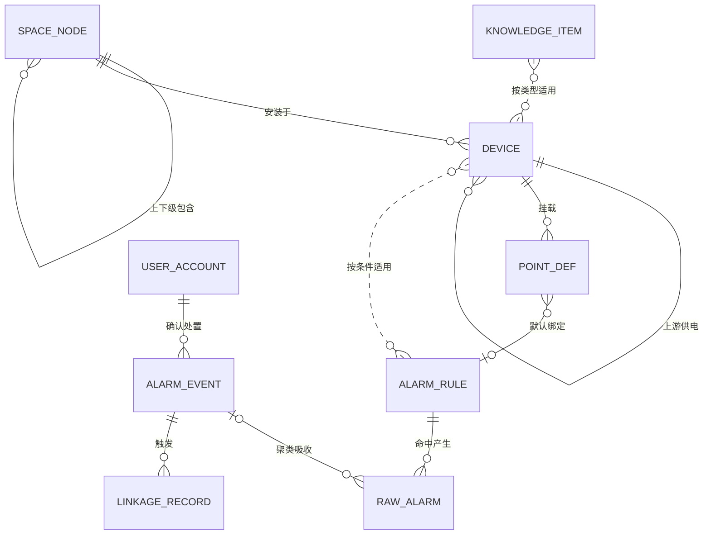
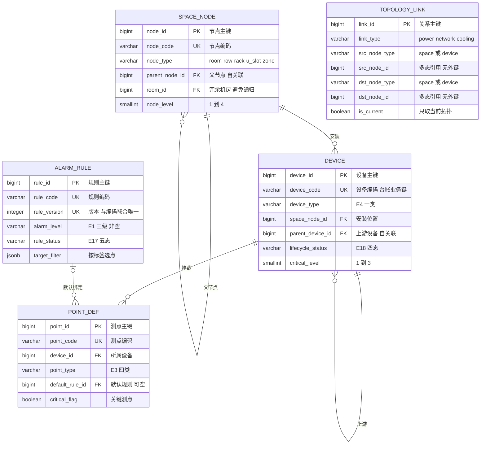
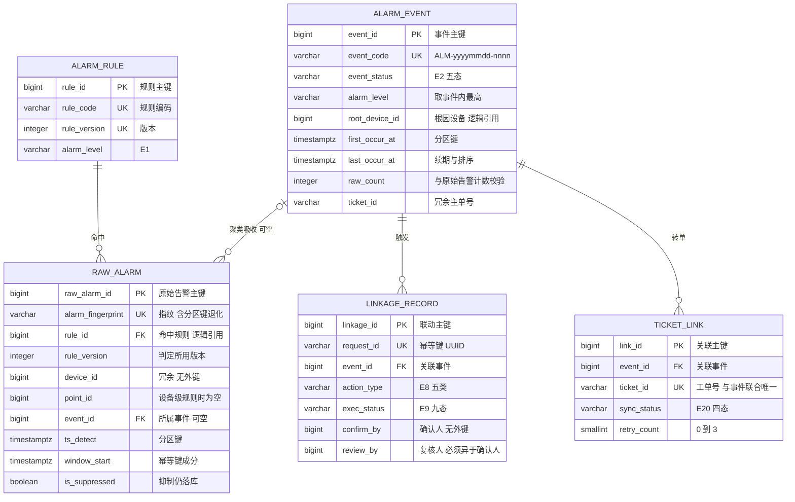
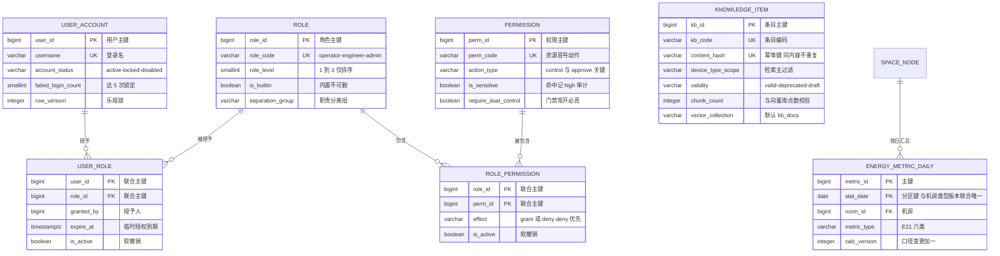
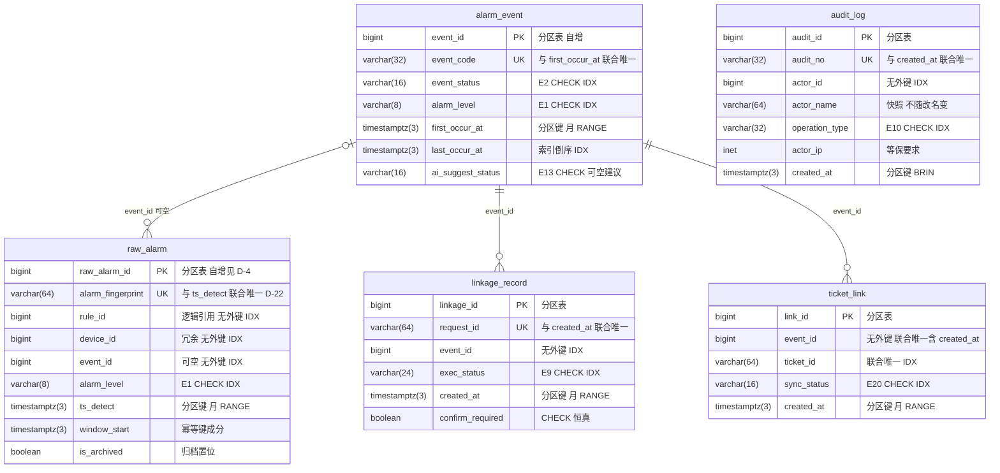

# E-R 图集（Entity-Relationship Diagram Set）

| 项 | 内容 |
|---|---|
| 文档编号 | CDCIM-P3-DB-02 |
| 版本 / 状态 | v0.2 · 草案（待评审） |
| 所属阶段 | P3 详细设计 |
| 论文价值 | ★★★★☆ 「数据库设计」「数据建模」两段的核心图件：概念 → 逻辑 → 物理三阶推导过程可直接作为「从需求到库表」的论证链，其中「三处刻意不建联系」与「分区表唯一键退化」是答辩时最能体现设计判断力的两处 |
| 上游依据 | [数据字典初稿 §3](../02-需求/08-数据字典初稿.md)（14 实体 / 23 表 / 16 组联系基数为唯一口径）、[数据库设计说明书](01-数据库设计说明书.md)（DDL 与索引，物理图字段类型以其 §3.3 为准）、[数据架构设计](../03-架构/10-数据架构设计.md)（四类存储边界）、[图表规范](../90-规范/02-图表规范.md)（`erDiagram` 约定、编号文档内唯一） |
| 下游承接 | P5 实现（按物理图建表、按关系表写校验）、P6 测试（按关系表构造引用完整性用例）、P7 论文「数据库设计」章节配图 |

> **口径声明**：本文只画关系，不定义字段语义——字段的中文名、长度、默认值、枚举取值一律以[数据字典](../02-需求/08-数据字典初稿.md)为准，物理图的类型标注须与[数据库设计说明书 §3.3](01-数据库设计说明书.md) 的 DDL 逐字一致，任一处不一致以 DDL 为准并回改本图。
>
> **编号约定**：图 `FIG-DB-00N`、表 `TAB-DB-00N`，**本文档内唯一**；与《数据库设计说明书》的 `TAB-DB-00N` 互不冲突（编号作用域为单文档，见[图表规范 §3](../90-规范/02-图表规范.md)）。

---

## 1. 三阶模型与读图方法

### 1.1 三阶回答三个不同的问题

**表 TAB-DB-001　三阶模型的分工**

| 阶 | 回答的问题 | 图里有什么 | 图里**没有**什么 | 本文图号 |
|---|---|---|---|---|
| **概念 E-R** | 业务世界有哪些事物、谁跟谁有关系 | 实体、关系、基数（1:1 / 1:N / N:M） | 主键、外键、字段、类型 | FIG-DB-001 |
| **逻辑 E-R** | 关系怎么落地成键，基数怎么变成外键 | 主键、关键属性、外键、基数与可选性 | 索引、分区、存储引擎 | FIG-DB-002 ~ 004 |
| **物理 E-R** | 落到哪个库、哪张表、什么类型、哪个索引 | 表名、字段类型、`PK/FK/UK`、索引标记 | 业务语义的完整解释 | FIG-DB-005 ~ 007 |

**为什么必须分三阶而不是直接画表**：概念图里「设备与测点是 1:N」这句话，在物理层会分裂成三个不同的事实——① `point_def.device_id` 是外键且 `RESTRICT`；② TDengine 侧同一关系变成「一台设备一张子表」的**隐式 1:1**；③ 跨库（PG ↔ TDengine）这一层关系**没有外键**，靠 `device_id` 值对齐。若直接从概念跳到 DDL，这三个差别会被压成一句「1:N」，评审时无法追问，实现时必然出错。

### 1.2 读图方法（四条）

| # | 读法 | 说明 |
|---|---|---|
| 1 | **先看基数符号再看标签** | `\|\|--o{` 左端「恰好一个」、右端「零到多个」；`}o--o{` 两端都可零到多（N:M）。符号比中文标签更不易误读 |
| 2 | **实线 vs 虚线** | 实线 `--` 表示**识别关系**（子表的键包含父表的键，或子表离开父表无意义）；虚线 `..` 表示**非识别关系**（仅引用）。本项目 90% 是实线，两处例外在 §5 标注 |
| 3 | **英文实体名 + 图注中文** | Mermaid `erDiagram` 不支持实体别名，故实体 ID 一律用英文大写（`ALARM_EVENT`），中文名见图下「实体对照」小表 |
| 4 | **物理图的 `IDX` 标记不等于索引名** | `IDX` 表示「该列参与了某个二级索引」，具体索引名与理由见[数据库设计说明书 TAB-DB-002](01-数据库设计说明书.md) |

### 1.3 三处刻意不建联系（图上一律不画线，只在本表登记）

这三处不是遗漏，是设计决定，且每一处都有代价。**注意区分**：§2 概念图里的两条虚线（规则按条件适用设备、知识按类型适用设备）属于「有联系但不建外键」；下面三条属于「连联系都不该画」，因为一画就会让人以为库层有约束。

| # | 不建的联系 | 为什么 | 代价 |
|---|---|---|---|
| 1 | `RAW_ALARM` ↔ 时序明细 | 跨库（PG ↔ TDengine），无分布式事务 | 告警详情页看「触发时的曲线」需应用层按「设备 + 测点 + 时间窗」二次查询，多一次往返 |
| 2 | `AUDIT_LOG` ↔ `USER_ACCOUNT` | 用户禁用/清理后审计必须仍可追溯 | 操作人存 `actor_id` + `actor_name` 双份，改名后历史记录显示旧名（这是**要求**，不是缺陷） |
| 3 | `TOPOLOGY_LINK` ↔ 任意节点 | 多态引用（可能指 `space_node` 或 `device`），无法建单一外键 | 悬空引用靠每日巡检发现，环路靠应用层保存时检测 |

---

## 2. 概念 E-R（9 个实体，不含字段）

**图 FIG-DB-001　CDCIM 概念 E-R：业务实体与联系**



**图注**：这张图回答「业务上有哪些事物、它们靠什么连起来」。三处虚线是刻意的非识别关系——「规则按条件适用」与「知识按类型适用」都不是外键，而是「值匹配」（`target_filter` 与 `device_type_scope`），画成虚线提醒实现者：**这两条关系的变化不会由数据库报错，只能靠应用层校验**。

**实体对照**

| 英文实体 | 中文实体 | 说明 |
|---|---|---|
| `SPACE_NODE` | 机房空间节点 | 机房 → 列 → 机柜 → U 位，四级自关联 |
| `DEVICE` | 设备台账 | 300 台，自关联表达供电/网络上游 |
| `POINT_DEF` | 测点定义 | 2 000 个，是时序数据的语义来源 |
| `ALARM_RULE` | 告警规则 | 多版本并存，按 `target_filter` 批量选点 |
| `RAW_ALARM` | 原始告警 | 只追加，是被聚类的原料 |
| `ALARM_EVENT` | 告警事件 | 有状态机（5 状态 / 9 条合法迁移） |
| `LINKAGE_RECORD` | 联动记录 | 控制类，需双人复核 |
| `USER_ACCOUNT` | 用户账号 | 60 人，三角色 |
| `KNOWLEDGE_ITEM` | 知识库条目 | 500 条，切 5 万向量 chunk |

> **为什么概念图是 9 个实体，而字典是 14 个**：账要这么算。字典把告警算作 **1 个实体**（E8，含规则 / 原始 / 事件三张表），概念图把它拆成 3 个框（「规则命中 → 原始告警 → 聚类成事件」在业务上是三段不同的东西，合成一个框反而看不懂），于是 9 个框对应字典的 **7 个实体**（空间、设备、测点、告警、联动、权限模型、知识）。剩下 **7 个**（测点时序、降采样、迟到旁路、拓扑关系、工单关联、审计日志、能效指标）全部未画，因为它们都是派生或辅助性质——不产生新的业务语义，只改变数据形态或留痕方式。7 + 7 = 14，账对得上；而角色与权限在概念层被折叠进「用户」一个框，到逻辑层（FIG-DB-004）才展开为五张表。

---

## 3. 逻辑 E-R（主键、关键属性、外键基数）

按域拆三张图，每张 ≤ 8 个实体，避免论文排版看不清。

### 3.1 资产与配置域

**图 FIG-DB-002　逻辑 E-R：空间、设备、测点、规则**



**图注**：`TOPOLOGY_LINK` 两端各有两个「类型判别列 + ID 列」，这是多态引用的标准写法；它**故意孤立**在图中（不连任何实体），因为没有物理外键可画——若强行画连线，会误导实现者以为库层有约束。

### 3.2 告警与处置域

**图 FIG-DB-003　逻辑 E-R：原始告警、事件、联动、工单**



**图注**：`ALARM_EVENT |o--o{ RAW_ALARM` 的左端是 `|o`（零或一）而不是 `||`——一个事件可以没有任何原始告警吗？不可以；但一个原始告警可以不属于任何事件（未被聚类），所以**可选性在右端**：`RAW_ALARM.event_id` 可空。这张图的基数符号若写成 `||--o{`，就等于宣称「每条原始告警必属一个事件」，与字典 §4.8「空表示未被聚类」矛盾。

### 3.3 权限、知识与派生域

**图 FIG-DB-004　逻辑 E-R：权限模型、知识库、能效指标**



**图注**：`ENERGY_METRIC_DAILY` 的 `stat_date` 被标为 `PK`，是因为唯一键 `(room_id, stat_date, metric_type, calc_version)` 中的 `stat_date` 同时是分区键——在物理层它必须参与唯一索引（见 §4.3 与[数据库设计说明书 D-3](01-数据库设计说明书.md)）。`SPACE_NODE` 只在此图出现一次作为外部引用（该实体已在 FIG-DB-002 定义），这是跨图复用的合法做法，避免同一实体在两张图里画出不同属性。

---

## 4. 物理 E-R（表名、字段类型、索引标记）

### 4.1 资产与配置域

**图 FIG-DB-005　物理 E-R：`space_node` / `device` / `point_def` / `alarm_rule` / `topology_link`**

```mermaid
erDiagram
    space_node {
        bigint node_id PK "自增 代理键"
        varchar(64) node_code UK "业务唯一键 IDX"
        varchar(16) node_type "E16 CHECK"
        bigint parent_node_id FK "RESTRICT IDX"
        bigint room_id FK "RESTRICT IDX 冗余"
        smallint node_level "CHECK 1 到 4"
        timestamptz(3) updated_at "触发器维护"
    }
    device {
        bigint device_id PK "自增"
        varchar(64) device_code UK "台账业务键"
        varchar(32) device_type "E4 CHECK IDX"
        bigint space_node_id FK "RESTRICT IDX"
        bigint parent_device_id FK "RESTRICT IDX 自引用"
        varchar(16) lifecycle_status "E18 CHECK IDX"
        varchar(16) online_status "部分索引 IDX"
        integer row_version "乐观锁"
    }
    point_def {
        bigint point_id PK "自增 TDengine 冗余存储"
        varchar(64) point_code UK "格式 CHECK"
        bigint device_id FK "RESTRICT IDX"
        varchar(16) point_type "E3 CHECK IDX"
        numeric(12,6) scale_factor "大于 0 CHECK"
        boolean critical_flag "部分索引 IDX"
        bigint default_rule_id FK "RESTRICT IDX"
    }
    alarm_rule {
        bigint rule_id PK "自增"
        varchar(64) rule_code UK "与版本联合唯一"
        jsonb target_filter "GIN jsonb_path_ops IDX"
        varchar(8) alarm_level "E1 CHECK 非空 IDX"
        varchar(16) rule_status "E17 CHECK IDX"
        integer rule_version "与编码联合唯一"
        varchar[] notify_channels "默认 screen 与 im"
    }
    topology_link {
        bigint link_id PK "自增"
        varchar(16) link_type "CHECK IDX"
        bigint src_node_id "多态 无外键 IDX 部分"
        bigint dst_node_id "多态 无外键 IDX 部分"
        boolean is_current "部分索引谓词"
        timestamptz(3) eff_from "与五列联合唯一"
    }

    space_node ||--o{ space_node : "parent_node_id"
    space_node ||--o{ device : "space_node_id"
    device ||--o{ device : "parent_device_id"
    device ||--o{ point_def : "device_id"
    alarm_rule |o--o{ point_def : "default_rule_id"
```

**图注**：这张图回答「哪一列是键、哪一列带索引、哪一列有 CHECK」。三处细节值得注意：① `space_node` 有两个自引用外键（`parent_node_id` 与 `room_id` 都指向自己），这是「层级 + 冗余机房」双写法；② `device.online_status` 的索引是**部分索引**（只索引非 `online` 行），图中以 `部分索引 IDX` 标注；③ `topology_link` 的两个 ID 列都是**部分索引**，谓词 `WHERE is_current` 不是列，所以只能标在图注里。

### 4.2 告警与审计域

**图 FIG-DB-006　物理 E-R：`raw_alarm` / `alarm_event` / `linkage_record` / `ticket_link` / `audit_log`**



**图注**：本域五张表**全部按月分区**，图中只标了分区键，分区策略见[数据库设计说明书 §6](01-数据库设计说明书.md)。`audit_log` 与 `user_account` 之间**没有连线**——这是 §1.3 的第 2 条刻意不建联系，`actor_id` 只是值，不是外键。

### 4.3 权限、知识与派生域

**图 FIG-DB-007　物理 E-R：权限五表、知识条目、能效日指标**

```mermaid
erDiagram
    user_account {
        bigint user_id PK "自增"
        varchar(64) username UK "格式 CHECK"
        varchar(128) password_hash "Argon2id 不存明文"
        varchar(16) account_status "CHECK IDX"
        smallint failed_login_count "0 到 10 CHECK"
        integer row_version "CHECK 大于等于 1"
    }
    role {
        bigint role_id PK "自增"
        varchar(32) role_code UK "E12 CHECK"
        smallint role_level "仅排序 不做继承"
        varchar(32) separation_group "职责分离校验"
        varchar(16) role_status "CHECK IDX"
    }
    permission {
        bigint perm_id PK "自增"
        varchar(64) perm_code UK "资源冒号动作"
        varchar(16) module "M1 到 M6 CHECK IDX"
        varchar(16) action_type "CHECK IDX"
        boolean is_sensitive "部分索引 IDX"
    }
    user_role {
        bigint user_id PK "联合主键 FK"
        bigint role_id PK "联合主键 FK IDX"
        bigint granted_by "RESTRICT"
        boolean is_active "软撤销"
    }
    role_permission {
        bigint role_id PK "联合主键 FK"
        bigint perm_id PK "联合主键 FK IDX"
        varchar(8) effect "grant 或 deny CHECK"
        boolean is_active "软撤销"
    }
    knowledge_item {
        bigint kb_id PK "自增"
        varchar(64) kb_code UK "业务唯一"
        varchar(64) content_hash UK "幂等键"
        varchar[] tags "GIN IDX"
        varchar(32) device_type_scope "检索主过滤 IDX"
        text content_text "切片前原文"
    }
    energy_metric_daily {
        bigint metric_id PK "分区表"
        date stat_date PK "分区键 年 RANGE"
        bigint room_id FK "RESTRICT IDX"
        varchar(24) metric_type "E21 CHECK IDX"
        integer calc_version "与三列联合唯一"
        numeric(12,4) metric_value "PUE 大于等于 1"
    }

    user_account ||--o{ user_role : "user_id"
    role ||--o{ user_role : "role_id"
    role ||--o{ role_permission : "role_id"
    permission ||--o{ role_permission : "perm_id"
    space_node ||--o{ energy_metric_daily : "room_id RESTRICT"
```

**图注**：`user_role` / `role_permission` 的联合主键两列都标 `PK`，同时分别标 `FK` 与 `IDX`（`role_id`、`perm_id` 方向需要反查索引，`user_id` 方向由主键覆盖）。`energy_metric_daily` 是七张分区表中唯一按**年**分区的（3 650 行/年，按月分区的元数据开销不划算）。

---

## 5. 关系说明表

**表 TAB-DB-002　实体关系、基数、可选性、级联策略**

| # | 关系 | 基数 | 可选性 | 级联策略 | 说明 |
|---|---|---|---|---|---|
| 1 | 空间节点 — 空间节点 | 1 : N（自关联） | 父端必填（room 除外） | 物理外键 `ON DELETE RESTRICT` | 四级不可跳（rack 父必须 row），CHECK `ck_space_node_root` + 应用层共同保证 |
| 2 | 空间节点 — 设备 | 1 : N | 设备端**必填** | 物理外键 `RESTRICT` | 一台设备安装于一个机柜或 U 位；`space_node_id` 是 3D 定位与影响范围起点 |
| 3 | 设备 — 设备 | 1 : N（自关联） | 可空（无上游） | 物理外键 `RESTRICT` + CHECK 禁自指 | `A→B→A` 环由应用层保存时检测；物理层只挡 `A→A` |
| 4 | 设备 — 测点 | 1 : N | 测点端**必填** | 物理外键 `RESTRICT` | TDengine 侧同一关系变为「一测点一子表」的隐式 1:1（无外键）：子表名 `m_<point_id>`，`device_id` 仅作 TAG |
| 5 | 规则 — 测点 | 1 : N | 可空（未预绑规则） | 物理外键 `RESTRICT` | 仅「默认绑定」；实际生效由 `target_filter` 值匹配决定，不走外键 |
| 6 | 规则 — 设备 | N : M（值匹配） | — | **无外键**（虚线非识别关系） | `target_filter @> '{"device_type":"ups"}'`，按标签批量选点；GIN 索引服务此匹配 |
| 7 | 规则 — 原始告警 | 1 : N | 原始告警端必填（逻辑） | **无外键**（事件类表不建） | 一条规则命中多次；`rule_version` 快照保证规则改版后可复盘 |
| 8 | 事件 — 原始告警 | 1 : N | 原始告警端**可空** | **无外键** | 空 = 未被聚类（独立告警）；这是左端用 `\|o`（零或一）而非 `\|\|`（恰好一）的原因 |
| 9 | 事件 — 联动记录 | 1 : N | 联动端必填（逻辑） | **无外键** | 一个事件可触发多次联动（门禁 + 抓拍），每次一条记录 |
| 10 | 事件 — 工单 | 1 : 0..1（主单） | 可空 | **无外键** | `alarm_event.ticket_id` 只冗余主单号；一个事件可开多张工单，落在 `ticket_link` |
| 11 | 拓扑关系 — 任意节点 | N : N（多态） | 两端均必填 | **无外键** | 多态引用，每日巡检悬空引用与自环；环路由应用层检测 |
| 12 | 知识条目 — 向量切片 | 1 : N | — | **无外键**（跨库 Qdrant） | 1 篇切 10~200 chunk，靠 `payload.kb_id` 对齐；`chunk_count` 与 Qdrant 点数每日校验 |
| 13 | 用户 — 角色 | N : M | — | 物理外键 `RESTRICT` | 经 `user_role`，`is_active` 软撤销；`expire_at` 支持临时授权 |
| 14 | 角色 — 权限 | N : M | — | 物理外键 `RESTRICT` | 经 `role_permission`，`effect='deny'` 优先于 `grant`（默认拒绝的数据层表达） |
| 15 | 用户 — 审计日志 | 1 : N | 审计端必填 | **无外键** | `actor_id` + `actor_name` 双份快照，用户禁用后仍可追溯 |
| 16 | 机房 — 能效日指标 | 1 : N | 指标端必填 | 物理外键 `RESTRICT` | 每机房每日每指标每版本一行；唯一键含 `calc_version` 支持口径变更后并存 |
| 17 | **原始告警 — 时序明细** | *不建* | — | **跨库，无任何约束** | 靠 `trace_id` 与「设备 + 测点 + 时间窗」在应用层关联（§1.3 第 1 条） |
| 18 | **告警事件 — 审计日志** | *不建* | — | 无关联 | 审计按 `target_type='alarm'` + `target_id=event_id` 值匹配，不做外键 |

**三处「无外键」的共性判据**：只要满足以下任一条，就不建物理外键——① 跨库（PG ↔ TDengine / Qdrant）；② 被引用对象可能被清理（用户、历史事件）；③ 多态引用。**判据的反面同样重要**：台账类（`space_node` / `device` / `point_def` / `alarm_rule`）必须建外键，因为它们的删除是「误操作」而非「正常业务」，需要库层拦住。

---

## 6. 与数据字典的一致性核对

### 6.1 实体与表数核对：14 / 23，完全吻合

**表 TAB-DB-003　14 个逻辑实体 → 23 张物理表的映射**

| # | 逻辑实体 | 物理表 / 集合 | 表数 | 所在存储 |
|---|---|---|---|---|
| E1 | 测点定义 | `point_def` | 1 | PostgreSQL |
| E2 | 设备台账 | `device` | 1 | PostgreSQL |
| E3 | 机房空间节点 | `space_node` | 1 | PostgreSQL |
| E4 | 拓扑关系 | `topology_link` | 1 | PostgreSQL |
| E5 | 测点时序值 | `st_metric`（+ 2 000 子表） | 1 | TDengine |
| E6 | 三级降采样 | `st_metric_1m` / `st_metric_5m` / `st_metric_1h` | 3 | TDengine |
| E7 | 迟到数据旁路 | `telemetry_late_bypass` | 1 | PostgreSQL |
| E8 | 告警（规则 / 原始 / 事件） | `alarm_rule` / `raw_alarm` / `alarm_event` | 3 | PostgreSQL |
| E9 | 联动记录 | `linkage_record` | 1 | PostgreSQL |
| E10 | 工单关联 | `ticket_link` | 1 | PostgreSQL |
| E11 | 审计日志 | `audit_log` | 1 | PostgreSQL |
| E12 | 知识库（元数据 + 向量） | `knowledge_item` / `kb_docs`（collection） | 2 | PostgreSQL + Qdrant |
| E13 | 权限模型（用户 / 角色 / 权限 / 两张关联） | `user_account` / `role` / `permission` / `user_role` / `role_permission` | 5 | PostgreSQL |
| E14 | 能效日指标 | `energy_metric_daily` | 1 | PostgreSQL |
| — | **合计** | — | **23** | 18 PG + 4 TDengine + 1 Qdrant |

**核对结论**：实体 **14** 个、物理表 **23** 张，与字典 §3.1 完全一致，**0 条不一致**。

### 6.2 三处需要解释的口径（不算不一致，但必须写清）

| # | 现象 | 解释 |
|---|---|---|
| 1 | 字典 §3.1 表中有 23 行，其中「运行态键空间 `cdcim:*`」占 1 行但**不计入 23 张表** | 该行是 Redis 的键空间说明（8 类 key），不是表。23 张 = 18 PG + 4 TDengine + 1 Qdrant，Redis 单列说明 |
| 2 | E5 的「+ 2 000 子表」不计入表数 | 子表是超级表的物理分片单位，不是独立逻辑表；本文与字典同口径。**逻辑上等价于 2 000 张子表（一测点一表），图中以超级表 `st_metric` 一个实体表示**。降采样另有 6 000 张子表（3 × 2 000），同样不计 |
| 3 | 字典 §1.1 称「10 项数据实体 + 2 类派生」= 12，而 §3.1 称 14 个逻辑实体 | 14 = 10（SRS 原始）+ 2（派生：降采样、能效）+ 2（权限模型拆分后的用户/角色权限、旁路辅助）——字典 §3.1 的表述已自洽（「权限模型拆分 + 旁路辅助表」），本文沿用 14 |

### 6.3 与 DDL 的字段数核对

| 表 | 字典字段数 | DDL 字段数 | 结论 |
|---|---|---|---|
| `point_def` | 22 | 22 | 一致 |
| `device` | 25 | 25 | 一致 |
| `space_node` | 18 | 18 | 一致 |
| `topology_link` | 15 | 15 | 一致 |
| `raw_alarm` | 24 | 24 | 一致 |
| `alarm_event` | 30 | 30 | 一致 |
| `alarm_rule` | 28 | 28 | 一致 |
| `linkage_record` | 26 | 26 | 一致 |
| `ticket_link` | 15 | 15 | 一致 |
| `audit_log` | 22 | 22 | 一致 |
| `knowledge_item` | 22 | 22 | 一致 |
| `user_account` | 21 | 21 | 一致 |
| `role` | 13 | 13 | 一致 |
| `permission` | 12 | 12 | 一致 |
| `user_role` | 7 | 7 | 一致 |
| `role_permission` | 6 | 6 | 一致 |
| `telemetry_late_bypass` | 15 | 15 | 一致 |
| `energy_metric_daily` | 18 | 18 | 一致 |
| **合计** | **339** | **339** | 一致，**未新增任何字段** |

> **339 与字典「382 字段」的关系**：382 是字典对**全部 23 张表**的总口径，其中包含 TDengine 侧的列与 TAG、以及 Qdrant 的 12 个 payload 字段，与「PG 18 张表的列数」不是同一个分母，不能直接相减。本文核对的判据是**逐表 1:1 对得上**（见上表 18 行），而不是总数相等；TDengine 侧 4 张超级表的列数与 TAG 数已在[数据库设计说明书 §4.1](01-数据库设计说明书.md) 与字典 §4.5 逐一对齐（11+5、11+4、11+4、8+4）。

### 6.4 偏差登记（与《数据库设计说明书》§3.5 同步，共 5 条）

| 编号 | 偏差 | 对 E-R 图的影响 |
|---|---|---|
| D-1 | 时序子表按**测点**建（一测点一表，2 000 + 6 000 = 8 000 张），`PRECISION 'ms'`，写入不加偏移 | 概念/逻辑图不受影响（TDengine 不在 E-R 图内，只以 E5 一行出现）；物理图亦不拆分子表，以超级表表示 |
| D-2 | TDengine 拆 4 库 | 同上，不影响 PG 侧 E-R |
| D-3 | 5 张分区表唯一键含分区键 | 物理图 FIG-DB-006 的 `UK` 标记已按退化后的复合键标注（如 `alarm_fingerprint` 的 `UK` 注为「与 `ts_detect` 联合唯一」） |
| D-4 | 分区表标识列的序列兜底 | 不影响图 |
| D-5 | 外键统一 `RESTRICT` | §5 关系表「级联策略」列按实际 DDL 标注，与字典「台账类 RESTRICT」一致 |

---

## 7. Mermaid 渲染注意事项

本节是给后续维护者的操作说明，不是理论——本项目已在架构阶段踩过两次渲染失败。

| # | 规则 | 反例（渲染失败或错乱） | 正确写法 |
|---|---|---|---|
| 1 | **实体 ID 用英文大写，不用中文** | `设备 \|\|--o{ 测点 : "挂载"` | 实体定义 `DEVICE` / `POINT_DEF`，中文放属性注释与图注 |
| 2 | **关系标签一律双引号包裹** | `DEVICE \|\|--o{ POINT_DEF : 挂载` | `DEVICE \|\|--o{ POINT_DEF : "挂载"` |
| 3 | **属性注释也要双引号，且不能含未转义引号** | `bigint id PK 设备主键` | `bigint id PK "设备主键"` |
| 4 | **类型里不要出现空格与中括号** | `numeric (12,6)` | `numeric(12,6)`（括号紧贴类型名） |
| 5 | **避免 SQL 保留字做实体名** | `USER`、`ORDER`、`GROUP`、`KEY` | `USER_ACCOUNT`、`ALARM_RULE`（本集全部加后缀规避） |
| 6 | **属性名不要以 `_` 结尾或含 `-`** | `val-double` | `val_double` |
| 7 | **基数符号必须成对，左端只能取 `\|o` `\|\|` `}o` `}\|`** | `o{--\|\|`（左右写反） | 左父右子：`DEVICE \|\|--o{ POINT_DEF` |
| 8 | **单图实体 ≤ 9，属性 ≤ 10/实体** | 一张图画 18 张表 | 按域拆图（本文 7 张图） |
| 9 | **虚线仅表达非识别关系** | 用虚线画外键关系 | 外键用实线；值匹配/跨库/多态用虚线 |
| 10 | **不要在 `erDiagram` 里写 `%%` 注释以外的 Markdown** | 图中夹 `**加粗**` | 说明一律放图注表格 |

**一条经验**：`erDiagram` 的报错信息只说「Parse error on line N」，不给具体原因，且中文标签出错时行号常指向上一行。因此**改图后必须在 Mermaid Live Editor 渲染一次**（[图表规范 §6](../90-规范/02-图表规范.md) 的导出流程会自动校验）；本集的 7 张图已按上表规则逐条核对，但**未经实际渲染验证**，P4 导出 SVG 时若失败，优先检查规则 2 与 4。

---

## 考点映射

| 考纲知识点 | 本文件对应内容 | 论文可用位置 | 真题溯源 |
|---|---|---|---|
| **E-R 模型与三阶建模** | §1.1 三阶分工、§2 概念图、§3 逻辑图、§4 物理图 | 论文「数据库设计」段的主体：先概念后逻辑再物理，每一阶只回答一类问题 | 历年案例「数据库设计」高频 |
| **基数与可选性的判定** | §5 关系表 18 行、§3.2 图注（`\|o--o{` 与 `\|\|--o{` 的区别为何影响业务正确性） | 论文「数据建模」段：基数写错不是画错图，是写错约束 | 案例题「E-R 设计」 |
| **关系模式的范式与落地** | §5 第 13/14 行（N:M 展开为关联表）、§1.3 刻意不建联系的三条判据 | 论文「数据库设计」段：什么时候**不**建外键，比什么时候建更能体现判断 | 案例题「数据库优化」 |
| **参照完整性与级联策略** | §5「级联策略」列、`RESTRICT` / 无外键的分野 | 论文「数据完整性」段：台账类必须挡，事件类不能挡 | 案例题「数据完整性设计」 |
| **物理设计与分区的影响** | §4.2 图注（五张分区表）、§6.4 D-3（唯一键退化在图上的标注） | 论文「物理设计」段：逻辑上 1 个唯一键，物理上必须变成复合键 | 案例题「数据库性能优化」 |
| **数据治理（模型一致性）** | §6 三张核对表（14/23、字段数逐表核对、偏差登记） | 论文「数据治理」段：模型与字典的一致性是可核查的，不是口头承诺 | 2023 下「论数据治理」 |
| **文档可维护性** | §7 十条渲染规则 + 「报错行号指向上一行」的经验 | 论文「工程实践」段的细节佐证（可选） | — |

---

## 论文可引用段落

> **【适用题目类型】论数据库设计 / 论数据建模 / 论信息系统设计**

我把数据建模分成三阶来做，每一阶只回答一类问题。概念图里只有九个实体，我把拓扑关系、审计日志、降采样这些都拿掉了，因为它们不产生新的业务语义，只改变数据的形态；概念图的价值是让人一眼看懂业务，穷举反而模糊重点。逻辑阶要回答的是「关系怎么变成键」，这里我特意标出了两处可选性：一条原始告警可以不属于任何事件，因为未被聚类的告警是合法的；而一个事件不可能没有原始告警。这个差别在图上就是零或一与恰好一的区别，写错一个符号，库里的约束就错了，业务上会出现永远聚不了类也关不掉的事件。物理阶碰到的是分区带来的连锁反应：五张告警与审计类表按月分区，而分区表要求唯一索引包含分区键，原本的告警指纹唯一约束只能退化成指纹加判定时刻。我没有悄悄改掉它，而是把理由写进偏差表和决策台账——去重窗口只有五分钟，跨月的同指纹重复在业务上不可能发生。三阶走完，十四实体、二十三张表，其中十八张关系表合计三百三十九个字段，逐表核对无缺口。

（约 300 字）

---

## 变更记录

| 版本 | 日期 | 变更 |
|---|---|---|
| v0.1 | 2026-11-27 | 初稿。三阶模型分工与读图方法、概念 E-R（9 实体 / 11 联系）、逻辑 E-R 三张（资产配置 5 / 告警处置 5 / 权限知识派生 7）、物理 E-R 三张（含类型、`PK/FK/UK` 与索引标记）、18 行关系说明表（含 3 处刻意不建联系）、14 实体对 23 表的映射核对与 18 张 PG 表 339 字段逐表核对（0 缺口）、5 条偏差登记、10 条 Mermaid 渲染规则 |
| v0.2 | 2026-11-27 | 时序建模裁决落实：E5 子表数由「约 300（按设备）」改为「2 000（一测点一表）」，降采样 900 → 6 000；§6.2 补「逻辑上等价于 2 000 张子表，图中以超级表表示」；关系表第 4 行由「一设备一子表」改为「一测点一子表（`m_<point_id>`、`device_id` 作 TAG）」；`device_code` 的「子表名来源」注释改为「台账业务键」；偏差 D-1 由「`ts` 精度 us + 微秒偏移」改为「按测点建子表、`PRECISION 'ms'`、不加偏移」 |
