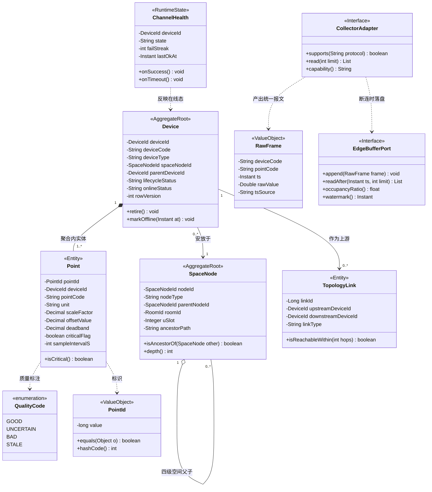
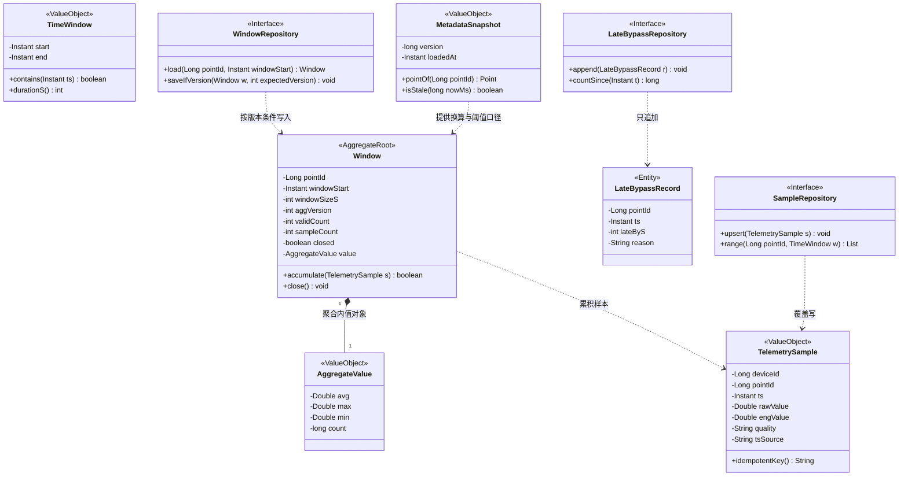
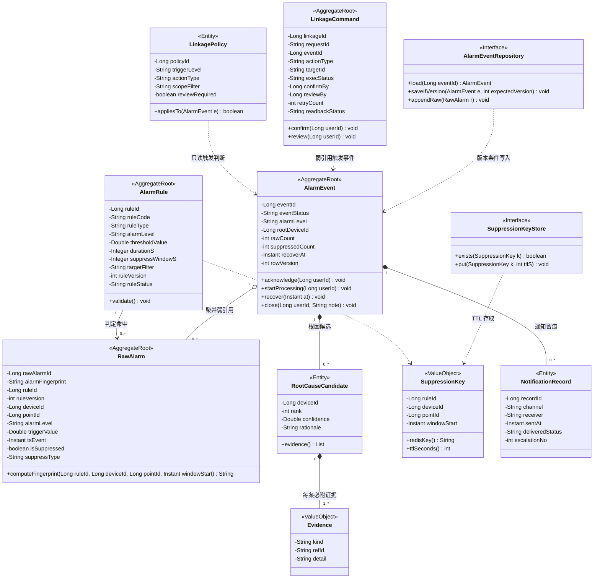
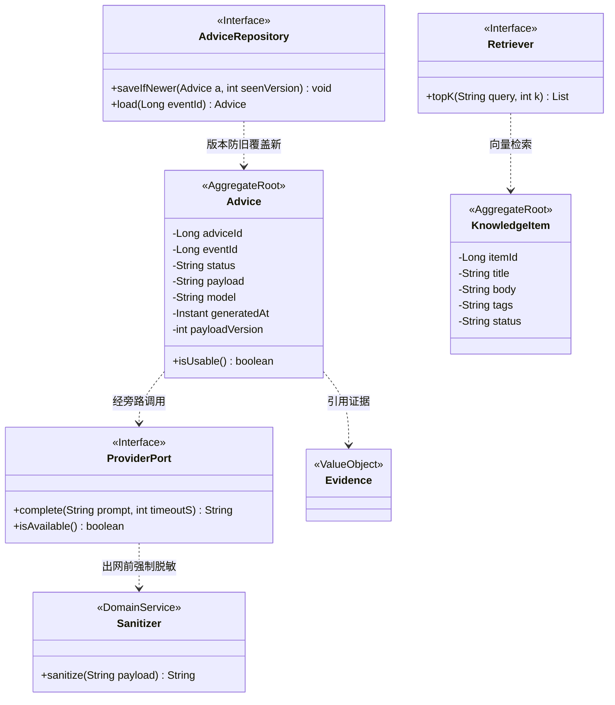

# 类图与领域模型

| 项 | 内容 |
|---|---|
| 文档编号 | CDCIM-P3-DD-01 |
| 版本 / 状态 | v0.1 · 草案（待评审） |
| 所属阶段 | P3 详细设计 |
| 论文价值 | ★★★★★ 论文「领域建模」「面向对象设计」「设计模式应用」三题的**主体素材**。§3 的 9 个聚合与「一个事务只改一个聚合」的划法、§4 值对象的判等与不可变性、§5 领域服务「为什么不放进实体」的四条理由、§6 七个模式的「不用的后果」，都是答辩被追问「你的类为什么这样分」时的正面回答。§3 的跨聚合一致性列与《限界上下文与微服务拆分》§7 的三手段直接咬合，是「无分布式事务」论证在下层的落点 |
| 上游依据 | [逻辑视图](../03-架构/04-逻辑视图.md)（12 个关键抽象、43 条不变式、十三条依赖规则）、[限界上下文与微服务拆分](../03-架构/09-限界上下文与微服务拆分.md)（6 上下文、数据所有权与单一写主体）、[需求规格说明书](../02-需求/02-需求规格说明书.md)（M3 告警 14 条、M4 联动 9 条）、[用例规约集](../02-需求/05-用例规约集.md)（UC-06/07/08/10）、[数据字典初稿](../02-需求/08-数据字典初稿.md)（23 张表 / 14 逻辑实体 / E1–E17 枚举）、[ATAM 报告](../03-架构/03-ATAM架构权衡评估报告.md)（S2 风暴判定、SP-03 抑制窗口、R-05 失效域耦合） |
| 下游承接 | 《状态机设计》（CDCIM-P3-DD-03）从本文 §3 的告警事件、联动指令、建议三个聚合展开状态；《流程图集》（CDCIM-P3-DD-04）从本文 §5 的四个领域服务展开时序；P5 骨架按 §1.2 的四层建包，按 §2.5 的类清单建文件；P6 单元测试以 §3 的「不变式」列逐条建断言用例 |

> **口径声明一（编号作用域）**：图与表编号在**本文件内唯一**，本文占用 `FIG-DD-001 ~ 005`、`TAB-DD-001 ~ 009` 段；同目录的《状态机设计》使用 `011~` 段、《流程图集》使用 `021~` 段，三段互不重叠，因此同目录内可直接以编号互相引用。跨目录引用仍须带文档名（规范 §3）。
>
> **口径声明二（本文不写什么）**：本文只表达**结构与职责**——类有什么、谁能改它、不变式挂在哪里。不含方法体、不含 SQL、不含报文 schema、不含线程与并发（属进程视图）。类名与成员名一律英文，中文只出现在图注、表头与 `%%` 注释里，避免 Mermaid 类图在中文标识符上的渲染差异。
>
> **口径声明三（与数据字典的关系）**：本文的类**不是**表的镜像。表按「写入频率与保留策略」组织（数据字典 §2），类按「一致性与不变式」组织（本文 §1.1）。两者是多对多：一个聚合可能落两张表（`alarm_event` + `raw_alarm`），一张表也可能被两个值对象投影（`st_metric` 的 `quality` 列同时服务于 `QualityCode` 与聚合计数）。映射关系集中在 §7，冲突时以**本文的聚合边界**为准，以**数据字典的字段类型**为准。

---

## 1. 建模方法与分层

### 1.1 五种建模元素的判据

判据的作用是让「为什么这个是实体、那个是值对象」可被复核，而不是靠命名习惯。每条判据都配一个**写成它会怎样**的反例，因为反例比正例更能暴露误用。

**表 TAB-DD-001　五种建模元素的判据、本文实例与反例**

| 元素 | 判据（一句话） | 本文实例 | 误用后的可观测后果 |
|---|---|---|---|
| **实体 Entity** | 有独立标识、跨多次交互身份不变、属性可变，且**生命周期受状态机约束** | `Device`、`Point`、`AlarmEvent`、`LinkageCommand` | 把 `TelemetrySample` 建成实体 → 每来一条样本都要查库判「是否已存在」，写入路径从「覆盖写」退化为「先查后写」，FR-M2-05 的幂等代价从存储层挪到应用层，P99 直接翻倍 |
| **值对象 ValueObject** | 无标识、**以值判等**、创建后不可变，替换而非修改 | `PointId`、`TimeWindow`、`SuppressionKey`、`QualityCode`、`AlarmFingerprint` | 给 `SuppressionKey` 加 setter → 一个键在缓存里被就地改写，TTL 与窗口起点不再对应，不变式 #9-① 失守且**静默**（只会多推或漏推，不报错） |
| **聚合 Aggregate** | 一个一致性边界：**一次本地事务只改一个聚合**，跨聚合只允许最终一致 | `AlarmEvent`（含 `NotificationRecord`）、`Window`（含 `AggregateValue`） | 把 `AlarmEvent` 与 `LinkageCommand` 合成一个聚合 → 联动超时会把告警事务长时间挂住，直接违反 FR-M4-07「联动失败不影响告警」 |
| **领域服务 DomainService** | 规则**跨多个聚合**、或**无自然归属实体**、或需要外部只读数据才能判定 | `RuleEvaluator`、`ClusterReducer`、`RootCauseAnalyzer`、`LinkageArbiter` | 把聚类规则塞进 `AlarmEvent.addRaw()` → 事件必须先加载全部候选原始告警才能判断「该不该归入」，聚合变成查询入口，事务范围不可控 |
| **仓储接口 Repository** | **一聚合一仓储**，只暴露聚合根，不暴露内部实体 | `AlarmEventRepository`、`WindowRepository` | 暴露 `RawAlarmRepository.update()` → 只追加表被就地改写，FR-M3-14 的「只追加不覆盖」在接口层即被破坏 |

**一条补充判据（用于实体与值对象之间的灰区）**：问「两个对象互换之后，业务上是否有区别」。`PointId(1001)` 与 `PointId(1002)` 有区别，但两者都是「一个测点标识」，且**不需要追踪它的变化**——追踪的是它指向的 `Point` 的状态，故 `PointId` 是值对象。反之 `Device` 的身份在设备改型号、换机柜、退役之后仍不变，故是实体。

### 1.2 分层与依赖方向

四层，依赖严格单向。**领域层不依赖任何框架**（不 import SQLAlchemy、不 import FastAPI），这条是 P5 能被单测覆盖的前提：43 条不变式中的 31 条可以在无数据库、无消息总线的进程内被断言。

**表 TAB-DD-002　四层职责与禁止项**

| 层 | 只做这些 | 允许依赖 | **不允许做什么** | 本文对应章节 |
|---|---|---|---|---|
| **接口层**（API / 消息消费者） | DTO 转换、参数校验、鉴权调用、错误码映射 | 应用层 | ① 不写业务判断（「这条告警能不能关」不在此层）；② 不直接调仓储；③ 不持有事务 | — （属接口契约文档） |
| **应用层**（ApplicationService） | 用例编排、事务开启与提交、领域事件发布、审计切面挂载 | 领域层、领域层定义的接口 | ① 不含业务规则（规则必须在领域层，否则同一规则会在两个用例里各写一遍）；② 不跨聚合开事务（见 §3 末段） | §5 各服务的调用方 |
| **领域层**（Entity / VO / Aggregate / DomainService / Repository 接口） | 不变式守卫、状态迁移、判定算法 | 仅 JDK 与共享内核的枚举码值 | ① 不依赖框架与 IO；② 不读系统时间以外的环境（时钟必须可注入，否则「连续 3 个周期」无法单测）；③ 不调用其他上下文 | §2 ~ §5 |
| **基础设施层**（Repository 实现 / 适配器实现 / 消息发布） | 持久化、外部平台适配、事件发送 | 领域层（**实现**其接口） | ① 不含业务判断（「这个值该不该告警」不在 SQL 里）；② 不反向调用应用层 | §7 |

**依赖倒置的具体落点**：`AlarmEventRepository` 是接口，声明在领域层；`PgAlarmEventRepository` 在基础设施层实现它。这样 `AlarmEvent.acknowledge()` 的单测可以注入一个内存实现，无需起 PostgreSQL——这是 §6 中「状态模式 + 显式迁移表」能被测试的前提。

### 1.3 从不变式到类的四步

建模不是「先画类再想约束」，而是反过来：约束决定边界。四步的顺序不可交换，因为后一步的输入是前一步的输出。

| 步 | 动作 | 判据 | 本文的产出 |
|---|---|---|---|
| 1 | **找不变式的主语** | 把 43 条不变式逐条改写成「X 必须……」句式，X 即候选聚合根 | 主语收敛为 9 个：`Device`、`SpaceNode`、`Window`、`AlarmRule`、`RawAlarm`、`AlarmEvent`、`LinkageCommand`、`Advice`、`KnowledgeItem` |
| 2 | **定聚合边界** | 若两条不变式必须**同时**为真才能判定，则其主语必须同聚合；否则拆开 | `recovered ≠ closed`（#8-②）与 `raw_count` 可对账（#8-③）必须同事务 → `RawAlarm` 与 `AlarmEvent` **拆两个聚合**（前者只追加、后者可变），靠事件 ID 弱引用而非组合 |
| 3 | **降为值对象** | 去掉标识后业务语义不变 → 值对象 | 12 个（§4），其中 `SuppressionKey` 是从「抑制键 TTL 与窗口严格一致」这条不变式反推出来的——它不是任何实体的属性，只能独立成值对象 |
| 4 | **升为领域服务** | 规则跨聚合 / 需要外部只读数据 / 无自然宿主 | 5 个（§5），其中 `RootCauseAnalyzer` 需要拓扑快照与时间序，两者都不属于任何单个聚合 |

**第 2 步的代价必须说清**：`AlarmEvent` 与 `RawAlarm` 拆开后，「事件的 `raw_count` 等于其明细条数」就**不能靠外键与同事务保证**，只能靠「判定时先追加明细、再累加计数」的顺序 + 日切对账兜底。这个代价是刻意付的，因为若合成一个聚合，风暴期 200 条原始告警会把事件聚合撑成一个大对象，每次状态迁移都要重载 200 行明细——ATAM S2 的 P99 ≤ 3 s 预算里没有这一项。

---

## 2. 核心域类图

四张图按「变更频率」分组，而不是按「模块」分组：同一张图里的类因同一类原因变化。这样一张图被改，能立即推断出影响面。每张图的类数控制在 6 ~ 11 个，成员数上限 12，超出的部分以「同构省略」注记，避免论文插图糊成一团。

### 2.1 采集台账域

**图 FIG-DD-001　采集台账域类图**——回答「设备、测点、空间、协议四类概念如何组织，以及哪些约束靠结构保证」。三处结构选择值得注意：① `Point` 是 `Device` 的**组合**（`*--`），因为「一个测点只属一台设备」且测点不能脱离设备存在；② `SpaceNode` 自关联（`o--`），因为四级空间的父子是同一类型的递归，用继承表达会得到四个类且无法表达「层级不可跳」；③ `Point` **没有** `changeScaleFactor()` 方法——不是遗漏，而是「系数一经投运不得变更」这条不变式在**接口层面**的实现：不提供方法，就没有调用点。

**对应需求**：FR-M1-01 / 04 / 05 / 07 / 08 / 09 / 10（采集、质量码、在线判定、过载降级、协议可插拔、时间戳规范化）；FR-M3-06（拓扑父子关系为父子抑制提供依据）。**对应不变式**：#1-①②③、#2-①②③、#3-①②③。

> 同构省略：`DeviceId`、`SpaceNodeId`、`RoomId` 与 `PointId` 结构完全相同（单 `long` 值 + 值判等），图中不重复绘制。这不是偷懒，而是「值对象应当同构」的证据——一个值对象需要三个字段才能判等时，通常意味着它其实是实体。

### 2.2 遥测与窗口域

**图 FIG-DD-002　遥测与窗口域类图**——回答「一条样本如何变成可信的窗口值，迟到的样本去哪里」。核心是 `Window` 的 `aggVersion` 与 `closed` 两个字段：`close()` 只允许一次，之后的重算必须走 `aggVersion + 1` **另写一行**，而不是就地改写（不变式 #5-①）。`TelemetrySample` 是值对象而非实体——它的「标识」就是 `(deviceId, pointId, ts)` 三元组本身，`idempotentKey()` 把这个三元组显式化，供 `SampleRepository.upsert` 做覆盖写，符合 FR-M2-05「写入前不做跨库去重查询」。

**对应需求**：FR-M2-01 / 03 / 05 / 06（清洗换算、三级聚合、幂等写入、乱序与迟到）；FR-M2-02（端到端时延，决定了窗口不得在写入路径上做二次查询）。**对应不变式**：#4-①②③④、#5-①②③、#12-①②③④。

### 2.3 告警与联动域

**图 FIG-DD-003　告警与联动域类图**——回答「一条判断如何变成可处置事件，以及联动为何与告警分离」。三处刻意的不对称：① `RawAlarm` 是**独立聚合根**，与 `AlarmEvent` 之间只有 `o--` 弱引用（`event_id` 可为空，表示未被聚类），因为原始告警只追加、事件可变，两者的事务边界不同；② `RootCauseCandidate` 与 `Evidence` 是**组合**且 `1..*`，把「无证据即过滤」这条不变式（#11-②）画成了基数约束——结构上不允许多重性为 0；③ `LinkageCommand` 与 `AlarmEvent` 之间**只有单向弱引用**，图中不存在从 `LinkageCommand` 指回 `AlarmEvent` 状态字段的任何箭头，这就是 FR-M4-07「联动失败不影响告警」在类图上的样子。

**对应需求**：FR-M3-01 ~ 10、14（判定、持续、变化率、分级、两类抑制、聚类、根因此处承载候选结构、状态机、原始留存）；FR-M4-01 / 02 / 05 / 09（策略、人工确认、幂等、双人复核）。**对应不变式**：#6-①②③④、#7-①②③④、#8-①②③④、#9-①②③、#10-①②③④。

### 2.4 智能旁路域

**图 FIG-DD-004　智能旁路域类图**——回答「建议为什么不能反向影响告警」。全图**没有任何一条箭头从 `Advice` 指向 `AlarmEvent` 的状态字段**，只有 `eventId` 这一个弱引用；`Advice` 不持有 `AlarmEvent` 对象，因此「把建议结果传给告警状态机」在类型上不可表达。`ProviderPort` 与 `Sanitizer` 的串联顺序是 `Advice → ProviderPort → Sanitizer → 出网`，脱敏放在端口**内部**而非调用方，这样任何新增的调用路径都必须经过它（fail-closed）。

**对应需求**：FR-M6-01 / 02 / 03 / 07 / 08（建议生成、根因建议、时延降级、脱敏、只读约束）；FR-M3-08（规则侧根因与建议并列，不互相覆盖）。**对应不变式**：#11-①②③④。

### 2.5 类清单与关键抽象的对照

36 个类：9 个聚合根、6 个实体、1 个运行态对象、1 个领域服务、10 个接口、1 个枚举、8 个值对象。它们与逻辑视图 12 个关键抽象的对应如下。**没有对应项的类必须能解释为什么存在**，否则它就是多余的抽象。

**表 TAB-DD-003　类清单与关键抽象的追溯**

| 类 | 类型 | 所属上下文 | 对应关键抽象 | 对应 FR |
|---|---|---|---|---|
| `Device` | 聚合根 | 采集接入 | #2 设备 | M1-01/07/10 |
| `Point` | 实体 | 采集接入 | #1 测点 | M1-04/05/08 |
| `SpaceNode` | 聚合根 | 采集接入 | #3 空间节点 | M5-04（3D 定位依赖）、M3-08（影响范围） |
| `TopologyLink` | 实体 | 采集接入 | #2 设备的父子关系 | M3-06（父子抑制） |
| `RawFrame` | 值对象 | 采集接入 | #4 遥测样本的前身 | M1-09（契约统一） |
| `ChannelHealth` | 运行态 | 采集接入 | — （无对应，见下注） | M1-07/08 |
| `CollectorAdapter` | 接口 | 采集接入 | — （协议可插拔的策略点） | M1-09 |
| `EdgeBufferPort` | 接口 | 采集接入 | #12 元数据快照的同层：本地资源端口 | M1-06 |
| `QualityCode` | 枚举 | 共享内核 | #4-② 质量码 | M1-05 |
| `PointId` | 值对象 | 采集接入 | #1 的标识 | — |
| `TelemetrySample` | 值对象 | 流计算 | #4 遥测样本 | M2-01/05 |
| `Window` | 聚合根 | 流计算 | #5 时间窗 | M2-03/06 |
| `AggregateValue` | 值对象 | 流计算 | #5-③ 有效点数口径 | M2-03 |
| `TimeWindow` | 值对象 | 流计算 | #5 的区间表达 | M2-06 |
| `LateBypassRecord` | 实体 | 流计算 | #5-② 迟到旁路 | M2-06 |
| `MetadataSnapshot` | 值对象 | 告警研判 / 流计算 | #12 元数据快照 | M2-09、M3-12 |
| `AlarmRule` | 聚合根 | 告警研判 | #6 告警规则 | M3-01~04/12 |
| `RawAlarm` | 聚合根 | 告警研判 | #7 原始告警 | M3-05/14 |
| `AlarmEvent` | 聚合根 | 告警研判 | #8 告警事件 | M3-07/10 |
| `RootCauseCandidate` / `Evidence` | 实体 / 值对象 | 告警研判 | #8 的根因与 #11-② 证据 | M3-08、M6-02 |
| `SuppressionKey` | 值对象 | 告警研判 | #9 抑制键 | M3-05/06 |
| `NotificationRecord` | 实体 | 告警研判 | #8 的通知留痕（内部实体） | M3-11 |
| `LinkagePolicy` | 实体 | 联动控制 | #10 的策略侧 | M4-01 |
| `LinkageCommand` | 聚合根 | 联动控制 | #10 联动指令 | M4-02/03/05/09 |
| `Advice` | 聚合根 | 智能增强 | #11 建议 | M6-01/02/03 |
| `Sanitizer` / `ProviderPort` / `Retriever` | 服务 / 接口 | 智能增强 | #11-① 只读的类型保证（端口是唯一出口） | M6-07/08 |
| `KnowledgeItem` | 聚合根 | 智能增强 | 知识条目（RAG 语料） | M6-04/05 |
| 6 个 `*Repository` + 4 个外部端口 | 接口 | 各自上下文 | 一聚合一仓储 / 防腐层端口 | — |

> **`Repository` 的一处刻意例外**：`AlarmEventRepository` 同时承担 `RawAlarm` 的追加（`appendRaw`）。按「一聚合一仓储」本应有 `RawAlarmRepository`，但两者在同一次判定事务内按「**先写明细、再累加计数**」的固定顺序写入（§3.3 第 1 条），拆成两个仓储后，这条顺序约束就没有宿主了——调用方可以任意先后，而顺序错了会让 `raw_count` 与明细对不上。把两个写方法放在同一个接口里，等于**用接口形状表达顺序约束**。代价是 `RawAlarm` 的检索也需要从这个接口走（`loadRawByEvent`），这是可接受的，因为原始告警的读路径始终以「事件 + 时间」为入口。

> **`ChannelHealth` 为什么没有对应关键抽象**：它是一个**运行态对象**，不入库、不参与事务，只承载「连续 3 个周期无响应判离线」的计数（FR-M1-07）。把它建成聚合是不对的——它的生命周期是「进程存活期」，重启即重建，且它的状态变化通过 `device_status_event` 落库而非自身落库。这一段也是《状态机设计》SM-05 的载体（对象不入库，状态机照样成立）。

---

## 3. 聚合与一致性边界

### 3.1 九个聚合

聚合的划法只有一条硬判据：**同一时刻必须同时为真的两条不变式，其主语必须在同一聚合内**；其余一律拆开，靠事件与对账收敛。下表第五列是本文最容易被评审追问的一列——拆开之后靠什么不散。

**表 TAB-DD-004　九个聚合的边界、不变式与一致性手段**

| # | 聚合根 | 内部实体 / 值对象 | 承载的不变式（摘自逻辑视图 TAB-ARCH-86） | 事务边界 | **跨聚合一致性手段** |
|---|---|---|---|---|---|
| A1 | `Device` | `Point`、`DeviceId`、`SpaceNodeId` | #2-①②③ 父子不成环、退役不删、在线态只由采集侧写 | 单设备一次事务（含全部测点） | 与 `SpaceNode`：设备安放关系变更时才校验 `spaceNodeId` 存在，用**读快照**校验，不跨聚合写 |
| A2 | `SpaceNode` | 自关联子节点、`ancestorPath` | #3-①②③ 层级不跳、`room_id` 与祖先链一致、`u_slot` 不删 | 单节点一次事务 | 与 `Device`：删除或改层级前先查「是否被设备引用」，**查询不算写**，允许瞬时不一致 |
| A3 | `Window` | `AggregateValue` | #5-①②③ 封闭后只能 `aggVersion+1` 重算、迟到 >60 s 入旁路、缺失不插值 | 单测点单窗口一次事务 | 与 `TelemetrySample`：样本先落库、再累加窗口，窗口失败不回滚样本（宁可重算，不可丢数） |
| A4 | `AlarmRule` | 阈值 / 持续 / 变化率三类参数、`ruleVersion` | #6-①②③④ 级别非空三级、版本只增、表达式白名单、生效范围非空 | 单规则单版本一次事务 | 与 `MetadataSnapshot`：规则生效靠 `meta.change` 广播，允许 ≤10 s 版本差（FR-M3-12） |
| A5 | `RawAlarm` | `alarmFingerprint`、抑制标记 | #7-①②③④ 只追加、被抑制也留存、幂等键、`ts_detect ≥ ts_event` | **一次插入即完成**（无更新路径） | 与 `AlarmEvent`：先写明细再累加 `raw_count`，日切对账兜底 |
| A6 | `AlarmEvent` | `NotificationRecord`、`RootCauseCandidate`+`Evidence` | #8-①②③④ 9 条迁移、`recovered ≠ closed`、计数可对账、单一主工单 | 单事件一次迁移一次事务 | 与 `RawAlarm`：`raw_count` 由判定侧原子累加，靠 `row_version` 条件更新防并发覆盖 |
| A7 | `LinkageCommand` | 确认 / 复核 / 回读字段 | #10-①②③④ `confirm_required` 恒真、`request_id` 幂等 24 h、复核人≠确认人、超时置未知 | 单指令一次状态迁移一次事务 | 与 `AlarmEvent`：**只读** `eventId`，无回写；失败经 `alarm.events` 另发「联动失败」告警 |
| A8 | `Advice` | `Evidence` 引用、`payloadVersion` | #11-①②③④ 类型不可作控制入参、必附证据、结果可空、只写四列 | 单建议一次写入 | 与 `AlarmEvent`：`saveIfNewer` 按版本防旧覆盖新，写失败即放弃（建议可空） |
| A9 | `KnowledgeItem` | 切片引用 | #11-④ 的延伸：条目失效以 `status` 表达，不删除 | 单条目一次事务 | 与 Qdrant：先写库再异步嵌入，嵌入失败重试，检索侧按 `status` 过滤 |

### 3.2 三条容易划错的边界

| 易错划法 | 后果 | 本文的划法与理由 |
|---|---|---|
| 把 `RawAlarm` 作为 `AlarmEvent` 的内部实体 | 事件聚合随风暴膨胀；`raw_count` 看似「天然一致」，实则每次迁移都要加载数百行；且原始告警只追加、事件可变，两者事务语义相反 | 拆两个聚合，`event_id` 弱引用（可为空）。代价是计数需对账，换来的是写入路径无放大 |
| 把 `LinkageCommand` 并入 `AlarmEvent` | 联动要 10 s 超时 + 30 s 回读，等于把告警事务挂在一个外部平台的响应上，FR-M4-07 直接失效 | 拆开；`LinkageCommand` 只持 `eventId`。联动失败另发告警事件，而不是改原事件状态 |
| 把 `Point` 从 `Device` 拆出去独立成聚合 | 「一个测点只属一台设备」「系数不可变」两条不变式失去同事务保证；协议适配按设备加载，独立后要加载两次 | 保留组合关系。代价是设备下测点多时聚合偏大（本项目单设备 ≤ 50 点，可接受） |

### 3.3 无分布式事务下的三条纪律

这三条与《限界上下文与微服务拆分》§7 一一对应，但在类图层面有更具体的含义：

1. **一次应用服务调用只开一个写事务**。`AlarmEventApplicationService.acknowledge()` 只改 `AlarmEvent` 一个聚合；`raw_count` 的累加由判定侧在**另一个**事务里完成，两者之间允许短暂不一致，靠 `raw_count` 对账任务发现（24 h 内必须发现，见拆分文档 §7.1）。
2. **聚合之间只传标识，不传对象**。`LinkageCommand` 持 `eventId` 而非 `AlarmEvent`，`Advice` 持 `eventId` 而非 `AlarmEvent`。这一条同时解决三个问题：序列化不会级联、懒加载不会跨聚合、反向写权限在类型上不存在。
3. **乐观锁只设在聚合根**。`AlarmEvent.row_version`、`LinkageCommand` 的 `request_id` 唯一键、`Window.aggVersion` 三处，分别对应「并发确认」「重复提交」「窗口重算」三类真实冲突（UC-06 E2、UC-10 E4、FR-M2-03）。

---

## 4. 值对象清单

值对象的三条纪律：**不可变**（构造后无 setter）、**整体替换**（`withXxx` 返回新实例）、**以值判等**（`equals` 比较全部构成字段）。下表第四列是「不这样判等会怎样」，比单纯声明「按值相等」更有说服力。

**表 TAB-DD-005　十二个值对象**

| # | 值对象 | 构成字段 | 不可变性保证 | 相等性判定 | 若误建为实体会怎样 |
|---|---|---|---|---|---|
| V1 | `PointId` | `long value` | `final` 字段，无 setter | `value` 相等 | 每个引用点都持有一个可变 ID 对象，改一处全局串号 |
| V2 | `DeviceId` / `SpaceNodeId` / `RoomId` | 同上（同构，图中省略） | 同上 | 同上 | 同上 |
| V3 | `TimeWindow` | `Instant start, end` | 构造时校验 `end > start` | `start` 与 `end` 同时相等 | 窗口被就地拉长，已封闭窗口的区间语义被篡改，聚合与明细口径分叉 |
| V4 | `AlarmLevel` | 枚举 `critical / major / minor` | 枚举天然不可变 | 枚举标识相等 | FR-M3-04「三级固定」失去类型保证，第四级可在运行期被写入 |
| V5 | `SuppressionKey` | `ruleId, deviceId, pointId, windowStart` | 四字段 `final`；`redisKey()` 由四字段**派生**而非存储 | 四字段全等 | 键被就地改写后 TTL 与窗口起点脱钩，不变式 #9-① 失守且静默 |
| V6 | `QualityCode` | 枚举 `good / uncertain / bad / stale` | 枚举 | 枚举标识相等 | 质量码可被下游改写，「原始值不可改」的链路失去锚点 |
| V7 | `AlarmFingerprint` | `String sha256Hex` | 由 `computeFingerprint` 纯函数生成，无构造入口 | 字符串相等 | 指纹可变 → 幂等键失效 → 重复消息变重复记录（最贵的错误，静默） |
| V8 | `TsSource` | 枚举 `device / gateway / replay / manual` | 枚举 | 枚举标识相等 | 回放数据与在线数据无法区分，FR-M2-10 的「隔离」失效 |
| V9 | `AggregateValue` | `avg, max, min, count` | 四字段 `final`，`close()` 时一次性构造 | 四字段全等（含浮点按定点比较） | 聚合值被增量改写，重算与首算结果不可复现，FR-M2-03 的误差校验失去基准 |
| V10 | `Evidence` | `kind, refId, detail` | `final` | 三字段全等 | 证据被清空或改写，「无证据即过滤」可被绕过 |
| V11 | `ReadbackResult` | `status, at, rawPayload` | `final` | 三字段全等 | 回读结果与指令状态混为一体，「结果未知」无法与「失败」区分（FR-M4-05） |
| V12 | `ActorRef` | `userId, roleCode, at` | `final` | `userId` + `roleCode` + `at` 全等 | 审计里的操作人可被替换，等保要求的不可抵赖失效 |

**两条实现纪律**：① 浮点比较（V9）统一按 `numeric(18,6)` 转定点后比较，否则 `0.1 + 0.2` 会让「同一个聚合值」被判为不等，重算校验永远失败；② 所有值对象的 `equals` 与 `hashCode` 必须同源（由同一组字段生成），这条在 P6 用「属性测试」验证——随机生成两个仅一字之差的值对象，必须判不等。

---

## 5. 领域服务

四个判定类服务 + 一个补充服务。共同点：**它们的规则跨聚合、或需要聚合之外的只读数据、或没有天然宿主**。第五列「不放进实体的理由」是本节的重点，因为「把方法塞进最近的类」是 OO 设计里最常见的滑坡。

**表 TAB-DD-006　五个领域服务**

| # | 服务 | 入参 | 出参 | 不放进实体的理由 | 时延预算 / 依据 |
|---|---|---|---|---|---|
| DS-1 | `RuleEvaluator` 规则判定 | `AlarmRule` 编译后的表达式树、`Window` 快照、`MetadataSnapshot` | `List<RawAlarm>`（未抑制的命中记录） | ① 一次判定要跨**多个** `Window`（上下限带需同点双阈值、变化率需两个窗口）；② 规则是配置、窗口是数据，两者不同聚合；③ 判定必须**纯函数**才能回放验证（FR-M2-10）——挂在实体上会带状态，回放不可复现 | 单条 ≤ 5 ms；S2 场景 1800 msg/s 下判定总耗 ≤ 1.3 s（ATAM 预算 3000 ms 中的 1300 ms） |
| DS-2 | `ClusterReducer` 聚类降噪 | `List<RawAlarm>`、`MetadataSnapshot` 的拓扑邻域、相似度阈值与 120 s 时间窗 | `List<AlarmEvent>`（新建或追加）、被抑制/被吸收的 `RawAlarm` 标记 | ① 聚类要比较**尚未属于任何事件**的原始告警；② 抑制键在 Redis，实体不应感知缓存；③ 「先判后抑制」的顺序不可交换（拆分文档 §3.3），顺序必须在服务里显式表达 | 单批 ≤ 60 ms（200 条）；相似度计算用倒排索引剪枝，不做两两比较 |
| DS-3 | `RootCauseAnalyzer` 根因关联 | `AlarmEvent`、拓扑图快照、事件内原始告警时间序 | `List<RootCauseCandidate>`（Top3，含 `Evidence` 与置信度）+ 影响范围 | ① 需要**跨设备**的拓扑遍历（设备→列头柜→UPS，2 层）；② 结果要按「最上游 + 最早 + 覆盖面」三因子排序，属于跨聚合的全局排序；③ 同步查询接口 ≤ 5 s 由 3D 定位调用，实体不该有「可被远程同步调用」的方法 | P95 ≤ 5 s（FR-M3-08）；只读内存拓扑，不触库（拆分文档 §9 例外 5） |
| DS-4 | `LinkageArbiter` 联动裁决 | `AlarmEvent`、命中策略集合、目标门当前状态、`ActorRef`（确认人 / 复核人） | `LinkageCommand` 或拒绝原因（含错误码） | ① 裁决要同时看事件、策略、目标当前状态**三方**；② 「提交人 = 复核人」的判定需要两个操作者身份，两者都不属于指令聚合的固有属性；③ 「远程开门」必须在**动作枚举校验**处拒绝，这个校验点必须早于聚合创建 | ≤ 50 ms（不含外部平台）；拒绝路径必须同步返回 403/404，不允许异步失败 |
| DS-5 | `DurationTracker` 持续时长判定 | 测点标识、条件命中序列、`durationS`、采样间隔 | 是否达标的布尔值 + 已持续秒数 | ① 计数状态在 Redis（`cdcim:dur:*`），不是聚合；② 「中途恢复则清零」要求跨多个窗口保持状态；③ 三个采样点判定（连续 3 个窗口达标）本质是**时间序列上的有限状态判定**，与 `Window` 聚合的生命周期正交 | 单点 ≤ 1 ms（纯内存计数）；键 TTL = `durationS × 3` |

**为什么没有「告警升级服务」**：升级计时（5 min 间隔、最多 3 次）曾考虑独立成服务，最终落在 `AlarmEvent` 的 `NotificationRecord.escalationNo` + 一个应用层定时器上。理由：升级只依赖**单个事件**的确认状态，不跨聚合，做成服务只会多一层间接。判据回到 §1.1——不满足「跨聚合 / 无宿主 / 需外部数据」三条中任一条的，就不该是领域服务。

---

## 6. 设计模式落点

模式的选择标准不是「用了几个」，而是**不用它会付出什么**。下表第三、四列必须成对读：先看「解决什么问题」，再看「不用的后果」，后者才是模式存在的理由。

**表 TAB-DD-007　七个模式：落点、问题与不用的后果**

| # | 模式 | 用在哪（具体类/接口） | 解决什么问题 | **不用的后果** |
|---|---|---|---|---|
| P1 | **策略 Strategy** | `CollectorAdapter`（协议族）、`RuleEvaluator` 内的 `ThresholdStrategy / DurationStrategy / RateStrategy` | 新增一类协议或一类规则时，只新增实现类，不改调用方。FR-M1-09 的验收判据是「改动 ≤ 2 个文件、下游 0 改动」 | 变成 `if protocol == "modbus" ... elif snmp ...`，每加一种协议要回归整条采集链；协议差异泄漏到报文层 |
| P2 | **适配器 Adapter** | 门禁平台适配器、视频平台适配器、`ProviderPort`（大模型） | 隔离外部协议不可控（GB/T 28181 与厂商 REST 尚未定，SRS Q-2） | 外部平台改一个字段，领域层与前端一起改；《拆分文档》§4 的防腐层失去落点 |
| P3 | **观察者 Observer** | 领域事件：`AlarmEvent` 迁移后发布 `alarm.events`；`Device` 状态变化发布 `device_status_event`；`meta.change` 广播 | 告警状态变更要同时通知 SSE 推送、联动触发、AI 任务投递、报表缓存失效，四者**都不允许反向影响告警事务** | 应用服务里串行调用四个下游，任一超时都拖慢告警；FR-M4-07「联动失败不影响告警」无法成立 |
| P4 | **状态 State** | `AlarmEvent`（9 条迁移）、`LinkageCommand`（12 条迁移）、`Advice`（4 条迁移） | 非法迁移必须**拒绝并留痕**（409），而不是静默忽略。实现为「显式迁移表 + 守卫函数」，不用每个状态一个子类 | 用 `if status == ...` 散落在各服务里，同一迁移在两处判断不一致；非法迁移被静默接受（FR-M3-10 的反例） |
| P5 | **工厂 Factory** | `AlarmRuleFactory`（按 `ruleType` 组装三类参数并校验）、`EventFactory`（按聚类结果生成事件编号与初始状态） | 构造过程本身有约束（级别必填、生效范围非空、编号规则 `ALM-YYYYMMDD-NNNN`），把这些约束关在工厂里，外部无法构造出非法对象 | 构造函数被到处调用，校验散落且遗漏；「第四级告警」只要有一处忘记校验就能写进库（FR-M3-04 要求 100% 拦截） |
| P6 | **模板方法 Template Method** | `AbstractJudgementPipeline`：`归一化 → 三采样点判定 → 抑制检查 → 分级 → 聚类 → 发布`，子类只实现 `decide()` | 判定流水线的**顺序不可交换**（先判后抑制，见拆分文档 §3.3），把骨架固定在父类，差异只在判定这一格 | 每个规则类型各写一遍流水线，顺序迟早被某个实现改坏；某天「先抑制后判定」会让被抑制的告警不再计数，压缩比指标悄悄失真 |
| P7 | **规格 Specification** | `SuppressionSpec`（同源抑制）、`ParentChildSuppressionSpec`（父子抑制）、`CoverageSpec`（根因覆盖面） | 抑制条件可组合、可单独单测、可解释（前端要展示「因何被抑制」） | 抑制条件写成深层嵌套 `if`，无法单独测；`suppress_reason` 只能填「其他」，值班员无法判断是否可信 |

**一处刻意不用模式**：仓储层**不用** Unit of Work 模式。理由是本文 §3.3 第 1 条——一次应用调用只改一个聚合，Unit of Work 解决的是「多聚合一次提交」，本项目明确不做（无分布式事务，跨聚合只最终一致）。引入它等于给自己开一条「顺手写两个聚合」的口子。

---

## 7. 与数据模型的映射

### 7.1 类与表的对应

映射原则：**聚合根对主表，内部实体对子表，值对象对字段组或独立列**。值对象**不单独建表**（`PointId` 不是一个表），只有需要被独立检索或跨聚合引用时才落列。

**表 TAB-DD-008　类 ↔ 表 / 字段的映射（节选 16 项）**

| 类 | 表 | 关键字段映射 | 说明 |
|---|---|---|---|
| `Device` | `device` | `deviceId→device_id`、`lifecycleStatus→lifecycle_status`、`onlineStatus→online_status` | `online_status` 只有采集侧可写（不变式 #2-③），DB 账号级限制 |
| `Point` | `point_def` | `scaleFactor→scale_factor`、`offsetValue→offset_value`、`criticalFlag→critical_flag` | 组合关系 → 子表带 `device_id` 外键 `ON DELETE RESTRICT` |
| `SpaceNode` | `space_node` | `ancestorPath→ancestor_path`、`uSlot→u_slot` | 自关联 `parent_node_id`，`ancestor_path` 为冗余（不变式 #3-②） |
| `TopologyLink` | `topology_link` | `upstreamDeviceId→upstream_device_id` | 独立关系表，不成环由应用层 + 递归 CTE 校验 |
| `TelemetrySample` | `st_metric` | `idempotentKey→主键 (device_id, point_id, ts)` | **不新增列**：值对象的标识直接复用表主键 |
| `Window` / `AggregateValue` | `st_metric_1m / _5m / _1h` | `aggVersion→agg_version`、`validCount→valid_count` | 一行一窗口一版本，重算即新行 |
| `LateBypassRecord` | `telemetry_late_bypass` | `lateByS→late_by_s` | 只追加 |
| `AlarmRule` | `alarm_rule` | 三类规则参数平铺为 `threshold_value / duration_s / rate_window_s` | 唯一键 `(rule_code, rule_version)` 支持多版本并存 |
| `RawAlarm` | `raw_alarm` | `alarmFingerprint→alarm_fingerprint`（唯一键）、`isSuppressed→is_suppressed` | 只追加；分区按月 |
| `AlarmEvent` | `alarm_event` | `eventStatus→event_status`、`rowVersion→row_version` | 状态机 9 条迁移见 DD-03 |
| `RootCauseCandidate` / `Evidence` | `alarm_event.impact_scope` + `raw_alarm.raw_payload` | 以 `jsonb` 存 `roots` / `evidence` | 根因是**可重算的派生结果**，不建表；`jsonb` 含 `schema_version` |
| `NotificationRecord` | 通知记录表（P3 待拆，当前并入 `alarm_event` 扩展） | `escalationNo→escalation_no` | 见 §8 待确认 2 |
| `SuppressionKey` | Redis `cdcim:sup:*` | `redisKey()` = `cdcim:sup:{ruleId}:{deviceId}:{pointId}:{windowStart}` | **不落关系库**（TTL 300 s，可丢） |
| `LinkagePolicy` | `alarm_rule`（`rule_type='linkage'`） | `actionType→action_type` | 本期并入规则表，数据字典已注明 P3 可拆 |
| `LinkageCommand` | `linkage_record` | `execStatus→exec_status`、`requestId→request_id`（唯一键） | 复核人≠确认人由 DB `CHECK` 兜底 |
| `Advice` | `alarm_event.ai_suggest_*` 四列 | `status→ai_suggest_status`、`payload→ai_suggest_payload` | **不建独立表**：建议只能写四列，是权限设计的落点 |
| `KnowledgeItem` | `knowledge_item` + Qdrant `kb_docs` | 正文入库，向量入 Qdrant | 双写以库为准，嵌入失败可重试 |

### 7.2 为什么用显式映射而不是 ORM 关系映射

选择：**SQLAlchemy Core + 手写 Repository**，不用 ORM 的关系导航（`relationship()` / 懒加载）。

| 理由 | 说明 | 若用 ORM 关系映射的后果 |
|---|---|---|
| 聚合边界 ≠ 表边界 | `AlarmEvent` 与 `RawAlarm` 是弱引用（`event_id` 可空），ORM 会把它建成一对多关系并默认级联加载 | 查一个事件顺带拉出 200 条明细，工作台列表页 P95 直接从 80 ms 涨到秒级 |
| 只追加表不允许 ORM 跟踪 | `raw_alarm`、`audit_log`、`telemetry_late_bypass` 一旦被 session 跟踪，就可能生成 UPDATE | 只追加语义被框架悄悄破坏，FR-M3-14 与等保要求同时失守 |
| 乐观锁要显式条件更新 | `UPDATE ... WHERE event_id=? AND row_version=?`，影响行数为 0 即冲突 | ORM 的版本列机制在批量与并发场景下语义不透明，冲突被吞成「最后写赢」 |
| 时序表根本不是关系模型 | TDengine 的写入是「覆盖同主键」，无事务、无外键 | ORM 映射到无事务存储，任何 `flush` 都可能部分成功 |

**代价与补偿**：显式映射要手写 9 个聚合根（连同内部实体与值对象，共 36 个类）的转换函数（`to_row` / `from_row`），约 900 行样板代码。补偿手段是把转换放在基类 `RowMapper<T>` 里按字段名约定生成，且**只为聚合根写入口**——内部实体随聚合根一起读写，不单独建映射。这笔账的结论是：样板代码可测、可读、可 grep，而 ORM 的隐式行为不可测。

---

## 8. 待确认事项

| # | 待确认点 | 本文暂定 | 备选 | 影响面 | 建议 |
|---|---|---|---|---|---|
| 1 | **`RootCauseCandidate` 是否独立成表** | 不建表，以 `alarm_event.impact_scope` 与 `raw_alarm.raw_payload` 的 `jsonb` 承载；理由是根因是**可重算的派生结果**，且 3D 定位只读当前值，不查历史根因 | 建 `alarm_root_cause` 表（事件 ID + 排名 + 设备 + 置信度 + 判据），支持「根因结论随时间变化」的复盘 | 数据字典表数（23 → 24）、FR-M3-08 的「人工指定根因作为样本」如何沉淀、P6 的根因命中率回归用例取数方式 | 建议**维持不建表**，但把「人工指定根因」这一动作写进 `audit_log` 并在 `impact_scope` 里加 `manual_root` 键——人工结论属「行为」而非「派生结果」，本就该进审计。若 P6 需要按根因做统计回归，再建表并回填 |
| 2 | **`NotificationRecord` 的落点** | 本期并入 `alarm_event` 的扩展字段（`escalation_no` 等），不建独立表 | 建 `notification_record` 表（事件 ID + 渠道 + 接收人 + 送达状态 + 升级次数），一条告警多行 | 数据字典表数、FR-M3-11 的「通知链路展示」实现方式、通道失败率统计的取数成本 | 建议**在 P3 末裁决**：若「通知链路展示」需要在事件详情里列出每次升级的渠道与时刻（UC-09 主场景 6），单行扩展字段不够用，应建表；否则维持。倾向建表，因为它同时承担「通道健康度」统计的数据源 |

---

## 考点映射

| 考纲知识点 | 本文件对应内容 | 论文可用位置 | 真题溯源 |
|---|---|---|---|
| **面向对象分析与设计（OOAD）** | §1.1 五种元素的判据与反例、§1.3 从不变式到类的四步 | 论文「系统设计」段：先说判据，再说结论，避免「我们有实体、有值对象」式的名词罗列 | 论文题「论面向对象设计」类 |
| **领域驱动设计：聚合与一致性边界** | §3 九个聚合 + 事务边界 + 跨聚合手段、§3.2 三条易错划法 | 论文「领域建模」段的**核心**：聚合不是「相关对象的集合」，而是「必须同时为真的不变式的作用域」 | 2024 下「论领域驱动设计」、案例题「领域建模」 |
| **值对象与不可变性** | §4 十二个值对象、V7 指纹与 V5 抑制键两条「误建即静默失败」 | 论文「设计细节」段：用一个具体值对象说明「不可变如何消除一整类并发缺陷」 | 案例题「设计模式应用」、论文题「论软件设计」 |
| **领域服务与贫血模型之辨** | §5 五个服务及「不放进实体的理由」、§5 末「为什么没有升级服务」 | 论文「领域模型」段：反驳「把方法都塞进实体就是富领域模型」的误解 | 2024 下「论 DDD」追问高频 |
| **设计模式（策略/适配器/观察者/状态/工厂/模板方法/规格）** | §6 七个模式的落点与「不用的后果」、§6 末「刻意不用 Unit of Work」 | 论文「设计模式应用」段的骨架：模式 × 落点 × 不用会怎样，三列成对 | 案例题「设计模式应用」（历年高频） |
| **ORM 与持久化映射的取舍** | §7.2 显式映射 vs ORM 关系映射的四条理由与代价补偿 | 论文「数据访问层设计」段：不写「我们用了 ORM」，而写「为什么不用它的关系导航」 | 案例题「数据库设计」「系统设计」 |
| **需求可追溯** | §2 每图下方的「对应需求」、§2.5 类与关键抽象的对照表（36 类 → 12 抽象 → FR） | 论文「需求实现」段的追溯证据；也是评审「你这个类是为哪条需求存在的」的直接答案 | 评分要求「可追溯」 |

---

## 论文可引用段落

> **【适用题目类型】论领域驱动设计 / 论面向对象设计 / 论设计模式应用**

我把领域模型建立在不变式上，而不是建立在名词上。做法是四步：先把需求里所有「必须恒真」的约束改写成「X 必须……」的句子，主语收敛为九个聚合根；再看哪两条约束必须同时为真才能判定，是则同聚合、否则拆开。这条判据让我把告警事件与原始告警拆成两个聚合——前者可变、后者只追加，事务语义相反；代价是「事件内计数等于明细条数」不再由外键保证，只能靠写入顺序加日切对账，但换来风暴期不必为一次状态迁移重载数百行明细。值对象只承载「替换而非修改」的概念，抑制键的四个字段全部 final，因为一旦允许就地改写，缓存里的 TTL 与窗口起点就会脱钩，而这种错误不报错、只会让推送悄悄多一条或少一条。判定、聚类、根因、联动裁决四类规则被提升为领域服务，理由只有三条：跨聚合、无自然宿主、需要外部只读数据。设计模式我只用七个，但每一个都必须回答「不用会怎样」——模板方法锁住判定流水线的顺序，是因为先判后抑制的次序一旦被某个实现改坏，压缩比指标会静默失真。

（约 300 字）

---

## 变更记录

| 版本 | 日期 | 变更 |
|---|---|---|
| v0.1 | 2026-11-27 | 初稿。建立五种建模元素的判据与反例（TAB-DD-001）、四层职责与禁止项（TAB-DD-002）、从不变式到类的四步；四张核心类图（FIG-DD-001 采集台账 10 类 / FIG-DD-002 遥测窗口 9 类 / FIG-DD-003 告警联动 11 类 / FIG-DD-004 智能旁路 6 类，共 36 类）；类与 12 个关键抽象的追溯（TAB-DD-003）；9 个聚合的边界与跨聚合一致性手段（TAB-DD-004）、三条易错划法、三条无分布式事务纪律；12 个值对象及「误建为实体」的后果（TAB-DD-005）；5 个领域服务及不放进实体的理由（TAB-DD-006）；7 个设计模式与「不用的后果」（TAB-DD-007）；16 项类↔表映射与显式映射的四条理由（TAB-DD-008）；2 项待确认 |
