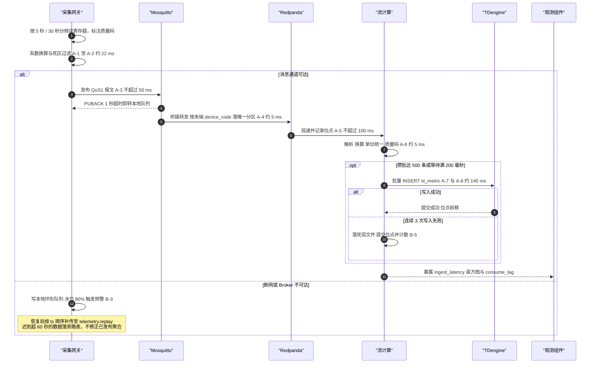
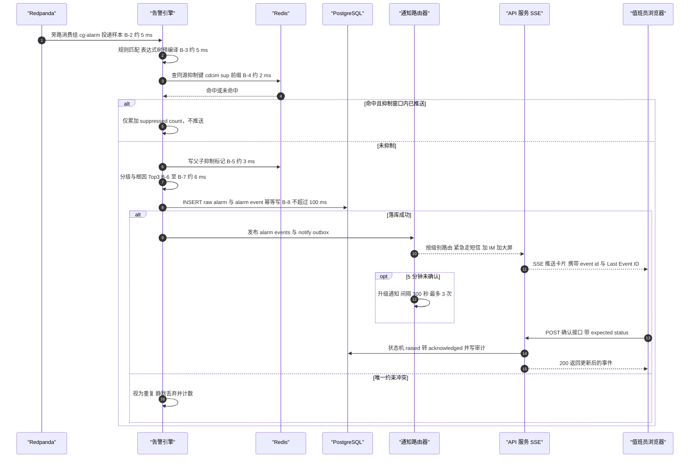
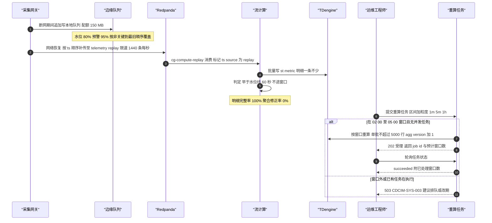
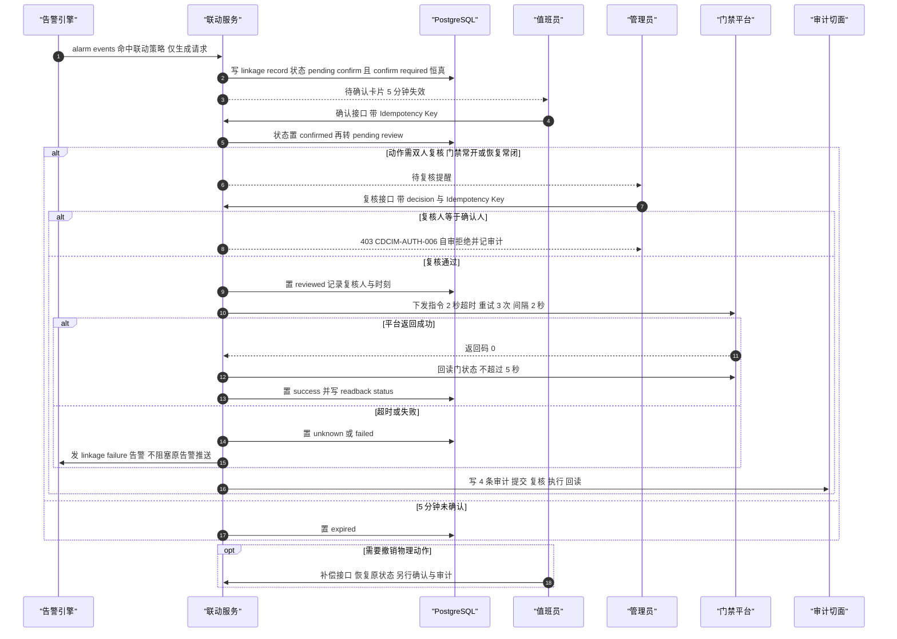
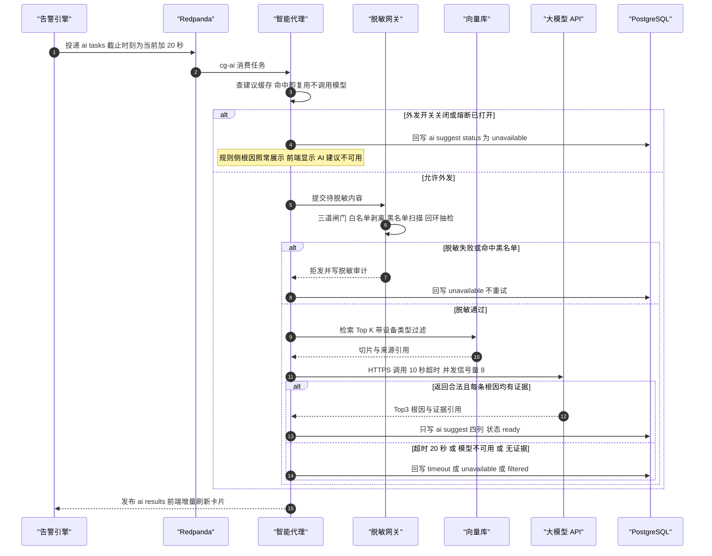

# 时序图集

| 项 | 内容 |
|---|---|
| 文档编号 | CDCIM-P3-DD-02 |
| 版本 / 状态 | v0.1 · 草案（待评审） |
| 所属阶段 | P3 详细设计 |
| 论文价值 | ★★★★☆ 「详细设计」「交互设计」两段的图证素材：五条核心时序把 P2 的四张视图落到「谁在第几步调谁、超时多少、失败怎么办」，每张图配的调用说明表可直接改写为论文的「关键流程」小节 |
| 上游依据 | [进程视图 §4](../03-架构/06-进程视图.md)（FIG-ARCH-16 主时序）、[场景视图](../03-架构/08-场景视图.md)（S-1 ~ S-3 三条路径）、[容量规划 §3](../03-架构/12-容量规划与性能模型.md)（TAB-ARCH-166 / 167 / 168 逐段预算）、[安全架构 §4](../03-架构/11-安全架构与等保对照.md)（复核与审计）、[接口文档](07-接口文档.md)（47 个接口）、[消息契约](08-消息主题与事件契约.md)（13 个主题） |
| 下游承接 | P5 实现（按图施工的超时与降级）、P6 端到端用例（每张图的失败分支各一条）、P7 论文「关键流程设计」段 |

> **口径声明**
> 1. 图中的时延标注取自[容量规划 TAB-ARCH-166 / 167 / 168](../03-架构/12-容量规划与性能模型.md)，标「估算」者为该文按单条处理成本推算，非实测；标「目标」者为验收门槛。
> 2. 编号自 `TAB-API-31`、`FIG-API-01` 起编，与同批《接口文档》《消息主题与事件契约》错段，避免跨文档引用歧义；编号在本文内唯一。
> 3. 参与者一律用英文 ID + 引号包裹的中文标签，保证 Mermaid 各渲染器一致（[图表规范 §4](../90-规范/02-图表规范.md)）。单图参与者 ≤ 7。

---

## 1. 时序图与流程图的分工

同一件事画两张图是浪费，画错一张是误导。本文只画**交互时序**，其余表达交由别的图：

**表 TAB-API-31　四类图的职责边界**

| 图 | 回答的问题 | 本项目中的位置 | 本文是否需要 |
|---|---|---|---|
| **时序图** | 谁在第几步调用谁、同步还是异步、超时多少、失败走哪条分支 | 本文五张图 | ✔ 本文主体 |
| 流程图 | 一次动作或一批数据的步骤与分叉（先做什么、失败退回哪） | [《流程图集》](06-流程图集.md) F-1 ~ F-5 | ✘ 不重复画 |
| 状态机 | 一个对象允许的状态与迁移（告警 5 态、联动 9 态） | [《状态机设计》](05-状态机设计.md) SM-01 ~ SM-06 | ✘ 只引用，不重画 |
| 部署图 | 进程跑在哪个网络区、端口怎么绑 | 物理视图 | ✘ 只在参与者命名上体现归属 |

三条自律规则：

1. **时序图不表达业务规则**。「是否抑制」在图中只画成一个 `alt` 分支，判断逻辑本身属规则引擎（见《流程图集》F-2/F-3 的分叉树），画进来会让图变成伪代码；
2. **每个 `alt` 必须对应一条可测的失败用例**。图上画了「写失败」，P6 就必须有「注入连续 3 次写失败」的用例；画了但不能测的分支应删掉；
3. **参与者超过 7 个就拆图**。超出的部分用 `Note` 指向另一张图，而不是把 12 个参与者挤在一张图里——论文黑白印刷后必然看不清。

---

## 2. 时序一：遥测采集 → 入库（含批写与背压）

覆盖 FR-M1-01/02/06、FR-M2-02/05/07/08；时延目标 P99 ≤ 2 s（链路 A）。

**图 FIG-API-01　一条遥测从寄存器到可查询**

图注：本图回答「一条数据在哪一步可能丢、丢了谁兜住」。主路径的时延瓶颈是 A-7 的攒批等待（均值 100 ms，是链路最大单项），**不是数据库**；断网分支的处置全部发生在边端，中心侧在此期间不做任何补偿动作。

**表 TAB-API-32　时序一的消息与调用说明**

| 步 | 发起方 → 接收方 | 协议 / 机制 | 同步异步 | 超时 | 失败处理 |
|---|---|---|---|---|---|
| 1 | 采集网关 → 设备 | Modbus TCP / SNMP / MQTT 订阅 | 同步轮询 | 3 s，重试 1 次 | 连续 3 周期失败置离线并发 `communication` 告警 |
| 2 | 采集网关 → 采集网关 | 进程内计算 | 同步 | — | 超量程置 `uncertain`，不参与聚合 |
| 3 | 采集网关 → Mosquitto | MQTT PUBLISH QoS 1 | 异步等 PUBACK | 1 s | 超时转本地队列，不阻塞采集节拍 |
| 4 | Mosquitto → Redpanda | 桥接 | 异步 | broker 默认 | 桥接断开时边端队列承接 |
| 5 | Redpanda → 流计算 | 消费组 `cg-compute` 拉取 | 异步 | 无（长轮询 500 ms） | 位点不提交，重启后续消费 |
| 6 | 流计算 → 流计算 | 进程内换算 | 同步 | — | 字段缺失进 DLQ（`schema_invalid`） |
| 7 | 流计算 → TDengine | 批量 INSERT | 同步（线程池 4 线程） | 5 s | 3 次失败 → 死信文件 + 提交位点（B-5），每日 04:30 重放 |
| 8 | 流计算 → 观测组件 | Prometheus 拉取 | 异步 | 15 s 抓取周期 | 单次失败留缺口，不影响业务 |

**时延标注**：A-1 20 ms + A-2 2 ms + A-3 10 ms + A-4 5 ms + A-5 5 ms + A-6 5 ms + A-7 100 ms + A-8 40 ms = **均值 187 ms**，加尾部 150 ms，**P99 估算 337 ms**，目标 2 000 ms，余量 83%。峰值（1 800 msg/s）口径放宽至 P99 ≤ 5 s，同时必须报 lag（≤ 10 s）——**只报单条时延会掩盖积压**。

---

## 3. 时序二：告警判定 → 推送 → 值班确认

覆盖 FR-M3-01 ~ 11、FR-M5-09；时延目标 P99 ≤ 3 s（链路 B），首通道送达 P95 ≤ 60 s（FR-M3-11）。

**图 FIG-API-02　从样本到值班员确认**

图注：本图回答「降噪发生在哪一步、确认动作为什么不会被重复提交」。抑制在**推送之前**（不是推送之后过滤），因此值班员看到的第一条就是主告警；确认走状态机而非幂等键，重复提交由 `expected_status` 不匹配而返回 409，前端据此提示「已被他人确认」。

**表 TAB-API-33　时序二的消息与调用说明**

| 步 | 发起方 → 接收方 | 协议 / 机制 | 同步异步 | 超时 | 失败处理 |
|---|---|---|---|---|---|
| 1 | Redpanda → 告警引擎 | 消费组 `cg-alarm` 拉取 | 异步 | 无 | 位点不提交，lag 独立告警（优先级高于计算组） |
| 2 | 告警引擎 → 告警引擎 | 规则表达式树 | 同步（线程池 2 线程） | 单条 ≤ 200 ms 预算 | 表达式异常记 `handler_exception` 进 DLQ |
| 3 | 告警引擎 → Redis | `GET` 抑制键 | 同步 | 100 ms | Redis 不可用 → 降级为进程内 5 min 指纹集合（可能重复推送，不漏判） |
| 4 | 告警引擎 → Redis | `SET` 父子抑制标记 | 同步 | 100 ms | 同上；丢失只导致重复推送 |
| 5 | 告警引擎 → PostgreSQL | `INSERT ... ON CONFLICT` | 同步 | 100 ms | 唯一约束冲突视为重复；其他异常重试 3 次后丢弃并计数（宁漏一次推送，不重复推送） |
| 6 | 告警引擎 → 通知路由器 | `alarm.events` 主题 | 异步 | — | 通知失败不回滚告警；写 `notify.outbox` 后由发送器重试 |
| 7 | 通知路由器 → API | SSE 广播 | 异步 | — | SSE 断线由前端重连带 `Last-Event-ID` 补推（5 min 内补全量，超时只推摘要） |
| 8 | 前端 → API | HTTPS `POST` 确认 | 同步 | 5 s | 409 时按 `allowed_next` 刷新；403 记审计 |

**时延标注**：B-1 40 ms + B-2 5 + B-3 5 + B-4 2 + B-5 3 + B-6 1 + B-7 5 + B-8 10 = **均值 71 ms**，尾部 120 ms，**P99 估算 191 ms**，目标 3 000 ms。**风暴期必须单列**：200 条原始告警在 3 min 内到达时，B-4 与 B-5 的 Redis 调用串行化，按并发度 2 估算约 500 ms 的额外排队——P99 仍可守住 3 s，但 **P50 会明显上移**，因此压测必须同时看 P50。

---

## 4. 时序三：断网 → 补传 → 重算

覆盖 FR-M1-06、FR-M2-03/06、场景视图 S-2；这是 P3 必办的「聚合修正率为 0」的补偿路径。

**图 FIG-API-03　断网 30 分钟后的补传与聚合修复**

图注：本图回答「补传能修好什么、不能修好什么」。补传只保证**明细**一条不少；所有补传数据的时间戳都早于 60 s 水位线，因此不进窗口、不改聚合。聚合要修正只能走重算接口，这是[场景视图 S-2](../03-架构/08-场景视图.md) 走查发现、并在 P3 补上的能力。

**表 TAB-API-34　时序三的消息与调用说明**

| 步 | 发起方 → 接收方 | 协议 / 机制 | 同步异步 | 超时 | 失败处理 |
|---|---|---|---|---|---|
| 1 | 采集网关 → 边缘队列 | 本地落盘追加 | 同步（`asyncio.to_thread` 固定 1 线程） | `fsync` 100 ms | `fsync` 失败重试；连续失败按 B-4 覆盖最旧并计 `dropped_total` |
| 2 | 采集网关 → Redpanda | MQTT → 桥接 → `telemetry.replay` | 异步 | PUBACK 1 s | 保持队列不排水，下次恢复从队首继续（位点为文件偏移） |
| 3 | Redpanda → 流计算 | 消费组 `cg-compute-replay` | 异步 | 无 | 限速 1 440 条·秒⁻¹，超速即暂停拉取，不挤压在线组 |
| 4 | 流计算 → TDengine | 批量 INSERT（覆盖写） | 同步 | 5 s | 同在线路径：3 次失败入死信，位点前移 |
| 5 | 流计算 → 流计算 | 水位线判定 | 同步 | — | 迟到 > 60 s 写 `telemetry_late_bypass` 并发 `data_delay` 告警 |
| 6 | 运维 → 重算任务 | HTTPS `POST /maintenance/recompute` | 异步（202） | 5 s | 422 区间超 7 天；503 并发已满或不在窗口 |
| 7 | 重算任务 → TDengine | 按窗口覆盖写，`agg_version + 1` | 同步 | 单批 ≤ 5 000 行，固定 02:00 起跑 | 单窗口失败记录后继续；失败窗口数 > 0 时任务置 `failed` 并可重跑 |
| 8 | 运维 → 重算任务 | `GET /maintenance/jobs/{job_id}` | 同步轮询 | 5 s | 轮询间隔建议 30 s，避免占用查询预算 |

**时延标注**：补传目标「5 min 内补齐」在 ATAM 评估中已被标记为高风险（R-02）——30 min 数据约 43.2 万条，5 min 补齐需 1 440 条·秒⁻¹，是稳态 400 条·秒⁻¹ 的 3.6 倍，与在线链路争同一磁盘队列。本文按 **≤ 15 min** 设计（见 §7 Q-1），并在图上标注为「目标待定」而非既成事实。

---

## 5. 时序四：联动执行（人工确认 → 复核 → 下发 → 回执 → 记录）

覆盖 FR-M4-01 ~ 09；判据：提交到下发 ≤ 2 s、回读 ≤ 5 s、自审 100% 拒绝。

**图 FIG-API-04　一次门禁联动的完整闭环**

图注：本图回答「为什么单人无法完成一次开门类动作」。三重约束叠在同一路径上：`confirm_required` 恒真（无自动执行分支）、复核人 ≠ 确认人（DB CHECK 兜底）、审计四条成链（提交/复核/执行/回读）。失败分支特意指向告警引擎——**联动失败只会多一条告警，不会让原告警卡住**（FR-M4-07）。

**表 TAB-API-35　时序四的消息与调用说明**

| 步 | 发起方 → 接收方 | 协议 / 机制 | 同步异步 | 超时 | 失败处理 |
|---|---|---|---|---|---|
| 1 | 告警引擎 → 联动服务 | `alarm.events` 消费 + 策略匹配 | 异步 | — | 策略未命中则不生成记录；匹配异常记审计 |
| 2 | 联动服务 → PostgreSQL | `INSERT linkage_record` | 同步 | 100 ms | 幂等键冲突返回首次结果；写失败则不弹卡片 |
| 3 | 联动服务 → 前端 | SSE 卡片推送 | 异步 | — | 前端断线时卡片在列表页可见（不依赖推送） |
| 4 | 值班员 → 联动服务 | HTTPS `POST` 确认 | 同步 | 5 s | 超 5 min 置 `expired`；状态非法返回 409 |
| 5 | 管理员 → 联动服务 | HTTPS `POST` 复核 | 同步 | 5 s | 自审 403；非 `pending_review` 409 |
| 6 | 联动服务 → 门禁平台 | HTTPS REST（IF-EXT-05） | 同步 | 2 s × 3 次，间隔 2 s | 仍失败 → `failed` + `linkage_failure` 告警；超时先置 `unknown` 再回读 |
| 7 | 联动服务 → 门禁平台 | 状态回读 | 同步 | 5 s | 回读失败保持 `unknown`，核对任务 30 s 内重试 |
| 8 | 联动服务 → 审计切面 | 进程内调用 + `INSERT` | 同步 | 50 ms | 审计写入失败按 fail-closed 拒绝整个动作（SEC-N-01） |

**时延标注**：确认到下发 ≤ 2 s（IF-EXT-05 判据）、下发到回读一致 ≤ 5 s（FR-M4-03）、补偿从确认到完成 ≤ 10 s（FR-M4-06）。这三段不在容量文档的链路预算内，属**外部平台约束**，P6 只能用模拟门禁平台验证，真实时延待现场联调。

---

## 6. 时序五：AI 建议生成（脱敏 → 调用 → 校验 → 回写，含超时降级）

覆盖 FR-M6-01 ~ 03、FR-M6-07、FR-M6-09；判据：建议 P95 ≤ 15 s、超时 20 s 放弃、外发前 100% 脱敏。

**图 FIG-API-05　AI 建议的旁路生成与四类降级**

图注：本图回答「模型不可用时为什么告警不受影响」。整条链路是虚线性质的旁路：入口是异步任务主题，出口是四个可空字段，**主链路从不 `await` 它**。四个出口状态（`ready` / `timeout` / `unavailable` / `filtered`）与数据字典 E13 一一对应，前端按状态渲染占位，不需要知道失败原因。

**表 TAB-API-36　时序五的消息与调用说明**

| 步 | 发起方 → 接收方 | 协议 / 机制 | 同步异步 | 超时 | 失败处理 |
|---|---|---|---|---|---|
| 1 | 告警引擎 → Redpanda | `ai.tasks` 主题 | 异步 | — | 队列积压 > 100 或熔断打开时丢弃新任务（B-9），不排队 |
| 2 | Redpanda → 智能代理 | 消费组 `cg-ai` | 异步 | — | 位点前移，任务可丢（建议是增强，不是事实） |
| 3 | 智能代理 → Redis | 查建议缓存 | 同步 | 100 ms | 缓存不可用则直接调模型（多花 Token，不阻塞） |
| 4 | 智能代理 → 脱敏网关 | 进程内函数调用（fail-closed） | 同步 | 50 ms | 任一闸门失败即拒发，写脱敏审计，置 `unavailable` |
| 5 | 智能代理 → 向量库 | gRPC 检索 | 同步 | 3 s | 不可用则降级为关键词检索（`mode=keyword`，FR-M6-05） |
| 6 | 智能代理 → 大模型 API | HTTPS（OpenAI 兼容） | 同步（信号量 8） | 连接 10 s / 整体 20 s | 超时置 `timeout`；连续 5 次失败熔断 10 min（SEC-V-02） |
| 7 | 智能代理 → PostgreSQL | 更新 `ai_suggest_*` 四列 | 同步 | 100 ms | 写失败重试 1 次；仍失败则丢弃（建议可空） |
| 8 | 智能代理 → 告警引擎 | `ai.results` 主题 | 异步 | — | 前端按事件 ID 增量刷新，不整页重绘 |

**时延标注**：建议生成 P95 ≤ 15 s（FR-M6-03）、超时放弃 20 s（`deadline_at`）、熔断窗口 10 min。**这段时延不进告警 P99 预算**——它发生在告警落库并推送之后，用户看到的是「先有告警卡片，几秒后卡片上多出建议」。若把它算进告警时延，3 s 的预算立刻不成立，这正是「旁路」二字的量化含义。

---

## 7. 时延与预算汇总

**表 TAB-API-37　五条时序的时延目标、估算与余量**

| 时序 | 指标 | 目标 | 估算 | 余量 | 主要风险 |
|---|---|---|---|---|---|
| 一 采集→入库 | P99 | ≤ 2 s | 337 ms | 83% | A-7 攒批等待（均值 100 ms）+ TDengine 提交抖动 |
| 一 峰值 | P99 / lag | ≤ 5 s / ≤ 10 s | — | — | 单分区 ρ ≈ 0.6，P99 会是均值数倍；必须同时报 lag |
| 二 采集→告警 | P99 | ≤ 3 s | 191 ms | 94% | **不是时延而是可用性**：判定与推送同进程，单点 |
| 二 首通道送达 | P95 | ≤ 60 s | — | — | 短信网关与 IM 的第三方时延不可控 |
| 三 补传 | 补齐时长 | ≤ 5 min（待确认） | 需 1 440 条·秒⁻¹ | 负 | ATAM R-02：与在线链路争磁盘队列，建议改 ≤ 15 min |
| 三 重算 | 单批 | ≤ 5 000 行，并发 1 | — | — | 与备份（01:00）、归档（03:00）错峰 |
| 四 联动下发 | 提交→下发 | ≤ 2 s | — | — | 门禁平台侧时延；协议待定（Q-2） |
| 四 回读 | 下发→一致 | ≤ 5 s | — | — | 同上 |
| 五 AI 建议 | P95 | ≤ 15 s | — | — | 模型侧时延；与主链路无耦合 |
| 五 AI 超时 | 放弃阈值 | 20 s | — | — | 超时后置 `timeout`，不重试（避免 Token 浪费） |

**三处必须写明的口径**：

1. **估算与目标差 5 ~ 15 倍不是「余量浪费」**。设计预算是按最坏情况分配的（A-1 给 200 ms 是给协议栈抖动留的垫子），估算是按典型情况推算的。余量大不等于可以砍预算——砍掉 A-7 的 100 ms，写入次数会从 5 次·秒⁻¹ 升到 400 次·秒⁻¹，反而压垮 TDengine。
2. **时序二的风险在可用性不在时延**。94% 的时延余量与「单进程单副本」是两个维度，不能互相抵消：崩溃时数据仍在入库，但没有人知道。
3. **时序三的补传目标是负余量**，因此它是一个**待确认项**而不是承诺值。论文中不得写成「5 分钟补齐已验证」。

---

## 8. 待确认事项

| # | 待确认点 | 本文暂定 | 备选 | 影响面 | 建议 |
|---|---|---|---|---|---|
| Q-1 | **断网补传的补齐时长**：FR-M1-06 写「5 min 内补齐」，ATAM R-02 判定不可达（需 1 440 条·秒⁻¹，与在线争同一磁盘队列） | 按 **≤ 15 min** 设计并在图中标注「目标待定」；5 min 作为理想值不写入验收 | ① 维持 5 min 并接受在线 P99 在补传期劣化至 5 s；② 补传限速降至 800 条·秒⁻¹，补齐时长放宽至 30 min | FR-M1-06 的验收判据、QA-AVAIL-05 的不可用时长预算（该事件已占全年 57%）、NFR-PERF-07 的峰值口径 | 建议**改为 ≤ 15 min**：可用性预算已经算过，30 min 断网事件在 5 min 补齐口径下几乎吃掉全年 99.99% 的不可用额度。改成 15 min 后仍占约 19%，是「可承诺」的量级。此改动需回写 SRS FR-M1-06 与场景视图 S-2 |
| Q-2 | **SSE 的断连补推阈值与连接寿命**：进程视图 §7.3 写「断连超 5 min 改为只推摘要」，但未定单连接最长存活与 Nginx 读超时 | 单连接最长 8 h（与会话绝对超时一致）；Nginx `proxy_read_timeout` 设为 3600 s，服务端每 30 s 发心跳注释行；断连 ≤ 5 min 按 `Last-Event-ID` 补全量，> 5 min 只推未关闭事件摘要 | ① 缩短到 1 h 强制重连；② 用 WebSocket 替代 SSE（需双向能力时） | Nginx 配置、前端重连逻辑、值班大屏 8 h 常开的实际场景、告警补推的完整性口径 | 建议**维持 8 h + 30 s 心跳**：值班大屏是 7×24 常开设备，每小时强制重连会在交接班时制造一次可见的刷新。5 min 的补推窗口已能覆盖绝大多数网络抖动，更长的断连本就是「终端离线」，应走摘要而非全量回放 |

---

## 考点映射

| 考纲知识点 | 本文件对应内容 | 论文可用位置 | 真题溯源 |
|---|---|---|---|
| 详细设计中的交互设计 | §1 四类图的分工、§2 ~ §6 五条时序的 alt/opt 分支设计 | 论文「详细设计」段的交互描述 | 2023 下 详细设计、2024 上 系统设计 |
| 时序图与流程图的取舍 | §1 三条自律规则（不表达业务规则、分支必须可测、参与者 ≤ 7） | 论文「设计表达」段的方法论 | 案例题「 UML 与建模」 |
| 超时与降级设计 | 每张图的超时列、§6 四类降级出口、§7 时延汇总 | 论文「可靠性设计」段 | 2024 下 软件可靠性 |
| 性能预算的逐段分解 | §7 表 TAB-API-37、与容量文档 TAB-ARCH-166/167 的对应 | 论文「性能设计」段：预算如何分配到每一跳 | 论文题「论系统性能优化」 |
| 安全控制点的时序落位 | §5 三重约束（确认/复核/审计）、§6 脱敏 fail-closed | 论文「安全设计」段：控制点画在流程里而非写在制度里 | 2024 上 信息安全 |
| 一致性与幂等 | §3 补传与重算的分工、§5 幂等键与状态机的双重兜底 | 论文「数据一致性」段 | 案例题「分布式系统设计」 |

## 论文可引用段落

> **【适用题目类型】论详细设计 / 论系统设计 / 论软件可靠性设计**

时序图最容易犯的错，是把它画成「成功路径的示意」。我在详细设计阶段给自己定了一条规矩：每一个 alt 分支都必须对应一条可执行的失败用例，画了但不能测的分支就删掉。五张图因此都带着超时与兜底：遥测入库的写失败走死信并前移位点，因为单分区下无限重试等于全链路停摆；告警推送的抑制发生在推送之前而不是之后，所以值班员看到的第一条就是主告警；联动执行把「确认、复核、回读、审计」串成一条链，复核人不能等于确认人，这条约束同时写在数据库的检查约束里；AI 建议画出四个出口状态，其中三个是降级。最值得一提的是断网补传那张图，它诚实地标出了一个负余量：补传只能保证明细不丢，聚合修正率为零，要修聚合必须另走重算接口。把「做不到什么」画进图里，比把「做到了什么」画得漂亮更有价值。

（约 300 字）

---

## 变更记录

| 版本 | 日期 | 变更 |
|---|---|---|
| v0.1 | 2026-11-27 | 初稿。含四类图的分工边界与三条自律规则、五条核心时序（采集入库含断网分支、告警判定与 SSE 确认、断网补传与重算、联动确认复核闭环、AI 旁路四类降级）、每图配套的消息与调用说明表（协议/同步异步/超时/失败处理）、时延汇总与三处口径说明、2 项待确认（补传时长、SSE 连接寿命） |
