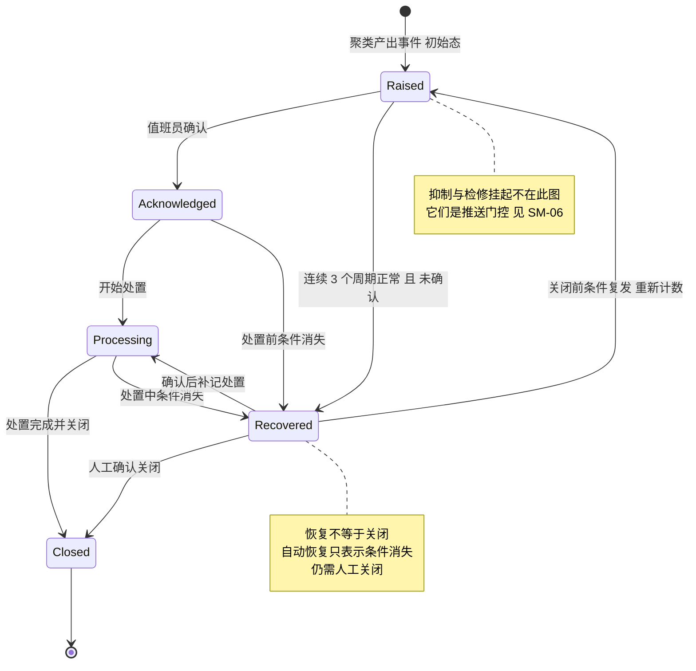
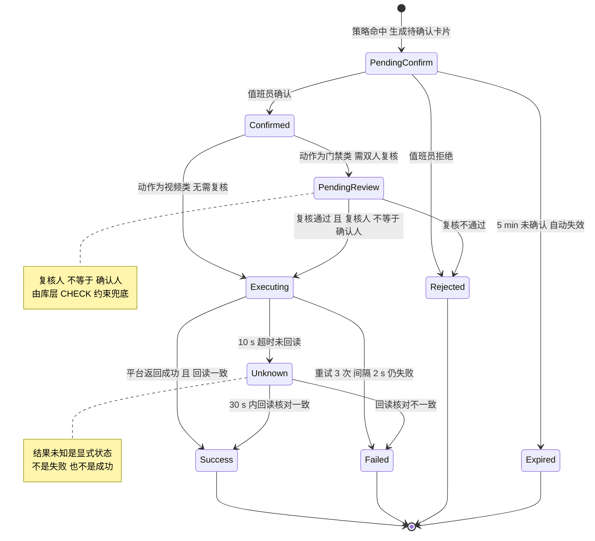
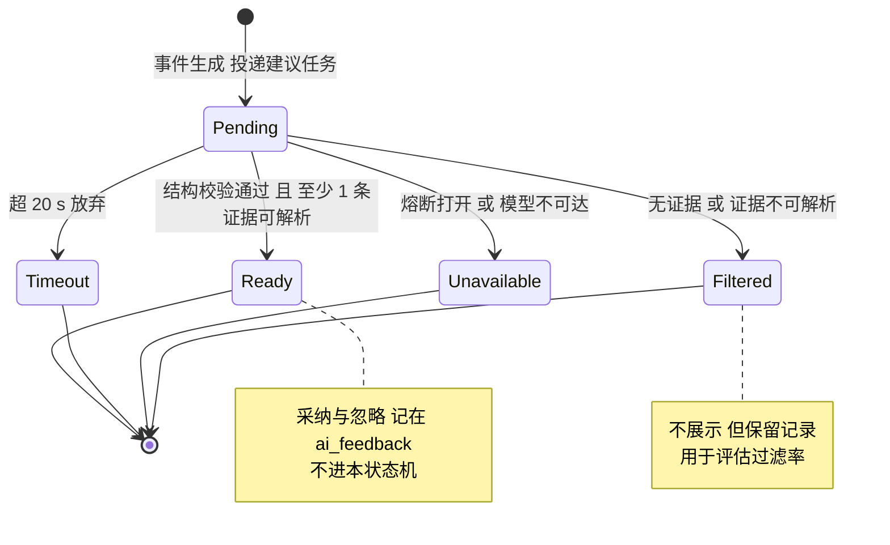
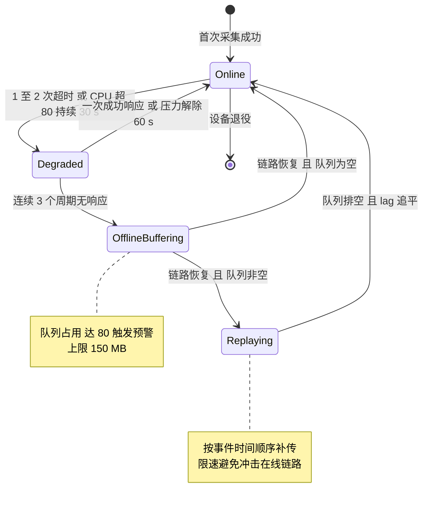

# 状态机设计

| 项 | 内容 |
|---|---|
| 文档编号 | CDCIM-P3-DD-03 |
| 版本 / 状态 | v0.1 · 草案（待评审） |
| 所属阶段 | P3 详细设计 |
| 论文价值 | ★★★★★ 论文「状态机设计」「软件可靠性」「接口设计」三题的直接素材。三个最有价值的点：① §2.4「抑制与挂起为什么不进生命周期」——把「状态」与「推送门控」分开，避免了状态爆炸，这是答辩被追问「你的状态机为什么没有『已抑制』这个状态」时的正面回答；② §3 的四层错误码（409 / 422 / 403 / 404）区分「状态不允许」「守卫不满足」「权限不足」「动作不存在」，回答「非法迁移如何拒绝而不是静默忽略」；③ §4 联动状态机把「禁止远程开门」落成**枚举校验**而非流程约束 |
| 上游依据 | [类图与领域模型](03-类图与领域模型.md)（`AlarmEvent` / `LinkageCommand` / `Advice` 三个聚合、`ChannelHealth` 运行态对象）、[数据字典初稿](../02-需求/08-数据字典初稿.md)（§4.9 `event_status`、§4.11 `exec_status`、§5.9 E9、§5.13 E13）、[需求规格说明书](../02-需求/02-需求规格说明书.md)（FR-M3-10 9 条合法迁移 / 6 条非法迁移、FR-M4-02/05/09、FR-M6-03）、[用例规约集](../02-需求/05-用例规约集.md)（UC-06 异常流 E1/E2、UC-10 异常流 E1/E4/E5、UC-07）、[ATAM 报告](../03-架构/03-ATAM架构权衡评估报告.md)（SP-03 抑制窗口 5 min、S2 风暴收敛） |
| 下游承接 | 《流程图集》（CDCIM-P3-DD-04）在流程图的判定节点上引用本文的守卫条件；P5 按 §1.3 的三种实现形态落地（迁移表 / 派生状态 / 运行态对象）；P6 直接以 §3 的 8 条非法迁移与 §2.2 的 9 条合法迁移建用例（FR-M3-10 的验收判据即「9 条全通、6 条全拒」） |

> **口径声明一（编号作用域）**：本文占用 `FIG-DD-011 ~ 014`、`TAB-DD-011 ~ 020` 段，与同目录《类图与领域模型》（001~009 段）、《流程图集》（021~ 段）不重叠。跨目录引用带文档名。
>
> **口径声明二（状态机的三条准入判据）**：不是所有「有几种值」的字段都该做成状态机。本文只对满足「① 迁移有方向、② 非法迁移必须被拒绝、③ 迁移伴随动作与留痕」三条的字段建模（判据见 §1.1）。按此判据，`alarm_level`（三级，可任意赋值）、`quality_code`（四值，每次采样独立）**都不是状态机**，本文不为其建图——**明确写出「什么不是状态机」比多画两张图更能说明设计边界**。
>
> **口径声明三（与数据字典的关系）**：状态取值以数据字典的枚举为准（`event_status` 见 §4.9、`exec_status` 见 §5.9、`ai_suggest_status` 见 §5.13），本文**不新增也不改名**任何存储值；本文新增的是「守卫条件、动作、落库与通知的对应关系」这三样数据字典不表达的内容。一处口径差异已在 §8 待确认 2 登记。

---

## 1. 状态机清单与选型

### 1.1 三条准入判据

| # | 判据 | 反例（不该做成状态机） | 后果 |
|---|---|---|---|
| 1 | **迁移有方向**：A 能到 B，B 不一定能回 A，且方向由业务语义决定 | `alarm_level` 三级之间可任意改（改级别是重新分级，不是迁移） | 画成状态机后，`major → critical` 会被当成一次迁移去记审计与发通知，噪声淹没真正的迁移 |
| 2 | **非法迁移必须被拒绝**：拒绝是需求，不是实现细节 | `quality_code` 每次采样独立判定，任意值到任意值都合法 | 强行加守卫会把「数据本身可疑」变成「系统拒绝写入」，丢数据 |
| 3 | **迁移伴随动作与留痕**：每次迁移要写时间戳、操作人、发事件或通知 | 缓存键的存在/不存在（`SuppressionKeyStore.exists`） | 每次 TTL 到期都记一条审计，审计表被无意义记录撑爆，真正的事件反而查不出来 |

**判据 1 的一条推论**：状态机必须能画出「终态」。`exec_status` 的 `rejected` / `expired` / `success` / `failed` 四个终态中，`failed` **看似**可重试——但重试是**新建一条记录**（新 `request_id`），不是把旧记录改回 `pending_confirm`。把「可重试」画成自环，会让「同一 `request_id` 只执行一次」的幂等约束在状态图层面自相矛盾。

### 1.2 六个状态机

**表 TAB-DD-011　状态机清单：状态数、迁移数、载体与实现形态**

| # | 状态机 | 承载对象 | 状态数 | 合法迁移数 | 载体（字段 / 存储） | 实现形态 | 对应 FR / UC |
|---|---|---|---|---|---|---|---|
| SM-01 | **告警事件生命周期** | `AlarmEvent` | 5（raised / acknowledged / processing / recovered / closed） | **9** | `alarm_event.event_status` + `row_version` | 显式迁移表 | FR-M3-10、UC-06 |
| SM-02 | **原始告警处置态** | `RawAlarm` | 5（detected / published / suppressed / absorbed / archived） | **6** | 无独立 `status` 列，由 `is_suppressed` + `suppress_type` + `event_id` + `is_archived` 组合表达 | **派生状态**（只追加表不可 UPDATE） | FR-M3-05/06/07/14 |
| SM-03 | **联动执行** | `LinkageCommand` | 9（pending_confirm / confirmed / pending_review / rejected / expired / executing / success / failed / unknown） | **12** | `linkage_record.exec_status` | 显式迁移表 | FR-M4-02/03/05/09、UC-10 |
| SM-04 | **AI 建议** | `Advice` | 5（pending / ready / timeout / unavailable / filtered） | **4** | `alarm_event.ai_suggest_status` | 显式迁移表（极浅） | FR-M6-02/03、UC-18 |
| SM-05 | **采集通道连通性** | `ChannelHealth` | 4（online / degraded / offline_buffering / replaying） | **8** | 进程内运行态 + `device_status_event`（只追加） | **运行态对象**（不入库） | FR-M1-06/07/08 |
| SM-06 | **推送门控**（抑制 / 检修挂起） | 告警事件的推送决策 | 3（PUSH_OPEN / PUSH_SUPPRESSED / PUSH_SUSPENDED） | **6** | Redis 抑制键 + `alarm_event.suppress_expire_at` | 运行态 + 字段混合 | FR-M3-05/06/13、UC-07 |
| | **合计** | | **31 个状态** | **45 条** | | | |

### 1.3 三种实现形态，为什么不是一种

同一个系统里用三种形态，不是技术选型摇摆，而是**三类对象的物理约束不同**：

| 形态 | 适用对象 | 为什么必须这样 | 代价 |
|---|---|---|---|
| **显式迁移表** | 可 UPDATE 的事务表（SM-01 / SM-03 / SM-04） | 迁移集合有限（9 / 12 / 4 条），可以穷举成表；守卫、动作、通知三样都能挂在表的行上；非法迁移的拒绝理由可以直接从表里查到并返回给前端 | 每加一条迁移要改表 + 改测试；表本身成为「第二份需求」，需与 SRS 对账 |
| **派生状态** | 只追加表（SM-02） | 只追加表**不允许 UPDATE**（FR-M3-14、等保要求），所以状态不能在库里「迁」。做法是：判定时在内存里走完 4 态，落库时把结果**冻结**成字段组合，之后只能靠新增一行表达变化 | 「查询某条原始告警当前处于什么态」要写组合条件（`is_suppressed = false AND event_id IS NOT NULL AND is_archived = false` → `absorbed`），不能 `WHERE status = ?` |
| **运行态对象** | 不入库的连接健康（SM-05）、跨对象的推送门控（SM-06） | 它们的生命周期是「进程存活期」或「抑制窗口」，重启即重建是**正确语义**（丢失只导致重复推送，不导致漏判，不变式 #9-③）；入库反而要处理「重启后陈旧状态」这一整类问题 | 不可直接查询历史；需靠状态变化时写一条 `device_status_event` 才能复盘 |

**一句必须说清的话**：SM-02 的「状态」是**派生**的，不是存储的。这决定了它的「迁移」在数据库层面**不可见**——没有 `UPDATE raw_alarm SET status` 这样的语句，只有 `INSERT`。这也是为什么它的迁移表（§6.1）要额外标注「迁移发生在插入的那一刻」。

---

## 2. 告警生命周期状态机

### 2.1 状态图

**图 FIG-DD-011　告警事件生命周期状态机**——回答「一次故障从产生到关闭经过哪些合法路径，以及为什么恢复之后还会退回产生」。图中 9 条迁移与数据字典 §4.9 的枚举严格一致（2 + 2 + 2 + 3）。三处箭头需要解释：① `Raised → Recovered` 不经确认，因为自动恢复是**条件驱动**的，与人的动作无关；② `Recovered → Raised` 是本项目最反直觉的一条（不变式 #8-②③），条件在关闭前复发时必须**回到原事件继续计数**，否则同一次故障裂成多条事件，降噪压缩比与重复告警率两个指标同时失效；③ 图中**没有** `suppressed` 状态，理由见 §2.4。

**对应需求**：FR-M3-10（9 条合法迁移、6 条非法迁移全部拒绝、自动恢复需连续 3 个周期正常）；UC-06 主场景 4~6、异常流 E1/E2。

### 2.2 状态迁移表

`raised` 是初始态，由聚类产出时建立，**不计入迁移**。下表 9 行与数据字典 §4.9 的 9 条合法迁移逐条对应，第 6、7 列是本文新增的信息（数据字典不表达）。

**表 TAB-DD-012　告警事件 9 条合法迁移**

| # | 当前态 | 事件 | 守卫条件 | 动作 | 目标态 | 是否落库 | 是否通知 |
|---|---|---|---|---|---|---|---|
| 1 | `raised` | 值班员确认 | ① 具备 `alert:ack` 权限；② `row_version` 匹配（未被他人在先确认）；③ 事件非 `closed` | 写 `ack_by` / `ack_at`；终止升级计时；发 `alarm.events`（type = acknowledged） | `acknowledged` | 是（`row_version + 1` + 审计） | 否（仅 SSE 状态帧，不重发短信） |
| 2 | `raised` | 自动恢复 | ① 连续 3 个采样周期判定为正常（三采样点）；② 事件未确认（已确认者走 8/9 的路径） | 写 `recover_at`；发 `alarm.events`（type = recovered） | `recovered` | 是 | 是（恢复通知，渠道与级别同源但降一档：紧急仍走 IM + 大屏，不走短信） |
| 3 | `acknowledged` | 开始处置 | ① 具备 `alert:process` 权限；② `ack_by` 非空 | 写 `process_by` / `process_at` | `processing` | 是 | 否 |
| 4 | `acknowledged` | 自动恢复 | 连续 3 个采样周期正常 | 写 `recover_at`；终止升级计时 | `recovered` | 是 | 是（同 #2） |
| 5 | `processing` | 人工关闭 | ① 具备 `alert:close` 权限；② `close_note` 非空（处置措施或误报原因）；③ **不要求**已 `recovered`（允许处置完成而条件仍在） | 写 `close_by` / `close_at` / `close_note`；若标误报则计入规则评估样本 | `closed` | 是 | 否 |
| 6 | `processing` | 自动恢复 | 连续 3 个采样周期正常 | 写 `recover_at` | `recovered` | 是 | 是（同 #2，且提示「处置未完成即恢复，请确认是否需继续处置」） |
| 7 | `recovered` | 条件复发 | ① 同一 `alarm_fingerprint` 的原始告警再次到达；② 抑制窗口内（避免把抖动当复发）；③ 事件**尚未** `closed` | 更新 `last_occur_at`；`raw_count + 1`；**清空** `recover_at`；升级序号清零重算 | `raised` | 是（同一行更新，**不新建事件**） | 是（按原级别重推，重复率统计中计为「同事件复发」而非新告警） |
| 8 | `recovered` | 确认后补记处置 | ① 具备 `alert:process` 权限；② 处置实际已开始但未记录 | 写 `process_by` / `process_at` | `processing` | 是 | 否 |
| 9 | `recovered` | 人工确认关闭 | `close_note` 非空 | 写 `close_by` / `close_at` / `close_note` | `closed` | 是 | 否 |

**两条读法**：

1. **第 7 行的「不新建事件」是本表的重点**。它的实现要求是：`recovered` 状态的事件在抑制窗口内**继续持有** `alarm_fingerprint` 索引（不能因为已恢复就释放），否则复发的原始告警找不到归属事件，会自动新建一条——设计意图随即失效。这条在 P6 必须有专门用例（UC-06 无覆盖，属本文补充的测试点）。
2. **第 5 行允许「未恢复即关闭」**。看似放宽了约束，实际是必需的：现场常见「处置完成但采样值仍在边界抖动」，若强制先恢复再关闭，事件会长期挂在 `processing`，`close_at` 的统计口径失真。代价是「关闭时条件仍在」这一状态存在，前端须同时展示 `close_at` 与最后一次 `trigger_value`。

### 2.3 三条重设计决策

| 决策 | 备选 | 为什么这样选 |
|---|---|---|
| **`recovered` 与 `closed` 分离** | 合并为「已结束」 | 自动恢复是**机器判断**（条件消失），关闭是**人判断**（处置完成）。合并后无法统计「恢复了但没人管」的事件——而这恰是值班质量的核心指标。代价是前端要区分两个状态的卡片样式 |
| **复发回到原事件而非新建** | 新建事件，旧的置 `closed` | 一次故障一条事件，是降噪指标成立的前提（ATAM S2 的压缩比 40:1 按事件数计）。新建会让同一根因产生 N 条事件，压缩比虚高而重复率爆炸 |
| **抑制与挂起不进状态机** | 增加 `suppressed` / `suspended` 两个状态 | 见 §2.4 |

### 2.4 抑制与检修挂起为什么不进生命周期

这是本文最需要显式论证的一处，因为「告警状态机」的教科书画法里通常会有「已抑制」这个状态。

**如果加进去，会发生什么**：

| 问题 | 具体后果 |
|---|---|
| 状态数从 5 涨到 7，迁移从 9 涨到 ≥ 20 | 每条迁移都要回答「抑制态能不能确认」「挂起态能不能关闭」，组合爆炸；9 条合法迁移的验收判据（FR-M3-10）随即失效，需重写 |
| 抑制与生命周期的**驱动源不同** | 生命周期由「人的动作 + 条件是否消失」驱动；抑制由「抑制键 TTL 300 s」驱动。两者正交：一条 `acknowledged` 的事件完全可以同时「被抑制」（同一根因的第二条派生告警），此时它到底是 `acknowledged` 还是 `suppressed`？答案是**两个都是**，说明它们不是同一个维度 |
| 抑制是**推送属性**，不是对象状态 | 被抑制的原始告警**仍然入库、仍然计数**（FR-M3-14）。「抑制」影响的是「这条要不要推给人」，不影响「这条记录处于什么处置阶段」 |

**本文的做法**：把抑制与挂起建模为**独立的推送门控**（SM-06，§6.3），它作用在「事件 → 通知路由器」这条边上，而不是作用在事件对象上。生命周期照常推进，门控决定「这一刻推不推」。两条约束由此同时成立：① 9 条合法迁移不被污染；② 「挂起期间推送 0 条、原始告警 100% 可查」（FR-M3-13）由门控 + 只追加表两条腿保证。

**代价**：`alarm_event` 多了一个 `suppress_expire_at` 字段（挂起到期），它看起来像状态字段但不是——它只被门控读取，从不参与 `event_status` 的判定。这一点在图 FIG-DD-011 的 note 里明确标注，避免后来者「顺手」把它当成状态。

---

## 3. 非法迁移处理

### 3.1 四层错误码：区分「不允许」的四种原因

把「拒绝」统一返回 400 是最常见的偷懒，它让调用方无法区分「我该换条路」「我该补参数」「我该换个人」「这个动作根本不存在」。四层错误码的划分依据是**调用方的补救动作**：

**表 TAB-DD-013　八条非法迁移与四层错误码**

| # | 非法迁移 / 非法请求 | 拒绝原因类别 | 拒绝方式 | 返回码 | 响应体要点 |
|---|---|---|---|---|---|
| 1 | `closed → processing`（关闭后想重开处置） | 状态不允许 | 迁移表查不到该边，直接拒绝 | **409** | `error=ILLEGAL_TRANSITION`、`current=closed`、`allowed=[]`（终态无出边）、`hint=请新建事件或由工程师手工关联` |
| 2 | `raised → processing`（跳过确认） | 状态不允许 | 同上 | **409** | `allowed=["acknowledged","recovered"]`、`hint=请先确认` |
| 3 | `acknowledged → closed`（跳过处理中） | 状态不允许 | 同上 | **409** | `allowed=["processing","recovered"]` |
| 4 | `recovered → acknowledged`（恢复到已确认） | 状态不允许 | 同上 | **409** | `allowed=["raised","processing","closed"]` |
| 5 | `acknowledged → raised`（退回未确认） | 状态不允许 | 同上 | **409** | `hint=确认不可撤销，如需重开请走复发路径` |
| 6 | 并发确认（两人同时点确认，后到者 `row_version` 不匹配） | 并发冲突 | 条件更新影响行数 = 0 → 重读当前态；若当前态**已是**目标态，返回成功语义 | **409**（幂等特例返回 200） | `error=VERSION_CONFLICT`、`acked_by=张三`、`acked_at=...`（UC-06 E2 要求提示「已被 XXX 确认」） |
| 7 | 守卫不满足：关闭时 `close_note` 为空；或确认时缺少 `ack_by` | 参数 / 守卫不满足 | 迁移边存在，但守卫函数返回 false | **422** | `error=GUARD_FAILED`、`field=close_note`、`rule=关闭必须填写处置说明` |
| 8 | 越权：值班员改 `alarm_level`；联动服务回写 `event_status`；AI 服务写状态字段 | 权限不足 | 权限中间件 + 列级授权双重拦截 | **403** | `error=FORBIDDEN`、`required=alert:level`、`actor=operator`；联动/AI 走服务账号，库层无该列 UPDATE 权限，**连改都改不了** |

### 3.2 三条实现纪律

1. **拒绝必须带「合法路径」**。409 的响应体里 `allowed` 数组由迁移表**直接查出**，不是手写的常量。这样新增一条迁移时，前端提示自动跟着变——否则迁移表与提示文案迟早各说一套。
2. **拒绝必须留痕**。每次非法迁移写一条 `audit_log`（`operation_type=update`、`operation_result=denied`）。这条在等保测评里是「访问控制有效性」的证据；也是排查「谁在反复尝试关闭未处置的告警」的唯一线索。
3. **「动作不存在」与「无权限」必须分开**。请求「远程开门」返回 **404**（接口清单里没有这个动作），而不是 403。因为 403 意味着「有这个能力但你不够格」，会让攻击者确认能力存在；404 才是正确语义。这条与 FR-M4-08「接口清单中不存在该写操作」互为表里。

### 3.3 为什么不做「自动纠正」

曾考虑「非法迁移时自动走到最接近的合法路径」（如 `raised → processing` 自动先确认再处置）。否决理由：自动纠正会把**调用方的 bug** 变成**系统的静默行为**。告警状态的确认人一旦被系统自动填入，等保要求的「不可抵赖」直接失效——没人会为一个系统代填的签名负责。宁可 409 报错，让人改代码。

---

## 4. 联动执行状态机

### 4.1 状态图

**图 FIG-DD-012　联动执行状态机**——回答「一次带人工确认的控制意图，如何从待确认走到成功或失败，以及超时为什么单列一个状态」。9 个状态、12 条迁移。三处结构选择：① `Confirmed` 分叉成 `PendingReview` 与 `Executing` 两个分支，分叉点是**动作类型**（门禁类必须双人复核，视频类不需要），不是权限；② `Unknown` 是**显式状态**而非失败——门禁动作不可逆，外部平台可能已执行，此时「不知道结果」与「失败」是两件事，前者必须触发回读核对（FR-M4-05）；③ 图中**不存在** `action=open_door` 的任何边，因为该动作在枚举层就不存在。

**对应需求**：FR-M4-02（100% 人工确认、绕过确认返回 403）、FR-M4-03（门禁 2 s 下发、5 s 回读、3 次重试）、FR-M4-05（`request_id` 幂等、10 s 置未知、30 s 核对）、FR-M4-09（双人复核、自审拒绝）；UC-10 主场景 1~6、异常流 E1/E4/E5。

### 4.2 状态迁移表

**表 TAB-DD-014　联动执行 12 条合法迁移**

| # | 当前态 | 事件 | 守卫条件 | 动作 | 目标态 | 是否落库 | 是否通知 |
|---|---|---|---|---|---|---|---|
| 1 | `pending_confirm` | 值班员确认 | ① 具备 `link:confirm`；② 未超 5 min；③ `request_id` 未被执行过（24 h 幂等查） | 写 `confirm_by` / `confirm_at`；按动作类型决定下一跳 | `confirmed` | 是 | 否 |
| 2 | `pending_confirm` | 值班员拒绝 | 同上 | 写 `result_message=rejected_by_user` | `rejected` | 是 | 否 |
| 3 | `pending_confirm` | 确认超时 | 定时器判定 `now - created_at > 300 s` | 置 `expired`；卡片置灰 | `expired` | 是 | 是（提示「联动请求已失效，如需执行请重新发起」） |
| 4 | `confirmed` | 需复核 | ① 动作为 `door_hold_open` 或 `door_restore`；② `review_required = true` | 生成复核待办；**不下发** | `pending_review` | 是 | 是（复核人待办） |
| 5 | `confirmed` | 无需复核 | 动作为 `camera_snapshot` / `camera_stream` / `video_wall` | 写 `execute_at`；调视频平台 | `executing` | 是 | 否 |
| 6 | `pending_review` | 复核通过 | ① 具备 `link:review`；② `review_by ≠ confirm_by`（库层 CHECK 兜底）；③ 与确认同一 `request_id` | 写 `review_by` / `review_at` / `execute_at`；≤ 2 s 内下发 | `executing` | 是 | 否 |
| 7 | `pending_review` | 复核不通过 | 同上（除 ②） | 写 `result_message=review_rejected` | `rejected` | 是 | 是（通知发起人及原告警接收人） |
| 8 | `executing` | 执行成功 | 平台返回成功 **且** 5 s 内回读状态与指令一致 | 写 `readback_status` / `readback_at` / `execute_latency_ms` | `success` | 是 | 是（卡片「已执行」+ SSE） |
| 9 | `executing` | 执行失败 | 重试 3 次（间隔 2 s）后仍失败 | 写 `retry_count` / `result_code` / `result_message`；**另发**「联动失败」重要告警 | `failed` | 是 | 是（卡片失败原因 + 独立告警，FR-M4-03） |
| 10 | `executing` | 回读超时 | 10 s 内未取得回读结果 | 置 `unknown`；投递核对任务（30 s 后回读） | `unknown` | 是 | 是（卡片「结果未知，正在核对」） |
| 11 | `unknown` | 核对一致 | 核对任务回读结果与指令一致 | 写 `readback_*`；关闭核对任务 | `success` | 是 | 是 |
| 12 | `unknown` | 核对不一致 | 核对任务回读结果与指令不符 | 写 `result_code=E_READBACK_MISMATCH`；提示补偿动作 | `failed` | 是 | 是（提示「可发起恢复原状态」，补偿本身另走 #1~#6） |

### 4.3 「禁止远程开门」的四处落点

这条约束只有落在**四处**才真正成立，任缺一处都可被绕过：

| 落点 | 具体做法 | 缺了它会怎样 |
|---|---|---|
| **枚举层** | `action_type` 只允许 E8 的 5 个值，无 `door_open`。这是**第一道**，也是最硬的一道 | 接口收到字符串就直接转发给门禁平台，平台侧可能真的支持远程开门 |
| **接口清单** | 写接口只有 5 项（门禁 2 + 视频 3），不存在第 6 项；越权调用返回 **404** 而非 403 | 攻击者能通过 403/404 的差异探测「系统是否有这个能力」 |
| **状态图** | 图中不存在任何以「开门」为动作的迁移（见图注） | 状态图是实现的直接依据，图上没有的边，代码里也不该有 |
| **审计** | 每次下发记 `action_type` 原值；若出现 `door_open` 即为越权证据（理论上不可能，作为兜底检测） | 无法事后证明「系统从未开过门」 |

**为什么不是「允许但需双人复核」**：SRS Q-3 已确认维持「仅常开 / 恢复」。技术理由是：远程开门的安全责任无法在系统层面闭环——系统只能证明「某人点了按钮」，不能证明「门口确实需要开」。而「常开」是**持续状态**，出问题时可回退为「恢复常闭」；「开门」是**瞬时动作**，无回退语义。这一区别决定了前者可被系统承担，后者不能。

---

## 5. AI 建议状态机

### 5.1 状态图

**图 FIG-DD-013　AI 建议状态机**——回答「建议的四种『没有结果』如何区分」。5 个状态、**仅 4 条迁移**。这个状态机刻意做得很浅：所有迁移都从 `Pending` 出发，`Ready` 之后无出边。理由：建议是旁路产物，**一旦生成就冻结**；重新生成是**新一条建议**（`adviceId` 变、`payloadVersion + 1`），不是旧建议改状态。四个失败态分开而不是合成一个「失败」，是因为前端要显示不同文案、运维要看不同指标：`timeout` 是性能问题、`unavailable` 是可用性问题、`filtered` 是质量问题（模型在编造无证据的根因）。

**对应需求**：FR-M6-02（每条根因必附 ≥1 条可点击证据，无证据即过滤）、FR-M6-03（超时 20 s 放弃、不可用时占位、规则侧根因照常展示）。

### 5.2 状态迁移表

**表 TAB-DD-015　AI 建议 4 条合法迁移**

| # | 当前态 | 事件 | 守卫条件 | 动作 | 目标态 | 是否落库 | 是否通知 |
|---|---|---|---|---|---|---|---|
| 1 | `pending` | 建议生成成功 | ① JSON 结构合法；② 根因条数 1~3；③ 每条根因的 `evidence` 非空且引用可解析（设备 / 测点 / 拓扑边存在）；④ `payloadVersion` 大于库中当前值 | 写 `ai_suggest_payload` / `ai_suggest_at`；只更 4 列 | `ready` | 是（`ai_suggest_*` 四列） | 是（SSE 片段推送到已打开的事件详情） |
| 2 | `pending` | 超时 | `elapsed > 20 s` | 写 `ai_suggest_status=timeout`；丢弃结果（若迟到返回也丢弃） | `timeout` | 是 | 是（占位「AI 建议超时」） |
| 3 | `pending` | 降级 | 熔断器打开，或 Provider 健康检查失败 | 写 `unavailable`；快速失败，不重试 | `unavailable` | 是 | 是（占位「AI 建议不可用」，规则根因照常展示） |
| 4 | `pending` | 过滤 | 根因列表为空，或全部根因缺证据 / 证据不可解析 | 写 `filtered`；保留原始响应到日志（供质量评估），不写 payload | `filtered` | 是 | 否（不展示，避免无证据结论影响判断） |

### 5.3 口径对齐：任务口径的六个词如何落到五个值

需求与用例里出现的「生成中 / 已生成 / 已采纳 / 已忽略 / 已过期 / 降级缺失」是**六个词**，数据字典 E13 是**五个存储值**。两者不是矛盾，而是「状态」与「反馈」两个维度的混写。对齐关系必须显式写出来，否则前端与后端会各实现一套：

**表 TAB-DD-016　建议状态的口径对齐**

| 业务口径 | 实现口径 | 存储位置 | 说明 |
|---|---|---|---|
| 生成中 | `pending` | `ai_suggest_status` | 骨架占位 |
| 已生成 | `ready` | `ai_suggest_status` | 含 Top3 + 证据 |
| **已采纳 / 已忽略** | `ready` **不变** | `ai_feedback` = `useful` / `useless` | 反馈是**评价**，不是状态迁移。若把它做成状态，则「已采纳的建议后来被证明是错的」无法表达 |
| **已过期** | `ready` **不变** | 由 `ai_suggest_at` 与事件 `last_occur_at` 比较派生 | 建议针对的是「当时的事件」，事件复发后（`recovered → raised`）旧建议自动被视为过期；**不加存储值**，避免多一次批量 UPDATE |
| 降级缺失 | `timeout` / `unavailable` / `filtered` | `ai_suggest_status` | 三值分开，前端文案与运维指标不同（见 §5.1） |

**「已过期」为什么用派生而不用存储值**：若新增 `expired`，需要一条定时任务扫描全部 `ready` 的建议并逐条 UPDATE——而这个 UPDATE 的唯一作用是「让前端显示不同文案」。用 `ai_suggest_at < alarm_event.last_occur_at` 一条表达式即可，零写入。这条同时解释了为什么 `Advice` 聚合不需要状态机之外的生命周期（类图 §2.4 的 `isUsable()` 就是这个派生判定）。

---

## 6. 其余三个状态机

### 6.1 SM-02 原始告警处置态（派生状态）

只追加表不能 UPDATE，所以「状态」由字段组合表达。**迁移发生在插入的那一刻**——判定流水线在内存里走完四个态，落库时把终态冻结成字段。

**表 TAB-DD-017　原始告警 6 条迁移与字段组合**

| # | 内存态 | 事件 | 守卫条件 | 落库后的字段组合 | 目标态 | 是否落库 | 是否通知 |
|---|---|---|---|---|---|---|---|
| 1 | `detected` | 判定命中且不在抑制窗口 | 抑制键 `exists = false`，且未归入任何簇 | `is_suppressed=false`、`suppress_type=none`、`event_id` 视聚类结果 | `published` | 是（INSERT） | 是（作为主告警推送） |
| 2 | `detected` | 判定命中但被抑制 | ① 同源抑制：抑制键存在；② 父子抑制：上级设备在窗口内有活动告警 | `is_suppressed=true`、`suppress_type=self` 或 `parent_child`、`suppress_reason` 填上级设备 | `suppressed` | 是（INSERT） | 否（只累加事件的 `suppressed_count`） |
| 3 | `detected` | 判定命中且被聚并 | 聚类三条件加权分 ≥ 阈值，归入已有事件 | `event_id` 回填、`is_suppressed=false` | `absorbed` | 是（INSERT） | 否（事件级推送，明细可展开） |
| 4 | `published` | 归档 | `ts_detect + 90 天` 到期，或分区到期 | `is_archived=true`，随后 `DROP PARTITION` | `archived` | 是（批量 UPDATE 一次） | 否 |
| 5 | `suppressed` | 归档 | 同上 | 同上 | `archived` | 是 | 否 |
| 6 | `absorbed` | 归档 | 同上 | 同上 | `archived` | 是 | 否 |

**一处必须承认的复杂度**：查「某条原始告警当前是什么态」不能 `WHERE status = 'suppressed'`，要写组合条件。为降低查询成本，`raw_alarm` 建了 `idx_raw_alarm_event (event_id)` 与 `idx_raw_alarm_dev_ts`，且前端只按「事件 + 时间」检索（FR-M3-14 的验收判据就是「按时间 + 设备检索 ≤ 3 s」，不要求按状态检索）。**这是需求没有要求「按处置态检索」时，用派生状态换「只追加」的合理代价**。若将来要求按状态统计，再加生成列（`GENERATED ALWAYS AS`）即可，不需改语义。

### 6.2 SM-05 采集通道连通性（运行态对象）

**图 FIG-DD-014　采集通道连通性状态机**——回答「一条采集通道从正常到断连再到补传，中间有哪些态，以及补传为何要单列一个态」。`Replaying` 必须单列，因为它与 `Online` 的差别不是「连不连得上」，而是「**数据是否还在追赶**」——这个差别决定了：① 补传期间是否允许新数据插队（不允许，必须按事件时间保序）；② 前端是否显示「数据延迟」（是）；③ 对账任务是否把缺口算作缺失（不算，补传未完成的缺口是正常态）。

**对应需求**：FR-M1-06（断连缓存、恢复后按事件时间补传、保留原始时间戳、队列 80% 预警）、FR-M1-07（连续 3 个周期无响应判离线、≤ 15 s 判定、状态变化 ≤ 5 s 可见）、FR-M1-08（CPU > 80% 持续 30 s 停采非关键测点、压力解除 60 s 内恢复）。

**表 TAB-DD-018　采集通道 8 条合法迁移**

| # | 当前态 | 事件 | 守卫条件 | 动作 | 目标态 | 是否落库 | 是否通知 |
|---|---|---|---|---|---|---|---|
| 1 | `online` | 单次超时 | `fail_streak` 由 0 变 1 或 2（`cause=timeout`） | 计数 +1，继续采集 | `degraded` | 否（内存） | 否（避免抖动刷屏） |
| 2 | `online` | 过载降级 | ① `cause=overload`；② CPU > 80% 持续 30 s | 停采非关键测点（`critical_flag=false`），记录停采清单 | `degraded` | 是（`device_status_event`） | 是（降级告警，FR-M1-08） |
| 3 | `degraded` | 恢复成功 | `cause=timeout` 且收到一次成功响应 | `fail_streak=0` | `online` | 否 | 否 |
| 4 | `degraded` | 压力解除 | `cause=overload` 且 CPU < 70% 持续 60 s | 恢复停采测点；采样间隔偏差校验 ≤ 20% | `online` | 是 | 是（恢复通知） |
| 5 | `degraded` | 判定离线 | `fail_streak ≥ 3`（连续 3 个采集周期无响应） | 写离线事件；开始本地落盘 | `offline_buffering` | 是（事件） | 是（通信中断告警） |
| 6 | `offline_buffering` | 链路恢复且有积压 | 链路可达 **且** 队列占用 > 0 | 启动补传（限速，独立消费组）；标注 `ts_source` 保留原值 | `replaying` | 是 | 是（「补传中」状态帧） |
| 7 | `offline_buffering` | 链路恢复且无积压 | 链路可达 **且** 队列为空 | 直接恢复在线采集 | `online` | 是 | 是（恢复通知） |
| 8 | `replaying` | 补传完成 | 队列排空 **且** 消费 lag ≤ 10 s | 停止限速；上报补传条数与最老样本时延 | `online` | 是 | 是（补传完成通知 + 对账任务触发） |

**第 6 行的限速是本设计的要点**：ATAM R-02 指出「5 min 补 108 万条需 3600 条/秒，是稳态的 6~9 倍，单机算力不足以支撑」。本文的应对是在 `replaying` 态**显式限速**并接受补传时长延长（建议目标改为 ≤ 15 min，见 ATAM PC-08），把「补传多久」从状态机的隐含行为变成**可观测的指标**（补传速率、剩余积压、最老样本时延）。状态机不解决算力问题，但它让「补传是否在正常推进」变成可判定的事。

### 6.3 SM-06 推送门控（抑制 / 检修挂起）

三个状态作用在「事件 → 通知路由器」这条边上，与生命周期正交。它读两个源：Redis 抑制键（TTL 300 s）与 `alarm_event.suppress_expire_at`（挂起到期）。

**表 TAB-DD-019　推送门控 6 条合法迁移**

| # | 当前态 | 事件 | 守卫条件 | 动作 | 目标态 | 是否落库 | 是否通知 |
|---|---|---|---|---|---|---|---|
| 1 | `PUSH_OPEN` | 同源命中 | 抑制键 `cdcim:sup:*` 存在且事件未确认 | `suppressed_count + 1`；标记 `suppress_type=self` | `PUSH_SUPPRESSED` | 是（明细 + 计数） | 否 |
| 2 | `PUSH_SUPPRESSED` | 窗口届满 | `now - window_start ≥ 300 s` | 键自然过期；下次命中按新窗口重新计数 | `PUSH_OPEN` | 否（TTL 驱动） | 否 |
| 3 | `PUSH_OPEN` | 挂起生效 | `suppress_expire_at > now`，且挂起申请已审批（原因 + 审批人非空） | 记录挂起；原始告警照常入库 | `PUSH_SUSPENDED` | 是（`suppress_expire_at`） | 否（挂起本身不推送，但**申请结果**回执给申请人） |
| 4 | `PUSH_SUSPENDED` | 挂起结束 | 到期（误差 ≤ 10 s）或工程师手工解除 | 清 `suppress_expire_at`；写解除审计 | `PUSH_OPEN` | 是 | 是（恢复通知，提示「挂起已解除」） |
| 5 | `PUSH_SUPPRESSED` | 挂起覆盖 | 挂起窗口覆盖当前抑制窗口 | 挂起优先（挂起是人为的、有审批的，抑制是自动的） | `PUSH_SUSPENDED` | 是 | 否 |
| 6 | `PUSH_SUSPENDED` | 挂起解除但抑制仍有效 | 解除时抑制键仍在 TTL 内 | 按抑制处理，不再单独推送 | `PUSH_SUPPRESSED` | 否 | 否 |

**优先级为什么是「挂起 > 抑制」**：挂起有审批人与原因（FR-M3-13 要求「未填原因被拒绝」），是**人做出的、可追责的决定**；抑制是系统的自动行为。当两者同时成立时，以人的决定为准——否则会出现「申请了检修挂起，但工程师仍收到推送」这种看似矛盾的现象（因为抑制窗口恰好届满）。

**一条监控要求**：`PUSH_SUSPENDED` 的持续时间必须被监控。UC-07 异常流 E2 指出「抑制配置错误导致长时间不推送」的风险，日报的「零推送设备」清单就是它的发现手段——挂起与抑制一样，都需要一个「长期静默」的告警。

---

## 7. 状态与字段的对应

### 7.1 状态列、时间戳与并发控制

**表 TAB-DD-020　六个状态机的字段级落点**

| 状态机 | 状态列 / 载体 | 取值域 | 时间戳字段 | 并发控制 | 审计要求 |
|---|---|---|---|---|---|
| SM-01 | `alarm_event.event_status` | `raised` / `acknowledged` / `processing` / `recovered` / `closed` | `first_occur_at`（建）、`last_occur_at`（复发）、`ack_at`、`process_at`、`recover_at`、`close_at` | `row_version` 乐观锁；条件更新影响行数为 0 → 409 | 每次迁移一条（含操作人、前态、后态） |
| SM-02 | 派生：`is_suppressed` + `suppress_type` + `event_id` + `is_archived` | 见 TAB-DD-017 | `ts_event`（数据时间）、`ts_detect`（判定时间）、`created_at` | 无（只追加，唯一键 `alarm_fingerprint` 保证幂等） | 不逐条审计（日志类），靠只追加本身 |
| SM-03 | `linkage_record.exec_status` | E9 的 9 个值 | `confirm_at`、`review_at`、`execute_at`、`readback_at` | `request_id` 唯一键（24 h 幂等）+ 复核人 CHECK 约束 | **每次迁移必审计**（控制类，≥ 6 个月） |
| SM-04 | `alarm_event.ai_suggest_status` | E13 的 5 个值 | `ai_suggest_at` | `payloadVersion` 比较（防旧覆盖新） | 不审计（旁路产物） |
| SM-05 | 进程内 `state` + `fail_streak` | `online` / `degraded` / `offline_buffering` / `replaying` | 内存 `last_ok_at`；落库事件用 `device_status_event.event_at` | 无（单写者：采集执行器） | 状态变化写事件，不写审计 |
| SM-06 | Redis 键 + `alarm_event.suppress_expire_at` | 3 个门控态 | `window_start`（Redis 键内）、`suppress_expire_at` | TTL（Redis 原子过期） | 挂起申请与解除各一条审计 |

### 7.2 乐观锁的三条落地细则

1. **条件更新，不读-改-写**。形式固定为「`UPDATE ... SET status=?, row_version=row_version+1 WHERE id=? AND row_version=?`」，影响行数 0 即判定冲突。**禁止**「先 SELECT 读出 version，再无条件 UPDATE」——两个请求之间有一个窗口，恰好是并发确认的窗口。
2. **冲突后的语义分三种**，不能一律报错：① 目标态 = 当前态 → 返回 200（幂等，重复点确认不报错）；② 当前态 ≠ 目标态且当前态在合法来源集合内 → 409 并提示「已被 XXX 操作」；③ 当前态是终态 → 409 且 `allowed=[]`（无路可走）。三者的区分依据是 UC-06 E2 的「以首次确认为准」，不是实现偏好。
3. **`row_version` 只加不减，只由状态迁移递增**。非状态字段的更新（如 `ai_suggest_payload` 回写）**不递增** `row_version`——否则 AI 写建议会让用户的确认操作无端失败，这正是「AI 不进主链路」被破坏的一种隐蔽形式。

### 7.3 时间戳的四条纪律

| 纪律 | 原因 | 违反后果 |
|---|---|---|
| 所有时间戳一律 `timestamptz(3)`，UTC 存储 | 跨机房、跨时区展示一致 | 夏令时或时区换算导致「恢复早于发生」这类不可能状态 |
| `ts_detect ≥ ts_event` 由库层 CHECK 保证 | 判定时延的统计基数（FR-M3-09） | 时延出现负值，P99 统计失真 |
| `last_occur_at` 只增不减，复发时更新 | 排序与抑制窗口续期的依据 | 工作台排序错乱，旧告警排到最前 |
| 字段名严格 `*_at` / `*_s`（数据字典 §2.4） | 可被静态检查；避免 `duration` 是秒还是毫秒的歧义 | 「5 min 未确认」被判成 5 秒或 5 小时 |

---

## 8. 待确认事项

| # | 待确认点 | 本文暂定 | 备选 | 影响面 | 建议 |
|---|---|---|---|---|---|
| 1 | **`ai_suggest_status` 是否新增 `expired` 值** | 不加。过期由 `ai_suggest_at` 与 `alarm_event.last_occur_at` 比较**派生**（§5.3） | 新增第 6 个存储值 `expired`，由定时任务扫描 `ready` 且事件已复发的建议并 UPDATE | 数据字典 §5.13 与 E13 枚举、前端文案实现处、是否多一条定时任务 | 建议**不加**：新增枚举值的唯一收益是「前端少一个判断」，代价是一条全表扫描的定时任务 + 枚举版本升级（共享内核码值变更需全上下文同步）。若前端确实需要在列表页显示「已过期」角标，由查询服务在投影里算好一个布尔字段返回，不动枚举 |
| 2 | **数据字典 §4.11 注「8 状态机」与 §5.9 的 9 个状态不一致** | 本文以 §5.9 的**9 个状态、12 条迁移**为准（§4.2 表），并把 §4.11 的「8 状态机」视为笔误 | 若确认为 8 状态，需合并 `rejected` 与 `expired`（两者都是「未执行即终止」，但原因不同） | FR-M4-02「确认超时自动失效」与 FR-M4-09「复核不通过」的区分、卡片文案、`exec_status` 统计口径 | 建议**维持 9 状态**并回改 §4.11 的注释。理由：`rejected` 与 `expired` 的区分对「人未响应」与「人明确拒绝」两类运营指标是必需的——前者说明排班或培训有问题，后者说明策略配置过于激进，混在一起两个问题都看不见 |

---

## 考点映射

| 考纲知识点 | 本文件对应内容 | 论文可用位置 | 真题溯源 |
|---|---|---|---|
| **有限状态机（FSM）建模** | §1.1 三条准入判据、§1.2 六个状态机与 45 条迁移、§2.1 状态图 | 论文「详细设计」段的骨架：先给判据（什么该做成状态机），再给状态图，最后给迁移表 | 论文题「论软件设计」类、案例题「系统设计」 |
| **状态机与业务对象生命周期的分离** | §2.4「抑制与挂起为什么不进生命周期」、§6.3 推送门控作为正交维度 | 论文「设计决策」段的**亮点**：说明为什么「多一个状态」是负债而不是资产 | 答辩追问「为什么没有已抑制状态」 |
| **非法输入与非法迁移的处理策略** | §3 四层错误码（409/422/403/404）、§3.2 三条纪律、§3.3 为什么不做自动纠正 | 论文「接口设计」或「可靠性设计」段：区分「状态不允许」「守卫不满足」「权限不足」「动作不存在」四类拒绝理由 | 案例题「接口设计」「安全设计」 |
| **并发控制（乐观锁）** | §7.2 三条细则、冲突后三种语义、`row_version` 只由状态迁移递增 | 论文「并发设计」段：不写「用了乐观锁」，而写「冲突后为什么有三种不同响应」 | 2024 下「论高并发系统设计」 |
| **不可逆操作与「结果未知」** | §4.1 的 `Unknown` 状态、§4.2 第 10~12 行、回读核对 | 论文「可靠性设计」段：把「不确定」显式建模，而不是靠重试掩盖——这是与「尽力而为的重试」的分界 | 案例题「系统可靠性」 |
| **安全约束的结构化落地** | §4.3「禁止远程开门」的四处落点（枚举 / 接口清单 / 状态图 / 审计） | 论文「安全设计」段：安全约束不能只写在文档里，要落到类型与权限上；404 与 403 的区分是信息泄露防护 | 2023 下「论信息安全设计」、等保测评问答 |
| **降级与可空结果的设计** | §5.1 四个失败态分开的理由、§5.3 口径对齐（6 个词 → 5 个值） | 论文「可用性设计」段：旁路能力的「没有结果」必须分类，否则运维无法定位是性能、可用性还是质量问题 | 2022 下「论系统可用性」 |

---

## 论文可引用段落

> **【适用题目类型】论软件详细设计 / 论系统可靠性 / 论接口设计**

状态机的价值不在于「把状态画出来」，而在于「把不允许的迁移挡住」。我先立三条准入判据：迁移有方向、非法迁移必须被拒绝、迁移伴随动作与留痕；据此只为六个对象建状态机，而把告警级别、质量码明确排除——它们有多个取值，但没有方向。最费斟酌的一处是抑制与检修挂起：按教科书写法应当增加两个状态，但它们是「推不推给人」的门控，与「处置到哪一步」正交，一条已确认的事件完全可以同时被抑制。合并会把九条合法迁移炸成二十几条，验收判据随之失效；我把它们拆成一个三态门控，生命周期照常推进，挂起优先于抑制，因为前者有审批人可追责。拒绝分四层：状态不允许返回四零九并附合法路径，守卫不满足返回四二二并指出字段，权限不足返回四零三，动作根本不存在返回四零四——最后这一条是为了不泄露「系统具备什么能力」。联动状态机里我单列了「结果未知」：门禁动作不可逆，外部平台可能已经执行，此时不知道结果与失败是两件事，前者必须触发回读核对。

（约 300 字）

---

## 变更记录

| 版本 | 日期 | 变更 |
|---|---|---|
| v0.1 | 2026-11-27 | 初稿。确立三条准入判据与「什么不是状态机」（§1.1）；六个状态机清单（TAB-DD-011，31 状态 / 45 条合法迁移）与三种实现形态的取舍（§1.3）；告警生命周期状态图与 9 条迁移表（FIG-DD-011 / TAB-DD-012），并论证抑制与挂起不进生命周期（§2.4）；八条非法迁移与四层错误码 409/422/403/404（TAB-DD-013）、「不做自动纠正」的理由；联动执行状态图与 12 条迁移（FIG-DD-012 / TAB-DD-014）、「禁止远程开门」的四处落点（§4.3）；AI 建议 5 态 4 迁移与六词口径对齐（FIG-DD-013 / TAB-DD-015 / TAB-DD-016）；原始告警派生状态 6 迁移（TAB-DD-017）、采集通道 4 态 8 迁移与补传限速（FIG-DD-014 / TAB-DD-018）、推送门控 3 态 6 迁移（TAB-DD-019）；状态列与时间戳、乐观锁三条细则（TAB-DD-020）；2 项待确认（含数据字典「8 状态机」笔误） |
