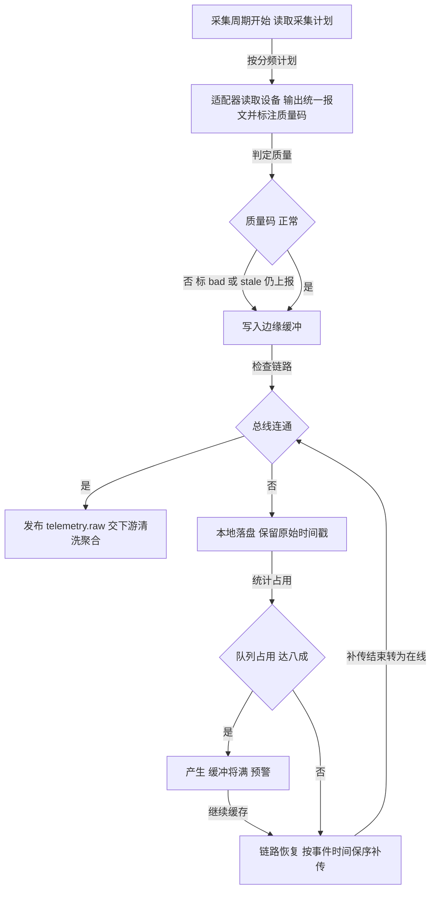
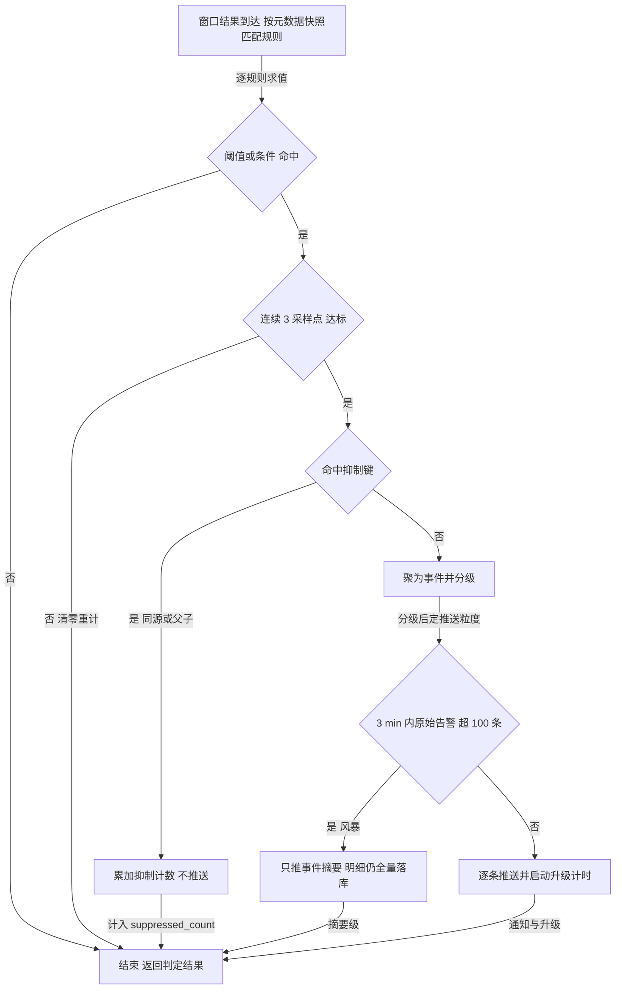
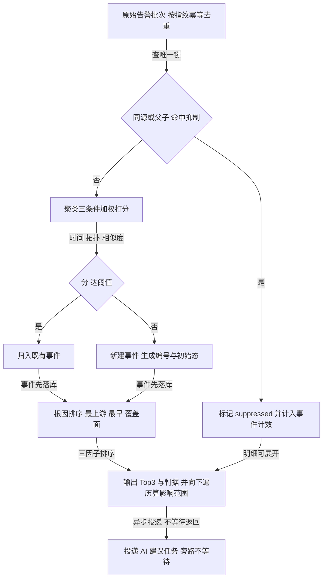
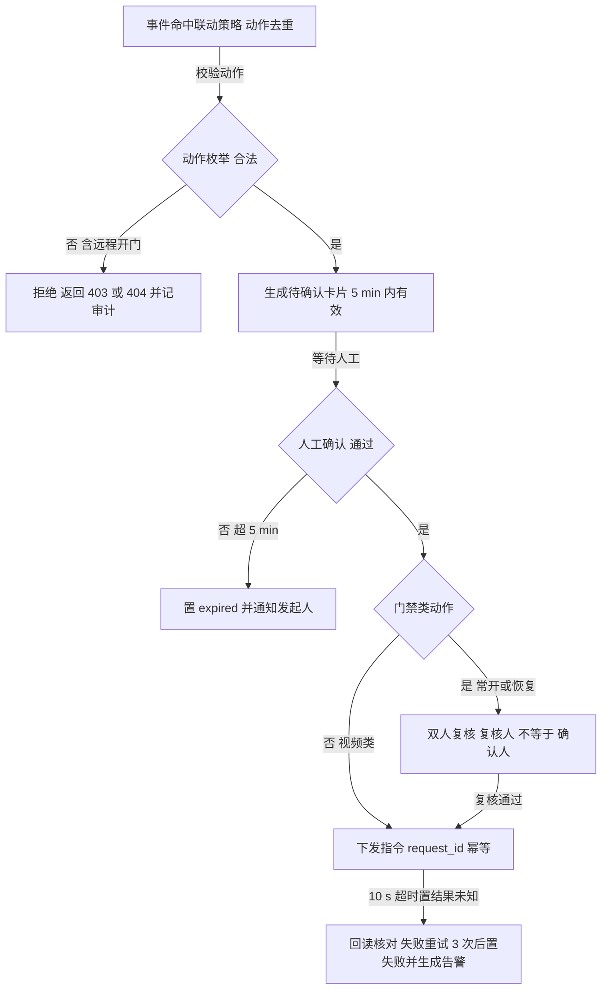
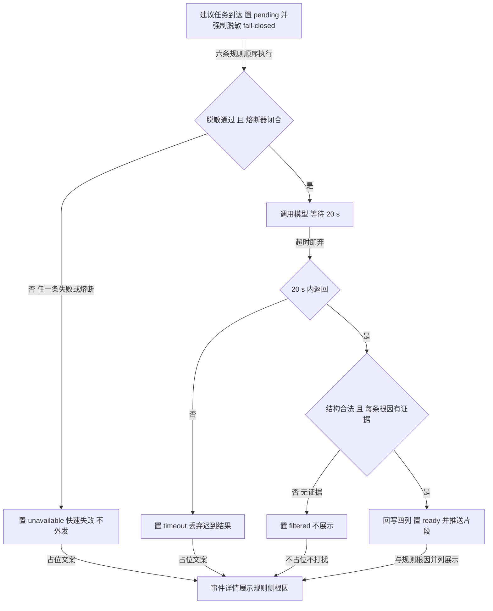

# 流程图集

| 项 | 内容 |
|---|---|
| 文档编号 | CDCIM-P3-DD-04 |
| 版本 / 状态 | v0.1 · 草案（待评审） |
| 所属阶段 | P3 详细设计 |
| 论文价值 | ★★★★★ 论文「详细设计」「业务流程设计」「可靠性设计」三题的素材。核心价值在三处：① §1 把流程图与状态机的**分工**讲清（流程管事序、状态管对象生命周期），避免「一张图什么都想画」的常见失败；② §3 告警判定流程的**三采样点与风暴分支**，是 ATAM S2（200 条/3 min、P99 ≤ 3 s、压缩比 40:1）在设计层的直接落点；③ §6 联动流程的**拒绝分支**（404 / 403 / 自审 / 重复提交），把「禁止远程开门」「双人复核」画成流程里真实存在的边，而不是文档里的一句话 |
| 上游依据 | [类图与领域模型](03-类图与领域模型.md)（5 个领域服务、9 个聚合）、[状态机设计](05-状态机设计.md)（SM-01~06 的守卫与动作，本文流程的判定节点直接引用其守卫条件）、[需求规格说明书](../02-需求/02-需求规格说明书.md)（M1 10 条、M2 12 条、M3 14 条、M4 9 条 FR）、[用例规约集](../02-需求/05-用例规约集.md)（UC-01/02/04/06/07/08/10/11 的主场景与异常流）、[ATAM 报告](../03-架构/03-ATAM架构权衡评估报告.md)（S2 风暴判定、R-02 补传算力、SP-03 抑制窗口）、[图表规范](../90-规范/02-图表规范.md)（中文加引号、节点 ≤ 9、连线带动词） |
| 下游承接 | P5 按 §2~§6 的步骤表逐行实现（一行对应一个可测的代码段），P6 以「失败处理」列为故障注入点建用例，P7 论文「详细设计」章直接取 §3 与 §6 两张图 |

> **口径声明一（编号作用域）**：本文占用 `FIG-DD-021 ~ 025`、`TAB-DD-021 ~ 027` 段，与同目录《类图与领域模型》（001~009 段）、《状态机设计》（011~020 段）不重叠。
>
> **口径声明二（本文不写什么）**：不写接口契约的字段、不写表结构、不写并发与线程。流程图只表达**事序**——谁先谁后、在哪一步分叉、失败退回哪里。凡涉及「对象处于什么状态」的判断，一律引用《状态机设计》的守卫编号（如「守卫 SM-01#1」），不在本文重复定义，避免两份文档各写一套条件。
>
> **口径声明三（图与步骤表的关系）**：图回答「顺序与分叉」，表回答「谁做、输入什么、失败怎么办」。**表比图更详细**，这是刻意的——图的节点数被规范限制在 9 个以内（图表规范 §4 第 7 条），放不下的异常处理全部沉到表里。评审时若只读图，会漏掉失败路径；只读表，会看不出主次。两者必须成对使用。

---

## 1. 流程图与状态机的分工

### 1.1 一条判据：主语是谁

| | 流程图 | 状态机 |
|---|---|---|
| **主语** | **一次动作 / 一批数据**（可结束的） | **一个对象**（长期存在的） |
| **回答** | 先做什么、后做什么、在哪分叉、失败退回哪 | 这个对象现在允许变成什么、不允许变成什么 |
| **时间观** | 有起点与终点，跑完即结束 | 无终点（除非进入终态），可被外部事件随时触发 |
| **典型问题** | 「一条遥测数据从设备到入库经过几步」 | 「一条告警能不能从关闭直接回到处理中」 |
| **本项目的例子** | 采集入库、判定、降噪、联动、AI 调用 | 告警生命周期、联动执行、建议、通道、门控 |

**用错的两种症状**：

1. **把流程画成状态机**：给「采集入库」画 12 个状态，结果是这张图永远不会「结束」，且每个节点都要问「如果中途进程崩了，这条数据停在哪个状态」——这是流程问题，不是状态问题。正确做法是流程图 + 幂等键（重跑即可，不需要断点状态）。
2. **把状态机画成流程**：给告警生命周期画一条从左到右的箭头串（产生 → 确认 → 处理 → 关闭），丢掉了「恢复」「复发」「并行分支」，于是实现时必然漏掉 `recovered → raised` 这条最贵的迁移。**状态机必须画出所有入边，流程图只需要画主路径与关键异常**。

### 1.2 五条流程的清单

**表 TAB-DD-021　五条流程：范围、触发、对应状态机与需求**

| # | 流程 | 起点 | 终点 | 涉及的状态机 | 对应 FR / UC |
|---|---|---|---|---|---|
| F-1 | 采集与入库 | 采集周期开始 | 数据可查询 / 补传完成 | SM-05 通道连通性 | FR-M1-01/05/06/07/10、FR-M2-01/05/08；UC-01/02 |
| F-2 | 告警判定 | 窗口结果到达 | 事件推送 / 无告警 | SM-01（建事件）、SM-06（门控） | FR-M3-01~05/07/09/10/11；UC-06 |
| F-3 | 降噪与根因 | 原始告警批次 | 事件含 Top3 与影响范围 | SM-02（派生态）、SM-01 | FR-M3-06/07/08/14；UC-07/08 |
| F-4 | 联动执行 | 事件命中联动策略 | 成功 / 失败 / 结果未知 | SM-03 联动执行 | FR-M4-01~09；UC-10/11 |
| F-5 | AI 旁路调用 | 建议任务到达 | 建议回写 / 降级占位 | SM-04 AI 建议 | FR-M6-02/03/07/08；UC-18 |

**一条读法**：F-2 与 F-3 都产出 `AlarmEvent`，但两者是**同一条流水线的两段**，不是两个独立流程。分段的原因在 ATAM S2：判定必须在 3 s 内完成（快），根因可以 5 s（慢），两者若串在一个流程里，根因的耗时会把判定时延拖垮。图上它们首尾相接，实现上是**同一个进程内的两段，中间有一个「事件先落库、根因后补齐」的写点**——这个写点就是 UC-08 异常流 E3「先返回 Top1，20 s 内补齐 Top3」能成立的依据。

---

## 2. 流程 F-1：采集与入库

### 2.1 流程图

**图 FIG-DD-021　采集与入库流程**——回答「一条采样值如何从设备走到可查询，以及断连时为什么不会丢」。三处关键设计：① 质量码不正常的报文**仍然上报**（C 的「否」分支标注「标 bad 或 stale 仍上报」后并入 D），因为「坏值」本身是有信息量的事实，丢掉它会让下游无法区分「设备坏了」与「网络丢了」（FR-M1-05、不变式 #4-②）；② 断连时数据落**本地队列**而非丢弃，且保留原始时间戳（G），这是补传后时间戳偏差为 0 的唯一保证（FR-M1-06 验收判据）；③ J 补传完成后**回到 E 而不是直接结束**——补传的数据同样要检查链路、同样要经过清洗与聚合，只是走限速通道。

**对应需求**：FR-M1-01（多协议采集）、FR-M1-05（质量码）、FR-M1-06（断连缓存与补传）、FR-M1-07（在线判定）、FR-M1-10（时间戳规范化）、FR-M2-01（清洗换算）、FR-M2-05（幂等写入）、FR-M2-08（写入失败可恢复）；UC-01 主场景、UC-02 断连场景。

### 2.2 流程步骤表

**表 TAB-DD-022　F-1 步骤、角色、输入输出与失败处理**

| 步 | 动作 | 角色（组件） | 输入 | 输出 | 失败处理 |
|---|---|---|---|---|---|
| 1 | 读取采集计划（测点、周期、死区、系数） | 采集执行器 | `point_def` 只读快照 | 本轮待采点清单 | 快照过期时**继续用旧版**，不回查库、不阻塞（不变式 #12-③）；计划缺失的测点跳过并计数 |
| 2 | 按协议读设备，统一报文 | 适配器（策略） | 设备地址、协议参数 | `RawFrame`（含 `ts`、`ts_source`、`quality`） | 单点超时 → 质量码 `bad`，计数 +1，**不影响同设备其他测点**；协议异常 → 该适配器熔断 60 s |
| 3 | 质量码判定 | 采集执行器 | 原始值、量程、上轮值 | 质量码 `good/uncertain/bad/stale` | 量程外 → `uncertain`；连续 3 周期无新值 → `stale`；**不插值、不修正**（不变式 #4-④） |
| 4 | 写入边缘缓冲 | 边缘缓冲 | `RawFrame` | 队列条目 | 队列已满 → 按「最旧非关键测点优先丢弃」并计数（丢的是非关键点，`critical_flag=true` 的点不丢，不变式 #1-③） |
| 5 | 总线连通性检查 | 采集执行器 / SM-05 | 连接状态 | 分支判定 | 不可达 → 走步 7；可达但 broker 拒绝 → 按不可达处理并计一次失败 |
| 6 | 发布 `telemetry.raw` | 接入网关 | 队列条目 | 已发布事件（含 `schema_version`） | QoS 1 未确认 → 重发（最多 3 次），仍失败转落盘，位点不前移 |
| 7 | 本地落盘 | 边缘缓冲 | `RawFrame` | 磁盘队列条目 | 磁盘写失败 → 内存队列暂存（上限 5 000 条）并告警；超限即丢弃并计「不可恢复丢失」，这是唯一允许丢数的路径 |
| 8 | 占用率统计与预警 | 边缘缓冲 | 队列水位 | 占用率、预警事件 | ≥ 80% → 产生「缓冲将满」预警（FR-M1-06）；≥ 95% → 升为重要告警 |
| 9 | 链路恢复后保序补传 | 采集执行器 | 磁盘队列 | 补传数据流（`ts_source=replay` 标记保留原 `ts`） | 限速补传（避免冲击在线 P99，ATAM R-02）；补传期间新数据不插队；补传中断后从上次位点继续 |
| 10 | 清洗换算与窗口聚合 | 流计算器 | 发布的事件 | `st_metric` 行、窗口结果 | 超量程 → 标 `bad` 且不进聚合；写入失败 → **不提交位点**，积压保留（FR-M2-08） |

---

## 3. 流程 F-2：告警判定

### 3.1 流程图

**图 FIG-DD-022　告警判定流程**——回答「一条窗口结果如何变成一次推送，以及风暴时怎么不被自己压垮」。四处关键设计：① B 与 C 是**两道独立的判定**——先判单点是否越限，再判是否连续 3 个采样点达标（FR-M3-02 的「59 s 不告警、第 60 s 告警」靠这一格；持续计数在 `DurationTracker` 的 Redis 键里，不在此图上）；② D 在 C 之后，顺序不可交换（模板方法的骨架，见《类图》§6 P6）——先抑制后判定会让被抑制的记录不进 `raw_count`，压缩比指标失真；③ G 的风暴分支不是「丢弃」，而是「改变推送粒度」：事件照常生成、明细照常落库，只是不再逐条推送（ATAM S2 要求「被抑制告警 100% 可检索」）；④ E 与 F/I 的关系是「明细 vs 事件」——被抑制的条目计入事件计数但不单独推送。

**对应需求**：FR-M3-01（四类阈值）、FR-M3-02（持续 N 秒）、FR-M3-03（变化率）、FR-M3-04（三级分级）、FR-M3-05（同源抑制）、FR-M3-07（聚类）、FR-M3-09（判定时延 P99 ≤ 3 s）、FR-M3-10（建事件 9 条迁移的起点）、FR-M3-11（分级通知与升级）；UC-06 主场景 1/2、UC-07 主场景 1/2；ATAM S2 风暴场景。

### 3.2 流程步骤表

**表 TAB-DD-023　F-2 步骤、角色、输入输出与失败处理**

| 步 | 动作 | 角色（组件） | 输入 | 输出 | 失败处理 |
|---|---|---|---|---|---|
| 1 | 窗口结果到达，匹配适用规则 | 规则判定器 | 窗口结果事件（含 `valid_count`）、`MetadataSnapshot` | 待求值的规则列表 | 快照版本落后 ≤ 30 s 时继续用旧版（不阻塞、不回查库）；规则为空 → 无告警，直接结束 |
| 2 | 规则求值（阈值 / 持续 / 变化率） | `RuleEvaluator`（策略） | 编译后的表达式树、窗口值 | 命中 / 未命中 | 表达式执行异常 → 该规则本轮跳过并计一次「规则异常」，**不产生告警、不中断其他规则**；同一规则连续 3 次异常 → 生成「规则未生效」重要告警 |
| 3 | 三采样点持续判定 | `DurationTracker` | 条件命中序列、`durationS`、采样间隔 | 是否达标 + 已持续秒数 | 计数键丢失（Redis 重启）→ 按「重新计时」处理（宁可晚推，不可误推）；中途未命中 → 计数清零（FR-M3-02） |
| 4 | 生成原始告警并算指纹 | 规则判定器 | 规则 ID、设备、测点、窗口起点 | `RawAlarm`（含 `alarm_fingerprint`） | 指纹重复（同窗口已判过）→ 幂等丢弃，不重复入库（FR-M2-05 的同源手段） |
| 5 | 抑制检查 | `ClusterReducer` / `SuppressionKeyStore` | 抑制键、拓扑父子关系 | 是否抑制 + 抑制类型 | Redis 不可达 → **降级为「仅同源抑制」**（按内存最近 1 min 判定），并标记「抑制降级」；拓扑不完整 → 跳过父子抑制并生成台账质量告警（UC-07 E4） |
| 6 | 风暴判定 | 降噪器 | 3 min 滑窗内原始告警条数 | 是否风暴态 | 计数丢失 → 按非风暴处理（退化但安全：只会多推几条，不会漏） |
| 7 | 聚为事件、分级 | `ClusterReducer` + `AlarmEvent` | 原始告警批次、拓扑邻域、相似度 | 新建或追加的 `AlarmEvent` | 聚类参数缺失 → 退化为「同设备 + 同类型 + 120 s」单条件聚类，并记录降级标记 |
| 8 | 推送与升级计时 | 通知路由器 | 事件（含级别）、通知策略 | 各渠道通知记录、升级计时器 | 单渠道失败 → 其他渠道并行继续（不串行、不整体回滚，FR-M3-11）；全失败 → 降级为界面强提示并记「通知不可达」 |

**风暴分支的三条量化口径**（否则「风暴态」会变成一个模糊词）：

| 口径 | 取值 | 依据 |
|---|---|---|
| 触发阈值 | 3 min 滑窗内 > 100 条原始告警 | ATAM S2 的场景基线是 3 min 200 条，取一半为触发点，留出收敛时间 |
| 风暴期推送粒度 | 每事件 1 条摘要（含 `raw_count` / `suppressed_count` / Top1 设备），不再逐条 SSE | 值班员在风暴期无法处理逐条推送；摘要是「可行动的最小信息」 |
| 退出条件 | 滑窗回落到 ≤ 100 条并持续 1 min | 单点回落就退出会导致推送抖动（进/出风暴态反复切换） |

---

## 4. 流程 F-3：降噪与根因

### 4.1 流程图

**图 FIG-DD-023　降噪与根因流程**——回答「200 条原始告警如何变成 5 个带根因的事件」。三处关键设计：① 去重（A）在抑制（B）**之前**，因为幂等是「不重复记录」，抑制是「不重复推送」，两者的判据不同，顺序错了会把重复消息当成被抑制（`suppressed_count` 虚高）；② H 发生在事件落库**之后**（F/G → H），所以根因算得慢不会阻塞事件推送，这正是 UC-08 异常流 E3「先返回 Top1」能实现的结构原因；③ J 是**虚线语义的异步投递**（图中为实线但标注「不等待返回」）——AI 建议永远不在这条流程的返回路径上，`ai_suggest_status` 初始为 `pending`，由 SM-04 独立推进。

**对应需求**：FR-M3-06（父子抑制并保留关联链）、FR-M3-07（聚类 120 s + 拓扑 + 相似度，200 条 → ≤ 5 事件）、FR-M3-08（Top3 根因 + 影响范围，P95 ≤ 5 s，Top1 命中 ≥ 85%）、FR-M3-14（原始告警全量留存并可展开）；UC-07 主场景 1~2/6、UC-08 主场景 1~4。

### 4.2 流程步骤表

**表 TAB-DD-024　F-3 步骤、角色、输入输出与失败处理**

| 步 | 动作 | 角色（组件） | 输入 | 输出 | 失败处理 |
|---|---|---|---|---|---|
| 1 | 批量去重 | 降噪器 | 原始告警批次 | 去重后批次 + 重复计数 | 唯一键冲突 → 静默忽略（幂等键就是为此设计）；重复率 > 10% → 记入「上游重发」指标，供排查 |
| 2 | 抑制判定（同源 / 父子） | `SuppressionSpec` | 抑制键、`TopologyLink`、上级活动告警 | 抑制标记 + `suppress_type` + `suppress_reason` | 抑制键服务不可用 → 降级为仅同源（内存 1 min）；拓扑缺失 → 跳过父子并标「拓扑不完整」 |
| 3 | 聚类打分 | `ClusterReducer` | 时间窗（120 s）、拓扑邻域、指标相似度、权重 | 每条原始告警的归属建议 | 权重配置缺失 → 用默认权重（时间 0.40 / 拓扑 0.35 / 相似度 0.25，取《告警降噪与根因算法设计》的口径）并记一条配置告警 |
| 4 | 归入或新建事件 | `EventFactory` + `AlarmEvent` | 归属建议、现有事件集合 | `event_id` + 事件初始态 `raised` | 并发新建同指纹事件 → 唯一约束拦下，后到者改为「追加」；写失败 → 原始告警已落库，事件延后由重试任务补建 |
| 5 | 根因排序 | `RootCauseAnalyzer` | 事件内明细、拓扑图快照 | Top3 候选 + 置信度 + 判据 | 超 5 s → **先返回已算出的 Top1 与影响范围**，界面显示「正在细化」，20 s 内补齐 Top3（UC-08 E3） |
| 6 | 影响范围遍历 | `RootCauseAnalyzer` | 根因设备、拓扑 | 受影响机柜 / 业务清单（`impact_scope`） | 拓扑成环或缺 `space_node` → 降级为「仅给出根因设备」，标「影响范围不可算」，生成台账质量告警 |
| 7 | 投递 AI 建议任务 | 告警研判 → 智能增强 | `eventId` + 脱敏后的上下文 | `ai.tasks` 消息 | 投递失败 → 仅记日志，**不重试、不影响事件**（建议可空，NFR-AVAIL-03）；队列积压 → 丢弃最旧任务 |

**聚类参数的一处口径说明**：ATAM 报告 SP-02 指出「聚类相似度阈值与时间窗参数当前未定量」。该缺口已在同目录《告警降噪与根因算法设计》中闭合（Δt = 120 s、权重 0.40 / 0.35 / 0.25、簇内主告警上限 50），本文流程**直接引用**而不重复定义参数——否则同一组数字会在两份文档里各自漂移。本文只补该文档不表达的一件事：参数缺失时流程如何降级（见上表第 3 步）。验收仍以 FR-M3-07 的「召回率 ≥ 95%、压缩比 ≥ 40:1」为准，需在 P6 用 10 组混合场景回放标定，本文不预设标定结果。

---

## 5. 流程 F-4：联动执行

### 5.1 流程图

**图 FIG-DD-024　联动执行流程**——回答「一次门禁动作如何被人工放行，以及为什么失败也不影响告警」。四处关键设计：① B 在 D **之前**——动作合法性先于卡片生成，非法动作连卡片都不该出现（`action_type` 无 `door_open`，此处返回 404 而非 403）；② E 与 H 是**两道独立的人工关口**，且 H 的守卫是「复核人 ≠ 确认人」，由库层 CHECK 兜底（不能只靠应用层判断）；③ I 的 `request_id` 幂等与 J 的回读是「同一件事的两半」——幂等防重复下发，回读防「下发了但不知道结果」；④ 图中**没有**「告警推送」这条边：整条流程的任何失败都不会回写告警状态，告警推送的成功率与这条流程无关（FR-M4-07）——这是「一条不存在的边」比「一条虚线」更有力的表达。

**对应需求**：FR-M4-01（策略与动作去重）、FR-M4-02（100% 人工确认、绕过返回 403）、FR-M4-03（门禁 2 s 下发 / 5 s 回读 / 3 次重试）、FR-M4-04（视频取流与抓拍回落）、FR-M4-05（幂等与结果未知）、FR-M4-06（审计与补偿）、FR-M4-07（失败不影响告警）、FR-M4-08（范围排除）、FR-M4-09（双人复核）；UC-10 全部异常流、UC-11 E1/E2。

### 5.2 流程步骤表

**表 TAB-DD-025　F-4 步骤、角色、输入输出与失败处理**

| 步 | 动作 | 角色（组件） | 输入 | 输出 | 失败处理 |
|---|---|---|---|---|---|
| 1 | 策略匹配与动作去重 | `LinkageArbiter` | 事件（级别 / 类型 / 设备）、策略集合 | 去重后的动作列表 | 同动作被多条策略命中 → 只执行 1 次并记命中策略数（FR-M4-01）；策略为空 → 流程结束，不生成卡片 |
| 2 | 动作合法性校验 | `LinkageArbiter` | `action_type` | 通过 / 拒绝 | 非 E8 枚举值（含 `door_open`）→ **404**；有该动作但无权限 → 403；两者都记审计（§3.1 第 3 条） |
| 3 | 生成待确认卡片 | 联动执行器 | 目标、动作、有效期、`request_id` | 卡片（`pending_confirm`） | 同一目标已有未完结的相反动作 → 进「待裁决」，由工程师选择保留哪个，**不并行下发**（UC-10 E5） |
| 4 | 人工确认 | 值班员 | 卡片、确认人身份 | `confirm_by` / `confirm_at` | 超 5 min → `expired` 并通知；重复点击 → 幂等返回当前态（不重复记确认人） |
| 5 | 判定是否复核 | 联动执行器 | `action_type` | 分支 | 动作类型未知 → 按「需复核」处理（保守优先） |
| 6 | 双人复核 | 运维工程师 | 待复核记录、复核人身份 | `review_by` / `review_at` | 提交人自审 → **403** 并记审计，指令不下发（FR-M4-09）；无第二人可用 → 停留待复核，不发指令（宁可不做，不可自审） |
| 7 | 下发指令 | 门禁 / 视频适配器（防腐层） | 目标标识、动作、参数、`request_id` | 平台响应 | `request_id` 重复 → 直接返回首次结果（24 h 幂等）；连接失败 → 重试 3 次（间隔 2 s）；仍失败 → `failed` + 生成「联动失败」重要告警 |
| 8 | 回读核对 | 联动执行器 | 平台查询接口 | `readback_status` | 5 s 内未回读 → 继续等待至 10 s；10 s 仍未回读 → `unknown` + 30 s 后核对任务回读（FR-M4-05） |
| 9 | 结果留痕与补偿入口 | 联动执行器 + 审计切面 | 全过程字段 | `linkage_record` 一行 + 审计一条 | 审计写失败 → 整个动作 fail-closed（不执行），因为「无审计的控制动作」比「不做」更危险 |
| 10 | 失败后的告警隔离确认 | 联动执行器 | 失败计数 | 联动失败告警（**新事件**，非改原事件） | 生成联动失败告警失败 → 记日志 + 观测指标，不得因此阻塞或重试原联动 |

**「禁止远程开门」在流程上的三处可见**：① B 的判定节点存在且指向 C（拒绝），不是一个「永远为真」的装饰；② C 的返回码是 404 而非 403（不泄露能力存在）；③ 整个流程**没有任何一条边**通向「开门」动作，即使有人绕过前端直接调接口，也会在 B 处被拦。§4.3 表（《状态机设计》）的四处落点在此处对应第 2 步。

---

## 6. 流程 F-5：AI 旁路调用

### 6.1 流程图

**图 FIG-DD-025　AI 旁路调用流程**——回答「建议如何在不影响主链路的前提下产出，以及四种『没有结果』如何区分」。四处关键设计：① A 把「置初始态」与「强制脱敏」合并成一步，语义是**先落 `pending` 再脱敏**——这样即使脱敏阶段进程崩溃，前端看到的也是「生成中」而不是空白（`pending` 有超时兜底）；② B 把脱敏与熔断合成一个判定节点，因为两者的处理动作完全相同（都是 `unavailable` + 不外发），实现上也走同一个 catch 分支；③ E 的超时判定在**调用之后**而非之前，20 s 是从发出请求算起，不是从任务到达算起，否则排队时间会吃掉模型的响应预算；④ C/F/H 三条失败路径与 I 的成功路径**都汇到 J**（展示规则侧根因）——这是「AI 不可用时功能完整度下降但核心可用」（NFR-AVAIL-03）的图形表达：**旁路的失败不产生空白页**。

**对应需求**：FR-M6-01（建议生成）、FR-M6-02（每条根因必附证据，无证据即过滤）、FR-M6-03（超时 20 s 放弃、不可用占位、规则根因照常展示）、FR-M6-07（六条规则强制脱敏、失败拒绝外发）、FR-M6-08（只写建议字段）；UC-18 全部异常流。

### 6.2 流程步骤表

**表 TAB-DD-026　F-5 步骤、角色、输入输出与失败处理**

| 步 | 动作 | 角色（组件） | 输入 | 输出 | 失败处理 |
|---|---|---|---|---|---|
| 1 | 任务到达，置 `pending` | 智能代理 | `ai.tasks` 消息（`eventId` + 上下文引用） | `ai_suggest_status = pending` | 重复任务（同事件同版本）→ 幂等丢弃；事件已 `closed` → 直接置 `filtered`（不再生成） |
| 2 | 强制脱敏 | `Sanitizer` | 事件摘要、设备与人员信息、自由文本 | 脱敏后的 payload | 任一规则失败 → **拒绝外发**，置 `unavailable`（fail-closed）；六条规则的执行顺序固定，不允许「跳过某条」的配置项 |
| 3 | 熔断检查 | 熔断器 | 近 1 min 失败率、连续失败数 | 闭 / 开 | 熔断打开 → 快速失败置 `unavailable`（不排队、不重试）；半开状态放行 1 个探测请求 |
| 4 | 调用模型（含 RAG 检索） | `ProviderPort` + `Retriever` | 脱敏 payload、Top-K 知识切片 | 模型响应 | 超 20 s → 置 `timeout` 并**丢弃迟到结果**（迟到结果若回写会造成「建议比事件还旧」）；检索失败 → 降级为无 RAG 的直调 |
| 5 | 结构校验 | 智能代理 | 响应 JSON | 校验结论 | 非 JSON / 缺字段 → 按无结果处理；`roots` 超过 3 条 → 截断为 Top3 并记一条质量指标 |
| 6 | 证据校验 | 智能代理 | 每条根因的 `evidence` | 通过 / 过滤 | 任一根因缺证据或引用不可解析（设备 / 测点 / 拓扑边不存在）→ 该条丢弃；全部丢弃 → 置 `filtered`（不展示，保留日志供质量评估） |
| 7 | 回写四列 | 智能代理（库账号仅 4 列 UPDATE 权限） | `payload`、`status`、`at`、`feedback`（空） | 更新后的 `alarm_event` | 写失败 → 放弃（建议可空），不重试、不告警；版本冲突（`payloadVersion` 更旧）→ 丢弃 |
| 8 | 前端呈现 | 应用展现 | `ai_suggest_status` + payload | 建议卡片 / 占位文案 | `ready` → 卡片（与规则根因**并列**展示，不覆盖）；其余四态 → 对应占位；建议过期（`ai_suggest_at < last_occur_at`）→ 折叠并标「事件已复发，建议可能过时」 |

**「AI 不进主链路」在流程上的两处可见**：① 整条流程的**起点是异步消息**，主链路（F-2）在投递完任务后立即返回，不等待；② 第 7 步的写入权限只有 4 列（数据字典 §4.8），流程图上看似能「回写」，实际连 `event_status` 这一列都没有 UPDATE 权限——这是「图上看不出、但类型与权限挡得住」的一类约束，注释在此，避免读者误以为约束只在代码评审里。

---

## 7. 流程与需求的追溯

**表 TAB-DD-027　五条流程的需求追溯与验证点**

| 流程 | 主要 FR | 主要 UC | 关联状态机守卫 | 验证点（P6 从这里取用例） |
|---|---|---|---|---|
| F-1 采集与入库 | FR-M1-01/05/06/07/10、FR-M2-01/05/08 | UC-01、UC-02 | SM-05#1~8 | 断连 30 min 后补传，时间戳偏差 = 0；队列 80% 预警；重复消息 10% 时记录数增量不变 |
| F-2 告警判定 | FR-M3-01~05/07/09/10/11 | UC-06 | SM-01 初态建立（不计迁移）、SM-06#1 | 59 s 不告警 / 60 s 告警；100 条同源推 1 条；风暴期事件数 ≤ 5、明细 100% 可查 |
| F-3 降噪与根因 | FR-M3-06/07/08/14 | UC-07、UC-08 | SM-02#1~3、SM-01 | 200 条 → ≤ 5 事件；Top1 命中 ≥ 85%；Top1 返回 ≤ 5 s，Top3 20 s 内补齐 |
| F-4 联动执行 | FR-M4-01~09 | UC-10、UC-11 | SM-03#1~12 | 绕过确认 403；自审 403；`door_open` 404；重复提交执行 1 次；停视频平台后告警推送 100% |
| F-5 AI 旁路 | FR-M6-02/03/07/08 | UC-18 | SM-04#1~4 | 断模型后告警推送 100%、规则根因 100% 展示、占位 100%；注入 5 次越权写入 5 次被拒 |

**一处必须承认的空白**：F-2 的「风暴分支」在 UC 层没有对应用例——UC-06 只覆盖「接收与确认」，不覆盖「3 min 200 条」的极端负载。本文把它作为**补充测试点**记在此表最后一行（与 ATAM S2 场景对齐），建议 P6 直接以 S2 的场景描述建用例，而不是从 UC 派生。

---

## 8. 待确认事项

| # | 待确认点 | 本文暂定 | 备选 | 影响面 | 建议 |
|---|---|---|---|---|---|
| 1 | **风暴态的触发阈值与推送粒度** | 3 min 内 > 100 条触发；风暴期只推事件摘要（含计数与 Top1 设备），退出条件为回落到 ≤ 100 条并持续 1 min | ① 阈值改为「同比增长 > 3 倍基线」的自适应口径；② 风暴期连摘要也不推，仅在大屏显示计数 | FR-M3-11 的推送成功率统计口径、值班员体验、ATAM S2 的压缩比指标 | 建议**先用固定阈值**（可解释、可回归），并把「同比口径」列为 P6 压测后的优化项。固定阈值的代价是「基线本身很低时（如夜间 3 条/3 min）不触发」，但夜间值班人力充足，漏触发的影响小于误触发的噪音 |
| 2 | **F-4 第 3 步「待裁决」的实现位置** | 在联动执行器内实现：同一目标存在未完结的相反动作时，新请求进「待裁决」队列，由工程师在卡片上选择 | 用分布式锁在目标级串行化（同一门同一时刻只允许一条指令在途） | UC-10 异常流 E5 的实现复杂度、`linkage_record` 是否需增状态值、跨告警事件的并发场景 | 建议**用待裁决而非分布式锁**：锁只能保证「不并发」，不能回答「两条相反指令谁优先」这个业务问题；而待裁决把决策交回给人，符合「控制动作必须人工确认」的整体基调。代价是要多一个 UI 交互，且待裁决本身需要一个超时（建议 30 min） |

---

## 考点映射

| 考纲知识点 | 本文件对应内容 | 论文可用位置 | 真题溯源 |
|---|---|---|---|
| **流程图与状态图的选型** | §1.1 一条判据（主语是谁）、两种用错的症状 | 论文「详细设计」段开头的图种说明：先讲清每张图回答什么，再给图。这一段能显著提升「设计表达」的评分 | 论文题「论软件设计」类、案例题「系统设计」 |
| **业务流程与异常流设计** | §2~§6 每张图的失败分支 + 每张表的「失败处理」列 | 论文「可靠性设计」段：不写「我们考虑了异常」，而写「每条流程的每一步失败时退到哪」 | 案例题「系统可靠性」「业务流程设计」 |
| **性能关键路径的识别** | §3 三采样点与风暴分支、§7 判定时延预算、F-3 的「先出 Top1 后补 Top3」 | 论文「性能设计」段：把 P99 预算拆到流程的每一格，说明哪一步不能等 | 2024 下「论高并发系统设计」、案例题「性能优化」 |
| **安全约束的流程化落地** | §5 的拒绝分支（404 / 403 / 自审拦截）、§6 的 fail-closed 脱敏 | 论文「安全设计」段：安全不是流程之外的检查，而是流程里真实存在的边 | 2023 下「论信息安全设计」、等保测评 |
| **降级与旁路设计** | §6 的四种「没有结果」、D/G/I 三路汇到「规则根因照常展示」 | 论文「可用性设计」段：旁路失败不产生空白页——这是「可空结果」在设计层的表达 | 2022 下「论系统可用性」 |
| **需求可追溯** | 每图下方「对应需求」、§7 追溯表（流程 × FR × UC × 守卫 × 验证点） | 论文「需求实现」段的证据链；也用于答辩「这条需求在哪实现的」的定位 | 评分要求「可追溯」 |
| **图表的规范性表达** | 全部 5 张流程图节点 ≤ 10、中文标签加引号、判定用菱形、连线带动词 | 论文插图质量分；也说明「规范不是形式，它让图可被机器渲染、可被评审」 | 评分要求「文档规范」 |

---

## 论文可引用段落

> **【适用题目类型】论软件详细设计 / 论系统可靠性 / 论业务流程设计**

详细设计里最容易犯的错是「一张图什么都想画」。我先划清分工：流程图的主语是一次动作或一批数据，有起点有终点；状态机的主语是一个对象，没有终点，只回答「允许变成什么」。判据就是问主语是谁。据此，采集入库画成流程——它跑完即结束，靠幂等键而非断点状态保证可重跑；告警生命周期画成状态机——它必须画出所有入边，包括最反直觉的「恢复后复发回到原事件」。五条流程里我保留了两处「看似多余」的分支。判定流程里，质量码不正常的报文仍然上报，因为坏值本身是信息，丢掉它下游就分不清是设备坏了还是网络丢了。联动流程里，动作合法性校验放在生成卡片之前，非法的「远程开门」返回四零四而不是四零三——后者等于告诉调用方「这个能力存在，只是你权限不够」。风暴分支则刻意不丢弃数据，只改变推送粒度：事件照常生成、明细照常落库，被压缩的每一条都能展开查到，这是压缩比与可检索性之间必须付的那笔账。

（约 300 字）

---

## 变更记录

| 版本 | 日期 | 变更 |
|---|---|---|
| v0.1 | 2026-11-27 | 初稿。确立流程图与状态机的分工判据与两种误用症状（§1.1）；五条流程清单与分段理由（TAB-DD-021）；采集入库流程含断连落盘、80% 预警与保序补传（FIG-DD-021 / TAB-DD-022）；告警判定流程含三采样点、抑制顺序与风暴分支的三条量化口径（FIG-DD-022 / TAB-DD-023）；降噪与根因流程含去重先于抑制、事件先落库后算根因、AI 异步投递（FIG-DD-023 / TAB-DD-024，含聚类参数的引用口径与缺失降级）；联动执行流程含 404/403 拒绝分支、双人复核、幂等与回读（FIG-DD-024 / TAB-DD-025）；AI 旁路流程含 fail-closed 脱敏、20 s 超时、证据过滤与「不产生空白页」的三路汇合（FIG-DD-025 / TAB-DD-026）；五条流程的需求追溯与验证点（TAB-DD-027，含风暴分支无 UC 覆盖的空白声明）；2 项待确认 |
