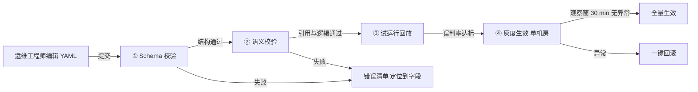

# 规则引擎 DSL 设计

| 项 | 内容 |
|---|---|
| 文档编号 | CDCIM-P3-DD-05 |
| 版本 / 状态 | v0.1 · 草案（待评审） |
| 所属阶段 | P3 详细设计 |
| 论文价值 | ★★★★☆ 规则引擎「配置化 + 安全表达式子集 + 校验灰度」的完整落地，可支撑论文「详细设计」「规则引擎设计」「可修改性战术」三段 |
| 上游依据 | [需求规格说明书](../02-需求/02-需求规格说明书.md)（FR-M3-01 ~ 05、09、11、12、14；NFR-MOD-02）、[质量属性场景表](../02-需求/03-质量属性场景表.md)（QA-PERF-06、QA-MOD-02）、[ATAM 评估报告](../03-架构/03-ATAM架构权衡评估报告.md)（SP-03、SP-04、R-08）、[数据字典](../02-需求/08-数据字典初稿.md)（`alarm_rule` 28 字段、E1/E6a/E7）、[数据架构设计](../03-架构/10-数据架构设计.md)（TAB-ARCH-20 链路 B 预算、TAB-ARCH-22 幂等键）、[组件映射表](../03-架构/01-组件映射表-v1.md)（alarm-engine）、[图表规范](../90-规范/02-图表规范.md) |
| 下游承接 | 告警引擎实现（`alarm-engine`）、规则管理界面、[告警降噪与根因算法设计](11-告警降噪与根因算法设计.md)（本 DSL 产出的 `raw_alarm` 是其唯一输入）、P6 规则回归用例 |

> **口径声明**：本文所有时延、条数、上限均为**设计目标值**，不是实测值。规则求值耗时按「预编译表达式树 + 3 次比较」估算，实测在 P6 产生。文中凡写 `≤` `≥` 者均为设计约束，验收方法在括号内标注。

---

## 1. 设计目标与边界

### 1.1 谁写规则

规则的作者是**运维工程师**（SRS 3.2 角色表），不是开发人员。这一条决定了 DSL 的全部形态：一份规则必须能用「改一个 YAML 文件」完成，不编译、不发版、不重启（NFR-MOD-02：0 行代码、≤ 10 s 生效、≤ 10 s 回滚）。

四类使用者的诉求并不一致，DSL 需要同时满足：

| 角色 | 诉求 | DSL 的对应设计 |
|---|---|---|
| 运维工程师 | 看得懂、改得动；不想学编程 | YAML 键值结构 + 中文枚举，条件只允许 5 个函数 |
| 开发人员 | 可校验、可回放、出错能定位到字段 | 四道闸门 + 14 类错误码（第 6 节） |
| 值班员 | 规则改了不要静默失效 | 灰度生效 + 试运行报告 + 一键回滚 |
| 架构评估方 | 规则不得成为注入点 | 表达式白名单 AST，禁止任意执行（第 4 节） |

### 1.2 三条设计原则

1. **声明式优先于脚本式**：DSL 只描述「什么条件下算什么级别」，不描述「怎么做」。判定后的抑制、聚类、根因由固定流水线承担（见 DD-06），规则作者无法干预——这是「降噪不降灵敏度」在配置层的保证（BR-R2）。
2. **能力边界靠语法收窄，不靠文档提醒**：禁止的写法必须在解析期报错，而不是在规范里写「请不要使用 `eval`」。第 4 节的白名单是**封闭集合**，新增一个函数需要走变更流程。
3. **规则表达力够用即止**：不引入 Flink CEP / Drools（组件映射表已决策）。在 200 条规则规模、约 1000 次求值/秒的负载下，预编译表达式树的单次求值成本约 15 µs，算力不是瓶颈（容量规划 §5 已论证），表达力过剩只会带来校验与运维成本。

### 1.3 不做什么

| 不做 | 理由 |
|---|---|
| 规则内写通知动作、联动指令 | DSL 的 `actions` 只产出「联动建议」，指令下发必须经人工确认（FR-M4-02、C-12）。类型上隔离，规则无法生成可执行指令 |
| 规则内访问数据库 / 外部接口 | 求值必须是纯函数，否则回放（FR-M2-10）无法复现当时结果 |
| 用户自定义告警级别 | 固定三级（A-1、FR-M3-04），第四级在 schema 层就拒绝 |
| 规则脚本化（任意 Python） | 引入注入面且无法静态校验；本项目的规则形态经盘点全部可被 YAML + 安全表达式覆盖 |
| 规则跨规则引用（规则 A 调用规则 B） | 会形成隐式依赖图，变更影响不可分析；需要组合时用 `scope` + 多规则同族聚类替代 |

---

## 2. DSL 总体结构

一条规则是一个 YAML 文档，顶层 10 个键，嵌套共 24 个字段（合计 34 个）。结构如下：

```yaml
rule_id: TMP-RACK-INLET-HIGH-30        # 业务唯一键（必填）
name: 机柜进风温度越上限 30 ℃            # 展示名（必填）
enabled: true                           # 是否加载（默认 true）
scope:                                  # 适用对象，解析为测点集合（必填）
  rooms: [RM-A]
  device_types: [th_sensor]
  point_codes: [INLET_TEMP]
condition:                              # 判定条件（必填）
  type: threshold
  op: gt
  value: 30
duration:                               # 持续判定（可选，缺省即瞬时）
  seconds: 60
  samples: 3
  recover_samples: 3
level: major                            # 三级之一（必填）
suppression:                            # 降噪参数（可选，取默认值）
  window_s: 300
  cross_level_break: true
  parent_child: true
actions: {}                             # 联动建议（可选，不自动执行）
notify:                                 # 通知路由（可选，按级别默认）
  channels: [sms, im]
  escalate_interval_s: 300
  escalate_max_times: 3
```

**表 TAB-DD-01　DSL 顶层与嵌套字段清单（34 个）**

| 字段 | 类型 | 取值 / 范围 | 必填 | 默认 | 校验与说明 |
|---|---|---|---|---|---|
| `rule_id` | string | `^[A-Z][A-Z0-9_]{3,63}$` | 是 | — | 业务唯一键，落库 `alarm_rule.rule_code`；同编码多版本并存（`uk_alarm_rule`） |
| `name` | string | ≤ 128 字符 | 是 | — | 中文展示名，进入告警标题 |
| `enabled` | bool | true / false | 否 | `true` | false 时参与编译校验但不加载，便于预置草稿 |
| `scope` | object | 见表 TAB-DD-02 | 是 | — | 解析为测点集合，空集或超限即拒绝（E-06 / E-07） |
| `condition` | object | 见表 TAB-DD-03 | 是 | — | 判定表达式与阈值 |
| `duration` | object | 见表 TAB-DD-04 | 否 | `{seconds: 0, samples: 1, recover_samples: 3}` | 缺省为瞬时判定 |
| `level` | enum | `critical` / `major` / `minor` | 是 | — | E1 三级，第四级拒绝（FR-M3-04） |
| `suppression` | object | 见表 TAB-DD-05 | 否 | 见默认列 | 降噪参数，缺省值与 SRS 一致 |
| `actions` | object | 见表 TAB-DD-06 | 否 | `{}` | **仅生成建议**，不产生控制指令 |
| `notify` | object | 见表 TAB-DD-07 | 否 | 按级别默认 | 通知通道与升级策略（FR-M3-11） |

**表 TAB-DD-02　`scope` 子字段（5 个）**

| 字段 | 类型 | 取值 | 必填 | 默认 | 说明 |
|---|---|---|---|---|---|
| `rooms` | array \| string | 机房编码数组，或 `all` | 否 | `all` | 灰度发布的粒度单位（FR-M3-12） |
| `device_types` | array[enum] | E4：`ups`/`pdu`/`battery`/`precision_ac`/`th_sensor`/`leak`/`smoke`/`door_ctrl`/`camera`/`gateway` | 否 | 空 = 不限 | 按设备类型选点 |
| `device_ids` | array[string] | 设备编码数组 | 否 | 空 = 不限 | 精确指定，用于单台设备临时加固 |
| `point_types` | array[enum] | E3：`analog`/`discrete`/`accumulate` | 否 | 空 = 不限 | 与 `condition` 的语义相关联（analog 才可比较大小） |
| `point_codes` | array[string] | 测点编码数组 | 否 | 空 = 不限 | 精确指定测点 |

`scope` 的 5 个条件取**交集**；交集为空即校验失败（E-06），命中测点数 > 500 即拒绝（E-07）——单条规则覆盖过多测点会使单次事件求值耗时线性上升，直接挤压 TAB-ARCH-20 的 200 ms 规则匹配预算。

**表 TAB-DD-03　`condition` 子字段（6 个）**

| 字段 | 类型 | 取值 | 必填 | 默认 | 说明 |
|---|---|---|---|---|---|
| `type` | enum | `threshold` / `rate` / `expression` / `communication` | 是 | — | 落库 `rule_type`，与 duration 组合决定 E6a 取值（见 7.1） |
| `op` | enum | `gt`/`ge`/`lt`/`le`/`between`/`outside`/`eq`/`ne` | `type` 为 `threshold` 或 `rate` 时必填 | `gt` | `between`/`outside` 必须同时给 `value` 与 `value2` |
| `value` | number | 工程单位 | `type` 为 `threshold` 或 `rate` 时必填 | — | 阈值；`rate` 类型下表示变化率阈值（工程单位/窗口），如 3 ℃/min 配 `window_s: 60` |
| `value2` | number | > `value` | `between`/`outside` 时必填 | — | 区间上界 |
| `expr` | string | ≤ 512 字符，第 4 节安全子集 | `type=expression` 时必填 | — | 组合条件，回退到 `op` 时禁止同时填写 |
| `window_s` | int | 60 ~ 3600 | `type=rate` 时必填 | — | 变化率窗口，落库 `rate_window_s` |

**表 TAB-DD-04　`duration` 子字段（3 个）**

| 字段 | 类型 | 取值 | 必填 | 默认 | 说明 |
|---|---|---|---|---|---|
| `seconds` | int | 0 ~ 3600 | 否 | `0` | 条件需持续满足的秒数（FR-M3-02） |
| `samples` | int | 1 ~ 10 | 否 | `3` | 持续判定所需的连续采样点数；与 `seconds` **同时满足**才成立（双条件防抖） |
| `recover_samples` | int | 1 ~ 10 | 否 | `3` | 自动恢复所需的连续正常周期数（FR-M3-10「连续 3 个周期正常」） |

`samples` 默认 3 的依据：快变 5 s 采样下 3 点 = 15 s，恰好过滤单点毛刺而不掩盖真实阶跃；慢变 30 s 采样下 3 点 = 90 s，与 `seconds` 的常见配置（60 ~ 120 s）同量级，不会让慢变量规则永不成立。需要区分两个缺省：**完全省略 `duration` 块**时按瞬时判定处理（`samples` 视为 1）；**写了 `duration` 块但省略 `samples`** 时才取默认 3。

**表 TAB-DD-05　`suppression` 子字段（3 个）**

| 字段 | 类型 | 取值 | 必填 | 默认 | 说明 |
|---|---|---|---|---|---|
| `window_s` | int | 60 ~ 3600 | 否 | `300` | 同源抑制窗口（FR-M3-05，落库 `suppress_window_s`） |
| `cross_level_break` | bool | true / false | 否 | `true` | 级别升高时立即打断抑制；判定键为 `(device_id, point_id)`，**不区分规则**，故「低级别规则已抑制」时高一级别规则仍能穿透（见 DD-06 §3.3） |
| `parent_child` | bool | true / false | 否 | `true` | 是否参与父子拓扑抑制（FR-M3-06，落库 `parent_suppress_enabled`） |

**表 TAB-DD-06　`actions` 子字段（3 个）**

| 字段 | 类型 | 取值 | 必填 | 默认 | 说明 |
|---|---|---|---|---|---|
| `on_raise` | array[string] | `door_hold_open` / `video_snapshot` / `video_stream` / `video_mark` | 否 | `[]` | 告警产生时**生成**的联动建议 |
| `on_recover` | array[string] | `door_restore` | 否 | `[]` | 恢复时的建议 |
| `on_escalate` | array[string] | 同 `on_raise` | 否 | `[]` | 升级时追加的建议 |

`actions` 的语义是「建议」而非「指令」：引擎只写 `linkage_suggestion`，界面生成待确认卡片，人工确认后才调用门禁/视频（FR-M4-02、FR-M6-08）。规则作者无法通过 DSL 触达控制接口，这是 C-12 在配置层的硬隔离。

**表 TAB-DD-07　`notify` 子字段（4 个）**

| 字段 | 类型 | 取值 | 必填 | 默认 | 说明 |
|---|---|---|---|---|---|
| `channels` | array[enum] | `screen`/`sms`/`email`/`im`/`itsm` | 否 | critical:`[sms,im,screen]`；major:`[sms,im]`；minor:`[screen,im]` | 与 E1 通知范围一致；紧急告警为空即拒绝（E-13） |
| `escalate_interval_s` | int | ≥ 60 | 否 | `300` | 未确认时的升级间隔（FR-M3-11） |
| `escalate_max_times` | smallint | 0 ~ 5 | 否 | `3` | 最大升级次数，达到即停 |
| `template_id` | string | 通知模板编码 | 否 | 按 `alarm_type` 默认 | 短信/IM 模板，变量由引擎注入 |

---

## 3. 判定语义

### 3.1 四类规则的判定顺序

单条规则在一次求值中固定走四步，任一步不通过即返回「未命中」，不产生中间状态：

1. **作用域匹配**：事件所属 `(device_id, point_id)` 是否在 `scope` 解析出的集合内；
2. **质量门禁**：`quality ∈ {Bad, Stale}` 时跳过判定（避免用不可信数据触发告警，与 FR-M1-05 一致），`Uncertain` 允许判定但结果标 `quality_code`；
3. **条件求值**：`threshold` 直接比较；`rate` 取窗口首末差分除以窗口秒数；`expression` 求 AST；`communication` 读设备状态事件；
4. **持续判定**：`seconds` 与 `samples` 双条件同时满足才出告警；否则只更新窗口状态（Redis ZSET），不落 `raw_alarm`。

### 3.2 时间基准

规则求值时注入的是**事件时间** `ts_event`（数据自带时间戳），不是墙上时钟。原因是回放（FR-M2-10）要求「回放产出与当时落库结果一致率 ≥ 99%」——若表达式内部读 `now()`，同一区间回放两次会得到不同结果。因此 `avg(300)`、`rate(60)` 的窗口边界一律以 `ts_event` 对齐到秒。

### 3.3 与固定流水线的分工

| 环节 | 谁决定 | 规则作者可否干预 |
|---|---|---|
| 是否命中、什么级别 | 规则（DSL） | 可以 |
| 是否抑制、是否并簇 | 固定流水线（DD-06） | **不可**（规则只能给 `window_s` 等参数） |
| 根因是谁 | 固定算法（DD-06） | **不可** |
| 是否联动、是否执行 | 人工确认（FR-M4-02） | **不可** |

这条分工是「规则可改，但降噪语义不可被规则绕过」的结构性保证：即使有人写了一条把所有设备都纳入 `scope` 的规则，也无法让某条告警跳过抑制。

---

## 4. 条件表达式安全子集

`expr` 字段是 DSL 中唯一具备「计算能力」的位置，也是最可能成为注入点的位置。设计上采取**封闭白名单 + AST 校验 + 沙箱求值**三层，任一层不通过即拒绝加载。

### 4.1 语法元素白名单

**表 TAB-DD-08　允许的语法元素（封闭集合）**

| 类别 | 允许 | 示例 |
|---|---|---|
| 字面量 | 数字、`true`/`false`、单引号字符串 | `30`、`true`、`'stop'` |
| 变量 | `v`（当前值）、`v_prev`（上一采样值）、`q`（质量码 0~3） | `v > 30` |
| 测点引用 | `p.<POINT_CODE>`，最多两级，编码须存在于 `point_def` | `p.UA < 180` |
| 设备属性 | `d.device_type`、`d.critical_level`、`d.online_status` | `d.critical_level <= 2` |
| 聚合函数 | `avg(n)`、`max(n)`、`rate(n)`、`pct_change(n)`、`abs(x)` | `rate(60) > 3` |
| 运算符 | `+ - * /`、`> >= < <= == !=`、`and or not`、括号 | `(p.UA < 180) and (p.UB < 180)` |

**表 TAB-DD-09　禁止的写法与拦截方式**

| 禁止项 | 典型样本 | 拦截层 |
|---|---|---|
| 任意代码执行 | `eval(...)`、`exec(...)`、`compile(...)` | AST 层：标识符不在白名单即 E-10 |
| 导入与反射 | `__import__(...)`、`getattr(...)`、`__class__`、以 `_` 开头的标识符 | AST 层：下划线开头一律拒绝 |
| 循环与推导式 | `for`、`while`、`[... for ...]` | 语法层：DSL 不支持语句，仅支持表达式 |
| 函数定义与 lambda | `lambda`、`def` | 语法层：Python 语法树中 `Lambda`/`FunctionDef` 节点拒绝 |
| 下标与切片 | `p['UA']`、`v[0]` | AST 层：`Subscript` 节点拒绝，测点引用只允许点号形式 |
| 属性链 | `d.parent.parent.host` | AST 层：属性层级 > 2 拒绝 |
| IO 与网络 | `open`、`requests`、`socket` | 运行沙箱：求值环境无 `builtins`、无模块导入能力 |
| 时间与随机 | `now()`、`random()`、`time()` | 函数白名单：不在 5 个函数内即拒绝；时间由引擎注入 |
| 赋值与副作用 | `x = 1`、`+=` | 语法层：表达式不允许赋值节点 |

### 4.2 沙箱执行约束

**表 TAB-DD-10　求值沙箱的 9 条约束**

| # | 约束 | 取值 | 违反后果 |
|---|---|---|---|
| 1 | AST 节点白名单 | 允许 `Expression/BoolOp/BinOp/UnaryOp/Compare/Call/Name/Constant/Attribute`，其余全部拒绝 | 加载失败（E-10） |
| 2 | 表达式长度 | ≤ 512 字符 | 加载失败（E-09） |
| 3 | AST 嵌套深度 | ≤ 8 层 | 加载失败（E-10） |
| 4 | 函数白名单 | 仅 `abs`/`avg`/`max`/`rate`/`pct_change` 五个 | 加载失败（E-11） |
| 5 | 聚合窗口参数 | 必须是常量整数，范围 60 ~ 3600 | 加载失败（E-11） |
| 6 | 单次求值超时 | 5 ms（超出即判「未命中」并计数） | 计入 `rule_eval_timeout` 指标 |
| 7 | 求值纯度 | 无 IO、无网络、无全局可变状态；同输入必同输出 | 由约束 1、4 结构性保证 |
| 8 | 执行线程 | 固定 2 线程池（进程视图 §4 已定），单线程串行求值 | 并发度超限即排队，不额外扩线程 |
| 9 | 单次求值预算 | ≤ 15 µs（典型：预编译树 + 3 次比较） | 超预算 10 倍即记慢规则，进入优化清单 |

约束 6 与 9 的区别需要说明：15 µs 是**目标值**（用于容量估算），5 ms 是**硬超时**（用于防止死循环或异常长的聚合链）。前者用于优化排序，后者用于保护判定链路。

### 4.3 编译与缓存

规则加载时编译一次，产出两样东西：`(rule_id, rule_version)` 为键的**可调用闭包**，以及给校验器用的 **AST 摘要**（记录引用的测点编码、函数、常量，用于「改了阈值会影响哪些设备」的影响分析）。

编译不通过的规则不进缓存，也不参与判定——**不存在「部分生效」**。编译产物随规则版本号一同缓存，热加载时整体替换（见 8.4）。

---

## 5. 规则示例

以下 6 条规则覆盖 threshold / expression / rate 三类形态与 analog / discrete 两类测点，每条给完整 YAML 与预期触发轨迹。示例中的设备编码为示意值。

### 5.1 示例 1：机柜进风温度越上限（threshold + duration）

```yaml
rule_id: TMP-RACK-INLET-HIGH-30
name: 机柜进风温度越上限 30 ℃
enabled: true
scope:
  rooms: [RM-A, RM-B, RM-C]
  device_types: [th_sensor]
  point_types: [analog]
  point_codes: [INLET_TEMP]
condition:
  type: threshold
  op: gt
  value: 30
duration:
  seconds: 60
  samples: 3
level: major
suppression:
  window_s: 300
  cross_level_break: true
  parent_child: true
actions:
  on_raise: [video_snapshot]
notify:
  channels: [sms, im]
  escalate_interval_s: 300
  escalate_max_times: 3
```

**表 TAB-DD-11　示例 1 触发轨迹（快变 5 s 采样）**

| 时刻 | 输入 / 事件 | 判定中间态 | 产出 |
|---|---|---|---|
| T+00 s | 29.4 ℃ | 条件不满足，计时清零 | 无 |
| T+05 s | 30.2 ℃ | 条件命中，计时起点 T+05，计数 1 | 无（duration 未满） |
| T+10 s | 30.6 ℃ | 计数 2，持续 5 s | 无 |
| T+15 s | 30.4 ℃ | 计数 3，持续 10 s | 无（seconds 未满 60 s） |
| T+65 s | 30.8 ℃ | 持续 60 s 且计数 3 同时满足 | **生成 `raw_alarm`**：major / threshold / `trigger_value=30.8` / `threshold_value=30` / `window_start=T+05 对齐到 300 s 桶` |
| T+70 s | 30.9 ℃ | 同窗口同指纹 | 幂等冲突，不新增记录；`suppressed_count` +1 |
| T+400 s | 29.1 ℃（持续 3 周期） | 连续 3 周期正常 | 事件置 `recovered`，不自动关闭 |

### 5.2 示例 2：市电中断（expression，三相互证）

```yaml
rule_id: PWR-MAINS-LOSS-01
name: 市电三相失压
enabled: true
scope:
  rooms: [RM-A]
  device_types: [ups]
  point_types: [analog]
  point_codes: [UA, UB, UC]
condition:
  type: expression
  expr: (p.UA < 180) and (p.UB < 180) and (p.UC < 180)
duration:
  seconds: 15
  samples: 3
level: critical
suppression:
  window_s: 300
  cross_level_break: true
  parent_child: true
actions:
  on_raise: [door_hold_open, video_stream]
notify:
  channels: [sms, im, screen]
  escalate_interval_s: 300
  escalate_max_times: 3
```

**表 TAB-DD-12　示例 2 触发轨迹（含父子抑制）**

| 时刻 | 输入 / 事件 | 判定 | 产出 |
|---|---|---|---|
| T+00 s | UA 228 / UB 229 / UC 227 | 不命中 | 无 |
| T+05 s | UA 176 / UB 177 / UC 175 | 三相全部 < 180，计数 1 | 无 |
| T+10 s | 同上 | 计数 2 | 无 |
| T+15 s | 同上 | 计数 3 且持续 15 s | **生成 `raw_alarm`**：critical / expression / `is_derived=false` |
| T+20 s | 下挂列头柜 PDU-A01 上报「输入失压」 | 父级（UPS-01）存在活动告警 | 下级 `is_derived=true`、`suppress_type=parent_child`、`suppress_reason=上级 UPS-01 告警抑制`，**不推送**，仍落库 |
| T+25 s | 3 台机柜设备上报「掉电」 | 同上（深度 2，仍在上限内） | 同上，被抑制 |
| T+55 s | 市电恢复，UA/UB/UC 回到 228（自 T+40 起连续 3 个 5 s 周期正常） | 连续 3 周期正常 | 事件 `recovered`；父级抑制键删除 → 下级若仍异常则**重新推送**（FR-M3-06） |

这条规则演示了三个关键点：`expr` 的三相互证避免了单相 PT 断线导致的误判（单相失压多为测量回路故障，三相同失才是真市电中断）；`level=critical` 使其在聚类中成为簇的候选根因；`actions` 只生成建议，门禁常开仍需人工确认。

### 5.3 示例 3：UPS 电池容量低（threshold 组合 + 单体电压）

```yaml
rule_id: UPS-BATT-LOW-01
name: UPS 电池容量或单体电压偏低
enabled: true
scope:
  rooms: [RM-A, RM-B, RM-C]
  device_types: [battery]
  point_types: [analog]
  point_codes: [BATT_SOC, BATT_VOLT_MIN]
condition:
  type: expression
  expr: (v < 30) or (p.BATT_VOLT_MIN < 10.8)
duration:
  seconds: 60
  samples: 3
level: major
suppression:
  window_s: 600
  cross_level_break: true
  parent_child: true
notify:
  channels: [sms, im]
  escalate_interval_s: 600
  escalate_max_times: 2
```

**表 TAB-DD-13　示例 3 触发轨迹**

> `expr` 中的 `v` 指**事件所属测点的当前值**：当事件来自 `BATT_SOC` 时 `v` 是容量百分比，当事件来自 `BATT_VOLT_MIN` 时 `v` 是单体电压。两个测点由同一规则覆盖，故 `v < 30` 只对 SOC 生效，单体电压靠 `p.BATT_VOLT_MIN < 10.8` 覆盖；这样同一条规则可同时管理两个互补判据，减少规则条数。

| 时刻 | 输入 | 判定 | 产出 |
|---|---|---|---|
| T+00 s | SOC 42% / 单体最低 12.1 V | 不命中 | 无 |
| T+60 s | SOC 29% / 单体 11.9 V | SOC 命中（`or` 短路成立），计数 1 | 无 |
| T+120 s | SOC 28% / 单体 11.9 V | 计数 2 | 无 |
| T+180 s | SOC 28% / 单体 11.9 V | 计数 3 且持续 60 s | **生成 `raw_alarm`**：major / expression |
| T+240 s | SOC 26% | 同窗口同指纹 | 抑制，`suppressed_count` +1 |
| T+780 s | SOC 24%（窗口届满且事件未恢复） | 窗口续期（rolling），不新推送 | 新增 1 条 `is_suppressed=true`、`suppress_reason=window_rollover` |
| T+900 s | SOC 降至 12% | 同一规则，级别不变 | 不打断抑制，仅续期 |
| T+960 s | 单体电压 10.6 V 且 SOC 12%，另一条 critical 级规则 `UPS-BATT-CRIT-01` 命中 | 同一 `(device, point)` 的活动事件级别为 major，新告警为 critical | `cross_level_break` 生效，**立即推送**新主告警并把事件级别升为 critical |

`window_s=600` 而非默认 300 的理由：电池容量是慢变量（分钟级变化），5 min 窗口内续期过于频繁，会把「电池在持续放电」这一件事刷成多条记录；10 min 与慢变采集 30 s × 20 个周期相当，既覆盖持续放电过程，又不会跨过整段备电时长（典型 15 ~ 30 min）。

### 5.4 示例 4：漏水（discrete + 短持续）

```yaml
rule_id: ENV-LEAK-DETECT-01
name: 机房漏水检测动作
enabled: true
scope:
  rooms: [RM-A, RM-B, RM-C]
  device_types: [leak]
  point_types: [discrete]
  point_codes: [LEAK_STATE]
condition:
  type: threshold
  op: eq
  value: 1
duration:
  seconds: 30
  samples: 2
level: critical
suppression:
  window_s: 300
  cross_level_break: true
  parent_child: false
actions:
  on_raise: [video_snapshot, video_stream]
  on_recover: [door_restore]
notify:
  channels: [sms, im, screen]
  escalate_interval_s: 120
  escalate_max_times: 3
```

**表 TAB-DD-14　示例 4 触发轨迹（慢变 30 s 采样）**

| 时刻 | 输入 | 判定 | 产出 |
|---|---|---|---|
| T+00 s | `LEAK_STATE=0` | 不命中 | 无 |
| T+30 s | `LEAK_STATE=1` | 命中，计数 1 | 无 |
| T+60 s | `LEAK_STATE=1` | 计数 2 且持续 30 s | **生成 `raw_alarm`**：critical / threshold / `trigger_value=1` |
| T+90 s | `LEAK_STATE=1` | 同窗口同指纹 | 抑制 |
| T+180 s | 人工确认，漏水已处置，`LEAK_STATE=0` 自 T+90 起连续 3 个 30 s 周期正常 | 连续 3 周期正常 | 事件 `recovered`，`on_recover` 生成「门禁恢复」建议 |

`parent_child: false` 的理由：漏水传感器不是供配电拓扑上的下游节点，把它挂到父级抑制链会让「UPS 告警期间漏水不告警」——这是不可接受的漏报。**凡是环境类（水、烟、温湿度）规则，一律关闭父子抑制**，这条约定写进校验器（E-14）。

### 5.5 示例 5：精密空调停机（discrete + analog 交叉验证）

```yaml
rule_id: HVAC-AC-STOP-01
name: 精密空调停机
enabled: true
scope:
  rooms: [RM-A, RM-B]
  device_types: [precision_ac]
  point_types: [discrete, analog]
  point_codes: [RUN_STATE, CURRENT_A]
condition:
  type: expression
  expr: (p.RUN_STATE == 0) and (p.CURRENT_A < 1.0)
duration:
  seconds: 120
  samples: 3
level: major
suppression:
  window_s: 300
  cross_level_break: true
  parent_child: true
actions:
  on_raise: [video_snapshot]
notify:
  channels: [sms, im]
  escalate_interval_s: 300
  escalate_max_times: 3
```

**表 TAB-DD-15　示例 5 触发轨迹**

| 时刻 | 输入 | 判定 | 产出 |
|---|---|---|---|
| T+00 s | RUN=1 / 电流 6.2 A | 不命中 | 无 |
| T+05 s | RUN=1 / 电流 0.8 A | `RUN_STATE == 0` 不成立 | 无（避免「除湿/待机」误判） |
| T+60 s | RUN=0 / 电流 0.4 A | 两条件同时成立，计数 1 | 无 |
| T+180 s | RUN=0 / 电流 0.3 A | 持续 120 s 且计数 3 | **生成 `raw_alarm`**：major / expression |
| T+240 s | 机房温度 30.6 ℃ 也开始越限 | 温度规则属 `ENV_LIMIT` 族，与空调停机的 `HVAC_STOP` 族不同族；两设备在拓扑上是兄弟节点（hops=2 → H=0），聚类得分 0.4×0.5 + 0.35×0 + 0.25×0 = 0.20 < θ=0.60 | **不并簇**：另建一个事件；两事件以「同列 + 时间差 60 s」互标 `related_event`，仅用于根因建议的参考，不合并推送 |

`(RUN_STATE == 0) and (CURRENT_A < 1.0)` 的双条件是为消除单一遥信抖动：空调控制板在转换工况时会短暂置 `RUN_STATE=0`，此时压缩机电流仍在 5 A 以上，单看遥信会误报。

### 5.6 示例 6：温升速率异常（rate）

```yaml
rule_id: TMP-RATE-RISE-01
name: 机柜进风温度快速上升
enabled: true
scope:
  rooms: [RM-A, RM-B, RM-C]
  device_types: [th_sensor]
  point_types: [analog]
  point_codes: [INLET_TEMP]
condition:
  type: rate
  op: gt
  value: 3
  window_s: 60
duration:
  seconds: 0
  samples: 1
level: major
suppression:
  window_s: 600
  cross_level_break: true
  parent_child: false
notify:
  channels: [sms, im]
  escalate_interval_s: 300
  escalate_max_times: 3
```

**表 TAB-DD-16　示例 6 触发轨迹（阶跃噪声不误报）**

| 时刻 | 输入序列 | 窗口首末差 / 60 s | 判定 |
|---|---|---|---|
| T+00 ~ T+60 s | 24.0 → 24.3 ℃，含 ±0.5 ℃ 抖动 | 0.3 ℃/min | 不命中（阈值 3 ℃/min） |
| T+60 ~ T+120 s | 24.3 → 29.1 ℃ | 4.8 ℃/min | **命中**，生成 `raw_alarm`（major / rate / `trigger_value=4.8`） |
| T+120 ~ T+180 s | 29.1 → 29.4 ℃ | 0.3 ℃/min | 不命中；因 `window_s=600`，同事件在 10 min 内不重复推送 |

这条规则的价值不在「抓越限」，而在「越限之前抓趋势」：温度从 24 ℃ 升到 30 ℃ 需要时间，速率规则可比阈值规则提前 5 ~ 20 min 给出预警（对应 BR-12 的可实现部分，替代 C 类趋势预测的一部分作用）。

---

## 6. 规则校验与生效

### 6.1 四道闸门

**图 FIG-DD-01　规则从编辑到生效的四道闸门**



图注：本图回答「一条规则为什么需要四道闸门而不是一次保存」。Schema 校验管结构，语义校验管引用与逻辑倒挂，试运行管「改了会不会误判」，灰度管「误判的影响面有多大」——四者的失败代价依次上升，所以前置的必须最严。

| 闸门 | 检查内容 | 耗时预算 | 失败处置 |
|---|---|---|---|
| ① Schema | 字段名、类型、枚举、范围、必填 | ≤ 50 ms | 拒绝保存，返回错误码清单 |
| ② 语义 | scope 解析、测点存在性、表达式 AST、逻辑倒挂、拓扑环 | ≤ 200 ms | 拒绝保存 |
| ③ 试运行 | 取最近 24 h 回放该规则，输出命中数 / 命中设备分布 / 与现有规则的重叠率 | ≤ 30 s（离线任务，不阻塞保存） | 允许保存为 `draft`，但禁止直接 `enabled` |
| ④ 灰度 | 单机房生效，观察窗 30 min | 观察窗 30 min | 自动回滚（误判条数 > 阈值）或人工回滚 |

### 6.2 试运行的判定口径

试运行不是「跑一遍看有没有报错」，而是给出三个可判断的数字：

- **命中条数**：24 h 内会生成的 `raw_alarm` 条数。若 > 500 条/天，提示「规则可能过松」；
- **命中设备分布**：Top5 设备占比。若单台设备占 > 60%，提示「可能是个体异常而非普遍阈值」；
- **与现有规则的重叠率**：同一 `(device, point, 时间窗)` 已被其他规则覆盖的比例。> 80% 时警告「重复规则」，避免同一事件被两条规则各记一条。

### 6.3 灰度与回滚

灰度单位是**机房**（`scope.rooms`），不是设备——设备级灰度会让同一物理事件的告警行为在同机房内不一致，聚类结果不可解释。

| 项 | 设计值 | 依据 |
|---|---|---|
| 灰度范围 | 单机房（默认取规则原生效机房中告警量最小的一个） | 影响面可控，且能观察到跨机房差异 |
| 观察窗 | 30 min | NFR-MOD-02 与 FR-M3-12 的默认值；覆盖 6 个 5 min 抑制窗口 |
| 自动回滚条件 | 灰度机房误判条数 > 基线 3 倍，或产生 critical 误报 ≥ 1 条 | 误报比漏报更伤信任，critical 零容忍 |
| 回滚耗时 | ≤ 10 s | 双缓冲切换（8.4），不含人工确认时间 |
| 窗口边界保护 | 切换前等待当前抑制窗口关闭，最长 +60 s | R-08：避免灰度跨越窗口边界导致同一故障判两次 |

### 6.4 校验错误清单（14 类）

**表 TAB-DD-17　规则校验错误码**

| 错误码 | 类别 | 检测阶段 | 触发条件（示例） | 提示信息 | 处置 |
|---|---|---|---|---|---|
| E-01 | 结构 | ① | 出现未定义字段 `triger` | 未知字段，可能是 `trigger` 的笔误 | 阻断 |
| E-02 | 结构 | ① | 缺 `level` | 缺少必填字段 level | 阻断 |
| E-03 | 结构 | ① | `value: "30"`（字符串） | 字段类型应为 number | 阻断 |
| E-04 | 结构 | ① | `level: severe` | 级别只允许 critical / major / minor | 阻断 |
| E-05 | 结构 | ① | `window_s: 30` | 抑制窗口须在 60 ~ 3600 秒 | 阻断 |
| E-06 | 语义 | ② | `device_ids: [UPS-99]` 不存在 | scope 匹配到 0 个测点 | 阻断 |
| E-07 | 语义 | ② | `device_types: [th_sensor]` 全机房；或启用规则总数将超 200 | 容量超限：单规则 scope 命中 1200 个测点（上限 500），或启用规则数将超 200 | 阻断 |
| E-08 | 语义 | ② | `rule_id: tmp-01` | 编码须大写字母开头，4 ~ 64 位 | 阻断 |
| E-09 | 语义 | ② | `expr` 长 700 字符 | 表达式超过 512 字符 | 阻断 |
| E-10 | 语义 | ② | `expr: v.__class__` | 表达式含不允许的语法节点（属性层级 / 下划线标识符） | 阻断 |
| E-11 | 语义 | ② | `expr: avg(v) > 3` | avg 的参数必须是常量秒数，且仅允许 abs/avg/max/rate/pct_change | 阻断 |
| E-12 | 语义 | ② | `expr: p.UNKNOWN_PT > 1` | 引用的测点编码不存在 | 阻断 |
| E-13 | 语义 | ② | critical 规则 `channels: []` | 紧急告警必须至少 1 个通知通道 | 阻断 |
| E-14 | 语义 | ② | 环境类规则（`leak`/`smoke`/`th_sensor`）设 `parent_child: true`，或 `window_s < duration.seconds` | 环境类规则不得参与父子抑制；抑制窗口不得小于持续时间 | 阻断（前者）/ 警告（后者） |

E-14 的第二半是个容易忽略的逻辑倒挂：若 `window_s=60` 而 `seconds=120`，一次持续越限在 120 s 后出告警，下一条在 240 s 后出告警，窗口早已届满——规则作者以为自己配了去重，实际没有。这类「参数之间的语义冲突」是静态校验能覆盖、而单字段范围校验覆盖不到的部分，因此必须单独成码。

---

## 7. 规则与告警的映射

### 7.1 DSL 字段到库表列的流转

**表 TAB-DD-18　字段流转表（DSL → `raw_alarm` → `alarm_event`）**

| DSL 字段 | `raw_alarm` 列 | 转换规则 | 是否进入 `alarm_event` |
|---|---|---|---|
| `rule_id` | `rule_code` → `rule_id` | 按 `(rule_code, rule_version)` 查 `alarm_rule` 主键 | 否（事件保留 `root` 与 `alarm_type`） |
| （加载版本） | `rule_version` | 取编译产物版本号，随告警落库（R-08 要求） | 否 |
| `scope` 解析结果 | `device_id` / `point_id` | 由事件所属测点反查，不取 scope 原值 | `root_device_id` / `root_point_id` 取根因条目 |
| `condition.type` + `duration.seconds` | `alarm_rule.rule_type`（E6a） | `rate` → `rate`；`communication` → `communication`；`threshold` 且 `duration.seconds > 0` → `duration`；其余 → `threshold` | 否（配置侧字段） |
| 同上（派生） | `raw_alarm.alarm_type`（E6） | 按 `rule_type` 直取同名值；`linkage_failure` / `system` / `data_delay` / `forecast` 由系统规则产生，非用户 YAML 配置 | `alarm_type` 取根因条目类型 |
| `level` | `alarm_level` | 直接映射 E1 | 取事件内**最高**级别 |
| `condition.value` / `value2` | `threshold_value` | 阈值快照（`between` 取下界） | 否 |
| （实测值） | `trigger_value` | 引擎注入的当前值或变化率值 | 否 |
| `duration.seconds` / `samples` | `raw_payload.duration` | 进 JSON 摘要，不单列字段 | 否 |
| `suppression.window_s` | `window_start` | `floor(ts_detect / window_s) * window_s`，**秒级精度** | 否（参与 `alarm_fingerprint`） |
| （指纹） | `alarm_fingerprint` | `SHA-256(rule_id\|device_id\|point_id\|level\|window_start)` | 否（`uk_raw_alarm_fingerprint`） |
| （抑制判定） | `is_suppressed` / `suppress_type` / `suppress_reason` | 由 DD-06 算法一写入，规则无权设置 | 参与 `suppressed_count` 累加 |
| （父级判定） | `is_derived` | 由 DD-06 算法一写入 | 否 |
| （聚类） | `event_id` | 由 DD-06 算法二写入；未并簇为空 | 事件主键 |
| `actions` | 不落 `raw_alarm`，写 `linkage_suggestion`（待确认卡片） | 仅建议，`status=pending_confirm` | 否 |
| `notify.channels` | 不落 `raw_alarm`，写通知路由 | 按级别默认值可被规则覆盖 | 否 |
| （时间） | `ts_event` / `ts_detect` | 事件时间 / 判定时间，二者共同支撑时延统计 | `first_occur_at` 取簇内最早 `ts_event` |

两处需要强调：

1. **`raw_alarm` 是规则与算法之间的唯一契约**。规则侧不写 `is_suppressed`、`event_id`，算法侧不改 `alarm_level`、`trigger_value`——职责边界落在列级，而不是靠约定（这使「降噪不降灵敏度」可被代码审查验证）。
2. **`alarm_fingerprint` 的精度必须在 P3 锁定为秒级**。数据架构 §6.2 已指出：秒与毫秒不一致会导致同一告警产生两个指纹，去重失效且不会报错。本设计取 `window_start` 为 `window_s` 的整数倍秒值，引擎与库两侧共用同一构造函数，并在启动自检时用固定样本比对（不一致即拒绝启动）。

### 7.2 一条规则到事件的完整链路

以示例 2（市电中断）为例，200 条原始告警 → 1 个事件的字段流转：

| 阶段 | 产出 | 条数 | 关键字段 |
|---|---|---|---|
| 规则求值 | `raw_alarm` 候选 | 200 | 每条带 `rule_id`、`trigger_value`、`ts_detect` |
| 指纹去重 | 唯一 `raw_alarm` | 200（不同 `device_id`，指纹不冲突） | `alarm_fingerprint` 唯一约束保证不重复插入 |
| 同级抑制 | `is_suppressed=true` | 195 | 同设备同规则在 300 s 内重复命中 |
| 父子抑制 | `is_derived=true` | 其中 180 条为下游派生 | `suppress_reason` 指明上级设备 |
| 聚类 | `event_id` 赋值 | 5 条主告警归入 1 簇 | 簇内成员 200，簇代表 = UPS-01 条目 |
| 根因关联 | `alarm_event` 1 条 | 1 | `root_device_id=UPS-01`、`alarm_level=critical`、`raw_count=200`、`suppressed_count=195` |

---

## 8. 性能约束与热加载

### 8.1 规则条数上限

| 档位 | 上限 | 依据 | 超限行为 |
|---|---|---|---|
| 正常模式 | **200 条**启用规则 | 组件映射表 alarm-engine 内存预算 200 MB；按每条规则平均 1 MB（含 AST、闭包、scope 索引）计留 2 倍余量 | 保存时拒绝（E-07 的容量分支），提示停用无用规则 |
| 降级模式 | **20 条** | 组件映射表 §226 已定的降级策略；只保留 critical 与设备离线规则 | 由降级开关触发，非人工逐条停用 |
| 单规则作用域 | 500 个测点 | 单次求值耗时与作用域无关，但 scope 索引查询与事件分发成本随测点数上升 | 拒绝保存（E-07） |
| 单事件适用规则数 | 无硬限，实际约 2.5 条 | 容量规划 §5：400 点·秒⁻¹ × 2.5 ≈ 1000 次求值·秒⁻¹ | 超过 10 条即记「规则过密」指标 |

规则条数上限取 200 而非「不设限」的理由：规则的边际成本不是 CPU（1000 次求值/秒仅占 1.5% 单核），而是**人的维护成本与内存占用**。300 条规则时，同一测点被 3 条以上规则覆盖的比例超过 50%，误报归因变得困难；200 条是「表达力够用」与「可维护」的交点。

### 8.2 单条规则求值预算

| 指标 | 目标值 | 说明 |
|---|---|---|
| 单次求值耗时 | ≤ 15 µs | 预编译树 + 3 次比较；expression 类按 5 个节点估算 |
| 规则匹配段总耗时 | ≤ 200 ms / 批 | 对应 TAB-ARCH-20「规则匹配」行；批量按 200 ms 或 500 条先到触发 |
| 单规则加载编译 | ≤ 20 ms | 200 条全量编译 ≤ 4 s，在 10 s 生效预算内（NFR-MOD-02） |
| 表达式最大节点数 | ≤ 32 | 超过时求值耗时按线性上升，5 ms 硬超时的触发概率显著增加 |

时延预算的组成（示例 2 的 200 条告警）：单条 15 µs × 200 条 = 3 ms，加 scope 匹配与上下文组装约 5 ms，合计 < 10 ms，相对 200 ms 预算留 20 倍余量。**因此 3 s 判定时延的风险不在规则求值，而在聚类与落库**（DD-06 §2.2 的预算分解已量化）。

### 8.3 一致性约束：规则版本与窗口

R-08 指出的问题必须在 DSL 层闭合：灰度切换若跨越抑制窗口边界，同一故障可能被判两次（新旧版本各一次）或漏判（新版本指纹与旧窗口错位）。三条处置：

1. `rule_version` 写入 `raw_alarm.rule_version`，指纹含 `rule_id`（新版本是新 `rule_id`），因此**新旧版本天然不互相抑制**——这是把「版本切换」变成「两条独立规则」而非「同一条规则改参数」的结构性选择；
2. 灰度切换时等待当前窗口关闭（最长 +60 s），确保同一窗口内只有一版生效；
3. 回滚时新版本置 `archived`，其已生成的告警保留（不删），但不再产生新告警。

### 8.4 热加载机制

**双缓冲 + 原子指针切换**，不重启进程、不中断判定：

```
加载流程（每 10 s 轮询或收到 meta.change 事件触发）：
  1. 读取 rule_status ∈ {draft, gray, enabled} 且 effective_from ≤ now 的规则集
  2. 逐条编译 → 得到候选版本 V(n+1) 的 {规则表, scope 索引, 闭包缓存}
  3. 若任一规则编译失败 → 整体放弃，保留 V(n)，记录失败规则与错误码，告警「规则加载失败」
  4. 编译成功 → 等待当前批次判定完成（单批次 ≤ 200 ms）
  5. 原子替换指针：active → V(n+1)
  6. 旧版本引用计数归零后释放（容留 2 个批次，避免在途事件读到已释放对象）
```

三条设计取舍：

- **全量重建而非增量**：200 条规则的编译耗时 ≤ 4 s，增量更新需要维护「哪条规则影响哪个 scope 索引」的反向映射，复杂度远高于收益；
- **失败整体放弃而非跳过单条**：部分生效会让「为什么这条规则不生效」变成排查难题，与「不存在部分生效」（4.3）一致；
- **不动在途事件**：切换点前已进入判定的批次用旧版本算完，切换点后用新版本——这使「同一批次内混用两个版本」不可能发生。

---

## 9. 待确认

| # | 待确认点 | 本文暂定 | 备选方案 | 影响面 | 建议 |
|---|---|---|---|---|---|
| Q-1 | **`scope` 是否支持按空间节点（机房/列/机柜）选点** | 仅支持 `rooms` 粗粒度 + `device_types` / `device_ids` / `point_codes` 精确指定 | 增加 `space_nodes`（列/机柜级），如「A 区 3 列所有温湿度」 | 影响 3 条高频规则的配置行数（当前需列 6 ~ 12 个设备编码）；也影响灰度粒度能否细到列 | 建议暂不支持：300 台设备规模下 `device_ids` 列举成本可接受，而空间维度选点会与「scope 命中 ≤ 500 测点」的校验产生复杂交互；待设备规模过千再走变更 |
| Q-2 | **灰度观察窗内若发生告警风暴，是否自动暂停全量发布** | 不暂停（按 30 min 观察窗正常推进） | 检测到 3 min 内 > 200 条告警时冻结灰度，待风暴平息后重新计时 | 风暴期规则变更的误判会被淹没在正常告警中，观察窗失去判别力；反之冻结会延长变更周期 | 建议冻结：风暴期是「规则误判最难被发现」的时段，冻结的代价只是变更晚 30 min，而误判的代价是一次错误的值班员出动 |

---

## 考点映射

| 考纲知识点 | 本文件对应内容 | 论文可用位置 | 真题溯源 |
|---|---|---|---|
| 详细设计方法（结构化 / 面向对象） | 第 2 节 DSL 结构、第 3 节判定语义 | 论文「详细设计」段的模块内部设计 | 2023 下 系统设计、2024 上 详细设计 |
| 规则引擎与配置化设计 | 第 2 ~ 5 节：YAML 结构 + 6 条完整规则 | 论文「系统设计」段的规则引擎实现 | 2022 下 系统设计（规则引擎） |
| 输入校验与安全编码 | 第 4 节表达式白名单 + 第 6 节 14 类错误码 | 论文「安全设计」段的注入防护 | 2024 下 信息安全、2023 上 安全设计 |
| 可修改性战术（配置化 / 热加载） | 第 8.4 节双缓冲切换、第 6.3 节灰度回滚 | 论文「质量属性」段的战术落地 | 2024 下 软件可靠性、2023 上 架构评估 |
| 数据契约与字段映射 | 第 7 节 DSL → `raw_alarm` → `alarm_event` 流转表 | 论文「接口设计」或「数据设计」段 | 2023 下 多源集成 |

## 论文可引用段落

> 本段适用于「系统设计」「详细设计」「软件架构设计」类论文的规则引擎或配置化设计部分。
>
> 告警规则若写进代码，每改一个阈值都要发一次版，与「变更十分钟内生效」的目标直接冲突。我把规则外置为 YAML，一条规则由作用域、条件、持续判定、级别、抑制参数、联动建议与通知策略七部分组成，共三十四个字段，运维人员无需编程即可配置。难点不在结构而在算式安全：条件允许写表达式，就必须假设其中会出现任意代码。为此做了三层封闭——只支持表达式不支持语句，语法树只放行九类节点并拒绝下标与下划线标识符，沙箱不注入内置函数、单次求值五毫秒超时，聚合函数仅开放五个。规则保存前还要过结构校验、二十四小时回放、单机房灰度与自动回滚四道闸门。这样规则既可改又不可越界，也为降噪保留了唯一入口：规则只决定是否命中与什么级别，抑制与聚类由固定流水线接管。

## 变更记录

| 版本 | 日期 | 变更 |
|---|---|---|
| v0.1 | 2026-11-27 | 初稿。定义 34 字段 DSL 结构、表达式安全子集（5 函数 / 9 类禁止写法 / 9 条沙箱约束）、6 条完整规则示例与触发轨迹、4 道校验闸门与 14 类错误码、字段流转表、规则条数上限 200（降级 20）与双缓冲热加载、2 项待确认 |
