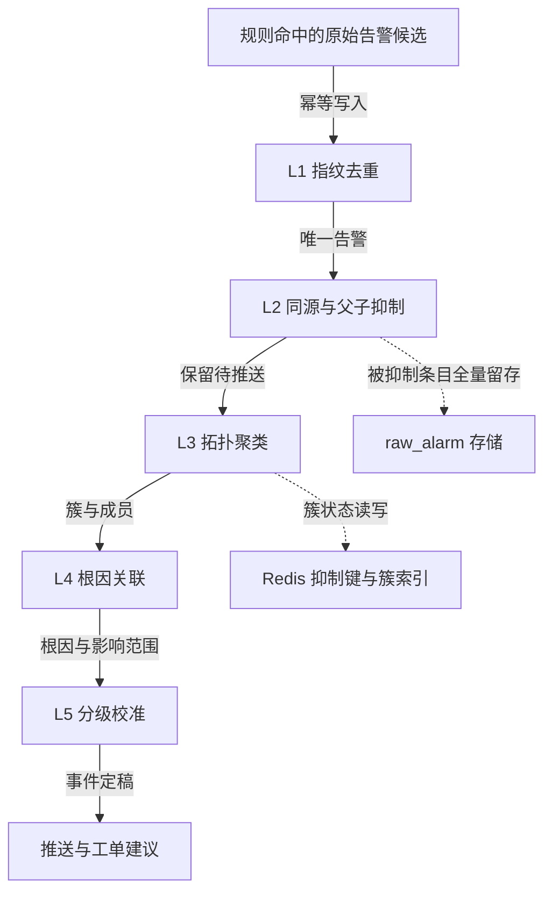
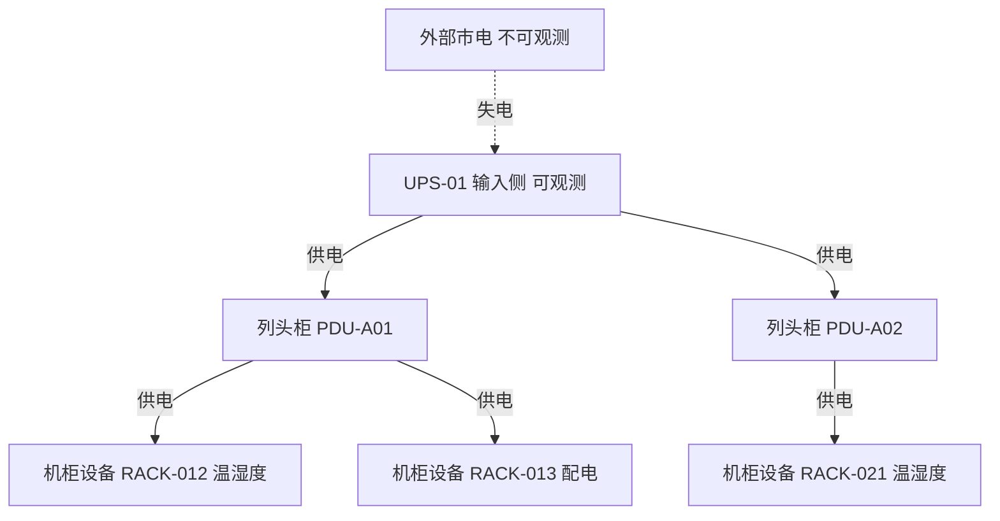

# 告警降噪与根因算法设计

| 项 | 内容 |
|---|---|
| 文档编号 | CDCIM-P3-DD-06 |
| 版本 / 状态 | v0.1 · 草案（待评审） |
| 所属阶段 | P3 详细设计 |
| 论文价值 | ★★★★★ 全项目算法密度最高的一份：五级降噪流水线、指纹抑制、拓扑聚类（参数已定量）、两层根因打分，可直接改写为论文「算法设计」整段，也是 ATAM 前提条件 PC-02 的闭合证据 |
| 上游依据 | [需求规格说明书](../02-需求/02-需求规格说明书.md)（FR-M3-05 ~ 08、10、14；FR-M6-01/02/03）、[质量属性场景表](../02-需求/03-质量属性场景表.md)（QA-PERF-06 风暴收敛、QA-AVAIL-03/04）、[ATAM 评估报告](../03-架构/03-ATAM架构权衡评估报告.md)（SP-03 抑制窗口、**SP-04 聚类参数未定量 → 本文闭合**、R-08 版本与窗口）、[数据字典](../02-需求/08-数据字典初稿.md)（`raw_alarm` 24 字段、`alarm_event` 30 字段、E1/E7）、[数据架构设计](../03-架构/10-数据架构设计.md)（TAB-ARCH-20 链路 B 预算、TAB-ARCH-22 幂等键、Redis 键空间 §5.3）、[ADR-0007](../09-决策/ADR-0007-数据处理架构-简化流式与存储层重算.md)（同一函数库） |
| 下游承接 | `alarm-engine` 的 suppress / cluster / rootcause 三个子模块、[规则引擎 DSL 设计](10-规则引擎DSL设计.md)（其产出的 `raw_alarm` 是本文唯一输入）、P6 算法评估用例与 100 条标注样本、P7 论文「算法设计」章 |

> **口径声明**：本文全部准确率、召回率、压缩比、时延均为**设计目标值**，不是实测值。算法效果的目标值待 P6 用 100 条标注样本实测（第 9 节给出评估方法，不给结论数字）。凡文中出现「约 65%」「日均 4 万条」等现状数字，均标注数据来源与口径，不与本系统产出直接相减。

---

## 1. 问题定义

### 1.1 现状：不是「告警太多」，是「有效告警被淹没」

| 现象 | 现状数据（口径见注） | 后果 |
|---|---|---|
| 推送总量 | 日均约 **4 万条**（多厂商平台汇总口径，含重复上报与抖动） | 值班员 8 h 盯屏，人均每小时 200+ 条 |
| 有效占比 | 人工判定有效约 **10% ~ 15%** | 90% 的注意力消耗在噪声上 |
| 重复率 | 约 **65% ~ 70%**（同根因、同窗口内重复推送） | 单次市电波动 3 min 内 200+ 条，值班员放弃逐条阅读 |
| 根因定位 | 平均 **25 min**（G-3 基线） | 靠人工翻拓扑、打电话确认 |

> **注**：4 万条是「各厂商平台推送总量」口径，包含跨平台重复（同一物理事件被 UPS 平台与环境平台各推一次）与规则抖动。本系统 `raw_alarm` 的落库预估为 **2 000 ~ 5 000 条/天**（SRS 6.3），二者口径不同、不可相减，差异来源见第 10 节 Q-1。

### 1.2 目标

**表 TAB-DD-19　降噪目标与来源**

| 指标 | 目标值 | 口径 | 来源 |
|---|---|---|---|
| 重复告警率 | ≤ **20%**（验收门槛）/ ≤ **10%**（内控攻关） | 推送口径：推送告警中同根因且同抑制窗口内重复的条数 ÷ 推送总数 | SRS 6.2.5（Q-1 已确认推送口径） |
| 降噪压缩比 | 风暴期 ≥ **10:1**；单次市电波动场景 ≥ **40:1** | 原始告警数 ÷ 推送告警数 | SRS 6.2.5、QA-PERF-06 |
| 漏报 | **0**（结构性保证 + 样本验证） | 独立故障不得被吸收；被抑制条目 100% 可检索 | BR-R2、FR-M3-14 |
| 根因 Top1 | ≥ **85%**（20 个构造场景命中 ≥ 17 个） | 人工判定为准 | FR-M3-08 |
| 根因输出时延 | P95 ≤ **5 s**（含影响范围遍历） | 「告警生成 → 返回 Top3」 | NFR-PERF-02 延伸 |
| 判定时延 | P99 ≤ **3 s** | 采集时间戳 → `generated_at` | NFR-PERF-02 |

三条目标的张力必须先说清，否则后文的参数取值会被误读为「调参找平衡」：

- **压缩比与可解释性对立**：阈值放宽能提高压缩比，但会把不同根因并成一个事件，值班员拿到一个 200 条成员、标题写着「供电异常」的事件，仍然不知道该去哪个机柜（ATAM SP-04 的原话）。
- **抑制与二次恶化对立**：窗口拉长能降重复率，但同一根因的二次恶化会被吞掉（ATAM SP-03）。
- **压缩比与漏报对立**：只要允许「吸收」，就存在把独立故障吸收掉的可能。本设计用「结构性拆分 + 簇上限 + critical 独立成簇」三条硬约束把漏报压到 0，而不是靠调参。

### 1.3 输入输出契约

| 项 | 内容 |
|---|---|
| 输入 | `raw_alarm` 流（每条含 `alarm_fingerprint`、`rule_id`、`device_id`、`point_id`、`alarm_level`、`alarm_type`、`trigger_value`、`ts_event`、`ts_detect`） |
| 静态输入 | 设备拓扑（`device.parent_device_id`，深度 ≤ 2 的三层树）、规则族映射（`rule_id → rule_family`）、设备重要度（`device.critical_level`） |
| 输出 | ① `raw_alarm` 上的四个标记列（`is_suppressed` / `suppress_type` / `is_derived` / `event_id`）；② `alarm_event` 行（含 `root_device_id`、`impact_scope`、`raw_count`、`suppressed_count`）；③ 推送决策 |
| 不变式 | **任何一级只减少推送，不减少记录**：`raw_alarm` 在全流程中只增不改（除四个标记列），`count(raw_alarm) ≥ count(alarm_event)` 恒成立（FR-M3-14） |

---

## 2. 降噪流水线

### 2.1 五级结构

**图 FIG-DD-02　告警降噪五级流水线**



图注：本图回答「为什么是五级而不是一个聚类算法」。五级的顺序由「代价递增、可判性递减」决定：L1 是键空间上的确定判断（最便宜、最可靠），L5 是业务规则的最后修正（最贵、最容易被质疑），中间三级逐层引入不确定性——把确定性判断放在前面，可以用结构吸收掉大部分噪声，使后面的启发式算法只需处理「真正相邻的少量告警」。

### 2.2 各级职责与预算

**表 TAB-DD-20　五级职责、判据与耗时预算**

| 级 | 名称 | 判断依据 | 输入 → 输出（300 条风暴场景） | 预算 | 失败模式 |
|---|---|---|---|---|---|
| L1 | 指纹去重 | `alarm_fingerprint` 唯一性（键空间判断，非时间窗） | 300 → 300（指纹互不相同，仅拦截重投） | ≤ 40 ms | 指纹精度不一致 → 去重失效（M5） |
| L2a | 同源抑制 | `(device, point, rule)` 的 300 s 窗口内去重 | 300 → **8 条主告警**（292 条标 `self`） | ≤ 40 ms | 抑制吞掉二次恶化（M3） |
| L2b | 父子抑制 | 上级设备活动告警 → 下游标派生 | 8 → **4 条推送候选**（4 条标 `parent_child`，同属通信中断） | ≤ 100 ms | 拓扑台账错误 → 误压（M4） |
| L3 | 拓扑聚类 | 时间 + 拓扑 + 规则族加权打分 | 300 → **4 簇**（8 条主告警作种子，292 条被抑制条目按 `(device, 窗口)` 挂靠回填 `event_id`） | ≤ 50 ms | 过聚类 / 欠聚类（M1、M2） |
| L4 | 根因关联 | 2 层树上打分，取 Top3 | 4 → 4 条根因 | ≤ 250 ms | 上游不可观测 → 根因偏一档（M6） |
| L5 | 分级校准 | 取簇内最高级别 + 覆盖广度上调；全派生簇挂靠父簇 | 4 → **3 个推送事件**（4 簇各种子 1 条，其中 1 簇种子全为派生，挂到父事件不单独推送） | ≤ 20 ms | 级别通胀（M7 的一部分） |
| — | 合计 | — | **300 → 3 个事件（100:1）** | **≤ 500 ms** | — |

三个数字口径必须说清，否则表会被误读：

1. **L3 的输入是 300 而不是 8**。聚类必须覆盖全部 `raw_alarm`（含被抑制条目），否则 `alarm_event.raw_count` 无法等于 `raw_alarm` 的实际条数，FR-M3-14 的「原始告警条数 ≥ 事件条数」校验会失败。抑制只决定「谁推送」，不决定「谁入簇」。
2. **L2b 的产出是「推送候选」而非「独立事件」**。父子抑制标记为派生的几条，仍会作为成员进入聚类，只是不能在 L5 作为独立事件推送——防止「30 台设备掉电」被当成 30 个事件（它们与 UPS 失压不同规则族，聚类本来合不到一起，靠派生标记挂靠）。
3. **压缩比 100:1 高于 QA-PERF-06 的 40:1 下限**，这是设计预期而非超标承诺：40:1 对应「200 条 / 5 个事件」的最不利情形，100:1 对应「300 条 / 3 个事件」的典型市电中断。验收按 40:1 判定，不因设计值更高而上调门槛。

预算的合计口径：链路 B 总预算 1 300 ms（TAB-ARCH-20），其中「同源抑制 100 ms + 父子抑制 100 ms + 根因关联 300 ms + 分级 50 ms」合计 550 ms 属于本流水线。本设计占 500 ms，留 50 ms 余量给上下文组装与簇状态写回。规则匹配（200 ms）与落库（100 ms）不在此列。

**为什么 L1 是「键空间」而不是「时间窗」**：去重若靠「最近 N 秒的指纹缓冲」，进程重启即丢失去重能力，且并发下先查后插必然有竞态。本项目把抑制窗口编码进指纹（`window_start` 是 `window_s` 的整数倍），使「同一窗口内重复」变成「同一主键重复」，由唯一约束兜底（数据架构 §6.2 已论证）。代价是 `window_start` 的精度必须在引擎与库两侧一致，这条已在 P3 锁定为秒级（DSL 文档 §7.1）。

### 2.3 各级之间的三个不变式

| # | 不变式 | 为什么必须有 |
|---|---|---|
| 1 | 抑制 ≠ 丢弃：`is_suppressed=true` 的条目 100% 落库、可按时间+设备检索 ≤ 3 s | FR-M3-14；也是「漏报 0」可被审计的前提 |
| 2 | 只有 L1/L2/L3 能写 `raw_alarm` 的四个标记列，L4/L5 对 `raw_alarm` 只读（L5 只写 `alarm_event` 的级别） | 根因算法若反过来影响抑制判定，会形成环，风暴期可能震荡 |
| 3 | 每级都可单独关闭（降级开关），关闭后其后级仍可工作 | AI 或某级算法异常时，L1 仍能拦截重复，不至于全链路退化 |

---

## 3. 算法一：同源去重与抑制

### 3.1 指纹设计

```
F = SHA-256( rule_id ‖ device_id ‖ point_id ‖ level ‖ window_start )
window_start = floor( ts_detect / window_s ) × window_s     // 秒级，window_s 默认 300
```

**表 TAB-DD-21　指纹五个构成项的取值与理由**

| 构成项 | 取值 | 为什么进指纹 | 不进的后果 |
|---|---|---|---|
| `rule_id` | `alarm_rule` 主键（与 `rule_version` 一一对应） | 不同规则命中同一测点是两件事（如「温度越限」与「温升过快」） | 两条不同性质的告警被合成一条，丢失判据 |
| `device_id` | 设备主键 | 同规则在不同设备上是不同告警 | 全院同规则只推 1 条，严重的漏报 |
| `point_id` | 测点主键（设备级规则为空，用 0 占位） | 同一设备的多测点越限需分别可见（如 UPS 三相） | 三相失压只能看到一相 |
| `level` | E1 三级 | **防御位**：规则版本切换或规则重建后，同一 `rule_id` 的级别可能变化 | 旧级别（major）抑制新级别（critical），形成静默漏报 |
| `window_start` | 抑制窗口起点（秒级） | 把「同窗口内重复」变成「同主键重复」，去重不依赖缓冲区与进程存活 | 重启后 5 min 内重复推送；并发下先查后插竞态 |

`level` 进入指纹这一点与数据字典 §4.8 的 4 元组定义存在差异，本文按 5 元组实现，差异处置见第 10 节 Q-2。差异的必要性用一句话说明：`level` 在正常情形下由 `rule_id` 唯一派生、属冗余位，但它是**唯一能防住「低级别规则压制高级别规则」的静态手段**，而这类问题一旦发生不报错、只表现为某类告警长期不出现，排查成本极高。

### 3.2 三个判定场景

**表 TAB-DD-22　抑制判定矩阵**

| 场景 | 条件 | 判定 | 落库 | 推送 |
|---|---|---|---|---|
| S-1 同窗口重复 | 指纹相同（同设备同点同规则同级别同窗口） | 唯一约束冲突 | 冲突即丢弃插入（`ON CONFLICT DO NOTHING`），主告警的 `suppressed_count` +1 | 否 |
| S-2 跨窗口但未恢复 | 指纹不同（新窗口），但同一 `(device, point)` 存在 `raised/acknowledged/processing` 事件 | 窗口续期（rolling），不新建主告警 | 新增 1 条 `is_suppressed=true`、`suppress_type=self`、`suppress_reason=window_rollover` | 否 |
| S-3 跨级或恶化 | 新告警 `level` 秩高于该 `(device, point)` 活动事件的级别；**或**同一测点 `trigger_value` 相对抑制起点恶化 ≥ 20%（P-15） | 打断抑制，立即推送 | 新增主告警，事件级别按 L5 重算，`suppressed_count` 保留 | **是** |
| S-4 已恢复后再命中 | 事件状态为 `recovered` / `closed` | 视为新故障 | 新建事件，新窗口计数 | 是 |
| S-5 上级活动告警 | 父链（深度 ≤ 2）上存在活动告警，且本规则 `parent_child=true` | 标记派生 | `is_derived=true`、`suppress_type=parent_child`、`suppress_reason=上级编码 + 告警` | 否 |

S-2 是本设计与 SRS「窗口届满重新计数」的字面表述之间的**必要细化**：若严格按「届满即重新推送」，一个持续 40 min 的电池放电会每 5 min 推一条，重复率反而上升；而「续期」会让二次恶化被吞（ATAM SP-03 指出的风险）。两者的分界由 S-3 给出——**只要级别不变且数值未显著恶化，就认为「还是同一件事在持续」；级别一变或恶化超过 20%，就认为「事情变严重了」**，立即穿透。20% 这个阈值的取法见 P-15：它必须大于正常波动（温度、电压的正常波动通常在 ±2% 以内），又要小于量级变化，取 20% 使「SOC 从 28% 降到 22%」这类真实恶化能穿透，「从 28% 到 27%」的抖动不会。这条规则把「疲劳」与「恶化感知」的冲突从调参问题变成了状态机问题。

### 3.3 抑制窗口：同级 5 min、跨级立即、父级覆盖子级

| 规则 | 取值 | 依据 |
|---|---|---|
| 同级抑制窗 | **300 s**（5 min），可由规则 `suppression.window_s` 在 60 ~ 3600 s 内覆盖 | FR-M3-05 默认值；与值班员「接警 → 判断 → 处置」的最短闭环时间同量级（G-1 目标 1 min 内确认，处置通常 5 ~ 15 min） |
| 跨级打断 | **立即**（0 s 延迟），不受窗口约束 | 级别是「严重性」的直接编码，级别变化必然意味着判据变化 |
| 父级覆盖子级 | 父级抑制有效期 **600 s**（Redis `cdcim:sup:parent:{root_device_id}` TTL），每次父级命中续期 | 数据架构 §5.3 已定 600 s；父级故障的持续时间通常长于单次采样周期，600 s 覆盖 20 个慢变周期 |
| 父级抑制深度 | **≤ 2 层**（设备 → 列头柜 → UPS） | 与根因 2 层一致；3 层以上会把「同机房不同 UPS 分区」的错误连通变成压制 |
| 环境类例外 | `leak` / `smoke` / `th_sensor` 强制 `parent_child=false` | 漏水、烟感、温度不是供配电拓扑的下游，压制即是漏报（DSL 文档 E-14） |
| 窗口对齐 | `window_start` 秒级，引擎与库共用构造函数 | 数据架构 §6.2：精度不一致会产生「同一告警两个指纹」的静默失效 |

### 3.4 伪代码

```
PROCEDURE suppress_and_dedup(a, now):
    // a: 一条原始告警候选；返回 推送 / 抑制 / 丢弃
    F ← sha256(a.rule_id, a.device_id, a.point_id, a.level, bucket(a.ts_detect, a.window_s))

    IF exists_raw_alarm(F) THEN                       // S-1 同窗口重复
        increment_suppressed_count(parent_event(F))
        RETURN 丢弃
    END IF

    active ← get_active_event(a.device_id, a.point_id)  // 活动事件索引
    IF active EXISTS THEN
        IF rank(a.level) > rank(active.level) THEN    // S-3 跨级升高
            event ← upgrade_event(active, a)
            mark(a, is_suppressed = false)
            RETURN 推送(event)
        ELSE                                          // S-2 未恢复，续期
            event ← rollover_window(active, a)
            mark(a, is_suppressed = true, type = self, reason = window_rollover)
            RETURN 抑制
        END IF
    END IF

    IF a.suppress.parent_child AND ancestor_active(a.device_id, depth ≤ 2) THEN
        mark(a, is_suppressed = true, type = parent_child, is_derived = true,
             reason = ancestor_code + " 告警抑制")
        RETURN 抑制
    END IF

    event ← create_event(a)                            // S-4 新故障
    mark(a, is_suppressed = false)
    renew_parent_key(ancestors(a.device_id), ttl = 600)
    RETURN 推送(event)
END PROCEDURE
```

伪代码只表达判定顺序，不含并发控制细节：唯一约束冲突与事件创建在同一个事务内完成（`raw_alarm` 与 `alarm_event` 同库 PG，数据架构 §6.5 一致性矩阵已定 CP 语义），因此「同一指纹并发插入」由库层串行化，不需要分布式锁。

---

## 4. 算法二：拓扑聚类

### 4.1 聚类依据

三个条件缺一不可，任何一个单独使用都会产生系统性的错误：

| 依据 | 单独使用的失败 | 三者合用的作用 |
|---|---|---|
| 时间邻近 | 风暴期所有告警都在 3 min 内，单靠时间会把 200 条并成一簇（不同根因也被并） | 作为主权重，但必须被拓扑与规则族否决 |
| 拓扑邻近 | 同一台 UPS 下挂的 20 台设备同时因两个独立原因告警（一个过热、一个通信中断），单靠拓扑会并簇 | 否决「跨分区并簇」 |
| 规则同族 | 同一设备同一时间既有「温度越限」又有「门禁异常」，单靠规则族会并簇 | 区分「同一物理事件的不同表征」与「不同物理事件」 |

**表 TAB-DD-23　规则族定义（6 族）**

| 规则族 | 包含的 `alarm_type` / 设备子系统 | 典型同族事件 |
|---|---|---|
| `PWR_LOSS` | 供配电·失压 / 掉电 / 输入中断 | 市电中断 → UPS 转电池 → 下挂设备掉电 |
| `PWR_QUALITY` | 供配电·电压偏差 / 频率异常 / 谐波 | 电压暂降引起的批量欠压告警 |
| `BATT_DEGRADE` | 蓄电池·容量低 / 单体电压低 / 内阻高 | 电池组整体容量衰减 |
| `HVAC_STOP` | 暖通·停机 / 送风温度 / 压缩机故障 | 空调停机 → 机房温度上升 |
| `ENV_LIMIT` | 环境·温度越限 / 湿度越限 / 漏水 / 烟感 | 局部热点、漏水 |
| `COMM_LOSS` | 通信·设备离线 / 采集超时 | 交换机故障引起的批量离线 |

规则族由 `(rule_id, device_type, alarm_type)` 三元组映射，映射表随规则一同热加载；未命中映射的规则归入 `OTHER`，`OTHER` 与任何族不同族（权重取最低），宁可少并簇也不误并。

### 4.2 打分公式与参数取值

```
sim(a, b) = w_t · T + w_h · H + w_r · R

T = max(0, 1 − |ts_event(a) − ts_event(b)| / Δt)          // 时间项，Δt = 120 s
H = 1 − hops(a, b) / 2        若 hops ≤ 2，否则 0          // 拓扑项，hops 为设备树上的最短跳数
R = 1.0 同规则族；0.3 同设备；0.15 同设备类型；0.0 否则     // 规则族项

w_t = 0.40, w_h = 0.35, w_r = 0.25；并簇阈值 θ = 0.60
```

**表 TAB-DD-24　聚类参数取值与理由（ATAM SP-04 的定量闭合）**

| 参数 | 取值 | 取值范围 | 取值理由 | 越界的后果 |
|---|---|---|---|---|
| 时间窗 Δt | **120 s** | 60 ~ 180 s | 单向传播最长 3 跳（UPS → 列头柜 → 设备），慢变采样 30 s，每跳至少 1 个采样周期才可观测 → 3 × 30 = 90 s，取 1.33 倍余量 = 120 s；上界由同级抑制窗 300 s 的一半约束（避免把「两次独立处置之间」的故障并簇） | 上调至 300 s：把两次独立故障并簇，召回率下降；下调至 60 s：3 跳传播链被拆成 2 ~ 3 个事件，压缩比不达标 |
| 拓扑跳数上限 | **2** | 1 ~ 3 | 与根因 2 层（设备 → 列头柜 → UPS）严格一致；3 跳必然经过机房级公共父节点，会把不同 UPS 分区的设备错误连通 | 上调至 3：跨分区并簇概率显著上升（两台不同 UPS 下的设备相距 4 跳，但经「机房」节点只需 2 跳的写法会让所有设备两两可达）；下调至 1：市电中断链被拆成「UPS 一簇 + 设备若干簇」 |
| 簇内主告警上限 | **50** | 20 ~ 100 | 计的是**主告警条数**（未抑制条目），不是 `raw_count`：200 条原始告警中主告警通常只有 5 ~ 10 条，上限 50 留 5 倍余量；超过 50 说明这一簇已覆盖多个独立故障 | 上调至 200：单簇吞噬多故障，根因不可判；下调至 20：市电链与通信链合并时被强行分裂，压缩比不达标 |
| 时间权重 w_t | **0.40** | 0.3 ~ 0.5 | 时间是最强的物理证据：同一物理事件的告警必然时间邻近，反之不成立（时间邻近未必同事件） | 权重过低：跨区故障被并簇；过高：与单条件聚类无异 |
| 拓扑权重 w_h | **0.35** | 0.3 ~ 0.4 | 供电方向传播有明确的因果性，但同一父节点下的两个独立故障（过热 + 通信中断）确实存在，故不能高于时间项 | 过高：同父不同因被并簇（M1） |
| 规则族权重 w_r | **0.25** | 0.2 ~ 0.3 | 最弱证据：同族可能来自不同根因（温度高可能因空调停机、也可能因负载突增），只作否决用 | 过高：`ENV_LIMIT` 族把全机房热点并成一簇 |
| 并簇阈值 θ | **0.60** | 0.55 ~ 0.70 | 校准点：同设备同族 = 0.983（应并）；同设备不同族 = 0.808（应并）；邻接同族时间差 60 s = 0.625（应并，边界）；跨分区 3 跳时间差 24 s = 0.57（不应并，落在阈值下） | 上调至 0.70：邻接同族被拒（欠聚类）；下调至 0.50：3 跳跨区被并（过聚类） |

**阈值校准的三个锚点**（表 TAB-DD-25 给出算式），θ = 0.60 不是「试出来的感觉值」，而是被三个必须成立的判定夹出来的区间中点：

**表 TAB-DD-25　θ 的校准锚点**

| 场景 | 时间项 T | 拓扑项 H | 规则族项 R | sim | 期望判定 | 与 θ=0.60 的关系 |
|---|---|---|---|---|---|---|
| 同一设备，温升过快 + 温度越限（不同规则，同族） | 时间差 5 s → 0.958 | hops=0 → 1.0 | 同族 → 1.0 | 0.383+0.35+0.25 = **0.983** | 并簇 | 远高于 |
| 同一设备，温度越限 + 门禁异常（不同族） | 时间差 5 s → 0.958 | hops=0 → 1.0 | 同设备 → 0.3 | 0.383+0.35+0.075 = **0.808** | 并簇（同一设备同时发生，仍属同一处置对象） | 高于 |
| 邻接设备（hops=1），同族，时间差 60 s | 0.5 | 0.5 | 1.0 | 0.20+0.175+0.25 = **0.625** | 并簇 | 略高于（边界样本） |
| 跨分区（hops=3 → H=0），同族，时间差 24 s | 0.8 | 0 | 1.0 | 0.32+0+0.25 = **0.57** | 不并簇 | 低于 |
| 同机房不同列（hops=2），不同族，时间差 120 s | 0 | 0 | 0 | **0** | 不并簇 | 远低于 |

第三行是最紧的边界：邻接同族、时间差 60 s 得 0.625，仅高出阈值 0.025。这提示一个问题——**若把 θ 提到 0.63，这类「市电中断传播链上的相邻设备」就会被拆开**，压缩比立刻跌到 10:1 以下。因此 θ 的上界不是由「想更严格」决定的，而是由这一行决定的。

### 4.3 用 100 条历史样本调优的步骤

参数不是拍出来的，也不是无限可调。调优方法固定为五步，且必须**留出法交叉验证**——用同一批样本调参又用同一批样本报结果，等于自证。

| 步 | 动作 | 产出 |
|---|---|---|
| 1 | 取 100 条历史原始告警（覆盖 3 类场景：市电波动 32 条、空调停机 28 条、独立单点故障 40 条），双人标注每条所属的「真实物理事件 ID」与「是否根因」 | 标注集（不一致项由第三人仲裁，仲裁记录留档） |
| 2 | 按 60 / 40 划分：60 条用于调参（调参集），40 条只用于最终评估（评估集），划分时**按事件分层抽样**，保证两集都含三类场景 | 两个互斥子集 |
| 3 | 在调参集上做网格搜索：Δt ∈ {90, 120, 150}、hops ∈ {1, 2}、θ ∈ {0.55, 0.60, 0.65}、max_members ∈ {30, 50}，共 36 组；每组算簇级 P / R / F1 与压缩比 | 36 组指标表 |
| 4 | 选点规则：先筛「压缩比 ≥ 10:1 且 R ≥ 0.95」，再在其中取 F1 最高者；若多组并列，取参数更保守（θ 更大、Δt 更小）的一组 | 唯一参数组 |
| 5 | 在评估集上只报一次结果（不允许回到第 3 步改参数）；若评估集 R < 0.95，记录为「参数在真实分布上过拟合」，回第 3 步并扩大 Δt 候选范围 | 评估报告 + 是否过拟合的结论 |

本文给出的默认值（120 / 2 / 50 / 0.60）来自**设计推导**（第 4.2 节的三条物理约束 + 表 TAB-DD-25 的锚点），第 3 步的网格搜索用于在 P6 校正，不用于从零搜索。这样做的理由是：100 条样本只够校正 3 ~ 4 个参数，若同时搜索 5 个以上参数必然过拟合；把搜索空间限制在默认值附近的 36 组，是把「样本量决定的可辨识度」作为约束写进方法，而不是事后解释。

### 4.4 聚类输出

| 输出项 | 定义 | 用途 |
|---|---|---|
| `cluster_id` | `uuid5(NS, seed_device_id ‖ rule_family ‖ window_bucket_300s)`，**确定性生成** | 回放（FR-M2-10）时同一物理事件得到同一 ID，结果可逐条比对；事件表主键仍用自增 `event_id`，`cluster_id` 存 `impact_scope.cluster_id` 便于复盘 |
| 代表告警 | 簇内**根因得分最高**的成员；同分取 `ts_event` 最早者 | 事件标题与级别由代表告警决定，避免「级别最高但无关」的条目当标题 |
| 成员数 | 簇内 `raw_alarm` 条数（含被抑制条目） | 写入 `alarm_event.raw_count`；压缩比的计算基数 |
| 簇内级别 | 成员级别最大值 | L5 分级校准的输入（不直接等于事件级别，见 5.5） |
| 簇内规则族集合 | 去重后的族列表 | 可解释性：事件详情展示「本事件含供配电·失压 3 条、暖通·停机 1 条」 |

单遍在线聚类，不做批量重算：维护「最近 **300 s** 内的活跃簇」列表（存活期与同级抑制窗对齐，保证窗口续期产生的被抑制条目仍能回填 `event_id`；但入簇打分的时间项仍按 Δt = 120 s 衰减，存活期不等于相似度窗口）。新告警按 `(room, rule_family)` 二级索引取候选簇（通常 < 10 个），逐个打分取最高且 ≥ θ 且未满员的簇并入，否则新建簇。复杂度 O(候选簇数) ≈ O(10)，单条聚类耗时 < 1 ms，50 ms 预算内可处理 300 条。

---

## 5. 算法三：根因关联（2 层）

### 5.1 关联图构建

**图 FIG-DD-03　两层根因关联图与影响传播方向**



图注：本图回答「根因候选为什么只能在这三层里选」。故障沿供电方向自上而下传播，因此「最上游的可观测节点」是最可能的根因；深度限定 2 层（设备 → 列头柜 → UPS），因为第 3 层（外部市电、变电站）在本系统内不可观测，继续上溯只会得到「未知」而非「根因」。UPS 自身的告警同时受上游失电与其内部故障影响，故图中不区分这两类原因，由根因打分的级别项与证据标注承担区分。

| 图元素 | 数据来源 | 约束 |
|---|---|---|
| 边 `子 → 父` | `device.parent_device_id`（自引用） | 只允许 `设备 → pdu`、`pdu → ups` 两类边；其他组合在校验期拒绝（E-13 的拓扑部分） |
| 深度 | 树深度 ≤ 2（UPS 为根） | 超过 2 层的父链不参与抑制与根因，只作为影响范围展示 |
| 环 | 应用层环检测 | `A → B → A` 属非法配置，保存设备台账时拒绝 |
| 不可观测节点 | 图中虚线节点（外部市电） | 不作为根因候选，仅在 `evidence` 中标注 `upstream_unobservable=true` |

### 5.2 打分公式

```
score(n) = w_D · D(n) + w_T · T(n) + w_L · L(n)

D(n) = (2 − depth(n)) / 2                       // 拓扑优势：UPS=1.0，列头柜=0.5，设备=0
T(n) = max(0, 1 − (t_first(n) − t_min) / Δt)    // 时间优势：簇内最早=1.0
L(n) = 1.0 / 0.7 / 0.4                          // 级别权重：critical / major / minor

w_D = 0.45, w_T = 0.35, w_L = 0.20
Top1 输出条件：score ≥ 0.60 且 (score₁ − score₂) ≥ 0.10
Top3 输出条件：score ≥ 0.45（不足 3 条时输出实际条数）
```

**表 TAB-DD-26　打分项权重与阈值取值理由**

| 参数 | 取值 | 理由 |
|---|---|---|
| w_D（拓扑） | **0.45** | 供电方向是因果方向，最上游优先是电力系统的物理事实（BR-03「最上游 + 最早发生 + 覆盖面」的第一位） |
| w_T（时序） | **0.35** | 「最早发生」是强相关但非因果：上游故障先发生是常态，但采样抖动可能让下游先上报（附录 M6）。故略低于拓扑 |
| w_L（级别） | **0.20** | 级别是人为映射结果（规则作者设定），不是物理证据，权重最低；若给高权重，一条误配为 critical 的下游规则会把根因带偏 |
| Top1 阈值 | **0.60** | 校准：UPS 侧 1.00、列头柜 0.70、终端设备 0.46（表 TAB-DD-27）；0.60 恰好把「列头柜及以上」纳入 Top1 候选，终端设备（0.46）排除 |
| Top1 差值 | **≥ 0.10** | 防止「两个列头柜得分 0.66 / 0.64」被强行报一个 Top1；差值不足时输出「疑似多根因」，标 `confidence=low`，交人工判断 |
| Top3 阈值 | **0.45** | 覆盖「终端设备但级别为 critical 且最早」（D=0, T=1, L=1 → 0.55）这类需要提示的情形 |

**表 TAB-DD-27　示例 2（市电中断）的根因打分**

| 节点 | depth | D | 首报时刻 | T | 级别 | L | score | 结论 |
|---|---|---|---|---|---|---|---|---|
| UPS-01（输入侧失压） | 0 | 1.00 | T+15 s | 1.00 | critical | 1.0 | **1.00** | Top1 |
| PDU-A01（输入失压） | 1 | 0.50 | T+20 s | 0.958 | major | 0.7 | **0.70** | Top2 |
| RACK-012（掉电） | 2 | 0 | T+25 s | 0.917 | major | 0.7 | **0.46** | Top3（≥ 0.45） |
| RACK-013（掉电） | 2 | 0 | T+25 s | 0.917 | major | 0.7 | 0.46 | 并列 Top3 |
| RACK-021（掉电） | 2 | 0 | T+26 s | 0.908 | minor | 0.4 | 0.40 | 不输出（< 0.45） |

Top1 = UPS-01，与 Top2 差值 0.30 ≥ 0.10，`confidence=high`。这与 FR-M3-08「20 个场景 Top1 命中 ≥ 17」的设计意图一致：市电类场景的根因在拓扑上几乎唯一。

### 5.3 影响范围

影响范围 = 从根因节点沿 `parent_device_id` **向下遍历**的全部设备，再映射到 `space_node` 得到机柜列表，去重后写入 `alarm_event.impact_scope`（`rooms` / `racks` / `biz` 三键，数据字典 §4.9）。

| 项 | 做法 | 约束 |
|---|---|---|
| 遍历方向 | 自上而下（与故障传播方向一致） | 深度不设限（下游可能多级），但单次遍历节点数 ≤ 500 |
| 范围口径 | 拓扑可达 ≠ 实际受影响：只统计「在簇内出现过告警」或「处于同一父链且在线」的设备 | 避免把「接了 UPS 但当天未告警」的 100 台设备全列进影响范围，那等于没给范围 |
| 时延 | 遍历为内存操作（拓扑图全量驻留），≤ 1 ms；主要耗时在 `impact_scope` 组装与写库 | 预算 300 ms 内（TAB-ARCH-20 根因关联行） |

### 5.4 与 AI 根因建议的关系

规则侧根因（本节算法）与 AI 侧根因建议（FR-M6-02）**并行产出、互不依赖**：

| 维度 | 规则算法根因 | AI 根因建议 |
|---|---|---|
| 输出位置 | `alarm_event.root_device_id`（事件主字段） | `alarm_event.ai_suggest_payload`（JSON，只读） |
| 是否可缺 | **不可缺**（拓扑可算则必算） | 可缺（`ai_suggest_status=unavailable`） |
| 时延 | ≤ 300 ms | P95 ≤ 15 s，超时 20 s 放弃（FR-M6-03） |
| 证据 | 拓扑距离、时序、级别三项可复算 | 关联测点、时序片段、知识库条目（必须可点击） |
| AI 不可用时 | 不受影响 | 占位提示 |

这条分工是 C-14 在算法层的落地：**降噪与根因判定的能力不依赖任何外部服务**。

### 5.5 分级校准（L5）

分级不是在规则里定完就结束的。L5 做三件事，只升不降：

| 动作 | 规则 | 理由 |
|---|---|---|
| 取簇内最高级别 | 事件级别 = max(成员级别) | 一个事件里有 1 条 critical，事件就是 critical |
| 覆盖广度上调 | 同族成员覆盖 ≥ 3 台设备且跨 ≥ 2 列时，`major` → `critical` | 影响面是级别的实质因素（G-3 影响范围），单台 vs 一片必须有区别 |
| 设备重要度上调 | 根因设备 `critical_level = 1`（A 级）时，`minor` → `major` | 台账已有重要度，A 级设备的一般告警不可按一般处理 |
| 禁止降级 | L5 不得把任何成员级别下调 | 下调即是漏报，与 BR-R2「不降低判定灵敏度」冲突 |

上调的累计效应必须封顶：单次事件最多上调一档（`minor → major`、`major → critical`），不叠加为 `minor → critical`。理由是叠加会让「两条弱证据」产生一个虚假的紧急事件，而紧急事件会触发短信 + 全员 IM，误报代价最高。

---

## 6. 误判与漏判分析

八种失败模式，每种给可观测的检测手段。检测手段必须是**运行时可统计的指标**，而不是「评审时注意」——后者不是工程手段。

**表 TAB-DD-28　八种失败模式与处置**

| 编号 | 失败模式 | 触发条件 | 表现 | 检测手段（可观测指标） | 缓解措施 |
|---|---|---|---|---|---|
| M1 | **过聚类**（独立故障被吸收） | 同一父节点下两个独立故障在 120 s 内发生且同规则族 | 一个事件含 2 个真根因，值班员处置错方向 | `cluster_purity`（抽检簇内规则族与设备分布离散度）；簇内 ≥ 2 个不同 `root` 候选且差值 < 0.10 的簇计数 | 跳数上限 2 + 规则族权重；同一 `(device, point)` 的 critical 强制独立成簇 |
| M2 | **欠聚类**（同一故障被拆散） | 传播链上有节点上报延迟 > 120 s，或中间设备离线导致链断 | 同一物理事件产生 2 ~ 3 个事件，压缩比不达标 | 5 min 内同根因设备产出 > 1 个事件的计数（`split_event_count`） | 事件合并窗口：同 `cluster_id` 前 300 s 内若出现同族新簇，自动并入；离线设备作为「链断点」标记，触发合并而不是阻断 |
| M3 | **抑制吞掉二次恶化** | 同一 `(device, point)` 持续异常但级别未变，实际已恶化 | 事件长期停在 major，实际已达 critical 严重度 | 抑制期内 `trigger_value` 变化率 > 20% 的计数（`worsen_while_suppressed`） | 恶化幅度 > 20% 或级别升高即打断抑制（S-3 的扩展条件）；事件详情展示 `trigger_value` 趋势供人判断 |
| M4 | **拓扑台账错误导致误压** | `parent_device_id` 配错（如把温湿度挂到 UPS 下） | 严重告警被无关父级压制 | 父子抑制率 > 60% 的设备计数；保存台账时的类型组合校验拒绝数 | 只允许 `设备 → pdu`、`pdu → ups` 两类边；环境类强制 `parent_child=false`；父级不可达时**不抑制**（fail-open 而非 fail-closed，见下） |
| M5 | **指纹碰撞或窗口错位** | 引擎与库的 `window_start` 精度不一致（秒 vs 毫秒） | 同一告警 5 min 内生成 2 条记录，去重失效且不报错 | 同 `(device, point, rule)` 在 300 s 内 `alarm_fingerprint` 去重后条数 > 1 的计数 | 启动自检：用固定样本在引擎与库两侧各算一次指纹，不一致即拒绝启动；`window_start` 精度写入契约 |
| M6 | **时钟偏差使时序项失真** | NTP 偏差 > 100 ms，或设备时钟未校时（`ts_source=gateway`） | 「最早发生」判错，根因偏向下游 | NTP 偏差 > 100 ms 的设备计数；`ts_source != device` 的告警占比 | 偏差 > 100 ms 时 T 项降权为 0.5（中性），并在 `evidence` 标注时间质量；不因此排除候选 |
| M7 | **级别通胀** | 规则作者普遍把新规则设为 critical；L5 上调叠加 | 紧急告警占比 > 30%，值班员重新陷入疲劳 | 事件级别分布（critical 占比）；L5 上调触发率 | L5 单次最多上调一档；critical 规则数纳入规则评审（critical 占比 > 20% 即预警） |
| M8 | **规则缺失导致漏报**（非降噪算法缺陷，但影响「漏报 0」） | 某设备类型 × 故障类型无对应规则 | 故障发生但无任何告警 | 覆盖率矩阵：`device_type × rule_family` 的规则覆盖格数；巡检异常项中「未关联告警」的比例 | 覆盖率矩阵纳入 P3 规则库验收；巡检（FR-M2-11）作为兜底；AI 可提示「该设备类型无规则覆盖」（仅提示，不判定） |

**M4 的 fail-open 选择需要单独说明**：父级关系不可信时（父设备已删除、父链超过 2 层、类型组合非法），本设计选择**不抑制**。理由是不抑制的代价是多推一条告警，而误抑制的代价是一条真故障永远不出现。这与「脱敏 fail-closed」（TP-06）方向相反，但两者的取舍逻辑一致——都是让失败落在**可被发现**的一侧：多推的告警会被人看到，漏掉的告警不会。

---

## 7. 算法参数表

**表 TAB-DD-29　算法参数总表（15 项）**

| 编号 | 参数 | 默认值 | 取值范围 | 调优依据 | 变更影响 |
|---|---|---|---|---|---|
| P-01 | 同源抑制窗 `window_s` | 300 s | 60 ~ 3600 | FR-M3-05；与处置闭环时长同量级 | 上调：重复率↓、二次恶化感知↓；下调：重复率↑ |
| P-02 | 跨级打断 | 开启 | 开 / 关 | 级别是严重性的直接编码 | 关闭即失去「恶化必达」，不建议 |
| P-03 | 窗口续期策略 | rolling | rolling / reset | 持续故障不应每 5 min 推一条 | 改 reset：重复率上升 3 ~ 5 倍 |
| P-04 | 父级抑制有效期 | 600 s | 300 ~ 1800 | 数据架构 Redis TTL；覆盖 20 个慢变周期 | 缩短：父级恢复后下游重复推送；延长：下游漏报窗口变长 |
| P-05 | 父级抑制深度 | 2 | 1 ~ 2 | 与根因 2 层一致 | 改 1：市电链下游设备不被压制，压缩比下降 |
| P-06 | 聚类时间窗 Δt | 120 s | 60 ~ 180 | 3 跳 × 30 s 采样 × 1.33 余量 | 见 TAB-DD-24 |
| P-07 | 聚类拓扑跳数上限 | 2 | 1 ~ 3 | 与根因层数一致 | 改 3：跨分区并簇概率上升 |
| P-08 | 簇内主告警上限 | 50 | 20 ~ 100 | 风暴期主告警通常 5 ~ 10 条，留 5 倍余量（200 条原始告警 ≠ 200 条主告警） | 上调：单簇含多个独立故障，根因不可判；下调：传播链被强行分裂 |
| P-09 | 时间权重 `w_t` | 0.40 | 0.30 ~ 0.50 | 最强物理证据 | 权重失衡见 M1 / M2 |
| P-10 | 拓扑权重 `w_h` | 0.35 | 0.30 ~ 0.40 | 因果方向明确但非充分 | 同上 |
| P-11 | 规则族权重 `w_r` | 0.25 | 0.20 ~ 0.30 | 最弱证据，仅作否决 | 上调：`ENV_LIMIT` 族过度合并 |
| P-12 | 并簇阈值 θ | 0.60 | 0.55 ~ 0.70 | 三个锚点夹出（TAB-DD-25） | 见 TAB-DD-25 边界样本 |
| P-13 | 根因权重 `w_D : w_T : w_L` | 0.45 : 0.35 : 0.20 | 各自 ±0.05 | 因果 > 时序 > 人为映射 | 时序权重上调：采样抖动导致根因偏下游 |
| P-14 | 根因输出阈值 | Top1 ≥ 0.60 且差值 ≥ 0.10；Top3 ≥ 0.45 | ±0.05 | 表 TAB-DD-27 校准 | 上调：Top1 输出率下降，可能空结果 |
| P-15 | 恶化打断阈值 | 20% | 10% ~ 50% | 大于正常波动（温度 ±2%）、小于量级变化 | 下调：抑制被频繁打断，重复率回升；上调：恶化感知迟钝 |

参数变更的管理约束三条：① P-01、P-06、P-07、P-12、P-14 属「影响压缩比与召回」的参数，变更后必须重跑 100 条样本评估（第 9 节），不得只看线上指标；② 全部参数存配置表，与规则一同热加载，但**参数变更不受灰度保护**（灰度只针对单条规则）——因此参数变更需走变更评审并记录到决策台账；③ 参数与代码分离，禁止在代码中硬编码默认值（与数据字典「枚举禁止硬编码」同一条纪律）。

---

## 8. 与 AI 的分工

### 8.1 三条边界

1. **判定权归规则算法**：`is_suppressed`、`event_id`、`alarm_level`、`root_device_id` 四个字段的写入权只在规则算法侧，AI 服务的输出字段全部落在 `ai_suggest_*` 前缀下（数据字典 §4.9 已定型，类型上只读）。
2. **AI 只做「建议 + 解释」**：语义聚类建议（FR-M6-01）、根因建议与证据（FR-M6-02）、知识库问答（FR-M6-04）。AI 的建议**不改变任何告警状态**，FR-M6-01 的验收判据是「关闭 AI 后告警列表与状态 0 变化」。
3. **AI 不可用时降噪能力不下降**：降噪五级全部在本地完成，无外部调用。QA-AVAIL-03 要求断开模型与向量库 30 min 后核心功能可用度 100%。

### 8.2 分工对照

**表 TAB-DD-30　规则算法与 AI 的职责划分**

| 能力 | 规则算法 | AI | 说明 |
|---|---|---|---|
| 指纹去重 | ✅ 唯一路径 | ❌ | 键空间判断，AI 无法参与（不确定性不能进幂等键） |
| 同源 / 父子抑制 | ✅ 唯一路径 | ❌ | 抑制会决定「是否打扰人」，必须可复算、可审计 |
| 拓扑聚类 | ✅ 主路径 | 语义聚类建议（仅展示） | AI 建议卡片可提示「这 3 个事件可能同源」，但不合并 |
| 根因定位 | ✅ 主路径（Top3 + 影响范围） | 根因建议 + 证据（并行展示） | 两者都展示，冲突时不隐藏任何一方 |
| 分级 | ✅ 唯一路径 | ❌ | 级别驱动通知渠道与审批，AI 不得参与 |
| 知识关联 | ❌ | ✅ RAG 问答 | 规则侧不查知识库（避免求值引入 IO） |

### 8.3 为什么不让 AI 参与降噪判定

三条理由，按重要性排序：

1. **不可复算**：降噪结果要能被复核（「为什么这条被抑制」）。大模型同一输入两次输出可能不同，无法支撑 `suppress_reason` 的确定性。
2. **时延不可控**：判定链路 P99 预算 3 s，其中留给抑制与聚类 500 ms；大模型 P95 15 s，数量级不匹配。
3. **可用性耦合**：AI 一旦进入判定路径，模型超时即降噪失效，直接违反 C-14 与 NFR-AVAIL-03。

代价必须承认：纯规则算法无法理解「空调停机」与「同列温度升高」之间的语义关系。两者在设备树上互为兄弟（hops=2，拓扑项为 0），规则族不同（`HVAC_STOP` 与 `ENV_LIMIT`，族项为 0），时间差 60 s 时聚类得分仅 0.4×0.5 = 0.20，远低于阈值 0.60，因此只能分列两个事件并以「同列 + 时间邻近」互标 `related_event`，不能合并推送。这部分能力由 AI 语义聚类建议补足——**补足的方式是提示，不是替代**。

---

## 9. 评估方法

### 9.1 样本与标注

| 项 | 设计 | 理由 |
|---|---|---|
| 样本量 | **100 条原始告警** | 100 条是「能算出有意义的 P/R」与「人工标注可承受」的折中；每条标注约 2 min，双人标注合计约 7 人时 |
| 样本来源 | 3 类场景：市电波动 32 条、空调停机 28 条、独立单点故障 40 条；来自历史回放（FR-M2-10）与构造场景（NFR-TEST-01 故障注入） | 三类场景的聚类难度差异大，单一场景的评估会高估或低估 |
| 标注内容 | 每条：① 真实物理事件 ID；② 是否该事件的根因；③ 是否为重复条目 | 三个标注项分别支撑簇级 P/R、根因 Top1、重复率三个指标 |
| 标注方式 | 双人独立标注 + 第三人仲裁；一致率 < 90% 的样本重新标注 | 单人标注的偏差会被算法「学到」 |
| 划分 | 60 条调参 / 40 条评估，按事件分层 | 防止在同一批样本上调参并报结果 |

### 9.2 指标与目标

**表 TAB-DD-31　评估指标（目标值待 P6 实测）**

| 指标 | 定义 | 目标值 | 说明 |
|---|---|---|---|
| 簇级精确率 P | 同一簇内成员属于同一真实事件的比例（按簇平均） | ≥ **0.90** | 衡量「有没有把不同事件并一起」 |
| 簇级召回率 R | 同一真实事件的成员被归入同一簇的比例（按事件平均） | ≥ **0.95** | 衡量「有没有把同一事件拆散」；比 P 更严，因为拆散的代价是值班员处置两次 |
| F1 | 2PR / (P + R) | ≥ **0.92** | 综合 |
| 根因 Top1 命中 | 20 个构造场景中 Top1 正确的比例 | ≥ **85%**（≥ 17/20） | FR-M3-08 的验收口径 |
| 根因 Top3 命中 | Top3 中含正确根因的比例 | ≥ **95%**（≥ 19/20） | 设计目标，非 SRS 硬指标 |
| 重复率（推送口径） | 推送告警中同根因同窗口重复条数 ÷ 推送总数 | ≤ **20%**（验收）/ ≤ **10%**（内控） | SRS 6.2.5 |
| 压缩比 | 原始告警数 ÷ 推送告警数 | 风暴 ≥ 10:1；市电波动场景 ≥ 40:1 | SRS 6.2.5、QA-PERF-06 |
| 漏报数 | 100 条样本中被抑制或并簇但事后判定为独立故障的条目数 | **0** | 任何非 0 即视为结构性缺陷，不按比例放宽 |

### 9.3 方法边界

三条必须写明的局限，避免论文被追问时无法回答：

1. **样本量只支撑 3 ~ 4 个参数的可辨识度**：100 条样本在一次评估中同时校正 5 个以上参数必然过拟合（第 4.3 节）。因此本文的参数默认值来自设计推导，样本只用于**校正**，不用于从零搜索。
2. **目标值不是实测值**：表 TAB-DD-31 的全部数字是设计门槛，实测在 P6 产生。论文中引用时必须写「设计目标」，不能写「达到」。
3. **构造场景与真实分布存在差距**：20 个构造场景（故障注入）覆盖的是已知故障模式，对「未知组合故障」的代表性有限。这一点在 P6 用真实历史区间回放部分弥补，但 180 天留存内的真实故障数量本身有限，属**样本受限**，结论按定性表述。

### 9.4 评估执行清单

| # | 动作 | 产出 | 责任人 |
|---|---|---|---|
| 1 | 抽取 100 条样本，双人标注 + 仲裁 | 标注集（含仲裁记录） | 运维工程师 + 值班员 |
| 2 | 按 60/40 划分，跑 36 组网格（调参集） | 36 组指标表 | 开发 |
| 3 | 按选点规则定参，冻结参数版本 | 参数版本号 + 变更记录 | 开发 + 架构 |
| 4 | 在评估集上跑一次，记录 P/R/F1/Top1 | 评估报告 | 开发 |
| 5 | 回放 3 个历史区间（各 1 h），核对告警条数与当时落库一致率 ≥ 99% | 回放一致性报告 | 测试 |
| 6 | 结果回填本文表 TAB-DD-31 与论文，标注「实测 / 目标」 | 定稿 | 架构 |

---

## 10. 待确认

| # | 待确认点 | 本文暂定 | 备选方案 | 影响面 | 建议 |
|---|---|---|---|---|---|
| Q-1 | **现状「日均 4 万条」的口径来源** | 按「多厂商平台推送总量（含跨平台重复与抖动）」表述，与本系统 `raw_alarm` 2 000 ~ 5 000 条/天（SRS 6.3）分列，不相减 | 改用「单平台日均推送量」或「值班员日均处理量」作为基线 | 影响论文「实施效果」段的对比基数；若口径不清，降噪前后对比会被质疑为「换了分母」 | 建议维持分列表述，并在论文中显式加一句「两者统计口径不同，压缩比以本系统原始告警为分子」——宁可少一个漂亮的对比数字，不要一个站不住的数字 |
| Q-2 | **`alarm_fingerprint` 是否由 4 元组扩为 5 元组（增加 `level`）** | 5 元组（`rule_id`+`device_id`+`point_id`+`level`+`window_start`） | 维持数据字典 §4.8 的 4 元组，级别变化靠 S-3 的运行时判断兜底 | 需同步修订数据字典 §4.8 与数据架构 §6.2 的指纹定义；`uk_raw_alarm_fingerprint` 的构造与既有索引不变 | 建议扩为 5 元组：多一个字节的哈希输入，换掉一类「静默漏报」的可能；4 元组方案的运行时兜底依赖事件状态查询，在事件已关闭的边界上会漏 |
| Q-3 | **重复率 10%（内控）与 20%（验收）如何在文档与论文中并存** | 验收按 ≤ 20%，内控按 ≤ 10%，两者并列呈现并注明「内控严于验收」 | 只保留 20%，不写 10% | 影响 G-2 的达成表述与论文目标值的一致性 | 建议并列：内控值是团队自加压，验收值是合同口径，二者不矛盾；但论文中必须写清「以 20% 为验收门槛，10% 为努力方向」，避免被质疑指标前后不一 |

---

## 考点映射

| 考纲知识点 | 本文件对应内容 | 论文可用位置 | 真题溯源 |
|---|---|---|---|
| 算法设计（问题建模 → 算法选择 → 参数定值 → 复杂度） | 第 3 ~ 5 节三个算法，含公式、参数表与伪代码 | 论文「算法设计」整段（本文核心用途） | 2024 上 算法设计、2023 下 系统设计 |
| 规则算法与智能算法的分工 | 第 8 节三条边界 + 分工表 | 论文「AI 应用」或「架构权衡」段 | 2023 上 新技术应用 |
| 质量属性与算法指标的映射 | 第 1.2 节目标表、第 9 节评估指标 | 论文「质量属性」段的度量来源 | 2024 下 软件可靠性 |
| 算法的失效分析 | 第 6 节八种失败模式 + 可观测检测指标 | 论文「测试与评估」段的缺陷分析 | 2022 下 系统可靠性 |
| 参数敏感点与权衡 | 第 7 节 15 项参数 + 变更影响列 | 论文「架构权衡」段的敏感点论证 | 2023 上 架构评估（ATAM） |
| 数据一致性（幂等 / 键空间） | 第 3.1 节指纹设计、第 2.2 节键空间去重 | 论文「数据设计」段 | 2024 上 大数据、2023 下 分布式 |

## 论文可引用段落

> 本段适用于「算法设计」「系统设计」「软件架构设计」类论文的降噪与根因部分，可直接用于「算法设计」段。
>
> 告警降噪的难点不是减少数量，而是在减少数量的同时不丢失独立故障。我把降噪拆成五级流水线：指纹去重、同源与父子抑制、拓扑聚类、根因关联、分级校准。指纹取规则、设备、测点、级别与窗口起点的哈希，把同窗口重复转化为同主键重复，由唯一约束兜底，去重因此不依赖缓冲区，重启也不失效。抑制并非一律压制：同级窗口内只推首条，窗口届满而故障未恢复则续期不重推，级别升高或数值恶化超阈值即穿透，把疲劳与恶化感知的冲突从调参问题变成状态机问题。聚类按时间、拓扑、规则族加权，时间窗取一百二十秒，依据是传播最长三跳、慢变采样三十秒；跳数限两层，与根因层数一致。根因在三层树上按拓扑优势、时间先后、级别权重打分，取阈值以上且与次名有差距者为第一根因。全部阈值都给出取值理由与越界后果，效果指标明确标注为待实测的设计目标。

## 变更记录

| 版本 | 日期 | 变更 |
|---|---|---|
| v0.1 | 2026-11-27 | 初稿。定义五级降噪流水线（300 条 → 3 个事件，预算 500 ms）、指纹 5 元组与 5 类抑制判定、拓扑聚类三项加权与参数定量（Δt=120 s / hops≤2 / 簇内主告警上限 50 / θ=0.60，闭合 ATAM SP-04）、两层根因打分（0.45/0.35/0.20）与阈值、8 种失败模式、15 项参数表、与 AI 的分工边界、100 条样本评估方法、3 项待确认 |
