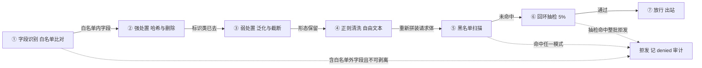

# 脱敏规则与 Prompt 模板

| 项 | 内容 |
|---|---|
| 文档编号 | CDCIM-P3-DD-07 |
| 版本 / 状态 | v0.1 · 草案（待评审） |
| 所属阶段 | P3 详细设计 |
| 论文价值 | ★★★★☆ 把「脱敏」从一个合规口号变成可执行、可审计、可回归的七步流水线，把「Prompt」从一段自然语言变成带 schema 与拒答分支的接口契约。可直接支撑论文「安全架构」「AI 应用工程化」「接口设计」三段，尤其「哈希短码必须稳定、映射表必须不落盘」这一对看似矛盾的要求 |
| 上游依据 | [AI 功能需求说明](../02-需求/09-AI功能需求说明.md)（5 项能力、20 项脱敏规则、三道闸门、5 份输出 schema、成本模型）、[安全架构与等保对照](../03-架构/11-安全架构与等保对照.md)（SEC-C-05、TAB-ARCH-54 三闸门、7.3 fail-closed、7.4 Q-4 默认策略）、[ADR-0003](../09-决策/ADR-0003-大模型接入-旁路化与脱敏.md)、[告警降噪与根因算法设计](10-告警降噪与根因算法设计.md)（§5.4 与 AI 的分工、§8 三条边界）、[数据字典](../02-需求/08-数据字典初稿.md)（`device` / `space_node` / `alarm_event` / `knowledge_item` 字段与 E1/E4/E6/E13/E19）、[接口文档](07-接口文档.md)（`/alarm-events/{event_id}/ai-advice`、`/kb/ask`）、[图表规范](../90-规范/02-图表规范.md) |
| 下游承接 | `sanitizer` 与 `ai-proxy` 两个组件的实现、`prompts/` 目录的模板版本管理、P5 的 AI 旁路联调、P6 的「100 条抓包 0 命中」脱敏回归与 Prompt 回归用例、P7 论文「安全 + AI」素材卡 |

> **口径声明**：本文描述的全部行为发生在 `AI_EXTERNAL_ENABLED=true` 之后。出厂默认 `false`（D-20、ARCH-10 §7.4），关闭时本文所有组件不产生任何外发流量，系统行为与「无 AI 版本」逐项一致。本文的时延、token、成本均为**设计预算**，不是实测值；凡涉及模型效果者只写结构约束，不写准确率。

---

## 1. 文档目的与适用前提

### 1.1 目的

SRS-08 已经回答了「AI 做什么、放在哪、失败怎么办」，但留下了三个必须由详细设计定死的空洞，本文只补这三个：

| # | 上游留下的问题 | 本文的答法 | 落点 |
|---|---|---|---|
| 1 | 20 项脱敏规则写成「哈希 / 截断 / 泛化」，**具体怎么算、算失败了算不算失败** | 26 条可执行条目 + 「有兜底 / 无兜底」的失败判定线 | 第 3、4 节 |
| 2 | Prompt 只给了五段式骨架，**填什么、多长、输出怎么卡** | 四份可直接投用的模板（汉字 ≤ 400、全份 ≤ 500 字符）+ 输出校验矩阵 | 第 6、7 节 |
| 3 | 成本与缓存只说「按批次调用、可再降 30%」，**降在哪一步** | 六个成本闸门，逐条对应到可配置参数 | 第 9 节 |

本文**不新增 FR 编号、不改任何验收判据**。若与 SRS-08 冲突，以 SRS-08 的业务口径为准；本文只在其未展开的实现层给参数，并在第 3.2 节把每处差异显式登记。

### 1.2 三条不可违背的前提

| 前提 | 含义 | 本文的落实位置 |
|---|---|---|
| **P-1 出厂关闭** | `AI_EXTERNAL_ENABLED=false` 是部署默认值，开启需「信息安全部书面结论 + 双人确认 + 100 条脱敏回归 0 命中」三个前置 | §1.3 的开关表；第 10 节 Q-4 |
| **P-2 只做建议** | AI 输出只写 `ai_suggest_*` 四列，控制接口不接受其作为入参；模板中不出现任何控制动词 | §6 各模板「禁控制动词 / 不转控制动作」的约束；§7.1 校验 4 |
| **P-3 fail-closed** | 脱敏失败即拒发，**不允许降级为「部分字段发送」**，也不允许「先发后补审计」 | §2 七步流水线的失败出口；§3.3 失败判定线 |

### 1.3 适用前提与四个开关

**表 TAB-DD-01　四个开关与本文的依赖关系**

| 开关 | 默认 | 关闭后的行为 | 本文是否仍适用 |
|---|---|---|---|
| `AI_EXTERNAL_ENABLED` | `false` | 不产生任何外发请求，AI 卡片区不渲染 | 不适用（本文全部内容处于休眠态） |
| `LLM_MASK_BEFORE_SEND` | `true`，**不可配为 false** | 无此分支：代码中不存在「不脱敏直发」的路径 | 恒适用（ADR-0003 §3.4 强制项） |
| `AI_PROVIDER` | `mock` | `mock` 返回固定结构，全链路可验证但不触网 | 适用（脱敏与校验链路完全一致） |
| `AI_CACHE_ENABLED` | `true` | 每次请求都外发，成本上升，一致性下降 | 部分适用（第 8 节失效） |

**为什么 `LLM_MASK_BEFORE_SEND` 只允许 `true`**：给它留一个 `false` 分支，就等于给「某次排障临时关掉脱敏」留了口子，而这类口子一旦存在，就一定会在某次压力下被打开。实现上它是**常量断言**（启动时校验，读到非 `true` 即拒绝启动），不是可配置项——这是「把纪律写成代码」而非写成规范的一处具体做法。

### 1.4 Q-4 未决时的默认策略

SRS 第 10 节 Q-4（大模型是否允许走公网 API）与 AI-Q1 仍是暂定项，ARCH-10 §7.4 已给出「技术上支持、工程上关闭」的默认策略。本文不重复论证，只登记它对**本文**的三个影响：

1. **默认不外发 ⇒ 本文只能靠 mock 与抓包自证**：`AI_PROVIDER=mock` 时，sanitizer → 校验 → 回写 → 展示全链路可跑通，外发报文可被抓包导出比对。演示与验收用这条路径，不需要真实联网；
2. **若书面结论为「允许」**：本文不需要改任何规则，只需把 `AI_PROVIDER` 切到真实 Provider 并完成 100 条回归；
3. **若书面结论为「禁止」**：本文第 3、4 节的脱敏规则**仍然有用**——`sanitizer` 转为内网模型的输入前处理（若将来启用本地模型），而第 6 节的模板可直接复用于内网模型；第 7 节校验与第 8 节缓存则完全不变。也就是说本文的失效面只有「外发」这一层，不是整篇作废。

---

## 2. 脱敏流水线

### 2.1 七步流水线与唯一失败出口

**图 FIG-DD-05　外发脱敏七步流水线**



图注：本图回答「一条外发请求要过几道关、哪一步失败会拦下它」。实线是通行路径，三条虚线全部指向同一个终点——**拒发并记审计**，不存在「退回上一步重试」或「降级放行」的分支。①对应 ARCH-10 的第一道闸门（白名单剥离）、⑤对应第二道（黑名单扫描）、⑥对应第三道（回环抽检），②③④是同一次遍历内的三种处置手法，不是三道额外闸门。

### 2.2 七步的判据、预算与失败语义

**表 TAB-DD-02　七步流水线的输入输出与预算**

| 步 | 动作 | 判据 | 预算 | 失败语义 |
|---|---|---|---|---|
| ① 字段识别 | 按 `(表名, 字段名)` 查白名单映射表，命中则取处置策略，未命中则整字段**剥离**并计数 | 剥离后请求体不得残留任何未知字段；若某字段被业务逻辑判为「必填」却不在白名单 → 直接失败 | 5 ms | 无兜底 → 拒发 |
| ② 强处置 | 对标识类执行哈希（§4.1）或删除；删除即从请求体移除键 | 哈希输出必须命中前缀 + 十六进制正则；删除后键不存在 | 8 ms | 哈希异常 / 短码碰撞未解决 → 拒发 |
| ③ 弱处置 | 数值截断到 3 位有效数字并相对化；容量取 10 kW 档；时间转相对偏移 | 输出必须是有限数值（非 NaN / Inf）；容量档位必须是 10 的整数倍 | 6 ms | 数值非法 / 窗口起点缺失 → 拒发 |
| ④ 正则清洗 | 对自由文本按 6 类模式替换：IPv4/IPv6、`secret://`、手机号、邮箱、人名、工单号/机柜号 | 替换后文本长度 ≤ 原文，且不得出现连续 3 个 `[已脱敏]`（说明原文结构异常） | 12 ms | 清洗后仍命中黑名单（交 ⑤ 判定） |
| ⑤ 黑名单扫描 | 对**拼装完成**的整个请求体再做一次全模式扫描 | 任一模式命中即失败；扫描对象是最终字符串，不是字段值 | 10 ms | 命中 → 拒发（不尝试二次清洗） |
| ⑥ 回环抽检 | 5% 请求做一次与 ⑤ 同规则的复扫，并比对「脱敏前/后」的敏感词计数差 | 抽检命中 → **整批**拒发并回溯同批次（同一次调用的多事件） | 5 ms | 命中 → 拒发 + 告警 |
| ⑦ 放行 | 写一条脱敏审计，交出请求体 | 审计写入成功是放行的**前置条件** | 4 ms | 审计写失败 → 拒发（无审计即无合规证据） |

合计预算 **50 ms**，与 ARCH-10 §7.3 的「脱敏超时 > 50 ms 放弃本次外发」严格对齐。超时判定的起点是 ①，终点是 ⑦ 的审计落库完成——**不含**网络时间，因为网络失败属于 ai-proxy 的降级范畴（置 `unavailable`），不属于脱敏失败。

### 2.3 一次外发的审计记录

**表 TAB-DD-03　脱敏审计字段（8 项，落 `audit_log`，`operation_type = ai_mask`）**

| 字段 | 取值 | 用途 |
|---|---|---|
| `request_id` | 本次外发唯一号（UUID v4） | 与 ai-proxy 调用日志、模型侧账单三方对账的唯一锚点 |
| `cap` | `C1` ~ `C5` | 分能力统计剥离数与拒绝率 |
| `gate_failed` | `field` / `blacklist` / `loopback` / `audit` / `timeout` / `null` | 定位「哪一步拦下的」，是本文唯一的可观测性来源 |
| `stripped_fields` | 整数 + 字段名列表（前 10 个） | 发现「开发新增字段顺手带出去」的唯一手段 |
| `hit_pattern` | 命中的正则名（如 `phone_cn`） | 用于判断是否需要补规则，而非只看总量 |
| `ref_count` | 本次请求内生成的短码个数 | 与 §4.4 的请求内映射条数交叉校验 |
| `elapsed_ms` | 七步累计耗时 | 超 50 ms 的样本用于定位是哪一步劣化 |
| `result` | `pass` / `denied` | `denied` 必带 `gate_failed` |

审计**不含**任何原始字段值——审计本身若记录原文，就变成了第二个泄露面。这一条与 ARCH-10 §8.2「`action_detail` 必须脱敏」同源。

---

## 3. 字段级脱敏规则表

### 3.1 六类敏感类型

| 类型 | 判定标准 | 处置取向 |
|---|---|---|
| **资产标识** | 能唯一定位一台物理设备（编码、序列号、名称） | 哈希或删除，**关系必须保留**（否则同一设备无法跨请求识别） |
| **位置标识** | 能推断设备在机房中的位置（机房/列/机柜编码、三维坐标） | 层级保留、名字哈希，坐标删除 |
| **网络与凭据** | IP、端口、`secret://` 引用 | 一律删除，命中即拒发 |
| **人员与个人信息** | 姓名、手机号、邮箱、处理人 | 删除，仅保留角色标签 |
| **数值与时间指纹** | 原始值、绝对时间戳（可反推负荷曲线与班次） | 截断 + 相对化，保留形态 |
| **自由文本** | 关闭说明、备注、工单描述、知识片段正文 | 正则清洗，**不清洗等于没脱敏** |

### 3.2 与 SRS-08 的对应关系

SRS-08 表 TAB-SRS-31 的 20 项规则，在本文展开为 **26 条执行条目**，差异只有两类，处置方式与判定口径不变：

| 差异 | 条目 | 原因 |
|---|---|---|
| **拆分（3 处，+3 行）** | ①`vendor`/`model` 拆两行（品牌与型号的兜底值不同）；②`space_node.node_code` 拆「机房」与「机柜」两行（前者泛化、后者哈希）；③「自由文本」拆「关闭说明」与「知识片段正文」两行（前者在 `alarm_event`，后者在 `kb_docs.payload`，清洗时机不同） | 三处的**失败兜底值不同**，合成一行会导致一部分字段「有兜底」一部分「无兜底」却共用一条失败判定 |
| **新增（3 条）** | `alarm_event.event_code`（SRS 在 §4.1.1 提到 `event_ref` 需哈希，但未进表）、`alarm_event.event_title`（标题含「A 区 1# UPS」这类位置信息）、`device.protocol_params`（jsonb 内可能含 community 串） | 落地时逐字段过了一遍白名单，这三处是 SRS 表未覆盖但实际会进请求体的字段 |

> **不做什么**：本文不新增任何「允许外发」的字段。26 条全部是「原样保留 / 有兜底 / 无兜底」三种之一，没有第四条路。

### 3.3 失败判定线：有兜底 ≠ 部分放行

这是本文与「尽力脱敏」最容易混淆的一点，必须先定义清楚：

| 情形 | 判定 | 理由 |
|---|---|---|
| 该字段的处置**有确定兜底值**（如 `vendor` 未命中品牌白名单 → `VENDOR-OTHER`；`ack_by` 角色缺失 → `OPERATOR`） | **处置成功**，继续流水线 | 兜底值本身不含任何敏感信息，且是常量——这是「换一个安全的值」，不是「把敏感值发出去」 |
| 该字段的处置**无兜底**（哈希异常、正则不匹配、数值非法、窗口缺失） | **处置失败 → 整条请求拒发** | 无兜底意味着只能「原样发」或「不发」，P-3 规定必须选后者 |
| 整条请求中部分字段成功、部分失败 | **整条拒发**，成功部分也不发 | 一旦允许「成功部分发送」，模型就会拿着残缺上下文给出看似完整的结论，比没有建议更危险 |

**表 TAB-DD-04　处置方式与兜底值**

| 处置 | 可逆性 | 兜底值 | 兜底后是否算成功 |
|---|---|---|---|
| 哈希（短码） | 不可逆，但**保留一致性** | 无（哈希失败即无可用值） | 否 |
| 删除 | 不可逆 | 无（删除恒成功） | 是 |
| 泛化 / 截断 | 不可逆，保留分布 | 有（`OTHER` 类常量 / 档位下取整） | 是 |
| 正则清洗 | 部分可逆 | 有（`[已脱敏]` 占位） | 是，但清洗后仍命中 ⑤ 则失败 |

### 3.4 26 条执行条目

**表 TAB-DD-05　字段级脱敏规则（26 条）**

| # | 字段（来源表） | 敏感类型 | 处置 | 保留语义 | 示例（前 → 后） | 失败行为 |
|---|---|---|---|---|---|---|
| 1 | `device_code`（`device`） | 资产标识 | 哈希 `DEV-` + 8 位 | 完整（跨请求稳定） | `UPS-A-03` → `DEV-7f3a91c2` | 哈希异常 / 碰撞未解 → 拒发 |
| 2 | `device_name`（`device`） | 资产标识 | 删除，重建为「类型#序号」 | 部分 | `A 区 1# UPS` → `UPS#03` | 序号不可得 → 拒发 |
| 3 | `device_type`（`device`） | 无 | 原样 | 完整 | `ups` → `ups` | 越出 E4 → 拒发 |
| 4 | `vendor`（`device`） | 资产标识 | 品牌白名单保留 | 部分 | `维谛技术有限公司` → `维谛` | 未命中 → `VENDOR-OTHER` |
| 5 | `model`（`device`） | 资产标识 | 保留系列，截去容量尾缀 | 部分 | `GXT5-20kVA` → `GXT5` | 未命中 → `MODEL-OTHER` |
| 6 | `host`（`device`） | 网络 | 删除，替换为逻辑网段号 | 丢失 | `10.20.31.14` → `NET-02` | 网段不可得 → 拒发 |
| 7 | `port`（`device`） | 网络 | 删除 | 丢失 | `502` → （删除） | 恒成功 |
| 8 | `serial_no`（`device`） | 资产标识 | 删除 | 丢失 | `SN-2023UPS00871` → （删除） | 恒成功 |
| 9 | `credential_ref`（`device`） | 凭据 | 删除 + 黑名单 | 丢失 | `secret://snmp/a01` → （删除并拒发） | 命中 `secret://` → 拒发 |
| 10 | `rated_power_kw`（`device`） | 数值 | 10 kW 档下取整 | 量级 | `80.00` → `80 kW` | 解析失败 → 拒发 |
| 11 | `node_code`（`space_node`，`room`） | 位置标识 | 泛化 | 关系保留 | `RM-A` → `ROOM-01` | 映射缺失 → 拒发 |
| 12 | `node_code`（`space_node`，`rack`） | 位置标识 | 哈希 `RACK-` + 4 位 | 关系保留 | `RACK-012` → `RACK-7f3a` | 同上 → 拒发 |
| 13 | `pos_x` / `pos_y` / `pos_z`（`space_node`） | 位置标识 | 删除 | 丢失 | `12.480 / 6.200 / 0.000` → （删除） | 恒成功 |
| 14 | `capacity_kw`（`space_node`） | 数值 | 10 kW 档下取整 | 量级 | `62.50` → `≤ 60 kW` | 解析失败 → 拒发 |
| 15 | `event_code`（`alarm_event`） | 资产标识 | 哈希 `EV-` + 6 位 | 完整 | `ALM-20261126-0007` → `EV-3c81d0` | 异常 → 拒发 |
| 16 | `event_title`（`alarm_event`） | 位置标识 | 删除，由「设备类型 + 告警类型」重建 | 部分 | `A 区 1# UPS 输入失压` → `ups 输入失压` | 重建失败 → `device_type` + `alarm_type`（兜底） |
| 17 | `close_note`（`alarm_event`） | 自由文本 | 正则清洗 | 部分 | `已通知张伟，工单 WO-20261126-0031` → `已通知[人名]，工单[单号]` | 清洗后仍命中 → 拒发 |
| 18 | `ticket_id`（`alarm_event` / `ticket_link`） | 资产标识 | 哈希 `TK-` + 4 位 | 完整 | `WO-20261126-0031` → `TK-2b9e` | 异常 → 拒发 |
| 19 | `ack_by` / `process_by` / `close_by`（`alarm_event`） | 人员 | 删除，替换为角色标签 | 丢失个体、保留角色 | `u_1042 张伟` → `OPERATOR` | 角色缺失 → `OPERATOR` |
| 20 | `phone` / `email` / `display_name`（`user_account`） | 个人信息 | 删除 + 黑名单 | 丢失 | `13812345678` → （删除并拒发） | 命中手机号/邮箱 → 拒发 |
| 21 | `val_double` / `val_int` / `trigger_value`（`st_metric` / `raw_alarm`） | 数值 | 3 位有效数字 + 相对化 | 形态 | `31.87 ℃（阈值 30 ℃）` → `+6.2%（阈值 30）` | 计算失败 → 拒发 |
| 22 | `first_occur_at` / `ts_event`（`alarm_event`） | 时间 | 绝对时间 → 相对窗口偏移 | 序与间隔 | `2026-11-26T14:32:07+08:00` → `T-330s` | 窗口起点缺失 → 拒发 |
| 23 | `source_uri`（`knowledge_item`） | 内部键 | 删除 | 丢失 | `file:///srv/kb/ups/gxt5_v3.pdf` → （删除） | 恒成功 |
| 24 | `chunk_text`（`kb_docs` payload） | 自由文本 | 正则清洗（同 17） | 部分 | `联系 http://10.20.31.9/manual` → `联系[已脱敏]` | 清洗后仍命中 → 拒发 |
| 25 | `trace_id`（`raw_alarm`） | 内部键 | 删除 | 丢失 | `a1b2c3d4e5f6` → （删除） | 恒成功 |
| 26 | `protocol_params`（`device`） | 网络与凭据 | 整体删除（不在白名单） | 丢失 | `{"community":"public"}` → （删除） | 恒成功 |

**三处的取值说明**：

1. **第 4、5 条保留品牌与型号前缀**，因为知识检索要用它（「维谛 GXT5 转电池告警」能命中厂商手册），但容量尾缀（`20kVA`）与批次号（`-B3`）会缩到极小范围，必须截去；
2. **第 16 条重建而非哈希**，因为事件标题是给人看的，哈希后模型与值班员都无法理解；重建后的标题丢失了「哪台设备」，但设备信息已在第 1 条以短码给出，信息不丢；
3. **第 21 条的相对化分母是阈值或基期值，不是均值**——用均值会让「越限 6%」变成「越限 200%」，反而放大噪声。

---

## 4. 哈希与替换策略

### 4.1 短码算法

```
ref = PREFIX ‖ LOWER(HEX(SHA-256(SALT ‖ table_name ‖ normalize(business_key))))[0:8]
normalize(k) = UPPER(TRIM(k))          // UPS-A-03；不去掉连字符，连字符是编码的一部分
```

| 要素 | 取值 | 理由 |
|---|---|---|
| 哈希算法 | SHA-256 | 与审计哈希链同一算法族，不引入第二套密码库；抗碰撞强度远超本场景需要 |
| 输出长度 | 8 位十六进制（32 bit） | 300 台设备时碰撞概率约 `300²/2 / 2³² ≈ 1.0×10⁻⁵`；同时短码要进 Prompt，长度直接影响 token |
| 前缀 | `DEV-` / `EV-` / `TK-` / `RACK-` / `ROOM-` / `NET-` / `PT-` | 让模型在证据引用时能区分类型（「引用 `PT-` 而不是 `DEV-`」是可校验的） |
| 盐 | 32 字节随机串，`AI_MASK_SALT` | 见 §4.3：无盐哈希在小基数字段上等于没脱敏 |
| 归一化 | 大写 + 去首尾空白，**不改动连字符与下划线** | 归一化不一致会导致同一设备在两个服务里算出两个短码，这类 bug 不报错、只表现为「模型认不出是同一台」 |

**表 TAB-DD-06　短码前缀与位宽**

| 前缀 | 对象 | 位宽 | 示例 |
|---|---|---|---|
| `DEV-` | 设备 | 8 | `DEV-7f3a91c2` |
| `EV-` | 告警事件 / 原始告警 | 6 | `EV-3c81d0` |
| `PT-` | 测点 | 6 | `PT-91a2` |
| `TK-` | 工单 | 4 | `TK-2b9e` |
| `RACK-` | 机柜 | 4 | `RACK-7f3a` |
| `ROOM-` / `NET-` | 机房 / 网段 | 2 位十进制 | `ROOM-01` / `NET-02` |

机柜与工单取 4 位而非 8 位，是因为基数更小（机柜约 180 个、工单按月约 2 000 个）；即便如此，180 个机柜在 16 bit 空间里的碰撞概率约 `180²/2 / 65536 ≈ 0.25`——**这个数不低，所以机柜短码必须做碰撞检测**（见 §4.2 末行）。这一点是设计时算出来的，不是拍出来的。

### 4.2 稳定性：为什么必须稳定，以及稳定性靠什么保证

模型要判断「这三条告警是不是同一台设备」，唯一依据就是短码相同。**短码一旦随机化，聚类与根因推理的前提直接消失**——同一台 UPS 在三次请求里得到三个不同短码，模型会认为这是三台设备。

| 做法 | 对稳定性的影响 | 是否采纳 |
|---|---|---|
| 固定盐 + 确定性哈希 | 同设备永远同码 | ✅ 采纳 |
| 每次请求随机盐（naive 匿名化） | 同设备每次不同码，**摧毁跨请求关联** | ❌ 否决 |
| 按租户/按机房分盐 | 同设备在不同机房同码概率降低，但引入了「盐的分片管理」复杂度 | ❌ 本期不采纳（单机构单机房） |
| 加随机 nonce 后再哈希 | 不可关联，但等于把「同一设备」这个信息彻底删掉 | ❌ 否决（那不如直接删除字段，省一次哈希） |

这里存在一个必须说清的权衡：**随机盐换来「不可关联性」，而本场景恰好需要「可关联性」**。因此本项目选择「固定盐 + 短码不还原 + 盐按凭据级别保密」，而不是追求「密码学意义上的匿名」。如果评审认为「同设备可关联」本身构成风险，那结论应当是**关闭 AI 外发**（Q-4 的否决路径），而不是改成随机盐——因为随机盐会让外发失去全部工程价值，却仍然发送了数据。

**碰撞处置**（§4.1 末段算出的 0.25 必须落成动作）：生成短码时若该码已被另一 `business_key` 占用，追加 1 位十六进制重算（位宽 8 → 9），并计数告警；同一请求内出现「一个短码对应两个业务键」即视为碰撞未解，按 §3.3 拒发。碰撞检测的成本是一次哈希表查找，远低于「模型把两台设备当成一台」的代价。

### 4.3 盐的管理与泄露分析

| 项 | 规定 |
|---|---|
| 存放 | `.env` 中 `AI_MASK_SALT`，文件权限 600，不入镜像、不入 Git、不入日志；启动时校验长度 ≥ 32 字节，缺失即拒绝启动（SEC-C-06） |
| 与加密密钥的关系 | 与 `AES_KEY` **不同密钥、不同用途**：盐只用于短码，永不解密任何东西 |
| 轮换 | 年度轮换；轮换期设 7 天双盐并行（新旧盐同时可算），并行期结束后旧盐销毁。轮换会改变全部短码，**必须同期清空 §8 的缓存**，否则缓存键与新短码不一致，命中率归零但不报错 |
| 泄露影响 | **必须承认**：设备编码空间只有 300 ~ 5 000，无盐 SHA-256 在这个空间上枚举一遍不到 1 秒即可反查。因此短码的安全性完全等于盐的保密性，**哈希本身不提供匿名性**，只提供「不直接把明文发出去」 |
| 日志 | 盐值在任何日志、异常栈、审计中一律不出现；脱敏审计只记 `ref_count`，不记盐 |

### 4.4 映射表：不落盘，随请求销毁

短码回写时需要还原（`ai_suggest_payload` 里是 `DEV-7f3a91c2`，前端要显示「A 区 1# UPS」）。这里有一个容易做错的选择：

| 方案 | 风险 | 结论 |
|---|---|---|
| 建持久映射表 `hash → device_id`（Redis / PG） | 这张表本身就是一个「短码 ↔ 真实资产」的索引，一旦可读，等于把脱敏成果原样还原；且它的存在使「外发数据不可反查」这句话不再成立 | ❌ 否决 |
| 请求内内存字典，请求结束即销毁 | 只能还原本次请求出现过的短码，够用（回写只涉及本次结果）；不产生任何可持久反查的结构 | ✅ 采纳 |
| 由台账确定性重算 | `device_code` 已知时可实时算短码反向比对（O(n) 遍历 300 台，< 1 ms） | ✅ 采纳（回写主路径） |

回写实现：对结果中的每个 `DEV-xxxx`，先在**请求上下文**的字典里查；查不到则遍历本机房设备台账重算短码比对；两者都失败 → 该条证据视为不可还原，按 §7.1 第 3 条丢弃该建议单元。**绝不猜测**。

`device_name` 的「`UPS#03`」里的序号也必须是确定性的：取「同 `device_type` 下按 `device_id` 升序的位次」，实时计算，不落表。台账增删设备会导致序号漂移，这是已知代价——它只影响可读性，不影响判据（判据用的是 `DEV-` 短码）。

---

## 5. 上下文构造规则

### 5.1 六段上下文与预算

**表 TAB-DD-07　上下文六段预算（以 P1 根因场景为例，单位 token）**

| 段 | 内容 | 来源 | 预算 | 裁剪位次 | 裁剪方式 |
|---|---|---|---|---|---|
| S1 模板固定段 | 角色 + 任务 + 约束 + 输出结构 + 1 对示例 | `prompts/*.v1.md` | **640** | 不裁剪 | 版本化文件，改则升版本 |
| S2 告警事件摘要 | 事件短码、级别、类型、设备类型、告警类型、首现偏移、原始条数、抑制条数 | `alarm_event` + `device` | **200** | 不裁剪 | 对象本身不可删（删了没有分析对象） |
| S3 同设备前后 10 min 测点 | ≤ 4 个关键测点 × 6 个统计量 `{min,max,avg,slope,over_limit_cnt,missing_ratio}` | `st_metric_1m` 聚合 | **240** | 第 3 | 测点 4→2，统计量 6→4（先去 `missing_ratio`） |
| S4 拓扑路径 | ≤ 3 跳，抽象为 `LEVEL-1 → LEVEL-2 → LEVEL-3` + 哈希节点 | `device.parent_device_id` | **120** | 第 4 | 3 跳→2 跳→仅本设备（并标注「拓扑受限」） |
| S5 历史同类告警 | 近 7 天同设备类型 + 同告警类型的 Top3：间隔、是否同根因类型、处置时长 | 规则侧统计 | **180** | 第 1 | 3→1→0 |
| S6 知识片段 | Top3 切片，单段 ≤ 200 token，超长保留首尾 | `kb_docs` | **600** | 第 2 | 3→2→1，单段 200→150 |
| — | 输入合计 | — | **1 980** | — | — |
| — | 输出预留 | — | **900** | — | 由 `max_tokens` 硬约束 |

**裁剪顺序的口径**：先删「最可能被模型忽略且不影响判据」的段。历史同类告警是弱先验，删了模型仍能从测点与拓扑判断；知识片段是强先验但排第二，因为它的信息在无召回时可降级为「无知识证据」而不是错误证据；测点与拓扑是判据本身，最后动；模板固定段与事件摘要不可删。

数字合计 1 980 + 900 = 2 880 token，仍远低于 8 k 上下文上限。**为什么不把余量用满**：预算留白用于两件事——重试时拼接首次失败的原因说明（约 100 token）、事件描述较长时的溢出（约 400 token）。把预算卡到 7 900 的写法在换 Provider（上下文更小）时必须重算全部参数。

**C3 的一处差额**：RAG 场景的检索域比根因场景大（问句可能涉及任意设备类型），S6 取 **Top-5 × 200 = 1 000**，其余段同表，故 C3 输入 = 640 + 50（问句）+ 1 000 + 120（前 2 轮会话）= **1 810**。单段仍守 200 token——多给片段数与多给单段长度是两件事，前者增覆盖，后者只增冗余。

### 5.2 与 SRS-08 成本表的差异

SRS-08 表 TAB-SRS-32 给出 C2 的 `T_in = 2 600`（300 + 600 + 200 + 300 + 3×400）。本文为 1 980，差 **−620**，来源三处，均为压缩而非扩容：

| 项 | SRS-08 | 本文 | 差 | 原因 |
|---|---|---|---|---|
| 模板固定段 | 900 | 640 | −260 | 五段式压到 ≤400 汉字（§6.1），示例只留 1 对 |
| 拓扑 | 300 | 120 | −180 | 只送路径结构（`LEVEL-n` + 短码），不送节点属性 |
| 知识片段 | 3×400 = 1 200 | 3×200 = 600 | −600 | 单段 200 足够覆盖一条规程要点；400 会把整节手册塞进来 |
| 测点 / 历史同类 | 隐含在「关联测点」内 | 240 + 180 = 420 | +420 | SRS 未给出预算，本文显式化 |

净差 −620 token，对应单次成本由 0.0124 元降至约 0.0112 元（公式与单价不变，见 §9.2）。**这不是成本口径变更**，只是同一公式下输入变短；若 P6 实测发现 600 token 的知识片段不足，回退到 3×400 即可，无需改公式。

### 5.3 禁送清单

以下内容在任何场景下都不进请求体，且不受「上下文还有余量」影响：

| 禁送项 | 所属表 | 原因 |
|---|---|---|
| 原始时序点（`st_metric` 明细行） | TDengine | 一点一行的曲线可还原负荷特征，且极易超预算 |
| `raw_alarm.raw_payload` | PG | 原始报文含厂商私有字段，脱敏规则未覆盖 |
| `raw_alarm.suppress_reason` | PG | 文本里含「上级 UPS-01 告警抑制」这类真实编码 |
| `alarm_event.impact_scope` | PG | 影响范围是结构化结果，由规则侧展示；AI 只给 `impact_scope_hint` 文字（SRS-08 §4.2.3） |
| `knowledge_item.content_text` 全文 | PG | 只送检索命中的切片，不送整篇 |
| 任何 `audit_log` 内容 | PG | 审计不得成为模型输入（否则模型可复述他人操作） |

---

## 6. Prompt 模板

### 6.1 使用约定

| 项 | 规定 |
|---|---|
| 存放 | `prompts/{cap}/v{n}.md`，与代码同仓、随版本发布；模板版本记入调用日志，**不写进输出 schema**（避免模型复述版本号） |
| 变量 | `{{ }}` 占位由 ai-proxy 填充，填充前已完成脱敏；模板内**不得**出现真实标识（示例中的短码也是构造值） |
| 字数 | 「400 字」的落地口径：**指令段（角色/任务/约束）≤ 400 汉字，全份 ≤ 500 非空白字符**。实测四份为 107 / 109 / 72 / 120 汉字、483 / 380 / 444 / 383 字符——差额全部来自 schema 字段名与示例（属结构件，按 token 计，不是文字冗长）。超限时压示例、不删约束 |
| 语气 | 祈使句、编号约束、无形容词。凡能被程序判定的写成规则，不写「请注意」 |
| 变更 | 模板改动视同代码改动：需重跑该能力的回归用例（含对抗样本），失败率上升即回滚上一版本 |

### 6.2 P1　告警根因建议（AI-C2）

```
角色：动环研判助手，只给根因建议，不能操作设备。任务：按最上游、最早、覆盖面排序，给 ≤3 个疑似根因。
约束：①每条须 ≥1 证据，ref 只取输入中的 PT-/EV-/PATH-/KB-，取不到不输出；②不足则 roots=[]、insufficient_evidence=true，禁猜；③只输出 JSON；④禁控制动词：下发/执行/开启/关闭/切换/复位/解锁；⑤动作仅用 检查/核实/测量/查阅/比对。
输出：{event_ref,roots[rank,device_ref,device_type,fault_hypothesis,confidence,evidence[type,ref,note],suggested_check],insufficient_evidence,schema_version}
例：EV-3c81d0+PT-91a2(0V/42s) ⇒ {rank:1,device_ref:"DEV-7f3a91c2",fault_hypothesis:"UPS 输入侧失压",confidence:0.82,evidence:[{ref:"PT-91a2"}]}
```

### 6.3 P2　知识库问答（AI-C3，含无召回分支）

```
角色：知识库助手，只依据 <资料> 回答，无资料即明说。任务：用 <资料> 答问，结论句后标 [n]。
约束：①只用 <资料>，禁资料外知识与常识补全；②结论句标 [n]，n∈资料编号；③资料不足则 no_answer=true、answer="知识库无相关内容"；④规程原文引用，不改写、不转控制动作；⑤只输出 JSON。
输出：{question, answer, citations[n, kb_id, chunk_id, title, quote], no_answer, no_answer_reason, confidence, schema_version}
例：[1]「单节电压低于 1.8 V 应更换」，问 1.75 V 怎么办 ⇒ {"answer":"低于 1.8 V，应更换[1]","citations":[{"n":1,"chunk_id":"31:4"}],"no_answer":false}
```

### 6.4 P3　自然语言查询转结构化条件（AI-C4）

```
角色：只读查询生成器，只产 SELECT。任务：把中文问句转成一条只读 SQL，只用给定视图与字段。
约束：①仅 SELECT，禁 INSERT/UPDATE/DELETE/DDL/GRANT；②禁 UNION、子查询 >3 层、pg_sleep；③必带 LIMIT≤1000；④时间用占位符；⑤意图不明则 need_clarify=true；⑥只输出 JSON。
输出：{sql, params[], explain_note, need_clarify, clarify_question, confidence, schema_version}
例：问「昨日各机房紧急告警数」⇒ {"sql":"SELECT room_name,count(*) FROM v_alarm_event WHERE alarm_level=$1 AND first_occur_at BETWEEN $2 AND $3 GROUP BY 1 LIMIT 1000","params":["critical","T0","T1"],"need_clarify":false}
```

### 6.5 P4　值班报告生成（AI-C5）

```
角色：值班报告助手，只复述给定数据，不推断、不评价、不建议处置。任务：按 概况/告警/巡检/能效/待办 五节写草稿，每节 ≤150 字，另给 3 行摘要。
约束：①数字只取自输入 JSON，禁算派生值如环比；②不写主观评价与下一步指令；③数据缺失写「本节数据不完整」，不猜；④refs 指向输入字段路径；⑤只输出 JSON。
输出：{period[from,to], summary_3lines[], sections[heading, body, refs[]], data_incomplete, schema_version}
例：输入 alarm.critical.count=3 ⇒ {"sections":[{"heading":"告警","body":"本班紧急告警 3 起。","refs":["alarm.critical.count"]}],"data_incomplete":false}
```

### 6.6 四份模板的一句话差异

| 模板 | 最容易被模型破坏的约束 | 对应校验 |
|---|---|---|
| P1 根因 | 编造设备短码（`DEV-` 不在输入集合） | §7.1 证据引用白名单 |
| P2 问答 | 用常识补全 / 编造 `chunk_id` | §7.1 引用 + `no_answer` 一致性 |
| P3 查询 | 偷偷加 `UNION` 或写操作 | §7.2 AST 校验（不靠正则） |
| P4 报告 | 计算派生值（「环比上升 12%」） | §7.1 数字回填 |

四份模板都不含「先解释再输出」的措辞，因为任何解释都会被下游解析器当作正文。`temperature` 统一 0.2；重试一次时降为 0（SRS-08 §8 第 5 行）。

---

## 7. 输出校验与回退

### 7.1 校验矩阵：丢弃的粒度

**核心规则：建议的「最小可接受单元」是一个完整单元，单元内部不允许部分采纳。**

| 能力 | 最小单元 | 单元内部分采纳？ | 单元之间 |
|---|---|---|---|
| C1 聚类 | 一个 `group`（含其全部成员与证据） | 不允许（不能「采纳分组但不采纳成员」） | 独立丢弃，其余保留 |
| C2 根因 | 一条 `root`（含其全部证据与建议动作） | 不允许（不能「采纳根因但不采纳证据」——那正是幻觉最危险的形态） | 独立丢弃，`rank` 重排 |
| C3 问答 | 整条回答 | 不允许 | 整条丢弃 |
| C4 查询 | 整条 SQL | 不允许（不能改写后执行） | 整条丢弃 |
| C5 报告 | 整份报告 | 不允许（单节丢弃会让报告出现无法解释的空洞） | 整份退回模板版 |

**表 TAB-DD-08　五道校验与失败处理**

| # | 校验 | 判据 | 不通过时 | 落库状态 |
|---|---|---|---|---|
| 1 | JSON Schema 严格模式 | `additionalProperties=false`；必填项齐全；类型正确 | 重试 1 次（`temperature=0`），仍失败 → 整条丢弃 | `filtered` |
| 2 | 字段白名单 | 顶层与嵌套字段名 ⊆ schema 定义；出现 `action` / `command` / `control` 类键即失败 | 整条丢弃（防模型塞入处置方案） | `filtered` |
| 3 | 证据引用白名单 | 每个 `ref` ∈ 本次输入集合 ∪ 知识库白名单；`chunk_id` ∈ 本次检索结果 | C1/C2 丢该单元；C3 整条丢弃 | `filtered` / 减少组数 |
| 4 | 控制动词黑名单 | 全文匹配 下发/执行/开启/关闭/切换/复位/解锁/投入/置位 | **整条**丢弃并计数（不按单元丢，因为出现控制词说明模型已越界，其余内容不可信） | `filtered` + 告警 |
| 5 | 置信度阈值 | `confidence` ∈ [0,1]；< 0.5 折叠，0.5 ~ 0.7 标「低置信」 | 不丢弃，只影响展示层级 | `ready`（带低置信标记） |

**校验 3 与校验 4 的粒度不同是有意的**：引用错误是「局部记错」，丢掉那一条即可；控制动词是「越界意图」，同一份输出里出现一次，其余内容也应视为不可信。这个区分对应 SRS-08 §7.1 五条防线中第 1 与第 4 条的差异。

### 7.2 能力专属校验

| 能力 | 专属校验 | 失败处理 |
|---|---|---|
| C1 | 完备性：`groups.member ∪ ungrouped = 输入全集`，且两两不相交 | 整条丢弃（防「漏项」与「幻觉 ID 恰好凑齐」） |
| C2 | `insufficient_evidence=true` 时 `roots` 必须为空；`suggested_check` 动词 ∈ 白名单 | 该 `root` 丢弃；若因此为空则置 `filtered` |
| C3 | `no_answer=false` ⇒ `citations ≥ 1`；`no_answer=true` ⇒ `answer` 必须为固定句式 | 整条丢弃（不允许软化拒答） |
| C4 | AST 校验：根节点 `SelectStmt`、全部 `RangeVar` ∈ 6 视图、含 `LimitClause`、参数数 = `params` 长度 | 拒绝执行，回显拒绝原因，不落库 |
| C5 | 数字回填：`body` 中每个数值必须在输入 JSON 叶子节点中存在同值 | 删该句并计数；计数 > 3 → 整份退回模板版 |

### 7.3 回退阶梯

```
T0 正常调用
 ├─ 结构失败 → T1 重试一次（temperature=0，附失败原因 ≤100 token）
 │    └─ 仍失败 → T2 整条丢弃（静默，无占位）→ 状态 filtered
 ├─ 超时 20 s → T2 置 timeout（可手动重试 1 次）
 ├─ 429 / 5xx → T2 退避 2 s 重试 1 次 → 仍失败置 unavailable
 └─ 连续 5 次失败 → T3 熔断 10 min（期间 0 次外发，但**缓存仍可命中**）
C3 特有：向量库不可用 → 关键词检索片段（无生成答案，标注「已降级」）
C5 特有：模型不可用 → Jinja 模板 + 输入 JSON 直接渲染（标注「模板生成」）
```

**熔断期间允许读缓存**是一个容易搞反的点：熔断的目的是「不再向 Provider 发请求」，而读缓存不产生任何外发，因此不应被阻断。这样做的好处是——外部服务抖动时，新告警拿不到建议，但已有建议的告警刷新页面仍能看到内容，界面不会整片空白。

---

## 8. 一致性要求

### 8.1 缓存键：必须是脱敏后的指纹

**表 TAB-DD-09　缓存键构成（`cdcim:ai:cache:{cap}:{fp}`）**

| 构成项 | 是否入键 | 理由 |
|---|---|---|
| 能力编号 `cap` | ✅ | C2 与 C3 的上下文不同，不能互相命中 |
| 事件短码 `EV-xxxx` | ✅ | 同一事件的重复请求应命中 |
| 告警级别、类型、设备类型 | ✅ | 级别升级后必须重新生成（恶化不命中旧缓存） |
| 6 个形态统计量的 3 位有效数字 | ✅ | 形态变化意味着物理事实变化 |
| 测点集合短码的排序拼接 | ✅ | 换了一批测点，判据已不同 |
| 知识片段 `chunk_id` 列表 | ✅（C2/C3） | 知识库更新后不应复用旧答案 |
| 模板版本号 | ✅ | 模板升级后旧结果不可复用 |
| **`device_code` 原始值** | ❌ **禁止** | 键若含明文，缓存库就成了一张「明文 → 建议」索引表，等价于重建了一份未脱敏数据 |
| **`ticket_id`、`close_note` 原文** | ❌ 禁止 | 同上；且自由文本几乎不可能作为稳定键 |
| **绝对时间戳** | ❌ 禁止 | 秒级时间入键会使命中率归零，且泄露时间 |
| 请求时间（用于 TTL 判定） | ❌ 不入键 | 时间只影响过期，不影响身份 |

```
fp = SHA-256(cap ‖ prompt_version ‖ event_ref ‖ level ‖ alarm_type ‖ device_type
             ‖ shape_6 ‖ sorted(PT-*) ‖ sorted(chunk_id))[0:16]
```

### 8.2 有效期与命中行为

| 项 | 规定 | 理由 |
|---|---|---|
| 一致性窗口 | 同一 `fp` 在 **300 s** 内重复请求直接返回缓存 | 与降噪的同源抑制窗（P-01，300 s）对齐：值班员在 5 min 内多次刷新，看到的必须是同一份建议 |
| 缓存 TTL | **3 600 s**（数据字典 §4.21 已登记） | 窗口是「一致性要求」，TTL 是「复用范围」——两者不同：5 min 内必须一致，1 h 内允许复用但不承诺一致 |
| 命中时 `ai_suggest_at` | 保持**首次生成时间**，不刷新 | 刷新会让「5 分钟前的建议」看起来像刚生成的，误导值班员判断时效 |
| 缓存内容 | 仅 `ai_suggest_payload`（全为短码）+ `prompt_version` | 不含原始标识，命中后无需二次脱敏 |
| 写回时机 | 校验全部通过后才写缓存 | 不合格结果不入缓存，避免「一次错误被复用 1 h」 |
| 清空触发 | 盐轮换、模板升版、知识库大批量更新 | 三者都会使旧 `fp` 失效；盐轮换不清缓存则命中率归零但不报错（静默劣化） |

### 8.3 跨用户一致性

同一事件的建议对**所有角色**相同（缓存共享，不看用户）。这一条排除了「同一告警两个值班员看到不同根因」的对话灾难——那种情况下两人会各按各的判断处置，事后无法复盘谁依据了什么。个性化只体现在**可见性**（`ai:read` 决定能否看到），不体现在内容，也不存在「某人可以改一改建议」的入口。

---

## 9. 成本控制落点

### 9.1 六个闸门

**表 TAB-DD-10　成本闸门与默认值**

| # | 闸门 | 默认值 | 节省量级 | 失效/超限行为 |
|---|---|---|---|---|
| 1 | 上下文裁剪上限 | 四场景 1 980 / 1 810 / 1 920 / 3 140 token | 相对「送完整上下文」约减半（按 §5.2 的逐项差额估算，非实测） | 超限按 §5.1 顺序裁剪；裁剪后仍超 → 缩短知识片段 |
| 2 | 批次聚合 | C1 每批 5 ~ 20 条，一次调用 | 相对「每条告警一次」约 −90% | 批 < 2 条不调用；> 20 条截断留待下一窗口 |
| 3 | 缓存命中 | 估 30%（不承诺，P6 实测） | 约 −30% | 未命中即正常调用；命中不产生外发 |
| 4 | 配额与限流 | 日 5 000 次 / 单能力 C1 1 000 · C2 300 · C3 500 · C4 200 · C5 50 / 单用户 200 / 5 QPS | 硬上限，超限即止 | 普通请求返回「已限流」；紧急池 500 次不占普通配额 |
| 5 | 熔断 | 连续 5 次失败 → 10 min 静默 | 故障期内 0 次外发 | 期间缓存仍可命中；结束后首个请求不自动重试失败批次 |
| 6 | `max_tokens` 硬约束 | 800 / 900 / 600 / 300 / 1 500（C1 ~ C5） | 防「模型话多」导致的输出费用失控 | 达到上限即截断 → 解析失败 → 按 §7.3 丢弃 |

### 9.2 用本文预算重算单次成本

公式与单价沿用 SRS-08 §6.1（`p_in = 2`、`p_out = 8` 元/百万 token），只替换 `T_in`：

| 能力 | `T_in`（本文） | `T_out` | 单次成本 | SRS-08 估算 | 差 |
|---|---|---|---|---|---|
| C1（批 10 条） | 640 + 10×200 = 2 640 | 800 | `(2640×2 + 800×8)/10⁶ = 0.0117` | 0.0122 | −4% |
| C2 | 1 980 | 900 | `0.0112` | 0.0124 | −10% |
| C3 | 640 + 50 + 5×200 + 120 = 1 810 | 600 | `(1810×2 + 600×8)/10⁶ = 0.0084` | 0.0107 | −21% |
| C4 | 640 + 1 200 + 80 = 1 920 | 300 | `0.0062` | 0.0064 | −3% |
| C5 | 640 + 2 500 = 3 140 | 1 500 | `0.0183` | 0.0188 | −3% |

四场景（C2 ~ C5）输入预算合计 **8 850 token**，最坏单次 3 140（C5）。按 SRS-08 的日调用量结构，日成本约 **3.8 元**（原估 4.06 元），月成本约 **113 元**（含 60% 冗余约 181 元）。**这些数字仍是估算**：单价随合同变、token 折算率依赖分词器、批大小随现场分布变。本文只主张一件事——**同一公式下，输入变短，成本只会更低，不会更高**；若 P6 实测高于 SRS 估算，说明本文的裁剪预算估小了，应回调 §5.1 而非改公式。

### 9.3 成本闸门与失败行为的边界

三个「不会发生」必须写清，否则成本控制会被误读为功能约束：

1. **限流不影响告警**：配额耗尽只让「建议不出现」，与告警产生、推送、确认、关闭完全无关（NFR-AVAIL-03）；
2. **熔断不重放**：熔断结束后的第一个请求不会自动补发熔断期间的批次，避免「恢复瞬间雪崩」；
3. **缓存不计费**：命中缓存不产生 Provider 调用，因此也不占用日配额——这一条使「高频刷新」不会把配额刷爆。

---

## 10. 待确认

| # | 待确认点 | 本文暂定 | 影响面 | 建议 |
|---|---|---|---|---|
| **Q-4** | **大模型外发边界是否获信息安全部书面结论**（SRS Q-4 / AI-Q1，**本文全部内容的生效前提**） | 按「脱敏后可外发」设计，部署默认 `AI_EXTERNAL_ENABLED=false`，取得书面结论后双人开启 | 若否决，本文第 2、3、8 节转为「内网模型前置处理」，第 6 节模板可复用，第 9 节成本作废；若允许，本文不需改任何规则 | 在 P3 结束前取得书面结论，并明确「时序数值经截断+相对化后是否属敏感数据」。这是本项目唯一可能推翻已定架构的外部风险 |
| DD-Q1 | **`AI_MASK_SALT` 的托管位置与轮换责任人** | `.env` 外置 + 600 权限 + 年度轮换 + 7 天双盐并行 | 盐泄露 ⇒ 短码可被枚举反查（300 台设备不到 1 秒）；轮换不当 ⇒ 短码全变、缓存全失效 | 原型维持 `.env`；生产环境投产后迁至 KMS/密码机（ARCH-10 U-03 已列为不可验证项）。轮换须与「清空 AI 缓存」绑定为一个操作，不可分开执行 |
| DD-Q2 | **自由文本中「隐晦位置描述」是否接受残余风险** | 正则只覆盖 6 类可枚举模式（IP/凭据/手机/邮箱/人名/单号），「三楼东侧第二台」这类描述无法清洗 | ARCH-10 T-I-01 已标注此残余风险；若进入请求体，等于位置信息以自然语言外发 | 建议一期把 `close_note` 的送模长度压到 ≤ 60 字且先过「位置词表」（东/西/南/北/层/排/第 N 台）命中即整段删除；若评审认为仍不足，改为「自由文本整体不入模」——代价是 C1/C2 失去人工处置经验这一弱先验 |

---

## 考点映射

| 考纲知识点 | 本文件对应内容 | 论文可用位置 | 真题溯源 |
|---|---|---|---|
| 数据脱敏与隐私保护 | 第 2 节七步流水线与 50 ms 预算、第 3 节 26 条字段级规则、第 3.3 节「有兜底 ≠ 部分放行」 | 论文「安全架构」段：把合规要求落成可执行的字段级判定 | 2022 下 论文·信息系统安全架构；案例题·数据安全 |
| 大模型应用工程化 | 第 6 节四份可直接投用的模板、第 7 节「最小可接受单元」与丢弃粒度 | 论文「AI 应用」段：Prompt 是接口契约，不是提示词技巧 | 2025 上 新技术应用；论文题·人工智能应用 |
| 接口契约与输出校验 | 第 7 节五道校验 + 五种能力的专属校验 + 回退阶梯 | 论文「接口设计」段：AI 接口与 REST 的差异在于必须校验语义 | 2023 下 多源集成、2024 下 SOA |
| 安全与可用性的权衡 | 第 1.4 节 Q-4 默认策略、第 9.3 节三条边界、熔断期允许读缓存 | 论文 ATAM 段的权衡实例：fail-closed 与「不空白」的取舍 | 2023 上、2024 上 架构评估 |
| 成本与资源约束 | 第 5 节上下文预算、第 9 节六个闸门与重算 | 论文「非功能需求」段的成本论证：成本靠「少发、发短、复用」而非「换便宜模型」 | 2024 下 系统可靠性；案例题·成本管理 |
| 可测试性 | 第 2.3 节脱敏审计 8 字段、第 7.1 节校验矩阵（均为可统计指标） | 论文「测试与评估」段：脱敏效果如何被观测而非靠声明 | 2025 下 性能测试 |

## 论文可引用段落

> 本段适用于「安全架构」「AI 应用」「接口设计」类论文的脱敏与 Prompt 部分。
>
> 脱敏最容易停在「已做脱敏」这句话上。我把它拆成七步：字段识别、强处置、弱处置、正则清洗、黑名单扫描、回环抽检、放行，预算五十毫秒，任一步失败即拒发并记审计，不设降级分支。设计中最尖锐的矛盾是：模型要判断两条告警是否同源，就必须能从短码看出是同一台设备，而可关联恰是脱敏最想消除的性质。我的选择是固定盐的确定性哈希，保留可关联性，把安全性押在盐的保密上，并诚实承认：设备编码只有三百个，无盐哈希一秒内即可枚举反查。配套的是映射表不落盘，只留请求内内存字典，否则这张表本身就成了还原脱敏成果的索引。Prompt 我按接口契约写：固定角色、编号约束、输出 schema、一对示例，四份均不超过五百字符，并把「引用不到即不输出」「资料不足即拒答」写成可校验的硬规则。校验粒度也定了规矩：建议的最小单元是完整单元，单元内部不得部分采纳，因为采纳根因却丢弃证据正是幻觉最危险的形态。
>
> （约 320 字）

## 变更记录

| 版本 | 日期 | 变更 |
|---|---|---|
| v0.1 | 2026-11-27 | 初稿。含七步脱敏流水线（FIG-DD-05，预算 50 ms）、26 条字段级脱敏规则（SRS-08 的 20 项拆分 3 处、新增 3 条）、失败判定线（有兜底 / 无兜底）、短码算法与盐管理、映射表不落盘策略、上下文六段预算（C2 1 980 token，四场景合计 8 850）、四份 Prompt 模板（汉字 72 ~ 120、全份 380 ~ 483 字符）、五道校验与丢弃粒度、缓存键脱敏指纹与 300 s 一致性窗口、六个成本闸门（重算月成本约 113 元）、3 项待确认（含 Q-4） |
