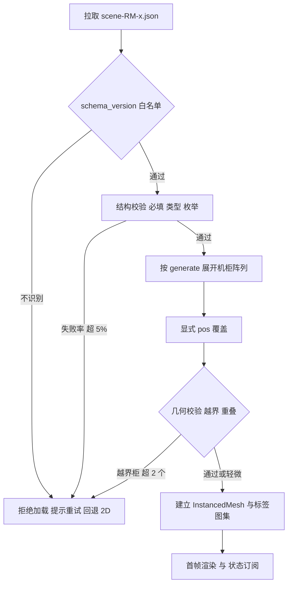

# 3D 场景数据模型

| 项 | 内容 |
|---|---|
| 文档编号 | CDCIM-P3-DD-08 |
| 版本 / 状态 | v0.1 · 草案（待评审） |
| 所属阶段 | P3 详细设计 |
| 论文价值 | ★★★★☆ 「数字孪生数据建模」「配置驱动 vs 美术资产」「坐标契约与几何校验」三处论点的落点。参数化生成 + 39 字段契约 + 加载期几何校验，可支撑论文「系统实现」段与答辩「换机房要不要改代码」的追问 |
| 上游依据 | [3D 可视化需求说明](../02-需求/10-3D可视化需求说明.md)（UX-3D-01 ~ 10、PERF-3D-01 ~ 08、TAB-SRS-37 场景 39 字段、TAB-SRS-38 运行时 5 字段、L0 ~ L4 降级链）、[数据字典初稿](../02-需求/08-数据字典初稿.md)（`space_node` 18 字段、`device` 25 字段、E4/E16）、[开发视图](../03-架构/05-开发视图.md)（`web/src/three` 目录与三条命名规则）、[物理视图](../03-架构/07-物理视图.md)（14 容器与 8080 单入口）、[接口文档](07-接口文档.md)（接口 18 实时值、接口 27 SSE、错误码）、[ADR-0004](../09-决策/ADR-0004-3D可视化-Threejs机房级数字孪生.md)、[图表规范](../90-规范/02-图表规范.md) |
| 下游承接 | P5 实现 `web/src/three/scene`（加载器、生成器、校验器）、P5 场景配置文件产出、P6 首屏与 draw call 实测、P7 论文「场景建模」段 |

> **口径声明**
> 1. 字段以[3D 可视化需求说明](../02-需求/10-3D可视化需求说明.md) TAB-SRS-37/38 为唯一来源：配置 **39 字段**、运行时增量 **5 字段**，本文不增不减；仅做**3 处路径重排、1 处取值修正、2 处口径补充**（共 6 项），逐条登记在 TAB-DD-43，便于评审逐项核对。
> 2. 体积、面数、draw call 均为**估算与预算**，实测在 P6 产生；本文不得被引用为「已达成」。
> 3. 坐标数值与 `space_node.pos_x/y/z` 的 `numeric(8,3)` 对齐，统一保留 3 位小数；本文出现的整数（如 `0`）视为 `0.000` 的简写。

---

## 1. 目的与边界

### 1.1 本文回答的三个问题

**表 TAB-DD-32　本文的三个回答对象**

| # | 问题 | 产出 | 不回答的后果 |
|---|---|---|---|
| M-1 | 一个机房的场景由哪些字段完整描述 | §3 顶层结构与 6 张字段表（39 项） | 前端各写一份「机柜长什么样」，换人即换风格 |
| M-2 | 120 个机柜的坐标是量出来的还是算出来的 | §4 生成规则（5 参数 + 4 公式） | 每加一个机柜要改 JSON，配置成为新的手工劳动 |
| M-3 | 状态 200 ms 内怎么落到画面上 | §5 运行时增量（5 字段）+ 更新路径 | 每次刷新重建几何，帧率跌到不可用 |

### 1.2 三条边界

**表 TAB-DD-33　场景模型的做与不做**

| 做到 | 不做到 | 理由 |
|---|---|---|
| 机房级壳体 + 机柜级柜体 | U 位、板卡、端口级建模 | 集显环境几何量直接换算帧率；机柜级已能回答「哪个柜」（TAB-SRS-30） |
| 参数化生成的几何体（盒体 / 线段） | BIM/CAD 还原、贴图材质、美术资源 | 场景是**数据的投影**，不是模型文件；资源制作与维护成本不可持续 |
| 状态与温度映射为实例颜色 | 视频纹理、实时流上墙 | 解码 + 显存上传，集显不可承受（PERF-3D-06 禁视频纹理） |
| 浏览器端运行时的解析与校验 | 服务端预渲染、离线烘焙几何 | 单入口 8080 + 纯静态产物（物理视图 TAB-ARCH-121 第 12 行），不新增渲染服务 |

**一条贯穿全文的原则**：**场景文件只放「画出来需要什么」，业务字段一律按主键回查**。`racks[].device_ids` 只存 ID，机柜的温度、告警、负责人全部走接口——否则场景 JSON 会退化为数据副本，出现「3D 里显示 27 ℃、详情页显示 29 ℃」的双源问题。

---

## 2. 坐标体系

### 2.1 约定表

**表 TAB-DD-34　坐标体系约定**

| 项 | 约定 | 理由 | 落点 |
|---|---|---|---|
| 单位 | 米（m），1 场景单位 = 1 m，前端不做二次缩放 | 与 `space_node.pos_x` 的 `numeric(8,3)` 一一对应，避免换算误差 | `scene.coordinate.unit` 固定 `"m"` |
| 原点 | 机房地面**西南角内侧**：西墙内表面 `x = 0`、南墙内表面 `z = 0`、地面 `y = 0` | 现场放线以墙角为基准，图纸与实测可直接对齐 | `scene.coordinate.origin` = `south-west-floor-corner` |
| 轴向 | 右手坐标系；`+X` 向东、`+Y` 向上、`+Z` **由南向北**（背向机房门） | `+Y` 与 Three.js 默认一致；`+Z` 取「向房间内部」，使全部机柜坐标为正值，满足库约束 `pos_z ≥ 0` | `scene.coordinate.up_axis` = `"+Y"` |
| 朝向 | 机柜正面朝 `-Z`（即朝南墙、朝机房门一侧），背面朝 `+Z` | 冷通道靠门侧便于施工，且正反面着色不同，拾取时不易看错 | `racks[].orientation` |
| `y` 语义 | `racks[].pos[1]` 是**底面高度**，落地柜为 `0`；渲染中心 = `pos[1] + size[1]/2` | 避免「中心点 / 底面」两套语义在代码里混用，这是 3D 最常见的差半米错误 | 生成器内部换算，不进 JSON |
| 精度 | 坐标保留 3 位小数，四舍五入；比较时容差 `0.05 m` | 与 `numeric(8,3)` 对齐；容差取 `0.05 m` 恰等于设计最小缝隙（柜距 0.65 − 柜宽 0.60），可判重叠又不把相邻柜误报为穿模 | 校验器常量 `EPS_M = 0.05` |

> **对 SRS 6.4 的一处修正**：SRS 原文写「`+Z` 向南（沿通道方向）」，而原点取「西南角」。两者同时成立时，机房内部全部落在 `z < 0`，与 `space_node.pos_z ≥ 0` 及「包围盒在 `room.size` 内」的校验直接冲突。本文改为 **`+Z` 由南向北递增**，语义修正、数值口径不变（仍是右手系、仍是 Y-up），登记为 TAB-DD-43 的 D-5。

### 2.2 四角坐标示意

以默认机房 `12.0 m（X，东西）× 3.2 m（Y）× 32.0 m（Z，南北）` 为例：

**表 TAB-DD-35　机房四角与机柜坐标示意（单位 m）**

| 位置 | 坐标 `[x, y, z]` | 说明 |
|---|---|---|
| 西南角（原点） | `[0, 0, 0]` | 西墙内表面与南墙内表面的交线、地面 |
| 东南角 | `[12.0, 0, 0]` | 东墙、南墙（机房门所在墙）交汇 |
| 西北角 | `[0, 0, 32.0]` | 西墙、北墙交汇 |
| 东北角 | `[12.0, 0, 32.0]` | 房间最深处 |
| 第 1 列第 1 柜（中心） | `[0.325, 0, 1.2]` | 由 §4 公式生成；`y` 为底面 |
| 第 13 列第 3 柜（中心） | `[1.625, 0, 30.0]` | 最远一柜，包围盒上界 `z = 30.6 ≤ 32.0`，通过越界校验 |

**为什么 32 m 深而不是示意值 12 m**：13 列 × 列距 2.4 m = 28.8 m 的**列距本身就占满 31.2 m**（含首末半深），12 m 深的房间装不下 13 列。SRS 6.2 示例里的 `size: [18.0, 3.2, 12.0]` 是结构示例，不是规模自洽的取值。本文改取 `[12.0, 3.2, 32.0]`，并在 TAB-DD-43 登记 D-4；现场实测后以实测值覆盖 `room.size`，公式与参数不动。

---

## 3. 场景 JSON 顶层结构

### 3.1 六个顶层键

**表 TAB-DD-36　场景 JSON 顶层结构**

| 键 | 类型 | 基数 | 必填 | 职责 | 对应原字段段 |
|---|---|---|---|---|---|
| `scene` | object | 1 | 是 | 契约版本、场景标识、坐标系、生成参数 | `schema_version` + `scene_id` + `coordinate.*` + `generate.*`（11 项） |
| `rooms` | array | 1 | 是 | 机房壳体与净尺寸 | `room.*`（4 项） |
| `racks` | array | 0 ~ 200 | 是 | 机柜实例（位置、尺寸、朝向、容量） | `racks[]`（11 项） |
| `devices` | array | 0 ~ 500 | 是 | 机房级设备（空调、UPS、配电、网络柜） | `devices[]`（5 项） |
| `pipes` | array | 0 ~ 20 | 是 | 桥架、管线折线 | `pipes[]`（4 项） |
| `legend` | array | 1 ~ 3 | 是 | 色标与图例定义 | `legends[]`（4 项） |

合计 **11 + 4 + 11 + 5 + 4 + 4 = 39 字段**，与 TAB-SRS-37 严格相等。

`rooms` 与 `legend` 取数组而非单对象，是为「同一场景内的壳体分区」与「多套色标并存」留位；**本期校验规则要求 `rooms` 长度恒为 1、`legend` 长度 ≤ 3**（温度 / 状态 / 告警各一套），超出即拒绝加载（§8）。数组化不增加字段数，只改容器形态。

### 3.2 `scene`（11 字段）

**表 TAB-DD-37　`scene` 命名空间字段**

| # | 字段 | 类型 | 必填 | 取值 / 约束 | 示例 |
|---|---|---|---|---|---|
| 1 | `scene.schema_version` | string | 是 | `^\d+\.\d+$`；前端白名单 `["1.0"]`，不识别即拒绝加载 | `"1.0"` |
| 2 | `scene.scene_id` | string | 是 | 与机房 `node_code` 一致，`^RM-[A-Z]$` | `"RM-A"` |
| 3 | `scene.coordinate.unit` | string | 是 | 本期固定 `"m"`，其他值拒绝 | `"m"` |
| 4 | `scene.coordinate.origin` | string | 是 | 本期固定 `"south-west-floor-corner"` | `"south-west-floor-corner"` |
| 5 | `scene.coordinate.up_axis` | string | 是 | 固定 `"+Y"` | `"+Y"` |
| 6 | `scene.coordinate.forward_axis` | string | 是 | 机柜默认朝向，固定 `"-Z"` | `"-Z"` |
| 7 | `scene.generate.cols` | int | 否 | 1 ~ 40；缺省时完全按 `racks[].pos` 摆放 | `13` |
| 8 | `scene.generate.racks_per_col` | int | 否 | 1 ~ 20 | `3` |
| 9 | `scene.generate.col_spacing` | number | 否 | 1.2 ~ 6.0 m，须 `> rack_size[2]`（否则列重叠） | `2.4` |
| 10 | `scene.generate.rack_spacing` | number | 否 | 0.6 ~ 3.0 m，须 `≥ rack_size[0]` | `0.65` |
| 11 | `scene.generate.rack_size` | number[3] | 否 | `[宽, 高, 深]`，各分量 0.3 ~ 3.0 m，高 ≥ 1.0 | `[0.6, 2.0, 1.2]` |

`generate` 的 5 个参数**要么全给、要么全不给**：只给一半时，缺失项取默认值会让生成结果与作者意图不符，且难以察觉——校验器按「全有或全无」判定（§8 校验 2）。

### 3.3 `rooms`（4 字段）

**表 TAB-DD-38　`rooms[]` 字段**

| # | 字段 | 类型 | 必填 | 取值 / 约束 | 示例 |
|---|---|---|---|---|---|
| 12 | `rooms[].room_id` | int | 是 | 引用 `space_node.node_id`（`node_type = room`），须存在 | `101` |
| 13 | `rooms[].name` | string | 是 | ≤ 64 字符，进入切换器与标题 | `"机房 A"` |
| 14 | `rooms[].floor` | string | 否 | `^B\d{1,2}$` 或 `^F\d{1,2}$`，仅用于切换器分组 | `"B1"` |
| 15 | `rooms[].size` | number[3] | 是 | `[宽, 高, 深]`，各分量 3.0 ~ 200 m，高 ≥ 2.2 | `[12.0, 3.2, 32.0]` |

### 3.4 `racks`（11 字段）

**表 TAB-DD-39　`racks[]` 字段**

| # | 字段 | 类型 | 必填 | 取值 / 约束 | 示例 |
|---|---|---|---|---|---|
| 16 | `racks[].node_id` | int | 是 | `space_node.node_id`，**场景内唯一** | `3001` |
| 17 | `racks[].node_code` | string | 是 | 与 `space_node.node_code` 逐字一致，格式 `RM-x/ROW-nn/RACK-nnn` | `"RM-A/ROW-03/RACK-012"` |
| 18 | `racks[].label` | string | 是 | `机房短码-列-位`，各段两位补零，≤ 12 字符；与搜索写法 `A-03-02` 一致（UX-3D-07） | `"A-03-02"` |
| 19 | `racks[].col_index` | int | 是 | 1 起，连续无空洞；决定键盘导航顺序与「同列」影响范围 | `3` |
| 20 | `racks[].seq_in_col` | int | 是 | 1 起，同列内连续无空洞 | `2` |
| 21 | `racks[].pos` | number[3] | 是 | 机柜**中心** `[x, y, z]`，`y` 为底面；须在 `rooms[0].size` 内 | `[0.975, 0, 6.000]` |
| 22 | `racks[].size` | number[3] | 否 | 覆盖 `generate.rack_size`；缺省继承 | `[0.6, 2.0, 1.2]` |
| 23 | `racks[].orientation` | string | 是 | `front_+Z` / `front_-Z` / `front_+X` / `front_-X` | `"front_-Z"` |
| 24 | `racks[].capacity_u` | int | 否 | 1 ~ 60，仅详情展示 | `42` |
| 25 | `racks[].capacity_kw` | number | 否 | ≥ 0，两位小数 | `8.00` |
| 26 | `racks[].device_ids` | int[] | 否 | 柜内设备主键，≤ 60 项；点击详情时按此查询 | `[2001, 2002]` |

`label` 由生成器按「机房短码 + `col_index` + `seq_in_col`」拼装（`"A-03-02"`，短码取 `scene_id` 末位字母），**不取 `node_name`**：`node_name` 是台账展示名（「A 区 3 列 2 号柜」），长度不可控，塞进 Sprite 会糊满屏（SRS 7.4 要求标签总量 ≤ 60）；同时该格式必须与搜索支持的三种写法之一逐字一致，否则「输入 A-03-02 搜不到」会在验收时才暴露。展示名在详情面板按 `node_id` 回查。

### 3.5 `devices`（5 字段）

**表 TAB-DD-40　`devices[]` 字段**

| # | 字段 | 类型 | 必填 | 取值 / 约束 | 示例 |
|---|---|---|---|---|---|
| 27 | `devices[].device_id` | int | 是 | `device.device_id`，场景内唯一 | `2001` |
| 28 | `devices[].device_type` | string | 是 | 渲染类型 6 值：`ups` / `pdu` / `crac` / `env` / `access` / `network`（由 E4 聚合，见 TAB-DD-44） | `"crac"` |
| 29 | `devices[].rack_id` | int | 是 | 所属机柜 `node_id`；机房级设备填 `null` | `null` |
| 30 | `devices[].u_position` | int | 否 | 起始 U 位，**仅供详情展示**，不参与渲染 | `10` |
| 31 | `devices[].label` | string | 是 | ≤ 16 字符，短名 | `"CRAC-02"` |

`devices` 里只放**需要独立几何体**的设备：4 台精密空调、2 台 UPS/配电、1 台独立网络柜。机柜内的服务器、交换机不进 `devices`——它们由 `racks[].device_ids` 表达，点击后才查明细。若把 300 台设备全列进来，`devices` 会从 7 条涨到 300 条，场景 JSON 体积翻 4 倍而画面无任何变化。

### 3.6 `pipes`（4 字段）与 `legend`（4 字段）

**表 TAB-DD-41　`pipes[]` 字段**

| # | 字段 | 类型 | 必填 | 取值 / 约束 | 示例 |
|---|---|---|---|---|---|
| 32 | `pipes[].pipe_id` | int | 是 | 场景内唯一 | `9001` |
| 33 | `pipes[].pipe_type` | string | 是 | `cooling` / `power` / `network` | `"cooling"` |
| 34 | `pipes[].path` | number[3][] | 是 | 折线顶点 ≥ 2，各点须在 `rooms[0].size` 内 | `[[0.6,2.8,0.6],[11.4,2.8,0.6]]` |
| 35 | `pipes[].color_key` | string | 否 | 样式键，取值见前端 `three/styles/palette.ts`，**不在 JSON 写死颜色** | `"coolant"` |

**表 TAB-DD-42　`legend[]` 字段**

| # | 字段 | 类型 | 必填 | 取值 / 约束 | 示例 |
|---|---|---|---|---|---|
| 36 | `legend[].legend_id` | string | 是 | 图例标识，场景内唯一 | `"temp"` |
| 37 | `legend[].type` | string | 是 | `temp` / `alarm` / `status` | `"temp"` |
| 38 | `legend[].unit` | string | 否 | `type = temp` 时必填 | `"℃"` |
| 39 | `legend[].stops` | number[] | 是 | 升序、严格递增、长度 = 分档数 − 1；温度默认 4 个边界 | `[22, 25, 28, 30]` |

`stops` 可配置是 SRS 第 10 节 Q2 的落地方式：现场 SOP 若改档位，只改配置不改代码，色标与图例同时生效（两者读同一份 `stops`，避免「图例改了、渲染没改」）。

### 3.7 与 SRS 39 字段的对账

**表 TAB-DD-43　39 字段对账与 6 处偏差（增减 0 项）**

| # | 偏差类型 | SRS 原写法 | 本文写法 | 影响 | 是否需回写 SRS |
|---|---|---|---|---|---|
| D-1 | 容器形态 | `room`（object） | `rooms`（array，长度恒 1） | 路径由 `room.x` 变 `rooms[0].x`；字段数与语义不变 | 建议 |
| D-2 | 键名 | `legends` | `legend` | 顶层键名变，元素 4 字段不变 | 建议 |
| D-3 | 命名空间 | `coordinate.*` / `generate.*` 顶层 | `scene.coordinate.*` / `scene.generate.*` | 避免 6 个顶层键中 3 个是「配置而非内容」，加载器可按 `scene` 整体读取 | 建议 |
| D-4 | 取值 | `room.size` 示例 `[18.0, 3.2, 12.0]` | 默认 `[12.0, 3.2, 32.0]` | 原值装不下 13 列 × 2.4 m（需 31.2 m 进深） | **必须**（示例值会误导配置） |
| D-5 | 语义 | `+Z` 向南 | `+Z` 由南向北 | 原写法导致全部机柜 `z < 0`，与库约束冲突 | **必须** |
| D-6 | 缺省规则 | 未定义 | `orientation` 由生成器统一填 `front_-Z` | 生成器行为需明确，否则同一份参数两次生成结果不同 | 可并入 P5 |

**计数**：配置字段 39 项（`scene` 11 + `rooms` 4 + `racks` 11 + `devices` 5 + `pipes` 4 + `legend` 4），运行时增量 5 项，合计 **44**，与 SRS 的 39 + 5 相等；**无新增、无删除**。上表 6 项均为路径或取值层面的调整。

---

## 4. 参数化生成规则

### 4.1 五个参数与默认值

**表 TAB-DD-44　生成参数（5 项）与默认值**

| # | 参数 | 默认 | 取值范围 | 物理含义 | 谁改 |
|---|---|---|---|---|---|
| 1 | `cols` | 13 | 1 ~ 40 | 列数（沿 `+Z` 方向排列的机柜带数量） | 机房规划 |
| 2 | `racks_per_col` | 3 | 1 ~ 20 | 单列机柜数（沿 `+X` 方向排列） | 机房规划 |
| 3 | `col_spacing` | 2.4 | 1.2 ~ 6.0 | 相邻列中心距 = 柜深 1.2 + 通道 1.2 | 现场实测 |
| 4 | `rack_spacing` | 0.65 | 0.6 ~ 3.0 | 同列相邻柜中心距 = 柜宽 0.6 + 缝 0.05 | 现场实测 |
| 5 | `rack_size` | `[0.6, 2.0, 1.2]` | 各分量 0.3 ~ 3.0 | `[宽(X), 高(Y), 深(Z)]`，42U 标准柜近似 | 厂商规格 |

> 与 SRS 6.5 的分解差异：SRS 写「2.4 = 柜深 1.2 × 2 + 冷热通道各 0.6」，把两列深度与两条半通道相加；本文按**相邻列中心距 = 柜深 + 单条通道宽**计算，数值同为 2.4，但后者可被一条公式校验（`col_spacing > rack_size[2]`），前者会让人以为一条通道同时属于两列。数值不变，口径以本文为准。

### 4.2 四条公式

**表 TAB-DD-45　坐标生成公式**

| 目标 | 公式 | 说明 | 代入（第 3 列第 2 柜） |
|---|---|---|---|
| 列内 `x` | `x = (seq_in_col − 0.5) × rack_spacing` | 首柜贴西墙内侧留半个柜宽，无额外 margin 参数 | `(2 − 0.5) × 0.65 = 0.975` |
| 列间 `z` | `z = (col_index − 0.5) × col_spacing` | 首列贴南墙内侧留半个柜深 | `(3 − 0.5) × 2.4 = 6.000` |
| 底面 `y` | `y = 0` | 落地柜；上架柜显式给值，不参与生成 | `0` |
| 渲染中心 `y` | `y_c = y + size[1] / 2` | 只在渲染层换算，不写回 JSON | `0 + 2.0/2 = 1.0` |

**适配校验（生成前必算）**：`(cols − 0.5) × col_spacing + rack_size[2]/2 ≤ rooms[0].size[2]` 且 `(racks_per_col − 0.5) × rack_spacing + rack_size[0]/2 ≤ rooms[0].size[0]`。不满足即**拒绝生成并报出超界量**（如「超出 4.2 m」），不允许静默截断——静默截断会让「少了 2 个机柜」在画面上看不出来。

### 4.3 「改规模只改参数」的边界

| 变更 | 需改什么 | 不需改什么 |
|---|---|---|
| 加 1 列机柜 | `cols: 13 → 14`，并把 `room.size[2]` 加到 ≥ 33.6 | 前端代码、`racks` 数组（由生成器展开） |
| 换机房（尺寸不同） | `room.size`、`cols`、`racks_per_col`、`col_spacing` | 加载器、渲染器、着色逻辑 |
| 单柜挪位（绕过柱子） | 该柜 `racks[].pos` 显式覆盖 | 其余 39 柜的生成结果 |

**`racks[].pos` 与生成值冲突时以显式 `pos` 为准**（与 SRS 6.4 一致）：生成器先铺阵列，再用显式 `pos` 覆盖，覆盖后重跑重叠校验。这条规则使「95% 规整 + 5% 特例」两种布局共存，而不需要引入第二套配置文件。

### 4.4 生成时机

生成在前端**加载期**完成（`web/src/three/scene/generator.ts`），不在构建期烘焙：构建期烘焙会把布局固化进产物，改一个机柜就要重新发版，与「换机房只改配置」（NFR-MOD-03 精神）直接矛盾。生成结果是内存对象，不落盘、不回写 JSON。校验与回退的先后顺序如图 FIG-DD-32 所示。

**图 FIG-DD-32　场景加载、校验与回退流程**——图注：本图回答「一份坏配置会在哪一步被拦住」。四个出口中三个通向 `2D 兜底（L3）`，只有「轻微越界/重叠」允许带告警进入渲染，因为现场实测误差不应阻断查看。

---

## 5. 运行时增量接口

### 5.1 五个增量字段

**表 TAB-DD-46　机柜运行时状态（5 字段，与 TAB-SRS-38 一致）**

| # | 字段 | 类型 | 必填 | 取值 | 示例 | 消费方式 |
|---|---|---|---|---|---|---|
| 1 | `rack_id` | int | 是 | `racks[].node_id` | `3001` | 实例索引（加载期建 `node_id → instanceId` 映射） |
| 2 | `status` | string | 是 | `normal` / `alarm` / `offline` / `maintenance` / `unknown` | `"alarm"` | 实例色 + 图标（状态模式） |
| 3 | `alarm_level` | string | 否 | `critical` / `major` / `minor` / `null` | `"major"` | 描边粗细 + 呼吸动画 |
| 4 | `temp_inlet` | number | 否 | −10 ~ 60 ℃，缺省表示无有效数据 | `27.4` | 实例色（温度模式），按 `legend[].stops` 分档 |
| 5 | `ts` | string | 是 | ISO 8601 带偏移，毫秒 | `"2026-11-26T10:12:03.412+08:00"` | 乱序丢弃（`ts` 小于已存值即忽略） |

### 5.2 数据从哪来（不新增接口）

**本模型不引入新的推送通道**，5 个字段由已有接口在前端合成，避免为 3D 单开一条链路（SRS 5.4「3D 不得阻塞 2D」与接口文档 47 个接口的边界）。`ts` 随每次响应携带，不单独取：

| 字段 | 来源 | 频率 | 说明 |
|---|---|---|---|
| `status`、`alarm_level` | 接口 27 `GET /alarm-events/stream`（SSE） | 事件驱动 | 告警事件带 `impact_scope`，按 `root_device_id → rack_id` 归并到机柜 |
| `temp_inlet` | 接口 18 `GET /realtime/points`（批量 ≤ 50 点） | 30 s | 单机房约 40 点（39 柜进风 + 关键设备回风），一次请求即可（上限 50）；全项目约 120 点分 3 次 |
| `status` 的 `offline` / `maintenance` | 接口 11 `/devices/{id}` 与 `space_node.node_status` 的每日快照 | 天级 | 维护中**不参与告警着色**（SRS 7.2 与字典 4.3 一致） |

**若后续要求端到端 ≤ 1 s 的机柜状态推送**，需在接口文档增补一条 SSE（`/scene/{scene_id}/stream`），属接口变更、不在本文范围内，登记为 §9 Q2。

### 5.3 更新路径（只改颜色，不重建几何）

| 步骤 | 做什么 | 预算 | 违反后果 |
|---|---|---|---|
| ① 接收 | 解析 5 字段，按 `ts` 丢弃乱序 | — | 温度回跳，画面闪烁 |
| ② 映射 | `rack_id → instanceId`，写 `Float32Array` 颜色缓冲 | ≤ 0.1 ms / 柜 | 遍历对象导致 GC 抖动 |
| ③ 提交 | `instanceColor.needsUpdate = true`，仅标脏不重建 | ≤ 200 ms / 批次（SRS 6.6） | 重建 `InstancedMesh` 会使帧率跌至个位数 |
| ④ 高亮 | 由 `alarm_level` 与同列/同排集合推导外框 Mesh，**不新增字段** | ≤ 1 帧 | 影响范围需重复计算 |

「同列」= 相同 `col_index`，「同排」= 相同 `seq_in_col`；两者都由既有字段本地计算，不需要接口返回影响范围（接口 22 的 `impact_scope` 用于跨机房/业务影响，与本处的空间邻接不是同一概念，不混用）。

---

## 6. 与数据库的映射

### 6.1 `space_node` / `topology_link` → `rooms` / `racks` / `pipes`

**表 TAB-DD-47　空间节点到场景字段的映射**

| `space_node` 字段 | 场景字段 | 转换规则 | 缺失时 |
|---|---|---|---|
| `node_id` | `racks[].node_id` | 直传（int64 → int，前端按 `Number` 安全范围内使用） | 该行丢弃并计入错误 |
| `node_code` | `racks[].node_code` | 直传，不重排分段 | 丢弃（搜索依赖它） |
| `node_name` | —— | **不进场景**，详情面板按 `node_id` 回查 | 不影响渲染 |
| `node_type` | 决定归属 | `room` → `rooms`；`rack` → `racks`；`row` → 仅用于推导 `col_index`；`u_slot` → **不渲染**（保留数据） | 未知类型跳过 |
| `parent_node_id` | `racks[].col_index` | 找父 `row` 节点的 `seq_no` → `col_index` | 父缺失时按 `seq_no` 降级排序 |
| `seq_no` | `racks[].seq_in_col`（rack）/ `col_index`（row） | 直传；须连续，空洞即校验失败 | 丢弃 |
| `room_id` | `rooms[].room_id` / `scene.scene_id` | 由 `node_id → node_code` 反查机房编码 | 丢弃 |
| `pos_x` / `pos_y` / `pos_z` | `racks[].pos` | `numeric(8,3)` → number，**三值齐全才覆盖**生成值 | 任一为空则用生成值 |
| `capacity_u` | `racks[].capacity_u` | 直传 | 缺省不展示容量行 |
| `capacity_kw` | `racks[].capacity_kw` | 直传，保留 2 位 | 同上 |
| `node_status` | **不进场景** | 作为运行时 `status` 的 `maintenance` 来源 | 按 `normal` 处理 |

`pipes` 不由 `space_node` 生成：管线是**关系**而非节点，来源是 `topology_link` 中 `link_type ∈ {cooling, power, network}` 且 `is_current = true` 的记录。该表没有顶点坐标列，因此 `pipes[].path` 由生成脚本按「同机房内首末机柜的中心线 + 桥架高度 2.8 m」画一条**示意走线**，`pipe_id` 取 `link_id`。这是一处有意的降级：管线只用于表达「冷/电/网从哪侧进入」，不参与任何计算，不值得为它增加 3 张顶点表。

### 6.2 `device` → `devices` / `racks[].device_ids`

**表 TAB-DD-48　设备到场景字段的映射与类型聚合**

| `device` 字段 | 场景字段 | 转换规则 |
|---|---|---|
| `device_id` | `devices[].device_id` / `racks[].device_ids[]` | 直传；`space_node_id` 指向 rack 时进 `device_ids`（最多 60 项），指向 room 时进 `devices` |
| `device_name` | `devices[].label` | 截断至 16 字符，超出以「…」结尾 |
| `device_type`（E4，10 值） | `devices[].device_type`（6 值） | 见下表聚合 |
| `space_node_id` | `devices[].rack_id` | 指向 rack 填 `node_id`；指向 room 填 `null` |
| —— | `devices[].u_position` | `device` 表无 U 位字段，由 `space_node`（`node_type = u_slot`）子节点推导；未维护则 `null` |

**E4（10 值）→ 渲染类型（6 值）聚合**，落字段 `devices[].device_type`：

| 渲染类型 | 覆盖 E4 | 说明 |
|---|---|---|
| `ups` | `ups`、`battery` | 电池组与 UPS 同柜，不单独建模 |
| `pdu` | `pdu` | 配电柜，手配坐标 |
| `crac` | `precision_ac` | 精密空调，4 台/机房，含出风口色块 |
| `env` | `th_sensor`、`leak`、`smoke` | 传感器不单独建模，聚合到机柜温度/状态 |
| `access` | `door_ctrl`、`camera` | 门禁与摄像机在壳体内以图标表示 |
| `network` | `gateway` | 网关/独立网络柜 |

> `battery` 并入 `ups`、`th_sensor`/`leak`/`smoke` 并入 `env`，使 `devices` 实际条目从 300 降到 7（每机房），这是「字段最小化」原则在类型层的落地。**代价**：无法在 3D 中单独点击一台温湿度传感器——它本来也不该在 3D 中可点，传感数据已聚合到机柜。

### 6.3 映射的三条纪律

1. **单向生成**：只允许「库 → 场景」，不允许「场景 → 库」。场景文件是只读投影，改布局必须改台账，否则 `space_node` 与画面必然分叉。
2. **生成脚本与前端生成器分开**：P5 提供一个离线脚本（`scripts/gen-scene.py`）把库导出成 JSON，供无后端环境演示；该脚本与前端 `generator.ts` 共用同一份结构校验规则（JSON Schema），避免两处实现漂移。
3. **库未改、场景不重建**：台账变更通过 `meta.change` 事件（字典 §8）30 s 内生效，场景文件按「发布时重新导出」更新，不做运行时热重载——热重载会让正在看的位置突然改变，值班员会以为看错了机房。

---

## 7. 体积与预算

### 7.1 单机房 JSON 体积估算

**表 TAB-DD-49　单机房场景文件体积估算（估算值，P5 产出后实测替换）**

| 段 | 条目数 | 单条约 | 小计 | 说明 |
|---|---|---|---|---|
| `scene` | 1 | 320 B | 0.3 KB | 含 5 个生成参数与 4 个坐标约定 |
| `rooms` | 1 | 90 B | 0.1 KB | — |
| `racks` | 39 | 230 B | 9.0 KB | 含 `node_code` 长串（≈30 B）与 `device_ids`；独立网络柜计入 `devices`，故为 39 而非 40 |
| `devices` | 7 | 100 B | 0.7 KB | 仅需独立几何体的设备 |
| `pipes` | 9 | 90 B | 0.8 KB | 折线 2 ~ 4 点 |
| `legend` | 2 | 70 B | 0.1 KB | — |
| 缩进与分隔 | — | — | 1.2 KB | 2 空格缩进 |
| **合计** | — | — | **约 12 KB 未压缩 / 约 3 KB gzip** | 预算 120 KB / 30 KB（TAB-SRS-36），余量约 10 倍 |

**余量为什么留这么大**：预算按「每个机柜带 60 个 `device_ids`」的极端情况给（39 × 60 × 6 B ≈ 14 KB 额外），保证机柜装满时仍不超预算。若确实逼近 120 KB，先砍 `device_ids`（改为按 `rack_id` 反查接口），不动结构。

### 7.2 分包与加载顺序

**表 TAB-DD-50　分包粒度与加载顺序**

| 顺序 | 资源 | 体积预算 | 触发时机 | 失败处理 |
|---|---|---|---|---|
| 1 | 3D 路由 chunk（three.js + 加载器 + 生成器） | ≤ 800 KB gzip | 进入 3D 路由 | L3 回退 2D |
| 2 | `scene-RM-A.json` | ≤ 30 KB gzip | 与 ① 并行 | 提示「机房配置加载失败」+ 重试（SRS UX-3D-05） |
| 3 | 标签图集 + 状态图标（2 张 512²） | ≤ 2 MB | 首帧后 | 缺失时退化为纯色块（L2 行为） |
| 4 | 其他机房 JSON | 各 ≤ 30 KB gzip | 切换器悬停 300 ms 预取 | 静默失败，切换时再请求 |

**不做机柜级分包**：单机房 12 KB 拆成 4 片只会增加 3 次 RTT，收益为零；分包阈值定在「单文件 > 60 KB」，当前无触发条件。三机房**不做同屏并列**：单机柜在 1366 px 宽下已只占约 12 px，三机房并列后低于 8 px 可辨阈值，且三角面预算按单机房核算（PERF-3D-05 的 15 万面），并列即超预算。

---

## 8. 校验与降级

### 8.1 校验项与处置

**表 TAB-DD-51　加载期校验规则（按执行顺序，命中即处置）**

| # | 校验 | 判据 | 处置 | 级别 |
|---|---|---|---|---|
| 1 | 文件可达 | HTTP 200 且 `Content-Type` 为 JSON | 提示 + 重试按钮 | L3 |
| 2 | 可解析 | `JSON.parse` 不抛错 | 提示「配置格式错误」+ 重试 | L3 |
| 3 | 版本 | `schema_version ∈ ["1.0"]` | 提示「客户端版本过旧/配置过新」 | L3 |
| 4 | 结构 | 6 个顶层键齐全，类型匹配 | 缺任一必填顶层键即拒绝 | L3 |
| 5 | 生成参数 | `generate` 五参数全有或全无；`col_spacing > rack_size[2]`；`rack_spacing ≥ rack_size[0]` | 拒绝生成，报具体参数名 | L3 |
| 6 | 唯一性 | `racks[].node_id` 与 `node_code` 场景内唯一；`col_index`/`seq_in_col` 连续 | 重复者保留首个、丢弃后者并计数 | 告警级（计数 > 2 则 L3） |
| 7 | 越界 | 机柜包围盒在 `rooms[0].size` 内（容差 0.05 m），`pos[1] ≥ 0` | 越界柜钳制到边界内并标红日志；越界 > 2 柜则拒绝 | 告警级 / L3 |
| 8 | 重叠 | 同层机柜包围盒相交体积 > 0（容差 0.05 m） | **只告警不拒绝**（实测误差不应阻断查看），重叠柜以描边提示 | 告警级 |
| 9 | 引用完整性 | `racks[].device_ids` 与 `devices[].rack_id` 双向一致 | 悬空 ID 剔除并计数 | 告警级 |
| 10 | 图例 | `legend[].stops` 升序且严格递增；`type = temp` 必有 `unit` | 该图例丢弃，着色回退到内置默认档 | 告警级 |

**「丢弃并计数」的阈值取 5%**：单机房 40 柜（39 阵列柜 + 1 独立网络柜），丢弃 2 柜（5%）仍可判断态势；丢弃 3 柜（7.5%）说明配置已不可信，宁可退回 2D 也不展示一份缺角的机房——缺角比没有更容易误导（值班员会以为那一列不存在）。

### 8.2 与 L0 ~ L4 降级链的衔接

**表 TAB-DD-52　场景侧故障到降级级别的映射**

| 场景侧故障 | 降级级别 | 保留能力 | 界面提示 |
|---|---|---|---|
| JSON 404 / 解析失败 / 版本不识别 | L3（2D 热力图） | 平面图状态着色、告警定位、温度热力、图例 | 「3D 配置加载失败，已切至平面图」+ 重试 |
| 校验失败率 > 5% 或越界 > 2 柜 | L3 | 同上 | 「机房配置异常（N 处），已切至平面图」 |
| WebGL 2.0 不可用 / 上下文丢失 | L3 | 同上 | 「当前设备不支持 3D」 |
| 纹理加载失败 | L2（简化模式） | 色块、定位、热力、搜索 | 「已进入简化模式：纹理缺失」 |
| 轻微越界 / 重叠 / 悬空 ID | L0 保持 | 全部 | 仅在调试 HUD 计数，不打扰值班员 |

**三条规则**：① 场景侧的任何异常都**不向 2D 大屏抛错**、不写审计、不产生后端请求风暴（NFR-AVAIL-04、SRS 8.3 第 3 条）；② 降级原因必须可见，禁止静默降级；③ 降级后 `racks[].col_index` / `seq_in_col` 仍是 2D 平面图的排布依据，两视图共用同一份场景文件——这是「2D/3D 切换保持选中机柜」（UX-3D-10）的数据基础。

---

## 9. 待确认

| # | 待确认点 | 本文暂定 | 备选 / 影响 | 建议 |
|---|---|---|---|---|
| Q1 | **三个机房的实测净尺寸与列数** | 默认 `[12.0, 3.2, 32.0]`、13 列 × 3 柜 × 2.4 m；容量上限按 40 柜/机房 | 若现场为 18 m 宽 × 12 m 深的房间，则列数须降到 ≤ 4 列，机柜总数从 120 降到约 40，直接影响 TAB-SRS-32 的规模基线与 PERF-3D-05 的面预算 | 建议 P4 前由运维提供一次现场放线（或按已有机房图纸量取），把实测值写入 `deploy/config/scene/*.json`；**参数可改，公式不改**，因此不影响本文其余结论 |
| Q2 | **机柜状态是否单开推送通道** | 不单开：`status`/`alarm_level` 由接口 27 SSE 合成，`temp_inlet` 走接口 18 每 30 s 轮询 | 若验收要求「温度变化 ≤ 1 s 上屏」，需在接口文档增补 `GET /scene/{scene_id}/stream`（SSE，5 字段原样推送），并增加一条限流与断线重连规则 | 建议**暂不单开**：SRS 6.6 只要求「收到增量后 ≤ 200 ms 更新」，未要求端到端 1 s；30 s 轮询与 FR-M5-05 的热力刷新周期一致，先按低成本方案实现，P6 实测不够再加 |

---

## 考点映射

| 考纲知识点 | 本文件对应内容 | 论文可用位置 | 真题溯源 |
|---|---|---|---|
| 数字孪生的数据建模 | §3 39 字段契约、§6 库到场景的单向映射 | 论文「系统实现」段：孪生体不是模型文件，而是「参数 + 主键引用」的投影 | 2023 下 数字孪生、2024 下 数据可视化 |
| 配置驱动与可修改性 | §4 5 参数 4 公式、§4.3 变更边界表 | 论文「可修改性战术」段：换机房改 4 个数字，改代码 0 行 | 2023 上 架构评估、案例题「可维护性设计」 |
| 契约与校验（防御式设计） | §8 十项校验、5% 丢弃阈值、L3 衔接 | 论文「健壮性设计」段：坏配置在加载期暴露，而不是在画面上表现为「看不见」 | 2023 上 系统可靠性 |
| 性能预算与资源约束 | §7 体积与分包、不与 2D 同 chunk、不做机柜级分包 | 论文「性能设计」段：预算按极端情况给余量，阈值定在 60 KB 而非拍脑袋拆包 | 2025 下 性能测试 |
| 坐标与几何一致性 | §2 坐标体系、§2.2 四角示意、D-4/D-5 两处修正 | 答辩追问「3D 里机柜位置怎么保证不穿模」 | 评分点为「设计的严谨性」 |
| 数据一致性与单一数据源 | §1.2 字段最小化、§6.3 单向生成 | 论文「数据设计」段：场景不做数据副本，避免双源 | 2024 上 数据架构 |

## 论文可引用段落

> 三维场景最容易走成两条歪路：一是当成美术资产，换机房就要重新建模；二是当成数据副本，温度、告警全抄进配置，于是三维显示 27 度而详情页显示 29 度。本项目把场景定义成参数的投影：一份机房配置只保留三十九个字段，其中五个是生成参数，机柜坐标由两条公式算出，改规模只改数字，前端代码零改动；业务字段一概不进配置，只留设备主键，点击时回查接口。为让算出来的坐标可信，加载期设十项校验，越界与重叠按容差判定，丢弃超过百分之五就退回二维平面图，因为缺角的机房比没有机房更容易误导值班员。设计时还纠正了两处不自洽：十三列、二点四米列距需要三十一点二米进深，示例的十二米房间装不下；原文 Z 轴朝南又会让全部机柜坐标为负值。这类矛盾在三维里一定表现为看不见或穿模。

（约 290 字）

---

## 变更记录

| 版本 | 日期 | 变更 |
|---|---|---|
| v0.1 | 2026-11-27 | 初稿。建立坐标体系与四角示意（TAB-DD-34/35）、六顶层键结构与 39 字段表（TAB-DD-36 ~ 42）、39 字段对账与 6 处偏差（TAB-DD-43）、5 参数 4 公式与适配校验（TAB-DD-44/45）、运行时 5 字段与来源合成（TAB-DD-46）、库到场景映射与 E4 六类聚合（TAB-DD-47/48）、体积估算与分包顺序（TAB-DD-49/50）、十项校验与 L0 ~ L4 衔接（TAB-DD-51/52）、2 项待确认 |
