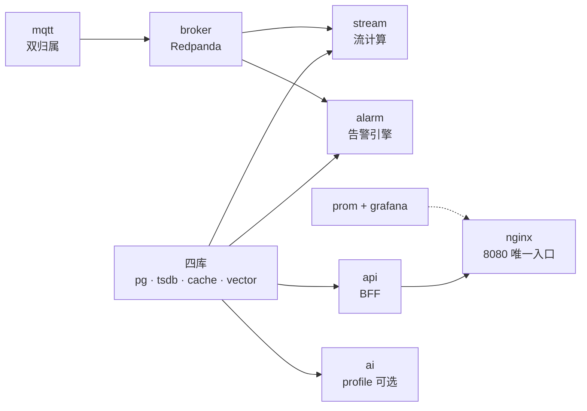

# 部署架构落地说明（Deployment Realization）

| 项 | 内容 |
|---|---|
| 文档编号 | CDCIM-P4-OPS-01 |
| 版本 / 状态 | v0.1 · 草案（待评审） |
| 所属阶段 | P4 骨架落地 |
| 论文价值 | ★★★★☆ 「架构文档 → 可执行编排」的落地证据：物理视图的每一条约束（单端口对外、三段网络、逐单元配额）都能在 compose 里指到具体一行；差异表的六条偏差是「设计与实现之间必须被记录的距离」的实例，可直接用于论文「部署设计」与「经验总结」段 |
| 上游依据 | [物理视图](../03-架构/07-物理视图.md)（14 容器 / 3 网络 / 13 卷 / 内存与 CPU 配额）、[组件映射表 v1](../03-架构/01-组件映射表-v1.md)（端口规划、镜像与参数）、[数据库设计说明书](../04-详细设计/01-数据库设计说明书.md)（18 表 DDL、4 库 4 超级表）、[消息主题与事件契约](../04-详细设计/08-消息主题与事件契约.md)（13 主题与分区数）、[编码规范](../04-详细设计/13-编码规范.md)（YML-01~05、SQL-07 幂等） |
| 下游承接 | P6 部署手册与端口扫描用例（`docs/06-交付运维/`）、P6 故障注入（断网、毒消息、卷权限、备份恢复）、P7 论文「部署架构」段 |

> **口径声明一（执行状态）**：本文件描述的编排、初始化脚本与命令**均未在本机运行**。凡「能起」「已通」的表述一律视为**设计预期**，实测结论只能在 P6 产生。文中出现的耗时、内存占用为设计值或估算值，非实测。
>
> **口径声明二（目录位置）**：《文档规范》§1.1 中 `docs/05-*` 为测试阶段目录，本文件按 P4 交付要求落在 `docs/05-实施/`，编号类型码沿用 `OPS`。此项为**编号约定的临时扩展**，P6 建 `docs/06-交付运维/` 时本文件迁入该目录并改为 `CDCIM-P6-OPS-0x`，不在原处保留副本。
>
> **口径声明三（源码唯一性）**：本文不重复粘贴 compose 与 SQL 全文，只写「哪一条约束落在哪个文件哪一段」。任何数字与代码冲突时，**以 `deploy/` 下的文件为准并回写本文**。

---

## 1. 与物理视图的对应关系

### 1.1 单元映射（compose 服务名 → 容器名 → 物理视图单元）

**表 TAB-OPS-01　15 个服务定义与 14 个物理单元的对照**

| # | compose 服务 | 容器名 | 物理视图单元 | 网络归属 | 默认启动 |
|---|---|---|---|---|---|
| 1 | `collector` | `cdcim-collector` | 采集网关 | edge-net | 是 |
| 2 | `mqtt` | `cdcim-mqtt` | MQTT 接入（双归属） | edge-net + core-net | 是 |
| 3 | `broker` | `cdcim-broker` | 事件总线 | core-net | 是 |
| 4 | `stream` | `cdcim-stream` | 流计算 | core-net + data-net | 是 |
| 5 | `alarm` | `cdcim-alarm` | 告警引擎 | core-net + data-net | 是 |
| 6 | `tsdb` | `cdcim-tsdb` | 时序库 | data-net | 是 |
| 7 | `pg` | `cdcim-pg` | 关系库 | data-net | 是 |
| 8 | `cache` | `cdcim-cache` | 缓存 | data-net | 是 |
| 9 | `vector` | `cdcim-vector` | 向量库 | data-net | 是 |
| 10 | `ai` | `cdcim-ai` | AI 代理 | core-net + data-net | **否**（profile `ai`） |
| 11 | `api` | `cdcim-api` | API 服务 | core-net + data-net | 是 |
| 12 | `nginx` | `cdcim-nginx` | 反向代理 | core-net | 是 |
| 13 | `prometheus` | `cdcim-prom` | 指标（三网观测例外） | edge-net + core-net + data-net | 是 |
| 14 | `grafana` | `cdcim-grafana` | 看板 | core-net | 是 |
| 15 | `flink` | `cdcim-flink` | **无对应**（流计算的替代实现） | core-net + data-net | **否**（profile `flink`） |

计数口径：**服务定义 15 个、物理单元 14 个、`docker compose up -d` 默认起 13 个**（`ai` 在 profile 内、`flink` 为可选替代）。

**为什么 `ai` 默认不启动**：AI 是旁路，出厂关闭（`AI_EXTERNAL_ENABLED=false`）。把它放进 profile 而不是「起来了但空转」，是为了让「不启用 AI 时资源占用为零」成为可测量的事实，而不是文档里的声明——这条与组件映射表 §1.5「旁路四条硬约束」中的第 4 条（崩溃隔离）同源。

### 1.2 差异登记（6 条，逐条给理由）

**表 TAB-OPS-02　落地文件与物理视图的偏差**

| # | 项 | 物理视图写法 | 本批实现 | 理由与风险 | 处置 |
|---|---|---|---|---|---|
| D-1 | 服务数 | 14 个单元 | 15 个服务定义（+ Flink 替代实现），默认起 13 个 | Flink 不在 14 单元内，是为「流计算换实现」预留的可选路径，不参与默认拓扑；代价是 `docker stats` 多一行（profile 未启用时不出现） | 接受。Flink 内存（512 MB）**不从** 4 702 MB 预算出，从 3 490 MB 余量出，见 §5 |
| D-2 | 宿主端口 | §3 说明 2：PG / Redis / TDengine / Qdrant 等**默认不映射**宿主 | 全部映射，但一律绑 `127.0.0.1` | 任务要求「其余全部 `127.0.0.1:<port>:<port>`」，与物理视图的「默认不映射」是**宽紧不同的两档**。风险：开发机的 5432/6379 冲突面从 0 回到 12 | **登记为偏差**。缓解：① 绑定回环，网段不可达；② 端口全部 `${PORT_*}` 化，冲突时改 `.env` 一行；③ P6 若要求最严档，加 `compose.override.nodebug.yml` 用 `ports: []` 关闭，不改主文件 |
| D-3 | 卷名 | `cdcim-tsdb-data` / `cdcim-broker-data` / `cdcim-cache-data` | `cdcim_tdengine-data` / `cdcim_redpanda-data` / `cdcim_redis-data`（其余 8 个同名） | 三处命名按「组件名」而不是「角色名」命名，与镜像名对齐，减少「tsdb 到底是哪个库」的歧义。实际卷名前缀由 `COMPOSE_PROJECT_NAME` 补，均为 `cdcim_*` | 接受，对照表见 §4。**运维脚本引用卷名时必须用新名** |
| D-4 | 内存预算 | 合计 4 702 MB（含 Docker/WSL2 内核 350 MB） | 容器 `mem_limit` 合计 **4 352 MB**，不含宿主 350 MB | 完全一致：compose 只能约束容器，350 MB 是宿主进程，无法也不应写进 compose | 无偏差，仅说明口径 |
| D-5 | nginx 配置 | 承担静态资源与 API 反代 | 本批**未交付** `nginx.conf`，只挂 `nginx-cache` 卷；健康检查打 `/` 而非 `/healthz` | 反向代理配置依赖 upstream 列表与前端构建产物，属 P4 另一交付项（`core/`、`web/`）。缺配置时镜像自带默认站点，容器能起但**只返回欢迎页** | 登记为**待补**。补配置后健康检查改为 `/healthz` 并加 `depends_on: api` 的强依赖验证 |
| D-6 | 编排文件拆分 | 编码规范 YML-05：一份 compose 只对应一个 profile | 单个 `docker-compose.yml` 承载 15 个服务，用 `profiles` 区分 `ai` / `flink` | 14 单元的 `depends_on: condition: service_healthy` 关系是**一张图**，拆文件会让「启动顺序」分散在三处，评审时无法一眼看全；YML-05 的目标（可读性）与拆分的代价（依赖碎片化）在本场景下冲突 | **登记为偏离规范**，建议评审时按「单文件 + profiles」固化为例外条款，或 P6 改为 `compose.base.yml` + `compose.ai.yml` |

**三处非偏差，但需知道**：

1. 容器名与物理视图完全一致（`cdcim-*`），因此 `docker network disconnect cdcim-edge-net cdcim-mqtt` 这类断网命令可以**照物理视图原文执行**。
2. 端口「绑定地址」写进 compose 的 `ports` 第一段（`127.0.0.1:` 前缀），因此「端口最小暴露」是**文件的属性**，评审可直接 grep 验证，不依赖任何人守规矩。
3. 每个服务同时写 `mem_limit` 与 `deploy.resources.limits.memory`：前者对 `docker compose`（非 swarm）生效，后者供将来 `docker stack` / 迁移时复用，两处数值必须同值，改一处即视为错误。

---

## 2. 启动顺序与依赖图

启动不是「一起起」，而是四段。判据来自 compose 的 `depends_on: condition: service_healthy`——**依赖关系写在文件里，不是写在文档里**。



**图 FIG-OPS-01　四段启动顺序（9 个节点，观测面用虚线）**

| 段 | 内容 | 就绪判据 | 典型耗时（估算，非实测） |
|---|---|---|---|
| 1 数据底座 | `pg` / `tsdb` / `cache` / `vector` / `mqtt` | 原生工具探针通过（`pg_isready`、`taos -s 'SHOW DATABASES'`、`redis-cli ping`、`bash /dev/tcp`、`mosquitto_pub`） | 10 ~ 90 s，TDengine 首启最慢 |
| 2 接入 | `broker` | `rpk cluster health` 报告 healthy | 30 ~ 60 s |
| 3 计算 | `stream` / `alarm` | 各自 `/healthz` 返回 200 | 15 ~ 45 s |
| 4 应用与观测 | `api` → `nginx`；`prometheus` → `grafana` | `/healthz` 与 `/`、`/-/healthy` 与 `/api/health` | 10 ~ 30 s |

**一条刻意的串行**：`nginx` 依赖 `api` 健康，而不是「起来就转发」。理由：反代先起会把 502 暴露给用户，而 502 在值班员眼里与「系统故障」无法区分；让入口晚 30 s 可用，比让用户看到 30 s 的 502 更符合「失败要可观测」——入口不可达是明确信号，502 是模糊信号。

---

## 3. 端口清单

**表 TAB-OPS-03　宿主端口绑定全表（照 `deploy/docker-compose.yml` 抄录）**

| 服务 | 宿主绑定 | 容器端口 | `.env` 变量 | 用途 | 对外 |
|---|---|---|---|---|---|
| `nginx` | **`0.0.0.0:8080`** | 80 | `PORT_WEB` | 大屏、3D、API 反代、SSE | **是（唯一）** |
| `mqtt` | `127.0.0.1:1883` | 1883 | `PORT_MQTT` | MQTT over TCP | 否 |
| `mqtt` | `127.0.0.1:9001` | 9001 | `PORT_MQTT_WS` | MQTT over WebSocket（排障用） | 否 |
| `broker` | `127.0.0.1:9092` | 9092 | `PORT_KAFKA` | Kafka 协议 | 否 |
| `broker` | `127.0.0.1:9644` | 9644 | `PORT_KAFKA_ADMIN` | Admin API 与指标 | 否 |
| `broker` | `127.0.0.1:8082` | 8082 | `PORT_KAFKA_PROXY` | Pandaproxy（REST 调试） | 否 |
| `tsdb` | `127.0.0.1:6030` | 6030 | `PORT_TDENGINE` | 原生连接 | 否 |
| `tsdb` | `127.0.0.1:6041` | 6041 | `PORT_TDENGINE_REST` | REST（应用主用） | 否 |
| `pg` | `127.0.0.1:5432` | 5432 | `PORT_POSTGRES` | 元数据 | 否 |
| `cache` | `127.0.0.1:6379` | 6379 | `PORT_REDIS` | 缓存与状态 | 否 |
| `vector` | `127.0.0.1:6333` | 6333 | `PORT_QDRANT` | HTTP | 否 |
| `vector` | `127.0.0.1:6334` | 6334 | `PORT_QDRANT_GRPC` | gRPC | 否 |
| `collector` | `127.0.0.1:8001` | 8001 | `PORT_COLLECTOR` | `/healthz`、`/metrics` | 否 |
| `stream` | `127.0.0.1:8002` | 8002 | `PORT_STREAM` | `/healthz`、lag 查询 | 否 |
| `alarm` | `127.0.0.1:8003` | 8003 | `PORT_ALARM` | 规则热加载 | 否 |
| `api` | `127.0.0.1:8000` | 8000 | `PORT_API` | 前端接口（经 nginx） | 否 |
| `ai` | `127.0.0.1:8004` | 8004 | `PORT_AI` | 健康检查（profile `ai`） | 否 |
| `prometheus` | `127.0.0.1:9090` | 9090 | `PORT_PROM` | 指标查询 | 否 |
| `grafana` | `127.0.0.1:3000` | 3000 | `PORT_GRAFANA` | 看板 | 否 |
| `flink` | `127.0.0.1:8081` | 8081 | `PORT_FLINK` | Web UI（profile `flink`） | 否 |

**三条使用说明**：

1. **端口冲突预案是三档整体偏移**：8080 → 18082、3000 → 13000、9090 → 19090。只改 `.env` 三个变量，不动 compose。
2. **验收方式可 grep**：`grep -cE '^\s+- "0\.0\.0\.0:' deploy/docker-compose.yml` 必须等于 **1**（`ports` 段里只有 nginx 一行绑全零地址；broker 的 `--kafka-addr PLAINTEXT://0.0.0.0:9092` 是容器内监听地址，不计入）。这是「端口最小暴露」从承诺变成可判定的一条命令，P6 应纳入自动化检查。
3. **接真实设备时**才需要把 1883 改绑宿主局域网地址（物理视图 §3 表注），此时必须同时启用 Topic ACL 与 TLS（`deploy/mosquitto/mosquitto.conf` 末尾注明）。**本期不启用**——设备是协议模拟器，走容器网络。

---

## 4. 卷与备份对象

**表 TAB-OPS-04　13 个命名卷与备份口径**

| # | 实际卷名 | 物理视图名 | 挂载点 | 内容 | 备份 | 备份方式 | 可重建性 |
|---|---|---|---|---|---|---|---|
| 1 | `cdcim_tdengine-data` | `cdcim-tsdb-data` | `/var/lib/taos` | 原始表 + 三级降采样 | **是** | 停写后 `tar` 打包（`make backup`） | 不可重建 |
| 2 | `cdcim_pg-data` | `cdcim-pg-data` | `/var/lib/postgresql/data` | 台账、告警、规则、审计、用户 | **是** | `pg_dump -Fc` 每日全量 + WAL 归档 | 不可重建 |
| 3 | `cdcim_collector-queue` | `cdcim-collector-queue` | `/var/lib/collector/queue` | 边端环形队列 | 否 | — | 不可重建（补传排水后自然清空） |
| 4 | `cdcim_dlq` | `cdcim-dlq` | `/var/lib/deadletter` | 写失败批次 | 否 | — | 半可重建（可从边端重采） |
| 5 | `cdcim_redpanda-data` | `cdcim-broker-data` | `/var/lib/redpanda/data` | 13 主题消息体 | 否 | — | 半可重建（丢则回放窗口失效） |
| 6 | `cdcim_mqtt-data` | `cdcim-mqtt-data` | `/mosquitto/data` | 会话/持久化快照 | 否 | — | 可重建 |
| 7 | `cdcim_qdrant-data` | `cdcim-vector-data` | `/qdrant/storage` | 向量与 payload | 否 | — | 可重建（由 PG 重嵌入） |
| 8 | `cdcim_redis-data` | `cdcim-cache-data` | `/data` | AOF | 否 | — | 可重建 |
| 9 | `cdcim_prom-data` | `cdcim-prom-data` | `/prometheus` | 15 天指标 | 否 | — | 可重建 |
| 10 | `cdcim_grafana-data` | `cdcim-grafana-data` | `/var/lib/grafana` | 看板与数据源 | 否 | — | 可重建（看板 JSON 入 git） |
| 11 | `cdcim_nginx-cache` | `cdcim-nginx-cache` | `/var/cache/nginx` | 静态缓存 | 否 | — | 可重建 |
| 12 | `cdcim_backup` | `cdcim-backup` | （宿主脚本挂载） | 备份产物与清单 | **是** | 再导出一份到 Windows 盘 | 不可重建 |
| 13 | `cdcim_archive` | `cdcim-archive` | （宿主脚本挂载） | 归档导出 | **是** | 异地一份 | 不可重建 |

**三条落地纪律**：

1. **只有五个卷不可重建**（1、2、3、12、13）。`make reset` 的提示语只列这五个，因为其余八个删了能在 30 min 内重建——把「哪些能随便删」说清楚，比笼统说「数据很重要」有用。
2. **备份与原卷同盘不算备份**。`make backup` 把 `pg_dump` 与 `taos` 目录写到 `${BACKUP_DIR}`，仍落在同一个 WSL2 的 `ext4.vhdx` 里；每日 01:30 的宿主脚本必须再复制到 Windows 盘（C-04 要求两台设备同构，故路径取自 `.env` 的 `BACKUP_DIR`，不写绝对路径）。
3. **卷在第 12、13 项默认不会被创建**。`backup` / `archive` 声明在 `volumes:` 里但不被任何服务挂载，`docker volume ls` 看不到它们，直到 P6 的备份脚本挂载。这是刻意留位：卷名先进编排，避免脚本里各写各的名字。

---

## 5. 资源分配

**表 TAB-OPS-05　容器配额合计与余量（数值取自物理视图 TAB-ARCH-124 / 125）**

| 分组 | 单元 | `mem_limit` | `cpus` |
|---|---|---|---|
| 接入 | mqtt | 64 MB | 0.2 |
| 接入 | broker | 1 152 MB | 2.0 |
| 计算 | stream | 384 MB | 1.0 |
| 计算 | alarm | 256 MB | 0.6 |
| 计算 | ai（默认不启） | 128 MB | 0.4 |
| 存储 | tsdb | 640 MB | 1.5 |
| 存储 | pg | 320 MB | 1.0 |
| 存储 | cache | 160 MB | 0.5 |
| 存储 | vector | 256 MB | 0.5 |
| 应用 | collector | 256 MB | 0.8 |
| 应用 | api | 224 MB | 0.6 |
| 应用 | nginx | 96 MB | 0.3 |
| 观测 | prometheus | 224 MB | 0.3 |
| 观测 | grafana | 192 MB | 0.3 |
| **容器上限合计（14 单元）** | — | **4 352 MB** | **10.0** |
| 宿主 | Docker + WSL2 内核（不受 cgroup 约束） | 350 MB | — |
| **合计** | — | **4 702 MB** | — |
| 预算 | WSL2 软配额（`.wslconfig` `memory=8GB`） | 8 192 MB | 8 vCPU |
| **余量** | — | **3 490 MB（42.6%）** | **−2.0 核（超配 1.25×）** |

**两处必须说清的口径**：

1. **上限之和超过估算 22%，是设计而非失准**（物理视图 §6.1 正文记 24%，按其给出的 1.22 倍比值重算为 22%，属取整口径差，以比值 1.22 为准）。`mem_limit` 是天花板不是预留：全容器同时触顶的概率极低（四库峰值在启动与压缩期、业务峰值在告警风暴期），而真同时触顶时 4.70 GB 仍在 8 GB 配额内。
2. **CPU 10.0 对 8 vCPU 是 1.25 倍超配，有意为之**。`cpus` 是硬上限而非独占，只有被调度到时才占核；超配成立的前提是「写入峰值与查询峰值不同相位」，重算任务固定在 02:00。若 P6 压测出现 P99 长尾，**处理顺序是先把 broker 降到 1.5、tsdb 降到 1.0，再动业务单元**——中间件的瓶颈在磁盘，核数弹性大于业务单元。
3. **Flink 的 512 MB 不在这张表内**。`--profile flink` 启用时从 3 490 MB 余量扣，启用后余量降至 2 978 MB。**启用 AI + Flink 同时开**时余量 2 850 MB，仍高于「页缓存 1.5~2 GB + 突发 0.5 GB」的需求下限——但这是估算，实测在 P6。

---

## 6. 两台设备的部署步骤

> 依据 C-04「两台设备同构」。以下步骤在设备 A、B 各执行一遍，**第 10 步之后两台必须产出可对比的清单**。本节所有命令均未在本机执行。

### 6.1 前置检查（两台各做一次，结果贴进验收记录）

| # | 检查 | 命令 / 位置 | 通过判据 |
|---|---|---|---|
| 1 | Windows 版本 | `winver` | Windows 11 22H2 及以上 |
| 2 | 虚拟化已开 | 任务管理器 → 性能 → 虚拟化 | 「已启用」 |
| 3 | 物理内存 | 任务管理器 | ≥ 16 GB（8 GB 给 WSL2，其余留给 Windows） |
| 4 | 磁盘可用 | 资源管理器 | ≥ 100 GB（数据 75 GB + 镜像与临时 25 GB） |
| 5 | WSL 版本 | `wsl --version` | WSL 2.x，内核版本两台同 minor |

### 6.2 配置 WSL2 内存与 CPU 配额

在 `C:\Users\<用户>\.wslconfig` 写入（**两台必须逐字相同**）：

```ini
[wsl2]
memory=8GB
swap=2GB
processors=8
localhostForwarding=true
```

执行 `wsl --shutdown` 后重进 WSL，`free -m` 应显示 total ≈ 8 192 MB。**这一条不设，WSL2 默认取宿主一半内存**，8 GB 配额下的全部余量核算失效（C-01）。

### 6.3 安装 WSL2 与 Ubuntu 22.04

```bash
wsl --install -d Ubuntu-22.04
wsl --set-default-version 2
```

进入 Ubuntu 后确认 systemd 开启（`ps -p 1 -o comm=` 应输出 `systemd`）；未开启则编辑 `/etc/wsl.conf` 加 `[boot] systemd=true`，再 `wsl --shutdown`。

### 6.4 在 WSL2 内直装 Docker Engine（不用 Docker Desktop）

```bash
# 官方脚本（两台同一版本，装完记录 docker --version 到验收表）
curl -fsSL https://get.docker.com | sudo sh
sudo usermod -aG docker "$USER"
newgrp docker
docker --version
```

**不用 Docker Desktop 的理由**（物理视图 §7）：Desktop 在 Windows 侧多一层代理与 `vpnkit`，200~400 MB 开销在 8 GB 配额里是纯损失。代价是失去 GUI 与自动端口转发，需靠 `.wslconfig` 的 `localhostForwarding` 兜底（本文 PQ-1 同源事项）。

`/etc/docker/daemon.json`（两台一致）：

```json
{
  "log-driver": "json-file",
  "log-opts": { "max-size": "10m", "max-file": "3" },
  "data-root": "/var/lib/docker"
}
```

`sudo systemctl restart docker` 后 `docker info | grep -E 'Cgroup|Storage'`：**Cgroup 必须是 v2**，否则 `mem_limit` 不生效（v1 下 compose 的 `deploy.resources` 会被静默忽略，容器吃穿宿主）。

### 6.5 同构性三项校准

| 项 | 命令 | 判据 |
|---|---|---|
| 时区 | `timedatectl` | `Asia/Shanghai`（两台一致；库内另设 UTC） |
| 行尾 | `git config --global core.autocrlf` | `false`；`file deploy/initdb/*.sql` 不含 CRLF |
| Docker 版本 | `docker --version` | 两台同 minor |

### 6.6 取代码与填配置

```bash
cd ~ && git clone <仓库地址> cdcim && cd cdcim/deploy
cp .env.example .env
# 填 5 个 CHANGE_ME：PG_PASSWORD / TDENGINE_PASSWORD / REDIS_PASSWORD / MQTT_PASSWORD / MASK_SALT
# 生成口令：openssl rand -base64 24   （每台设备各自生成，不共用）
# MASK_SALT：openssl rand -hex 16     （两台必须相同，否则脱敏哈希不可比）
chmod 600 .env
make config        # 校验插值：缺变量会在这里报 parameter is required
```

### 6.7 首次启动

```bash
make up            # 内部先执行 init-mqtt 生成 mosquitto/passwd，再 up -d
make ps            # 逐行看 HEALTH：13 个服务应全为 healthy
```

预期耗时：首次拉镜像 5~15 min（取决于加速源），镜像就绪后 60~90 s 起齐。**TDengine 首启会初始化数据目录，`start_period` 已放宽到 90 s**；90 s 内 unhealthy 属正常，超过则看 §7 第 5 条。

### 6.8 初始化数据与主题

```bash
make init-topics   # 13 个主题；telemetry.raw 必须 1 分区
make init-db       # TDengine 4 库 4 超级表；PG 由镜像首启自动执行
```

`make init-topics` 与 `make init-db` **均可重复执行**（前者先查 `rpk topic list`，后者全部 `IF NOT EXISTS`）。PG 的 18 张表只在空数据卷时由 `docker-entrypoint-initdb.d` 执行一次——若卷已存在，需手工 `psql -f`（`make init-db` 会提示该命令）。

### 6.9 验收清单（两台各跑一遍，结果并排比对）

| # | 项 | 命令 | 判据 |
|---|---|---|---|
| 1 | 容器状态 | `make ps` | 13 个服务 healthy，`restart` 次数为 0 |
| 2 | 唯一对外端口 | `grep -cE '^\s+- "0\.0\.0\.0:' deploy/docker-compose.yml` | **= 1** |
| 3 | 端口实际绑定 | `ss -ltnp \| grep -E ':(8080\|1883\|5432\|9092)'` | 除 8080 外全为 `127.0.0.1` |
| 4 | 入口可达 | Windows 浏览器 `http://localhost:8080` | 返回页面（D-5 未补 nginx.conf 时为欢迎页） |
| 5 | PG 表数 | `docker exec cdcim-pg psql -U cdcim -d cdcim -c "\dt cdcim.*"` | 18 张表 + 7 个 `_default` 分区 |
| 6 | TDengine 库 | `docker exec cdcim-tsdb taos -s "SHOW DATABASES;"` | 4 个库：dcim / dcim_1m / dcim_5m / dcim_1h |
| 7 | 主题 | `docker compose exec broker rpk topic list` | 13 行，`telemetry.raw` 分区数为 1 |
| 8 | 内存 | `docker stats --no-stream --format "{{.Name}} {{.MemUsage}}"` | 单容器不超 §5 表的上限 |
| 9 | 断网实验 | `docker network disconnect cdcim-edge-net cdcim-mqtt` | 采集侧报连接失败但进程不退出；`docker network connect` 后自愈 |

### 6.10 两台设备的比对与收尾

1. 把 6.9 的 9 项结果存为 `docs/06-交付运维/验收记录-设备A.md` 与 `设备B.md`（P6 建目录时归档）。
2. 差异只允许出现在「镜像拉取耗时」与「vhdx 实际占用」，出现其他差异即视为同构性失败。
3. 交付后立即建首个基线备份：`make backup`，并把 `${BACKUP_DIR}` 内的文件复制到 Windows 盘（`C:\cdcim-backup\`），记录 SHA-256 到清单。
4. 季度运维：`Optimize-VHD`（或 `diskpart` 压缩）收 `ext4.vhdx`——它只增不减，容器里看还剩 40 GB 而宿主盘已满是最典型的误判。

---

## 7. 常见启动失败与排查

> 以下 12 条按「出现频率 × 排障成本」排序。每条给**症状 → 定位命令 → 处置**，不写「检查配置是否正确」这类无法执行的话。

| # | 现象 | 定位 | 处置 |
|---|---|---|---|
| 1 | `bind: address already in use`，容器起不来 | `ss -ltnp \| grep :8080`（或 3000/9090） | 改 `.env`：`PORT_WEB=18082`、`PORT_GRAFANA=13000`、`PORT_PROM=19090`。**不要改 compose**。若是 5432/6379 冲突，说明宿主机另装了 PG/Redis，这类端口冲突正是物理视图 D-2 想避免的（见 TAB-OPS-02） |
| 2 | `permission denied` 写 `/var/lib/postgresql/data` 或 `/var/lib/taos` | `docker logs cdcim-pg \| head -20`；`docker volume inspect cdcim_pg-data` | 旧卷的属主 UID 与新镜像不一致（换过镜像 tag 或从别的机器拷过卷）。处置：确认卷内无数据后 `docker volume rm` 重建；**有数据时**用临时容器 `chown -R 999:999`（pg）或 `chown -R 0:0`（taos）修复，不要直接删 |
| 3 | 服务一直 `unhealthy` 但日志无报错 | `docker inspect --format '{{json .State.Health}}' cdcim-api \| head -c 800` 看探针的**实际输出** | 90% 是探针路径或端口不对（应用监听 `0.0.0.0` 还是容器 IP）。其次看 `start_period`：api/stream 冷启动 30~45 s，压到 10 s 必然失败。调 `start_period` 而不是把 `retries` 加到 50 |
| 4 | `cdcim-broker` 反复重启，日志含 `insufficient memory` / `cluster - timeout` / 复制因子校验失败 | `docker logs cdcim-broker \| tail -40` | **单节点必须 `--mode dev-container`**（compose 已写）。若手工改过 `command`，确认保留 `--mode dev-container --smp 1 --memory 1G --reserve-memory 0M --overprovisioned`；缺 `--overprovisioned` 会因 CPU 亲和校验退出；`--memory` 超过 `mem_limit` 1152 MB 会被 cgroup OOM 杀掉 |
| 5 | `cdcim-tsdb` 在 90 s 内 unhealthy，之后自己好了 | `docker logs cdcim-tsdb \| grep -i "init\|dnode"` | 首次启动要建数据目录、初始化 dnode，慢是正常。若 5 min 仍不通：检查卷是否被旧版本（2.x）数据污染——2.x 与 3.x 数据目录不兼容，必须换空卷 |
| 6 | `cdcim-mqtt` 退出码 1，日志 `Unable to open password file` | `ls -l mosquitto/passwd` | `make init-mqtt` 未执行或 `.env` 缺 `MQTT_USER/MQTT_PASSWORD`。这是**刻意的 fail-closed**：宁可起不来，也不要无认证地对外提供 1883 |
| 7 | `cdcim-pg` 反复重启，日志 `initdb: error` 或 `FATAL: password authentication failed` | `docker logs cdcim-pg \| grep -A3 initdb` | ① `01-postgres.sql` 报错 → PG 的 entrypoint 遇错即退出，且**卷已写脏**，重试会一直失败：`docker compose down`，`docker volume rm cdcim_pg-data`，重跑；② 口令改了但卷里还是旧口令：`POSTGRES_PASSWORD` 只在**空卷首启**生效，改口令要进容器 `ALTER USER` |
| 8 | `make config` 报 `The "PG_PASSWORD" variable is not set` / `parameter is required` | — | `.env` 未复制或某项留空。`.env.example` 里标 `CHANGE_ME` 的 5 项必须全部替换，`MASK_SALT` 即使不开 AI 也要填（ai profile 的 `${MASK_SALT}` 无默认值） |
| 9 | Windows 浏览器打不开 `localhost:8080`，但 WSL 内 `curl` 正常 | WSL 内 `curl -I http://127.0.0.1:8080`；`wsl hostname -I` | ① `.wslconfig` 的 `localhostForwarding` 被关；② Windows 防火墙拦了 WSL 的 vEthernet；③ 退化方案：用 `wsl hostname -I` 的地址访问并放行防火墙，此时 C-07 的表述需同步修改（物理视图 PQ-1） |
| 10 | 跑一段时间后写入报 `no space left on device`，但 `df -h` 显示还有空间 | `docker system df -v`；Windows 侧看 `ext4.vhdx` 实际大小 | `ext4.vhdx` 只增不减：卷里删掉的数据不会自动还给 Windows。处置：`wsl --shutdown` 后 `Optimize-VHD -Mode Full`（或 `diskpart` 的 `compact vdisk`）。**根治**：把 vhdx 占用纳入 Prometheus 磁盘水位，别只看容器内的 `df` |
| 11 | 所有容器时间比实际慢 8 小时或快 8 小时 | `docker exec cdcim-api date`；`docker exec cdcim-pg psql -c "show timezone"` | 两套时区是**设计如此**：容器 `TZ=Asia/Shanghai`（日志），PG 库级 `timezone=UTC`（存储）。若日志与库对不上，先确认是「显示时区」还是「时钟漂移」——后者查 WSL2 与宿主的时间同步（`timedatectl timesync-status`） |
| 12 | `--profile ai` 起不来，或起来后所有 AI 请求 500 | `docker logs cdcim-ai \| tail -30` | ① `AI_EXTERNAL_ENABLED=false` 时不该有出站请求，出现即代码缺陷（旁路硬约束第 1 条被破坏）；② `LLM_BASE_URL` 为空而 `AI_EXTERNAL_ENABLED=true` → 启动即失败是正确行为；③ 熔断打开后前端应显示「AI 增强不可用」横幅，**不要**把熔断当故障去重启 |

---

## 8. 与 P6 部署手册的衔接

**本文与 P6 的分工**：本文回答「**怎么把架子搭起来**」，P6 回答「**搭起来之后能不能证明它满足需求**」。前者是构造，后者是判定。

**表 TAB-OPS-06　交接清单**

| # | 本批交付 | P6 要做的事 | 交付位置 |
|---|---|---|---|
| 1 | `deploy/docker-compose.yml`（15 服务 / 3 网络 / 13 卷） | 端口扫描用例：验证只有 8080 对外（`nmap` 从 Windows 侧扫宿主）；验证 `ports` 段中 `0.0.0.0` 绑定的行数为 1 | `docs/05-测试/`（P6 建） |
| 2 | `deploy/initdb/01-postgres.sql`（18 表） | 连续执行两次的幂等验收（SQL-07 要求「第二次零报错零 diff」）——**注意本脚本整体不可重入**，幂等验收须改为「空库重建两次结果一致」 | 同上 |
| 3 | `deploy/initdb/02-tdengine.sql`（4 库 4 超级表） | 子表懒建验证：新增测点后检查 4 个库各出现 1 张 `m_<point_id>` | 同上 |
| 4 | `deploy/redpanda/bootstrap.sh`（13 主题） | 重复执行零报错；故意把 `telemetry.raw` 改成 2 分区后验证脚本**报警而非静默修改** | 同上 |
| 5 | `deploy/Makefile` | 故障注入：`reset` 的二次确认不可被 `-y` 绕过（无 `-y` 参数即为此设计） | 同上 |
| 6 | 本文 §7 的 12 条故障 | 逐条演练，产出「注入 → 现象 → 恢复」三列记录；至少 3 条要能**自动化**（端口占用、卷权限、MQTT 口令缺失） | `docs/06-交付运维/05-故障演练记录.md` |
| 7 | 本文 §6 的两台设备步骤 | 写成《部署手册》（可交付运维人员的版本），补：账号清单、变更流程、回滚步骤 | `docs/06-交付运维/01-部署手册.md` |
| 8 | §4 的备份口径 | 备份恢复演练：`pg_dump` 恢复到空实例、`taos` 快照恢复到新卷，各计一次 RTO/RPO（设计目标 RPO ≤ 1 h、RTO ≤ 2 h，**待实测**） | `docs/06-交付运维/03-备份恢复手册.md` |

**三条必须在 P6 前解决的问题（本文无法自证）**：

1. **`nginx.conf` 未交付**（TAB-OPS-02 D-5）：入口目前只有欢迎页，端到端链路（浏览器 → nginx → api → 库）尚不可演示。
2. **Prometheus 抓取配置未交付**：用了镜像自带默认配置（只抓自己），14 个 target 的 `scrape_configs` 属 P6 观测面工作。
3. **镜像 tag 未锁定 patch**：全部为占位口径（`redpandadata/redpanda:v24.2` 等），P4 收尾时须逐个 `docker image inspect` 记录 digest，写入依赖清单——否则「换机重建拉到新版本」的行为漂移无法避免（物理视图 §7 约束 9）。

---

## 考点映射

| 考纲知识点 | 本文件对应内容 | 论文可用位置 | 真题溯源 |
|---|---|---|---|
| **部署视图的落地** | §1 单元映射表（15 服务 / 14 单元）、§3 端口全表 | 论文「部署设计」段：架构图的每条线都能指到一行配置 | 论文题「论软件架构设计」类 |
| **端口最小暴露与安全边界** | §3 说明 2：`grep -c '0.0.0.0:' = 1` 作为可判定验收 | 论文「安全架构」段：把承诺变成 CI 可检查的断言 | 案例题「信息系统安全设计」 |
| **容器编排与依赖治理** | §2 四段启动、`depends_on: service_healthy`、nginx 晚起的理由 | 论文「云原生架构」段：编排的确定性来自依赖声明而非启动脚本 | 论文题「论云原生架构」类 |
| **资源配额与容量规划** | §5 内存/CPU 合计与 1.25 倍超配论证、余量用途 | 论文「性能与容量」段：上限之和为何大于估算 | 案例题「系统容量规划」 |
| **数据持久化与备份** | §4 13 卷的可重建性分级、备份同盘的残余风险 | 论文「可靠性设计」段：RPO/RTO 的落地口径 | 案例题「高可用与容灾」 |
| **可重复部署与环境一致性** | §6.5 同构性三项校准、§6.10 两台比对、tag 锁定的缺口 | 论文「工程实践」段：同构不是口号，是九项可比对的清单 | 2022 下 系统可靠性 |
| **诚实的技术边界** | TAB-OPS-02 六条偏差、§8 三条未解问题、全文「未运行」声明 | 论文「不足与改进」段 | 评分红线「虚构情节」 |

## 论文可引用段落

> **【适用题目类型】论云原生架构 / 论信息系统部署方案 / 论软件架构设计**

> 部署设计最容易失守的不是图，而是图与配置文件之间的缝。我把物理视图的每条约束落成可判定的断言：十四个单元只有一个端口对外，验收是数一遍编排文件里绑全零地址的行数，必须等于一；三段网络按信任级别切分，边端容器不接中心网络，于是断开一条网络连接就是一次真实断网实验；每个容器都写死内存与核数上限，上限之和比估算高两成，因为上限是天花板不是预留。落地出现六处不一致，我没有让文档迁就代码，也没有让代码假装符合文档，而是逐条登记：端口映射宽一档，就全部绑回环并参数化；三个卷改了名，因为按组件命名更少歧义；有一项偏离编排规范，理由是十四个单元的依赖是一张图。差异比一致更有价值，它证明落地是一次次具体取舍。

（约 290 字）

## 变更记录

| 版本 | 日期 | 变更 |
|---|---|---|
| v0.1 | 2026-11-27 | 初稿。落地 `deploy/`（compose 15 服务 / 3 网络 / 13 卷、mosquitto 配置、13 主题初始化脚本、18 表 PG 初始化、4 库 4 超级表 TDengine 初始化、Makefile 8 目标）与说明文档；含与物理视图的六条偏差登记、四段启动顺序图、20 行端口全表、13 卷备份口径、4 702 MB / 10.0 核的合计与余量、两台设备 10 步部署流程与 9 项验收、12 条启动故障排查、8 项 P6 交接。**全部文件未在本机运行，待宿主执行** |
