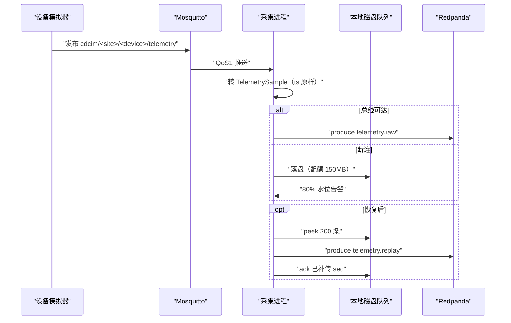

# 采集与接入实现说明（P4）

| 项 | 内容 |
|---|---|
| 文档编号 | CDCIM-P4-DD-01 |
| 版本 / 状态 | v1.0 · 未验收（编排已在本地自检，链路未在 WSL 实跑） |
| 所属阶段 | P4 工程骨架与部署 |
| 代码范围 | `core/shared/cdcim_shared/`、`core/collector/`、`core/stream/`、`core/api/`、`tools/simulator/`、`scripts/` |
| 上游依据 | [规则 DSL](../04-详细设计/09-规则引擎DSL设计.md)、[消息契约](../04-详细设计/08-消息主题与事件契约.md)、[数据库设计](../04-详细设计/01-数据库设计说明书.md)、[进程视图](../03-架构/06-进程视图.md) |

---

## 1. 这一批代码实现了什么、没有实现什么

先把边界钉死，避免把骨架当成成品。

| 链路 | P4 实现 | P4 未实现（P5） |
|---|---|---|
| 设备 → MQTT | 模拟器按 5 s / 30 s 发报文，可注入阶跃、漂移、断链 | 真实 UPS / 空调协议适配 |
| MQTT → 事件总线 | 采集进程订阅通配主题，转成 `TelemetrySample`，投 `telemetry.raw` | 协议级白名单、报文签名校验 |
| 断网缓冲 | SQLite 落盘、150 MB 配额、80% 水位告警、恢复后投 `telemetry.replay` | 多机房分别限速与优先级调度 |
| 总线 → 时序库 | 攒批 500 条 / 200 ms，按 `m_<point_id>` 懒建子表写入 | 死信重放界面、写入失败人工补偿 |
| 窗口聚合 | 60 s 滚动窗口 avg/min/max，写降采样表；聚合函数独立成模块 | 5 min / 1 h 两级、按区间重算接口 |
| 查询 | `/healthz`、`/readyz`、登录、最新值、历史（raw/1m/5m/1h） | 告警确认、联动、AI 建议等其余 40+ 接口 |
| 告警研判 | 无代码 | 规则 DSL、降噪、根因、抑制全链路 |

**其余接口的路由和权限点已在 API 中登记，返回 `CDCIM-P4-501`。** 这个错误码不在《接口文档》§5 的 26 条里，是 P4 骨架专用，P5 实现后整体删除，不留兼容分支。

---

## 2. 采集链路时序

对应需求：FR-M1-03/06、QA-AVAIL-05、`telemetry.raw` / `telemetry.replay` 两个主题契约。

---

## 3. 断网缓冲：三个不变式

`core/collector/buffer.py` 的 `DiskBuffer` 是**单进程单实例**（SQLite 写锁粒度是库），不是共享队列。

| 不变式 | 实现手段 | 违反后果 |
|---|---|---|
| 原始时间戳不偏移 | `TelemetrySample.build()` 把 `occurred_at` 与 `ts` 绑为同一值；落盘序列化后再读回逐字段比对 | 违反 FR-M1-06「偏差 0」；D-31 已否决微秒偏移方案 |
| 落盘即持久 | `PRAGMA synchronous=FULL`，`journal_mode=DELETE` | 断电后丢数据，与「断网 30 min 不丢」承诺冲突 |
| 补传不插队 | 独立 `telemetry.replay` 主题 + 独立限速组（D-41），在线事务优先 | 补传期在线 P99 被推到 5 s 以上 |

水位告警按 10% 阶梯触发，避免 80%~100% 区间每条数据都刷日志。

---

## 4. 单分区下的并发取舍

`telemetry.raw` 按消息契约只有 **1 个分区**，同一消费组内并行度上限就是 1。因此 `core/stream` 用单 worker：

- 增加 worker 不会提高吞吐，只会让空闲消费者空转、拉高 rebalance 频率；
- 并发靠协程（攒批与网络 IO 异步），隔离靠进程（采集/计算/告警分容器），并行靠消费组——但当前分区数决定后者暂时用不上；
- 阻塞型客户端（taosrest）统一走 `asyncio.to_thread`，池满就丢批次 + 计数进死信，**不反压上游**。

扩容到 4000 点时第一动作是**扩分区到 6**，不是加 worker（容量文档 §6.3）。

---

## 5. 批写与降采样

攒批条件是「500 条或 200 ms 先到者」，避免低峰期数据等到超时才入库。写入前按 `point_id` 分组，子表不存在则 `CREATE TABLE m_<point_id> USING st_metric TAGS(...)` 懒建。

聚合函数在 `core/stream/window.py` 里是**独立纯函数**，不绑在消费循环上。这样做的原因不是代码好看，而是 ADR-0007 要求「实时聚合与事后重算共用同一套函数库」——P5 的重算接口会直接 import 它。

水位线默认 60 s，另有墙钟兜底：如果设备全部停报，事件时间不再推进，最后一个窗口会永远开着，所以按 `now - 60 s` 强制推进。这是兜底，不是主路径。

---

## 6. 与设计文档的差异清单

| # | 设计文档 | P4 实现 | 原因 / P5 补什么 |
|---|---|---|---|
| 1 | 47 个 REST 接口 | 实现 5 个，其余登记路由返回 501 | P4 只验链路；P5 按接口文档逐条实现 |
| 2 | 服务端会话令牌 | 三段式占位令牌，**无签名可伪造** | P5 换 Redis opaque token，`cdcim:sess:*` |
| 3 | 三角色 19 权限点 | 权限矩阵子集内置在代码中 | P5 改从 `role_permission` 表加载 |
| 4 | 180 天查询走降采样 | 支持 raw/1m/5m/1h 路由，raw 限 7 天 | 与容量文档 v0.2 一致；P5 加重算 |
| 5 | TDengine 8000 子表 | 运行时按测点懒建，SQL 只建超级表 | D-31；避免预建 2000 张空表 |
| 6 | 告警判定消费样本流 + 窗口状态 | 无告警代码 | D-40；P5 实现 |

---

## 7. 启动自检清单

在宿主（WSL）按顺序执行，任一步失败不要继续：

1. `cd deploy && cp .env.example .env && make init-mqtt` —— 生成 mosquitto 口令文件。
2. `make build` —— 构建 collector / stream / api 三个镜像（P4 新增目标，原 compose 只有 `image`，镜像并不存在）。
3. `make config` —— 校验 compose 语法与环境变量插值。
4. `make up` —— 启动；等 `make ps` 中全部服务 healthy。
5. `make init-topics` —— 建 13 个 topic；`telemetry.raw` 必须为 **1 分区**。
6. `make init-db` —— 建 TDengine 4 库与超级表（PG 由镜像首次启动自动执行 01-postgres.sql）。
7. `python scripts/check_stack.py --base-url http://127.0.0.1:8080 --mode all`。
8. `python scripts/smoke_e2e.py --base-url http://127.0.0.1:8080`。
9. `python scripts/verify_backfill.py --base-url http://127.0.0.1:8080`。

> 步骤 7~9 的**结果未执行、未填写**，见[数据链路验证报告](03-数据链路验证报告.md)。

---

## 8. P4 落地时修正的一处跨文件不一致

三个执行 agent 分别写编排与代码，出现了接口对不齐：

| 项 | 编排侧原值 | 代码侧期望 | 修正 |
|---|---|---|---|
| 环境变量名 | `PG_DSN` / `TD_ENDPOINT` / `KAFKA_BOOTSTRAP` | `CDCIM_PG_*` / `CDCIM_TDENGINE_*` / `CDCIM_KAFKA_BOOTSTRAP_SERVERS` | compose 补 `CDCIM_` 前缀变量（保留旧名兼容） |
| MQTT 订阅 | `MQTT_TOPIC=telemetry/raw` | `cdcim/+/+/telemetry` | 改为 `CDCIM_MQTT_TOPIC_PATTERN`，默认 `cdcim/+/+/telemetry` |
| 缓冲路径 | 卷挂 `/var/lib/collector/queue` | 代码默认 `/var/lib/cdcim/buffer/...` | 环境变量指向卷内路径 |
| 健康端点 | compose 检查 8001/8002 的 `/healthz` | 两个服务没有 HTTP 端点 | 增加公共 `health.py`，在同一事件循环起极简监听 |
| 镜像来源 | 只有 `image`，无 `build` | 需要本地构建 | 补 `build` 段与 Makefile `build` 目标 |
| nginx 反代 | 无配置文件挂载 | `/api` 需转发到 api:8000 | 补 `deploy/nginx/nginx.conf` |

这类问题不通过运行很难发现；它也是「文档先行」阶段无法覆盖的——只有代码与编排面对面时才暴露。

---

## 考点映射

| 考纲知识点 | 本文件对应内容 | 论文可用位置 | 真题溯源 |
|---|---|---|---|
| 软件实现与编码 | 分层、配置集中、异常与错误码 | 论文「系统实现」段 | 2021 下 编码规范 |
| 消息队列与削峰填谷 | 单分区约束、攒批、不反压 | 论文「数据链路设计」 | 2023 下 消息中间件 |
| 容错与数据一致性 | 断网缓冲三不变式、补传独立通道 | 论文「可靠性设计」 | 2024 上 容错 |
| 设计模式 | 聚合函数独立复用（ADR-0007） | 论文「重构与复用」 | 2022 下 设计模式 |

## 论文可引用段落

> 进入实现阶段，编排与代码分别由不同小组完成，第一次合并时暴露出一个文档阶段看不到的问题：编排里写的是 `PG_DSN`、`TD_ENDPOINT` 这类简写环境变量，而代码的配置层只认统一前缀的 `CDCIM_PG_HOST`、`CDCIM_TDENGINE_HOST`。两边单独看都完整，合起来却连不上数据库。另一个问题是编排为采集和计算服务配置了 HTTP 健康探针，而这两个进程是纯消息循环，根本没有监听端口。我们没有把这些当成部署细节随手改掉，而是补了一层统一约定：所有配置只有一个入口，环境变量统一前缀，缺失在启动期就失败；健康探针用标准库起一个极小监听，只回答进程存活，不探测依赖。这件事说明，架构文档能保证组件边界正确，却不能保证跨文件的接口字面一致；实现阶段的评审重点必须从「职责对不对」转向「字段对不对」。

---

## 变更记录

| 版本 | 日期 | 变更 |
|---|---|---|
| v1.0 | 2026-11-27 | P4 骨架补齐：明确实现边界、断网三不变式、单分区并发取舍、六项设计差异、启动自检清单、跨文件不一致修正记录 |
