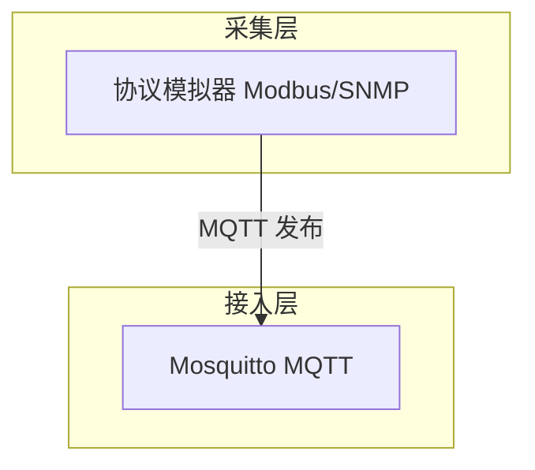

# 图表规范（Diagram & Figure Standard）

| 项 | 内容 |
|---|---|
| 文档编号 | CDCIM-SPEC-02 |
| 版本 / 状态 | v1.0 · 生效 |
| 适用范围 | `docs/` 下全部图表 |
| 上游依据 | [文档规范](01-文档规范.md) |

---

## 1. 单一源原则

**图的唯一真实来源是 Markdown 里的 Mermaid 代码块**，导出图片只是派生产物。

| 做法 | 是否允许 |
|---|---|
| 在 md 内写 Mermaid 源码 | ✅ 唯一推荐 |
| 用 drawio/Visio 画完导出图片 | ⚠️ 仅当 Mermaid 无法表达时使用，且需同时提交 `.drawio` 源文件 |
| 只有 PNG 没有源 | ❌ 禁止，无法维护 |
| 截图论文用图 | ❌ 禁止 |

**理由**：多设备同步时图片 diff 不可读、无法评审；Mermaid 源码可 review、可版本对比、可随时重生成。

---

## 2. 图类型选择

| 表达意图 | 用哪种 | Mermaid 关键字 |
|---|---|---|
| 组件关系、数据流向、部署边界 | 流程图 | `flowchart TB` / `flowchart LR` |
| 类与关系（含聚合/组合/依赖） | 类图 | `classDiagram` |
| 数据库实体关系 | E-R 图 | `erDiagram` |
| 交互时序（跨组件调用） | 时序图 | `sequenceDiagram` |
| 状态流转（告警生命周期） | 状态机 | `stateDiagram-v2` |
| 阶段排期 | 甘特图 | `gantt` |
| 占比 | 饼图 | `pie` |
| 层级分解（WBS） | 树形流程 | `flowchart TB` 手绘层级 |

**禁止使用**：`mindmap`、`journey`、`quadrantChart`（跨渲染器兼容性差，GitHub 与部分 IDE 不渲染）。象限类内容改用表格表达。

---

## 3. 编号与题注

| 类型 | 编号格式 | 示例 |
|---|---|---|
| 图 | `FIG-<阶段代码>-<序号>` | `FIG-ARCH-03` |
| 表 | `TAB-<阶段代码>-<序号>` | `TAB-SRS-02` |

阶段代码：`P0` `SRS` `ARCH` `DD` `TEST` `OPS` `THESIS`。

**题注规则**

- 图题置于图下方，格式：`**图 FIG-ARCH-03　系统部署架构**`
- 表题置于表上方，格式：`**表 TAB-SRS-02　质量属性场景清单**`
- 正文首次引用必须带编号：「如图 FIG-ARCH-03 所示」

---

## 4. Mermaid 编码约定



**硬规则**

| # | 规则 | 原因 |
|---|---|---|
| 1 | 节点 ID 用英文大写（`A1`、`SC`），标签用中文 | 中文 ID 在部分渲染器报错 |
| 2 | **中文标签一律用双引号包裹** | 括号、冒号、斜杠会截断解析 |
| 3 | 标签内不放 `(` `)` `:` `;` `#` 等特殊字符，必须表达时用中文括号「（」 | 同上 |
| 4 | `subgraph` 命名 `L1`…`L7` + 中文标签（`subgraph L1["采集层"]`） | 层次稳定、便于引用 |
| 5 | 连线上写动词：`-->|"批量写入"|` | 架构图必须体现「流向 + 做什么」 |
| 6 | 虚线 `-.->` 表示异步/旁路/可选 | 与实线主链路区分，是本项目 AI 层的关键表达 |
| 7 | 单图节点控制在 **7±2** 个主干节点 | 超过则拆图，避免论文里图看不清 |
| 8 | 方向默认 `TB`（自上而下），横向长链路用 `LR` | 论文排版纵向空间受限 |

---

## 5. 论文用图的额外要求

| 要求 | 说明 |
|---|---|
| 灰度可辨 | 论文为黑白印刷，不得仅靠颜色区分元素，需用线型（实/虚）或文字标注 |
| 字号 ≥ 8 pt（缩放后） | 导出时控制画布宽度不超过 1600 px |
| 必须有图题与一句图注 | 图注说明「这张图回答什么问题」，而不是重复图题 |
| 架构图三要素齐全 | 层次边界、数据流向、部署节点（本地/容器/外部） |
| 一张图只讲一件事 | 4+1 视图必须分图，不能合成一张大图 |
| 标注裁剪决策 | 原型与生产的差异在图上用虚线框 + 注释标出（这是加分点） |

---

## 6. 导出流程

**前置**：Node 已就绪（本机 v22.22.2）。

```bash
# 单文件导出（建议按文件粒度导出，避免逐图维护）
npx -y @mermaid-js/mermaid-cli -i docs/03-架构/01-组件映射表-v1.md -o docs/assets/FIG-ARCH-01-组件映射.svg

# 需要 PNG 时（论文插图用）
npx -y @mermaid-js/mermaid-cli -i docs/03-架构/01-组件映射表-v1.md -o docs/assets/FIG-ARCH-01-组件映射.png -w 1600 -b white
```

**命名**：`docs/assets/<图编号>-<中文名>.<svg|png>`，与图题编号一致。

**注意**

- `docs/assets/**/*.svg` 在 `.gitattributes` 中按二进制处理，避免 diff 噪音；
- 导出物与源码不一致时，以源码为准，重新导出；
- 首次导出需联网拉取 mermaid-cli，若网络受限，允许在 Mermaid Live Editor 手工导出并注明「手工导出，待脚本化」。

---

## 7. 图表评审清单

- [ ] 图有编号、有题注、正文有引用
- [ ] 在 Mermaid Live Editor 渲染通过（无语法错误）
- [ ] 中文标签全部加引号
- [ ] 连线有动词，非裸箭头堆叠
- [ ] 实线/虚线语义正确（主链路 vs 旁路）
- [ ] 节点数 ≤ 9，层次边界清晰
- [ ] 灰度下仍可区分

---

## 变更记录

| 版本 | 日期 | 变更 |
|---|---|---|
| v1.0 | 2026-11-11 | 建立图表规范 |
